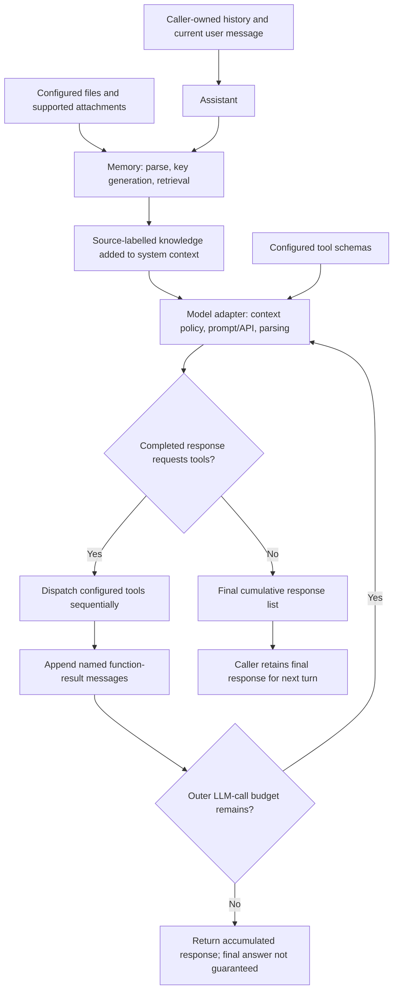
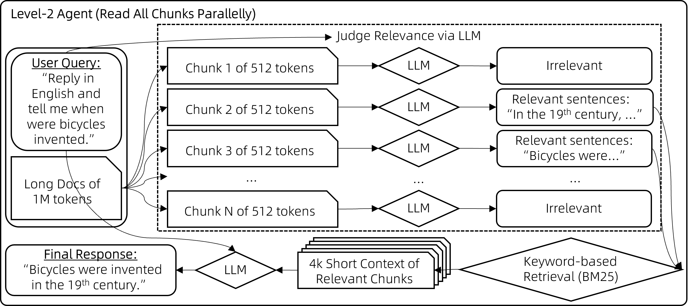
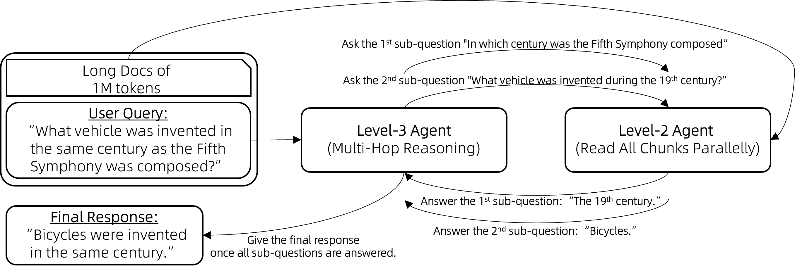
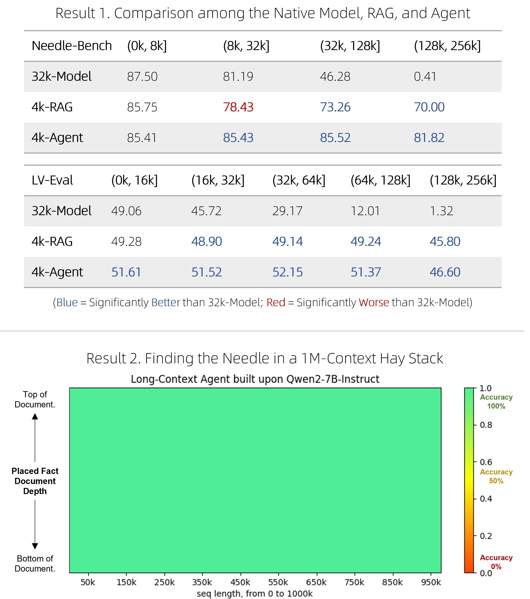

# Qwen-Agent - Qwen Team, 2023-present

> **Type:** software-framework and source review; not a model technical report
> **arXiv / venue:** no dedicated framework report identified; official repository, documentation, and technical blog
> **Affiliation:** Qwen Team, Alibaba; **Code license:** Apache-2.0
> **Project origin:** repository created 22 September 2023
> **Implementation snapshot:** [`31a4d36d123688581a9e9744427272b33ce940e0`][snapshot], 4 March 2026
> **Historical experiment:** *Generalizing an LLM from 8k to 1M Context using Qwen-Agent*,
> displayed publication date 6 June 2024; the article's supplied BibTeX instead says May 2024.

## TL;DR

Qwen-Agent supplies the application layer around a language model: message handling,
function-call prompting and parsing, a bounded model/tool loop, document retrieval,
code execution, MCP integration, and composable agents.
Its particularly instructive long-document example replaces one enormous attention
window with retrieval, parallel chunk readers, and an outer multi-hop controller.
The historical experiments show substantial gains over an undertrained extrapolated
long-context baseline, but neither these results nor the framework's name imply
that every agent has native million-token attention, persistent learned memory,
concurrent tool execution, or production-ready isolation.

## Problem & motivation

### A capable model is not yet a running agent

A model can emit a request to call a function, but something outside the model must
describe available functions, parse the request, validate arguments, execute the
operation, return its result, and decide whether to ask the model again.
Different providers also serialize tool calls and reasoning differently.
Qwen-Agent packages these responsibilities behind reusable Python interfaces,
allowing the same application structure to use hosted Qwen services or a compatible
local model endpoint. The [README][readme] describes Browser Assistant, Code
Interpreter, and Custom Assistant applications, and states that the framework
supports Qwen Chat; that last statement is a project claim, not a benchmark.

The distinction between **model capability** and **controller behavior** is essential.
The model proposes a tool name and arguments; the controller dispatches an
installed tool; the tool, not the model's text, actually accesses files, executes
code, or calls a service. Better prompts cannot substitute for correct dispatch,
permissions, result serialization, and failure handling.

### Long documents expose both retrieval and context limits

The [historical long-context article][long-blog] considers a model trained mainly
on short contexts and documents potentially containing one million tokens.
Direct extrapolation can fail because the model has not learned reliable
long-context behavior. Ordinary top-ranked retrieval avoids the huge prompt but
can miss a fact whose wording differs from the question, discard a necessary
intermediate clue, or retrieve only one part of a multi-hop answer.

The proposed alternative spends **more model calls** rather than requiring every
call to contain the entire document. This is system-level long-document access,
not a change to the transformer's positional encoding or attention architecture.
It also provides an agent that can help construct or check examples for subsequent
native long-context model training.

### Three dates, three different objects

The filename's **2023** denotes project origin, not the date of the current
implementation or the long-context experiment. The algorithmic blog is a **2024**
source, while the implementation reviewed here is pinned to **4 March 2026**.
The current blog page displays **6 June 2024**, despite its own citation block
using **May 2024**. Keeping these distinctions prevents current MCP support,
Docker execution, or Qwen3 configurations from being retroactively attributed to
the original long-context experiment.

## Key idea

### The agent is an explicit state machine around a pretrained model

Let $H_t$ be the message history available at model step $t$, $\mathcal{S}$ the
schemas of configured tools, and $Y_t$ the model's completed output message list.
An explanatory reconstruction of the default function-calling loop is:

$$
Y_t \sim p_\theta(\,\cdot \mid H_t,\mathcal{S}),
\qquad
o_{t,j}=F_{n_{t,j}}(a_{t,j}),
$$

$$
H_{t+1}
= H_t \mathbin{\Vert} Y_t
\mathbin{\Vert} [o_{t,1},\ldots,o_{t,k_t}].
$$

Here $\theta$ denotes the already trained model's parameters; $k_t$ is the number
of tool calls in $Y_t$; $n_{t,j}$ and $a_{t,j}$ are the name and arguments of call
$j$; $F_n$ is the configured implementation for tool $n$; and $\Vert$ means list
concatenation. Each observation $o_{t,j}$ is packaged as a named function-result
message. These equations describe the [implementation][fncall], not a published
training objective or numbered theorem.

When a completed model response contains no tool request, the default loop stops.
Otherwise, observations become input for the next model call. The default cap is
**20 outer-loop LLM calls per run**, configurable through
`QWEN_AGENT_MAX_LLM_CALL_PER_RUN` ([settings][settings]).
This is not a bound on all nested model calls, all individual tools, elapsed time,
or money spent.

### Long-document capacity comes from hierarchical computation

The historical method has three levels:

1. **Retrieve:** select useful chunks with sparse keyword retrieval.
2. **Read broadly:** ask small-context readers to inspect all chunks, then retrieve
   and synthesize from the evidence they identify.
3. **Reason across questions:** expose the document reader as a tool so an outer
   agent can ask successive subquestions.

The hierarchy separates *finding evidence*, *answering a local question*, and
*choosing the next question*. It can inspect a document much larger than any
individual prompt, but every filtering and summarization boundary can lose
information.

## How it works

### 1. Component map

| Component | Responsibility and important boundary |
|---|---|
| `Agent` | Normalizes input messages, applies the system instruction, owns the configured tool map, and supplies model/tool helper methods. The abstract `_run` method defines a workflow; inheriting from `Agent` alone does not create a planning loop. |
| `BaseChatModel` | Provides `chat(...)`, generation configuration, preprocessing, context truncation, streaming, and model-service integration. It bridges an application's message format and the chosen backend. |
| `BaseTool` | Describes a callable with a name, description, parameter schema, and `call(...)` implementation. A schema is an interface contract, not authorization to perform any operation the model requests. |
| `FnCallAgent` | Repeatedly generates model responses, detects function requests, executes tools, and appends observations. Multiple requested functions are supported, but this implementation invokes them sequentially. |
| `Assistant` | Adds initial file-based knowledge retrieval before entering the inherited function-call loop. Retrieval is not necessarily a model-selected action on every iteration. |
| `Memory` | Manages supplied document references, optional query/keyword generation, and retrieval. It is not automatically a durable store of all conversations or a learned memory model. |
| Specialized agents | Compose these interfaces into document QA, group conversations, and application-specific workflows. Their scheduling and termination rules must be inspected separately. |

Sources: [base agent][agent], [model base][llm-base], [tool base][tool-base],
[function-calling agent][fncall], [Assistant][assistant], and [Memory][memory].



*Original diagram reconstructed from the pinned source. Retrieval may be empty or
bypassed with explicitly supplied knowledge; it is shown as a preprocessing phase,
not as an obligatory tool invocation inside every loop.*

### 2. Messages, multimodal content, and streaming

The [schema][schema] defines `Message` with `role`, `content`, optional
`reasoning_content`, `name`, `function_call`, and `extra`.
The internal role constants include `system`, `user`, `assistant`, and `function`.
A `FunctionCall` contains a `name` and an **argument string**.
Do not assume the framework's internal messages are identical to the JSON expected
by every OpenAI-compatible provider; adapters handle that boundary.

Content can be a string or a list of typed `ContentItem` objects.
An item carries exactly one modality: text, image, file, audio, or video.
This represents multimodal input/output; it does not make a text-only backend
capable of understanding images or audio.

`Agent.run(messages)` deep-copies and normalizes its input and yields lists of
response messages. With all-dictionary input it returns dictionaries; otherwise
the response uses `Message` objects.
Crucially, these are **cumulative response snapshots**, not independent deltas:
while a model response streams, the agent yields completed prior outputs plus
the latest partial response. Completed tool results are then added to that list.

An application should render the latest snapshot and append the **final list once**
to its retained conversation history. Appending every yielded list would duplicate
partial responses and tool observations. `run_nonstream(...)` simply consumes
`run(...)` and returns its last response list; it is an agent-level convenience,
not a promise to disable streaming in the provider API.
These behaviors follow [the agent wrapper][agent] and [the loop][fncall].

### 3. Exact function-call execution and termination

The default `FnCallAgent` proceeds as follows:

1. Copy the working message history and initialize the outer LLM-call allowance.
2. Decrement that allowance and call the model with the configured tool schemas.
3. Yield cumulative snapshots while the response is generated.
4. Append the completed model output to both working history and response history.
5. Inspect each output message for `function_call`.
6. For every detected call, dispatch its configured implementation, append a
   `function` result with its tool name and function identifier, and yield again.
7. Stop if the model requested no tool; otherwise continue while allowance remains.
8. Yield the accumulated response when the loop ends.

The Python `for` loop in step 6 is **sequential**. A backend can produce several
function requests in one generation, sometimes called "parallel function calling,"
without the controller actually running their implementations concurrently.
By contrast, the specialized parallel document reader described below uses a
thread-pool executor.

Cap exhaustion does not synthesize a special successful answer or a distinct
terminal error record. A run can therefore end after a function result without a
natural-language conclusion. Applications needing reliable completion semantics
must track termination and task success themselves. Retried provider requests,
Memory's keyword generation, and nested agents also require separate accounting.

Error behavior is similarly specific, rather than uniformly "raise everything":
an unknown tool produces an error string; `ToolServiceError` and `DocParserError`
are re-raised; other tool exceptions are logged and converted into text returned
to the model. String results pass through, lists of `ContentItem` can remain
multimodal, and other results are JSON-serialized ([dispatch implementation][agent]).
An error observation enables recovery, but is not evidence that recovery succeeded.

### 4. Tools and argument validation

A custom tool subclasses `BaseTool`, declares its description and parameter
schema, and implements `call`.
`@register_tool` permits subsequent construction by registered name or configuration;
passing an instance directly avoids the registration requirement.
The agent's configured tool map limits dispatch to installed tools, not arbitrary
Python functions.

The base class checks the *definition* of dictionary-style schemas.
Its `_verify_json_format_args(...)` helper parses argument strings and validates
dictionary-style parameters with `jsonschema`; the older list-style parameter
format checks required names rather than enforcing an equally rich schema.
Importantly, a custom `call` implementation must actually invoke the helper or
perform equivalent validation. Inheriting `BaseTool` does not automatically validate
every invocation before user code executes ([tool source][tool-base]).

For example, the following illustrates an ordinary numeric tool and correct
history handling. It assumes the package is installed and a compatible local
endpoint is already serving the exact configured model name; it is not a complete
server deployment recipe.

```python
import json

from qwen_agent.agents import Assistant
from qwen_agent.tools.base import BaseTool


class Add(BaseTool):
    name = "add"
    description = "Add two numbers."
    parameters = {
        "type": "object",
        "properties": {
            "a": {"type": "number"},
            "b": {"type": "number"},
        },
        "required": ["a", "b"],
    }

    def call(self, params, **kwargs):
        args = self._verify_json_format_args(params)
        return json.dumps({"sum": args["a"] + args["b"]})


bot = Assistant(
    llm={
        "model": "qwen3-8b",
        "model_server": "http://localhost:8000/v1",
        "api_key": "EMPTY",
        "generate_cfg": {"max_input_tokens": 8192},
    },
    function_list=[Add()],
)
messages = [{"role": "user", "content": "Use the add tool for 17 plus 25."}]
response = None
for response in bot.run(messages=messages):
    print(response)
if response is None:
    raise RuntimeError("The agent produced no response snapshot.")
messages.extend(response)
```

`EMPTY` is a placeholder for an unauthenticated local server, not a hosted API key.
Schema validity does not establish that the model will select the intended tool,
nor that the selected backend's tool parser has been configured correctly.
For a one-shot application, `bot.run_nonstream(messages=messages)` is the shorter
way to obtain the final response list.

### 5. Model adapters, reasoning fields, and context management

The [README][readme] supports DashScope and OpenAI-compatible endpoints, including
locally served models. A typical hosted configuration uses `DASHSCOPE_API_KEY`;
local deployments need a running model server and matching model identifier.
Installation separates the minimal package from optional extras:
`qwen-agent[gui,rag,code_interpreter,mcp]`.
The extras install Python dependencies; they do not themselves provision a model
server, Docker service, or external MCP executable.

Tool parsing is **model- and backend-dependent**:

- For the documented Qwen3/QwQ local-serving route, the README recommends letting
  Qwen-Agent handle function-call parsing rather than also enabling vLLM's
  `--enable-auto-tool-choice --tool-call-parser hermes` route.
- For Qwen3-Coder, the README instead recommends server-native tool parsing with
  those flags and `generate_cfg.use_raw_api=True`.
- The current default function-call prompt template is described as **Nous**.
  `thought_in_content` controls whether reasoning is folded into content; its
  documented default is false, leaving reasoning in `reasoning_content`.

These are not interchangeable global recipes. Combining both parsing layers or
copying a model-specific template onto a different model can change behavior.
In the pinned [model base][llm-base], raw API mode requires full streaming:
`stream=True`, `delta_stream=False`. Delta streaming is deprecated there.

The context policy triggers at `max_input_tokens`.
The global input-policy default is **58000**, not a declaration that all supported
models have a 58000-token native window ([settings][settings]).
The [context guide][context-guide] describes progressively dropping old turns,
folding old tool results, removing intermediate steps, reducing recent results,
and finally truncating user/assistant content.

The implementation makes an important qualification: "folding" here includes
**head/tail text truncation or replacement with `omit`**, not a guaranteed
LLM-written semantic summary. The source preserves the system message, budgets
the remaining turns using approximate text-token accounting, and raises a model
service error if the system instruction consumes the available allowance.
Multimodal accounting and serialized prompt overhead still require backend-aware
configuration. Budget input, output reserve, tool schemas, and modality tokens
against the actual model limit rather than trusting this heuristic as an exact
provider-token guarantee.

Thus, the guide's "effectively unlimited context" means an ongoing conversation
can be shortened to keep operating. It does **not** mean all prior evidence remains
available, losslessly compressed, or equally influential.

### 6. Assistant retrieval and the actual meaning of Memory

Before entering its model/tool loop, `Assistant` asks `Memory` for knowledge unless
nonempty knowledge has already been supplied. Memory combines configured files
with supported attachments, deduplicates references, and ordinarily uses the last
user message as the query. Without documents it supplies no knowledge.
With a suitable LLM it can generate retrieval keywords; otherwise it searches
using the original query ([Assistant][assistant], [Memory][memory]).

For model names containing QwQ, QVQ, or Qwen3, `FnCallAgent` has a further
backend-specific choice: with DashScope it configures `qwen-turbo` for Memory,
with a 30000-token input policy; with other backends it passes no keyword-generation
LLM. Other model configurations generally reuse the agent's LLM.
Consequently, a locally served Qwen3 assistant does not necessarily perform the
same keyword-generation calls as a DashScope assistant with the same documents.

The retrieval pipeline is:

1. **Parse:** `DocParser` invokes document extraction and produces records with
   source URL/path, title, and chunks containing text, token counts, and metadata.
   The supported formats documented include PDF, Office documents, text, tabular
   files, and HTML. Availability depends on the RAG dependencies and parser.
2. **Chunk/cache:** larger documents are split using paragraph/sentence boundaries
   and carried-over trailing text. The target chunk size is configurable rather
   than an invariant exact number of tokens. A document small enough for the
   reference allowance may remain one chunk. Chunked-cache keys incorporate a
   SHA-256 hash of the URL/path string and chunk-size setting, so a cache entry is
   not proof that a changing source has been revalidated.
3. **Retrieve:** if all material fits the reference allowance, the search base
   returns all of it. Otherwise, the default search configuration combines
   `keyword_search` with `front_page_search`.
4. **Budget and order:** select chunks by retrieval priority until the allowance
   is exhausted, truncating a final chunk if needed. Selected text is returned
   grouped by document and in original chunk order, not simply as a descending
   relevance-score transcript.
5. **Inject:** Assistant formats source-labelled snippets into its system context
   before ordinary generation and tool execution.

Sources: [parser][parser], [retrieval wrapper][retrieval], [search base][base-search],
[keyword search][keyword-search], and [knowledge formatting][assistant].
Source labels support provenance, but do not guarantee that generated citations
are correct or that retrieved text is isolated from instruction following.

### 7. Sparse retrieval, rank fusion, and pinned defaults

`KeywordSearch` constructs `rank_bm25.BM25Okapi` over chunk keyword sequences.
The keyword utilities handle Chinese/English tokenization and structured generated
keyword fields; there is no requirement to deploy an embedding model for this
default route. Standalone keyword search falls back to front portions when the
query supplies no usable keywords or its best BM25 score is zero.

The default **HybridSearch** is not automatically dense-plus-sparse retrieval.
It fuses configured ranked lists with the following source-equivalent score:

$$
s(c)=\sum_{r:\,c\in L_r}\frac{1}{60+\operatorname{rank}_r(c)}.
$$

Here $c$ is a chunk, $L_r$ is searcher $r$'s ranked list, and
$\operatorname{rank}_r(c)$ starts at one.
The implementation also has an explicit positive-infinity override:
for a **single document**, `front_page_search` promotes up to its first **two**
chunks when the reference budget is sufficiently large relative to their sizes.
It returns no such list for multiple documents.
This front-matter heuristic can preserve useful introductory material, but is not
a learned relevance judgment ([fusion][hybrid-search], [front-page search][front-search]).

The base selection approximately enforces a reference-text budget:

$$
\sum_{c\in\mathcal{R}}\ell(c)\leq B_{\mathrm{ref}},
$$

where $\mathcal{R}$ is the selected material, $\ell(c)$ its counted token length,
and $B_{\mathrm{ref}}$ the reference allowance; the final chunk can be shortened.
This is a budget on retrieved text, not on the complete serialized model request.

| Setting | Pinned default | Meaning |
|---|---|---|
| `max_ref_token` | 20000 | Reference-material allowance, controlled globally by `QWEN_AGENT_DEFAULT_MAX_REF_TOKEN`. |
| `parser_page_size` | 500 | Target chunk size for ordinary RAG, controlled by `QWEN_AGENT_DEFAULT_PARSER_PAGE_SIZE`. |
| `rag_keygen_strategy` | `GenKeyword` | Global default from `QWEN_AGENT_DEFAULT_RAG_KEYGEN_STRATEGY`; a no-LLM path disables LLM key generation. |
| `rag_searchers` | `['keyword_search', 'front_page_search']` | Default hybrid searcher list; environment/configuration can replace it. |
| `max_input_tokens` | 58000 | Global model-input truncation policy; must be adapted to the selected backend/model. |
| Outer LLM calls per run | 20 | `FnCallAgent` loop allowance, not a whole-application compute budget. |

These defaults come from the pinned [settings source][settings].
The [RAG guide][rag-guide] calls `SplitQueryThenGenKeyword` the default, while the
implementation setting is `GenKeyword`; Memory's constructor documentation also
contains an older 4000-token reference example. Treat these as documentation drift,
not simultaneous runtime defaults. The historical 512-token chunk illustration
is a third, experimental setting rather than today's ordinary RAG default.

### 8. Historical Level 1: make the retrieval query informational

The [2024 article][long-blog] first splits a question into an informational need
and response instructions. For example, a request to answer in English should not
make "English" the main retrieval target when the actual question concerns the
invention of a vehicle.
It generates multilingual search terms for the informational component, performs
BM25 retrieval over short chunks, and constructs an answer from the selected text.

The article uses approximately **512-token** chunks as an example and describes
8K-context readers in its general method discussion. Its benchmark configuration
uses **4K per model call**, as detailed in Results.
The authors report that embedding retrieval did not justify its extra deployment
complexity in these experiments. This is an empirical engineering choice in that
setup, not evidence that sparse retrieval universally dominates embeddings.

### 9. Historical Level 2: read every chunk before final retrieval

Level 2 addresses the fact that a query's initial keywords may not resemble the
needed passage:

1. Split the document into small chunks.
2. Ask a reader model to identify relevant sentences in each chunk, or return
   no relevant content.
3. Run those independent reader requests in parallel.
4. Use the retained evidence as a richer retrieval query.
5. Retrieve a bounded set of original chunks with BM25 and synthesize an answer.



*Official historical method figure from the [long-context article][long-blog].
The diagram distinguishes broad parallel inspection from the small final answer
context. Its illustrative 512-token chunks and 4K synthesis prompt are not global
framework defaults. The downloaded figure is composited on white for readability.*

The pinned [`ParallelDocQA`][parallel-qa] implements a related, but not identical,
configuration. It parses **1000-token** reader chunks, calls a member agent per
chunk through `parallel_exec`, restores results to chunk order, filters no-answer
responses, generates retrieval keywords, and summarizes from retrieved material.
Its second-pass retrieval uses **300-token** chunks and a **4500-token** reference
allowance with keyword search alone. A no-useful-member-response path can repeat
the parallel reading pass up to **four** attempts.
The [executor][parallel-executor] uses `ThreadPoolExecutor`; this is genuine
concurrent scheduling, unlike the default function-call dispatch loop.

Do not use these 2026 source constants as the missing experimental configuration
for the 2024 scores. Similarly, this class's attachment extraction and its parsing
workflow should not be assumed identical to ordinary Assistant's Memory path.

### 10. Historical Level 3: turn document QA into a callable subagent

Some questions require an intermediate answer before the useful search query can
even be formulated. Level 3 exposes the Level-2 reader as a tool to an outer
function-calling/ReAct-style controller.
The outer agent asks a first question, receives an answer, uses it to form another
question, and eventually synthesizes the final response.



*Official historical figure from the [long-context article][long-blog].
The first answer supplies a century, which makes the second question about a
vehicle's invention searchable. The important mechanism is dependent subquestions,
not simply requesting all tool calls in one batch. White-background rendering.*

A simple cost reconstruction makes the trade-off explicit. For document length
$N$ and nominal reader chunk size $C$, the number of readers is approximately
$m=\lceil N/C\rceil$. For $h$ outer questions:

$$
\text{reader calls}\approx hm,
\qquad
\text{reader input tokens}\approx hN+hmP,
$$

where $P$ is per-reader prompt/question overhead. This excludes overlap, retries,
retrieval-key generation, synthesis, and outer-controller calls.
With an illustrative $N=1000000$ and $C=512$, a single pass needs approximately
**1954 reader calls**, not one million-token call.
Parallelism can reduce wall-clock latency subject to worker limits, quotas, and
server capacity; it does not eliminate billed tokens or total work.
Multi-hop questioning can repeat the scan and propagate an early incorrect answer.

### 11. MCP, code execution, and multi-agent composition

**MCP integration.** A `mcpServers` configuration can describe a local
`command`/`args` server or a remote URL. The pinned [MCP implementation][mcp]
supports stdio, SSE, and streamable HTTP, initializes sessions, discovers tool
schemas, and wraps them as tools available to the agent.
The manager runs an asyncio event loop in a background thread; the synchronous
tool wrapper waits for the submitted coroutine's result.
Persistent clients, reconnection, and shutdown are integration responsibilities,
not an implication that every individual tool call starts a fresh server.
The server's own authentication and authorization determine its capabilities;
MCP discovery is not a permission boundary by itself.

**Code interpreter.** The current [implementation][code-interpreter] launches a
Docker-hosted Python/IPython kernel, mounts the selected working directory into
`/workspace`, and reuses kernel state across calls for the same interpreter
instance/process. It builds or reuses the configured image and returns captured
execution output and supported generated media. The `call` signature has a
**30-second** default execution timeout, distinct from the LLM-loop cap.
Files copied into the working directory are available to the interpreter.

This is materially different from the README's historical warning about an
**unsandboxed local Python executor** used by the Qwen2.5-Math example.
Conversely, Docker is only a basic isolation layer: the source mounts a writable
workspace and publishes kernel ports, and the launch command does not itself
establish a complete production network/resource policy.
Do not infer safe execution of arbitrary hostile code, a read-only filesystem,
network denial, or tenant isolation from the word "sandbox."
This is an execution-boundary description, not a security audit.

**Agent composition.** Custom workflows can call other agents while giving each
its own prompt, model, tools, and files.
[`GroupChat`][group-chat] coordinates speakers using `manual`, `round_robin`,
`random`, or `auto` selection, including a human participant path.
Its `_run` default is **three rounds**. It is a speaker-coordination workflow,
not an automatic guarantee of parallel workers or better factual accuracy.
The optional Gradio `WebUI` supplies an application interface; neither the UI nor
the basic Assistant loop should be mistaken for a universal approval, persistence,
or authorization service.

## Training / data

### The framework does not train a new foundation model

Qwen-Agent composes already trained models, prompts, tools, retrieval code, and
application control flow. There is no single framework-wide pretraining corpus,
parameter count, loss function, optimizer, learning-rate schedule, GPU budget, or
new checkpoint to report.
Those quantities belong to the selected underlying model and its own technical
report, such as [Qwen2](backbone_2024_qwen2.md) or
[Qwen3](backbone_2025_qwen3.md).
Changing the backend can change reasoning, tool-call reliability, latency, context
capacity, and supported modalities without changing the framework's basic API.

### The historical agent-to-training-data workflow

The [long-context article][long-blog] proposes a broader three-step strategy:
first build a stronger document-processing agent from a short-context chat model;
then collect or validate long-document examples with that agent; finally fine-tune
a model to answer natively with long contexts.
The article concentrates on the **first** step.
It suggests recording human interactions with agents and cross-checking examples
generated by other methods, but does not supply a complete reproducible dataset,
distillation loss, optimizer, or compute recipe for the final native model.

For conceptual clarity, ordinary supervised distillation could minimize an
answer-token negative log-likelihood on agent-produced examples, but no particular
such objective should be attributed to this framework review as a reported
experiment. The substantial source-backed point is the use of **agent computation
as a data teacher**, not a newly specified training algorithm.
The later [Qwen2.5-1M report](backbone_2025_qwen2.5-1m.md) describes its own concrete
long-context data pipeline and should be read separately.

### Reproduction needs more than a repository commit

Reproducing behavior requires the model/checkpoint or dated service, prompt and
parser configuration, document versions, retrieval settings, tool versions,
execution environment, and decoding parameters.
Hosted aliases can change independently of the pinned framework.
The current project also links application demonstrations and a separate
DeepPlanning benchmark; those are not a replacement for a frozen protocol for the
historical long-document results.

## Results

### Historical setup and provenance

The quantitative results below are transcribed from **Result 1** of the
[official long-context article's figure][results-original], not measured anew with
the 2026 implementation.
The article compares three systems using the same **7B chat model**:

| System | Configuration in the historical article |
|---|---|
| 32k-Model | Mainly trained on 8K-context examples with some 32K examples, then extended to 256K through a training-free extrapolation method. It is not a fully trained contemporary 256K baseline. |
| 4k-RAG | The same model with Level-1 retrieval and a 4K model context. It selects a small portion instead of directly attending to the complete document. |
| 4k-Agent | The same model with the more advanced agent strategy, using only a 4K model context on each call. Its larger effective document access comes from repeated computation. |

NeedleBench and LV-Eval include documents up to **256K** in this comparison.
The authors **modify LV-Eval's metric** because the original rejects too many
valid answers; these scores must not be presented as directly comparable to the
original official LV-Eval leaderboard.

### NeedleBench: all reported length bins

Every score in this table is from the official figure's **Result 1, Needle-Bench**
panel. Length-bin notation follows the source; higher is better.

| System | (0K, 8K] | (8K, 32K] | (32K, 128K] | (128K, 256K] |
|---|---:|---:|---:|---:|
| 32k-Model | 87.50 | 81.19 | 46.28 | 0.41 |
| 4k-RAG | 85.75 | 78.43 | 73.26 | 70.00 |
| 4k-Agent | 85.41 | 85.43 | 85.52 | 81.82 |

The advanced agent is **not best in every bin**: at the shortest lengths,
85.41 is below both 87.50 and 85.75.
At the longest lengths, however, it exceeds RAG by **11.82 score points** and the
extrapolated model by **81.41 points**.
The evidence supports improved long-document robustness in this setup, not an
unqualified claim that agents always outperform direct model inference.
The article's prose says the agent "consistently" wins; the actual shortest-bin
values qualify that wording.

### LV-Eval with the authors' modified metric

Every score below is from the same figure's **Result 1, LV-Eval** panel.

| System | (0K, 16K] | (16K, 32K] | (32K, 64K] | (64K, 128K] | (128K, 256K] |
|---|---:|---:|---:|---:|---:|
| 32k-Model | 49.06 | 45.72 | 29.17 | 12.01 | 1.32 |
| 4k-RAG | 49.28 | 48.90 | 49.14 | 49.24 | 45.80 |
| 4k-Agent | 51.61 | 51.52 | 52.15 | 51.37 | 46.60 |

Here the advanced agent leads in every displayed bin.
Its longest-bin advantage over ordinary RAG is only **0.80 points**, whereas its
advantage over the extrapolated model is **45.28 points**.
This distinction matters: most of the longest-bin gain over that model is already
obtained by retrieval, with a much smaller incremental improvement from advanced
agent processing on this benchmark.
These point differences are arithmetic derived from the source values, not
additional experimental measurements.



*Official [results figure][results-original], composited on white without changing
its values. The upper panels contain the numerical results transcribed above.
The lower panel is labelled Qwen2-7B-Instruct and displays an all-green
million-token needle-retrieval grid; it is a separate pressure test, not the
256K benchmark table.*

### What the million-token test does and does not establish

The article says the agent successfully operates in a **1M-token single-needle**
pressure test. The supplied heatmap shows the successful region using an accuracy
color scale, but the article does not provide a complete trial-count and
aggregation protocol establishing a general-purpose "100% at 1M" benchmark result.
The authors explicitly state that they lack a reliable quantitative benchmark for
real-world million-token understanding.

Finding one planted fact is weaker evidence than synthesizing contradictory
sources, exhaustively enumerating distributed facts, or executing a long sequence
of dependent decisions. It also says nothing by itself about cost or latency.
No numerical end-to-end speedup, framework-wide success rate, or current
MCP/code-interpreter benchmark is inferred from this figure.

## Limitations & follow-ups

### Reliability is bounded by the whole pipeline

- **Evidence can disappear at several stages.** Parsing can miss layout or tables;
  keyword retrieval can miss paraphrases; chunk readers can reject relevant text;
  final synthesis can ignore a necessary qualification. Inspecting all chunks
  improves coverage, but does not make the reader's judgments exhaustive.
- **Multi-hop errors compound.** A wrong intermediate answer can direct the next
  document query toward the wrong evidence. A fluent final answer is not a proof
  that each tool result was interpreted correctly.
- **Compute can dominate.** Broad reading, retries, and repeated hops multiply
  requests. Default outer-loop caps do not bound nested agents or tool duration;
  concurrency must respect provider quotas and deployment capacity.
- **Context management is lossy.** Truncation permits continued operation but can
  remove old requirements, evidence, and function observations. Document Memory
  does not replace explicit application-level conversation storage.
- **Schemas and execution need independent controls.** Custom tools must validate
  inputs; external services need their own permissions; executing code requires a
  deployment-specific isolation policy. The basic model/tool loop does not supply
  a general human-approval transaction around every side effect.
- **Source labels are not instruction isolation.** Assistant inserts retrieved
  snippets into system context. Applications must treat document contents as
  untrusted evidence rather than assuming this placement makes them safe or true.
- **Historical scores are not current framework guarantees.** The baseline's
  undertraining, the modified LV-Eval metric, missing cost information, and
  incomplete million-token protocol constrain the result's generality.
- **Documentation and software evolve separately.** Keyword-generation defaults,
  tool-result typing, context "folding," and code execution are examples where
  a guide or old demo alone is insufficient to reconstruct the pinned behavior.

### Useful related reading

[Qwen2.5-1M](backbone_2025_qwen2.5-1m.md) studies native long-context models and
agent-assisted data construction rather than merely extending an application's
document access.
[Qwen2.5-Math](math_2024_qwen2.5-math.md) explains tool-integrated mathematical
reasoning; its historical Python-execution demo should not be confused with the
current Docker interpreter.
[Qwen3](backbone_2025_qwen3.md) supplies the reasoning/non-reasoning model context
behind several current parsing examples.
[Qwen3-VL](multimodal_2025_qwen3-vl.md) adds visual and agentic model capabilities,
while [Qwen3-Embedding](backbone_2025_qwen3-embedding.md) offers embedding/reranking
models that are distinct from this framework's default sparse retrieval.

## Links

- **Code:** [official Qwen-Agent repository](https://github.com/QwenLM/Qwen-Agent)
  / [reviewed source snapshot][snapshot] / [pinned README][readme].
- **Project documentation:** [official site](https://qwenlm.github.io/Qwen-Agent/en/).
- **Historical technical article:** [Generalizing an LLM from 8k to 1M Context using Qwen-Agent][long-blog].
  Displayed date: 6 June 2024; supplied BibTeX month: May.
- **Essential figure sources:** [Level 2][level2-original] / [Level 3][level3-original]
  / [benchmark and million-token panels][results-original].
- **Core implementation:** [Agent][agent] / [message schema][schema]
  / [model base][llm-base] / [tools][tool-base] / [FnCallAgent][fncall]
  / [Assistant][assistant] / [Memory][memory] / [settings][settings].
- **Retrieval implementation:** [parser][parser] / [retrieval tool][retrieval]
  / [base search][base-search] / [BM25 keyword search][keyword-search]
  / [hybrid rank fusion][hybrid-search] / [front-matter heuristic][front-search].
- **Specialized integrations:** [parallel document QA][parallel-qa]
  / [parallel executor][parallel-executor] / [MCP][mcp]
  / [Docker code interpreter][code-interpreter] / [group chat][group-chat].
- **Pinned guides:** [context management][context-guide] / [RAG][rag-guide].
- **arXiv / OpenReview / venue:** not applicable to this framework review.
- **Hugging Face:** no single framework checkpoint; use the selected model's own
  model card and report.
- **Talks / videos / Papers with Code:** no separate source used for this review.
- **Related local reviews:** [Qwen2](backbone_2024_qwen2.md)
  / [Qwen2.5-1M](backbone_2025_qwen2.5-1m.md)
  / [Qwen2.5-Math](math_2024_qwen2.5-math.md)
  / [Qwen3](backbone_2025_qwen3.md)
  / [Qwen3-VL](multimodal_2025_qwen3-vl.md)
  / [Qwen3-Embedding](backbone_2025_qwen3-embedding.md).

**Software citation** (an explicit source-snapshot citation, not a fabricated paper):

```bibtex
@misc{qwen_agent_snapshot,
  author       = {{Qwen Team}},
  title        = {{Qwen-Agent}},
  year         = {2026},
  howpublished = {GitHub software repository},
  url          = {https://github.com/QwenLM/Qwen-Agent/tree/31a4d36d123688581a9e9744427272b33ce940e0},
  note         = {Project created in 2023; source snapshot dated 4 March 2026,
                  commit 31a4d36d123688581a9e9744427272b33ce940e0}
}
```

[snapshot]: https://github.com/QwenLM/Qwen-Agent/tree/31a4d36d123688581a9e9744427272b33ce940e0
[readme]: https://github.com/QwenLM/Qwen-Agent/blob/31a4d36d123688581a9e9744427272b33ce940e0/README.md
[agent]: https://github.com/QwenLM/Qwen-Agent/blob/31a4d36d123688581a9e9744427272b33ce940e0/qwen_agent/agent.py
[schema]: https://github.com/QwenLM/Qwen-Agent/blob/31a4d36d123688581a9e9744427272b33ce940e0/qwen_agent/llm/schema.py
[llm-base]: https://github.com/QwenLM/Qwen-Agent/blob/31a4d36d123688581a9e9744427272b33ce940e0/qwen_agent/llm/base.py
[tool-base]: https://github.com/QwenLM/Qwen-Agent/blob/31a4d36d123688581a9e9744427272b33ce940e0/qwen_agent/tools/base.py
[fncall]: https://github.com/QwenLM/Qwen-Agent/blob/31a4d36d123688581a9e9744427272b33ce940e0/qwen_agent/agents/fncall_agent.py
[assistant]: https://github.com/QwenLM/Qwen-Agent/blob/31a4d36d123688581a9e9744427272b33ce940e0/qwen_agent/agents/assistant.py
[memory]: https://github.com/QwenLM/Qwen-Agent/blob/31a4d36d123688581a9e9744427272b33ce940e0/qwen_agent/memory/memory.py
[settings]: https://github.com/QwenLM/Qwen-Agent/blob/31a4d36d123688581a9e9744427272b33ce940e0/qwen_agent/settings.py
[parser]: https://github.com/QwenLM/Qwen-Agent/blob/31a4d36d123688581a9e9744427272b33ce940e0/qwen_agent/tools/doc_parser.py
[retrieval]: https://github.com/QwenLM/Qwen-Agent/blob/31a4d36d123688581a9e9744427272b33ce940e0/qwen_agent/tools/retrieval.py
[base-search]: https://github.com/QwenLM/Qwen-Agent/blob/31a4d36d123688581a9e9744427272b33ce940e0/qwen_agent/tools/search_tools/base_search.py
[keyword-search]: https://github.com/QwenLM/Qwen-Agent/blob/31a4d36d123688581a9e9744427272b33ce940e0/qwen_agent/tools/search_tools/keyword_search.py
[hybrid-search]: https://github.com/QwenLM/Qwen-Agent/blob/31a4d36d123688581a9e9744427272b33ce940e0/qwen_agent/tools/search_tools/hybrid_search.py
[front-search]: https://github.com/QwenLM/Qwen-Agent/blob/31a4d36d123688581a9e9744427272b33ce940e0/qwen_agent/tools/search_tools/front_page_search.py
[parallel-qa]: https://github.com/QwenLM/Qwen-Agent/blob/31a4d36d123688581a9e9744427272b33ce940e0/qwen_agent/agents/doc_qa/parallel_doc_qa.py
[parallel-executor]: https://github.com/QwenLM/Qwen-Agent/blob/31a4d36d123688581a9e9744427272b33ce940e0/qwen_agent/utils/parallel_executor.py
[mcp]: https://github.com/QwenLM/Qwen-Agent/blob/31a4d36d123688581a9e9744427272b33ce940e0/qwen_agent/tools/mcp_manager.py
[code-interpreter]: https://github.com/QwenLM/Qwen-Agent/blob/31a4d36d123688581a9e9744427272b33ce940e0/qwen_agent/tools/code_interpreter.py
[group-chat]: https://github.com/QwenLM/Qwen-Agent/blob/31a4d36d123688581a9e9744427272b33ce940e0/qwen_agent/agents/group_chat.py
[context-guide]: https://github.com/QwenLM/Qwen-Agent/blob/31a4d36d123688581a9e9744427272b33ce940e0/qwen-agent-docs/website/content/en/guide/core_moduls/context.md
[rag-guide]: https://github.com/QwenLM/Qwen-Agent/blob/31a4d36d123688581a9e9744427272b33ce940e0/qwen-agent-docs/website/content/en/guide/core_moduls/rag.md
[long-blog]: https://qwenlm.github.io/blog/qwen-agent-2405/
[level2-original]: https://qianwen-res.oss-cn-beijing.aliyuncs.com/assets/qwen_agent/qwen-agent-2405-lv2-agent.png
[level3-original]: https://qianwen-res.oss-cn-beijing.aliyuncs.com/assets/qwen_agent/qwen-agent-2405-lv3-agent.png
[results-original]: https://qianwen-res.oss-cn-beijing.aliyuncs.com/assets/qwen_agent/qwen-agent-2405-blog-long-context-results.png
