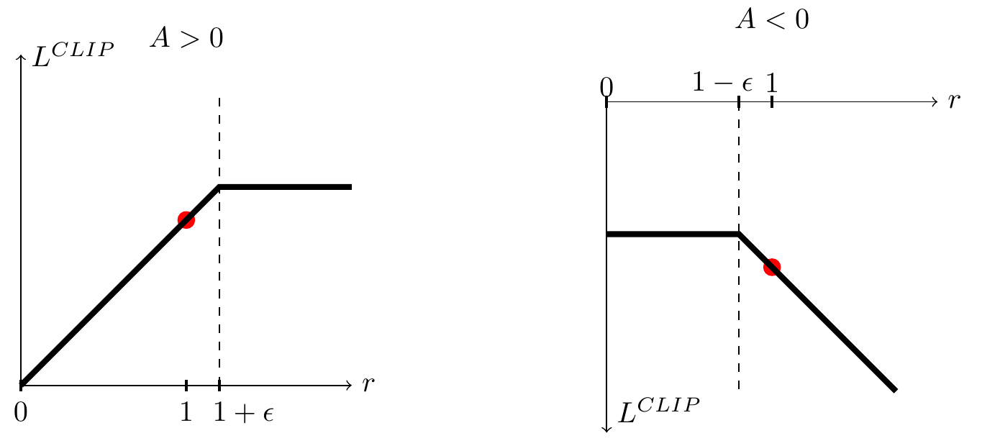
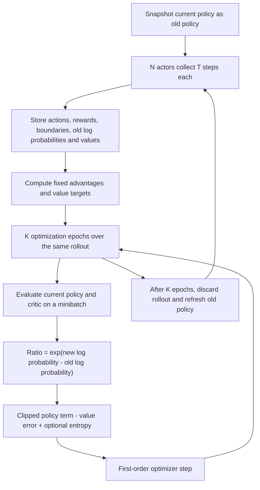
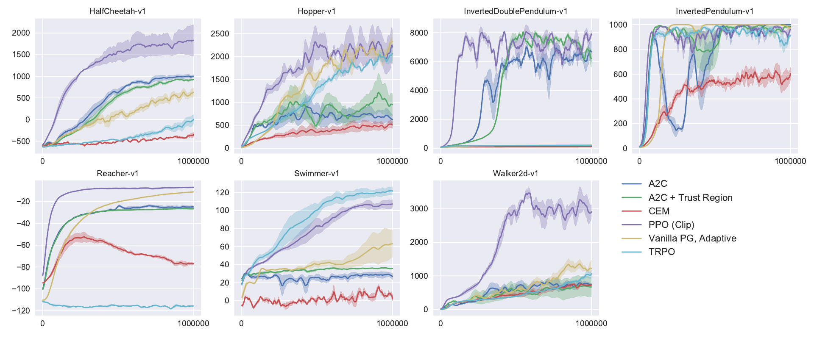
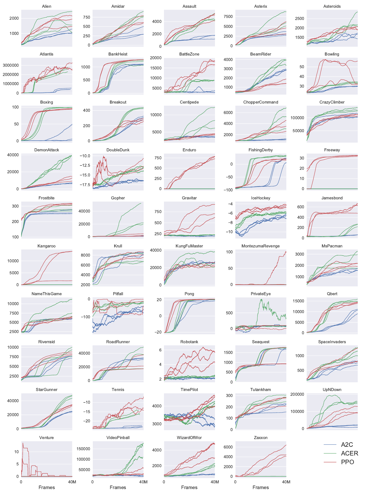

# Proximal Policy Optimization (PPO) -- Schulman et al., 2017

> **arXiv:** [1707.06347v2](https://arxiv.org/abs/1707.06347v2), 28 August 2017; first submitted 20 July 2017.
> **Venue:** preprint. **Affiliation:** OpenAI.
> **Authors:** John Schulman, Filip Wolski, Prafulla Dhariwal, Alec Radford, and Oleg Klimov.
> **Scope:** The original PPO paper, including both clipped and adaptive-KL variants, all numerical result tables, and Appendix A's task-specific training settings. Later implementation conventions are identified separately.

## TL;DR

Proximal Policy Optimization makes several minibatch optimization passes over a freshly collected on-policy rollout, using a surrogate objective designed to discourage excessively large policy updates. Its best-performing variant clips the **incentive to improve a sampled action's probability ratio**, rather than imposing a hard constraint on the policy or its KL divergence. In the paper's experiments, clipped PPO is strong on continuous control and wins more Atari games on learning speed than A2C or ACER, although ACER wins more games on final performance. The contribution is a practical first-order policy optimizer, not a reward model, a general off-policy replay algorithm, or a proof that every update improves true return.

## Problem & motivation

### Why not simply take more policy-gradient steps?

A stochastic policy $\pi_\theta(a\mid s)$ selects an action $a$ in state $s$, with trainable parameters $\theta$. Interacting with the environment produces rewards $R_t$. The standard discounted-return objective is

$$
J(\theta)=
\mathbb E_{\tau\sim\pi_\theta}
\left[\sum_{t=0}^{\infty}\gamma^tR_t\right],
\qquad 0\leq\gamma<1,
$$

where $\tau$ is an environment trajectory and $\gamma$ discounts future rewards. The policy's value $V^\pi(s)$ is expected future return from $s$; its action value $Q^\pi(s,a)$ additionally conditions on taking $a$. Their difference, $A^\pi(s,a)=Q^\pi(s,a)-V^\pi(s)$, measures whether an action is better or worse than the policy's usual behavior in that state.

The paper starts from the familiar policy-gradient estimator and its differentiable objective (Section 2.1, Eqs. 1-2):

$$
\widehat g=
\widehat{\mathbb E}_t
\left[\nabla_\theta\log\pi_\theta(a_t\mid s_t)\widehat A_t\right],
\qquad
L^{\mathrm{PG}}(\theta)=
\widehat{\mathbb E}_t
\left[\log\pi_\theta(a_t\mid s_t)\widehat A_t\right].
$$

Here $\widehat{\mathbb E}_t$ denotes an empirical average over collected transitions and $\widehat A_t$ is an estimated advantage. Positive advantage encourages the sampled action; negative advantage discourages it.

Collecting trajectories can be expensive, so it is tempting to optimize this objective repeatedly on the same batch. However, the samples came from the **old** policy. After sufficiently large changes, they no longer describe what the updated policy visits or does. Section 2.1 reports that repeated optimization of the ordinary policy-gradient objective can produce destructively large updates.

### What TRPO provides, and why PPO changes it

Trust Region Policy Optimization (TRPO) uses a likelihood-ratio surrogate while constraining the average change in the action distribution (Section 2.2, Eqs. 3-4):

$$
\begin{aligned}
\underset{\theta}{\operatorname{maximize}}\quad&
\widehat{\mathbb E}_t
\left[
\frac{\pi_\theta(a_t\mid s_t)}
     {\pi_{\theta_{\mathrm{old}}}(a_t\mid s_t)}
\widehat A_t
\right]\\
\text{subject to}\quad&
\widehat{\mathbb E}_t
\left[
D_{\mathrm{KL}}
\left(\pi_{\theta_{\mathrm{old}}}(\cdot\mid s_t)
\parallel\pi_\theta(\cdot\mid s_t)\right)
\right]\leq\delta_{\mathrm{KL}} .
\end{aligned}
$$

$\theta_{\mathrm{old}}$ is the rollout-generating policy snapshot and $\delta_{\mathrm{KL}}$ is an update-size budget. The KL direction here is **old policy to new policy**. TRPO approximately solves the constrained problem using local approximations and conjugate gradients.

PPO aims to keep the practical benefits of conservative updates while avoiding this constrained, second-order-style optimization machinery. The authors also emphasize compatibility with shared policy/value parameters and architectures containing noise, which were awkward for the TRPO formulation they discuss. This is a practical motivation, not a claim that no conceivable trust-region method can accommodate such architectures.

## Key idea

### A likelihood ratio lets one reuse a fresh rollout

Define the sampled-action probability or density ratio

$$
r_t(\theta)=
\frac{\pi_\theta(a_t\mid s_t)}
     {\pi_{\theta_{\mathrm{old}}}(a_t\mid s_t)}
=
\exp\left(
\log\pi_\theta(a_t\mid s_t)
-\log\pi_{\theta_{\mathrm{old}}}(a_t\mid s_t)
\right).
$$

The denominator stays fixed throughout the optimization epochs. At the start of an update, $r_t(\theta_{\mathrm{old}})=1$. This ratio is unrelated to the environment reward, which this recap denotes by $R_t$ to avoid the paper's overloaded use of $r$.

The unclipped conservative-policy-iteration surrogate is

$$
L^{\mathrm{CPI}}(\theta)=
\widehat{\mathbb E}_t[r_t(\theta)\widehat A_t].
$$

For a fixed state, importance weighting corrects the sampled action distribution. It does **not** make the batch's old-policy state distribution become the new policy's state distribution. Consequently, this remains a local surrogate, not an exact arbitrary-distance evaluation of $J(\theta)$.

### Clip the beneficial incentive, not the policy itself

PPO's central objective is Eq. 7:

$$
L^{\mathrm{CLIP}}(\theta)=
\widehat{\mathbb E}_t
\left[
\min\left(
r_t(\theta)\widehat A_t,\,
\operatorname{clip}(r_t(\theta),1-\epsilon,1+\epsilon)
\widehat A_t
\right)
\right].
$$

$\epsilon>0$ sets the clipping interval; Section 3 gives $0.2$ as an example. The algorithm **maximizes** this objective. Code using a minimization optimizer must negate the policy term.

The minimum matters. Merely replacing every ratio by a clipped ratio would also suppress gradients that should repair a harmful update. Instead, PPO takes the pessimistic choice between the original and clipped terms.

For one transition, with $A=\widehat A_t$ and $r=r_t(\theta)$, the same expression is

$$
\ell^{\mathrm{CLIP}}(r,A)=
\begin{cases}
A\min(r,1+\epsilon),&A\geq0,\\
A\max(r,1-\epsilon),&A<0.
\end{cases}
$$

- **Positive advantage:** increasing the sampled action's probability helps, but this term stops rewarding increases once $r>1+\epsilon$. Decreasing its probability is still penalized, even below $1-\epsilon$.
- **Negative advantage:** decreasing the sampled action's probability helps, but this term stops rewarding decreases once $r<1-\epsilon$. Increasing its probability is still penalized, even above $1+\epsilon$.
- **Zero advantage:** this transition contributes no policy-surrogate gradient. Value learning or an entropy term can still affect the parameters.



*Original Figure 1, cropped from PDF page 3. The left curve flattens only on the favorable high-ratio side; the right curve flattens only on the favorable low-ratio side. The red points mark the initial ratio of one. This asymmetry is the mechanism, not a symmetric clamp on all policy changes.*

For an illustrative $\epsilon=0.2$, the following values are **derived examples**, not benchmark measurements:

| Advantage $A$ | Ratio $r$ | Unclipped $rA$ | PPO contribution | Interpretation |
|---|---|---|---|---|
| 2 | 1.5 | 3.0 | 2.4 | No extra credit beyond the favorable upper threshold. |
| 2 | 0.5 | 1.0 | 1.0 | A harmful probability decrease remains visible. |
| -2 | 0.5 | -1.0 | -1.6 | No extra credit beyond the favorable lower threshold. |
| -2 | 1.5 | -3.0 | -3.0 | A harmful probability increase remains visible. |

### What the lower-bound statement does and does not mean

Pointwise, $\ell^{\mathrm{CLIP}}(r,A)\leq rA$, so $L^{\mathrm{CLIP}}\leq L^{\mathrm{CPI}}$ on the same empirical batch. Around $\theta_{\mathrm{old}}$, the two objectives agree to first order (Section 3).

This is **not** a proof that the clipped objective lower-bounds the true environment return. Nor does it force every sampled ratio into the clipping interval, bound changes to unsampled actions, or enforce a prescribed KL divergence. Shared parameters and other transitions' gradients can continue changing a probability after its own favorable term becomes flat.

Figure 2 in the paper illustrates this distinction along one policy-update direction on Hopper-v1: the clipped objective peaks near the updated policy, whose KL from the old policy is about **0.02** (Figure 2 caption). That is one observed update, not a universal target implied by $\epsilon$.

## How it works

### 1. Snapshot the policy and collect a fresh batch

At the beginning of an outer iteration, freeze the rollout policy $\pi_{\theta_{\mathrm{old}}}$. Run $N$ actors for $T$ environment steps each, obtaining $B=NT$ transitions. An actor is an environment-sampling stream, not a separate objective.

For each transition, retain the observation $s_t$, sampled action $a_t$, reward $R_t$, episode-boundary information, old value estimate, and old action log probability. A feed-forward implementation can organize the data as follows:

| Quantity | Logical shape | Purpose |
|---|---|---|
| Observations | $[N,T,\ldots]$ | Inputs to policy and critic. |
| Actions | $[N,T,\ldots]$ | Discrete indices or continuous action vectors. |
| Old/new action log probabilities | $[N,T]$ | One joint log probability per sampled action. |
| Rewards, values, advantages, value targets | $[N,T]$ each | Scalar learning signals per transition. |
| Feed-forward optimization batch | Leading dimension $B=NT$ | Flattened and divided into minibatches. |

For a factorized multivariate action distribution, sum the component log probabilities **before** exponentiating the difference; PPO's $r_t$ is the ratio for the joint sampled action. Do not treat each action coordinate as an independent transition.

### 2. Estimate advantages using the old critic

The paper permits different advantage estimators and uses generalized advantage estimation (GAE) in the reported recipes (Section 5; Appendix A). With zero-based indices $t=0,\ldots,T-1$ and no terminal state inside the segment, write

$$
\delta_t=
R_t+\gamma V_{\mathrm{old}}(s_{t+1})
-V_{\mathrm{old}}(s_t),
\qquad
\widehat A_t=
\sum_{l=0}^{T-1-t}(\gamma\lambda)^l\delta_{t+l}.
$$

$V_{\mathrm{old}}$ is the rollout-time critic; $\delta_t$ is its temporal-difference residual and $\lambda$ controls how much later residuals contribute. The indexed sum makes the segment endpoints explicit: the last residual has exponent $T-1-t$. This is an indexing-consistent form of the truncated estimator in Eqs. 11-12.

Equivalently, compute it backward:

$$
\widehat A_t=
\delta_t+\gamma\lambda\widehat A_{t+1},
\qquad \widehat A_T=0.
$$

The final residual still includes $V_{\mathrm{old}}(s_T)$ when the rollout ends without environment termination. Stopping the advantage recursion is not the same as discarding the value bootstrap.

At $\lambda=1$, the residuals telescope to the finite-horizon, bootstrapped return estimator discussed around Eq. 10:

$$
\widehat A_t=
\sum_{l=0}^{T-1-t}\gamma^lR_{t+l}
+\gamma^{T-t}V_{\mathrm{old}}(s_T)
-V_{\mathrm{old}}(s_t).
$$

At $\lambda=0$, only the one-step residual remains. The reported recipes use $\gamma=0.99$ and $\lambda=0.95$ (Tables 3-5).

**Episode boundaries need explicit handling.** A true terminal state has no future-value bootstrap and the recursion must not cross into a reset episode. A fixed-length rollout boundary normally retains the bootstrap from the final observation. In an implementation with time-limit truncations, bootstrapping from the final pre-reset observation and stopping recursion across the reset are separate decisions. These are boundary-handling requirements for implementing the estimator, not additional experimentally evaluated PPO variants in this paper.

### 3. Construct fixed critic targets

The shared actor-critic objective includes a squared-error value loss (Eq. 9):

$$
L_t^{\mathrm{VF}}(\theta)=
\left(V_\theta(s_t)-V_t^{\mathrm{targ}}\right)^2.
$$

The paper leaves the target as $V_t^{\mathrm{targ}}$ in that equation. A concrete choice in OpenAI Baselines' PPO1 implementation is

$$
V_t^{\mathrm{targ}}=
\widehat A_t+V_{\mathrm{old}}(s_t).
$$

This choice and that implementation's advantage standardization are verified in the [PPO1 source](https://github.com/openai/baselines/blob/master/baselines/ppo1/pposgd_simple.py); they should not be mistaken for an exhaustive specification of every 2017 experiment.

Compute the value target from the **unstandardized** advantage. Standardizing the policy advantages afterward must not rescale the critic's return targets. Keep the rollout log probabilities, advantage estimates, and return targets fixed while optimizing a collected batch; gradients should not flow into these targets or into the old policy.

### 4. Optimize policy, value, and optional entropy terms

When policy and value prediction share parameters, the paper combines the terms as follows (Eq. 9):

$$
L^{\mathrm{CLIP+VF+S}}(\theta)=
\widehat{\mathbb E}_t
\left[
\ell_t^{\mathrm{CLIP}}(\theta)
-c_1L_t^{\mathrm{VF}}(\theta)
+c_2\mathcal H[\pi_\theta](s_t)
\right].
$$

$c_1$ weights the value loss; $c_2$ weights an entropy bonus $\mathcal H$ that encourages exploration. For discrete actions, entropy is $-\sum_a\pi_\theta(a\mid s)\log\pi_\theta(a\mid s)$; continuous distributions use differential entropy. The policy and entropy terms are maximized, while the value error is minimized. Equivalently, a minimization loss is $-\ell^{\mathrm{CLIP}}+c_1L^{\mathrm{VF}}-c_2\mathcal H$.

Make $K$ optimization passes over the batch, using minibatches of size $M\leq NT$. The paper calls these minibatch SGD updates and notes that **Adam usually performs better** (Section 5). Recompute the **new** log probabilities, values, and entropy at the current parameters for every minibatch; do not overwrite the old denominator between epochs.

After all $K$ epochs, refresh $\theta_{\mathrm{old}}\leftarrow\theta$, collect a new rollout, and repeat. Reusing the current rollout for several epochs does **not** turn PPO into an unrestricted replay-buffer algorithm.

### 5. The full actor-critic loop



In executable-order pseudocode, Algorithm 1 becomes:

```text
repeat:
    freeze a snapshot of the current rollout policy
    collect N trajectories of T steps with old log probabilities and values
    compute boundary-aware GAE and fixed value targets
    optionally standardize policy advantages, not value targets
    repeat K times:
        iterate through minibatches from this rollout
        evaluate the current policy and value function
        form ratios against the unchanged rollout log probabilities
        update parameters using the chosen PPO surrogate and auxiliary losses
    discard this rollout before collecting the next one
```

For recurrent policies, preserve sequence order and recurrent-state/boundary information instead of blindly shuffling independent transitions. The paper motivates compatibility with recurrent implementations; its fixed-horizon algorithm does not eliminate their state-management requirements.

### 6. The alternative: adaptive KL-penalty PPO

PPO is a **family**, not only the clipped objective. Section 4 also optimizes

$$
L^{\mathrm{KLPEN}}(\theta)=
\widehat{\mathbb E}_t
\left[
r_t(\theta)\widehat A_t
-\beta
D_{\mathrm{KL}}
\left(
\pi_{\theta_{\mathrm{old}}}(\cdot\mid s_t)
\parallel
\pi_\theta(\cdot\mid s_t)
\right)
\right].
$$

After the minibatch optimization epochs, compute the average old-to-new KL, denoted $d$, and adapt the penalty for the **next** outer update:

$$
\beta_{\mathrm{next}}=
\begin{cases}
\beta/2,&d<d_{\mathrm{targ}}/1.5,\\
2\beta,&d>1.5d_{\mathrm{targ}},\\
\beta,&\text{otherwise}.
\end{cases}
$$

$d_{\mathrm{targ}}$ is the desired average update KL. The multipliers $1.5$ and $2$ are heuristic, and the update is not a hard constraint: individual updates can miss the target. Table 1's adaptive-penalty runs initialize $\beta=1$.

The paper says the adaptive penalty can replace clipping or be combined with it, but its main comparison finds **clipping better**. Do not silently add an adaptive KL penalty to every clipped-PPO recipe.

## Training / data

### Environment interaction is the training data

There is no static demonstration corpus or learned human-preference reward model in the original experiments. Policies generate their own transitions in simulated control environments or Atari; the environment supplies rewards.

Section 6.1 uses seven historical OpenAI Gym MuJoCo **v1** tasks: HalfCheetah, Hopper, InvertedDoublePendulum, InvertedPendulum, Reacher, Swimmer, and Walker2d. Each run trains for **one million timesteps**, and each algorithm setting uses **three random seeds per task**, giving **21 runs** for its aggregate score.

The continuous-control policy is an MLP with **two hidden layers of 64 units**, **tanh** activations, and Gaussian action outputs with variable standard deviations. Policy and value function do **not** share parameters in these experiments, and there is **no entropy bonus** (Section 6.1). Consequently, the shared-network value coefficient $c_1$ is irrelevant to that actor's objective.

Atari uses the policy-network architecture referenced from Mnih et al. (2016), shared across the compared algorithms (Section 6.4). The PPO paper does not restate its full layer-by-layer specification there; later Baselines PPO2 defaults should not be substituted without documenting the change.

### MuJoCo benchmark recipe

| Hyperparameter | Value | Source |
|---|---|---|
| Rollout horizon $T$ | 2048 | Table 3 |
| Adam learning rate | $3\times10^{-4}$ | Table 3 |
| Optimization epochs $K$ | 10 | Table 3 |
| Minibatch size $M$ | 64 | Table 3 |
| Discount $\gamma$ | 0.99 | Table 3 |
| GAE $\lambda$ | 0.95 | Table 3 |
| Clip $\epsilon$ for the final method comparison | 0.2 | Section 6.2 |
| Entropy bonus | None | Section 6.1 |
| Policy/value sharing | None | Section 6.1 |

Table 3 does not separately list the number of actors. Avoid importing the Atari actor count into this experiment. **Conditionally**, if a rollout contains exactly 2048 transitions, then 10 epochs with minibatches of 64 imply $10(2048/64)=320$ minibatch updates; this is arithmetic, not an independently reported actor configuration.

### Roboschool humanoid recipe

Section 6.3 demonstrates forward locomotion, running toward changing targets, and a harder target-following task involving external disturbances and recovery. The target changes every **200 timesteps** or upon reaching it. Figure 4 shows learning curves extending to **50 million timesteps** for locomotion and **100 million** for the two flagrun tasks.

| Hyperparameter | Reported value | Source |
|---|---|---|
| Horizon $T$ | 512 | Table 4 |
| Adam learning rate | Adjusted using a target KL; no fixed numeric rate listed | Table 4 |
| Optimization epochs $K$ | 15 | Table 4 |
| Minibatch size $M$ | 4096 | Table 4 |
| Discount $\gamma$ | 0.99 | Table 4 |
| GAE $\lambda$ | 0.95 | Table 4 |
| Actors $N$ | 32 for locomotion; 128 for flagrun | Table 4 |
| Action-distribution log standard deviation | Linearly annealed from -0.7 to -1.6 | Table 4 |

From the reported $N$ and $T$, the corresponding rollout sizes are **16,384** and **65,536** transitions, giving **60** and **240** minibatch updates per outer iteration at the listed $M$ and $K$; these counts are derived. Table 4's KL-based **learning-rate** adjustment should not be confused with Section 4's adaptation of the **penalty coefficient** $\beta$. The table does not supply a complete numeric rule for reproducing that learning-rate schedule.

### Atari recipe and budget

| Hyperparameter | Value | Source |
|---|---|---|
| Horizon per actor $T$ | 128 | Table 5 |
| Number of actors $N$ | 8 | Table 5 |
| Adam learning rate | $2.5\times10^{-4}\alpha$ | Table 5 |
| Optimization epochs $K$ | 3 | Table 5 |
| Minibatch size $M$ | $32\times8=256$ | Table 5 |
| Discount $\gamma$ | 0.99 | Table 5 |
| GAE $\lambda$ | 0.95 | Table 5 |
| Clipping $\epsilon$ | $0.1\alpha$ | Table 5 |
| Value coefficient $c_1$ | 1 | Table 5 |
| Entropy coefficient $c_2$ | 0.01 | Table 5 |

The schedule factor $\alpha$ decreases **linearly from 1 to 0** over training. Thus both the learning rate and clipping width are annealed; this is not constant $\epsilon=0.2$. The value coefficient is the paper's **1**, not a later implementation's commonly seen alternative.

These settings imply a **1024-transition rollout**, **four minibatches per epoch**, and **12 minibatch updates per outer iteration**; these are derived counts. Appendix B reports final results after **40 million game frames**, equivalent to **10 million environment timesteps**, with **three trials** per algorithm/game. Frames and policy decisions are not interchangeable units.

### What remains unspecified or implementation-dependent

The paper is not a complete modern reproducibility manifest. It does not enumerate every environment wrapper, preprocessing option, optimizer numerical constant, initialization choice, hardware configuration, or total wall-clock budget. Its abstract makes a qualitative wall-time claim, but the result tables do not provide a complete measured wall-time comparison.

OpenAI's [Baselines repository](https://github.com/openai/baselines) supplies concrete implementations. The inspected [PPO1 implementation](https://github.com/openai/baselines/blob/master/baselines/ppo1/pposgd_simple.py) verifies the clipped minimum, fixed old-policy copy, GAE recursion, advantage standardization, and value targets discussed above. The repository has evolved and its README identifies maintenance status and historical TensorFlow dependencies; a current branch is not a pinned reconstruction of every original run. Value-function clipping, gradient-norm clipping, and KL early stopping are **not specified as mandatory components of Algorithm 1**.

## Results

### 1. Surrogate-objective ablation: clipping beats these penalty settings

Section 6.1 first computes each run's mean reward over its **last 100 episodes**. For each environment, scores are shifted/scaled so a random policy is **0** and the best result is **1**; the table then averages over the **21 runs**. These are benchmark-specific normalized scores, not raw returns, human-normalized Atari scores, or success probabilities.

| Objective | Setting | Average normalized score |
|---|---|---|
| No clipping or penalty | Unconstrained ratio surrogate | -0.39 |
| Clipped surrogate | $\epsilon=0.1$ | 0.76 |
| Clipped surrogate | $\epsilon=0.2$ | **0.82** |
| Clipped surrogate | $\epsilon=0.3$ | 0.70 |
| Adaptive KL penalty | $d_{\mathrm{targ}}=0.003$ | 0.68 |
| Adaptive KL penalty | $d_{\mathrm{targ}}=0.01$ | 0.74 |
| Adaptive KL penalty | $d_{\mathrm{targ}}=0.03$ | 0.71 |
| Fixed KL penalty | $\beta=0.3$ | 0.62 |
| Fixed KL penalty | $\beta=1$ | 0.71 |
| Fixed KL penalty | $\beta=3$ | 0.72 |
| Fixed KL penalty | $\beta=10$ | 0.69 |

*All values: Table 1. The adaptive penalty starts at $\beta=1$. The authors also tried clipping in log space and report no improvement, without a separate numerical table.*

The negative unconstrained score is not a typo: Section 6.1 attributes it to a very poor HalfCheetah result, worse than the initial random policy. The table supports the need to control repeated updates and favors clipping in this sweep. It does not establish that every clipping setting outperforms every conceivable KL-based method.

### 2. Continuous-control comparison

Section 6.2 compares clipped PPO at $\epsilon=0.2$ with TRPO, cross-entropy method (CEM), vanilla policy gradients with adaptive step size, synchronous advantage actor-critic (A2C), and A2C with a trust region.



*Original Figure 3, cropped from PDF page 7. Every panel spans one million training timesteps. PPO is especially strong on HalfCheetah and Walker2d; the comparison is not a clean sweep, with TRPO stronger on Swimmer. The paper reports the cross-environment learning curves rather than a table of exact final raw returns, so this recap does not invent digitized endpoint scores.*

The authors' conclusion is that PPO outperforms the compared methods on **almost all**, not literally every, continuous-control environment. The humanoid section adds a qualitative capability demonstration and learning curves, rather than a matched numerical table proving superiority over another humanoid controller.

### 3. Atari: faster learning and final score are different rankings

For each game, Section 6.4 averages a metric over **three trials** and counts which algorithm wins. The two metrics lead to materially different conclusions:

| Metric | A2C wins | ACER wins | PPO wins | Ties |
|---|---|---|---|---|
| Mean episode reward over the entire training period | 1 | 18 | **30** | 0 |
| Mean episode reward over the last 100 episodes | 1 | **28** | 19 | 1 |

*All values: Table 2; each row covers 49 games. The first metric favors fast learning; the second favors final performance.*

PPO wins the learning-speed metric on more games, while ACER wins more final-score comparisons. Therefore "PPO is best on Atari" is too broad. ACER also uses experience replay; this is a comparison of practical algorithms, not an isolation of the clipping operator alone.



*Original Figure 6, cropped from PDF page 11. Blue is A2C, green is ACER, and red is PPO; curves show the individual random-seed runs. Different games favor different algorithms, and some tasks remain essentially unsolved. The source caption mentions only PPO and A2C, but the figure and legend also include ACER.*

### 4. Complete final Atari scores

All entries below are **mean final episode returns over the last 100 episodes**, averaged across **three runs**, after **40 million frames / 10 million timesteps** (Appendix B, Table 6). Scores are raw per-game returns and must not be averaged across games without an explicit normalization scheme.

| Game | A2C | ACER | PPO |
|---|---|---|---|
| Alien | 1141.7 | 1655.4 | 1850.3 |
| Amidar | 380.8 | 827.6 | 674.6 |
| Assault | 1562.9 | 4653.8 | 4971.9 |
| Asterix | 3176.3 | 6801.2 | 4532.5 |
| Asteroids | 1653.3 | 2389.3 | 2097.5 |
| Atlantis | 729265.3 | 1841376.0 | 2311815.0 |
| BankHeist | 1095.3 | 1177.5 | 1280.6 |
| BattleZone | 3080.0 | 8983.3 | 17366.7 |
| BeamRider | 3031.7 | 3863.3 | 1590.0 |
| Bowling | 30.1 | 33.3 | 40.1 |
| Boxing | 17.7 | 98.9 | 94.6 |
| Breakout | 303.0 | 456.4 | 274.8 |
| Centipede | 3496.5 | 8904.8 | 4386.4 |
| ChopperCommand | 1171.7 | 5287.7 | 3516.3 |
| CrazyClimber | 107770.0 | 132461.0 | 110202.0 |
| DemonAttack | 6639.1 | 38808.3 | 11378.4 |
| DoubleDunk | -16.2 | -13.2 | -14.9 |
| Enduro | 0.0 | 0.0 | 758.3 |
| FishingDerby | 20.6 | 34.7 | 17.8 |
| Freeway | 0.0 | 0.0 | 32.5 |
| Frostbite | 261.8 | 285.6 | 314.2 |
| Gopher | 1500.9 | 37802.3 | 2932.9 |
| Gravitar | 194.0 | 225.3 | 737.2 |
| IceHockey | -6.4 | -5.9 | -4.2 |
| Jamesbond | 52.3 | 261.8 | 560.7 |
| Kangaroo | 45.3 | 50.0 | 9928.7 |
| Krull | 8367.4 | 7268.4 | 7942.3 |
| KungFuMaster | 24900.3 | 27599.3 | 23310.3 |
| MontezumaRevenge | 0.0 | 0.3 | 42.0 |
| MsPacman | 1626.9 | 2718.5 | 2096.5 |
| NameThisGame | 5961.2 | 8488.0 | 6254.9 |
| Pitfall | -55.0 | -16.9 | -32.9 |
| Pong | 19.7 | 20.7 | 20.7 |
| PrivateEye | 91.3 | 182.0 | 69.5 |
| Qbert | 10065.7 | 15316.6 | 14293.3 |
| Riverraid | 7653.5 | 9125.1 | 8393.6 |
| RoadRunner | 32810.0 | 35466.0 | 25076.0 |
| Robotank | 2.2 | 2.5 | 5.5 |
| Seaquest | 1714.3 | 1739.5 | 1204.5 |
| SpaceInvaders | 744.5 | 1213.9 | 942.5 |
| StarGunner | 26204.0 | 49817.7 | 32689.0 |
| Tennis | -22.2 | -17.6 | -14.8 |
| TimePilot | 2898.0 | 4175.7 | 4342.0 |
| Tutankham | 206.8 | 280.8 | 254.4 |
| UpNDown | 17369.8 | 145051.4 | 95445.0 |
| Venture | 0.0 | 0.0 | 0.0 |
| VideoPinball | 19735.9 | 156225.6 | 37389.0 |
| WizardOfWor | 859.0 | 2308.3 | 4185.3 |
| Zaxxon | 16.3 | 29.0 | 5008.7 |

*Source: Table 6, including all 147 printed scores. Its caption also omits ACER even though the table includes it.*

**Rounding/aggregation discrepancy:** counting strict winners directly from the printed Table 6 values gives **1 A2C / 27 ACER / 19 PPO / 2 ties**, with ties on Pong and Venture. Table 2 instead reports **1 / 28 / 19 / 1** for final performance. Unrounded means could explain the additional apparent tie, but the paper does not explicitly resolve the discrepancy. Both printed results are preserved here rather than silently changing a score or the reported summary.

## Limitations & follow-ups

### Limits of the algorithmic claim

**Clipping is a surrogate heuristic, not a hard trust region.** The pointwise lower bound is relative to the unclipped surrogate on sampled data. It does not by itself guarantee monotonic improvement of true return, a maximum KL, or a bound on every action probability.

**It remains locally on-policy.** Multiple epochs improve reuse of the current rollout, but progressively move the policy away from its sampling distribution. The original loop refreshes data after those epochs; it does not justify arbitrary replay of old trajectories.

**The critic and advantage estimator still matter.** Bad value estimates, incorrect terminal bootstrapping, or noisy advantages can produce poor updates even when the ratio expression is implemented correctly. PPO is not a replacement for careful credit assignment.

**Exploration is not solved.** The Atari results include games with negligible final performance. A clipped policy update does not supply missing exploration, a better reward, or a curriculum.

### Limits of the evidence and reproducibility

**Hyperparameters are task-family-specific.** The paper uses different horizons, epoch counts, minibatch sizes, entropy settings, and clipping schedules for MuJoCo, humanoids, and Atari. It does not establish one universally robust default.

**Learning speed is not final performance.** The Atari learning-period metric favors PPO more often, whereas the final-score metric favors ACER more often. This distinction is essential to the paper's empirical conclusion.

**The historical environment and implementation stack matters.** These results use 2017 task versions and a partially specified preprocessing/training setup. Neither a modern environment with the same short name nor an evolved Baselines branch automatically reproduces the reported numbers. The tables also lack a complete account of statistical uncertainty for every comparison.

### From PPO to language-model RLHF

[InstructGPT](alignment-rl_2022_instructgpt-rlhf.md) later uses PPO inside a different system: a language-model policy receives a learned human-preference reward, a critic estimates returns, and a separate KL term discourages drifting from a fixed supervised reference.

The distinctions are important:

- **PPO's old policy** is the rollout-generating snapshot and changes between outer iterations. Its ratio supports the local optimizer.
- **An RLHF reference policy** can remain fixed throughout RL. Its KL term changes the reward/objective to preserve behavior.
- **The reward model** supplies a learned training signal. Neither the PPO clipping rule nor its critic creates human preference labels or verifies factual truth.

In InstructGPT's objective, the reference penalty is an expectation under the **current policy**, corresponding to current-to-reference KL. That is not the old-to-new KL used in this paper's TRPO and adaptive-penalty formulations.

For foundations, see [TRPO](https://arxiv.org/abs/1502.05477) for trust-region policy optimization and [GAE](https://arxiv.org/abs/1506.02438) for the advantage estimator. For a later, materially different preference-training route, [DPO](alignment-rl_2023_direct-preference-optimization.md) avoids the explicit online PPO actor-critic loop in its basic formulation; it is not simply another name for clipping.

## Links

- **arXiv:** [abstract, v2](https://arxiv.org/abs/1707.06347v2) / [HTML, v2](https://arxiv.org/html/1707.06347v2) / [PDF, v2](https://arxiv.org/pdf/1707.06347v2). The experimental HTML conversion was incomplete when checked; the PDF is the source used here.
- **Code:** [OpenAI Baselines](https://github.com/openai/baselines), especially [PPO1](https://github.com/openai/baselines/blob/master/baselines/ppo1/pposgd_simple.py). This is an implementation resource, not a claim that the current branch exactly matches the paper's runs.
- **Hugging Face:** No official paper-specific model or dataset release identified; training data are environment interactions.
- **Project page:** [OpenAI Baselines repository](https://github.com/openai/baselines).
- **Blog posts:** [OpenAI Baselines: PPO](https://openai.com/index/openai-baselines-ppo/) is the historical companion URL; its page returned HTTP 403 during this recap and was not used as evidence.
- **Talks / videos:** No paper-specific official recording verified for this recap.
- **OpenReview / venue page:** No conference venue asserted; the cited source is the arXiv preprint.
- **Papers-with-Code:** Not used as a source; primary paper and official code linked above.
- **Related / successor papers:** [TRPO](https://arxiv.org/abs/1502.05477), [GAE](https://arxiv.org/abs/1506.02438), [InstructGPT / RLHF recap](alignment-rl_2022_instructgpt-rlhf.md), [DPO](alignment-rl_2023_direct-preference-optimization.md).
- **BibTeX:**

```bibtex
@article{schulman2017proximal,
  title={Proximal Policy Optimization Algorithms},
  author={Schulman, John and Wolski, Filip and Dhariwal, Prafulla
          and Radford, Alec and Klimov, Oleg},
  journal={arXiv preprint arXiv:1707.06347},
  year={2017},
  url={https://arxiv.org/abs/1707.06347}
}
```
