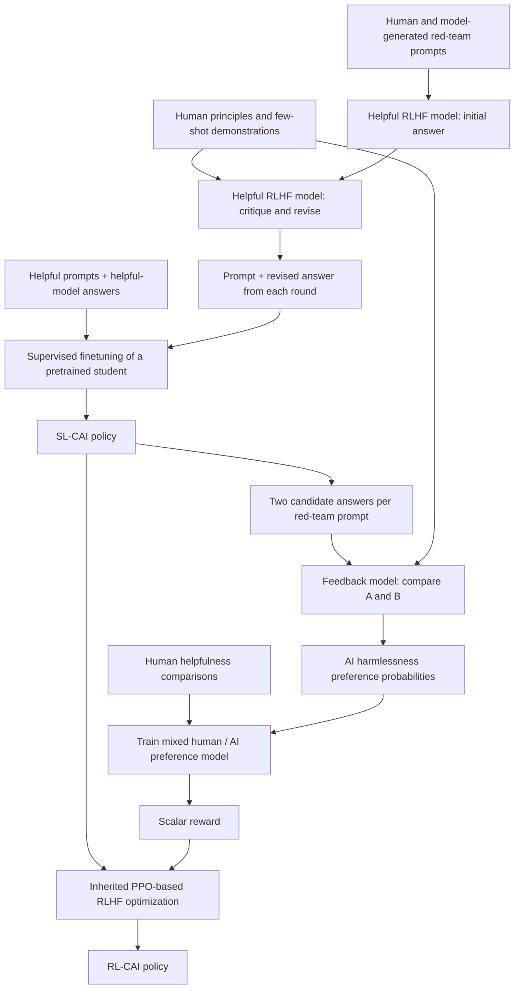
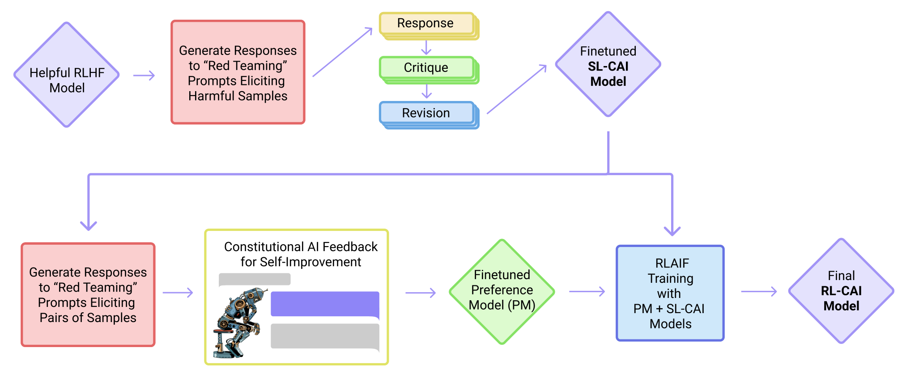
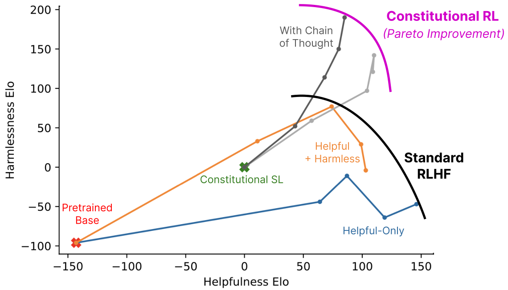
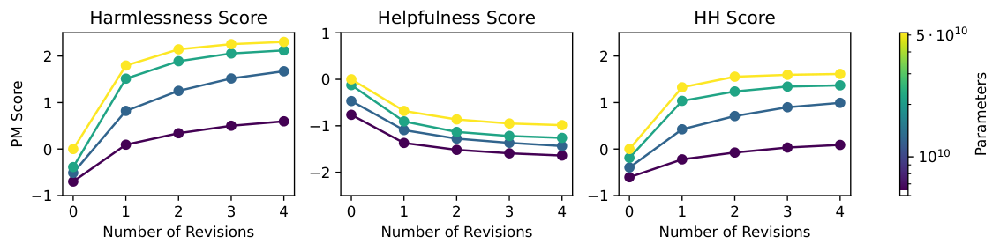
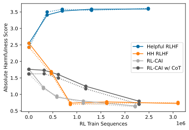

# Constitutional AI - Bai et al., 2022

> **arXiv:** [2212.08073v1](https://arxiv.org/abs/2212.08073v1), 15 December 2022; latest listed version. **Venue:** technical report / preprint. **Affiliation:** Anthropic.
>
> **Full title:** Constitutional AI: Harmlessness from AI Feedback.
>
> **Authors:** Yuntao Bai, Saurav Kadavath, Sandipan Kundu, Amanda Askell, and collaborators; see the [complete author list](https://arxiv.org/abs/2212.08073v1).

## TL;DR

Constitutional AI (CAI) uses explicit natural-language principles to generate two kinds of training supervision: improved answers produced by self-critique and revision, and AI preferences between candidate answers. The first trains a supervised assistant, SL-CAI; the second trains a preference model that supplies the reward for RL-CAI. Human comparison tests find a better helpfulness/harmlessness tradeoff than the paper's human-feedback baselines, with less evasive behavior, but the result is **not human-free alignment**: human helpfulness preferences, human-written principles and demonstrations, red-team prompts, and human evaluation remain central. The study also shows that unreliable critiques, poorly calibrated AI labels, and overoptimization can survive this supervision pipeline.

## Problem & motivation

### Scaling the source of supervision

In conventional language-model RLHF, humans compare model outputs, a learned preference model approximates those judgments, and RL optimizes the policy against that model. The immediate reward is already supplied by an AI model; what usually remains human-limited is the collection of preference labels and the definition of the desired behavior.

CAI asks whether a capable language model can interpret a small, readable set of principles well enough to generate useful harmlessness supervision. This is a more specific proposal than letting a model improve itself without an external criterion. Humans choose the principles, prompts, examples, and evaluation standard; models expand that specification into a much larger training signal.

The paper's starting point is Anthropic's earlier [helpful-and-harmless RLHF work](https://arxiv.org/abs/2204.05862). Its helpful-only assistants readily follow instructions but can follow inappropriate ones too. Its helpful-and-harmless, or **HH**, assistants are safer but often respond evasively to sensitive topics. Optimizing an imprecise safety preference can therefore reward blanket disengagement rather than useful, safe assistance.

### Harmlessness is not the same as saying nothing

The intended behavior is to decline unsafe assistance while still addressing the user's situation, explaining the objection, and offering appropriate alternatives. A safe response can be specific and engaged without fulfilling the unsafe request. The paper tries to make that distinction teachable through principles rather than hoping it emerges from thousands of opaque comparison decisions.

This objective also changes the evaluation. In the current paper's comparison tests, workers prefer a thoughtful, non-evasive answer when both answers are similarly harmless. That differs from some historical harmlessness-label collection. Consequently, a lower harmlessness Elo for an increasingly evasive model does not necessarily mean more dangerous content (Sections 3.3 and 4.4).

### A readable constitution is a specification, not a proof

The authors selected their principles in an ad hoc, iterative research process. The method makes some behavioral choices more inspectable, but it does not establish that the chosen values are universally legitimate, mutually consistent, or correctly implemented by the model. The paper explicitly proposes broader stakeholder involvement and adaptation to deployment context rather than treating its own instruction list as a final constitution.

## Key idea

CAI has two stages that use the constitution differently:

1. **Supervised constitutional learning:** generate an initial answer, critique it under a sampled principle, revise it, and train a student on the improved answer.
2. **Reinforcement learning from AI feedback (RLAIF):** generate two answers, ask a feedback model to judge them under a sampled principle, distill its preference into a reward model, and optimize the policy with the inherited RLHF machinery.

Let $x$ be a conversation ending at a user turn, $y$ an assistant answer, and $c$ a constitutional principle. Write $M$ for the helpful model used to generate revisions and $F$ for the feedback model. The supervised data-generation loop is

$$
\begin{aligned}
y^{(0)}&\sim M(\cdot\mid x),\\
z^{(k)}&\sim M(\cdot\mid x,y^{(k-1)},c_k,\text{critique request}),\\
y^{(k)}&\sim M(\cdot\mid x,y^{(k-1)},z^{(k)},c_k,\text{revision request}),
\end{aligned}
$$

where $z^{(k)}$ is a critique and $c_k$ is sampled independently for revision round $k$. Few-shot demonstrations and role formatting are additional conditioning context, suppressed in the notation.

For preference generation, sample $y_A,y_B$ from SL-CAI, place both answers in a multiple-choice judgment prompt, and obtain the feedback model's normalized choice probabilities:

$$
p_A=
\frac{\exp(\ell_A)}
{\exp(\ell_A)+\exp(\ell_B)},
\qquad p_B=1-p_A,
$$

where $\ell_A$ and $\ell_B$ are log probabilities of the **choice labels** identifying A and B. They are not log probabilities of generating the entire candidate answers. A learned preference model is trained to reproduce this soft preference; its scalar score then becomes the policy's RL reward.

These equations make the prose procedure operational. The paper does not print a complete new set of training-loss equations; the loss formulations below explain its targets and inherited preference-model/RLHF structure rather than claim that every reduction and implementation detail is specified in this report.

## How it works

### 1. Models, roles, and information flow

CAI is a supervision and post-training procedure, not a new transformer architecture. The study uses a family of pretrained autoregressive language models, including 52B-parameter experiments and smaller-model scaling comparisons. It inherits the underlying model and RL training infrastructure from earlier Anthropic work rather than releasing a new block-level architecture or checkpoint family.





*Original Figure 1. The upper branch produces revised answers for supervised learning; the lower branch produces AI preferences, trains a preference model, and uses that model for RL. The self-authored diagram above additionally makes the continuing human helpfulness-data branch explicit.*

The roles should not be conflated:

| Model or resource | Original role |
|---|---|
| Helpful RLHF model | Generates original answers, critiques, revisions, and helpfulness demonstrations; also used as the feedback model in the CoT variant. |
| Pretrained student | Finetuned on revised/helpful answers to obtain SL-CAI. The detailed SL recipe starts from a pretrained model, not by simply continuing to train the helpful teacher. |
| SL-CAI policy | Generates preference-training response pairs and initializes RL-CAI training. |
| Feedback model | Reads the constitution-conditioned comparison prompt and supplies choice probabilities. Without CoT, the experiments use a pretrained LM. |
| Preference model (PM) | Learns a scalar ranking score from human helpfulness and AI harmlessness comparisons. It supplies RL rewards, not the original critiques. |
| Human evaluators | Compare final policies and provide evaluation data; their absence from harmlessness training labels does not imply absence from evaluation. |

During ordinary policy training, generated texts and preference labels are fixed targets. The method does not backpropagate through discrete critique generation, feedback-model inference, or the constitution itself.

### 2. What is in the constitution?

Appendix C provides **16 SL critique/revision instruction pairs** and a separate set of **16 RL comparison instructions**. These sets overlap in intent but serve different jobs.

The SL instructions ask the model to identify problematic content and rewrite the answer. Their themes include physical and social harm, discrimination, inappropriate or unsafe advice, age appropriateness, empathy, and whether the user is trying to provoke an unsuitable response. The RL instructions ask the feedback model which candidate better satisfies the desired behavior; some explicitly discourage preachy, accusatory, or overly reactive answers.

A principle is sampled for each revision round or comparison example. The main procedure does not evaluate every answer under all principles and then apply a formally specified voting rule. The paper's term *ensembling* refers to using varied principles across the generated dataset. The principles and few-shot examples remain human-authored supervision.

The exact historical instruction sets are available in the [official prompt directory](https://github.com/anthropics/ConstitutionalHarmlessnessPaper/tree/main/prompts). They should not be silently replaced with a later product constitution when reproducing this paper.

### 3. Generate critique-and-revision data

For each red-team conversation prefix:

1. Sample an initial answer from the helpful RLHF model.
2. Sample a principle and append its critique request. Generate a critique of the answer.
3. Append the corresponding revision request. Generate a revised answer conditioned on the critique.
4. Reconstruct the original conversation prefix followed by the revised assistant answer.
5. Repeat with independently sampled principles to obtain four revision rounds.

The model can confuse roles and generate a critique when a revision is requested, or vice versa. Few-shot examples demonstrate the distinction and the intended formatting. All initial answers, critiques, and revisions in the illustrated self-critique pipeline come from the same helpful model; no separate human critic labels each revision.

**Use all revision rounds in the detailed recipe.** Section 1.2 summarizes the approach in terms of final revised answers, but Sections 3.1 and 3.2 explicitly train on revisions from all rounds. For four rounds, the harmlessness dataset is

$$
\mathcal D_{\mathrm{rev}}
=\{(x_i,y_i^{(k)}):i=1,\ldots,N_{\mathrm{red}},\ k=1,\ldots,4\}.
$$

The initial unsafe answer is not an intended imitation target, and the critique is generation context rather than the assistant answer to imitate. Training examples retain the normal conversation/assistant format. This distinction prevents a student from learning to output critique scaffolding instead of directly giving an improved answer.

The authors also sample ordinary helpful answers and mix them into SL training. This limits the loss of helpful behavior that could result from finetuning only on red-team revisions.

### 4. Distill revised answers into SL-CAI

Let $\mathcal D_{\mathrm{help}}$ contain helpful prompts paired with answers from the helpful teacher. A causal supervised loss can be expressed as

$$
\mathcal L_{\mathrm{SL}}(\theta)
=-\mathbb E_{(x,y)\sim\mathcal D_{\mathrm{rev}}\cup\mathcal D_{\mathrm{help}}}
\left[
\sum_{t\in\mathcal T(y)}
\log\pi_\theta(y_t\mid x,y_{<t})
\right],
$$

where $\mathcal T(y)$ denotes the intended answer-token targets. This states the imitation task; the CAI report does not completely specify packed-example masking, token-versus-sequence averaging, or all sampling weights.

For a batch of padded text sequences, inputs and attention masks have shape $[B,L]$ and model logits have shape $[B,L,V]$, where $B$ is batch size, $L$ sequence length, and $V$ vocabulary size. Causal labels must be shifted correctly, padding excluded, and the response-target convention declared. The constitution, critique, and discarded answer should not accidentally be inserted into the student target stream.

The purpose is partly an exploration warm start. RL beginning from an assistant that already produces reasonably safe, engaged answers can refine that distribution instead of having to discover suitable responses from an initially inappropriate one. SL-CAI is therefore both a deployable learned policy and the starting point for the second stage.

### 5. Generate constitutional preference labels

For each red-team prompt, generate two responses from SL-CAI. Present the conversation, responses A/B, a sampled principle, and few-shot judgment examples to the feedback model.

The judgment prompt turns open-ended answer quality into a binary choice. Read the model's likelihood of the two allowed choice continuations and normalize **their probabilities**. In numerically stable form,

$$
p_A=\exp\!\left(
\ell_A-\operatorname{logsumexp}(\ell_A,\ell_B)
\right).
$$

Do not divide the negative log-probability values by their sum. Also do not treat probability mass assigned to unrelated continuations as a third preference outcome: this construction conditions on the two permitted choices.

Store one record $(x,y_A,y_B,p_A)$. For $B$ comparisons, choice log probabilities have shape $[B,2]$ and probability targets shape $[B]$ or $[B,2]$. If a label spans multiple tokens, its log probability is the summed continuation log probability under the judgment prompt. The model's scalar confidence and the ordering of displayed candidates should be recorded; the paper does not establish that arbitrary option permutations leave judgments invariant.

### 6. Distill the judgments into a scalar preference model

Let $r_\phi(x,y)$ be the preference model's scalar score. The inherited pairwise model predicts

$$
\widehat p_A=
\sigma\!\left(r_\phi(x,y_A)-r_\phi(x,y_B)\right),
\qquad
\sigma(a)=\frac1{1+\exp(-a)}.
$$

For an AI target $p_A$, the corresponding soft pairwise cross-entropy is

$$
\mathcal L_{\mathrm{PM}}
=-\mathbb E_{\mathcal D_{\mathrm{PM}}}
\left[
p_A\log\widehat p_A+
(1-p_A)\log(1-\widehat p_A)
\right].
$$

For human helpfulness comparisons, $p_A$ is the observed binary preference after choosing the A/B convention. The combined training set mixes these human helpfulness records with AI harmlessness records. The record counts do not by themselves establish every minibatch sampling weight.

Only score differences identify pair probabilities: adding the same constant to both scores changes nothing. The score is not an absolute probability of safety. Its most important derivative is

$$
\frac{\partial\mathcal L_{\mathrm{PM}}}
{\partial\left(r_\phi(x,y_A)-r_\phi(x,y_B)\right)}
=\widehat p_A-p_A.
$$

A 0.6 soft target encourages a finite margin $\log(0.6/0.4)$ rather than the unbounded margin favored by a hard target of 1 in an isolated separable example. This helps explain why retaining uncertainty can reduce extreme optimization pressure.

Distillation amortizes the expensive judgment prompt: RL can query the scalar PM rather than repeatedly running a full constitutional comparison with demonstrations for every update.

### 7. The CoT feedback variant and probability clamping

The CoT variant uses a **helpful RLHF feedback model**, whereas the non-CoT experiments use a pretrained feedback model. It also reformats the judgment task conversationally and supplies hand-written reasoning demonstrations. Thus the comparison is not a perfectly isolated experiment that changes only the presence of a reasoning string.

The feedback model first produces reasoning about the comparison, then its choice probabilities are extracted. A problem arises because the generated reasoning often already commits to an option: the following choice probability becomes nearly 0 or 1. Such a probability measures confidence conditional on that particular reasoning sample, not automatically a calibrated preference marginal over all possible reasoning.

The authors clamp CoT preference targets:

$$
p_A^{\mathrm{clamp}}
=\operatorname{clip}(p_A,0.4,0.6),
\qquad
p_B^{\mathrm{clamp}}=1-p_A^{\mathrm{clamp}}.
$$

They report a modest improvement with a 0.2--0.8 interval and a further improvement with 0.4--0.6, which is used for the main CoT results (Sections 4.1 and 4.3). This preserves which side of 0.5 the target lies on while compressing confidence. It is not equivalent to adding a fixed amount of label smoothing or multiplying probabilities by a temperature.

For non-CoT feedback, normalized soft labels work better than hard 0/1 labels. Figure 9 reports reasonably calibrated feedback probabilities on the HHH evaluation; this should not be generalized into a claim that the unclamped CoT probabilities are well calibrated. Likewise, the five-reasoning-sample probability averaging in Section 2's evaluator experiment should not be confused with a claim that every main RL training label averages five CoTs.

Here **RL-CAI with CoT** refers to reasoning in the feedback-generation procedure. It does not mean that the trained policy must reveal an internal reasoning trace or rerun constitutional self-critique at inference.

### 8. Optimize the policy with inherited RLHF machinery

Section 4.2 says that RL uses the hyperparameters of the prior [HH RLHF paper](https://arxiv.org/abs/2204.05862). That work uses PPO and a KL-regularized preference reward. At the response-distribution level, the inherited idea is

$$
\mathcal J(\theta)
=\mathbb E_{x,\ y\sim\pi_\theta(\cdot\mid x)}
\left[
r_\phi(x,y)
-\lambda_{\mathrm{KL}}
\log\frac{\pi_\theta(y\mid x)}{\pi_0(y\mid x)}
\right],
$$

where $\pi_0$ is the fixed initialization/reference policy and $\lambda_{\mathrm{KL}}\geq0$. The sampled log ratio has the forward-KL expectation under the current policy. This is a conceptual regularized objective, not a replacement for the implementation's rollout/advantage estimation and clipped surrogate.

With old rollout policy $\pi_{\mathrm{old}}$, the standard PPO actor term is

$$
\mathcal J_{\mathrm{clip}}
=\mathbb E\left[
\min\left(
\rho_t\widehat A_t,\,
\operatorname{clip}(\rho_t,1-\epsilon,1+\epsilon)\widehat A_t
\right)
\right],
\qquad
\rho_t=
\frac{\pi_\theta(y_t\mid x,y_{<t})}
{\pi_{\mathrm{old}}(y_t\mid x,y_{<t})}.
$$

Here $\widehat A_t$ is the RL advantage, not the AI preference probability. The old-policy probabilities and rollout targets are held fixed during an update. The frozen PM supplies reward; training the policy is a different optimization from fitting the PM's pairwise cross-entropy. See the [PPO recap](alignment-rl_2017_proximal-policy-optimization.md) for the full optimization mechanism.

CAI changes the **source of preference supervision**, not PPO into a new critic-free algorithm. Nor is it a direct preference loss such as DPO: the paper explicitly trains a separate preference model and then performs online RL.

## Training / data

### Stage-one prompts, generated targets, and schedule

**Source: Section 3.2.** Counts are prompt/conversation-prefix records, not necessarily distinct complete conversations. A multi-turn conversation yields a prompt at each human turn.

| Resource or setting | Reported value |
|---|---:|
| Human-written red-team prompts | 42,496 |
| Additional model-generated red-team prompts | 140,335 |
| Total red-team prompts | 182,831 |
| Critique/revision rounds per red-team prompt | 4 |
| Human-written helpfulness prompts | 135,296 |
| Helpful teacher answers per helpfulness prompt | 2 |
| Sampling temperature | 1 |
| SL epochs | 1 |
| SL batch size | 1024 sequences |
| SL learning rate | Constant, 0.5 times the pretraining learning rate |

The detailed recipe implies **731,324 revised-answer targets** and **270,592 helpful-answer targets**, or **1,001,916 total targets**, before any unreported filtering/packing choices. These are arithmetic products and a sum of the Section 3.2 counts, not independently reported numbers of unique conversations or optimizer steps.

The useful distinction is between the helpful teacher used to construct data and the pretrained student being finetuned. This is synthetic-target distillation, not a loop that updates the generator's weights after each individual critique.

### Stage-two comparison and rollout data

**Source: Section 4.2.**

| Resource | Reported count |
|---|---:|
| Human helpfulness PM comparisons | 135,296 |
| AI harmlessness PM comparisons | 182,831 |
| Additional model-generated red-team RL prompts | 491,142 |
| Additional model-generated helpfulness RL prompts | 474,300 |

There is one AI comparison per SL-CAI red-team prompt. The PM datasets therefore contain **318,127 comparison records** in total by addition, before unspecified sampling decisions. The **135,296 helpfulness comparisons** in PM training and **135,296 helpfulness prompts** used for SL data are different kinds of records even though their counts match.

For controlled policy comparisons, all RL runs use the same prompt pool: the SL-CAI prompts plus the additional generated prompts listed above. The human-feedback baselines are trained directly from pretrained LMs in this study, rather than from the context-distilled initializations in the earlier HH paper. RL-CAI instead starts from SL-CAI.

### What is inherited, and what remains unspecified?

Section 4.2 delegates RL hyperparameters to the earlier HH paper. Its common setup, reported in Section 4.1 and Appendix B.1 of that predecessor, includes:

| Inherited setting | Value in the cited prior setup |
|---|---:|
| Policy learning rate | 0.01 times the pretraining learning rate |
| KL reward coefficient $\lambda_{\mathrm{KL}}$ | 0.001 |
| PPO clipping $\epsilon$ | 0.2 |
| Discount factor $\gamma$ | 1 |
| Entropy bonus | None |

These values are traced to the cited setup, not newly tabulated as a full CAI configuration. The predecessor uses different sample-reuse counts and schedules in different experiments; the CAI report does not give a complete per-run mapping of all those branches. Do not copy a robustness-study or online-RLHF configuration wholesale and present it as uniquely established for every CAI run.

Absolute learning rates require the size-specific pretraining rates. The report also does not provide a complete standalone account of optimizer state, context/truncation conventions, PM sampling weights, every rollout setting, hardware, or end-to-end compute cost. The supplementary repository is not a turnkey training implementation and does not release the study's model weights.

### Released materials checked against the repository

The [official supplement](https://github.com/anthropics/ConstitutionalHarmlessnessPaper) contains prompt specifications, evaluation sets, and samples rather than a full trainer. Its prompt files contain:

- [Critique/revision instructions](https://github.com/anthropics/ConstitutionalHarmlessnessPaper/blob/main/prompts/CritiqueRevisionInstructions.json): 16 instruction-pair entries.
- [Critique/revision demonstrations](https://github.com/anthropics/ConstitutionalHarmlessnessPaper/blob/main/prompts/CritiqueRevisionFewShotPrompts.json): 5 entries.
- [Comparison instructions](https://github.com/anthropics/ConstitutionalHarmlessnessPaper/blob/main/prompts/RLMadisonInstructions.json): 16 entries.
- [Non-CoT comparison demonstrations](https://github.com/anthropics/ConstitutionalHarmlessnessPaper/blob/main/prompts/RLMadisonFewShotPrompts.json): 5 entries.
- [CoT comparison demonstrations](https://github.com/anthropics/ConstitutionalHarmlessnessPaper/blob/main/prompts/RLMadisonPrecogFewShotPrompts.json): 6 entries.

These are counts of released file entries, not proof that every generation call included every demonstration. Exact few-shot selection, ordering, and formatting should be preserved when recreating the prompting task.

## Results

### Human comparison tests: the main outcome



*Original Figure 2. The axes are separately fitted helpfulness and harmlessness Elo scores for 52B policies, with higher better on both. RL-CAI moves the observed tradeoff outward relative to the paper's helpful-only and HH RLHF baselines. Only differences within the relevant Elo system are meaningful; the origin is not an absolute safety threshold. Figure 2 suppresses error bars that appear in Figure 3.*

**Sources: Sections 3.3, 4.3, and 4.4; Figures 2, 3, and 8.** The paper's main policy results are plots, not a table of exact Elo coordinates. The following preserves the reported comparisons without inventing numerical point estimates.

| Comparison | Reported result | Interpretation and caveat |
|---|---|---|
| Helpful RLHF versus HH RLHF | Helpful-only is more helpful but also more harmful. | Earlier human harmlessness labels can reward evasiveness; current evaluators penalize it when answers are equally safe. |
| SL-CAI versus helpful RLHF | SL-CAI is more harmless but less helpful. | Revisions improve safety, but supervised distillation alone does not eliminate the helpfulness cost. |
| SL-CAI versus HH RLHF | SL-CAI is less harmless and less helpful in the main comparison. | The stronger claim about the full method requires the RL stage, not just self-revision. |
| SL-CAI versus pretrained initialization | SL-CAI improves both helpfulness and harmlessness. | The constitutional supervised stage provides a useful starting distribution. |
| RL-CAI versus RLHF and SL-CAI | RL-CAI is substantially more harmless in the paper's human comparison tests, with comparatively little helpfulness loss. | This is the observed tradeoff under this evaluation, not universal dominance on all capabilities. |
| RL-CAI with versus without CoT feedback | The CoT variant is slightly more harmless and slightly less helpful. | Feedback-model type and prompting both differ, so this is not a pure reasoning-only ablation. |

The A/B evaluation collects **10,274 helpfulness** and **8,135 harmlessness comparisons** for **24 snapshots** shown collectively in Figures 2 and 3 (Section 3.3). The evaluations use fresh worker-written conversations, similar in distribution to but distinct from PM/RL training conversations. The current tests use Surge AI workers, while much of the older PM data came from Upwork and MTurk (Section 4.4).

Figure 8 sets the 52B SL-CAI starting point to zero Elo. RL-CAI begins there; RLHF begins from a pretrained model. The curves therefore should not be interpreted as matched-initialization measurements of only the final RL objective.

### Revision count and model scale



*Original Figure 5, Section 3.4. Revision 0 is the initial answer; rounds 1--4 are successive revisions. Larger generating models obtain stronger harmlessness and combined-HH PM scores, and the scores increase with revisions, but the pure helpfulness PM score decreases. These are evaluations by human-feedback-trained 52B PMs, not additional direct human judgments of every revision.*

**Sources: Sections 3.4 and 3.5; Figures 5--7.**

- **Additional revisions:** harmlessness and combined-HH PM scores improve, with much of the visual gain occurring early. The authors warn that high PM scores become less calibrated, so monotonic proxy improvement is not proof of unlimited human-perceived improvement.
- **More constitutional principles:** the harmlessness PM score does not improve significantly just from increasing the number of principles. The authors expect increased behavioral diversity to help RL exploration but explicitly do not quantify that diversity in this study.
- **Critique versus direct revision:** an explicit critique is more useful for smaller models; larger models perform similarly with and without it, with critiques slightly favored in the plotted comparison. Inspection also finds inaccurate or overstated critiques. A useful revised answer does not prove that the preceding explanation was correct or causally faithful.

### Can a language model judge the desired behavior?

**Sources: Section 2, Figure 4, and Appendix B, Figures 11 and 12.**

| Evaluation | Exact reported size | Main finding |
|---|---:|---|
| Earlier HHH binary comparisons | 221 | Models achieve well over 90% accuracy on the earlier set, motivating harder questions. |
| New harder HHH comparisons | 217 additional | Focus includes subtler harmlessness and avoiding unhelpful evasiveness. |
| Combined HHH comparisons | 438 | CoT improves larger-model judgments; averaging probabilities across five CoT samples provides a further small gain. |
| Harmful-versus-ethical conversation classification | 254, balanced | Few-shot and CoT prompting improve over zero-shot behavior identification. |
| Harm-type classification | 287, with 9 candidate classes | Increasing model capability improves classification of human-assigned harm types. |

The released JSONL files contain **438**, **254**, and **287** evaluation records respectively, matching the report. These are multiple-choice judgment tasks, not end-to-end adversarial robustness guarantees. In particular, distinguishing a clearly harmful assistant from an ethical one on a curated set is easier than reliably detecting every subtle unsafe behavior during open-ended deployment.

Figure 4 compares prompted models with PMs trained on several hundred thousand human labels. The scaling trend suggests that models larger than 52B could become competitive with those PMs; it is an extrapolation, not a reported experiment on a larger model in this paper.

### Soft labels, calibration, and overoptimization

**Sources: Sections 4.1 and 4.3; Figure 9.** Non-CoT soft probabilities work better than hard labels. CoT generates excessively confident conditional probabilities, and the main experiments use the 0.4--0.6 clamp. Varying principles and discouraging overreactive judgments also improves behavior qualitatively.

RL can still overoptimize the learned reward: the paper reports overly harsh responses and repetitive supportive boilerplate. This is Goodharting, not evidence that the constitution has been fully satisfied merely because the learned PM score is high. The paper does not give an exact numerical effect size for every label-processing or principle-wording ablation, so none is manufactured here.

### Absolute harmfulness: a different measurement



*Original Figure 10, Section 4.5: 52B policy snapshots evaluated with a learned absolute-harmfulness regressor. Lower is better, unlike harmlessness Elo. Solid curves use sampling temperature 1 and dashed curves temperature 0. HH RLHF and both RL-CAI variants become less harmful by this metric, while helpful-only RLHF becomes more harmful.*

The absolute scorer is trained on human ratings of full red-team conversations with squared error:

$$
\mathcal L_{\mathrm{abs}}(\psi)
=\mathbb E_{(d,h)}
\left[(g_\psi(d)-h)^2\right],
\qquad h\in\{0,1,2,3,4\},
$$

where $d$ is a conversation and $h$ the worker's rated success in eliciting harmful behavior. Figure 10 evaluates **64 hand-picked held-out red-team prompts**, averaging over **256 responses per prompt** (Section 4.5).

This scorer is an evaluation model, not the constitutional PM used as the policy's reward. Its nominal 0--4 target scale is also distinct from the 1--5 endpoint ratings described for selecting Appendix B's binary identification examples. The authors warn that absolute scores may not be well calibrated across workers.

The apparently conflicting HH RLHF trends have a straightforward explanation: it can become less harmful in absolute content while becoming more evasive and therefore less preferred in the current pairwise harmlessness tests. Neither metric alone is a complete definition of safe, useful assistance.

## Limitations & follow-ups

### What "without human harmlessness labels" does and does not mean

The claim concerns the harmlessness preference labels used to construct the CAI training signal. It does not remove human helpfulness training, human red-team prompt construction, written principles, few-shot demonstrations, pretraining influences, or human evaluation. The absolute-harmfulness evaluation regressor and some revision-evaluation PMs also use human-labeled data. Those evaluation uses do not contradict the narrower training claim, but must not be hidden.

### Remaining technical and governance limits

- **Critique quality is imperfect.** The model can generate inaccurate criticism while still producing a better answer. Natural-language explanations improve inspectability but are not evidence of faithful access to the model's decision process.
- **The judge is not an external ground truth.** Its preferences inherit its capabilities, training distribution, biases, and interpretation of the supplied constitution. Distilling those labels into a PM can preserve their mistakes.
- **Calibration and distribution shift matter.** CoT confidence needs clamping in this recipe; PM scores can become unreliable as RL pushes outputs beyond the label distribution. The paper proposes iterated online feedback as future work, not a demonstrated universal solution.
- **Safety and helpfulness are still competing measurements.** The main constitution is tuned toward harmlessness, the evaluation explicitly discourages evasiveness, and worker populations differ from earlier data collection. The result should not be generalized into a universal safety ranking.
- **Diversity and robustness claims are limited.** More principles are hypothesized to improve diversity without a quantitative diversity study, and the work does not establish immunity to red-team attacks. Held-out prompt evaluations are not exhaustive coverage of deployment risks.
- **The constitution is a human governance choice.** Its research principles are ad hoc. Changing the constitution may change the intended behavior, but natural language alone does not resolve conflicting values, stakeholder representation, or uneven effects on users.
- **The released supplement is not a full reproduction.** Prompts, examples, and evaluations are public; model weights, a full original trainer, all exact run settings, and total compute are not provided as a turnkey package.
- **Reduced labeling does not justify reduced oversight.** Section 6.2 warns that automating supervision may encourage deployment without adequate human testing and may make behavioral control easier to misuse. The stated aim is more effective human oversight, not its elimination.

### Related and successor approaches

[InstructGPT](alignment-rl_2022_instructgpt-rlhf.md) and [Anthropic's earlier HH RLHF paper](https://arxiv.org/abs/2204.05862) provide the comparison-model and RL foundations. [Chain-of-Thought](reasoning_2022_chain-of-thought.md) provides the prompting mechanism used in critiques and the reasoning-based feedback variant; [Self-Consistency](reasoning_2022_self-consistency.md) is related to sampling multiple reasoning paths, though CAI's Section 2 averages evaluator probabilities rather than majority-voting task answers.

[RLAIF: Scaling Reinforcement Learning from Human Feedback with AI Feedback](https://arxiv.org/abs/2309.00267) is a later empirical study of AI-generated preference supervision. It is not the same paper as Constitutional AI, even though CAI already uses the term RLAIF. [DPO](alignment-rl_2023_direct-preference-optimization.md), [KTO](alignment-rl_2024_kahneman-tversky-optimization.md), and [ORPO](alignment-rl_2024_odds-ratio-preference-optimization.md) change preference optimization, whereas CAI principally changes how supervision is produced. [DeepSeekMath / GRPO](alignment-rl_2024_deepseekmath-grpo.md) later changes the online RL advantage estimator and model roles; those changes should not be read back into CAI's original PPO-based pipeline.

## Links

- **arXiv:** [abstract, v1](https://arxiv.org/abs/2212.08073v1) | [HTML, v1](https://arxiv.org/html/2212.08073v1) | [PDF, v1](https://arxiv.org/pdf/2212.08073v1).
- **Code / supplement:** [official ConstitutionalHarmlessnessPaper repository](https://github.com/anthropics/ConstitutionalHarmlessnessPaper); supplementary data and prompts, not a full training-code release.
- **Prompts:** [critique/revision and AI-comparison specifications](https://github.com/anthropics/ConstitutionalHarmlessnessPaper/tree/main/prompts).
- **Evaluations:** [HHH and harm-classification JSONL files](https://github.com/anthropics/ConstitutionalHarmlessnessPaper/tree/main/evals).
- **Samples:** [released model comparisons and examples](https://github.com/anthropics/ConstitutionalHarmlessnessPaper/tree/main/samples).
- **Hugging Face:** no model-weight release is identified in the paper's supplement.
- **Project page:** [Anthropic research page](https://www.anthropic.com/research/constitutional-ai-harmlessness-from-ai-feedback).
- **Blog posts:** the research page above is the official publication hub.
- **Talks / videos:** no specific presentation is identified here.
- **OpenReview / venue page:** no conference venue is established by the sources used here; this recap follows the technical report.
- **Papers-with-Code:** not used as a primary source.
- **Inherited training method:** [Training a Helpful and Harmless Assistant with Reinforcement Learning from Human Feedback](https://arxiv.org/abs/2204.05862), especially Section 4.1 and Appendix B.1.
- **Related / successor papers:** [PPO](alignment-rl_2017_proximal-policy-optimization.md) | [InstructGPT](alignment-rl_2022_instructgpt-rlhf.md) | [CoT](reasoning_2022_chain-of-thought.md) | [Self-Consistency](reasoning_2022_self-consistency.md) | [RLAIF](https://arxiv.org/abs/2309.00267) | [DPO](alignment-rl_2023_direct-preference-optimization.md) | [KTO](alignment-rl_2024_kahneman-tversky-optimization.md) | [ORPO](alignment-rl_2024_odds-ratio-preference-optimization.md) | [GRPO](alignment-rl_2024_deepseekmath-grpo.md).
- **BibTeX:**

```bibtex
@misc{bai2022constitutional,
  title={Constitutional AI: Harmlessness from AI Feedback},
  author={Yuntao Bai and Saurav Kadavath and Sandipan Kundu and
          Amanda Askell and others},
  year={2022},
  eprint={2212.08073},
  archivePrefix={arXiv},
  primaryClass={cs.CL},
  url={https://arxiv.org/abs/2212.08073v1}
}
```
