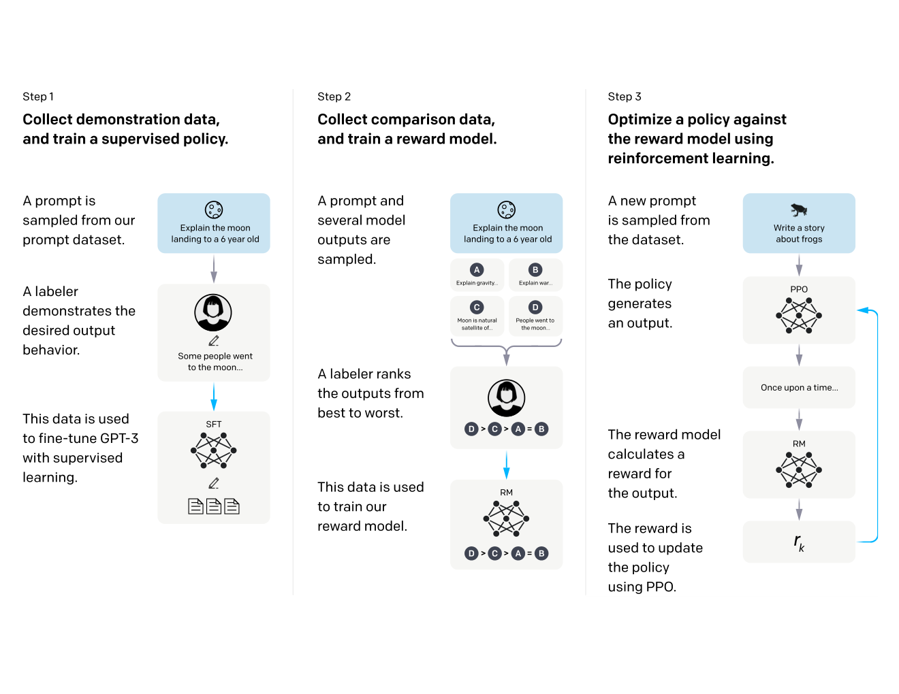
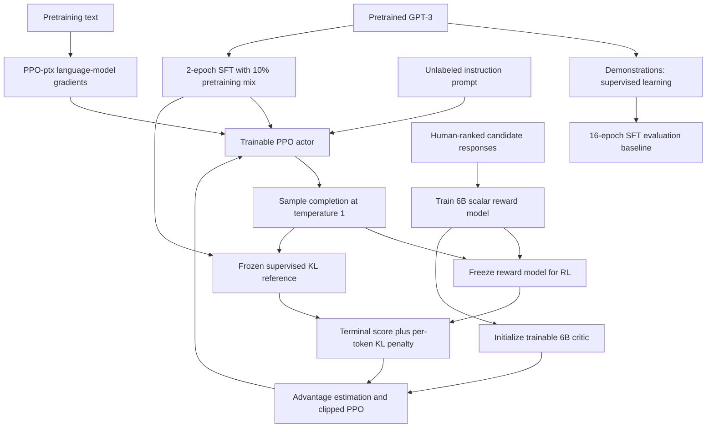
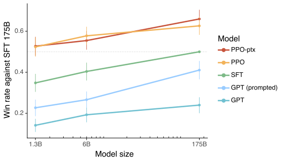
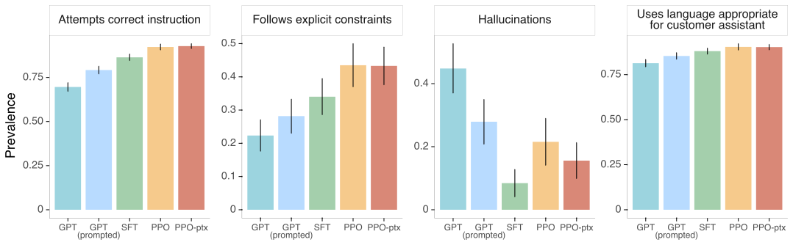
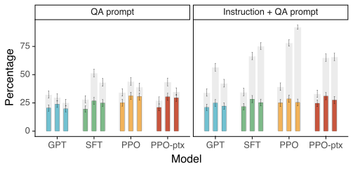

# InstructGPT: Training Language Models to Follow Instructions with Human Feedback - Ouyang et al., 2022

> **arXiv:** [2203.02155v1](https://arxiv.org/abs/2203.02155v1), 4 March 2022; the only arXiv version listed.
> **Venue:** Advances in Neural Information Processing Systems 35, NeurIPS 2022.
> **Authors:** Long Ouyang, Jeff Wu, Xu Jiang, Diogo Almeida, Carroll L. Wainwright, Pamela Mishkin, Chong Zhang, Sandhini Agarwal, Katarina Slama, Alex Ray, John Schulman, Jacob Hilton, Fraser Kelton, Luke Miller, Maddie Simens, Amanda Askell, Peter Welinder, Paul Christiano, Jan Leike, Ryan Lowe.
> **Affiliation:** OpenAI.
> **Scope:** The arXiv v1 methods, results, and appendices, with venue metadata and the official release/model card checked separately. "InstructGPT" normally means **PPO-ptx** in this paper. It is not a synonym for every later instruction-tuned API model, ChatGPT, or all possible RLHF pipelines.

## TL;DR

InstructGPT adapts GPT-3 to instructions through three stages: supervised learning from human demonstrations, learning a scalar reward from ranked model responses, and optimizing a language-model policy against that reward with PPO. A KL penalty limits drift from a supervised reference, while **PPO-ptx** additionally mixes in pretraining-language-model gradients to reduce capability regressions.

On the paper's API-prompt evaluation distribution, the 1.3B InstructGPT model is preferred to 175B GPT-3, and 175B InstructGPT is preferred to unprompted 175B GPT-3 **85% of the time, with a reported 95% confidence interval of +/-3 percentage points** (Sections 1 and 4.1). These are substantial improvements in measured instruction following, not a demonstration of universal capability superiority, factual correctness, representative human values, or complete safety.

## Problem & motivation

### Predicting Internet text is not the same objective as helping a user

Pretraining rewards a model for predicting the next token in text. A helpful response, a misleading claim, a continuation that ignores an instruction, and an imitation of an undesirable Internet style can all have high likelihood in some contexts.

Scaling that objective can improve capabilities without making the model reliably follow an actual user's intent. The paper therefore separates **what the pretrained model can do** from **which behavior it tends to produce when asked**.

The goal is to make the model more helpful, honest, and harmless. These concepts are only partially measurable: the paper uses labeler preferences, instruction-following metadata, truthfulness tests, toxicity measurements, and bias proxies. It does not claim that these measurements exhaust the concepts.

### Why demonstrations alone are not the whole solution

Human-written ideal responses teach a model a useful response style and basic instruction following. But writing a high-quality response is costly, and a single demonstration cannot express every tradeoff among several plausible responses.

Comparisons ask labelers which outputs they prefer. A reward model turns those judgments into a reusable scoring function, allowing many further policy-training episodes without asking a human to label every newly generated response.

The resulting signal remains a **learned proxy** for a particular annotation process. Optimizing it too aggressively can exploit inaccuracies in the reward model, while excessive fine-tuning can degrade capabilities retained from pretraining.

### Why the pretraining mixture matters

The paper finds regressions on public tasks such as reading comprehension, reasoning, and translation after reward optimization. It calls this an "alignment tax": improving the measured alignment objective can reduce other desirable behaviors.

PPO-ptx addresses this by training on the pretraining distribution during RL, rather than relying only on a penalty for changing policy on the instruction-prompt distribution. These constraints act on different data and are not interchangeable.

## Key idea

### Learn preferences, then optimize a policy subject to a reference constraint

Let $x$ be an instruction/prompt, $y$ a generated completion, $r_\theta(x,y)$ the learned scalar reward, $\pi_\phi$ the trainable policy, and $\pi_{\mathrm{ref}}$ a frozen supervised reference policy.

The paper's Equation 2 maximizes:

$$
J(\phi)=
\mathbb E_{\substack{x\sim D_{\mathrm{prompt}}\\y\sim\pi_\phi(\cdot\mid x)}}
\left[
r_\theta(x,y)
-\beta\log\frac{\pi_\phi(y\mid x)}{\pi_{\mathrm{ref}}(y\mid x)}
\right]
+\gamma_{\mathrm{ptx}}\,
\mathbb E_{z\sim D_{\mathrm{pretrain}}}
\left[\log\pi_\phi(z)\right].
$$

$D_{\mathrm{prompt}}$ is the RL prompt distribution, $D_{\mathrm{pretrain}}$ the original language-modeling distribution, $z$ a pretraining text sequence, $\beta$ the KL reward coefficient, and $\gamma_{\mathrm{ptx}}$ the pretraining-gradient coefficient. The paper denotes the latter by $\gamma$; the subscript here avoids confusing it with a reinforcement-learning discount factor.

- **Reward term:** favor completions predicted to be preferred by labelers.
- **Reference term:** discourage drifting too far from the supervised initialization.
- **Pretraining term:** retain the ability to model the broader pretraining distribution.

For **PPO**, $\gamma_{\mathrm{ptx}}=0$. For the main **PPO-ptx** recipe, $\beta=0.02$ and $\gamma_{\mathrm{ptx}}=27.8$ (Appendix C.4).

### A sampled log ratio is not always positive

For a completion $y=(y_1,\ldots,y_T)$, with prefix $h_t=(x,y_{<t})$:

$$
\log\frac{\pi_\phi(y\mid x)}{\pi_{\mathrm{ref}}(y\mid x)}
=\sum_{t=1}^{T}
\log\frac{\pi_\phi(y_t\mid h_t)}
{\pi_{\mathrm{ref}}(y_t\mid h_t)}.
$$

Each realized log ratio can be negative. Its expectation under the current policy is the corresponding forward KL:

$$
\mathbb E_{y\sim\pi_\phi}
\left[\log\frac{\pi_\phi(y\mid x)}
{\pi_{\mathrm{ref}}(y\mid x)}\right]
=D_{\mathrm{KL}}
\left(\pi_\phi(\cdot\mid x)\Vert\pi_{\mathrm{ref}}(\cdot\mid x)\right).
$$

Thus the reference term discourages divergence **in expectation**. Clamping every negative sampled log ratio to zero would change the method.



*Original Figure 2. Humans supply demonstrations and preferences; the learned reward model supplies scores during policy optimization. PPO does not require a fresh human judgment for every rollout.*

## How it works

### 1. Start from pretrained GPT-3 models

The policies have **1.3B, 6B, or 175B parameters**, using the GPT-3 architecture. This work fine-tunes existing models; it does not introduce a new Transformer architecture or train these language models from scratch.

Keep the roles separate:

| Component | Input / output | Updated when? |
|---|---|---|
| Supervised policy | Prompt to autoregressive completion probabilities | During SFT. |
| Reward model | Prompt plus completion to one scalar | During preference learning; frozen during the reported RL stage. |
| RL policy / actor | Prompt to sampled token sequence | During PPO and, for PPO-ptx, pretraining-gradient updates. |
| KL reference policy | Same tokens scored under the supervised initialization | Frozen during RL. |
| Value function / critic | Generated prefixes to predicted returns | Trained during PPO; initialized from the RM. |

The reward model and value function are **both 6B models for every policy size**, including the 1.3B and 175B actors. They are not necessarily the same size as the actor, and an initialized critic does not remain a frozen copy of the reward model.

In a conventional batched implementation, policy outputs are token distributions indexed by batch, sequence position, and vocabulary; reward outputs have one scalar per complete prompt/response; value estimates are associated with generation positions. These are explanatory interface descriptions, not an unpublished exact tensor/padding specification from the authors.

### 2. Collect demonstrations and train a supervised model

Labelers write desired completions for prompts. A conventional conditional SFT objective is:

$$
\mathcal L_{\mathrm{SFT}}(\phi)=
-\mathbb E_{(x,y^*)\sim D_{\mathrm{SFT}}}
\left[
\sum_{t=1}^{|y^*|}
\log\pi_\phi(y_t^*\mid x,y_{<t}^*)
\right],
$$

where $y^*$ is a demonstrated completion. This expresses supervised conditional language modeling; it is not an additional numbered loss in the paper or a claim that the unreleased implementation's exact masking/reduction details are specified.

**Important distinction:** the separately evaluated **SFT baseline** is trained for **16 epochs**. The supervised model used to **initialize PPO** is instead trained for **two epochs with 10% pretraining data mixed in** (Appendices C.1 and C.3). Treating the 16-epoch baseline as the exact PPO initialization would misrepresent the final recipe.

The baseline's validation language-model loss begins to overfit after about one epoch, yet additional epochs improve reward-model scores and human preferences. The checkpoint criterion is therefore not simply "stop at the lowest held-out token loss."

### 3. Rank several responses to each prompt

For one prompt, labelers rank between **four and nine** candidate completions. A complete strict ranking yields:

$$
M(K)=\binom K2=\frac{K(K-1)}2
$$

pairwise comparisons for $K$ candidates: six pairs at $K=4$ and 36 at $K=9$. Tied pairs are dropped in RM training (Appendix C.2).

These comparisons are highly correlated because the same completion appears in several pairs. Shuffling all pairs into independent training items repeatedly revisits each completion within an epoch and caused overfitting in the authors' experiments.

Instead, process the comparisons for one prompt as **one grouped training element**. Score each candidate completion once, then form the pairwise score differences from those shared scores. This reuses the expensive Transformer computations and avoids repeatedly updating on the same response in separate prompt-fragmented steps.

### 4. Train a scalar preference reward

For a winning response $y_w$ and losing response $y_l$, the preference model uses:

$$
P_\theta(y_w\succ y_l\mid x)
=\sigma\left(r_\theta(x,y_w)-r_\theta(x,y_l)\right),
\qquad
\sigma(u)=\frac{1}{1+e^{-u}}.
$$

The corresponding pair loss is:

$$
\ell_\theta(x,y_w,y_l)
=-\log\sigma\left(r_\theta(x,y_w)-r_\theta(x,y_l)\right).
$$

Equation 1 applies this logistic loss with a $\binom K2^{-1}$ normalization. An explicit grouped form is:

$$
\mathcal L_{\mathrm{RM}}(\theta)=
\mathbb E_{(x,\mathrm{ranking})}
\left[
\frac{1}{\binom K2}
\sum_{(w,l)\in\mathcal P_x}
\ell_\theta(x,y_w,y_l)
\right],
$$

where $\mathcal P_x$ is the set of retained preference pairs for that prompt. This makes the paper's prompt-grouped comparison structure explicit; tied pairs contribute no preference term. The appendix does not fully detail any additional reweighting for variable numbers of ties.

Only reward **differences** are supervised. Adding the same constant to every score does not alter any preference probability. Before RL, the authors apply a reward bias so that labeler demonstrations have **mean reward zero**. This is not a statement that rewards are probabilities, that all outputs are constrained to a fixed range, or that reward variance is normalized to one.

**Initialization nuance:** Section 3.5 describes initializing the RM from SFT with the unembedding removed. Appendix C.2 says the **final 6B RM** actually started from a GPT-3 model fine-tuned on public NLP tasks, for historical reasons. Those tasks were ARC, BoolQ, CoQA, DROP, MultiNLI, OpenBookQA, QuAC, RACE, and Winogrande. The authors report similar results with GPT-3 or SFT initialization. The final implementation detail should not be silently replaced by the simplified main-text account.

### 5. Turn generation into a reward-optimization problem

Sample a prompt, generate a response, score the response with the frozen RM, and end the episode. At the prompt/response level this is a **contextual bandit**, not a multi-turn environment with real-world actions. Autoregressive token generation still creates intermediate states for credit assignment.

A useful expression of the stated terminal reward plus per-token reference penalty is:

$$
\widetilde r_t
=
-\beta\log
\frac{\pi_\phi(y_t\mid h_t)}
{\pi_{\mathrm{ref}}(y_t\mid h_t)}
+\mathbf 1[t=T]\,r_\theta(x,y).
$$

$\widetilde r_t$ is the shaped reward at generation step $t$ and $\mathbf 1[t=T]$ selects the terminal step. This is an explanatory decomposition of the paper's described reward, not a new task-specific reward function.

The critic predicts expected return and supplies a baseline for advantage estimates. Its purpose is to reduce policy-gradient variance, not to decide which human judgments are valid. The paper uses generalized advantage estimation with **no discount**, but does not state every GAE or critic-loss hyperparameter.

### 6. Apply PPO rather than unconstrained reward maximization

For context, the standard clipped PPO policy surrogate is:

$$
L_{\mathrm{clip}}(\phi)=
\mathbb E_t\left[
\min\left(
\rho_t(\phi)\widehat A_t,\,
\operatorname{clip}(\rho_t(\phi),1-\epsilon,1+\epsilon)\widehat A_t
\right)
\right],
$$

$$
\rho_t(\phi)=
\frac{\pi_\phi(y_t\mid h_t)}
{\pi_{\mathrm{old}}(y_t\mid h_t)}.
$$

Here $\widehat A_t$ is an estimated advantage, $\pi_{\mathrm{old}}$ is the policy that generated the current rollout batch, and $\epsilon=0.2$ is the reported PPO clip parameter. These equations explain the imported PPO mechanism, not additional numbered equations claimed as original contributions of this paper.

There are **two different reference roles**:

- The **old policy** is the rollout-generating snapshot used by PPO's likelihood ratio.
- The **fixed supervised reference** is used by the KL reward and remains tied to the supervised initialization.

Conflating them changes the optimization. PPO clipping controls the current update; the KL penalty constrains cumulative drift from the supervised policy. Neither directly replaces pretraining replay.

### 7. Add pretraining gradients for PPO-ptx

For each RL minibatch, the authors compute PPO and pretraining gradients in consecutive steps, accumulate them into gradient buffers, and scale the pretraining contribution by **27.8**. They draw **eight times as many pretraining examples as RL episodes**.

These are separate quantities: an example ratio of eight is not the gradient coefficient 27.8, and neither is the 10% mixture used in the earlier supervised initialization.

Appendix E.11 reports that the eight-to-one choice doubles training time relative to the corresponding PPO-only experiment. More pretraining examples can improve gradient estimation but increase cost. The mixture is not merely an extra token penalty applied to the generated response.



*The reward model's actual final initialization is the public-NLP-fine-tuned 6B model described above. The diagram separates policy, reward, critic, and KL-reference roles rather than implying all four share trainable parameters.*

### 8. Evaluate with humans, not only the optimized reward

The main human evaluations use prompts from customers absent from the training split. Outputs are compared against the **175B SFT baseline**, which is near the middle of the models' quality range; that is the reference in Figures 1 and 3.

Direct head-to-head comparisons with GPT-3 are also reported, but should not be confused with those plotted baseline-relative win rates. Labelers give preferences, overall quality on a **1-7 Likert scale**, and metadata on instruction adherence, appropriateness, hallucination, and other output properties.

The study also evaluates a held-out labeler group that supplied no training data. Those workers came from the same vendors and did not undergo the same screening, so their agreement is a useful check beyond individual training workers, not proof of global demographic representativeness.

## Training / data

### Prompt sources, filtering, and splits

Prompts primarily come from the **API Playground**, particularly users of an earlier supervised InstructGPT model, rather than production API customer traffic. Users saw a recurring notification that these interactions could be used for training.

For bootstrapping, labelers also wrote plain instructions, few-shot tasks, and prompts based on API waitlist use cases. This helped obtain instruction-like inputs before such usage was common in the original GPT-3 interface.

The authors deduplicate by shared long prefixes, cap contributions at **200 prompts per user ID**, split by user ID, and filter personally identifiable information from training prompts (Section 3.2). These are risk-reduction procedures, not guarantees that heuristic filtering eliminates every sensitive datum or every semantic near-duplicate.

### Exact prompt counts

The following reorganizes **Table 6** without changing its counts. These are prompt counts, not counts of all pairwise rankings, generated episodes, or pretraining sequences.

| Stage / split | Labeler-written | Customer | Total, computed |
|---|---:|---:|---:|
| SFT train | 11,295 | 1,430 | 12,725 |
| SFT validation | 1,550 | 103 | 1,653 |
| RM train | 6,623 | 26,584 | 33,207 |
| RM validation | 3,488 | 14,399 | 17,887 |
| PPO train | - | 31,144 | 31,144 |
| PPO validation | - | 16,185 | 16,185 |

The PPO prompts need no human completion or ranking label for the RL stage: the frozen RM scores newly generated responses. The roughly 31k unique prompts are revisited during the **256k training episodes**; these two counts are not interchangeable.

### Task mixture and language coverage

Complete API-use-case percentages from **Table 1**, for the categorized RM prompt distribution:

| Use case | Share |
|---|---:|
| Generation | 45.6% |
| Open QA | 12.4% |
| Brainstorming | 11.2% |
| Chat | 8.4% |
| Rewrite | 6.6% |
| Summarization | 4.2% |
| Classification | 3.5% |
| Other | 3.5% |
| Closed QA | 2.6% |
| Extraction | 1.9% |

The shares sum to 99.9% because of rounding. The data is **over 96% English** (Section 3.3). Prompts can state an explicit instruction, imply a task through examples, or ask for a continuation; this is broader than a clean collection of single-turn question/answer pairs.

Approximately **40 contractors**, recruited through Upwork and Scale AI, produced demonstrations, rankings, and evaluations. Selection and researcher-written instructions influence the resulting preference target. Most training comparisons were labeled by only one contractor for cost reasons (Section 5.3).

The study also has an important objective mismatch: during data collection/training, helpfulness was prioritized in conflicts, whereas final evaluations prioritized truthfulness and harmlessness (Section 3.4). This limits any claim that the trained preference signal perfectly represents the final safety criteria.

### Supervised and reward training recipe

From **Appendices C.1-C.3**:

| Setting | 1.3B policy | 6B policy | 175B policy |
|---|---:|---:|---:|
| Evaluated SFT baseline epochs | 16 | 16 | 16 |
| SFT baseline peak learning rate | $9.65\times10^{-6}$ | $9.65\times10^{-6}$ | $5.03\times10^{-6}$ |
| SFT baseline batch size | 32 | 32 | 8 |
| PPO-initialization SFT epochs | 2 | 2 | 2 |
| PPO-initialization peak learning rate | $5\times10^{-6}$ | $1.04\times10^{-5}$ | $2.45\times10^{-6}$ |
| PPO-initialization batch size | 32 | 32 | 8 |

The evaluated SFT baseline uses **0.2 residual dropout**, cosine decay to **10% of the initial rate**, and **no warmup**. Checkpoints are selected using validation RM score rather than only SFT validation loss. The separate PPO initialization includes **10% pretraining data** and cosine decay to 10% of peak.

The **single final 6B RM** trains for **one epoch**, learning rate **$9\times10^{-6}$**, cosine decay to **10%**, and batch size **64 distinct prompts**. With up to nine candidates per prompt, a batch can contain up to **$64\times36=2,304$** untied pair comparisons. Multiple RM epochs quickly overfit.

The same RM is used for all actor sizes. A 175B RM could have lower validation loss but was less stable and substantially more expensive, including as a critic initialization.

### PPO and PPO-ptx recipe

From **Appendix C.4**, unless a later ablation is explicitly identified:

| Hyperparameter | Reported value |
|---|---|
| Training episodes | 256k |
| Rollout batch size | 512 |
| Minibatch size | 64, giving 8 minibatches |
| Inner optimization epochs per rollout batch | 1 |
| PPO clip ratio | 0.2 |
| Rollout temperature | 1 |
| Return discounting | None |
| KL reward coefficient $\beta$ | 0.02 |
| Learning-rate schedule | Constant after 10 warmup iterations; starts at 0.1 times peak |
| Weight EMA decay | 0.992 |
| Critic size | 6B |
| Critic learning rate, 1.3B / 6B actors | $9\times10^{-6}$ |
| Critic learning rate, 175B actor | $5\times10^{-6}$ |
| PPO-ptx pretraining-example ratio | 8 per RL episode |
| PPO-ptx pretraining-gradient coefficient | 27.8 |

The actor learning rate is tuned rather than specified as one universal value. Appendix E.9 sweeps **$2.55\times10^{-6}$ to $2.55\times10^{-5}$** for 1.3B/6B; PPO-only runs above **$8.05\times10^{-6}$** diverged in that study. For 175B, it compares **$2.55\times10^{-6}$** and **$3.74\times10^{-6}$** because of compute limits. Final checkpoints are selected by human Likert scores; the prose does not give a complete final actor-rate table for every variant.

Appendix E.11 finds minibatches of 32 slightly better by human evaluation, but the **final models use 64** for better GPU utilization. This is another distinction between an ablation's preferred value and the actually reported final recipe.

The paper does not disclose a complete executable training implementation, every optimizer/value-loss/GAE detail, or a full end-to-end hardware-hour budget. The released API variants used a slightly different procedure according to the official model card; they should not be assumed identical to these research checkpoints.

### Baseline construction and evaluation protocols

Baselines include pretrained GPT-3, GPT-3 with a selected instruction-following prefix, the SFT baseline, PPO, PPO-ptx, and GPT-3 175B fine-tuned on FLAN or T0 data. The latter are **the authors' controlled fine-tunes**, not necessarily the original published FLAN/T0 checkpoint families.

For FLAN/T0, Appendix C.5 uses the RM to select checkpoints. The selected FLAN and T0 runs both use **896k training examples**; the T0 source is **T0++**, subsampled for comparability. Figure 5 reports FLAN/T0 improvements over default GPT-3 but not the gains of the InstructGPT pipeline on this API distribution.

For automatic evaluations, Appendix D reports sampling at **temperature zero**, truncating at the first newline. It describes multiple-choice selection using the **"lowest average per-token log probability"** at temperature one. Taken literally, this reverses the usual highest-log-likelihood / lowest-negative-log-likelihood rule; the wording does not resolve the sign convention. A reproduction should check the released evaluation material rather than silently presenting either interpretation as unambiguous original code.

Bias/toxicity tests vary the prefix among basic, respectful, and deliberately bias-eliciting conditions. The latter is an evaluation stress condition, not the recommended deployment prompt. RealToxicityPrompts uses **5,000 prompts sampled approximately uniformly over input toxicity**, rather than the dataset's ordinary distribution (Appendix E.10); human evaluation covers **1,729 prompts** for three 175B models with and without respectful instructions (Figure 7).

## Results

### Human preference is the central result

| Human-evaluation finding | Reported result | Source / interpretation |
|---|---|---|
| 175B InstructGPT versus 175B GPT-3 | $85\%\pm3$ percentage points | Sections 1 and 4.1; direct preference comparison, 95% CI. |
| 175B InstructGPT versus prompted 175B GPT-3 | $71\%\pm4$ percentage points | Sections 1 and 4.1; direct preference comparison, 95% CI. |
| 1.3B InstructGPT versus 175B GPT-3 | InstructGPT preferred | Abstract, Figure 1; not a claim that the smaller model wins every capability benchmark. |
| Closed-domain hallucination | About 21% versus 41% | Section 1 / Figure 4; InstructGPT versus GPT-3, metadata pooled across sizes. |
| Training-labeler agreement | $72.6\%\pm1.5$ percentage points | Section 3.4; inter-annotator preference agreement. |
| Held-out-labeler agreement | $77.3\%\pm1.3$ percentage points | Section 3.4; same-vendor held-out workers, not a representative worldwide sample. |

The paper states that its error bars are **95% confidence intervals** (Figure 1 caption), not standard deviations. "About half as often" for hallucination concerns unsupported additions on closed-domain tasks such as summarization, not a universal open-domain factual-error rate.



*Original Figure 1. The plotted win rates use **175B SFT** as the reference. They are not the direct 85% comparison with unprompted GPT-3. SFT improves on GPT-3, and preference-based RL improves further; PPO-ptx retains similar preference gains while addressing capability regressions.*



*Original Figure 4. Results pool sizes because individual categories have limited data. InstructGPT more often attempts the intended task, respects explicit constraints, and avoids unsupported closed-domain additions. Rare metadata categories did not support statistically significant distinctions.*

### Generalization beyond the individual training labelers

Section 4.1 reports RM preference-prediction accuracy of **$69.6\%\pm0.9$** for held-out labeler groups versus **$72.4\%\pm0.4$** for training-labeler groups. The experiment uses five groups, five-fold validation, and three random seeds.

Appendix E.2 repeats those values but reverses the verbal "inter-/intra-group" ordering relative to the main text. The main-text mapping is stated here explicitly rather than hiding that discrepancy. The finding supports generalization within the studied annotator population, not alignment with every user's values.

### Truthfulness improves, but informativeness and prompting matter



*Original Figure 6. Gray bars measure truthfulness, while colored bars require truthfulness **and informativeness**. Abstaining can avoid a false statement without supplying a useful answer. The plot is a human evaluation and must not be conflated with the automatic TruthfulQA values below.*

The paper reports roughly twice as many truthful-and-informative responses in its human evaluation compared with GPT-3, but the gain depends on model and prompt. Section 4.2 identifies the **1.3B PPO-ptx exception**, which performs slightly worse than same-size GPT-3 in that evaluation.

Adding an instruction that permits abstention shifts behavior toward truthfulness without informativeness. This illustrates why a single truthfulness percentage is an incomplete quality metric.

### Full automatic evaluations: how to read the next tables

The following reproduces all **396 numeric result cells from Table 14**. Each model-family cell lists **1.3B / 6B / 175B**, in that order; the source calls the smallest size "XL."

Accuracy, truthfulness, and toxicity values are reported on the source's **0-1 scale**. Bias entropy is in **bits**, reading-comprehension F1 and translation BLEU use the source's larger numeric scales, and ROUGE-L is retained on its printed fractional scale. Do not interpret every entry as a percentage.

The basic/respectful/stress labels below correspond to the source's basic/respectful/"biased" prompt conditions. Stress-condition numbers describe a failure-mode evaluation; no stress-prompt text is reproduced.

### Bias and toxicity: not a blanket safety improvement

| Task / metric / condition | GPT | SFT | PPO | PPO-ptx |
|---|---|---|---|---|
| Winogender entropy, basic | 0.750 / 0.721 / 0.735 | 0.583 / 0.535 / 0.503 | 0.698 / 0.587 / 0.618 | 0.760 / 0.719 / 0.737 |
| Winogender entropy, respectful | 0.774 / 0.753 / 0.796 | 0.561 / 0.446 / 0.479 | 0.644 / 0.562 / 0.527 | 0.608 / 0.585 / 0.696 |
| Winogender entropy, stress | 0.760 / 0.773 / 0.783 | 0.561 / 0.516 / 0.540 | 0.706 / 0.567 / 0.564 | 0.676 / 0.543 / 0.690 |
| CrowS-Pairs entropy, basic | 0.448 / 0.430 / 0.410 | 0.356 / 0.326 / 0.241 | 0.355 / 0.361 / 0.326 | 0.448 / 0.434 / 0.413 |
| CrowS-Pairs entropy, respectful | 0.419 / 0.413 / 0.362 | 0.302 / 0.260 / 0.204 | 0.281 / 0.258 / 0.270 | 0.310 / 0.273 / 0.243 |
| CrowS-Pairs entropy, stress | 0.420 / 0.419 / 0.353 | 0.305 / 0.252 / 0.187 | 0.287 / 0.288 / 0.223 | 0.314 / 0.254 / 0.205 |
| Toxicity, basic | 0.228 / 0.229 / 0.231 | 0.198 / 0.211 / 0.211 | 0.213 / 0.214 / 0.228 | 0.228 / 0.227 / 0.234 |
| Toxicity, respectful | 0.211 / 0.232 / 0.233 | 0.196 / 0.196 / 0.199 | 0.198 / 0.176 / 0.205 | 0.179 / 0.204 / 0.196 |
| Toxicity, stress | 0.250 / 0.261 / 0.285 | 0.236 / 0.250 / 0.256 | 0.254 / 0.382 / 0.427 | 0.263 / 0.512 / 0.400 |

*Source: Table 14, first nine data rows.* Toxicity is lower-is-better; the entropy metrics are not a generic accuracy score. Appendix D.1 computes:

$$
H=-\sum_i P_i\log_2P_i,
\qquad \sum_iP_i=1,
$$

where $P_i$ is the normalized model probability assigned to a candidate completion. Binary-choice entropy has a maximum of one bit. Higher entropy indicates less preference among those options, which the paper uses as a narrow bias proxy; it is not a comprehensive fairness measure.

The basic-prompt toxicity advantage largely disappears, while respectful prompting helps. Under the deliberately bias-eliciting stress condition, instruction-following models can become **more** toxic. Figure 7's human-rated subset and its accompanying automatic scores differ from this full automatic table because they use different evaluation subsets.

### Automatic TruthfulQA measurements

| Task / metric / prompt | GPT | SFT | PPO | PPO-ptx |
|---|---|---|---|---|
| TruthfulQA true, QA | 0.312 / 0.220 / 0.284 | 0.324 / 0.436 / 0.515 | 0.546 / 0.586 / 0.755 | 0.297 / 0.476 / 0.712 |
| TruthfulQA true, instruction | 0.340 / 0.414 / 0.570 | 0.360 / 0.756 / 0.665 | 0.634 / 0.928 / 0.879 | 0.355 / 0.733 / 0.815 |
| TruthfulQA true, QA + instruction | 0.335 / 0.348 / 0.438 | 0.517 / 0.659 / 0.852 | 0.807 / 0.760 / 0.944 | 0.322 / 0.494 / 0.610 |
| TruthfulQA true + informative, QA | 0.193 / 0.186 / 0.251 | 0.267 / 0.253 / 0.271 | 0.524 / 0.574 / 0.752 | 0.285 / 0.464 / 0.689 |
| TruthfulQA true + informative, instruction | 0.212 / 0.212 / 0.226 | 0.282 / 0.213 / 0.257 | 0.559 / 0.187 / 0.382 | 0.339 / 0.350 / 0.494 |
| TruthfulQA true + informative, QA + instruction | 0.218 / 0.267 / 0.242 | 0.288 / 0.319 / 0.206 | 0.789 / 0.704 / 0.588 | 0.242 / 0.399 / 0.315 |

*Source: Table 14, TruthfulQA rows.* Truthful-only and truthful-plus-informative metrics can move in opposite directions. These automatic values are retained separately from the human-rated headline and Figure 6.

### Public NLP capability metrics

| Task / metric / setting | GPT | SFT | PPO | PPO-ptx |
|---|---|---|---|---|
| HellaSwag accuracy, zero-shot | 0.549 / 0.673 / 0.781 | 0.528 / 0.672 / 0.753 | 0.507 / 0.646 / 0.743 | 0.552 / 0.690 / 0.807 |
| HellaSwag accuracy, few-shot | 0.550 / 0.677 / 0.791 | 0.516 / 0.657 / 0.741 | 0.530 / 0.671 / 0.759 | 0.559 / 0.694 / 0.820 |
| WSC accuracy, zero-shot | 0.567 / 0.635 / 0.740 | 0.615 / 0.606 / 0.654 | 0.663 / 0.654 / 0.683 | 0.692 / 0.587 / 0.731 |
| WSC accuracy, few-shot | 0.587 / 0.654 / 0.798 | 0.615 / 0.625 / 0.779 | 0.625 / 0.596 / 0.654 | 0.644 / 0.673 / 0.788 |
| RTE accuracy, zero-shot | 0.527 / 0.617 / 0.563 | 0.487 / 0.516 / 0.570 | 0.480 / 0.708 / 0.704 | 0.538 / 0.657 / 0.668 |
| RTE accuracy, few-shot | 0.585 / 0.682 / 0.614 | 0.574 / 0.657 / 0.700 | 0.606 / 0.585 / 0.711 | 0.545 / 0.697 / 0.765 |
| SST accuracy, zero-shot | 0.592 / 0.616 / 0.898 | 0.873 / 0.888 / 0.907 | 0.817 / 0.820 / 0.920 | 0.812 / 0.901 / 0.900 |
| SST accuracy, few-shot | 0.842 / 0.930 / 0.944 | 0.909 / 0.933 / 0.936 | 0.794 / 0.880 / 0.944 | 0.838 / 0.923 / 0.938 |
| QuAC F1, zero-shot | 32.13 / 38.19 / 42.55 | 34.52 / 41.19 / 45.22 | 29.02 / 37.64 / 34.52 | 35.04 / 37.35 / 41.60 |
| QuAC F1, few-shot | 36.02 / 41.78 / 45.38 | 35.95 / 43.13 / 48.77 | 31.81 / 40.63 / 36.00 | 39.40 / 42.42 / 46.99 |
| SQuADv2 F1, zero-shot | 51.97 / 58.66 / 64.30 | 36.88 / 46.53 / 57.67 | 45.37 / 47.42 / 43.68 | 45.46 / 47.23 / 59.85 |
| SQuADv2 F1, few-shot | 58.86 / 62.33 / 69.75 | 46.62 / 53.91 / 65.90 | 48.11 / 52.34 / 51.95 | 58.33 / 63.78 / 69.93 |
| DROP F1, zero-shot | 17.68 / 19.96 / 27.53 | 13.29 / 13.23 / 15.79 | 14.70 / 12.34 / 13.08 | 14.71 / 10.64 / 15.23 |
| DROP F1, few-shot | 25.43 / 30.08 / 35.27 | 23.84 / 30.99 / 35.85 | 21.61 / 27.11 / 27.78 | 23.89 / 29.39 / 33.34 |
| French-English BLEU, zero-shot | 30.65 / 34.99 / 38.92 | 25.56 / 33.25 / 36.90 | 19.85 / 25.22 / 24.16 | 25.77 / 30.41 / 34.28 |
| French-English BLEU, few-shot | 31.37 / 35.49 / 39.93 | 24.73 / 31.76 / 35.07 | 21.65 / 29.96 / 26.58 | 27.67 / 33.56 / 36.76 |
| CNN/DM ROUGE-L | 0.182 / 0.197 / 0.196 | 0.198 / 0.235 / 0.225 | 0.218 / 0.231 / 0.227 | 0.214 / 0.231 / 0.220 |
| TLDR ROUGE-L | 0.182 / 0.197 / 0.196 | 0.198 / 0.235 / 0.225 | 0.218 / 0.231 / 0.227 | 0.214 / 0.231 / 0.220 |

*Source: Table 14, remaining rows.* The source prints identical CNN/DM and TLDR rows; both are reproduced rather than inventing a correction. Several appendix task-description captions also contain apparent copy/paste mistakes, so the primary metric labels and numeric table should be distinguished from incidental wording.

PPO-ptx mitigates many regressions but does **not** make every metric equal to or better than GPT-3. For example, 175B zero-shot DROP is **27.53** for GPT-3, **13.08** for PPO, and **15.23** for PPO-ptx. By contrast, 175B few-shot SQuADv2 goes from **69.75** to **51.95** to **69.93**, respectively (Table 14). Claims that replay completely eliminates every alignment tax would overstate the evidence.

### Ablations explain what the final recipe is buying

- **Pretraining gradient coefficient:** Appendix E.6 finds coefficients at least 20 recover the tested regressions in a 1.3B sweep; **27.8** is used across model sizes. This is not a guarantee of full recovery on every metric in Table 14.
- **KL alone is insufficient:** even increasing $\beta$ to **2.0**, 100 times the default, does not remove the tested DROP/SQuAD regressions. That ablation uses the pretrained GPT model as its KL reference, unlike the default supervised reference.
- **KL still matters:** Appendix E.7 reports poor human ratings at coefficients zero and two, with the best region around **0.01-0.02**. Replay does not remove the need to control reward overoptimization.
- **Longer RL is not uniformly better:** extending a 1.3B run from **256k to 512k episodes** can degrade public-task performance (Appendix E.6).
- **Replay amount and cost:** Appendix E.11 tests ratios including four and 32; eight is a speed/retention compromise. The ratio-32 experiment can improve human scores but increases training time substantially.

These are specific ablations, not independent hyperparameters that can be changed arbitrarily without retuning the rest of the system.

## Limitations & follow-ups

### Preference alignment is conditional on whose preferences are collected

The model is shaped by pretraining, customer prompts, researcher-written guidelines, labeler screening, and contractor judgments. Those are not a representative aggregation of all affected people.

The paper explicitly distinguishes API customers from downstream users and broader stakeholders. Customers' commercial goals can differ from end-user welfare. A model aligned to the average annotation may also fail to respect minority preferences or disagreements that deserve separate treatment.

Held-out-worker results show some within-population generalization. They do not establish that the labelers, researchers, or customers are the uniquely correct source of values.

### Better instruction following can amplify undesirable instructions

The historical training setup prioritized helpfulness in important conflicts. As a result, models can follow instructions that produce harmful or biased behavior more effectively. This is a central limitation, not an obscure exception to an otherwise universal safety result.

InstructGPT is not fully safe or fully aligned. It can hallucinate, accept false premises, hedge unnecessarily, mishandle unfamiliar prompts, and produce biased or otherwise undesirable outputs. Toxicity and bias benchmarks measure narrow proxies, not all real-world harms.

### Reward is a proxy, not verified truth

A preference model can be fooled by style, verbosity, or distribution shift. The KL term limits drift but does not prove that the actor is optimizing the intended human objective. Pretraining replay protects some capabilities but does not validate facts or guarantee safe responses.

Human raters also infer user intent from a prompt without seeing the deployment context. The optimized judgment may differ from the actual user's goal, and even careful human evaluations can miss errors.

### Reproducibility and evaluation scope

The official repository releases a model card and public-benchmark samples, not the full proprietary demonstration/ranking corpus, GPT-3 weights, or a complete training stack. Exact replication is therefore limited.

The official model card says deployed API variants use the same human-feedback data but a **slightly different procedure**. Later API endpoint names, later safety policies, and later RLHF recipes must not be silently treated as this paper's exact system.

The quantitative results in this recap are source-checked, not reproduced by training the original models. Prompting, sample truncation, annotation instructions, task distribution, and reference model choice all affect interpretation.

### Related directions

- **[PPO](alignment-rl_2017_proximal-policy-optimization.md):** supplies the clipped policy optimizer. InstructGPT's contribution is the instruction-following data, preference reward, and practical RLHF pipeline, not the invention of PPO.
- **[Learning to summarize from human feedback](https://arxiv.org/abs/2009.01325):** an earlier task-focused demonstration of supervised initialization, preference modeling, and RL. InstructGPT broadens the target to a heterogeneous instruction distribution.
- **[Direct Preference Optimization](alignment-rl_2023_direct-preference-optimization.md):** trains a policy from preference pairs without the same explicit reward-model-plus-PPO loop. It is a later alternative, not a hidden component of InstructGPT.
- **[Constitutional AI](https://arxiv.org/abs/2212.08073):** explores feedback guided by explicit principles and AI assistance, addressing a different feedback-generation design. It does not remove the need to decide which principles and evaluations matter.
- **[Chain-of-thought prompting](reasoning_2022_chain-of-thought.md) and [self-consistency](reasoning_2022_self-consistency.md):** change how a frozen model is prompted or decoded. InstructGPT instead changes model weights using demonstrations and preferences; these axes can be combined but should not be conflated.

## Links

- **arXiv:** [abstract, v1](https://arxiv.org/abs/2203.02155v1) / [HTML, v1](https://arxiv.org/html/2203.02155v1) / [PDF, v1](https://arxiv.org/pdf/2203.02155v1).
- **Code / release:** [Official repository](https://github.com/openai/following-instructions-human-feedback), containing the model card and automatic-evaluation samples, not a complete training implementation or released GPT-3 weights.
- **Model card:** [Official InstructGPT model card](https://github.com/openai/following-instructions-human-feedback/blob/main/model-card.md).
- **Hugging Face:** No official paper-specific weight or proprietary preference-dataset release verified.
- **Project page / blog:** The [official release README](https://github.com/openai/following-instructions-human-feedback#readme) is verified; the historical instruction-following blog was not retrievable during this recap.
- **Talks / videos:** No separate official talk verified.
- **OpenReview / venue:** [NeurIPS 2022 proceedings entry](https://proceedings.neurips.cc/paper_files/paper/2022/hash/b1efde53be364a73914f58805a001731-Abstract-Conference.html).
- **Papers with Code:** No separate record verified; primary paper, venue, and official release are used here.
- **Related / successor papers:** [PPO](alignment-rl_2017_proximal-policy-optimization.md), [summarization RLHF](https://arxiv.org/abs/2009.01325), [DPO](alignment-rl_2023_direct-preference-optimization.md), [Constitutional AI](https://arxiv.org/abs/2212.08073), [CoT recap](reasoning_2022_chain-of-thought.md), [self-consistency recap](reasoning_2022_self-consistency.md).
- **BibTeX:**

```bibtex
@inproceedings{ouyang2022instructgpt,
  title={Training language models to follow instructions with human feedback},
  author={Ouyang, Long and Wu, Jeff and Jiang, Xu and Almeida, Diogo
          and Wainwright, Carroll L. and Mishkin, Pamela and Zhang, Chong
          and Agarwal, Sandhini and Slama, Katarina and Ray, Alex
          and Schulman, John and Hilton, Jacob and Kelton, Fraser
          and Miller, Luke and Simens, Maddie and Askell, Amanda
          and Welinder, Peter and Christiano, Paul and Leike, Jan and Lowe, Ryan},
  booktitle={Advances in Neural Information Processing Systems},
  volume={35},
  year={2022},
  url={https://proceedings.neurips.cc/paper_files/paper/2022/hash/b1efde53be364a73914f58805a001731-Abstract-Conference.html}
}
```
