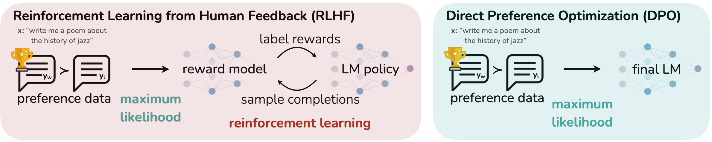
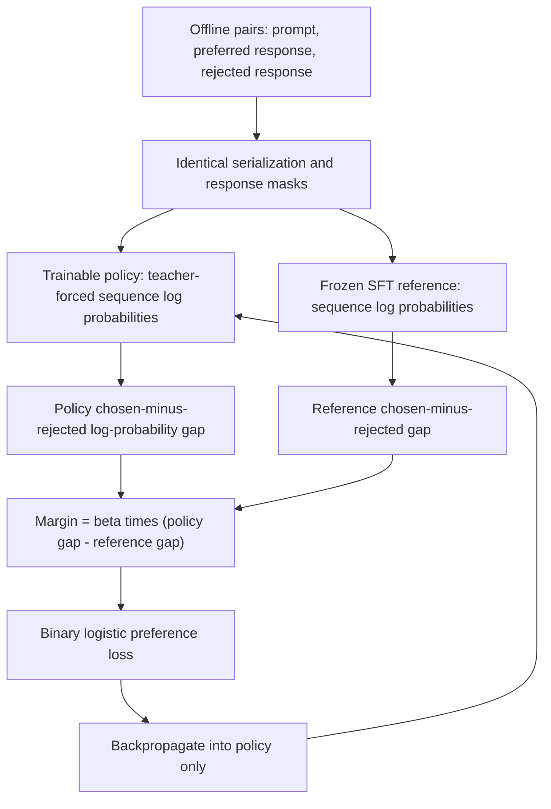
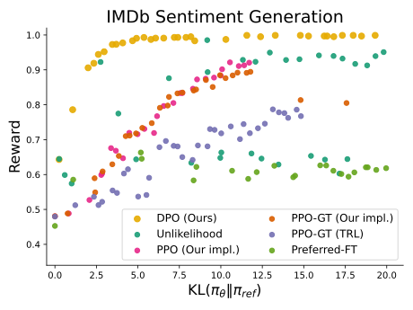
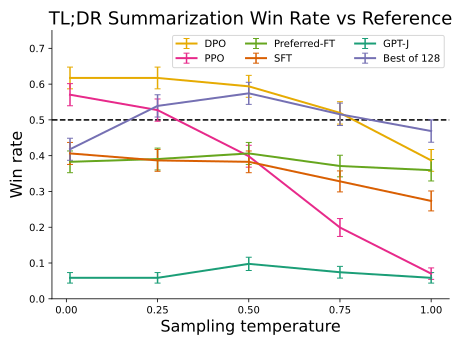
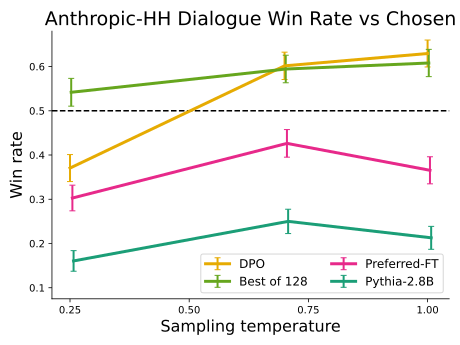

# Direct Preference Optimization (DPO) -- Rafailov et al., 2023

> **Title:** Direct Preference Optimization: Your Language Model is Secretly a Reward Model.
> **arXiv:** [2305.18290v3](https://arxiv.org/abs/2305.18290v3), 29 July 2024; first submitted 29 May 2023.
> **Venue:** NeurIPS 2023. **Affiliations:** Stanford University and CZ Biohub.
> **Authors:** Rafael Rafailov, Archit Sharma, Eric Mitchell, Stefano Ermon, Christopher D. Manning, and Chelsea Finn.
> **Scope:** The latest arXiv revision's method, mathematical appendices, experiments, and limitations. Paper settings are distinguished from the evolving reference repository's defaults.

## TL;DR

Direct Preference Optimization trains a language model on preferred/rejected response pairs using a binary logistic loss, without separately training a reward model or running an online actor-critic loop. Its key derivation rewrites the reward of a KL-regularized optimal policy as a scaled policy/reference log-probability ratio; prompt-dependent normalization cancels when comparing two responses to the same prompt. DPO performs strongly in the paper's sentiment, summarization, and single-turn dialogue experiments, but the theoretical change of variables does not guarantee exact recovery of human preferences from finite, noisy data or unrestricted out-of-distribution generalization. A frozen reference model, suitable preference data, and usually an SFT initialization still matter.

## Problem & motivation

### The difficulty is selecting behavior, not merely predicting text

A pretrained language model can assign probability to both useful and undesirable responses. Next-token likelihood alone does not specify which behavior users want. Supervised fine-tuning (SFT) addresses this by imitating demonstrations, but comparing two candidate responses can be easier than writing a high-quality answer from scratch.

The paper starts from the conventional preference-based RLHF pipeline:

1. Fine-tune a pretrained language model on demonstrations to obtain an SFT policy.
2. Collect comparisons between responses to the same prompt and fit a scalar reward model.
3. Generate new responses with the current policy and optimize the learned reward, typically using PPO plus a penalty for drifting from a reference policy.

The third stage introduces online sampling, reward evaluation, policy updates, and usually a value function. That is considerably more machinery than supervised training. For background on these distinct components, see the [InstructGPT recap](alignment-rl_2022_instructgpt-rlhf.md) and [PPO recap](alignment-rl_2017_proximal-policy-optimization.md).



*Original Figure 1. Conventional RLHF first fits a reward model and then repeatedly samples and optimizes a policy. DPO uses the same kind of preference labels to fit a policy directly. The diagram abstracts away initialization and reference-policy evaluation: DPO does not eliminate those requirements.*

### The precise optimization problem

Let $x$ be a prompt, $y$ a complete response, $\pi_\theta(y\mid x)$ the trainable policy, and $\pi_{\mathrm{ref}}(y\mid x)$ a fixed reference policy, usually the SFT model. For a reward function $r(x,y)$ and coefficient $\beta>0$, the RLHF objective is

$$
\max_{\pi_\theta}
\mathbb E_{x\sim\mathcal D}
\left[
\mathbb E_{y\sim\pi_\theta(\cdot\mid x)}r(x,y)
-\beta D_{\mathrm{KL}}
\left(\pi_\theta(\cdot\mid x)\parallel
\pi_{\mathrm{ref}}(\cdot\mid x)\right)
\right].
$$

This is the KL-regularized objective in Eq. 3. The KL is **current policy to fixed reference**, not PPO's ratio against a periodically refreshed rollout policy. A larger $\beta$ places more weight on staying near the reference when the underlying reward is held fixed.

The question is whether one can learn from preference labels while avoiding the explicit reward-model-then-RL decomposition. DPO answers this using a change of variables, not by dropping the preference model or ignoring regularization.

## Key idea

### 1. Preferences depend on reward differences

For two responses $y_w$ and $y_l$ to the same prompt, $y_w$ denotes the preferred response and $y_l$ the rejected response. The Bradley-Terry model assumes

$$
p_r(y_w\succ y_l\mid x)
=
\frac{\exp r(x,y_w)}
{\exp r(x,y_w)+\exp r(x,y_l)}
=
\sigma\left(r(x,y_w)-r(x,y_l)\right),
\qquad
\sigma(z)=\frac{1}{1+\exp(-z)}.
$$

This is Eq. 1. It is a probabilistic model of pairwise preferences, not a claim that all human judgments are deterministic, transitive, or governed by a single universally correct scalar utility.

A conventional reward model $r_\phi$ would minimize the negative log-likelihood

$$
\mathcal L_R(\phi)=
-\mathbb E_{(x,y_w,y_l)\sim\mathcal D}
\log\sigma\left(r_\phi(x,y_w)-r_\phi(x,y_l)\right).
$$

Here $\mathcal D$ is the offline preference dataset and $\phi$ denotes reward-model parameters (Eq. 2). DPO keeps this preference-likelihood structure but changes how rewards are represented.

### 2. Solve the regularized policy problem symbolically

For a fixed reward and prompt, the optimal unrestricted policy is

$$
\pi_r(y\mid x)=
\frac{\pi_{\mathrm{ref}}(y\mid x)\exp(r(x,y)/\beta)}
{Z_r(x)},
\qquad
Z_r(x)=
\sum_{y'}
\pi_{\mathrm{ref}}(y'\mid x)\exp(r(x,y')/\beta).
$$

$Z_r(x)$ is a prompt-dependent partition function (Eq. 4). Assume it is finite and that the reference has positive probability on responses being modeled.

To see why this is optimal, define $F_x(\pi)$ as the reward-minus-KL objective for one prompt. Substituting $\pi_r$ gives

$$
\begin{aligned}
F_x(\pi)
&=
\sum_y\pi(y\mid x)
\left[
r(x,y)-\beta\log
\frac{\pi(y\mid x)}{\pi_{\mathrm{ref}}(y\mid x)}
\right]\\
&=
\beta\log Z_r(x)
-\beta D_{\mathrm{KL}}
\left(\pi(\cdot\mid x)\parallel\pi_r(\cdot\mid x)\right).
\end{aligned}
$$

The first term does not depend on $\pi$, and the KL is minimized at $\pi=\pi_r$. This is an equivalent form of the derivation in Appendix A.1.

The solution is analytical, but computing $Z_r(x)$ by enumerating all language completions is impractical. DPO does **not** solve that enumeration problem.

### 3. Invert the policy solution and cancel the partition function

Rearrange the optimal-policy formula:

$$
r(x,y)=
\beta\log\frac{\pi_r(y\mid x)}
{\pi_{\mathrm{ref}}(y\mid x)}
+\beta\log Z_r(x).
$$

This is Eq. 5. The second term is identical for every response to a given prompt, so it cancels in $r(x,y_w)-r(x,y_l)$.

Define the policy's implicit reward and preference margin:

$$
\widehat r_\theta(x,y)=
\beta\log
\frac{\pi_\theta(y\mid x)}
{\pi_{\mathrm{ref}}(y\mid x)},
\qquad
z_\theta=
\widehat r_\theta(x,y_w)-\widehat r_\theta(x,y_l).
$$

The corresponding preference probability is $\sigma(z_\theta)$. Fitting preference labels now directly trains $\pi_\theta$:

$$
\boxed{
\mathcal L_{\mathrm{DPO}}(\theta)=
-\mathbb E_{(x,y_w,y_l)\sim\mathcal D}
\log\sigma
\left[
\beta
\left(
\log\frac{\pi_\theta(y_w\mid x)}
{\pi_{\mathrm{ref}}(y_w\mid x)}
-
\log\frac{\pi_\theta(y_l\mid x)}
{\pi_{\mathrm{ref}}(y_l\mid x)}
\right)
\right]
}.
$$

This is the main DPO loss, Eq. 7. It needs conditional log probabilities of the two supplied responses under the policy and reference. No new response must be sampled to evaluate a training pair.

The classifier's logit is a **difference of policy/reference log-ratios**. It is not the policy's raw preference for a response, a separate scalar classification head, or ordinary SFT on a label token.

### 4. Why this does not restrict the ideal reward model

Sections 5.1 and Appendix A.5-A.6 identify rewards that differ only by a prompt-dependent offset as equivalent:

$$
r'(x,y)=r(x,y)+c(x).
$$

Adding $c(x)$ changes neither Bradley-Terry/Plackett-Luce preferences nor the normalized optimal policy. DPO chooses the canonical representative

$$
\begin{aligned}
r_{\mathrm{canonical}}(x,y)
&=r(x,y)-\beta\log Z_r(x)\\
&=\beta\log
\frac{\pi_r(y\mid x)}{\pi_{\mathrm{ref}}(y\mid x)},\\
\sum_y\pi_{\mathrm{ref}}(y\mid x)
\exp\left(r_{\mathrm{canonical}}(x,y)/\beta\right)
&=1.
\end{aligned}
$$

Theorem 1 and Proposition 1 establish representation and uniqueness of this canonical reward within each equivalence class, assuming $\beta>0$ and positive reference support. The argument also requires a well-defined normalizable optimal distribution.

The theorem concerns distributions and reward equivalence classes. It does **not** say that a finite neural policy can represent every such distribution, that limited labels determine rewards on unseen responses, or that stochastic optimization finds the population optimum.

## How it works

### 1. Prepare an appropriate reference and preference dataset

Each training example is a triple $(x,y_w,y_l)$. Both responses must belong to the **same prompt**, since that is what makes the partition term cancel.

When an SFT policy matching the data source is available, use it as the reference and initialize the trainable policy from it. When it is unavailable, the paper fits a reference by maximizing the likelihood of preferred responses (Section 4):

$$
\pi_{\mathrm{ref}}
\approx
\underset{\pi}{\operatorname{argmax}}\,
\mathbb E_{(x,y_w)\sim\mathcal D}
\log\pi(y_w\mid x).
$$

The approximation sign acknowledges finite-model training rather than an exact optimization oracle. This initialization helps put the existing dataset within the model's distribution; it does not reconstruct the unknown original data-generating model exactly.

The reference remains **fixed** during a basic DPO run. Replacing it with the current policy after every minibatch would change the objective and destroy the intended comparison baseline.

### 2. Compute response-level conditional log probabilities

For a response containing $L_y$ tokens, use

$$
\log\pi_\theta(y\mid x)=
\sum_{t=1}^{L_y}
\log\pi_\theta(y_t\mid x,y_{<t}).
$$

This is the autoregressive sequence likelihood, evaluated by teacher forcing. It is a **sum**, not a length-normalized average; replacing it with an average changes the original objective.

For a batch of $B$ preference pairs, an efficient implementation concatenates the chosen and rejected sequences:

| Quantity | Logical shape | Meaning |
|---|---|---|
| Token IDs / attention mask | $[2B,L]$ | Padded prompt-plus-response sequences. |
| Policy logits | $[2B,L,V]$ | $V$ vocabulary logits per position. |
| Shifted token log probabilities | $[2B,L-1]$ | Next-token likelihoods after aligning labels and logits. |
| Masked response log probabilities | $[2B]$ | Sum over response tokens only. |
| Chosen/rejected policy and reference scores | Four tensors of shape $[B]$ | Inputs to the pairwise loss. |
| Preference margins and losses | $[B]$ | One logit and logistic loss per preference pair. |

Important details, consistent with the authors' [reference implementation](https://github.com/eric-mitchell/direct-preference-optimization/blob/main/trainers.py):

1. Shift causal logits and labels so each position predicts the next token.
2. Exclude prompt and padding positions from the response log-probability sum. Include any end-of-response token according to the same serialization convention in both models.
3. Use identical tokenization, formatting, response boundaries, and truncation for policy and reference scores.
4. Compute the frozen reference scores without gradients. They can be cached if the reference and preprocessing stay unchanged.
5. Reject malformed or empty-response training examples rather than silently treating a fully masked sequence as a meaningful zero log-probability response.

The current implementation uses an ignored-label marker of **-100**, replaces ignored labels with a valid dummy token before gathering log probabilities, and then masks out those positions. Its default sequence scoring sums the token log probabilities. These are implementation details, not a new loss variant.

### 3. Form a stable pairwise loss and update only the policy

For one pair, define

$$
\Delta_\theta=
\left[\log\pi_\theta(y_w\mid x)-\log\pi_\theta(y_l\mid x)\right]
-
\left[\log\pi_{\mathrm{ref}}(y_w\mid x)
-\log\pi_{\mathrm{ref}}(y_l\mid x)\right],
\qquad
\ell_\theta=
-\log\sigma(\beta\Delta_\theta)
=\operatorname{softplus}(-\beta\Delta_\theta).
$$

Use a numerically stable log-sigmoid or softplus implementation, average the per-pair losses, and backpropagate through the policy. There is no gradient through the fixed reference and no separately learned value target.

In self-authored pseudocode:

```text
initialize policy and frozen reference from the chosen SFT checkpoint
repeat over minibatches of same-prompt preferred/rejected pairs:
    serialize both responses with identical prompt boundaries
    score response tokens under the trainable policy
    obtain frozen reference response scores
    policy_gap = chosen_policy_logp - rejected_policy_logp
    reference_gap = chosen_reference_logp - rejected_reference_logp
    loss = mean(softplus(-beta * (policy_gap - reference_gap)))
    update only the policy parameters
```



Appendix B supplies a compact PyTorch implementation of the same loss and detached implicit rewards for logging. A detached reward used as a metric is not a separately trained reward model.

### 4. Understand the adaptive gradient weight

Differentiating Eq. 7 gives the main-text gradient:

$$
\nabla_\theta\mathcal L_{\mathrm{DPO}}
=
-\beta\,
\mathbb E_{\mathcal D}
\left[
\sigma(-z_\theta)
\left(
\nabla_\theta\log\pi_\theta(y_w\mid x)
-
\nabla_\theta\log\pi_\theta(y_l\mid x)
\right)
\right].
$$

The factor $\sigma(-z_\theta)$ is large when the implicit reward misorders the pair and small when it already ranks the preferred response well above the rejected one. A naive unweighted objective that indefinitely maximizes the chosen/rejected log-probability gap lacks this saturation.

At initialization, if policy and reference are identical, every margin is zero, every pair loss is $\log 2$, and the preference probability is $1/2$. The loss gradient is generally **not zero**: its scalar weight is $\beta/2$.

The derivative encourages the preferred response relative to the rejected one in log-likelihood space. Because language-model parameters and normalized token distributions are shared, it does not guarantee that each preferred response's absolute probability increases after every update.

**Source-sign warning:** Appendix A.4's Eq. 21 reverses the preferred/rejected order relative to Eq. 7, and its final expanded gradient uses the opposite sigmoid argument from the main-text gradient. The formulas here follow **Eq. 7, the main-text gradient, Appendix B's code, and the released implementation**, which agree on the logistic loss and the $\sigma(-z_\theta)$ weight.

### 5. Interpret beta without turning it into a hard KL bound

For a fixed underlying reward, the analytical optimal policy is proportional to $\pi_{\mathrm{ref}}\exp(r/\beta)$, so larger $\beta$ produces a more reference-conservative optimum.

In the training loss, however, $\beta$ also scales the classification margin and gradient. Reducing it does not simply make every gradient larger: at initialization the gradient scale is $\beta/2$, and representing the same reward difference requires a larger policy/reference log-ratio difference when $\beta$ is smaller.

There is **no explicit measured-KL constraint enforced per minibatch** in basic DPO. The regularization arises from the reference-based parameterization and the underlying optimization derivation. Finite data, separable preferences, model misspecification, or overtraining can still produce excessive drift.

### 6. Generalize from pairs to ranked lists

Appendix A.3 extends the derivation to Plackett-Luce rankings. Given $K$ candidate responses and a permutation $\tau$ ordering them from most to least preferred,

$$
p_\theta(\tau\mid x,y_{1:K})
=
\prod_{k=1}^{K}
\frac{\exp\widehat r_\theta(x,y_{\tau(k)})}
{\sum_{j=k}^{K}
\exp\widehat r_\theta(x,y_{\tau(j)})},
\qquad
\mathcal L_{\mathrm{rank}}
=-\mathbb E_{\mathcal D}\log p_\theta(\tau\mid x,y_{1:K}).
$$

Here $y_{1:K}$ denotes the candidate set and $\tau(k)$ the index selected at rank $k$. The prompt-dependent partition term cancels at every rank. For $K=2$, this reduces to the Bradley-Terry DPO loss. This is a theoretical extension; the main experiments use pairwise preference data.

### 7. What computation disappears, and what remains

DPO removes the separate reward-fitting stage and the online RL rollout/critic loop. It still performs policy forward/backward passes, evaluates or caches a reference model, and needs preference labels and usually an SFT checkpoint. It does not eliminate sampling used **before training** to create the dataset, **during evaluation**, or **at inference**.

Section 5.2 interprets the reward-normalization term $\beta\log Z_r(x)$ as a prompt-dependent baseline related to a soft value. Such a baseline leaves the optimal policy unchanged but can reduce the variance of policy-gradient estimation. DPO avoids estimating that baseline because it directly differentiates an offline preference likelihood. This is not a proof that every actor-critic implementation is unstable or that a value function is useless in other settings.

## Training / data

### Paper hyperparameters

Appendix B gives the following shared defaults, with a different beta for summarization:

| Setting | Paper value | Source |
|---|---|---|
| Default DPO beta | 0.1 | Appendix B |
| TL;DR summarization beta | 0.5 | Appendix B |
| Batch size | 64 | Appendix B |
| Optimizer | RMSprop | Appendix B |
| Learning rate | $10^{-6}$ | Appendix B |
| Learning-rate warmup | Linear from zero over 150 steps | Appendix B |

The paper does not give a complete task-by-task table of DPO epochs, sequence-length limits, optimizer numerical constants, hardware, and wall time. These should not be invented from present-day repository defaults.

For example, the inspected repository configuration currently sets a default learning rate of **$5\times10^{-7}$** and batch size **4**, whereas the paper states **$10^{-6}$** and **64**. Its README provides larger-batch commands and a separate illustrative Pythia training run; those are not substitutes for the paper's experimental specification. The repository also now includes conservative DPO and IPO options. The original DPO loss corresponds to **zero label smoothing** with the usual reference correction, not those later variants.

### Controlled sentiment: GPT-2-large and classifier preferences

The IMDb experiment uses short movie-review prefixes and asks the model to continue them with positive sentiment. Its "ground-truth reward" is a pretrained sentiment classifier, not human verification of every completion.

| Component | Reported setup | Source |
|---|---|---|
| Base language model | GPT-2-large | Appendix C.1 |
| Reward oracle | `siebert/sentiment-roberta-large-english` | Appendix C.1 |
| Prompt length | 2-8 tokens | Appendix C.1 |
| Initial SFT | One epoch on an IMDb subset | Appendix C.1 |
| Prefixes used to create comparisons | 25,000 | Appendix C.1 |
| Responses sampled per prefix | 4 | Appendix C.1 |
| Preference pairs per prefix | 6 | Appendix C.1 |
| Learned PPO reward model | Initialized from GPT-2-large; trained for 3 epochs; best validation-accuracy checkpoint | Appendix C.1 |
| Modified PPO rollout batch | 1024 samples per PPO step | Appendix C.1 |

Four candidates yield $\binom{4}{2}=6$ unordered comparisons. Thus the reported construction corresponds to **100,000 sampled responses** and **150,000 preference pairs**, before any unspecified filtering; these totals are derived, not additional dataset counts reported by the paper.

Section 6.1 sweeps PPO target KL over **$\{3,6,9,12\}$**, DPO beta over **$\{0.05,0.1,1,5\}$**, and unlikelihood coefficient alpha over **$\{0.05,0.1,0.5,1\}$**. The full comparison includes **22 runs**, with policy evaluation every **100 training steps** until convergence. Preferred-FT also varies random seeds.

The comparison includes ordinary PPO with a learned reward, PPO with direct access to the classifier reward (PPO-GT), and a modified PPO implementation with reward normalization and further tuning. Distinguish the paper's "TRL"/off-the-shelf baseline from its tuned implementation rather than treating one run as all possible PPO configurations.

### Summarization: GPT-J and Reddit TL;DR

The summarization experiments fine-tune the same **GPT-J-based, 6B-scale SFT checkpoint**, [CarperAI/openai_summarize_tldr_sft](https://huggingface.co/CarperAI/openai_summarize_tldr_sft), for DPO, PPO, and Preferred-FT (Section 6.2).

Training preferences come from the human comparison data of Stiennon et al. The comparison responses were generated by a different but similarly trained SFT model, so exact reference/data-generator identity is not assumed. DPO reuses labeled pairs; the PPO comparison additionally uses unlabeled TL;DR prompts for online optimization (Section 6.3).

For evaluation, the model summarizes held-out Reddit posts and GPT-4 compares its summary against the **human-written reference summary**. Sampling temperatures vary from **0 to 1**. The paper does not supply a complete count table for all summarization training/evaluation splits in these sections.

### Dialogue: Pythia-2.8B and Anthropic HH

The source preference dataset contains about **170,000 dialogues** (Section 6 setup). The experiment starts from **Pythia-2.8B**, first fine-tunes on preferred responses to construct an in-domain reference, then applies DPO.

Evaluation uses the **single-turn subset** of the Anthropic Helpful and Harmless test split. Its baseline is the **preferred response in that dataset**, not a separately established ground-truth answer.

Baselines include the reference/Preferred-FT model, a **2-shot** prompted base model, and best-of-**128** sampling. A released PPO model trained on HH, `reciprocate/ppo_hh_pythia-6B`, did not perform well under the prompts/temperatures the authors tried. Consequently, the paper treats best-of-128 as a **rough proxy** for PPO-level performance; it does not present a clean, successfully tuned, same-size DPO-versus-PPO dialogue comparison.

### Evaluation protocol

Appendix C.2 identifies the judge as **`gpt-4-0314`** and randomizes the order of the two candidate outputs. The judge first gives a short explanation, then an A/B choice.

For summarization, prompt **S** asks which output better captures important information. Prompt **C** additionally emphasizes precision and concision, because the simpler prompt tended to favor longer, repetitive summaries more than human raters did. Main summarization results use C. The dialogue rubric asks which response is more helpful.

These are pairwise, rubric- and opponent-dependent win rates, not universal factual-accuracy measurements. In particular, changing the baseline from a human summary to PPO changes what the reported percentage means.

## Results

### 1. Sentiment reward-KL frontier



*Original Figure 2, left panel. DPO obtains a better reward-versus-KL frontier than the plotted PPO and other baselines, including PPO variants with access to the classifier reward. The KL is sequence-level current-to-reference KL, described by the paper as a sum of per-timestep divergences. A higher reward at a much higher KL is not an unqualified improvement.*

Section 6.1 attributes the result to more efficient optimization of the preference-derived objective, not to DPO having better reward information than the classifier oracle. The figure is evidence for these runs and this controlled task; it is not a universal proof that DPO dominates every tuned PPO implementation. The paper does not tabulate exact coordinates for the whole frontier, so no digitized values are presented here.

### 2. TL;DR summarization



*Original Figure 2, right panel. GPT-4 compares generated summaries with human reference summaries. DPO stays stronger over a wider range of sampling temperatures, whereas PPO's quality drops more sharply as temperature rises. This plot does not use PPO itself as the comparison opponent.*

| Evaluation | DPO | PPO / comparison | Source |
|---|---|---|---|
| GPT-4 win rate against human TL;DR reference, temperature 0 | Approximately 61% | Approximately 57% for PPO at its best reported temperature, also 0 | Section 6.2 |
| Human preference in a direct DPO-versus-PPO comparison | 58% for DPO at temperature 0.25 | Opponent is PPO at temperature 0 | Section 6.2 and Table 2 |

The first row is an approximate prose-reported result against human reference summaries. The second is a different matchup, judged by humans. They cannot be combined into one common-baseline ranking without additional assumptions.

Preferred-FT does not substantially improve over the SFT model in this experiment, while DPO improves more. DPO also exceeds the best-of-N baseline's maximum plotted win rate (Section 6.2).

### 3. Single-turn dialogue



*Original Figure 3, left panel. DPO improves over the dataset's preferred responses and is comparable to or better than the computationally expensive best-of-128 baseline at their best temperatures. The source caption's reference to chosen "summaries" is a wording error: this panel evaluates dialogue responses.*

Section 6.2 reports DPO as the only computationally efficient tested method that improves over the chosen HH responses. Figure 3's other panel shows relatively quick convergence, with a small later decline that the discussion raises as a possible sign of over-optimization.

Appendix D.1 evaluates best-of-N with **$N\in\{1,4,16,64,128\}$** and finds performance roughly plateaus at **64-128** samples (Figure 4). This strong baseline has substantial **inference-time** generation and scoring cost; DPO does not need that repeated sampling after training.

### 4. Out-of-distribution summarization: CNN/DailyMail

The TL;DR-trained policies are applied to held-out news articles. GPT-4 C compares generated summaries with the dataset's reference summaries; the evaluation prompt changes "forum post" to "news article" (Section 6.3).

| Method | Temperature 0 | Temperature 0.25 |
|---|---|---|
| DPO | 0.36 | 0.31 |
| PPO | 0.26 | 0.23 |

*All values: Table 1. Entries are win-rate fractions, not percentages or task accuracies.*

DPO outperforms the tested PPO policy at both decoding temperatures. However, **all four win rates remain below one half**: being better than PPO here does not mean these models beat the reference summaries most of the time. This is one distribution-shift experiment, not broad OOD assurance.

### 5. Human validation of GPT-4 judgments

Every column below compares the named candidate against **PPO at temperature 0**. DPO and SFT candidates use temperature **0.25**; PPO-1 means PPO sampled at temperature **1.0**, not a different PPO architecture.

| Statistic | DPO | SFT | PPO-1 |
|---|---|---|---|
| Retained human judgments, source row "N respondents" | 272 | 122 | 199 |
| GPT-4 S candidate win % | 47 | 27 | 13 |
| GPT-4 C candidate win % | 54 | 32 | 12 |
| Human candidate win % | 58 | 43 | 17 |
| GPT-4 S / human agreement % | 70 | 77 | 86 |
| GPT-4 C / human agreement % | 67 | 79 | 85 |
| Human / human agreement % | 65 | - | 87 |

*All entries: Table 2. A dash means not measured, not zero. Despite the source's row label, the counts are judgment counts, not hundreds of distinct volunteers.*

Appendix D.3 describes **25 volunteers**, with one late respondent excluded, and **25 comparisons per completed survey**. The study selected **150 DPO/PPO comparisons** and **100 PPO-1/PPO-0 comparisons** for double annotation, and **125 SFT/PPO comparisons** for single annotation. One missing DPO survey left **275 DPO judgments** before ties; the other raw counts were **125 SFT** and **200 PPO-1** judgments.

The printed retained counts imply **3, 3, and 1 discarded judgments**, respectively, or **7 of 600** total judgments; these are derived counts consistent with the source's statement that about **1%** were ties. There are repeated judgments on the same comparison, so the table is not a set of hundreds of independent participants.

GPT-4 agreement is broadly comparable to the reported inter-human agreement, but the prompts are not interchangeable. In the DPO/PPO matchup, for example, S gives **47%**, C gives **54%**, and humans give **58%**. The C prompt is closer to human aggregate preferences, even though its per-judgment agreement is not higher in every column.

### 6. Failure cases matter

Appendix C.3 and Table 3 show that the unlikelihood baseline can degenerate into repetitive, meaningless output on summarization, so it is omitted from the main summarization/dialogue comparisons. This supports the importance of a controlled preference objective, not a theorem that every possible unlikelihood method fails.

Appendix D.2 includes DPO responses that are plausible or verbose but factually wrong, as well as an incorrect GPT-4 explanation of a comparison. Better preference win rates do not make DPO outputs or their automated evaluator reliable truth verifiers.

## Limitations & follow-ups

### The exact derivation has a precise scope

The policy/reward mapping is exact for the stated KL-regularized problem, a normalizable reward tilt, and the assumed preference model. With unrestricted distributions and sufficient population data, it motivates recovering the corresponding optimal policy through preference likelihood.

That is different from promising that finite neural DPO training exactly reproduces a particular separately trained reward-model-plus-PPO system. Model capacity, preference-model misspecification, optimization, sampling coverage, and the reference distribution all affect the practical result.

### Offline labels do not cover every response the trained model can generate

Basic DPO does not acquire fresh labels for new behavior during training. An SFT initialization helps, but does not remove distribution shift or determine preferences on unseen outputs. The CNN/DailyMail test is encouraging relative evidence, while Section 7 explicitly calls for more comprehensive OOD study and asks whether self-labeling could exploit additional unlabeled prompts.

Theoretical positive reference support also should not be confused with practically useful support: an extremely small reference probability can still correspond to an underrepresented region of the preference dataset.

### Implicit rewards are not externally validated rewards

$\widehat r_\theta$ is computed from the policy and reference, so it is a useful interpretation and training diagnostic, not independent evidence that a response is safe, correct, or preferred by all users. Human labels can be noisy, inconsistent, or reflect a limited population.

The reference correction does not enforce a fixed KL budget, and the logistic loss can keep favoring larger margins on separable training pairs. The paper leaves direct-preference over-optimization as an open question and notes a slight late-training decline in its dialogue plot.

### The empirical comparisons have limits

The models evaluated are at most **6B parameters** (Sections 1 and 7), not contemporary frontier-scale systems. The dialogue PPO checkpoint did not yield a successful matched baseline, so best-of-128 is only a proxy there. The sentiment reward is a classifier, and much of the realistic-task evaluation uses a prompt-sensitive GPT-4 judge.

The human study involves a small, mostly STEM/CS-affiliated Stanford population rather than a representative global sample (Appendix D.3). Agreement on the measured comparisons does not establish that the judge is unbiased, nor that automated preferences are equivalent to human welfare or factual correctness.

### Relationship to later methods

[InstructGPT](alignment-rl_2022_instructgpt-rlhf.md) exemplifies the explicit preference-reward-plus-PPO route that DPO simplifies. [PPO](alignment-rl_2017_proximal-policy-optimization.md) is a general policy optimizer and remains useful when the task calls for online interaction or direct reward optimization; DPO is an offline preference-learning formulation, not a drop-in solution to every reinforcement-learning problem.

The [reference repository](https://github.com/eric-mitchell/direct-preference-optimization) now also implements conservative DPO and [IPO](https://arxiv.org/abs/2310.12036), which alter the learning objective or assumptions. Later alternatives such as [KTO](alignment-rl_2024_kahneman-tversky-optimization.md) and [ORPO](https://arxiv.org/abs/2403.07691) change aspects of preference supervision or reference-based training. They should not be silently substituted for the original Eq. 7 when reproducing this paper.

## Links

- **arXiv:** [abstract, v3](https://arxiv.org/abs/2305.18290v3) / [HTML, v3](https://arxiv.org/html/2305.18290v3) / [PDF, v3](https://arxiv.org/pdf/2305.18290v3).
- **Code:** [Official reference implementation](https://github.com/eric-mitchell/direct-preference-optimization), including [loss and sequence scoring](https://github.com/eric-mitchell/direct-preference-optimization/blob/main/trainers.py) and [configuration](https://github.com/eric-mitchell/direct-preference-optimization/blob/main/config/config.yaml). Current defaults differ from some paper settings.
- **Hugging Face:** [Summarization SFT checkpoint used in the paper](https://huggingface.co/CarperAI/openai_summarize_tldr_sft). This is an initialization/baseline checkpoint, not a claim that it is the paper's final DPO model.
- **Project page:** [Official repository and README](https://github.com/eric-mitchell/direct-preference-optimization).
- **Blog posts:** No separate blog used as a source for this recap.
- **Talks / videos:** No paper-specific recording verified for this recap.
- **OpenReview / venue page:** [NeurIPS 2023 proceedings](https://proceedings.neurips.cc/paper_files/paper/2023/hash/a85b405ed65c6477a4fe8302b5e06ce7-Abstract-Conference.html).
- **Papers-with-Code:** Not used as a source; primary paper and released implementation linked above.
- **Related / successor papers:** [InstructGPT recap](alignment-rl_2022_instructgpt-rlhf.md), [PPO recap](alignment-rl_2017_proximal-policy-optimization.md), [summarization RLHF](https://arxiv.org/abs/2009.01325), [IPO](https://arxiv.org/abs/2310.12036), [KTO](alignment-rl_2024_kahneman-tversky-optimization.md), [ORPO](https://arxiv.org/abs/2403.07691).
- **BibTeX:**

```bibtex
@inproceedings{rafailov2023direct,
  title={Direct Preference Optimization:
         Your Language Model is Secretly a Reward Model},
  author={Rafailov, Rafael and Sharma, Archit and Mitchell, Eric
          and Ermon, Stefano and Manning, Christopher D.
          and Finn, Chelsea},
  booktitle={Advances in Neural Information Processing Systems},
  year={2023},
  url={https://arxiv.org/abs/2305.18290}
}
```
