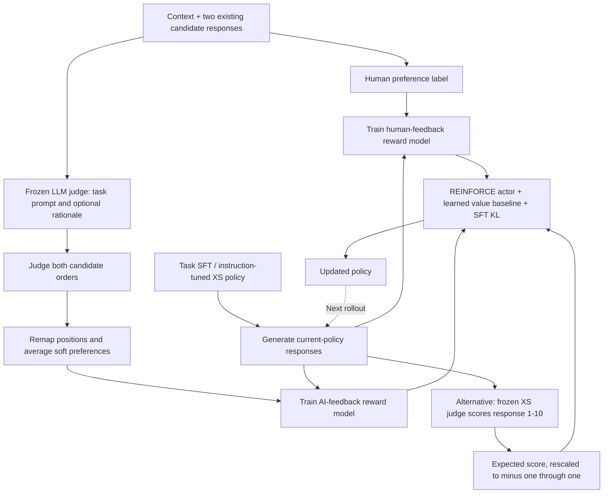
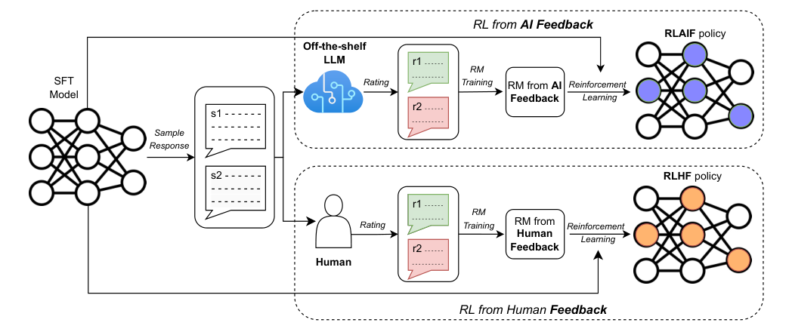
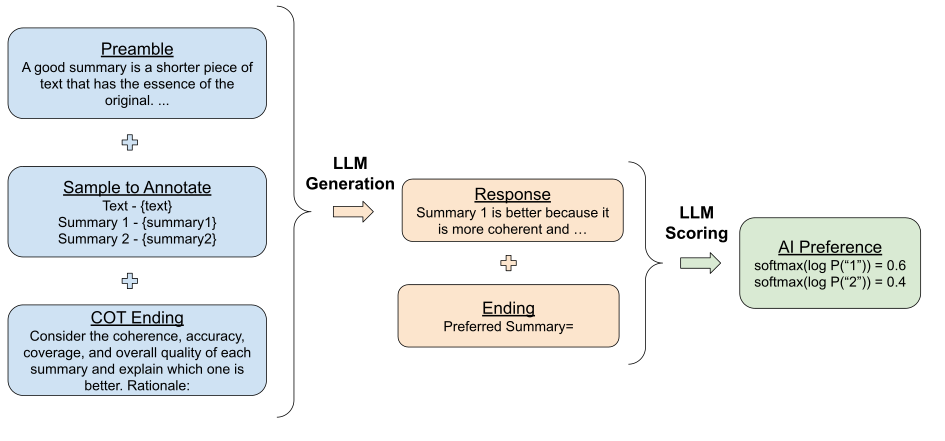
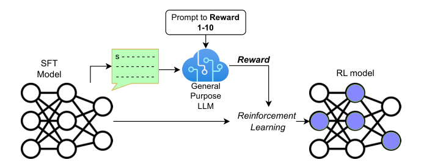
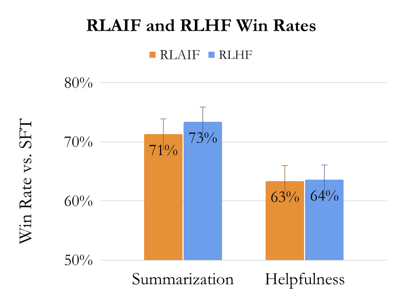

# RLAIF vs. RLHF - Lee et al., 2023

> **arXiv:** [2309.00267v3](https://arxiv.org/abs/2309.00267v3), 3 September 2024; first submitted 1 September 2023. **Venue:** ICML 2024, PMLR 235:26874--26901. **Affiliations:** Google DeepMind and Google.
>
> **Full title:** RLAIF vs. RLHF: Scaling Reinforcement Learning from Human Feedback with AI Feedback.
>
> **Authors:** Harrison Lee, Samrat Phatale, Hassan Mansoor, Thomas Mesnard, Johan Ferret, Kellie Lu, Colton Bishop, Ethan Hall, Victor Carbune, Abhinav Rastogi, and Sushant Prakash. The venue record lists Kellie Ren Lu.

## TL;DR

This paper compares otherwise similar post-training pipelines whose reward models learn from either human preferences or preferences supplied by an off-the-shelf language model. On summarization and helpful dialogue, humans prefer RLAIF over the SFT baseline **71%** and **63%** of the time, versus **73%** and **64%** for RLHF; on harmless dialogue, independently rated harmless-response rates are **88%**, **76%**, and **64%** for RLAIF, RLHF, and SFT respectively (Table 1). The latest revision also studies **direct-RLAIF**, which bypasses preference-model distillation by querying a frozen LLM for a scalar reward during RL, and reports gains even when the evaluator starts from the exact same checkpoint as the policy. The evidence supports useful AI-generated supervision on these tasks, not universal equivalence to human feedback, and response-length adjustment materially reduces several headline win rates.

## Problem & motivation

### Can AI preferences replace the expensive labeling step?

RLHF typically has three stages: supervise a pretrained policy on demonstrations, train a reward model from human comparisons, and optimize the policy against that reward. Human preferences permit objectives such as overall summary quality or helpfulness that are difficult to express as a token-level reference loss, but large-scale comparison collection is slow and expensive.

[Constitutional AI](alignment-rl_2022_constitutional-ai.md) had already introduced RLAIF, combining AI harmlessness judgments with human helpfulness preferences and constitutional self-revision. That left a narrower empirical question unresolved: if comparable downstream pipelines are trained from AI versus human preferences, how well do their final policies compare? Lee et al. isolate that question across summarization, helpful dialogue, and harmless dialogue, without requiring the constitutional critique/revision stage.

The paper also asks whether an evaluator must be much larger than the trained policy, whether better label agreement predicts better downstream behavior, and whether a separately trained reward model is necessary.

### Reward-model staleness is a second bottleneck

Canonical RLAIF annotates response pairs once, trains a compact reward model, and reuses it during policy optimization. As the policy changes, its outputs can leave the reward model's training distribution. Periodically generating new labels and retraining the reward model is one response to this staleness, but it adds orchestration and training cost.

Direct-RLAIF instead asks an off-the-shelf evaluator to score current responses during RL. This removes one learned approximation and its fixed comparison dataset. It does **not** make the frozen evaluator omniscient, immune to policy-induced distribution shift, or free to query.

### Three quantities that should not be conflated

**AI labeler alignment** is agreement with existing human preference labels on fixed response pairs. **Reward-model accuracy** is a trained scalar model's agreement with human preferences on held-out pairs. **Policy quality** is judged on newly generated answers after RL. These can move differently: the paper finds lower human-agreement accuracy for AI-trained reward models even when their final policies perform comparably to, or better than, human-feedback policies (Appendix G).

## Key idea

For canonical RLAIF, retain the usual reward-model-plus-RL pipeline but replace the human comparison label with an LLM's **soft preference distribution**.

Let $x$ be an input context and $y_A,y_B$ two candidate responses. A judgment prompt $P(x,y_A,y_B)$ contains task instructions, optional examples, and a request to choose candidate 1 or 2. If the evaluator assigns choice-token log probabilities $\ell_1,\ell_2$, its preference for the first candidate is

$$
p_1=\frac{\exp(\ell_1)}{\exp(\ell_1)+\exp(\ell_2)}.
$$

Run the judgment again with the candidates swapped. If $p_1^{AB}$ is the first-position probability when A is shown first and $p_1^{BA}$ when B is shown first, the content-aligned preference for A is

$$
p_A=\frac12\left[p_1^{AB}+(1-p_1^{BA})\right],
\qquad p_B=1-p_A.
$$

The reversal inside the second term is essential: average preferences for the **same candidate**, not the same screen position.

A reward model $r_\phi(x,y)$ learns the soft pair target through

$$
\widehat p_A=
\sigma\!\left(r_\phi(x,y_A)-r_\phi(x,y_B)\right),
\qquad
\mathcal L_{\mathrm{RM}}
=-\mathbb E\left[
p_A\log\widehat p_A+(1-p_A)\log(1-\widehat p_A)
\right],
$$

where $\phi$ denotes reward-model parameters and $\sigma$ is the logistic sigmoid. RL then increases the likelihood of responses with high reward while regularizing against the SFT policy.

For **direct-RLAIF**, do not train this reward model. Instead, ask the evaluator to rate one response on a 1--10 scale, normalize the likelihoods of those ten score labels, and use the expected score, rescaled to $[-1,1]$, as the reward. The optimization algorithm is still RL; this is neither DPO nor inference-time answer reranking.

## How it works

### 1. Architecture: change the supervisor, not the transformer

The experiments use the PaLM 2 family. Policies and reward models use **Extra-Small (XS)** checkpoints; the default preference labeler is an instruction-tuned **Large (L)** model. Smaller **S** and **XS** labelers are tested as ablations. The paper does not disclose exact parameter counts for these size labels or introduce a new transformer block.

All labelers are instruction-tuned and have not previously undergone RL in this setup. For summarization, the initial policy is additionally finetuned on Reddit TL;DR. For helpful and harmless dialogue, the instruction-tuned XS checkpoint serves as the SFT baseline without a new task-specific SFT stage.



The reward sources are alternatives, not three rewards necessarily combined in a single run.



*Original Figure 2. Both branches train a reward model and then optimize a policy; the comparison-label source differs. The trained policy is not merely prompted with the judge's instructions at inference time.*

### 2. Construct and score comparison prompts

Section 2.1 breaks the labeler prompt into four parts:

1. **Preamble:** describe the task and quality criteria. A short *Base* preamble is compared with a more detailed rubric.
2. **Optional exemplars:** give an input, two candidate responses, an optional rationale, and a preferred choice.
3. **Current example:** include the input and both candidate answers to judge.
4. **Ending:** request the preferred choice, such as a preferred-summary marker.

For summarization, the detailed criteria include coherence, factual accuracy relative to the source, coverage of important information, and overall quality. Helpful dialogue focuses on useful, honest assistance; harmless dialogue focuses on safer responses.

The model's log probabilities for the choice labels "1" and "2" are normalized with a softmax. This is a distribution **conditional on the allowed labels**; probability assigned to unrelated next tokens is not a third outcome. The candidate-answer likelihoods themselves are not used as preference scores.

In stable arithmetic,

$$
p_1=\exp\left[\ell_1-\operatorname{logsumexp}(\ell_1,\ell_2)\right].
$$

For a batch of $B$ comparisons, choice log probabilities have shape $[B,2]$. Store the resulting $[B,2]$ target distribution alongside the original context and response pair, retaining a consistent candidate identity.

The prompt itself is part of the supervisor specification. Replacing the rubric, examples, score-label formatting, or model version can change labels even when the response pairs do not change.

### 3. Position debiasing requires remapping candidate identities

LLMs may prefer the first or second displayed response independently of content. The paper therefore judges every pair in both orders and averages after mapping both judgments back to the original responses.

For an illustrative fixture, suppose the first-position probability is 0.9 in both orders. The debiased preference for A is $(0.9+0.1)/2=0.5$, not 0.9. If the probabilities are 0.9 in AB order and 0.2 in BA order, A receives $(0.9+0.8)/2=0.85$. These numbers illustrate the operation, not reported experiments.

Swapping reduces order dependence of the final score under the paired procedure. It does not prove that the underlying judgments are unbiased, calibrated, independent of formatting, or accurate. Appendix B quantifies the disagreement caused by position, especially for smaller models.

### 4. Optional CoT is a two-stage judgment procedure

The CoT variant first asks the labeler to discuss the two candidates and greedily decodes a rationale. It then appends that rationale to the original prompt, adds the choice-request ending, and scores "1" versus "2".



*Original Figure 3. Generating a rationale and extracting a soft choice distribution are separate steps. The rationale is context for the judge, not a supervised answer that the policy must imitate.*

Position debiasing is applied to this procedure as well, so each order gets its own judgment context and rationale. The default rationale generation uses temperature 0, maximum 512 generated tokens, and a 4096-token maximum input context (Appendix D).

This study does not inherit Constitutional AI's 0.4--0.6 CoT probability clamp: it trains on the soft preferences described here. Likewise, adding more rationales is not automatically beneficial. The self-consistency experiment averages preference probabilities across sampled rationales and finds lower human agreement than greedy single-rationale judgment (Appendix M).

### 5. Canonical RLAIF distills the evaluator into a reward model

For each fixed comparison, the reward model produces two scalar scores. Applying a softmax to those scores is equivalent to applying a sigmoid to their difference, as in the Key idea equation. The cross-entropy uses both sides of the soft target; thresholding to a hard winner discards the labeler's uncertainty.

Writing $\Delta=r_\phi(x,y_A)-r_\phi(x,y_B)$,

$$
\mathcal L_{\mathrm{pair}}
=\operatorname{softplus}(\Delta)-p_A\Delta,
\qquad
\frac{\partial\mathcal L_{\mathrm{pair}}}{\partial\Delta}
=\sigma(\Delta)-p_A.
$$

For $0<p_A<1$, an isolated pair's optimum is $\Delta=\log[p_A/(1-p_A)]$. Reward scores are therefore preference logits, not absolute probabilities that an answer is good or safe. Adding a common constant to both scores does not change the pairwise prediction.

The human-feedback branch uses the corresponding hard preferred/rejected labels and the usual negative log-sigmoid loss. Both branches use the same underlying preference pairs for the task; RLAIF replaces the annotations rather than asking the labeler to generate a completely new demonstration dataset.

The main summarization comparison is not perfectly identical in every training choice: its AI RM starts from the task SFT checkpoint, whereas its human RM starts from PaLM 2 XS. Appendix G reports alternative initializations. This matters when describing the study as controlled rather than claiming that label source is literally its only difference.

### 6. Direct-RLAIF: expected scalar ratings without an RM



*Original Figure 4. A frozen general-purpose evaluator rates responses generated during RL. It replaces the separately trained reward model, not the policy optimizer or learned value baseline.*

The direct evaluator is instruction-tuned PaLM 2 XS for the reported summarization and helpfulness experiments. Its task prompt asks for a score from 1 to 10 for one context/response pair.

Let $\ell_j$ be the log likelihood of score label $j$ for $j\in\{1,\ldots,10\}$. Define

$$
q_j=\frac{\exp(\ell_j)}{\sum_{k=1}^{10}\exp(\ell_k)},
\qquad
s(x,y)=\sum_{j=1}^{10}j\,q_j.
$$

The paper then normalizes the score to $[-1,1]$. The endpoint-preserving affine mapping is

$$
r_{\mathrm{direct}}(x,y)=2\frac{s(x,y)-1}{9}-1
=\frac{2s(x,y)-11}{9}.
$$

The last expression spells out the linear rescaling implied by the stated range; it is not an additional printed equation in the report. It maps expected scores 1, 5.5, and 10 to rewards -1, 0, and 1. A uniform ten-score distribution therefore gives reward 0. This is the expected score, not the most likely score, a sampled score, or an unnormalized sum of vocabulary probabilities.

For a batch, score-label log likelihoods have shape $[B,10]$; softmax over the score axis and a weighted sum produce $[B]$ rewards. The implementation must score the exact permitted continuations consistently. In a tokenizer where a label such as "10" spans multiple tokens, score its complete continuation rather than silently using only its first token. The report refers to score tokens but does not publish enough tokenizer-level code to establish every boundary convention.

No gradient flows through the frozen judge or its score-normalization computation during policy updates. Rewards are evaluated on sampled responses and then used as detached RL targets. Avoiding reward-model distillation removes one source of approximation/staleness, but online judge inference can be more expensive than querying a compact RM. The paper's offline-label cost estimate does not establish a universal total-training speedup for d-RLAIF.

### 7. The actual optimizer is REINFORCE with a learned baseline

This paper explicitly uses **REINFORCE with a value baseline**, not PPO and not a critic-free group-relative estimator (Section 3.3; Appendix E).

Treat generation as a finite-horizon Markov decision process. State $X_t$ is the input plus the generated prefix, action $A_t$ is the next token, and the next state is deterministic given that token. The task reward is zero before the response ends and equals the RM or direct-judge score at the terminal token:

$$
R_t=0\quad(t<T),\qquad R_T=r(x,y).
$$

With discount $\gamma=1$, the task-reward return is

$$
Z_t=\sum_{s=t}^{T}\gamma^{s-t}R_s=R_T.
$$

The policy loss in Appendix E is

$$
\mathcal L_{\mathrm{PG}}(\theta)
=-\sum_t\log\pi_\theta(A_t\mid X_t)
\,\operatorname{stopgrad}\!\left[Z_t-V_\psi(X_t)\right],
$$

and the value model learns

$$
\mathcal L_V(\psi)
=\sum_t\left[Z_t-V_\psi(X_t)\right]^2.
$$

Here $\theta$ is the policy parameter set, $\psi$ the value-model parameter set, and $V_\psi$ predicts the prefix's return. Both policy and value model initialize from the SFT checkpoint. Although the terminal task reward is shared by all tokens, subtracting prefix-dependent values produces token-dependent advantages.

The baseline is detached in the actor loss; otherwise its gradients would change the intended actor update. Likewise, the value model's regression target is detached. A state-only baseline does not change the expected score-function gradient under the stated on-policy distribution because

$$
\mathbb E_{a\sim\pi_\theta(\cdot\mid X)}
\left[b(X)\nabla_\theta\log\pi_\theta(a\mid X)\right]=0.
$$

That identity is a statement about matching the sampling distribution and score function. The practical recipe samples at temperature 0.9; the report does not publish a full trainer clarifying every temperature/log-probability implementation choice. Do not silently add PPO ratios, clipping, GAE, or GRPO normalization to fill those gaps.

For causal language-model batches, token log probabilities, masks, returns, and values can have shape $[B,T_{\max}]$. Align each next-token log probability with its generated target and prefix value; exclude prompt and padding positions. Appendix E writes a **sum over tokens**, so substituting a per-response token mean introduces length-dependent weighting not established by that equation. Exact packing, EOS, truncation, and cross-batch reduction conventions are not fully documented.

### 8. KL regularization and the reward coefficient

Appendix A.3 gives the regularized objective using $(1-\beta)$ on reward and $\beta$ on the forward KL. A precise distribution-level reading is

$$
J(\theta)=\mathbb E_x\left[
(1-\beta)\mathbb E_{y\sim\pi_\theta(\cdot\mid x)}r(x,y)
-\beta D_{\mathrm{KL}}\!\left(
\pi_\theta(\cdot\mid x)\Vert\pi_{\mathrm{SFT}}(\cdot\mid x)
\right)\right].
$$

For autoregressive responses with compatible support,

$$
D_{\mathrm{KL}}(\pi_\theta\Vert\pi_{\mathrm{SFT}})
=\mathbb E_{y\sim\pi_\theta}
\left[
\sum_{t=1}^{|y|}
\log\frac{\pi_\theta(y_t\mid x,y_{<t})}
{\pi_{\mathrm{SFT}}(y_t\mid x,y_{<t})}
\right].
$$

The response-level log ratio is a sampled estimator, not a nonnegative exact KL for every individual response. Appendix E says that KL is incorporated into the policy-gradient loss but does not expose every estimator detail.

The main training recipe uses $\beta=0.05$. If the whole objective is divided by the positive constant $(1-\beta)$, the equivalent *relative* KL coefficient is $\beta/(1-\beta)$, not $\beta$. Dropping the reward prefactor without adjusting the penalty changes the relative objective.

### 9. Metrics: agreement, pairwise wins, and independent safety judgments

For $D$ preference pairs, let $P^{AI}_{i,j}$ be the soft AI preference for candidate $j$ and $p_i^H$ the human's binary choice. Labeler agreement is

$$
z_{\mathrm{acc}}
=\frac1D\sum_{i=1}^{D}
\mathbf 1\!\left[\arg\max_jP^{AI}_{i,j}=p_i^H\right].
$$

Thresholding is for this metric, not for training the soft-label RM. It measures agreement with the dataset's judgments, not an absolute alignment or safety guarantee; exact tie-breaking is not fully specified.

For end-to-end **win rates**, human raters rank candidate outputs without ties, and rankings are converted into pairwise preferences. A 50% win rate is equal observed preference in that comparison.

For **harmless rates**, raters independently classify each answer as harmful or harmless. This avoids forcing a ranking between equally safe responses. Thus RLAIF's 88% harmless rate is not an 88% head-to-head win rate over RLHF.

### 10. Post-hoc response-length control

Longer answers may win more often even when additional length is not the intended improvement. Appendix J fits a logistic regression to each pairwise comparison, with character-length ratio as input:

$$
\Pr(A\text{ preferred}\mid u)=\sigma(a+bu),
\qquad
u=\frac{\operatorname{len}(y_A)}{\operatorname{len}(y_B)}.
$$

It reports the fitted probability at $u=1$, representing equal response length. For harmlessness, the reference length is the SFT policy's average generation length because responses were independently rated rather than pairwise ranked.

This adjustment estimates a conditional preference under a fitted model; it does not retrain the policies or prove that length is the only confounder. It is also not a randomized experiment forcing equal-length outputs. Raw and adjusted numbers must remain separately labeled.

## Training / data

### Datasets and splits

**Sources: Sections 3.1--3.2 and Appendix C.**

| Resource | Role and reported size |
|---|---|
| Filtered Reddit TL;DR | Approximately 123K posts; about 5% held out for validation. Used for summarization SFT and policy rollout contexts. |
| OpenAI human summary preferences | Approximately 92K pairwise comparisons, with Reddit posts and two candidate summaries. Used for human-label versus AI-relabel reward training. |
| Anthropic helpful-base | Over 40K training examples and about 2K original test examples; preference for more informative, honest responses. |
| Anthropic harmless-base | Over 40K training examples and about 2K original test examples; preference for safer responses. |
| Dialogue held-out splits | Split each original test set into two-thirds validation and one-third final test. |

Prompting experiments use downsampled **training** preferences for iteration, not the final human policy-evaluation test set. Sampling fractions are **15%**, **10%**, and **10%** for summarization, helpfulness, and harmlessness. Summarization also retains only high-confidence comparisons with original confidence ratings **1, 2, 8, or 9**, leaving approximately **3--4K examples per task** after filtering/downsampling (Section 3.2). These labeler-study subsets are not the complete RM training sets.

The authors also tried Stanford Human Preferences, but neither RLAIF nor RLHF showed meaningful gains over SFT after length correction (Section 3.1). The three successful task results are therefore not evidence that the procedure improves every preference dataset.

### Which labeler and prompt?

The main canonical labels use instruction-tuned **PaLM 2 L**, with the best-performing prompt per task:

| Task | Main labeling prompt |
|---|---|
| Summarization | Detailed + CoT, zero-shot |
| Helpful dialogue | Base + CoT, zero-shot |
| Harmless dialogue | Base, two-shot |

These correspond to Sections 3.2 and 4.4 and the released-in-paper templates in Tables 17, 21, and 22. Same-size summarization and both direct-RLAIF tasks use **PaLM 2 XS** evaluation instead. Labeler sizes are family labels, not published exact parameter counts.

### Training recipe

**Source: Appendix F, with labeling settings from Appendix D.**

| Stage | Optimizer / learning rate | Batch and duration | Length / other settings |
|---|---|---|---|
| Summarization SFT | Adafactor, $10^{-5}$ | 128, one epoch | Maximum input 1024 tokens, output 128 tokens |
| Dialogue SFT baseline | Already instruction-tuned XS | No additional task-specific finetuning | Serves as baseline and RL initialization |
| Reward models | Adafactor, $10^{-5}$ | 128 for summarization, 32 for dialogue; plateau in 2--3 epochs | Maximum combined input 1152 tokens: 1024 context + 128 response |
| RL | Learning rate $10^{-5}$ | Batch 128, eight epochs | Rollout temperature 0.9, KL weight $\beta=0.05$ |
| AI labeler inputs | Frozen instruction-tuned evaluator | Both candidate orders per comparison | Maximum input context 4096 tokens |
| Main CoT generation | Greedy decoding | One rationale per order | Maximum generated rationale 512 tokens, temperature 0 |
| Self-consistency ablation | Sampled rationales | 4 or 16 per order | Temperatures 0.3--1.0, top-K 40 |

The report explicitly names Adafactor for SFT and reward-model training; it does not separately spell out the RL optimizer in the RL paragraph. It also does not give a complete hardware/wall-clock budget or exact value-head architecture.

For summarization, the AI RM initializes from the task SFT checkpoint while the human RM initializes from PaLM 2 XS. For dialogue, both start from instruction-tuned XS. Policy and value models start from the task's SFT baseline.

For checkpoint selection, the authors choose **four** candidates with strong validation-prompt rewards, use an off-the-shelf LLM to judge outputs versus SFT, inspect about **a dozen** examples manually, and select the best combination of judged win rate and inspected quality (Appendix F). Thus AI evaluation and limited human inspection also influence model selection.

### Human evaluation and response formatting

Inputs come from task test splits unused for training or other evaluation. Across evaluations, Appendix I reports approximately **2K rating instances**, **6K unique context/response pairs**, **three independent raters per instance**, and **18K context/response/rating tuples**. Reported Kendall concordance $W$ is **0.6--0.7** across sessions. A near-zero $W$ reflects little concordance; it should not be read as a universal mathematical guarantee of perfectly opposite rankings.

Appendix H notes that RL summaries sometimes end with extraneous spaces or punctuation, possibly from reward hacking. The authors remove certain trailing symbols before human evaluation. The exact full sanitization implementation is not supplied, so the results are evaluations of the paper's postprocessed outputs, not necessarily every raw decoded string.

## Results

All rates below are percentages. Each subsection cites the relevant source table in **arXiv v3**. A dash means not reported, not zero. Raw and length-adjusted results are kept distinct; no unreported confidence intervals are invented.

### Main policy comparison



*Original Figure 1, left panel. Both canonical RLAIF and RLHF beat SFT on summarization and helpfulness. The plotted error bars should not be replaced with invented interval endpoints; exact point estimates are reproduced below.*

**Source: Table 1 and Sections 4.1--4.3; human evaluation.**

| Policy comparison | Summarization win rate | Helpful-dialogue win rate |
|---|---:|---:|
| RLAIF vs SFT | 71 | 63 |
| RLHF vs SFT | 73 | 64 |
| RLAIF vs RLHF | 50 | 52 |
| Same-size RLAIF vs SFT | 68 | - |
| d-RLAIF vs SFT | 74 | 66 |
| d-RLAIF vs same-size RLAIF | 60 | - |

| Policy | Harmless-dialogue harmless rate |
|---|---:|
| SFT | 64 |
| RLHF | 76 |
| RLAIF | 88 |

For summarization and helpfulness, the reported RLAIF/RLHF differences are not statistically significant; direct head-to-head rates also do not significantly differ from 50% (Section 4.1). This is evidence of comparable results, **not an equivalence or non-inferiority proof with a prespecified margin**. For harmlessness, the paper reports significant RLAIF gains over both RLHF and SFT using two-sided paired t-tests.

Against the human reference summaries rather than SFT, RLAIF and RLHF win **79%** and **80%**, respectively (Section 4.1, footnote 6). That is a different comparator, not an alternative value for the first two table rows.

### Same-size versus same-checkpoint improvement

The same-size summarization experiment uses an instruction-tuned XS labeler and a task-specific summarization-SFT XS policy. Its **68%** win rate over SFT shows useful supervision without a larger evaluator, but **not** identical-checkpoint self-improvement (Section 4.2; Table 1). The difference from the large-labeler canonical **71%** win rate is not significant at 0.05; the paper reports $p=0.07$ for the relevant two-sample test.

Direct-RLAIF summarization reaches **74%** over SFT and wins **60%** head-to-head over same-size canonical RLAIF; the paper reports the latter as significant under a binomial test (Section 4.3; Table 1). The proposed explanation is avoiding distillation loss and stale RM training data. Since d-RLAIF also changes from pairwise preference supervision to pointwise scalar scoring, this should not be interpreted as uniquely isolating the causal effect of staleness.

For helpful dialogue, the direct evaluator and initial policy are the **exact same instruction-tuned checkpoint**, with the evaluator remaining frozen while the policy trains. The **66%** win rate over the starting policy is the paper's strict same-checkpoint example (Section 4.3; Table 1). It does not imply a growing self-updating evaluator or improvement without any prior human instruction tuning.

### Prompt engineering: agreement with human labels

**Source: Table 2, Section 4.4; PaLM 2 L labeler.**

| Prompt | Summarization | Helpfulness | Harmlessness |
|---|---:|---:|---:|
| Base 0-shot | 76.1 | 67.8 | 69.4 |
| Base 1-shot | 76.0 | 67.1 | 71.7 |
| Base 2-shot | 75.7 | 66.8 | 72.1 |
| Base + CoT 0-shot | 77.5 | 69.1 | 70.6 |
| Detailed 0-shot | 77.4 | 67.6 | 70.1 |
| Detailed 1-shot | 76.2 | 67.6 | 71.5 |
| Detailed 2-shot | 76.3 | 67.3 | 71.6 |
| Detailed 8-shot | 69.8 | - | - |
| Detailed + CoT 0-shot | 78.0 | 67.8 | 70.1 |
| Detailed + CoT 1-shot | 77.4 | 67.4 | 69.9 |
| Detailed + CoT 2-shot | 76.8 | 67.4 | 69.2 |

Detailed instructions help summarization more consistently than dialogue. CoT helps relative to the short Base prompt on all three tasks, but it does not improve every Detailed-prompt setting. Few-shot examples improve harmlessness while often reducing summarization/helpfulness agreement. The best table values improve on Base 0-shot by **1.9**, **1.3**, and **2.7 percentage points**, calculated from the displayed rates; Section 4.4's prose says **1.7** for harmlessness, inconsistent with the table's 72.1 minus 69.4. The table values are preserved rather than silently changing a score to match that sentence.

The authors repeat the summarization Base 1-shot trial with **10** randomly chosen exemplars and obtain at most **76.1%** agreement, not exceeding Base 0-shot (Section 4.4). The cited earlier human inter-annotator agreement of **73--77%** is useful context, not a controlled demonstration that the AI judge is superior to humans on an identical protocol.

### Labeler size and order sensitivity

**Sources: Table 3, Section 4.5, and Table 4, Appendix B; summarization with Detailed + CoT 0-shot.**

| AI labeler | Human-label agreement | Same position preferred after swapping |
|---|---:|---:|
| PaLM 2 L | 78.0 | 18 |
| PaLM 2 S | 73.8 | 21 |
| PaLM 2 XS | 62.7 | 56 |

The order-sensitivity metric counts pairs for which the judge picks the same *position* in both orders, meaning its preferred content changes. It is not the model's overall error rate. Within those position-consistent cases, L favors the first position **94%** of the time, while S and XS favor the second **91%** and **99%** of the time; Appendix B reports significance under two-sided binomial tests at 0.05.

The results support testing both orders, especially for small judges. They do not establish that order bias alone explains the full agreement gap.

### Reward-model agreement is not the final outcome metric

**Source: Table 5, Appendix G; held-out human preference pairs.**

| Task | Human-feedback RM accuracy | AI-feedback RM accuracy |
|---|---:|---:|
| Summarization | 79.3 | 74.2 |
| Helpful dialogue | 76.0 | 67.8 |
| Harmless dialogue | 72.1 | 69.7 |

**Source: Table 6, Appendix G; summarization RM initialization.**

| Initialization | Human-feedback accuracy | AI-feedback accuracy |
|---|---:|---:|
| PaLM 2 XS | 79.3 | 73.0 |
| SFT | 78.7 | 74.2 |

**Source: Table 7, Appendix G; summarization AI RM variants.**

| AI RM variant | Human-preference accuracy |
|---|---:|
| Trained on Base 0-shot labels | 77.9 |
| Trained on Detailed CoT 0-shot labels from PaLM 2 XS | 66.4 |

Human-feedback RMs have better fixed-pair human agreement in the main tasks, yet their policies are not uniformly preferred. The summarization Base-label RM's accuracy also exceeds that of the default Detailed-CoT RM, while its downstream policy is worse in the Appendix N comparison. A held-out ranking accuracy can miss calibration, reward scale, errors in high-reward tails, or the particular distribution visited during RL; the paper does not uniquely identify which mechanism explains each discrepancy.

### Length-adjusted main results

**Sources: Tables 8--10, Appendix J.** Raw summarization outputs average **164**, **161**, and **132 characters** for RLAIF, RLHF, and SFT respectively before this analysis. The adjustment evaluates the fitted logistic model at equal response lengths.

| Summarization comparison (Table 8) | Raw win rate | Length-adjusted win rate |
|---|---:|---:|
| RLAIF vs SFT | 71 | 59 |
| RLHF vs SFT | 73 | 61 |
| RLAIF vs RLHF | 50 | 47 |

| Helpful-dialogue comparison (Table 9) | Raw win rate | Length-adjusted win rate |
|---|---:|---:|
| RLAIF vs SFT | 63 | 61 |
| RLHF vs SFT | 64 | 61 |
| RLAIF vs RLHF | 52 | 50 |

| Harmless-dialogue policy (Table 10) | Raw harmless rate | Length-adjusted harmless rate |
|---|---:|---:|
| SFT | 64 | 64 |
| RLHF | 76 | 78 |
| RLAIF | 88 | 91 |

The summarization advantage over SFT shrinks substantially under this correction but remains positive. The helpfulness comparison changes less. Harmlessness uses the SFT average length as its reference, not the pairwise ratio construction applied mechanically to independent labels.

### Length-adjusted direct, sensitivity, and mixed-feedback experiments

**Sources: Tables 11--13, Appendix J, with experiments in Sections 4.2--4.3 and Appendices K and N.** These summarization experiments are separate comparisons; do not pool all their SFT win rates as if they were repeated estimates from one common evaluation.

| Same-size/direct summarization (Table 11) | Raw win rate | Length-adjusted win rate |
|---|---:|---:|
| Same-size RLAIF vs SFT | 68 | 59 |
| d-RLAIF vs SFT | 74 | 65 |
| d-RLAIF vs same-size RLAIF | 60 | 56 |

| Labeler-prompt sensitivity (Table 12) | Raw win rate | Length-adjusted win rate |
|---|---:|---:|
| Base RLAIF vs SFT | 63 | 59 |
| Detailed RLAIF vs SFT | 67 | 63 |
| Base RLAIF vs Detailed RLAIF | 41 | 45 |

The sensitivity study's labeler agreement is **76.1%** for Base versus **78.0%** for Detailed-CoT. Detailed wins **59%** head-to-head, the complement of the table's Base-win rate, and the paper reports significance (Appendix N). Better labels can matter downstream, but two prompting configurations do not establish a general quantitative law linking agreement to policy quality.

| Mixed human/AI feedback (Table 13) | Raw win rate | Length-adjusted win rate |
|---|---:|---:|
| RLHF + RLAIF vs SFT | 71 | 61 |
| RLHF vs SFT | 74 | 67 |
| RLHF + RLAIF vs RLHF | 48 | 46 |

Appendix K finds no significant benefit from this mixed-feedback setup over human feedback alone. It uses additional response generation from RLHF/SFT at temperature 1 and a new RM trained on human/AI comparison data. The authors propose alternative curricula and larger AI-data ratios as future experiments; they do not prove that combining human and AI feedback is intrinsically useless.

### More sampled rationales can make the labels worse

**Source: Table 14, Appendix M; summarization labeler agreement.**

| Rationale sampling | Human-label agreement |
|---|---:|
| 1 sample, temperature 0.0 | 78.0 |
| 16 samples, temperature 0.3 | 76.2 |
| 16 samples, temperature 0.5 | 75.1 |
| 16 samples, temperature 0.7 | 74.0 |
| 16 samples, temperature 1.0 | 72.8 |

Each rationale count is applied in both candidate orders: one and sixteen samples correspond to **2** and **32** order-specific judgment executions. A CoT execution itself has generation followed by choice scoring. Four-sample results are omitted from the table because they differ from sixteen-sample results by at most approximately **0.4 percentage points** (Appendix M).

This experiment changes both sampling temperature and number of rationales relative to the greedy baseline. It supports the tested greedy setup, not a general theorem that averaging independent correct judgments hurts. The authors hypothesize lower-quality sampled rationales; their qualitative examples include misattribution of a hallucination to the wrong candidate.

### Labeling cost and qualitative behavior

**Source: Appendix L; historical estimate, not current service pricing.** The paper estimates roughly **$0.06 per AI-labeled pair** versus **$0.67 per human-labeled pair**. The calculation uses an average **830-token input**, **61-token rationale**, two candidate orders, and then-current GPT-4 prices as a cost proxy, although the study's actual labeler is PaLM 2:

$$
C_{\mathrm{AI}}
=2\left(
\frac{830\times\$0.03}{1000}
+\frac{61\times\$0.06}{1000}
\right)
=\$0.05712\approx\$0.06.
$$

For the human estimate, the paper uses approximately **304 words** per context/pair and **$0.11 per 50 words**, giving approximately $0.67. This is an over-10x labeling-cost estimate, not a measured total RL-training cost reduction. Annotation training, expert-versus-crowd differences, and LLM-labeling setup costs are excluded.

Section 5 observes some RLHF summaries hallucinating details absent from the source and some RLAIF summaries being less fluent or repetitive. A blinded **70-example** comparison of accuracy, coverage, and coherence finds no significant difference. These examples are hypotheses about failure modes, not a statistically established general superiority in factuality or fluency.

## Limitations & follow-ups

### Scope of the human-feedback replacement

AI relabeling removes new human comparison annotation from the canonical AI-feedback branch; it does not remove human-origin instruction tuning, task demonstrations, dataset creation, judge rubrics, exemplars, checkpoint inspection, or final human evaluation. The same-checkpoint experiment inherits the capabilities and preferences of that starting checkpoint.

The study is therefore evidence that a frozen model can expose useful evaluative information that RL exploits to improve its generation policy. It is not evidence that a closed model can bootstrap arbitrary capabilities from no supervision, or that its evaluation competence is always stronger than its generation competence.

### Remaining technical uncertainties

- **Three tasks and one model family:** the experiments do not establish universal substitution for expert humans, other languages, current model families, or high-stakes judgments. The unsuccessful length-adjusted Stanford Human Preferences exploration limits broad claims.
- **Statistical non-difference is not proven equivalence:** the headline comparisons support similar measured performance, not a guarantee of matching RLHF within a predefined bound on every behavior.
- **Length and formatting affect evaluation:** the appendix's adjustment substantially reduces some summarization gains, and trailing-symbol cleanup precedes evaluation. Neither adjustment guarantees elimination of all style-related confounds.
- **Human agreement is an imperfect proxy:** the main RM ranking accuracies and downstream policy results can disagree. Tuning only the labeler agreement or RM validation accuracy can miss reward behavior on current-policy outputs.
- **Judge bias remains:** order reversal addresses one formatting sensitivity, not all preference bias or correlated mistakes. The Impact Statement warns that AI feedback can transmit and amplify a supervisor's biases.
- **Direct scoring changes the reward task:** avoiding the trained RM also changes pairwise preference distillation into pointwise 1--10 judgment. Benefits cannot be attributed exclusively to avoiding staleness, and the direct evaluator can itself be exploited or fail out of distribution.
- **Self-consistency is not free improvement:** the tested sampled rationale ensembles are more expensive and less aligned than greedy judgment. CoT explanations can also be factually incorrect.
- **Incomplete reproducibility:** the paper documents prompts and important hyperparameters but does not identify a full original trainer or exact released model weights. Appendix D warns that then-accessible Vertex AI model versions could change; present-day availability is not established by that historical note.
- **Operational cost is unresolved:** the paper's price comparison estimates offline labeling cost, not the full compute tradeoff between a compact RM and an LLM queried throughout RL.

For medicine, law, employment, and other high-stakes uses, the authors identify carefully trained human experts following strict policies as the gold standard. Reducing the cost of supervision does not justify removing independent human testing or treating a judge's score as an objective safety certificate.

### Relation to neighboring methods

[Constitutional AI](alignment-rl_2022_constitutional-ai.md) supplies the RLAIF predecessor but includes a critique/revision stage and mixed human/AI objectives; it is not the same study. [InstructGPT](alignment-rl_2022_instructgpt-rlhf.md) explains the standard reward-model-based post-training pipeline. [PPO](alignment-rl_2017_proximal-policy-optimization.md) is a neighboring optimizer, **not** the optimizer used here.

[DPO](alignment-rl_2023_direct-preference-optimization.md), [KTO](alignment-rl_2024_kahneman-tversky-optimization.md), and [ORPO](alignment-rl_2024_odds-ratio-preference-optimization.md) change how preference data optimize the model; replacing a human with an AI labeler is conceptually independent of those choices. [DeepSeekMath / GRPO](alignment-rl_2024_deepseekmath-grpo.md) later removes the learned value baseline through group-relative advantages, unlike this paper's REINFORCE baseline. [Chain-of-Thought](reasoning_2022_chain-of-thought.md) and [Self-Consistency](reasoning_2022_self-consistency.md) explain the inference techniques studied here, whose success on task answering does not automatically transfer to evaluator agreement.

## Links

- **arXiv:** [abstract, v3](https://arxiv.org/abs/2309.00267v3) | [HTML, v3](https://arxiv.org/html/2309.00267v3) | [PDF, v3](https://arxiv.org/pdf/2309.00267v3).
- **Code:** no full original training-code release is identified in the paper or venue record used here.
- **Hugging Face:** [Anthropic HH-RLHF dataset](https://huggingface.co/datasets/Anthropic/hh-rlhf); no paper-specific model-weight release is established here.
- **Dataset resources:** [OpenAI summarize-from-feedback](https://github.com/openai/summarize-from-feedback) | [Anthropic HH-RLHF](https://github.com/anthropics/hh-rlhf).
- **Project page:** the [PMLR publication page](https://proceedings.mlr.press/v235/lee24t.html) is the verified venue hub.
- **Blog posts:** no separate post is required as a primary source for this recap.
- **Talks / videos:** [official ICML 2024 presentation slides](https://icml.cc/media/icml-2024/Slides/32802.pdf).
- **OpenReview / venue page:** [ICML 2024 / PMLR record](https://proceedings.mlr.press/v235/lee24t.html).
- **Papers-with-Code:** not used as a primary source.
- **Related / successor papers:** [Constitutional AI](alignment-rl_2022_constitutional-ai.md) | [InstructGPT](alignment-rl_2022_instructgpt-rlhf.md) | [PPO](alignment-rl_2017_proximal-policy-optimization.md) | [CoT](reasoning_2022_chain-of-thought.md) | [Self-Consistency](reasoning_2022_self-consistency.md) | [DPO](alignment-rl_2023_direct-preference-optimization.md) | [KTO](alignment-rl_2024_kahneman-tversky-optimization.md) | [ORPO](alignment-rl_2024_odds-ratio-preference-optimization.md) | [GRPO](alignment-rl_2024_deepseekmath-grpo.md).
- **BibTeX:** the file uses the original preprint year for chronological organization; the published proceedings citation is:

```bibtex
@InProceedings{pmlr-v235-lee24t,
  title = {{RLAIF} vs. {RLHF}: Scaling Reinforcement Learning
           from Human Feedback with {AI} Feedback},
  author = {Lee, Harrison and Phatale, Samrat and Mansoor, Hassan and
            Mesnard, Thomas and Ferret, Johan and Lu, Kellie Ren and
            Bishop, Colton and Hall, Ethan and Carbune, Victor and
            Rastogi, Abhinav and Prakash, Sushant},
  booktitle = {Proceedings of the 41st International Conference on Machine Learning},
  pages = {26874--26901},
  year = {2024},
  volume = {235},
  series = {Proceedings of Machine Learning Research},
  publisher = {PMLR},
  url = {https://proceedings.mlr.press/v235/lee24t.html}
}
```
