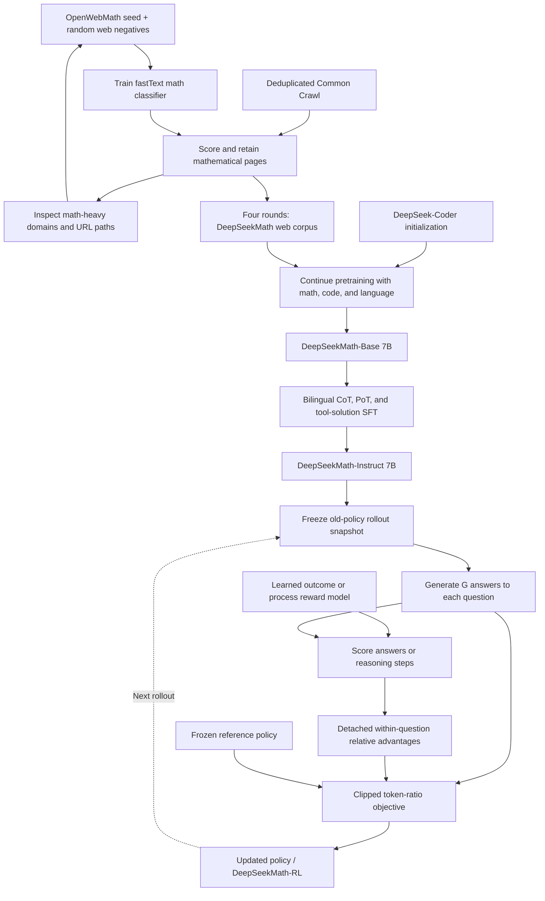
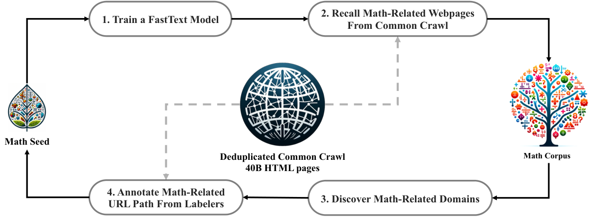
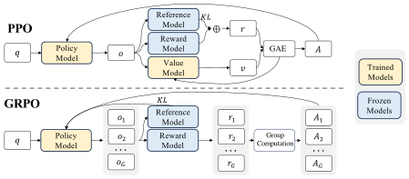
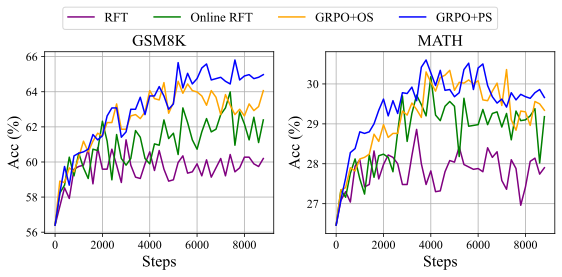
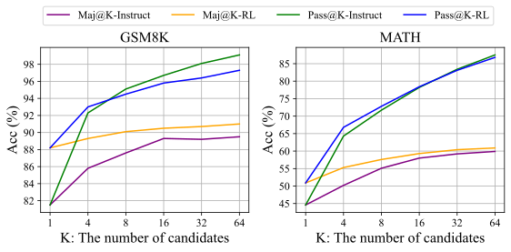

# DeepSeekMath and GRPO - Shao et al., 2024

> **arXiv:** [2402.03300v3](https://arxiv.org/abs/2402.03300v3), 27 April 2024; first submitted 5 February 2024. **Venue:** technical report / preprint. **Affiliations:** DeepSeek-AI, Tsinghua University, Peking University.
>
> **Full title:** DeepSeekMath: Pushing the Limits of Mathematical Reasoning in Open Language Models.
>
> **Authors:** Zhihong Shao, Peiyi Wang, Qihao Zhu, Runxin Xu, Junxiao Song, Xiao Bi, Haowei Zhang, Mingchuan Zhang, Y.K. Li, Y. Wu, and Daya Guo.

## TL;DR

DeepSeekMath combines an iteratively mined mathematical web corpus, code-initialized continued pretraining, bilingual mathematical instruction tuning, and reinforcement learning to build a strong 7B mathematical language model. Its **Group Relative Policy Optimization (GRPO)** replaces PPO's learned value model with advantages computed from multiple answers to the same question, while retaining a reward model, an old rollout policy, and a reference policy. DeepSeekMath-RL reaches **51.7% MATH accuracy without tools or voting**, **60.9% with 64-sample self-consistency**, and **58.8% with tool-integrated reasoning**; these are different evaluation settings, not interchangeable scores (abstract; Table 5). The original paper studies learned outcome and process rewards and iterative reward-model updates, not just the rule-based outcome rewards associated with later reasoning systems.

## Problem & motivation

The paper addresses three connected bottlenecks.

**Mathematical pretraining data are scarce relative to the general web.** Existing mathematical corpora combine academic papers, code, and mathematical web pages, but their inclusion does not establish which sources actually improve reasoning. The authors ask whether Common Crawl contains substantially more useful mathematical material than existing collections recover, including material useful for Chinese as well as English reasoning. Their answer is an iterative classifier-and-domain-mining pipeline that produces approximately 120B tokens from 35.5M pages, rather than relying primarily on scientific papers (Section 2.1).

**A strong base model and a capable problem-solving assistant are different artifacts.** Continued next-token pretraining can improve mathematical knowledge and completion, but an assistant must also follow questions, present multi-step solutions, and use programs when appropriate. DeepSeekMath therefore separates Base, Instruct, and RL checkpoints. On MATH, the reported CoT scores are 36.2% for Base under few-shot evaluation, 46.8% for Instruct, and 51.7% for RL; their prompting regimes differ, so this is a useful progression rather than a perfectly controlled single-variable comparison (Tables 2 and 5).

**PPO adds a costly value model whose training can be awkward for sparse mathematical rewards.** A conventional language-model RL stack contains the policy, reference model, reward model, and a learned value model. When reward arrives principally at the end of a long derivation, estimating a useful value for every prefix is difficult. GRPO uses several solutions to the *same* problem as a local comparison set: the group's rewards provide a baseline and scale without fitting a separate critic (Section 4.1).

Removing the critic does not remove exploration costs. Generating 64 answers per question, scoring them, and running policy/reference forwards remains substantial work. The paper does not establish a universal wall-clock speedup or a fixed total-memory reduction for every implementation.

## Key idea

The full contribution is a staged pipeline:

1. Mine mathematical web pages, using the current collection to discover more useful domains and retrain the retrieval classifier.
2. Continue pretraining a code-capable 7B model on mathematical text mixed with code and general language.
3. Teach bilingual CoT, program-of-thought, and tool-integrated solutions through supervised fine-tuning.
4. Sample groups of answers and reinforce answers that score better than alternatives to the same question, without learning a value function.

For outcome-supervised GRPO, sample $G$ completions $o_1,\ldots,o_G$ for question $q$ from a frozen rollout snapshot $\pi_{\mathrm{old}}$. A reward model assigns scalar scores $r_1,\ldots,r_G$. The advantage shared by all response tokens of completion $i$ is

$$
\widehat A_{i,t}=\widetilde r_i
=\frac{r_i-\operatorname{mean}(r_1,\ldots,r_G)}
{\operatorname{std}(r_1,\ldots,r_G)}.
$$

Here $t$ indexes a generated response token, not a prompt token. The reward is relative to answers to this particular question, not to an unrelated batch of questions. Above-average answers receive positive advantages; below-average answers receive negative ones. The reward model still supplies the judgment: the group is a substitute for the learned *value baseline*, not for the reward function.

The policy then maximizes a token-level clipped surrogate with a direct reference-policy penalty:

$$
\mathcal J_{\mathrm{GRPO}}(\theta)=
\mathbb E_{\substack{q\sim P(Q)\\
\{o_i\}_{i=1}^{G}\sim\pi_{\mathrm{old}}(\cdot\mid q)}}
\left[
\frac1G\sum_{i=1}^{G}\frac1{T_i}\sum_{t=1}^{T_i}
\left\{
\min\!\left[
\rho_{i,t}\widehat A_{i,t},
\operatorname{clip}(\rho_{i,t},1-\varepsilon,1+\varepsilon)
\widehat A_{i,t}
\right]-\beta k_{i,t}
\right\}
\right],
$$

$$
\rho_{i,t}=
\frac{\pi_\theta(o_{i,t}\mid q,o_{i,<t})}
{\pi_{\mathrm{old}}(o_{i,t}\mid q,o_{i,<t})},
\qquad
k_{i,t}=u_{i,t}-\log u_{i,t}-1,
\qquad
u_{i,t}=
\frac{\pi_{\mathrm{ref}}(o_{i,t}\mid q,o_{i,<t})}
{\pi_\theta(o_{i,t}\mid q,o_{i,<t})}.
$$

$P(Q)$ is the question distribution, $\theta$ denotes trainable policy parameters, $T_i$ is the response length, $\varepsilon$ is the clipping threshold, and $\beta$ controls the reference penalty. $\pi_{\mathrm{ref}}$ is a frozen reference distinct in purpose from the old rollout policy. A minimization-based trainer uses loss $-\mathcal J_{\mathrm{GRPO}}$. These are the paper's Equations 3 and 4, with the sampled KL term written as $k_{i,t}$ to distinguish it from an exact distribution-level KL divergence.

## How it works

### 1. End-to-end architecture and released backbone

DeepSeekMath does not introduce a new transformer block. It develops a training pipeline around a code-initialized decoder-only model.



The [released Base configuration](https://huggingface.co/deepseek-ai/deepseek-math-7b-base/blob/main/config.json) specifies a Llama-compatible causal LM with 30 layers, hidden width 4096, FFN intermediate width 11008, 32 attention heads and 32 key/value heads, a 102400-entry vocabulary, and a 4096-token context limit. It uses SiLU, RMSNorm with epsilon $10^{-6}$, untied input/output embeddings, and RoPE with base 10000 and no configured scaling. The checkpoint declares bfloat16 weights. These are released-model configuration facts, not a newly proposed architecture or a complete statement of training precision.

The 7B continuation starts from DeepSeek-Coder-Base-v1.5 **before its learning-rate decay**. Table 4 distinguishes this intermediate checkpoint from the fully decayed Coder checkpoint. Treating the final public Coder checkpoint as necessarily identical to the actual initialization would obscure an important reproduction detail.

### 2. Iteratively discovering mathematical web data

Section 2.1 and Figure 2 describe the following loop.

1. **Train a lightweight page classifier.** Use 500K positive examples from OpenWebMath and 500K randomly selected Common Crawl negatives. The fastText classifier uses embedding dimension 256, learning rate 0.1, maximum word n-gram length 3, minimum occurrence count 3, and 3 epochs.
2. **Prepare the crawl.** URL deduplication and near-deduplication leave approximately 40B HTML pages to search. This is a page count, not the size in tokens of the final corpus.
3. **Retrieve high-scoring pages.** Rank pages by classifier score. In the first iteration the authors compare retaining 40B, 80B, 120B, and 160B tokens and select the top 40B-token collection. A higher retrieval budget is not automatically a better training corpus because it can add lower-quality material.
4. **Recover missed pages through domains.** Group pages by base-URL domain. Domains for which more than 10% of pages were collected are considered math-related. Human inspection identifies mathematical URL paths; previously uncollected pages under these paths expand the positive seed.
5. **Retrain and repeat.** The expanded seed improves retrieval in subsequent rounds. After four rounds, the collection contains 35.5M pages and approximately 120B tokens; the more precise tokenizer-specific count in Table 1 is 120.2B.

Nearly 98% of the fourth-round collection was already present in the third, suggesting diminishing retrieval gains under this procedure. That observation measures convergence of this mining loop, not exhaustion of all mathematical content on the web.



*Original Figure 2. A classifier retrieves pages, domain inspection expands the seed, and the resulting seed trains the next classifier. Human URL-path annotation complements learned page scoring rather than being replaced by it.*

**Decontamination.** Remove text segments with exact 10-gram matches to benchmark material. For benchmark strings shorter than 10 grams but at least 3 grams, apply exact-match filtering. The covered English/Chinese evaluations include GSM8K, MATH, CMATH, and AGIEval. This reduces identifiable lexical leakage; it does not prove that paraphrases, translated equivalents, or every indirect contamination route are absent.

### 3. What the PPO-to-GRPO change removes

PPO typically forms advantages using a learned value function and generalized advantage estimation. In the paper's PPO setup, reward can also include a tokenwise reference log-ratio penalty. GRPO instead computes advantages from the sampled reward group and places its reference penalty directly in the optimization objective.



*Original Figure 4. GRPO removes the learned value-model branch and derives advantages from grouped rewards. The frozen reward and reference branches remain. The old policy is the rollout snapshot used in the importance-ratio denominator, even though it is not shown as a separate large branch in this schematic.*

The model roles must remain separate:

| Component | Role | Gradient/update behavior during a policy update |
|---|---|---|
| Current policy $\pi_\theta$ | Predict sampled response tokens and receive the RL update. | Trainable. |
| Old policy $\pi_{\mathrm{old}}$ | Generate the current rollout batch and define importance ratios. | Frozen snapshot; cached log probabilities are detached. |
| Reference policy $\pi_{\mathrm{ref}}$ | Anchor the current policy through the direct KL-style penalty. | Frozen within an outer RL iteration. |
| Reward model $r_\varphi$ | Score complete solutions or intermediate reasoning steps. | Frozen while optimizing the policy; can be retrained between iterative rounds. |
| Value model | Estimate prefix values in conventional PPO. | Not present in GRPO. |

These are logical roles, not a requirement to keep four independent full-weight GPU copies resident simultaneously. Snapshot storage, inference placement, and sharing are implementation decisions.

### 4. Outcome rewards and group normalization

For a batch of $B$ questions, outcome rewards have shape $[B,G]$. Compute their mean and standard deviation along the $G$ axis separately for each question. Broadcast each normalized scalar across the valid response positions of that completion to obtain advantages of shape $[B,G,T_{\max}]$.

For example, rewards $(0,0,1,1)$ have mean $0.5$ and population standard deviation $0.5$, giving advantages $(-1,-1,1,1)$. This is an explanatory fixture, not a reward distribution reported by the experiment. Adding a constant to all rewards for a question leaves its normalized advantages unchanged; multiplying them by a positive constant also leaves them unchanged when no numerical floor is active.

The paper does **not** specify whether standard deviation uses the population or sample convention, nor how zero variance is handled. A reproducible implementation must declare these choices. One explicit engineering choice is

$$
\mu_q=\frac1G\sum_i r_i,\qquad
s_q=\sqrt{\frac1G\sum_i(r_i-\mu_q)^2},
\qquad
\widehat A_{i,t}=\frac{r_i-\mu_q}{\max(s_q,\delta)},
$$

where $\delta>0$ is a declared numerical safeguard, **not a reported DeepSeekMath hyperparameter**. A constant-reward group then has zero preference advantages, although the reference penalty may still produce an update. Monitoring the fraction of such groups matters: many sampled tokens do not necessarily imply substantial reward-discrimination signal. Near-constant noisy rewards can also make the normalization sensitive to the safeguard.

Rewards, group statistics, and advantages are detached. Backpropagating through reward scoring or group normalization would define a different update.

### 5. Token ratios, clipping, masking, and reductions

For each sampled response token, evaluate current, old, and reference log probabilities on the **same question and response prefix**. With $a_{i,t}=\log\pi_\theta(o_{i,t}\mid q,o_{i,<t})$ and $a^{\mathrm{old}}_{i,t}$ defined analogously,

$$
\rho_{i,t}=\exp(a_{i,t}-a^{\mathrm{old}}_{i,t}).
$$

This is a token probability ratio, **not** $\exp(\sum_t a_{i,t}-a^{\mathrm{old}}_{i,t})$ for a whole completion. Even when the current policy initially has the same numerical weights as the old policy, the denominator remains detached; otherwise differentiating numerator and denominator together would incorrectly erase the learning signal.

Clipping is directional. With a positive advantage, ratios above $1+\varepsilon$ no longer improve the clipped reward term. With a negative advantage, ratios below $1-\varepsilon$ no longer improve it. Ratios on the opposite side can still receive a corrective gradient. The minimum does not clip the reference penalty, enforce a hard ratio bound, or guarantee a hard KL trust region.

Preserve the paper's nested reduction. For response mask $M_{i,t}\in\{0,1\}$, valid response length $T_i=\sum_tM_{i,t}>0$, and token objective $f_{i,t}$,

$$
\widehat{\mathcal J}
=\frac1{BG}\sum_{b=1}^{B}\sum_{i=1}^{G}
\frac{\sum_t M_{b,i,t}f_{b,i,t}}{\sum_tM_{b,i,t}}.
$$

Each completion contributes its own token mean, followed by equal completion/group averaging. A single global mean over all valid tokens gives longer completions more aggregate weight and is not the same objective. This normalization does not imply that every possible length-related optimization effect has disappeared.

Only generated response targets contribute. Use causal next-token alignment; exclude prompt and padding positions; declare EOS inclusion and maximum-length truncation handling. Reject empty valid responses explicitly rather than hiding them with an unexplained denominator fallback. The report does not completely specify EOS/truncation conventions, so later trainer defaults should not be presented as original settings.

### 6. The sampled reference penalty and its assumptions

Let $d_{i,t}=a^{\mathrm{ref}}_{i,t}-a_{i,t}$. The sampled term can be written

$$
k_{i,t}=\exp(d_{i,t})-d_{i,t}-1.
$$

It is nonnegative by $\exp(d)\geq 1+d$ and equals zero when the two token probabilities agree. Near zero, computing $\operatorname{expm1}(d)-d$ avoids subtracting two nearly equal numbers. Very large positive $d$ can still overflow: numerical checks and explicit failure reporting remain necessary.

At a **fixed prefix** $s$, if token $x$ is sampled from the current policy with suitable support, then

$$
\begin{aligned}
\mathbb E_{x\sim\pi_\theta(\cdot\mid s)}[k(x)]
&=\sum_x\pi_\theta(x\mid s)
\left[
\frac{\pi_{\mathrm{ref}}(x\mid s)}{\pi_\theta(x\mid s)}
-\log\frac{\pi_{\mathrm{ref}}(x\mid s)}{\pi_\theta(x\mid s)}-1
\right]\\
&=D_{\mathrm{KL}}\!\left(
\pi_\theta(\cdot\mid s)\,\Vert\,\pi_{\mathrm{ref}}(\cdot\mid s)
\right).
\end{aligned}
$$

This distributional identity explains the estimator's direction, $\mathrm{KL}(\pi_\theta\Vert\pi_{\mathrm{ref}})$. However, actual GRPO samples come from $\pi_{\mathrm{old}}$, and their prefixes also follow the rollout distribution. Reusing the batch while changing $\theta$ does not preserve the current-policy sampling assumption. Nor does an unbiased value estimator automatically make its fixed-sample autodifferentiated derivative an unbiased full-KL gradient: the sampling-distribution derivative is a separate issue. The implemented object should therefore be described as the paper's sampled surrogate penalty, not an unconditional exact KL computation.

Unlike a reward-shaping construction, GRPO subtracts this term directly from the token objective rather than first inserting it into the reward used to normalize advantages.

### 7. Process-supervised GRPO

Outcome supervision gives every token of an answer the same advantage. Process supervision instead scores the ends of reasoning steps and propagates the normalized future step rewards backward.

For output $i$, let $K_i$ be its number of reasoning steps, $e_{i,j}$ the response-token index at the end of step $j$, and $r_{i,j}$ that step's process reward. Form the collection

$$
\mathcal R_q=\{r_{i,j}:1\leq i\leq G,\ 1\leq j\leq K_i\},
\qquad
\widetilde r_{i,j}
=\frac{r_{i,j}-\operatorname{mean}(\mathcal R_q)}
{\operatorname{std}(\mathcal R_q)}.
$$

Normalize **all valid step rewards in the question's group**, not each answer independently and not padded step slots. The token advantage is

$$
\widehat A_{i,t}
=\sum_{j:\,e_{i,j}\geq t}\widetilde r_{i,j}.
$$

The inequality is inclusive: a token at a step's end receives that step's reward. Tokens earlier in the derivation receive credit from more future steps. The sum is undiscounted in this definition; it is not GAE and does not require learned prefix values.

An implementation can store step rewards and end indices in $[B,G,K_{\max}]$ tensors with a valid-step mask, normalize over valid $(i,j)$ pairs within each question, scatter the normalized rewards to their end positions, and take a reverse cumulative sum over response positions. Apply the response mask afterward. Variable numbers of steps affect the normalization population and the accumulated advantages; padding must not act as extra zero-reward steps.

The paper follows [Math-Shepherd](https://arxiv.org/abs/2312.08935) for reward-data construction rather than fully respecifying every step-segmentation, annotation, and reward-training detail. That work constructs process supervision automatically rather than requiring human labels for every reasoning step. Reproducing this branch therefore also requires the cited reward-modeling methodology; replacing it with a binary answer checker is a different experiment.

### 8. Iterative RL and the two snapshot schedules

Algorithm 1 supports multiple outer rounds:

1. Initialize the policy from SFT and prepare an initial learned reward model.
2. At the start of an outer iteration, freeze a reference snapshot of the current policy.
3. At each exploration stage, freeze an old-policy snapshot, sample question groups, score responses, and compute detached advantages.
4. Optimize the GRPO objective for $\mu$ policy updates on that rollout batch. The main recipe uses **one** update per exploration stage.
5. For a subsequent outer round, generate new reward-model training data from the improved policy, continue training the reward model with a replay mechanism incorporating **10% historical data**, and reset the reference to the current policy.

The old policy is refreshed for rollouts; the reference is reset at an outer-iteration boundary. Conflating these schedules would change the regularization target. The two-round 7B experiment finds the largest improvement in the first round and further gains after updating the reward model and reference (Section 5.2.3; Figure 6).

Algorithm 1's policy-update line cites Equation 21, but the complete clipped objective is Equation 3; Equation 21 is the later local gradient coefficient. Implement the objective, not the coefficient as if it were a standalone loss.

### 9. A unified view of post-training gradients

Section 5.2, Table 10, and Appendix A compare methods by their data source, reward, and token-level gradient coefficient. A useful sampled-data update form is

$$
g_{\mathcal A}
=\mathbb E_{(q,o)\sim\mathcal D_{\mathcal A}}
\left[
\frac1{|o|}\sum_t
C_{\mathcal A}(q,o,t)\,
\nabla_\theta\log\pi_\theta(o_t\mid q,o_{<t})
\right].
$$

This is a comparison of update structure with sampled data held fixed during differentiation, not proof that all methods optimize the same objective or that one can ignore derivatives through an arbitrary parameter-dependent sampling distribution.

| Method | Data used for the update | How tokens are weighted |
|---|---|---|
| SFT | Curated question/solution examples. | Positive demonstration likelihood; coefficient 1 in the paper's normalized formulation. |
| Rejection fine-tuning (RFT) | Completions sampled from the SFT policy. | Retain correct answers, equivalent to a 0/1 correctness weight in this view. |
| Online RFT | Fresh completions from the evolving policy. | Same correctness filtering, but with refreshed exploration. |
| DPO | Offline preferred/rejected pairs. | Opposite-signed updates controlled by a shared pairwise preference margin. |
| PPO | Online rollouts with learned rewards. | Advantages derived using a value model and GAE, subject to the clipped surrogate. |
| GRPO | Groups of online rollouts with learned rewards. | Group-relative advantages plus the direct reference-penalty gradient. |

For a fixed sampled token, away from clipping boundaries, differentiating the **unclipped** GRPO surrogate with respect to its current log probability gives

$$
\frac{\partial f_{i,t}}{\partial a_{i,t}}
=\rho_{i,t}\widehat A_{i,t}
+\beta(u_{i,t}-1).
$$

At the start of an update, where current and old policies agree numerically, $\rho_{i,t}=1$ and the coefficient reduces to

$$
C_{\mathrm{GRPO}}
=\widehat A_{i,t}+\beta(u_{i,t}-1).
$$

This explains the paper's Equation 21 under its single-update simplification. On a clipped branch the reward contribution can instead be zero; after multiple updates it generally retains the ratio factor. The old-policy denominator must remain detached even at equality.

**DPO derivation caveat.** Appendix A uses length-normalized log-ratios, unlike the summed response log probabilities in the original DPO formulation, and its displayed tokenwise coefficient should not be copied as an exact standard-DPO gradient. If $\ell_\theta(o)$ denotes a declared sequence score, define the full pair margin

$$
m=\beta\left[
\ell_\theta(o_w)-\ell_{\mathrm{ref}}(o_w)
-\ell_\theta(o_l)+\ell_{\mathrm{ref}}(o_l)
\right].
$$

Then maximizing $\log\sigma(m)$ yields the common pair coefficient

$$
\nabla_\theta\log\sigma(m)
=\beta\sigma(-m)
\left[\nabla_\theta\ell_\theta(o_w)
-\nabla_\theta\ell_\theta(o_l)\right].
$$

If $\ell$ is a token mean, its derivative includes that response's length normalization; if it is a sum, it does not. In both cases the sigmoid depends on the **whole pair**, not independently on each token. This distinction preserves the insight of the comparison without propagating the appendix's coefficient inconsistency.

## Training / data

### Controlled corpus-quality comparison

To compare corpora, Section 2.2 continues training DeepSeek-LLM 1.3B for **150B tokens per corpus**. Table 1 reports corpus sizes using a tokenizer with approximately 100K vocabulary entries. Thus corpus size and sampled training exposure are different quantities.

| Setting | Reported value |
|---|---|
| Training framework | HAI-LLM |
| Optimizer | AdamW |
| Adam moments | $\beta_1=0.9$, $\beta_2=0.95$ |
| Weight decay | 0.1 |
| Warmup | 2000 steps |
| Peak learning rate | $5.3\times10^{-4}$ |
| Late schedule | Reduce to 31.6% of peak after 80% of training, then to 10% after 90% |
| Batch | 4M tokens |
| Context length | 4K tokens |
| Exposure for each corpus | 150B training tokens |

The four mathematical corpora are MathPile (8.9B tokens), OpenWebMath (13.6B), Proof-Pile-2 (51.9B), and DeepSeekMath (120.2B), per Table 1. Proof-Pile-2 combines arXiv, web, and code in a 2:4:1 ratio in this comparison. Smaller corpora must be reused to reach the common 150B-token exposure; this comparison does not imply that all training tokens are unique.

### Building DeepSeekMath-Base 7B

Section 2.3 continues the pre-decay DeepSeek-Coder-Base-v1.5 checkpoint for **500B sampled tokens**. It follows the general recipe above but uses peak learning rate $4.2\times10^{-4}$ and a 10M-token batch. The mixture is:

| Source | Sampling share | Derived exposure over 500B tokens |
|---|---:|---:|
| DeepSeekMath web corpus | 56% | 280B |
| AlgebraicStack | 4% | 20B |
| arXiv | 10% | 50B |
| GitHub code | 20% | 100B |
| English/Chinese Common Crawl natural language | 10% | 50B |

The exposure column is arithmetic from the reported mixture, not five independently reported corpus sizes. In particular, a roughly 120B-token math web corpus supplies 280B sampled training tokens. Neither "120B total training" nor "500B unique mathematical web tokens" describes the experiment.

The language-modeling objective is ordinary causal next-token prediction:

$$
\mathcal L_{\mathrm{PT}}
=-\mathbb E_{x}\sum_{t\in\mathcal V(x)}
\log\pi_\theta(x_t\mid x_{<t}),
$$

where $\mathcal V(x)$ denotes valid training targets under the chosen packing/masking convention. Mathematical specialization comes from initialization, data selection, mixture, and training exposure rather than a new pretraining loss.

### Building DeepSeekMath-Instruct 7B

Section 3 collects **776K** bilingual examples with CoT, program-of-thought (PoT), and tool-integrated solutions.

- **English:** annotate GSM8K and MATH problems with tool-integrated solutions; include a subset of MathInstruct and the Lila-OOD training set, covering CoT/PoT and fields such as algebra, probability, number theory, calculus, and geometry.
- **Chinese:** collect K-12 mathematical problems across **76 subtopics**, with CoT and tool-integrated annotations.
- **Training:** randomly concatenate examples up to a 4K-token context, train for **500 steps**, batch size **256**, constant learning rate **$5\times10^{-5}$**.

In the paper's Appendix A update comparison, supervised solution likelihood is

$$
\mathcal L_{\mathrm{SFT}}
=-\mathbb E_{(q,o)\sim P_{\mathrm{SFT}}}
\left[\frac1{|o|}\sum_{t=1}^{|o|}
\log\pi_\theta(o_t\mid q,o_{<t})\right].
$$

This is the appendix's analytical formulation; Section 3 does not completely document every packed-training prompt-mask and reduction detail. The stated steps and batch size are not sufficient to infer an exact number of full dataset epochs when examples are packed.

### Building DeepSeekMath-RL 7B

Section 4.2 starts from Instruct and uses only approximately **144K GSM8K/MATH CoT questions** from the SFT collection. Other SFT tasks and tool formats are excluded from this RL question set to study transfer.

| Item | Original main recipe |
|---|---|
| Initial policy | DeepSeekMath-Instruct 7B |
| Initial learned reward model | Initialized from DeepSeekMath-Base 7B |
| Reward-model data | Constructed following [Math-Shepherd](https://arxiv.org/abs/2312.08935) |
| Initial reward-model learning rate | $2\times10^{-5}$ |
| Policy learning rate | $10^{-6}$ |
| Reference-penalty coefficient $\beta$ | 0.04 |
| Group size $G$ | 64 outputs per question |
| Maximum generation length | 1024 tokens |
| Stated training batch size | 1024; the paragraph does not precisely define the counting unit |
| Policy updates per exploration stage | 1 |
| Iterative variant | Updated reward model, 10% historical-data replay mechanism, and reference reset |

The main paragraph does not specify enough to recover every optimizer setting, clipping threshold, rollout temperature, hardware allocation, or total wall-clock budget. These should remain unspecified rather than being filled with defaults from a later GRPO library. In particular, a batch of 1024 should not silently be interpreted as either 1024 prompts times 64 responses or 1024 responses.

### Evaluation protocols

The paper evaluates different capabilities rather than treating all scores as the same "math accuracy."

- **Base CoT:** few-shot mathematical problem solving, including English and Chinese benchmarks (Table 2).
- **Base with tools:** prompt the model to write Python, permit libraries such as `math` and `sympy`, and evaluate the executed answer (Table 3).
- **Informal-to-formal proving:** supply an informal statement, its formal statement, and an informal proof; generate an Isabelle proof sketch and use Sledgehammer to fill missing details on miniF2F (Table 3). This is not unconstrained end-to-end theorem discovery.
- **General reasoning and coding:** use few-shot CoT for MMLU and BBH, zero-shot evaluation for HumanEval, and few-shot evaluation for MBPP (Tables 4 and 7).
- **Instruct/RL:** evaluate CoT and tool-integrated reasoning separately on GSM8K, MATH, MGSM-zh, and CMATH (Table 5).
- **Multiple samples:** distinguish majority-answer accuracy, Maj@K, from Pass@K, which asks whether at least one sampled solution is correct (Figure 7). Pass@K assumes access to correctness for evaluation; it is not a deployable majority selector.

The [official evaluation instructions](https://github.com/deepseek-ai/DeepSeek-Math/tree/main/evaluation) provide bilingual prompt conventions: request explicit reasoning or natural-language/program integration, and require the final answer in `\boxed{}`. The repository includes evaluation scripts, prompts, and model outputs. Its released evaluation resources should not be described as a complete original GRPO training implementation.

## Results

All numerical benchmark entries below are percentages. Each subsection identifies its source table in **arXiv v3**. A dash means not reported, not zero. Historical model names and scores are retained; they are not claims about current models.

### Corpus quality at a fixed 1.3B training recipe

**Source: Table 1, Section 2.2.** All trained variants receive 150B training tokens; the size column describes the corpus rather than exposure. Gaokao Cloze and QA abbreviate the paper's Gaokao MathCloze and MathQA tasks.

| Corpus | Size | GSM8K | MATH | OCW | SAT | MMLU STEM | CMATH | Gaokao Cloze | Gaokao QA |
|---|---|---:|---:|---:|---:|---:|---:|---:|---:|
| No Math Training | - | 2.9 | 3.0 | 2.9 | 15.6 | 19.5 | 12.3 | 0.8 | 17.9 |
| MathPile | 8.9B | 2.7 | 3.3 | 2.2 | 12.5 | 15.7 | 1.2 | 0.0 | 2.8 |
| OpenWebMath | 13.6B | 11.5 | 8.9 | 3.7 | 31.3 | 29.6 | 16.8 | 0.0 | 14.2 |
| Proof-Pile-2 | 51.9B | 14.3 | 11.2 | 3.7 | 43.8 | 29.2 | 19.9 | 5.1 | 11.7 |
| DeepSeekMath Corpus | 120.2B | 23.8 | 13.6 | 4.8 | 56.3 | 33.1 | 41.5 | 5.9 | 23.6 |

DeepSeekMath is strongest across these reported tasks in this controlled recipe, including a large Chinese gain despite the seed's origin in OpenWebMath. The experiment supports this collection and training setup; it does not isolate a universal causal effect of corpus size independently of quality, language coverage, or composition.

### Base-model mathematical reasoning

**Source: Table 2, Section 2.3; few-shot CoT, without tools.**

| Model | Size | GSM8K | MATH | OCW | SAT | MMLU STEM | CMATH | Gaokao Cloze | Gaokao QA |
|---|---|---:|---:|---:|---:|---:|---:|---:|---:|
| Minerva | 7B | 16.2 | 14.1 | 7.7 | - | 35.6 | - | - | - |
| Minerva | 62B | 52.4 | 27.6 | 12.0 | - | 53.9 | - | - | - |
| Minerva | 540B | 58.8 | 33.6 | 17.6 | - | 63.9 | - | - | - |
| Mistral | 7B | 40.3 | 14.3 | 9.2 | 71.9 | 51.1 | 44.9 | 5.1 | 23.4 |
| Llemma | 7B | 37.4 | 18.1 | 6.3 | 59.4 | 43.1 | 43.4 | 11.9 | 23.6 |
| Llemma | 34B | 54.0 | 25.3 | 10.3 | 71.9 | 52.9 | 56.1 | 11.9 | 26.2 |
| DeepSeekMath-Base | 7B | 64.2 | 36.2 | 15.4 | 84.4 | 56.5 | 71.7 | 20.3 | 35.3 |

The 7B model exceeds the listed 34B Llemma across these tasks and exceeds Minerva 540B on GSM8K and MATH, while remaining below it on OCW and MMLU STEM. This is not uniform dominance over every larger mathematical model.

### Base-model tools and formal proving

**Source: Table 3, Section 2.3; few-shot evaluation.**

| Model | Size | GSM8K+Python | MATH+Python | miniF2F-valid | miniF2F-test |
|---|---|---:|---:|---:|---:|
| Mistral | 7B | 48.5 | 18.2 | 18.9 | 18.0 |
| CodeLlama | 7B | 27.1 | 17.2 | 16.3 | 17.6 |
| CodeLlama | 34B | 52.7 | 23.5 | 18.5 | 18.0 |
| Llemma | 7B | 41.0 | 18.6 | 20.6 | 22.1 |
| Llemma | 34B | 64.6 | 26.3 | 21.0 | 21.3 |
| DeepSeekMath-Base | 7B | 66.9 | 31.4 | 25.8 | 24.6 |

The tool and formal columns measure different mechanisms: execution of generated Python versus proof-sketch generation plus automated Isabelle proving. They should not be combined into a single success rate.

### General reasoning and coding retention

**Source: Table 4, Section 2.3.** Dagger marks the Coder checkpoint **before learning-rate decay**, used to initialize DeepSeekMath.

| Model | Size | MMLU | BBH | HumanEval Pass@1 | MBPP Pass@1 |
|---|---|---:|---:|---:|---:|
| Mistral | 7B | 62.4 | 55.7 | 28.0 | 41.4 |
| DeepSeek-Coder-Base-v1.5 (dagger) | 7B | 42.9 | 42.9 | 40.2 | 52.6 |
| DeepSeek-Coder-Base-v1.5 | 7B | 49.1 | 55.2 | 43.2 | 60.4 |
| DeepSeekMath-Base | 7B | 54.9 | 59.5 | 40.9 | 52.6 |

Relative to the actual pre-decay initialization, general reasoning improves while code performance is broadly retained. Relative to the fully decayed Coder checkpoint, however, coding scores are lower. Those are different comparisons, and the table does not justify saying that mathematical continuation improves every coding metric.

### Instruction tuning and RL: CoT versus tools

**Source: Table 5, Sections 3.2 and 4.2.** The two subtables reproduce the original CoT and tool-integrated blocks.

| Model, CoT | Size | GSM8K | MATH | MGSM-zh | CMATH |
|---|---|---:|---:|---:|---:|
| Gemini Ultra | - | 94.4* | 53.2 | - | - |
| GPT-4 | - | 92.0 | 52.9 | - | 86.0 |
| Inflection-2 | - | 81.4 | 34.8 | - | - |
| GPT-3.5 | - | 80.8 | 34.1 | - | 73.8 |
| Gemini Pro | - | 86.5* | 32.6 | - | - |
| Grok-1 | - | 62.9 | 23.9 | - | - |
| Baichuan-3 | - | 88.2 | 49.2 | - | - |
| GLM-4 | - | 87.6 | 47.9 | - | - |
| InternLM2-Math | 20B | 82.6 | 37.7 | - | - |
| Qwen | 72B | 78.9 | 35.2 | - | - |
| Math-Shepherd-Mistral | 7B | 84.1 | 33.0 | - | - |
| WizardMath-v1.1 | 7B | 83.2 | 33.0 | - | - |
| DeepSeek-LLM-Chat | 67B | 84.1 | 32.6 | 74.0 | 80.3 |
| MetaMath | 70B | 82.3 | 26.6 | 66.4 | 70.9 |
| SeaLLM-v2 | 7B | 78.2 | 27.5 | 64.8 | - |
| ChatGLM3 | 6B | 72.3 | 25.7 | - | - |
| WizardMath-v1.0 | 70B | 81.6 | 22.7 | 64.8 | 65.4 |
| DeepSeekMath-Instruct | 7B | 82.9 | 46.8 | 73.2 | 84.6 |
| DeepSeekMath-RL | 7B | 88.2 | 51.7 | 79.6 | 88.8 |

*The starred GSM8K cells, Gemini Ultra 94.4 and Gemini Pro 86.5, are marked as 32-candidate majority-vote results by the original table's gray coloring. Their MATH cells are not marked that way in this source. Do not treat the starred entries as directly comparable single-answer accuracy.*

| Model, tool-integrated reasoning | Size | GSM8K | MATH | MGSM-zh | CMATH |
|---|---|---:|---:|---:|---:|
| GPT-4 Code Interpreter | - | 97.0 | 69.7 | - | - |
| InternLM2-Math | 20B | 80.7 | 54.3 | - | - |
| DeepSeek-LLM-Chat | 67B | 86.7 | 51.1 | 76.4 | 85.4 |
| ToRA | 34B | 80.7 | 50.8 | 41.2 | 53.4 |
| MAmmoTH | 70B | 76.9 | 41.8 | - | - |
| DeepSeekMath-Instruct | 7B | 83.7 | 57.4 | 72.0 | 84.3 |
| DeepSeekMath-RL | 7B | 86.7 | 58.8 | 78.4 | 87.6 |

Within the CoT block, Instruct to RL improves GSM8K by **5.3 percentage points**, MATH by **4.9**, MGSM-zh by **6.4**, and CMATH by **4.2**. In the tool block, the gains are **3.0**, **1.4**, **6.4**, and **3.3** points respectively; these are differences computed from Table 5. Transfer to Chinese and tool-integrated evaluations is notable because the RL question set is restricted to GSM8K/MATH CoT, although those capabilities were not absent from pretraining or SFT.

### Does code pretraining help mathematical reasoning?

**Source: Table 6, Section 5.1.1.** These are 1.3B ablations using the **89B-token second-iteration math corpus**, not the final 120B collection. Token columns describe the displayed training stage; a second stage inherits its preceding first stage. Row labels below disambiguate the two different "Stage 2: Math Training" rows.

| Training setting | General tokens | Code tokens | Math tokens | GSM8K | MATH | CMATH | GSM8K+Python | MATH+Python |
|---|---|---|---|---:|---:|---:|---:|---:|
| No continual training | - | - | - | 2.9 | 3.0 | 12.3 | 2.7 | 2.3 |
| General first: stage 1 | 400B | - | - | 2.9 | 3.2 | 14.8 | 3.3 | 2.3 |
| General first: stage 2, math | - | - | 150B | 19.1 | 14.4 | 37.2 | 14.3 | 6.7 |
| Code first: stage 1 | - | 400B | - | 5.9 | 3.6 | 19.9 | 12.4 | 10.0 |
| Code first: stage 2, math | - | - | 150B | 21.9 | 15.3 | 39.7 | 17.4 | 9.4 |
| One-stage math only | - | - | 150B | 20.5 | 13.1 | 37.6 | 11.4 | 6.5 |
| One-stage code/math mixture | - | 400B | 150B | 17.6 | 12.1 | 36.3 | 19.7 | 13.5 |

Code followed by math helps both tool-free and tool-based reasoning relative to the corresponding general-then-math route. The mixed route is strongest on the listed Python tasks but not on tool-free GSM8K or MATH. Comparing a 400B+150B two-stage route with 150B math-only training is **not compute matched**.

**Source: Table 7, Section 5.1.1; the same training routes, evaluated on general reasoning and coding.**

| Training setting | General tokens | Code tokens | Math tokens | MMLU | BBH | HumanEval Pass@1 | MBPP Pass@1 |
|---|---|---|---|---:|---:|---:|---:|
| No continual training | - | - | - | 24.5 | 28.1 | 12.2 | 13.0 |
| General first: stage 1 | 400B | - | - | 25.9 | 27.7 | 15.2 | 13.6 |
| General first: stage 2, math | - | - | 150B | 33.1 | 32.7 | 12.8 | 13.2 |
| Code first: stage 1 | - | 400B | - | 25.0 | 31.5 | 25.0 | 40.0 |
| Code first: stage 2, math | - | - | 150B | 36.2 | 35.3 | 12.2 | 17.0 |
| One-stage math only | - | - | 150B | 32.3 | 32.5 | 11.6 | 13.2 |
| One-stage code/math mixture | - | 400B | 150B | 33.5 | 35.6 | 29.3 | 39.4 |

A math-only second stage can erode earlier coding gains. Mixing code and math better preserves coding in this experiment, motivating the actual Base model's continued inclusion of code rather than an exclusively mathematical continuation.

### What happens with arXiv-heavy continuation?

**Source: Table 8, Section 5.1.2.** The 1.3B runs receive 150B training tokens and the 7B Coder runs 40B. MathPile contains 8.9B tokens and is over 85% scientific arXiv papers; ArXiv-RedPajama contains 28.0B tokens from cleaned arXiv LaTeX.

| Model | Size | Continuation corpus | GSM8K | MATH | OCW | SAT | MMLU STEM | CMATH | Gaokao Cloze | Gaokao QA |
|---|---|---|---:|---:|---:|---:|---:|---:|---:|---:|
| DeepSeek-LLM | 1.3B | No Math Training | 2.9 | 3.0 | 2.9 | 15.6 | 19.5 | 12.3 | 0.8 | 17.9 |
| DeepSeek-LLM | 1.3B | MathPile | 2.7 | 3.3 | 2.2 | 12.5 | 15.7 | 1.2 | 0.0 | 2.8 |
| DeepSeek-LLM | 1.3B | ArXiv-RedPajama | 3.3 | 3.4 | 4.0 | 9.4 | 9.0 | 7.4 | 0.8 | 2.3 |
| DeepSeek-Coder-Base-v1.5 | 7B | No Math Training | 29.0 | 12.5 | 6.6 | 40.6 | 38.1 | 45.9 | 5.9 | 21.1 |
| DeepSeek-Coder-Base-v1.5 | 7B | MathPile | 23.6 | 11.5 | 7.0 | 46.9 | 35.8 | 37.9 | 4.2 | 25.6 |
| DeepSeek-Coder-Base-v1.5 | 7B | ArXiv-RedPajama | 28.1 | 11.1 | 7.7 | 50.0 | 35.2 | 42.6 | 7.6 | 24.8 |

**Source: Table 9, Section 5.1.2; formal proving after the arXiv continuation of the 7B Coder model.**

| Continuation corpus | miniF2F-valid | miniF2F-test |
|---|---:|---:|
| No Math Training | 20.1 | 21.7 |
| MathPile | 16.8 | 16.4 |
| ArXiv-RedPajama | 14.8 | 11.9 |

The authors find no consistent reasoning improvement from these arXiv-heavy continuations, including deterioration on several evaluations. They explicitly leave open other tasks such as theorem informalization, mixtures with other data, and larger model scales. The finding is not that academic papers are universally useless; indeed, the final Base mixture still contains 10% arXiv tokens.

### Why online sampling and process supervision matter



*Original Figure 5, Section 5.2: an analysis using **DeepSeekMath-Instruct 1.3B**, not the main 7B model. Online RFT improves over a fixed offline RFT set later in training; GRPO improves further; process-supervised GRPO (PS) generally outperforms outcome-supervised GRPO (OS). The curves fluctuate, so the comparison concerns the overall training behavior rather than a claim that one method wins at every checkpoint.*

The comparison separates two effects often conflated as "RL": fresh sampling changes the training distribution, while advantage weighting and process rewards change how sampled solutions influence the policy. RFT can only imitate retained correct completions; GRPO also applies relative positive/negative weighting and reference regularization.

### RL improves answer selection more clearly than sampled coverage here



*Original Figure 7, Section 5.2.4. At sampling temperature 0.7, RL improves majority-answer accuracy on GSM8K and MATH but does not produce a corresponding improvement in Pass@K. On MATH, 64-sample self-consistency reaches **60.9%**, also highlighted in the abstract. The plot is evidence about these checkpoints and sampling settings, not a general impossibility result for learning new reasoning capabilities.*

For a sampled set of $K$ solutions, Maj@K evaluates the most frequent extracted answer, whereas Pass@K records whether the set contains any correct solution. RL can increase probability mass on correct answers already reachable by the instruction model without expanding the set of problems on which at least one correct answer appears under the tested budget. This is a narrower and better-supported interpretation than "RL creates no new knowledge."

Finally, **64 training completions per question** and **64 evaluation samples for self-consistency** are separate choices. The first constructs the advantage baseline; the second spends inference compute to choose an answer.

## Limitations & follow-ups

### Limits acknowledged by the paper

- **Geometry and theorem proving remain weak.** The conclusion highlights failures involving triangles and ellipses and a gap to stronger closed models. The authors suggest data-distribution bias; this is a hypothesis motivating better coverage, not proof that one missing topic explains every failure.
- **Few-shot prompting provides limited additional benefit.** Compared with GPT-4, the model benefits less from examples, and zero-shot/few-shot performance can be similar. Strong benchmark scores do not imply equally strong in-context adaptation.
- **The reward model must track the policy.** A reward model trained on older outputs may become less suitable as the policy improves. Iterative reward-model training helps, but introduces new data construction, replay, and reference-reset decisions.
- **Exploration and noisy supervision remain bottlenecks.** The paper calls for more effective exploration, algorithms robust to noisy rewards, and process reward models with better generalization and calibration. Removing a value network does not solve reward misspecification.
- **The arXiv conclusion is deliberately bounded.** The reported continuation experiments do not settle the effect of academic text in mixtures, at larger scales, or on untested tasks.

### Reproduction and interpretation cautions

The released weights, evaluation scripts, prompts, and outputs make the result inspectable, but do not by themselves provide a turnkey reproduction of corpus mining, all training data, reward-model annotation, or the complete original RL trainer. Missing settings include important rollout and numerical conventions; this recap labels such gaps instead of importing later defaults.

Group standardization changes reward scaling and loses preference signal in constant-reward groups. The original per-completion token averaging, clipped importance ratios, and sampled reference penalty have precise semantics; replacing them with global token averaging, sequence ratios, a different KL estimator, or a new reward function is an algorithmic variant even if a library still calls it GRPO.

The main results combine data mining, substantial continued pretraining, SFT, and RL. They should not all be attributed to GRPO alone. Historical cross-model tables also mix model families and some evaluation protocols, including the explicitly marked Gemini majority-vote cells.

### Related and later work

[PPO](alignment-rl_2017_proximal-policy-optimization.md) supplies the clipped-surrogate ancestor, while [InstructGPT](alignment-rl_2022_instructgpt-rlhf.md) explains the policy/reward/reference/value roles in earlier LM RLHF. [DPO](alignment-rl_2023_direct-preference-optimization.md), [KTO](alignment-rl_2024_kahneman-tversky-optimization.md), and [ORPO](alignment-rl_2024_odds-ratio-preference-optimization.md) provide contrasting offline preference objectives rather than interchangeable implementations of grouped online RL.

[Qwen2.5-Math](math_2024_qwen2.5-math.md) and [Qwen2.5](backbone_2024_qwen2.5.md) are later technical reports using GRPO-related post-training. [DeepSeek-R1](https://arxiv.org/abs/2501.12948) later popularizes a different reasoning-RL recipe, including rule-based verifiable rewards. Those later settings should not be retroactively substituted for DeepSeekMath's learned reward models and original training schedule.

## Links

- **arXiv:** [abstract, v3](https://arxiv.org/abs/2402.03300v3) | [HTML, v3](https://arxiv.org/html/2402.03300v3) | [PDF, v3](https://arxiv.org/pdf/2402.03300v3).
- **Code / evaluation resources:** [official DeepSeek-Math repository](https://github.com/deepseek-ai/DeepSeek-Math) | [evaluation instructions and resources](https://github.com/deepseek-ai/DeepSeek-Math/tree/main/evaluation). This is not a claim that the full original GRPO training stack is released.
- **Hugging Face:** [Base 7B](https://huggingface.co/deepseek-ai/deepseek-math-7b-base) | [Instruct 7B](https://huggingface.co/deepseek-ai/deepseek-math-7b-instruct) | [RL 7B](https://huggingface.co/deepseek-ai/deepseek-math-7b-rl) | [Coder initialization family](https://huggingface.co/deepseek-ai/deepseek-coder-7b-base-v1.5) | [released Base configuration](https://huggingface.co/deepseek-ai/deepseek-math-7b-base/blob/main/config.json).
- **Project page:** the official repository serves as the release hub.
- **Blog posts:** no separate post is needed as a primary source for this recap.
- **Talks / videos:** no specific presentation is identified here.
- **OpenReview / venue page:** no conference venue is established by the sources used here; this recap follows the technical report.
- **Papers-with-Code:** not used as a primary source.
- **Licensing:** [code license](https://github.com/deepseek-ai/DeepSeek-Math/blob/main/LICENSE-CODE) is MIT; [model license](https://github.com/deepseek-ai/DeepSeek-Math/blob/main/LICENSE-MODEL) is separate. The README permits commercial use subject to the model terms, not an unrestricted relicensing of the weights.
- **Related / successor papers:** [PPO](alignment-rl_2017_proximal-policy-optimization.md) | [InstructGPT](alignment-rl_2022_instructgpt-rlhf.md) | [DPO](alignment-rl_2023_direct-preference-optimization.md) | [KTO](alignment-rl_2024_kahneman-tversky-optimization.md) | [ORPO](alignment-rl_2024_odds-ratio-preference-optimization.md) | [Chain-of-Thought](reasoning_2022_chain-of-thought.md) | [Self-Consistency](reasoning_2022_self-consistency.md) | [Math-Shepherd](https://arxiv.org/abs/2312.08935) | [Qwen2.5-Math](math_2024_qwen2.5-math.md) | [DeepSeek-R1](https://arxiv.org/abs/2501.12948).
- **BibTeX:**

```bibtex
@misc{shao2024deepseekmath,
  title={DeepSeekMath: Pushing the Limits of Mathematical Reasoning in Open Language Models},
  author={Zhihong Shao and Peiyi Wang and Qihao Zhu and Runxin Xu and
          Junxiao Song and Xiao Bi and Haowei Zhang and Mingchuan Zhang and
          Y. K. Li and Y. Wu and Daya Guo},
  year={2024},
  eprint={2402.03300},
  archivePrefix={arXiv},
  primaryClass={cs.CL},
  url={https://arxiv.org/abs/2402.03300v3}
}
```
