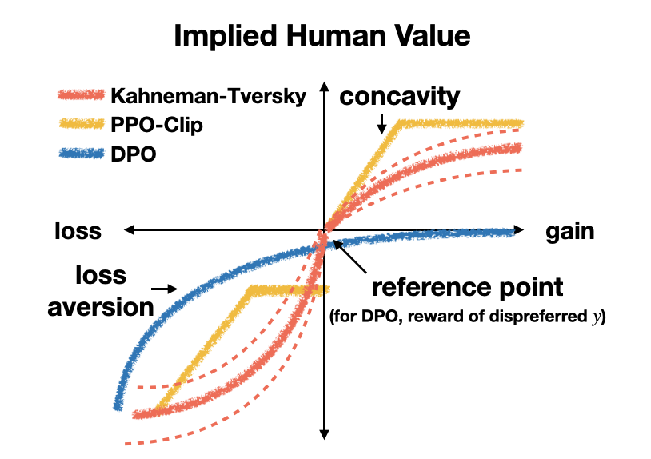
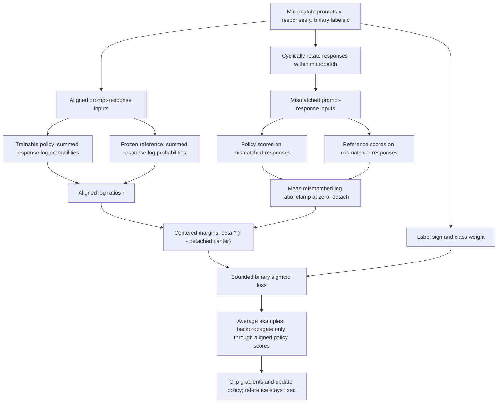
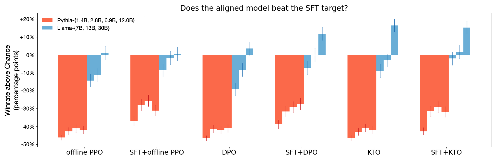
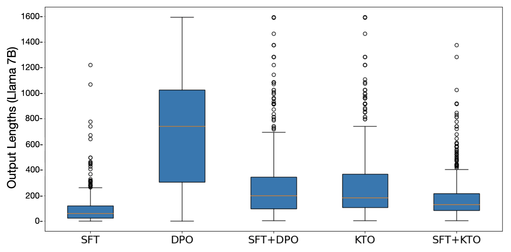
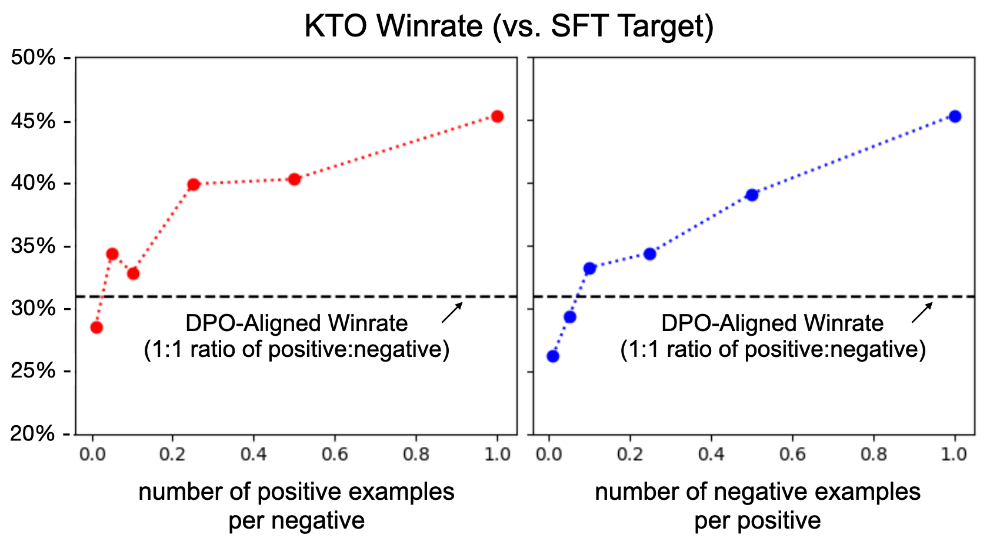

# KTO: Model Alignment as Prospect Theoretic Optimization - Ethayarajh et al., 2024

> **arXiv:** [2402.01306v5](https://arxiv.org/abs/2402.01306v5), 8 September 2026; first submitted 2 February 2024. **Venue:** ICML 2024, PMLR 235, pp. 12634-12651. **Affiliations:** Stanford University and Contextual AI. **Authors:** Kawin Ethayarajh, Winnie Xu, Niklas Muennighoff, Dan Jurafsky, and Douwe Kiela.

## TL;DR

**Kahneman-Tversky Optimization (KTO)** aligns a language model using individual responses labeled **desirable or undesirable**, rather than requiring a preferred/rejected pair for every prompt. It applies a bounded sigmoid utility to the response's policy/reference log-probability ratio, centered on a detached reference point; the practical center is a **biased surrogate for KL**, computed from mismatched prompts and responses. The paper motivates this objective through prospect theory and a broader family of human-aware losses, then finds KTO competitive with or better than DPO in its tested settings, including imbalanced feedback and some runs without an SFT stage. These are conditional empirical results, not a guarantee that binary feedback, omitting SFT, or any particular psychologically motivated loss will always improve alignment.

## Problem & motivation

### Preference pairs are not the only available feedback

The [InstructGPT/RLHF pipeline](alignment-rl_2022_instructgpt-rlhf.md) typically collects comparisons, fits a reward model, and optimizes the policy with an algorithm such as [PPO](alignment-rl_2017_proximal-policy-optimization.md). [DPO](alignment-rl_2023_direct-preference-optimization.md) removes the separately fitted reward model and reinforcement-learning loop, but still trains on pairs: for a prompt, one response is preferred to another.

Many applications instead produce an isolated thumbs-up, thumbs-down, acceptance, rejection, or quality judgment. There may be no second response to compare against, and good and bad examples need not arrive in equal numbers. Discarding these observations or manufacturing pairs adds constraints that are not intrinsic to the feedback.

KTO's training unit is therefore a triple $(x,y,c)$: prompt $x$, response $y$, and a binary class $c\in\{D,U\}$, for desirable and undesirable. Two observations with the same prompt are allowed, but not required. This is a distinction between **absolute labels and relative comparisons**, not just a different way to store a DPO pair. A winner in a pair can still be bad, and a loser can still be good.

### The loss function is itself an alignment assumption

The paper asks why objectives that are not explicit models of human psychology nevertheless work well with human preference data. Its answer is that some popular objectives already imply a transformation from reward to subjective value. What matters for optimization is not only the reward assigned to an output, but how improvements, deteriorations, and distance from a reference point are valued.

In the paper's scaling experiment, the distinction between its human-aware and non-human-aware loss families becomes statistically significant only at **13B parameters and above**, using Holm-corrected tests with $p<0.05$ (Section 3.2). The same setup does not show substantial alignment gains over SFT at model sizes of **7B or below**. These observations motivate investigating the loss shape; they do not prove that the formal family alone determines performance.

## Key idea

### From prospect theory to a language-model objective

Prospect theory evaluates an outcome relative to a reference point, rather than solely by its absolute magnitude. A standard illustrative value function is:

$$
v(z)=
\begin{cases}
(z-z_0)^\alpha,&z\geq z_0,\\
-\lambda(z_0-z)^\alpha,&z<z_0.
\end{cases}
$$

Here $z$ is an outcome, $z_0$ the reference point, $0<\alpha<1$ produces diminishing sensitivity, and $\lambda>1$ makes a loss more consequential than an equally sized gain. The paper cites median estimates $\alpha=0.88$ and $\lambda=2.25$ from monetary-choice research (Section 3.1). **These are not KTO's training defaults.** Prospect theory also concerns probability weighting; KTO does not implement a full model of that component.

For language-model training, replace the monetary outcome with how much more likely the policy makes a response than a reference model. Then use a sigmoid rather than the piecewise power function. This retains a saturating gain regime and a different curvature in the loss regime, while giving a simple differentiable objective.



*Original Figure 1. The horizontal axis is gain or loss relative to a reference point, not raw response probability. The curves illustrate the paper's interpretation of loss geometry: DPO uses the rejected response as its comparison point, PPO-Clip has flat regions, and the prospect-theoretic family allows different gain/loss sensitivity. This is a conceptual comparison, not a controlled benchmark proving one curve is universally best.*

### The exact KTO objective

Let $\pi_\theta(y\mid x)$ be the trainable policy and $\pi_{\mathrm{ref}}(y\mid x)$ a frozen reference policy. Define the **unscaled** implied reward and ideal reference point:

$$
r_\theta(x,y)=\log\frac{\pi_\theta(y\mid x)}
                            {\pi_{\mathrm{ref}}(y\mid x)},
\qquad
z_0(x)=D_{\mathrm{KL}}\!\left(
\pi_\theta(\cdot\mid x)\,\|\,\pi_{\mathrm{ref}}(\cdot\mid x)
\right).
$$

The distributions here are over complete responses. The reference point is the policy's expected log-probability ratio, not the reward of a rejected response. In KTO's convention, $\beta$ is placed in the value function, **not also multiplied into $r_\theta$**.

With sigmoid $\sigma(t)=1/(1+e^{-t})$, positive weights $\lambda_D,\lambda_U$, and temperature/scale parameter $\beta>0$, the label-dependent value is:

$$
v(x,y,c)=
\begin{cases}
\lambda_D\,\sigma\!\left(\beta[r_\theta(x,y)-z_0(x)]\right),
&c=D,\\
\lambda_U\,\sigma\!\left(\beta[z_0(x)-r_\theta(x,y)]\right),
&c=U.
\end{cases}
\qquad
\mathcal L_{\mathrm{KTO}}
=\mathbb E_{(x,y,c)\sim\mathcal D}[\lambda_c-v(x,y,c)].
$$

A useful equivalent form makes both signs and the actual backward pass explicit:

$$
\boxed{
\ell(x,y,c)=
\lambda_c\,\sigma\!\left(
-s_c\beta[r_\theta(x,y)-\operatorname{stopgrad}(\widehat z_0)]
\right),
\qquad s_D=+1,\quad s_U=-1.
}
$$

Desirable examples are encouraged to exceed the center; undesirable examples are encouraged to fall below it. Each loss lies between $0$ and $\lambda_c$. **Do not backpropagate through the center.** That stop-gradient is part of the specified training procedure, even though the center is recomputed as the policy changes.

Unlike DPO, this objective never needs to subtract the rewards of a particular winner and loser. Unlike standard supervised fine-tuning, it does not reward every additional unit of desirable-response log likelihood equally.

## How it works

### 1. The broader human-aware loss family

The paper calls its framework **human-aware loss functions**, or **HALOs** (Definition 3.4). A loss has the following form:

$$
\begin{aligned}
f(\pi_\theta,\pi_{\mathrm{ref}})
&=\mathbb E_{(x,y)\sim\mathcal D}
\left[
a_{x,y}\,
v_{x,y}\!\left(
r_\theta(x,y)
-\mathbb E_{Y'\sim Q(\cdot\mid x)}r_\theta(x,Y')
\right)
\right]+C_{\mathcal D},\\
r_\theta(x,y)&=l(y)\log
\frac{\pi_\theta(y\mid x)}{\pi_{\mathrm{ref}}(y\mid x)}.
\end{aligned}
$$

Here $l(y)$ is a positive normalization factor; $Q$ is a distribution specifying the reference point; $v_{x,y}$ is a nondecreasing value function; $a_{x,y}$ determines the example's contribution/sign; and $C_{\mathcal D}$ is a data-dependent constant. Holding the feedback data fixed, $l$, $a$, $v$, and $C_{\mathcal D}$ must be independent of both policies. The reference-point distribution $Q$ may depend on the policies.

This restriction prevents a vacuous rewriting in which arbitrary policy dependence is hidden in a supposedly constant term. In particular, when both policy arguments are the same arbitrary model, every log ratio is zero and the loss must be independent of which model was chosen. For DPO that equal-policy loss is $\log 2$, up to a policy-independent additive constant.

The paper's Theorem 3.5 shows that:

- **DPO is a HALO.** Take $l=\beta$, value function $\log\sigma$, and the rejected response as the reference-point distribution's point mass. Formally, augment the context to $(x,y_l)$ so the rejected response can specify $Q$ without changing what the policy conditions on. The winner's centered reward is then the usual DPO reward difference.
- **The fixed-data PPO-Clip surrogate is a HALO.** Hold sampled state/action pairs and their advantages fixed for a surrogate update. With the old policy as reference, the probability ratio is the exponential of a log-ratio reward, and clipped exponential branches give nondecreasing value functions. This statement concerns that surrogate, not every auxiliary value, entropy, or reward-learning term in an entire PPO system. Clipping is still not a hard constraint on policy KL.

The paper contrasts these with the full CSFT and SLiC objectives in its experiment. This classification depends on the specified objective and the invariance conditions; it is not shorthand for “anything successful is human-aware.” Nor does the theorem establish that every HALO must outperform every non-HALO.

KTO also admits a sign-consistent HALO representation. Let the common increasing value be $v(u)=\sigma(\beta u)$, take $a_D=-\lambda_D$, $a_U=+\lambda_U$, and add $C_{\mathcal D}=\mathbb E_{\mathcal D}[\lambda_D\mathbf 1\{c=D\}]$. This gives exactly the binary KTO loss above. The sign of an undesirable example belongs in its coefficient; its utility does not need to be misdescribed as an increasing function of undesirable reward.

### 2. Score complete responses, not individual preference labels

For response tokens $y_1,\ldots,y_T$, sequence scoring uses:

$$
\log\pi_\theta(y\mid x)
=\sum_{t=1}^{T}\log\pi_\theta(y_t\mid x,y_{<t}).
$$

The response is teacher-forced. Prompt and padding positions are masked out, and logits and target labels are causally shifted so each response token is scored by its preceding context. The original implementation uses **summed**, not length-averaged, response log probabilities in KTO. Changing this convention changes the objective and the useful scale of $\beta$.

For a microbatch of $m$ examples padded to length $L$, each model produces logits shaped roughly $[m,L,V]$, with vocabulary size $V$. Gathering the target-token log probabilities and reducing only over unmasked response positions yields one score per example, shape $[m]$. The reference model is frozen and needs no gradients.

### 3. Replace an expensive KL with an explicitly biased surrogate

The ideal conditional KL is an expectation under the **current policy**. Computing it by generating fresh policy responses during training would erode the simplicity of an offline method. Merely averaging rewards over the labeled examples is not equivalent: those examples have been selected for their desirability or undesirability.

Section 4.1 instead cyclically rotates the responses in a microbatch:

$$
\begin{aligned}
j(i)&=(i\bmod m)+1,\qquad i=1,\ldots,m,\\
\widehat z_0
&=\max\!\left(
0,\frac1m\sum_{i=1}^{m}
\log\frac{\pi_\theta(y_{j(i)}\mid x_i)}
               {\pi_{\mathrm{ref}}(y_{j(i)}\mid x_i)}
\right).
\end{aligned}
$$

The last prompt is paired with the first response. The mismatched examples provide a shared scalar reference point for the microbatch rather than a separately sampled conditional KL for each prompt.

Important implementation consequences:

1. **This is a biased surrogate, not an unbiased KL estimator.** Rotated dataset responses are not samples from $\pi_\theta(\cdot\mid x_i)$. A nonnegative result is not proof that the estimate equals a true KL. The clamp itself adds upward bias relative to the unclamped estimator, and the overall estimate can still underestimate the actual KL.
2. **Clamp after averaging the log ratios.** Averaging individually clamped terms changes the reference point. In a distributed implementation, likewise specify the reduction scope and reduce the intended sums/counts before clamping; averaging already-clamped local centers is different.
3. **Detach the resulting scalar.** Updating the center between steps is intended; differentiating through it during a step is not.
4. **Use microbatches of at least two examples.** Gradient accumulation can increase the effective batch size without providing a second response for local mismatching. A nominal effective batch of many examples does not repair a one-example local rotation.
5. **Different indices are not necessarily different prompts.** Repeated prompts can still occur in a dataset. Preserve the intended mismatching procedure and check the actual data layout rather than assuming a rotation guarantees semantic independence.

The auxiliary scores require additional model computation, but not online sampling, a reward model, or a critic. In some same-data SFT settings the estimate is near zero; the paper explores omitting the center, but its results do not justify making zero the universal default.

### 4. End-to-end training data flow



An implementation-grade step is:

1. Read and shuffle $(x_i,y_i,c_i)$ examples; tokenize with consistent prompt/response boundaries and truncation rules.
2. Construct both aligned and rotated inputs. Rebuild response masks for the new prompt-response combinations; do not score padding or accidentally include prompt tokens.
3. Score both groups with the policy and reference. Aligned policy scores need gradients; the reference and the auxiliary center do not. Implementations can concatenate groups for batching without changing these backward-pass semantics.
4. Compute the detached, nonnegative center from **unscaled** auxiliary log ratios.
5. Form each aligned margin $\beta(r_i-\widehat z_0)$ and apply its class sign and $\lambda_c$ weight.
6. Average the weighted per-example losses over the batch, then perform the optimizer step. Do not separately average each class and then add them unless intentionally changing the objective's weighting.

The [official legacy trainer](https://github.com/ContextualAI/HALOs/blob/legacy/trainers.py) confirms the detached center, summed sequence scores, and class-weighted concatenation of losses. The repository's main branch has since been substantially revised; its README directs readers to `legacy` for the original code. Its tutorial named `DummyKTOTrainer` is explicitly a dummy, not the paper's algorithm.

### 5. Why both easy and very hard examples lose influence

Let $u=r_\theta(x,y)-\widehat z_0$, keeping the center fixed in differentiation. Then:

$$
\nabla_\theta\ell
=-s_c\lambda_c\beta\,
\sigma(\beta u)\bigl[1-\sigma(\beta u)\bigr]\,
\nabla_\theta\log\pi_\theta(y\mid x).
$$

The scalar multiplier peaks at the center and tends toward zero at either extreme. Desirable examples already far above the center receive little further encouragement; undesirable examples far below it receive little further suppression. Crucially, a desirable example **far below** the center, or an undesirable example **far above** it, can also receive little gradient.

At initialization with $\pi_\theta=\pi_{\mathrm{ref}}$, all log ratios and the surrogate center are zero. Each example's loss is $\lambda_c/2$, and the derivative magnitude with respect to its log probability is $\lambda_c\beta/4$.

Proposition 4.1 formalizes vanishing gradients in the extremes **assuming bounded log-probability gradients**. The qualification matters: a vanishing scalar multiplier alone does not bound an arbitrarily diverging score gradient. The potential advantage is reduced influence from extreme/noisy observations; the corresponding risk is underfitting difficult but correct examples.

For comparison, DPO's pair loss is $-\log\sigma(\beta\Delta r)$. Its derivative with respect to the pair margin remains large when a pair is badly misordered. KTO deliberately has a different robustness/learnability trade-off, not simply a cheaper implementation of that same logistic loss.

### 6. What the reward-equivalence and contradictory-preference results say

**Reward equivalence is not automatically value equivalence.** Adding a prompt-only offset $h(x)$ to a reward preserves Bradley-Terry pairwise probabilities and the optimal KL-regularized policy. Theorem 4.2 notes that a nonlinear prospect-theoretic utility can nevertheless change **when the reference point is held fixed under that transformation**.

If the reference point is shifted by the same amount, centered outcomes are unchanged:

$$
[r(x,y)+h(x)]-[z_0(x)+h(x)]=r(x,y)-z_0(x).
$$

Thus the theorem is not a claim that every arbitrary reward shift changes a consistently recentered utility. Its stated fixed-reference-point assumption is essential. Nor does it show that binary data uniquely identifies a person's true cardinal utility.

**A reference policy can outweigh the majority in the final sampling distribution.** Theorem 4.3 considers exactly two outputs, $y_a,y_b$, with contradictory comparisons favoring $y_a$ in proportion $p>1/2$. DPO's optimum satisfies:

$$
\frac{\pi^*_{\mathrm{DPO}}(y_a\mid x)}
     {\pi^*_{\mathrm{DPO}}(y_b\mid x)}
=\left(\frac{p}{1-p}\right)^{1/\beta}
\frac{\pi_{\mathrm{ref}}(y_a\mid x)}
     {\pi_{\mathrm{ref}}(y_b\mid x)}.
$$

Consequently, a sufficiently strong reference preference for $y_b$ can leave that minority-preferred output more probable under the optimized policy. This does **not** mean DPO necessarily misfits the pairwise probabilities: its implicit reward can rank $y_a$ higher while reference-regularized sampling still favors $y_b$.

For a derived illustration, take $p=0.6$, $\beta=1$, and reference probabilities $(0.1,0.9)$. The optimal odds are $(0.6/0.4)(0.1/0.9)=1/6$, giving $\pi^*(y_a\mid x)=1/7$. The majority output becomes more probable than it was under the reference, but remains less probable than the minority output.

Under **loss-neutral weights** $\lambda_D=\lambda_U=\lambda>0$, the paper proves that the KTO update instead increases the majority output's relative likelihood in this two-output setting. To see the sign, define $\delta=\log(\pi_\theta(y_a\mid x)/\pi_\theta(y_b\mid x))$, $u_j=\beta(r_\theta(x,y_j)-z_0)$, and $g_j=\sigma(u_j)[1-\sigma(u_j)]$. For the pair-summed converted-example loss, with the center detached:

$$
\frac{\partial\mathcal L_{\mathrm{KTO}}}{\partial\delta}
=-\beta\lambda(2p-1)
\left[
\pi_\theta(y_b\mid x)g_a+
\pi_\theta(y_a\mid x)g_b
\right]<0.
$$

Gradient descent therefore increases $\delta$; averaging rather than summing the two labels adds only a positive constant factor. The assumptions include two possible outputs, this contradictory-label model, equal class utilities, and a fixed center during the update. This is not a general theorem about fairness, arbitrary multi-output neural training, or recovery of every population's preferences.

### 7. Reference-free and alternative-value variants

The paper tests removing the center, using a globally concave log-sigmoid value, replacing the value by an identity/risk-neutral function, and removing the learned reference model (Section 4.3 and Appendix E). These are **ablations**, not interchangeable implementations of standard KTO.

The reference-free discussion invokes a uniform reference. On a finite response support of size $N$, with ordinary nonnegative Shannon entropy $H(\pi_\theta)$, the exact identity is:

$$
\begin{aligned}
r_\theta(y)&=\log\pi_\theta(y)+\log N,\\
D_{\mathrm{KL}}(\pi_\theta\|\mathrm{Unif})
&=\log N-H(\pi_\theta),\\
r_\theta(y)-D_{\mathrm{KL}}(\pi_\theta\|\mathrm{Unif})
&=\log\pi_\theta(y)+H(\pi_\theta).
\end{aligned}
$$

The paper's prose writes an expression with **minus** entropy; under the standard entropy convention the cancellation above gives **plus**. This recap reports the empirical “no reference” row as published, but does not silently adopt that informal expression as an exact implementation recipe. A uniform distribution over all unrestricted variable-length strings is not normalizable, so an exact uniform-reference argument also requires a specified finite support. The practical mismatched-center approximation remains distinct from computing the exact entropy.

## Training / data

### Data construction and model families

The main scaling experiments use **Pythia 1.4B, 2.8B, 6.9B, and 12B**, and the original **Llama 7B, 13B, and 30B** models. The alignment mixture combines **Anthropic Helpful-Harmless, OpenAssistant, and Stanford Human Preferences (SHP)** (Sections 3.2 and 4.3). SFT uses a subset of preferred responses; pairwise methods use comparisons; KTO converts preferred responses to desirable labels and rejected responses to undesirable labels.

The authors explicitly call that conversion a naive assumption. It enables comparisons using existing preference corpora but does not establish that a pair's loser is absolutely undesirable. Real binary-feedback applications need an actual labeling criterion, and their data distribution may differ.

Separate experiments use Mistral-derived models and **UltraFeedback**, while revised Table 1 adds Llama-3 and Qwen2.5 configurations. These are different experimental groups, not one homogeneous benchmark sweep.

For the Zephyr-$\beta$-SFT/UltraFeedback comparisons, the starting model had been SFT-trained on **UltraChat**, not on UltraFeedback. Every compared method then sees exactly **one epoch of UltraFeedback** (Table 5). The row called “SFT” is the additional fine-tuning result in that comparison, not merely an untouched starting checkpoint.

### Class imbalance and utility weights

The general recommendation is to choose class weights so the **effective weighted positive-to-negative ratio** is about one to one-and-a-half:

$$
1\ \leq\
\frac{\lambda_D n_D}{\lambda_U n_U}
\ \leq\ 1.5,
$$

where $n_D,n_U$ are desirable/undesirable counts (Section 4.2). For $n_D:n_U=1:10$ and $\lambda_U=1$, this suggests $\lambda_D$ between **10 and 15**. It does not mean making the raw class counts equal or resampling until pairs exist.

The mixed HH/SHP/OpenAssistant experiments favor approximately **4:3** after weighting; the UltraFeedback imbalance experiments favor **1:1**. For the reported experiment dropping **90% of desirable examples**, $\lambda_D=13.33$ compensates for the remaining imbalance (Sections 4.2-4.3). “90% fewer positives” must not be rewritten as “90% less total training data”: if the original classes were equal and negatives were retained, that deletion removes 45% of all examples.

This recommendation can slightly favor desirable data after balancing. Prospect-theory motivation does not require setting the undesirable class weight higher in every application. The paper notes that applications especially sensitive to bad outcomes may prefer a different balance.

### Recommended tuning versus historical experimental settings

The revised paper recommends the following starting points (Section 4.2):

| Setting | Recommendation and scope |
|---|---|
| Optimizer / learning rate | Start with **AdamW**, around **5e-6 for an approximately 8B model**; KTO can use rates roughly **2-10 times** DPO's in the reported tuning experience. This is not a scale-free optimum. |
| Batch size | Effective batch **32** is a starting point; the suggested useful range is **8-128**. Keep the actual mismatching microbatch at least **2**. |
| Gradient clipping | Clip gradient norm at **10** in the recommended recipe. |
| Class weights | Start with $\lambda_D=\lambda_U=1$ for balanced data, then tune the effective weighted ratio. |
| $\beta$ | Default **0.1**; consider **0.01 to below 0.1** when already SFT-trained on the same data, and **above 0.1 up to 0.5** for a stronger reference. |
| Reference model | Frozen; normally the model at the start of the KTO stage. SFT-first versus direct KTO is an explicit experimental choice. |

These recommendations must be separated from the **historical controlled comparisons**. Unless otherwise stated, those comparisons use the DPO-style learning rate and **RMSprop** for comparability; this paper calls that default **5e-7** (Section 4.2 and Appendix C). The original DPO paper itself reports **1e-6** in its experimental recipe, whereas its released configuration uses **5e-7**; see the [DPO recap's distinction](alignment-rl_2023_direct-preference-optimization.md). There is no single interchangeable “DPO default” across those sources.

The [legacy released configuration](https://github.com/ContextualAI/HALOs/blob/legacy/config/config.yaml) has RMSprop, learning rate **5e-7**, **150** warmup steps, and **one epoch** as defaults; its [KTO loss configuration](https://github.com/ContextualAI/HALOs/blob/legacy/config/loss/kto.yaml) sets $\beta=0.1$ and both class weights to 1. These are implementation defaults, not proof that every figure used exactly that full configuration.

The paper does not supply a complete single recipe covering every model, sequence length, hardware allocation, epoch count, and wall-clock budget. Reproduction requires selecting the intended experiment and consulting its configuration rather than combining the newest recommendation with all historical plots.

### What “offline PPO” means in these experiments

Appendix C's PPO baseline is not the standard online algorithm from the [PPO paper](alignment-rl_2017_proximal-policy-optimization.md):

- The old policy is **never updated** and equals the reference model.
- The probability-ratio clipping interval is **[0.25, 4]**, rather than the illustrative standard **[0.8, 1.2]**.
- It uses dummy **+1/-1** rewards and an additional KL-related term estimated from actual output-token log-probability differences.
- Its critic is a **three-layer MLP**. Policy hidden states are detached for value learning, so that component trains the value head rather than propagating value gradients into the policy body.

The baseline helps isolate the loss-function comparison, but its quality or instability cannot be generalized to all online RLHF/PPO implementations.

## Results

### Main scaling comparison and the role of SFT



*Original Figure 3, Sections 3.2 and 4.3. GPT-4-0613 judges a generated response against a held-out SFT target for helpfulness, harmlessness, and conciseness. The vertical axis is **win rate minus 50%, in percentage points**, not raw win rate; zero means chance against that target. Error bars are 90% binomial confidence intervals. The plot's poor small-model results and larger-model gains are part of the result, not details to average away.*

KTO without an additional SFT stage is competitive at the larger Llama sizes in this experiment. Against DPO without SFT, KTO wins at Llama 7B, 13B, and 30B, with the **7B and 30B** differences significant at **$p<0.01$ after correction** (Section 4.3). This does not establish that SFT can always be skipped; the Pythia results and task dependence argue against that interpretation.

The dummy-reward offline PPO baseline approaches DPO in some settings but is unstable and falls behind at Llama 30B. Again, that is the specified offline baseline, not a universal verdict on PPO.



*Original Figure 4. DPO without SFT produces much longer responses in this experiment; preceding it with SFT changes the distribution substantially. KTO is less affected in this particular comparison. This illustrates one failure mode behind the win-rate differences, not an invariant property that DPO always rambles or that shorter responses are always better.*

### Revised Table 1: suggested configurations on newer models

All values below are **per Table 1** of v5. Learning rate and $\beta$ are settings; the final three columns are reported evaluation scores. The table contains aligned configurations, not a complete set of untouched-model baselines.

| Model | Method | Learning rate | $\beta$ | AlpacaEval LC | BBH | GSM8K, 8-shot |
|---|---|---|---|---|---|---|
| Llama-3 8B | SFT + KTO | 5e-6 | 0.05 | 10.59 | 65.15 | 60.20 |
| Llama-3 8B | KTO | 5e-6 | 0.10 | 11.25 | 65.26 | 57.92 |
| Llama-3 8B, LoRA | SFT + KTO | 5e-6 | 0.05 | 11.14 | 64.46 | 59.97 |
| Llama-3 8B Instruct | KTO | 5e-6 | 0.25 | 18.86 | 64.28 | 76.42 |
| Qwen2.5 3B Instruct | SFT + KTO | 5e-6 | 0.10 | 13.01 | 32.39 | 61.11 |
| Qwen2.5 3B Instruct | KTO | 5e-6 | 0.50 | 16.63 | 20.41 | 60.35 |

The configurations illustrate that initialization and $\beta$ matter. A higher chat-preference score can coexist with a lower reasoning score; the table does not justify selecting a recipe on one metric and assuming every capability improves. **Length-controlled AlpacaEval LC here is not interchangeable with the raw AlpacaEval 2 win rates in the appendix.**

### Tables 2 and 5: controlled UltraFeedback comparisons

The following four columns reproduce **all rows of Table 2**. The shared setting is Zephyr-$\beta$-SFT aligned on UltraFeedback; the relevant extended benchmark protocol is given in Table 5. Unless indicated otherwise, KTO has $\beta=0.1$ and $\lambda_D=\lambda_U=1$.

| Method / ablation | MMLU | GSM8K | HumanEval | BBH |
|---|---|---|---|---|
| SFT | 57.2 | 39.0 | 30.1 | 46.3 |
| DPO | 58.2 | 40.0 | 30.1 | 44.1 |
| ORPO, $\lambda=0.1$ | 57.1 | 36.5 | 29.5 | 47.5 |
| KTO, default | 58.6 | 53.5 | 30.9 | 52.6 |
| KTO, one response per prompt | 58.0 | 50.0 | 30.7 | 49.9 |
| KTO, center fixed at zero | 58.5 | 49.5 | 30.7 | 49.0 |
| KTO, concave log-sigmoid value | 58.3 | 42.5 | 30.6 | 43.2 |
| KTO, risk-neutral value | 57.3 | 42.0 | 28.8 | 6.1 |
| KTO, no reference, $\lambda_D=1.75$ | 57.5 | 47.5 | 29.5 | 51.6 |
| KTO, $\beta=0.01$ | 57.3 | 54.0 | 33.2 | 49.8 |
| KTO, $\beta=0.50$ | 58.3 | 45.0 | 32.7 | 51.8 |
| KTO, $\lambda_D=0.50$ | 57.4 | 47.0 | 32.2 | 30.5 |
| KTO, $\lambda_D=0.75$ | 58.3 | 52.0 | 30.3 | 50.6 |
| KTO, $\lambda_D=1.33$ | 58.5 | 52.0 | 32.8 | 45.4 |
| KTO, $\lambda_D=2.00$ | 58.1 | 43.0 | 32.1 | 45.3 |

Table 5 repeats the first four scores for a subset of those configurations and supplies the following additional results. Together, the two tables here preserve **all numerical results in the paper's Tables 2 and 5 without duplicating their four shared columns**.

| Method / ablation | TyDiQA | AlpacaEval 2 | Reported average over six tasks |
|---|---|---|---|
| SFT | 36.3 | 6.4 | 35.9 |
| DPO | 36.5 | 7.8 | 36.1 |
| ORPO, $\lambda=0.1$ | 38.5 | 5.0 | 35.7 |
| KTO, default | 31.2 | 12.5 | 39.9 |
| KTO, one response per prompt | 37.7 | 11.6 | 39.7 |
| KTO, center fixed at zero | 29.0 | 12.1 | 38.1 |
| KTO, concave log-sigmoid value | 36.6 | 7.4 | 36.4 |
| KTO, no reference, $\lambda_D=1.75$ | 36.8 | 9.7 | 38.8 |
| KTO, risk-neutral value | 33.6 | 10.3 | 29.7 |

Per Table 5, MMLU is 0-shot exact match; GSM8K is 8-shot chain-of-thought exact match; HumanEval is 0-shot code synthesis pass@1; BBH is 3-shot chain-of-thought exact match; TyDiQA is 1-shot, marked “GP,” with F1; and AlpacaEval 2 is 0-shot win percentage. Evaluations use sampling temperature **0.7**, and AlpacaEval 2 uses **GPT-4 Turbo with chain-of-thought** as judge. The six-task average combines different metrics and is not an uncertainty estimate.

The principal ablation lessons are:

- **KTO is stronger on some tasks, not all.** Its GSM8K score exceeds DPO's by **13.5 percentage points**, and its average is higher, but its TyDiQA score is lower (Tables 2 and 5).
- **The center matters in this setup.** Fixing it at zero drops GSM8K by **4.0 points** and BBH by **3.6 points** relative to standard KTO (Table 2). A near-zero surrogate in another initialization is not proof that centering never matters.
- **The value function matters.** Replacing the sigmoid-style value with the concave log-sigmoid variant lowers GSM8K by **11.0 points** and BBH by **9.4 points**; the risk-neutral variant has especially poor BBH performance (Table 2).
- **The reference-free row is promising but distinct.** It exceeds ORPO on MMLU, GSM8K, and BBH and ties it on HumanEval in Table 2. It does not strictly beat ORPO on all four, and its changed $\lambda_D$ is part of the configuration.
- **No single $\beta$ or class weight dominates.** Lower $\beta$ gives the highest GSM8K and HumanEval values among the displayed KTO settings, while default KTO has the highest BBH value (Table 2). Tuning on one task changes the trade-off.

### One-response-per-prompt and human evaluation

**Table 3** reports Mistral-7B variants evaluated with GPT-4 against OpenAssistant SFT targets. These are win-rate fractions with **90% binomial confidence intervals**, not accuracy on a fixed-answer benchmark.

| Model / alignment | GPT-4 win-rate fraction | 90% CI half-width |
|---|---|---|
| Mistral-7B, unaligned | 0.525 | 0.037 |
| + DPO | 0.600 | 0.037 |
| + KTO, all outputs | 0.652 | 0.036 |
| + KTO, one response per prompt | 0.631 | 0.036 |
| Mistral-7B-Instruct | 0.621 | 0.031 |

The one-response-per-prompt experiment retains only a single desirable or undesirable response for a prompt. It reduces the OpenAssistant training data volume by **72%** and the analogous UltraFeedback setup by **50%** (Section 4.3). Those are dataset-specific reductions, not a universal savings formula. The retained point estimates remain competitive, but the displayed confidence intervals overlap; Appendix D explicitly says the GPT-4 KTO/DPO difference is not statistically significant.

Appendix D also samples **256** OpenAssistant test prompts for human evaluation, skips specialist-domain questions, and obtains **214 comparisons per method**. Each method is compared **against SFT targets**, not directly against the other method.

| Method | Human win rate vs. SFT target | GPT-4 win rate vs. SFT target | Human/GPT-4 agreement |
|---|---|---|---|
| DPO | 62.1% +/- 5.7 pp | 60.0% +/- 3.7 pp | 65.9% |
| KTO | 72.9% +/- 5.3 pp | 65.2% +/- 3.6 pp | 68.7% |

All interval half-widths in this table are **90% binomial CIs**, per Appendix D. The paper reports the human KTO/DPO gap significant at **$p<0.05$**, while the GPT-4 gap is not. These numbers must not be restated as “humans choose KTO over DPO 72.9% of the time”: 72.9% is KTO's win rate against the SFT target.

### Robustness to imbalanced feedback



*Original Figure 5, Section 4.3. The left panel drops desirable examples; the right drops undesirable examples. Here the vertical axis is **raw win rate against the SFT target**, unlike Figure 3's win rate above chance. The dashed line is DPO trained with balanced pairs. The result supports using substantially imbalanced data with adjusted KTO weights; it does not show that removing useful labels improves a fixed-data comparison or that all imbalance levels are harmless.*

The headline is that KTO can remain competitive with DPO with **up to 90% fewer desirable examples** in the tested setup (Section 4.3). The weights and evaluation distribution are part of that result. There is no claim that arbitrarily sparse positives or negatives suffice for every task.

### Appendix E, Table 4: positive-only training

This separate experiment uses **only desirable examples**, the kind of data that could be used for SFT, with $\lambda_D=1$. The numbers and its own SFT baseline are reproduced **per Table 4**; do not merge that SFT row with the different SFT row in Tables 2 and 5.

| Method | MMLU | GSM8K | HumanEval | BBH | TyDiQA | AlpacaEval 2 | Reported average |
|---|---|---|---|---|---|---|---|
| SFT | 57.2 | 1.0 | 54.4 | 33.2 | 25.4 | 7.17 | 29.7 |
| KTO, $\beta=0.1$ | 57.8 | 12.5 | 53.2 | 29.5 | 28.0 | 5.46 | 31.1 |
| KTO, $\beta=0.01$ | 57.3 | 1.5 | 53.7 | 33.4 | 26.5 | 5.31 | 29.6 |

The table uses the same named task protocols printed in the extended table: MMLU 0-shot; GSM8K 8-shot CoT; HumanEval 0-shot synthesis; BBH 3-shot CoT; TyDiQA 1-shot GP; and AlpacaEval 2 0-shot. With small $\beta$, positive-only KTO has a similar reported average to SFT, as the caption emphasizes. It is not identical to cross-entropy training, and neither its average nor its chat win rate uniformly exceeds SFT.

Appendix E's Figure 6 additionally compares Mistral-7B methods trained on OpenAssistant across generation temperatures using AlpacaEval 2 and a GPT-4 Turbo CoT judge. KTO is above the displayed SFT/DPO curves there. This is a separate evaluation from the GPT-4-0613 main scaling experiment and the human study; no plot coordinates are invented here as tabulated results.

## Limitations & follow-ups

### What the prospect-theoretic interpretation does not establish

The behavioral motivation comes partly from human choices over monetary gambles. The paper does not demonstrate that the same utility parameters describe every language judgment, population, or task. Its sigmoid is an optimization design inspired by selected prospect-theory properties, not a complete fitted psychological model, and probability weighting is not modeled.

HALO membership is a structural property of a specified objective under fixed-data assumptions, not a theorem of alignment quality. The loss-family comparison also depends on optimization, model scale, data, and the chosen judge. Neither the reward-equivalence theorem nor the two-output contradiction theorem establishes a general fairness guarantee.

### Approximation and optimization risks

The practical center is a biased, batch-dependent surrogate. Mismatch construction, duplicated prompts, per-device microbatch size, truncation, distributed reduction, and clamping order can all affect it. Calling it “KL” in an implementation does not make it an exact divergence or an explicit KL constraint.

Bounded sigmoid losses can discount mislabeled outliers, but they can also largely ignore difficult correct examples. Class weighting can counter imbalance without repairing systematic label errors. Reference-free and zero-center variants remove particular dependencies at the cost of changing the objective; they are not free simplifications.

KTO removes the requirement for paired training labels, not the cost of collecting reliable judgments. Automatically reinterpreting a pairwise loser as absolutely bad can introduce noise. Binary labels also discard preference strength and do not resolve disagreement over whose notion of desirable should govern deployment.

### Evaluation and reproducibility scope

Much of the evidence uses automatic judges and preference targets, not a direct measure of truthfulness, safety, or human welfare. Different parts of the paper use different judges, raw versus length-controlled scores, and different baselines. The human study is useful but limited, and human/judge agreement is far from perfect.

The large-model and SFT-free findings are conditional on the tested models and data. A higher aggregate score can hide task regressions, as the UltraFeedback and newer-model tables demonstrate. The revised recommendations, original experiments, and evolving public implementation should be kept separate when reproducing results.

### Related directions

[DPO](alignment-rl_2023_direct-preference-optimization.md) remains the most direct comparison when reliable pairs exist. [InstructGPT](alignment-rl_2022_instructgpt-rlhf.md) and [PPO](alignment-rl_2017_proximal-policy-optimization.md) explain the explicit-reward and online-optimization route that offline binary alignment does not replace in every setting. [IPO](https://arxiv.org/abs/2310.12036) revisits preference-objective assumptions, while [ORPO](https://arxiv.org/abs/2403.07691) combines likelihood training with a reference-free odds-ratio preference term. These objectives use different supervision or regularization choices and should be compared as such, not relabeled as equivalent KTO implementations.

## Links

- **arXiv:** [abstract, v5](https://arxiv.org/abs/2402.01306v5) / [HTML, v5](https://arxiv.org/html/2402.01306v5) / [PDF, v5](https://arxiv.org/pdf/2402.01306v5).
- **Code:** [Official HALOs repository](https://github.com/ContextualAI/HALOs), [original-code legacy branch](https://github.com/ContextualAI/HALOs/tree/legacy), [legacy trainers](https://github.com/ContextualAI/HALOs/blob/legacy/trainers.py), [KTO loss configuration](https://github.com/ContextualAI/HALOs/blob/legacy/config/loss/kto.yaml), and [training defaults](https://github.com/ContextualAI/HALOs/blob/legacy/config/config.yaml).
- **Hugging Face:** Model and dataset links are collected in the [official repository README](https://github.com/ContextualAI/HALOs#readme); no particular checkpoint is asserted here to reproduce every paper result.
- **Project page:** [HALOs documentation and README](https://github.com/ContextualAI/HALOs#readme).
- **Blog posts:** No separate blog used as a primary source for this recap.
- **Talks / videos:** No paper-specific recording verified for this recap.
- **OpenReview / venue page:** [ICML 2024 / PMLR proceedings](https://proceedings.mlr.press/v235/ethayarajh24a.html). The venue title is *Model Alignment as Prospect Theoretic Optimization*, without the initial “KTO:”.
- **Papers-with-Code:** Not used as a source; primary paper and released implementation linked above.
- **Related / successor papers:** [DPO recap](alignment-rl_2023_direct-preference-optimization.md), [PPO recap](alignment-rl_2017_proximal-policy-optimization.md), [InstructGPT recap](alignment-rl_2022_instructgpt-rlhf.md), [IPO](https://arxiv.org/abs/2310.12036), [ORPO](https://arxiv.org/abs/2403.07691).
- **BibTeX:**

```bibtex
@inproceedings{ethayarajh2024model,
  title     = {Model Alignment as Prospect Theoretic Optimization},
  author    = {Ethayarajh, Kawin and Xu, Winnie and Muennighoff, Niklas
               and Jurafsky, Dan and Kiela, Douwe},
  booktitle = {Proceedings of the 41st International Conference on Machine Learning},
  series    = {Proceedings of Machine Learning Research},
  volume    = {235},
  pages     = {12634--12651},
  year      = {2024},
  publisher = {PMLR},
  url       = {https://proceedings.mlr.press/v235/ethayarajh24a.html}
}
```
