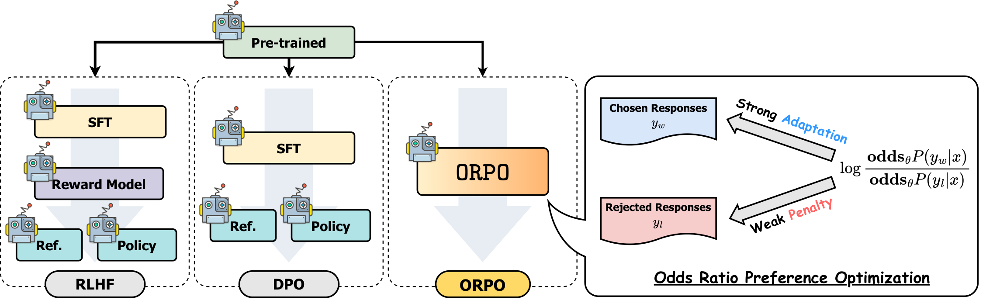
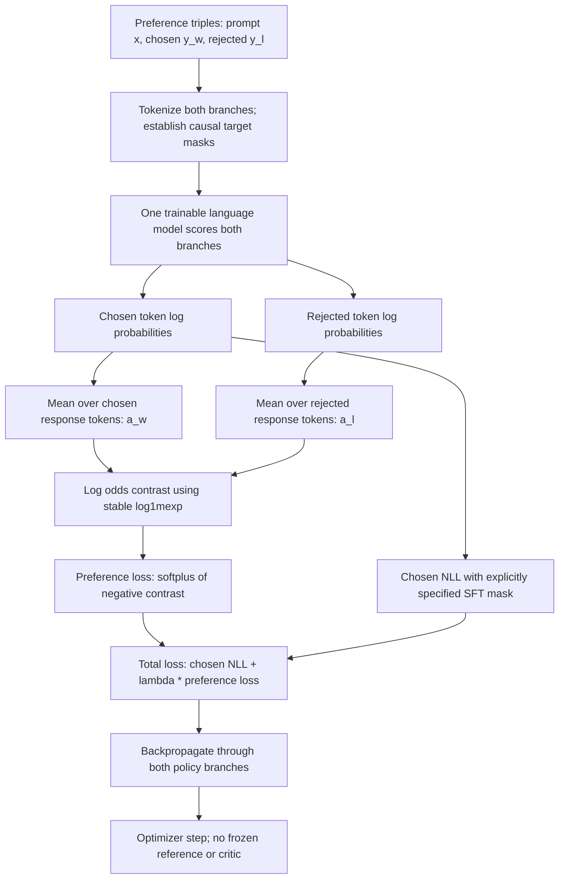
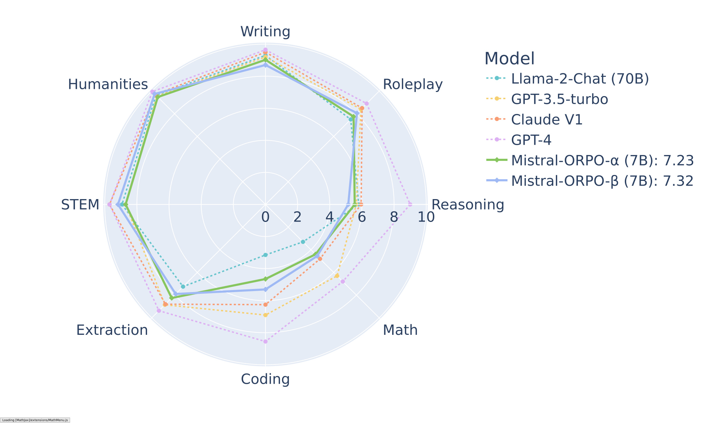
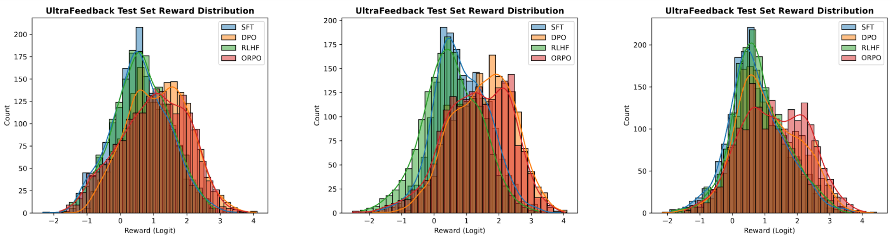
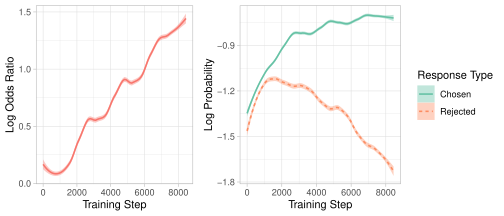

# ORPO: Monolithic Preference Optimization without Reference Model - Hong et al., 2024

> **arXiv:** [2403.07691v2](https://arxiv.org/abs/2403.07691v2), 14 March 2024; first submitted 12 March 2024. **Venue:** EMNLP 2024, pp. 11170-11189. **Affiliation:** KAIST AI. **Authors:** Jiwoo Hong, Noah Lee, and James Thorne.
>
> This recap follows the latest arXiv revision, **v2**. The subsequently published [EMNLP version](https://aclanthology.org/2024.emnlp-main.626/) has different numbering in places; section, equation, figure, and table references below refer to arXiv v2 unless stated otherwise.

## TL;DR

**Odds Ratio Preference Optimization (ORPO)** combines chosen-response language-model training with a pairwise odds-ratio penalty in a **single fine-tuning stage**, without a frozen reference model, reward model, or reinforcement-learning loop. Its contrastive term compares **length-normalized response scores**, encouraging the chosen response while discouraging the rejected response; the supervised term retains the positive domain-adaptation signal. In the paper's experiments, Mistral-ORPO-beta reaches **12.20% raw AlpacaEval 2.0 win rate**, **7.32 MT-Bench**, and **66.19% instruction-level loose IFEval accuracy** (Table 1, Figure 4, and Table 6). These are different automatic evaluations, not a single general-purpose accuracy measure or evidence that every reference-free objective beats DPO.

## Problem & motivation

### Why merge the stages?

The [InstructGPT/RLHF pipeline](alignment-rl_2022_instructgpt-rlhf.md) typically performs supervised fine-tuning, reward modeling, and policy optimization with [PPO](alignment-rl_2017_proximal-policy-optimization.md). [DPO](alignment-rl_2023_direct-preference-optimization.md) removes explicit reward-model fitting and the reinforcement-learning loop, but normally begins from an SFT model and compares the trainable policy against a frozen reference.

ORPO asks whether the language model can learn the desired response domain and its preference ordering together. The proposed answer is to keep the positive SFT signal and add a relatively small penalty derived from rejected responses. "No SFT warm-up" means **no separate preceding SFT stage**, not absence of supervised likelihood training.

This changes the training system in two ways. It removes the reference-model scores and weights from the objective, and it allows training directly from a pretrained model on preference triples $(x,y_w,y_l)$: prompt $x$, chosen response $y_w$, and rejected response $y_l$. **Pairs are still required.** In contrast, [KTO](alignment-rl_2024_kahneman-tversky-optimization.md) is designed to accept isolated desirable/undesirable labels.

### What ordinary SFT does and does not penalize

In the paper's pilot experiment, OPT-350M is trained on chosen HH-RLHF responses while the likelihoods of both chosen and rejected responses are monitored. Both rise, and rejected responses can remain competitive (Section 3, Figure 3). The interpretation is that domain adaptation can transfer to desirable and undesirable styles alike.

The paper describes cross-entropy as lacking a penalty for non-answer tokens. This needs a technical qualification: softmax cross-entropy **does** update non-target logits through normalization. For logits $z_j$, probabilities $p_j$, and target token $t$:

$$
\mathcal L_{\mathrm{CE}}=-\log p_t,
\qquad
\frac{\partial\mathcal L_{\mathrm{CE}}}{\partial z_j}
=p_j-\mathbf 1\{j=t\}.
$$

What chosen-only SFT lacks is an **explicit sequence-level preference term involving the labeled rejected response**. That is the missing signal ORPO adds. It is not necessary to assume that non-target logits receive literally zero gradient.



*Original Figure 2. The paper contrasts a multi-stage RLHF pipeline, SFT followed by reference-based DPO, and one-stage ORPO. The ORPO branch retains a positive likelihood signal and adds a chosen/rejected odds contrast. The absence of a separate SFT stage should not be confused with the removal of its domain-adaptation objective.*

## Key idea

### First define the score correctly

For a response $y=(y_1,\ldots,y_T)$, define its **mean response-token log likelihood**:

$$
a_\theta(x,y)
=\frac1T\sum_{t=1}^{T}
\log\pi_\theta(y_t\mid x,y_{<t}),
\qquad
P_\theta(y\mid x)=\exp a_\theta(x,y).
$$

Here $\pi_\theta$ is the actual autoregressive token distribution; $P_\theta$ is the paper's length-normalized response score (Eq. 3). It is the **geometric mean** of token probabilities, not their product.

This distinction matters. Although $0<P_\theta<1$ for ordinary finite scores, these geometric means do **not** generally sum to one over responses. Thus the paper's "odds of generating the response rather than not generating it" is an intuition for an odds transform of a score, not a literal Bernoulli interpretation of the model's full sequence probability. Length normalization reduces the built-in exponential penalty on longer sequences, but does not remove every possible length preference.

### Apply an odds transform, then combine with SFT

Define the odds and log odds ratio:

$$
\begin{aligned}
o_\theta(y\mid x)&=\frac{P_\theta(y\mid x)}{1-P_\theta(y\mid x)},\\
\mathrm{OR}_\theta(y_w,y_l\mid x)&=\frac{o_\theta(y_w\mid x)}
                                                       {o_\theta(y_l\mid x)},\\
q_\theta(x,y_w,y_l)&=\log\mathrm{OR}_\theta(y_w,y_l\mid x).
\end{aligned}
$$

An odds ratio above one, equivalently $q_\theta>0$, means the chosen response has the higher length-normalized score. Let $\sigma(u)=1/(1+e^{-u})$ and let $\lambda\geq0$ weight the preference term. The objective is:

$$
\boxed{
\mathcal L_{\mathrm{ORPO}}
=\mathbb E_{(x,y_w,y_l)\sim\mathcal D}
\left[
\mathcal L_{\mathrm{SFT}}(x,y_w)
+\lambda\,
\underbrace{-\log\sigma(q_\theta(x,y_w,y_l))}
_{\mathcal L_{\mathrm{OR}}}
\right].
}
$$

The SFT term is chosen-sequence causal language-model negative log likelihood with a specified training mask/reduction. In a response-only, per-example-mean formulation, it is simply $-a_\theta(x,y_w)$. The original released trainer has additional masking conventions discussed below, so that equality should not be assumed for every implementation.

At $\lambda=0$, the objective reduces to the selected SFT formulation. At equal chosen/rejected scores, the preference loss is $\log 2$. Increasing the log odds ratio reduces the preference loss, while the SFT term anchors training toward actually predicting the chosen tokens rather than merely widening a relative margin.

There is **no DPO-style temperature inside the log odds ratio in the paper's objective**. The coefficient $\lambda$ scales the added loss; it is not interchangeable with multiplying the margin by a temperature.

## How it works

### 1. Teacher-force both responses through one trainable model

For a batch of $B$ preference triples, tokenize the prompt/chosen and prompt/rejected sequences. Pad or pack them using explicit boundaries. A concatenated implementation can run $2B$ sequences together, producing logits of shape approximately $[2B,L,V]$, with padded sequence length $L$ and vocabulary size $V$; separate chosen and rejected forwards are also valid.

Causally shift logits and target IDs, gather the target-token log probabilities, and mask out positions that are not response targets. For example $i$, with mask $M_{i,t}$:

$$
a_i=
\frac{\sum_t M_{i,t}
 \log\pi_\theta(\mathrm{target}_{i,t}\mid\mathrm{prefix}_{i,t})}
     {\sum_t M_{i,t}}.
$$

Each chosen or rejected response then has a scalar score, giving vectors $a_w,a_l$ of shape $[B]$. **Both branches need policy gradients.** The rejected branch is not an inference-only reference pass.

The mean is over valid response tokens, not padded length, and not the whole prompt-plus-response sequence. An empty response after filtering or truncation has no valid denominator and must be diagnosed rather than assigned a successful-looking default score. Define whether EOS belongs to the scored response and use the same convention in both branches.

This differs from the original DPO convention of **summed response log probabilities**. Substituting sums for means in ORPO changes both the contrast and the nonlinear $1-P_\theta$ factors, not just an innocuous scale.

### 2. Compute the contrast in log space

Writing $a_w=\log P_w$ and $a_l=\log P_l$, expand the margin:

$$
q_\theta
=(a_w-a_l)
-\left[\log(1-e^{a_w})-\log(1-e^{a_l})\right],
\qquad
\mathcal L_{\mathrm{OR}}
=\operatorname{softplus}(-q_\theta).
$$

This is the quantity computed by the [official trainer](https://github.com/xfactlab/orpo/blob/main/src/orpo_trainer.py), which subtracts a weighted log-sigmoid from the chosen NLL. There is no need to exponentiate an entire odds ratio or multiply token probabilities explicitly.

For a robust implementation, use a stable log-one-minus-exp operation for $a<0$:

$$
\operatorname{log1mexp}(a)=
\begin{cases}
\log1p(-e^a),&a\leq-\log 2,\\
\log(-\operatorname{expm1}(a)),&-\log 2<a<0.
\end{cases}
$$

Near zero, forming $1-e^a$ by naive subtraction loses precision; for a strongly negative margin, computing a sigmoid and then its logarithm can underflow. Stable log-sigmoid/softplus avoids that second problem. An exactly zero or positive averaged log score is outside the finite mathematical domain of this odds calculation; silently clamping it changes the objective and can hide a scoring/masking error.

The published code uses `log1p(-exp(a))` and `log(sigmoid(q))`. The stable formulation above expresses the same finite-domain objective, rather than a new loss, but reproducing the historical implementation bit-for-bit also requires matching its precision choices.

### 3. Understand the gradient, including its sign

For $d=(x,y_w,y_l)$, define:

$$
\delta(d)=\sigma(-q_\theta)=\frac{1}{1+\mathrm{OR}_\theta},
\qquad
h(d)=
\frac{\nabla_\theta a_w}{1-P_w}
-\frac{\nabla_\theta a_l}{1-P_l}.
$$

The gradient of the **loss being minimized** is:

$$
\boxed{
\nabla_\theta\mathcal L_{\mathrm{OR}}
=-\delta(d)\,h(d).
}
$$

Equivalently, treating the two mean log scores as independent intermediate variables:

$$
\frac{\partial\mathcal L_{\mathrm{OR}}}{\partial a_w}
=-\frac{\delta}{1-P_w},
\qquad
\frac{\partial\mathcal L_{\mathrm{OR}}}{\partial a_l}
=+\frac{\delta}{1-P_l}.
$$

Gradient descent therefore increases the chosen score and decreases the rejected score in these score coordinates. Shared neural parameters mean an actual parameter update need not change every example's scores independently or monotonically.

The scalar $\delta$ approaches zero when the model already strongly favors the chosen response. It approaches one when the ordering is badly wrong, so the preference term emphasizes misordered pairs. The factors $1/(1-P)$ grow when **$P$ is high**, not when it is low; the full multiplier also includes $\delta$.

**Printed-sign caveat:** v2 Eq. 8 and the final Appendix A expression omit the leading minus sign required by Eq. 7's $-\log\sigma$ loss. Appendix A also drops a minus sign between Eqs. 28 and 29. The expressions here follow Eq. 7 and the released code's minimization direction. Using the printed positive $\delta h$ as a gradient for descent would reverse the preference update.

### 4. Why use odds rather than an ordinary probability ratio?

The ordinary ratio has margin $\log(P_w/P_l)=a_w-a_l$. The odds margin adds:

$$
q_\theta
=\log\frac{P_w}{P_l}
+\log\frac{1-P_l}{1-P_w}.
$$

For a fixed ratio, the odds transform distinguishes different absolute score levels. As a derived example, $(P_w,P_l)=(0.2,0.1)$ has probability ratio $2$ and odds ratio $2.25$, while $(0.8,0.4)$ still has probability ratio $2$ but odds ratio $6$. When both scores are very small, the odds correction becomes small and the two margins approach one another.

Section 7.1 illustrates the difference using **50,000** sampled probability pairs from $\mathrm{Unif}(0,1)$, comparing log odds with probability-ratio margins at scales **0.2 and 1.0**. Appendix B reports that the probability-ratio variant suppresses rejected-response log likelihood more aggressively in its ablation.

The authors interpret the wider odds-margin range as allowing preference separation without forcing as extreme a raw probability ratio during domain adaptation. This is a geometric argument and supporting ablation, **not a general convergence or numerical-stability theorem**. Uniform random scores are also not the distribution of every language model's geometric-mean scores.

### 5. End-to-end algorithm



In practical order:

1. Filter invalid pairs, including empty responses and identical chosen/rejected texts; validate again after truncation.
2. Tokenize with a consistent chat template and preserve prompt/response boundaries.
3. Score both responses with the same current policy, including gradients for both.
4. Compute response-token mean log scores, the log odds ratio, and the per-pair preference loss.
5. Compute the chosen-sequence NLL using the intended prompt mask and reduction. Combine with the **mean** pair loss scaled by $\lambda$.
6. Update the policy normally. No reward-model fitting, policy-generated training samples, reference-log-probability cache, or critic is required by ORPO.

### 6. Released implementation details that affect reproduction

The [original trainer](https://github.com/xfactlab/orpo/blob/main/src/orpo_trainer.py), [argument defaults](https://github.com/xfactlab/orpo/blob/main/src/args.py), and [preprocessing](https://github.com/xfactlab/orpo/blob/main/main.py) reveal several details not captured by a one-line objective:

- **The code calls the loss weight `alpha`.** Its `--alpha` corresponds to the paper's $\lambda$. The checkpoint names **Mistral-ORPO-alpha/beta** distinguish dataset variants; they are not the two values of that loss coefficient.
- **The chosen NLL can include prompt tokens.** The trainer uses the model's chosen-sequence causal-LM loss; prompt masking is enabled by `--disable_prompt_loss`, whose default is false. The preference scores separately attempt to isolate responses. Thus a response-only SFT derivation should not be silently presented as the exact default released training computation.
- **Reduction conventions differ.** The model's scalar NLL typically averages valid tokens across the chosen batch, whereas preference scores are first averaged per response and then the preference loss is averaged over pairs. With unequal lengths, that is not always the same as averaging an independent $-a_w$ equally for every example.
- **Mask boundaries need explicit tests.** The released preference scorer subtracts a next-position prompt mask from a previous-position full-sequence attention mask. With right padding, this can include the first padding target after the real sequence. A clean target-position response mask should exclude that position; historical comparison requires accounting for the original tokenization, EOS, and padding conventions.
- **The released code has precision-specific behavior.** It uses bfloat16 in parts of scoring/loss calculation and casts reduced scores to float64. Casting after a low-precision reduction does not restore precision already lost; this is another reason to use stable log-space operations and validate boundary cases.

These are reproduction qualifications, not changes to this repository's training code: this recap documents the objective and identifies where a literal reuse of the sample implementation needs care.

## Training / data

### Models, datasets, and filtering

The controlled experiments use **OPT-125M, OPT-350M, and OPT-1.3B**. Larger instruction-following experiments use **Phi-2 2.7B, Llama-2 7B, and Mistral 7B** (Section 5.1).

Training datasets are **Anthropic HH-RLHF** and **binarized UltraFeedback**. The authors remove pairs with identical chosen/rejected responses or either response empty. Appendix C also filters prompts longer than **1,024 tokens** and truncates/pads examples to **1,024 tokens for HH-RLHF** or **2,048 tokens for UltraFeedback**. Such filtering must not be interpreted as a guarantee that every truncated response still has a valid scoring span.

Mistral-ORPO-alpha uses the original binarized UltraFeedback. Mistral-ORPO-beta uses the [Argilla cleaned binarized version](https://huggingface.co/datasets/argilla/ultrafeedback-binarized-preferences-cleaned), with otherwise matching configuration described in Section 6.1. Appendix G describes using approximately **61k UltraFeedback instances**. The checkpoint comparison therefore includes **data quality**, not merely an algorithm change.

### Paper recipes and comparison settings

The paper reports the following settings (Sections 5-6 and Appendix C):

| Component | Reported setting and scope |
|---|---|
| SFT baseline | Maximum learning rate **1e-5**, **one epoch** on chosen responses. |
| DPO baseline | SFT first, then $\beta=0.1$, learning rate **5e-6**, up to **three epochs**, choosing the lowest evaluation-loss checkpoint. The first or second preference checkpoint is usually selected. |
| ORPO controlled recipe | Maximum learning rate **8e-6**, up to **ten epochs**, selecting the lowest evaluation-loss checkpoint for OPT, Phi-2, and Llama-2. |
| ORPO weight | $\lambda=0.25$ for Phi-2, **0.2** for Llama-2, and **0.1** for the main Mistral configurations (Section 6.1). |
| Mistral headline comparison | Figure 1 describes the Mistral results as **one-epoch** training on UltraFeedback. This should not be collapsed into the ten-epoch checkpoint-selection recipe for other models. |
| Optimizers / schedule | **AdamW and paged AdamW**, with linear warm-up and cosine learning-rate decay, per Appendix C. A single fully specified optimizer assignment for every run is not supplied there. |
| Attention / parallelism | FlashAttention-2 for the pretrained models; DeepSpeed ZeRO-2 for OPT and Phi-2; FSDP for Llama-2 and Mistral. |
| Hardware | **Four A100s** for 7B models, **two A100s** for 2.7B, and **four A6000s** for the smaller models. |

ORPO does have a meaningful preference-weight hyperparameter even though Appendix C informally says that only learning rate and epochs need setting. The explicit $\lambda$ choices and Appendix E ablations take precedence over interpreting that sentence literally.

The [released Mistral-beta launch script](https://github.com/xfactlab/orpo/blob/main/scripts/run_mistral_orpo_beta.sh) is **not the same full recipe** as those paper descriptions. It specifies learning rate **5e-6**, an **inverse-square-root** schedule, **200** warm-up steps, **five epochs**, `--alpha 0.1`, batch **8 per device**, and gradient accumulation **1**, with a comment indicating four A100s. Its prompt-length filter is **1,792**, while the field named `response_max_length` is **2,048** and is used by preprocessing for the **whole formatted sequence**, not an additional response-only allowance.

The generic argument defaults differ again, including loss weight **1.0**. Reproducing a result therefore requires pinning the intended checkpoint, dataset, script, masking behavior, and revision; combining the paper's best scores with all current defaults does not establish a matched reproduction. The paper does not give complete wall-clock, peak-memory, and per-run batch/schedule details for every experiment.

### Reward models and PPO baseline

ORPO itself has no learned reward model. The experiments nevertheless train **OPT-350M and OPT-1.3B reward models**, each for **one epoch**, using the Bradley-Terry logistic pair loss (Section 5.1):

$$
\mathcal L_{\mathrm{RM}}
=-\mathbb E_{(x,y_w,y_l)}
\log\sigma\!\left(r_\phi(x,y_w)-r_\phi(x,y_l)\right).
$$

RM-350M supplies PPO's training reward. The separately trained RM-1.3B evaluates generated responses and produces the controlled win rates and reward distributions. Training and evaluation rewards are therefore **not the same model**, and the authors identify reward mismatch as one possible explanation for PPO's weaker distributions.

For completeness, Table 5's UltraFeedback PPO settings are:

| PPO hyperparameter | Setting |
|---|---|
| PPO epochs | 4 |
| Initial KL coefficient | 0.1 |
| Horizon | 2,000 |
| Batch size | 64 |
| Minibatch size | 8 |
| Gradient accumulation | 1 |
| Minimum output length | 128 |
| Maximum output length | 512 |
| Optimizer | AdamW |
| Learning rate | 1e-5 |
| Discount $\gamma$ | 0.99 |

For HH-RLHF, the minimum/maximum output lengths instead become **64/256** (Appendix C). These are the comparison baseline's settings, not requirements imposed by ORPO.

## Results

### Table 1: single-turn instruction following

All numbers below are **per Table 1**. Percentages are win rates. Parenthesized uncertainty values are reproduced as printed; Table 1 does not explicitly define their type in its caption, so they are not relabeled here as confidence intervals.

| Model | Size | AlpacaEval 1.0, % | AlpacaEval 2.0, % |
|---|---|---|---|
| Phi-2 + SFT | 2.7B | 48.37 (1.77) | 0.11 (0.06) |
| Phi-2 + SFT + DPO | 2.7B | 50.63 (1.77) | 0.78 (0.22) |
| Phi-2 + ORPO | 2.7B | 71.80 (1.59) | 6.35 (0.74) |
| Llama-2 Chat, leaderboard | 7B | 71.34 (1.59) | 4.96 (0.67) |
| Llama-2 Chat, leaderboard | 13B | 81.09 (1.38) | 7.70 (0.83) |
| Llama-2 + ORPO | 7B | 81.26 (1.37) | 9.44 (0.85) |
| Zephyr-alpha, leaderboard | 7B | 85.76 (1.23) | 8.35 (0.87) |
| Zephyr-beta, leaderboard | 7B | 90.60 (1.03) | 10.99 (0.96) |
| Mistral-ORPO-alpha | 7B | 87.92 (1.14) | 11.33 (0.97) |
| Mistral-ORPO-beta | 7B | 91.41 (1.15) | 12.20 (0.98) |

Per Section 5.2, AlpacaEval 1.0 uses GPT-4 to judge responses against **text-davinci-003**. AlpacaEval 2.0 uses a GPT-4-Turbo judge and the newer GPT-4-family reference; the [benchmark documentation](https://github.com/tatsu-lab/alpaca_eval#readme) identifies its newer baseline as GPT-4 preview. The two columns therefore have different opponents and must not be interpreted as the same evaluation becoming worse.

These are the paper's **raw** win rates, not later length-controlled AlpacaEval results. The repository subsequently advertises a **14.7% length-controlled** score for Mistral-ORPO-beta; that is a different reported metric and should not replace Table 1's **12.20%**.

The Phi-2 comparison improves over its displayed SFT/DPO baselines, while the cleaned-data Mistral-beta model improves over Mistral-alpha. The larger-model leaderboard comparisons also differ in training data and pipeline, so they are not controlled evidence isolating the loss function alone.

Section 6.1 reports that the authors' attempted Llama-2 SFT and SFT+DPO models produced outputs that could not be evaluated in their setup. This is a failed baseline in that experiment, **not a measured zero score** and not proof that Llama-2 generally cannot be trained successfully with DPO.

### Multi-turn instruction following and IFEval



*The same category plot appears as Figures 4 and 12. Mistral-ORPO is relatively stronger on descriptive/open-ended categories than on coding and math. The model was trained using single-turn UltraFeedback examples; the plot evaluates multi-turn behavior, not exposure to a multi-turn preference-training corpus.*

The plotted MT-Bench averages are **7.23 for Mistral-ORPO-alpha** and **7.32 for Mistral-ORPO-beta** (Section 6.2 and Figure 4), using GPT-4 evaluation. The introduction instead prints **7.24** for alpha; this recap retains the **7.23** shown in the section and original figure rather than silently treating the two as identical.

**Table 6** reports IFEval fractions:

| Model | Prompt-strict | Prompt-loose | Instruction-strict | Instruction-loose |
|---|---|---|---|---|
| Mistral-ORPO-alpha | 0.5009 | 0.5083 | 0.5995 | 0.6163 |
| Mistral-ORPO-beta | 0.5287 | 0.5564 | 0.6355 | 0.6619 |

The headline **66.19%** is beta's **instruction-level loose** score, not its prompt-level or strict score. Prompt-level evaluation asks whether all relevant constraints are satisfied for a prompt; instruction-level evaluation evaluates individual constraints. The distinction between strict and loose checking also matters, so the four columns should not be collapsed into one generic "instruction accuracy."

### Tables 2 and 3: controlled reward-model comparisons

The next two tables report ORPO's win rate **against each named method at the same OPT size**, as judged by RM-1.3B. Entries are **mean percentage (standard deviation)** across **three rounds**, with generation temperature **1.0** (Tables 2-3). These are not human-preference percentages, confidence intervals, or necessarily variation over independent training seeds.

**HH-RLHF, per Table 2:**

| ORPO model | vs. SFT | vs. SFT + DPO | vs. SFT + PPO |
|---|---|---|---|
| OPT-125M | 84.0 (0.62) | 41.7 (0.77) | 66.1 (0.26) |
| OPT-350M | 82.7 (0.56) | 49.4 (0.54) | 79.4 (0.29) |
| OPT-1.3B | 78.0 (0.16) | 70.9 (0.52) | 65.9 (0.33) |

**UltraFeedback, per Table 3:**

| ORPO model | vs. SFT | vs. SFT + DPO | vs. SFT + PPO |
|---|---|---|---|
| OPT-125M | 73.2 (0.12) | 48.8 (0.29) | 71.4 (0.28) |
| OPT-350M | 80.5 (0.54) | 50.5 (0.17) | 85.8 (0.62) |
| OPT-1.3B | 69.4 (0.57) | 57.8 (0.73) | 65.7 (1.07) |

ORPO exceeds SFT and PPO in every displayed cell, but **does not consistently beat DPO at the smallest sizes**. Its win rate against DPO rises with scale in both tables. In particular, Table 2's highest SFT-comparison value is **84.0%**, even though the accompanying prose incorrectly calls **78.0%** the highest; the table values above are preserved.



*Original Figure 5. Left to right: OPT-125M, OPT-350M, and OPT-1.3B. RM-1.3B scores the generated responses; the horizontal axis is its reward logit, not a calibrated probability. ORPO often shifts mass toward higher evaluation rewards, while PPO's training used a different, smaller reward model. Similar HH-RLHF plots appear in Figure 11; neither plot demonstrates human-level alignment by itself.*

### Table 4: diversity within and across prompts

The paper uses Gemini-Pro-based response embeddings, described as accepting up to **2,048 tokens**, to compare cosine similarities (Section 6.4). The main protocol samples **five responses at temperature 1.0 for each of 160 AlpacaEval prompts**. Lower cosine similarity indicates more diverse embeddings.

| Method | Per-input cosine similarity, lower is more diverse | Across-input cosine similarity, lower is more diverse |
|---|---|---|
| Phi-2 + SFT + DPO | 0.8012 | 0.6019 |
| Phi-2 + ORPO | 0.8909 | 0.5173 |
| Llama-2 + SFT + DPO | 0.8889 | 0.5658 |
| Llama-2 + ORPO | 0.9008 | 0.5091 |

All values are **per Table 4**. ORPO is **less diverse within a prompt**, but **more diverse across different prompts**, in these measurements. The result is a trade-off, not "ORPO improves diversity" without qualification. Embedding cosine similarity measures semantic similarity in the selected representation, not every aspect of lexical diversity or response usefulness.

For clarity, the conventional mean pairwise cosine for a set of $n$ embeddings is:

$$
C(H)=\frac{2}{n(n-1)}
\sum_{1\leq i<j\leq n}\cos(h_i,h_j),
\quad
\mathrm{PID}=\frac1N\sum_{k=1}^{N} C(H_k),
\quad
\mathrm{AID}=C(\{h_{k,1}\}_{k=1}^{N}).
$$

Here $H_k$ contains the responses for prompt $k$, and across-input similarity takes one response per prompt. This expresses the intended averaging interpretation unambiguously, **not a claim that the printed equations fully specify the implementation**. Eq. 13 prints a prefactor $1/[2n(n-1)]$ if its set-size variable is read literally, whose maximum would be $1/4$, inconsistent with Table 4's values near 0.9. Its indexing also mixes input and sample counts, and the across-input prose says "8 samples" despite the earlier five-sample protocol. Those ambiguities and the unspecified exact embedding endpoint limit exact reproduction; the table is reported without silently rewriting its measurements.

### Training dynamics and the preference-weight ablation



*Original Figure 7, Section 7.2. In the OPT-350M/HH-RLHF pilot with $\lambda=1.0$, the log odds ratio grows while chosen responses retain a strong likelihood signal and rejected-response scores eventually decline. This is one training configuration; Appendix E shows that the individual scores can move differently at other weights.*

Appendix E tests $\lambda\in\{0.1,0.5,1.0\}$ on Mistral/UltraFeedback. With **0.1**, the margin can grow mainly by increasing chosen likelihood rather than decreasing rejected likelihood. With **0.5**, chosen likelihood rises while rejected likelihood declines. With **1.0**, both can decline while their separation grows.

The downstream comparison finds that the larger weight worsens **extraction, math, and reasoning** relative to 0.1 but improves **STEM, humanities, and roleplay** in the displayed MT-Bench categories (Figure 10). The lesson is to tune the trade-off, not assume a larger margin or stronger rejected-response suppression always improves the intended task.

Appendix H additionally describes a verbosity assessment using five short-answer instructions and five long-answer instructions, randomly selecting an instruction per batch. These prompt modifications are an evaluation detail, not an additional training objective or a new numerical result inferred here.

### Computational efficiency: what is and is not measured

Section 7.3 counts four logical sequence evaluations for reference-based DPO: chosen and rejected responses through the policy and through the reference. ORPO needs only the two policy-side evaluations. It also avoids storing a separate frozen reference in the straightforward implementation.

That is a **forward-scoring comparison**, not a measured twofold reduction in total training time or peak memory. Policy backward passes, optimizer state, activations, sequence lengths, batching, and distributed execution still cost resources. DPO implementations can also precompute reference scores or share base weights in adapter setups. The paper does not give a matched wall-clock/peak-memory benchmark establishing one universal speedup.

## Limitations & follow-ups

### No reference means no explicit reference anchor

ORPO has no fixed-reference KL term or reference-policy log ratio. Chosen NLL provides an adaptation signal, but not a hard bound on departure from the pretrained policy. Preference data quality, $\lambda$, masking, and stopping criteria therefore matter, and preference improvement alone need not preserve every pretrained capability.

The objective still needs reliable **paired** labels. It does not solve the isolated-feedback problem addressed by [KTO](alignment-rl_2024_kahneman-tversky-optimization.md), nor establish how to handle every conflicting or ambiguous preference. A loser can share many correct tokens with its winner; sequence-level rejection does not mean every token in that response is undesirable.

### Results are conditional on models, data, and judges

The largest trained models in the paper are **7B**. The authors identify scaling beyond that, more alignment baselines, and more diverse domains/data qualities as future work (Limitations). The GPT-based instruction-following tests and learned-reward comparisons measure different proxies; neither proves truthfulness, safety, or universally representative human preference.

The leaderboard baselines use different training pipelines and datasets. The Mistral-alpha/beta comparison changes data cleaning. PPO is trained with a smaller reward model than the model judging its outputs. These conditions limit causal claims attributing every difference solely to the optimizer or loss.

Within-prompt diversity decreases in Table 4, coding/math remain weaker than descriptive categories, and larger $\lambda$ changes the capability trade-off. "Monolithic" describes the merged training stage, not immunity to overfitting, noisy labels, or task regressions.

### Reproduction requires resolving source ambiguities

The geometric-mean score is not a normalized response distribution. The printed gradient signs, diversity normalization/protocol, and alpha MT-Bench average have inconsistencies noted above. Current launch scripts also differ from the arXiv recipes, and prompt-loss/default masking conventions affect the actual optimized objective.

A faithful comparison should pin the paper version, code revision, tokenizer/template, EOS/padding masks, NLL reduction, dataset variant, preference weight, validation-selection rule, and benchmark configuration. In particular, do not mix the later length-controlled AlpacaEval result with the paper's raw score or report reference-forward savings as measured end-to-end speed.

### Related directions

[DPO](alignment-rl_2023_direct-preference-optimization.md) provides the paired, reference-based comparison; [KTO](alignment-rl_2024_kahneman-tversky-optimization.md) changes the supervision unit to binary labels. [InstructGPT](alignment-rl_2022_instructgpt-rlhf.md) and [PPO](alignment-rl_2017_proximal-policy-optimization.md) explain the explicit-reward/online-optimization route. [IPO](https://arxiv.org/abs/2310.12036) revisits preference-objective assumptions. These methods should be distinguished by their data, regularization, and training procedure rather than treated as equivalent names for preference alignment.

## Links

- **arXiv:** [abstract, v2](https://arxiv.org/abs/2403.07691v2) / [HTML, v2](https://arxiv.org/html/2403.07691v2) / [PDF, v2](https://arxiv.org/pdf/2403.07691v2).
- **Code:** [Official ORPO repository](https://github.com/xfactlab/orpo), [original trainer](https://github.com/xfactlab/orpo/blob/main/src/orpo_trainer.py), [preprocessing/training entry point](https://github.com/xfactlab/orpo/blob/main/main.py), [argument defaults](https://github.com/xfactlab/orpo/blob/main/src/args.py), and [Mistral-beta script](https://github.com/xfactlab/orpo/blob/main/scripts/run_mistral_orpo_beta.sh).
- **Hugging Face:** [Mistral-ORPO-alpha](https://huggingface.co/kaist-ai/mistral-orpo-alpha), [Mistral-ORPO-beta](https://huggingface.co/kaist-ai/mistral-orpo-beta), and [cleaned UltraFeedback preferences](https://huggingface.co/datasets/argilla/ultrafeedback-binarized-preferences-cleaned).
- **Project page:** [Official README and experiment links](https://github.com/xfactlab/orpo#readme).
- **Blog posts:** No separate blog used as a primary source for this recap.
- **Talks / videos:** No paper-specific recording verified for this recap.
- **OpenReview / venue page:** [EMNLP 2024 / ACL Anthology](https://aclanthology.org/2024.emnlp-main.626/), [venue BibTeX](https://aclanthology.org/2024.emnlp-main.626.bib).
- **Papers-with-Code:** Not used as a source; primary paper, venue, and official implementation linked above.
- **Related / successor papers:** [DPO recap](alignment-rl_2023_direct-preference-optimization.md), [KTO recap](alignment-rl_2024_kahneman-tversky-optimization.md), [PPO recap](alignment-rl_2017_proximal-policy-optimization.md), [InstructGPT recap](alignment-rl_2022_instructgpt-rlhf.md), [IPO](https://arxiv.org/abs/2310.12036).
- **BibTeX:**

```bibtex
@inproceedings{hong-etal-2024-orpo,
  title     = {ORPO: Monolithic Preference Optimization without Reference Model},
  author    = {Hong, Jiwoo and Lee, Noah and Thorne, James},
  booktitle = {Proceedings of the 2024 Conference on Empirical Methods
               in Natural Language Processing},
  year      = {2024},
  month     = nov,
  address   = {Miami, Florida, USA},
  publisher = {Association for Computational Linguistics},
  pages     = {11170--11189},
  doi       = {10.18653/v1/2024.emnlp-main.626},
  url       = {https://aclanthology.org/2024.emnlp-main.626/}
}
```
