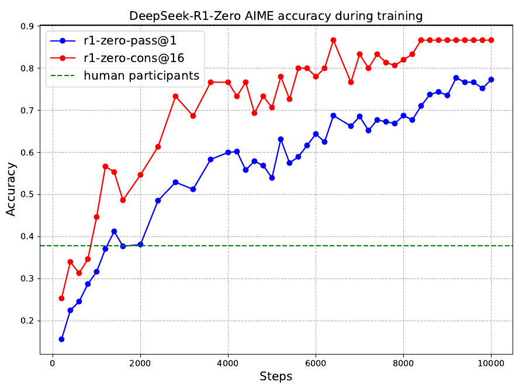
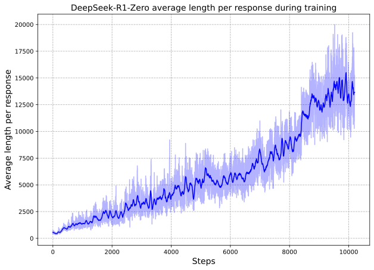
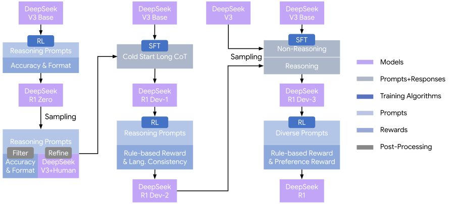
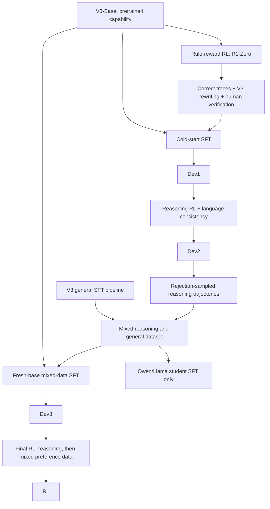
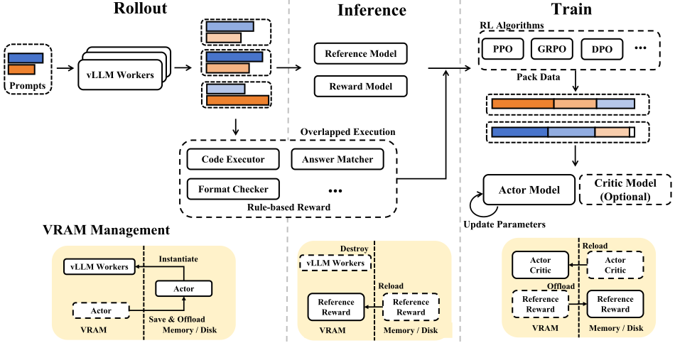

# DeepSeek-R1 - DeepSeek-AI, 2025

> **Paper:** DeepSeek-R1: Incentivizing Reasoning Capability in LLMs via Reinforcement Learning
>
> **arXiv:** [2501.12948v2](https://arxiv.org/abs/2501.12948v2), revised 4 January 2026; first submitted 22 January 2025
>
> **Venue:** Related Nature article, [DeepSeek-R1 incentivizes reasoning in LLMs through reinforcement learning](https://doi.org/10.1038/s41586-025-09422-z), published 17 September 2025
>
> **Affiliation:** DeepSeek-AI

## TL;DR

DeepSeek-R1-Zero demonstrates that a sufficiently capable pretrained language model can improve its reasoning through reinforcement learning on verifiable final answers, without an intervening supervised fine-tuning stage: in this revision, AIME 2024 pass@1 rises from **15.6% to 77.9%** (Section 2.3). DeepSeek-R1 converts that discovery into a more usable assistant through cold-start supervision, reasoning RL, rejection-sampled supervised training, and a final RL stage combining reasoning and human-preference objectives. Its reasoning trajectories also train six smaller Qwen/Llama models through ordinary supervised learning, showing that discovering a strategy and transferring it need not use the same optimization method.

**Scope:** This recap follows the substantially expanded **v2**, including its supplementary training recipes, developmental checkpoints, evaluation protocols, and safety report. Its numbers should not be mixed with those in the initial January 2025 report or later checkpoints such as R1-0528.

## Problem & motivation

### Learning to reason versus imitating a worked solution

Supervised fine-tuning teaches a model to reproduce a supplied answer trajectory. That is useful when the demonstrations are excellent, but expensive human annotations may omit the very operations that help a model solve difficult problems: checking a candidate answer, backtracking, recognizing a mistake, or trying a different approach. A short polished human solution is not necessarily the best sequence of intermediate tokens for a particular language model.

The paper therefore asks whether the model can discover useful trajectories by sampling solutions and receiving feedback about **whether the final answer is correct**, rather than receiving an annotation for each reasoning step. This is a claim about a post-training method, not about learning reasoning without pretraining, task descriptions, reference answers, or human-designed verifiers.

The starting checkpoint is **DeepSeek-V3-Base**, not the instruction-tuned DeepSeek-V3 assistant. It has **671B total parameters, 37B active per token**, and was pretrained on **14.8T tokens** (Supplementary A.1). Its mixture-of-experts architecture and Multi-head Latent Attention make that scale more practical, but R1 does not propose a new transformer architecture: the contribution is the post-training pipeline.

Importantly, Supplementary A.1 acknowledges substantial mathematical and code-related reasoning material in pretraining. Although the authors describe their corpus as naturally collected web pages and e-books rather than intentionally added synthetic data, those pages can contain other models' outputs. **No SFT before R1-Zero is not equivalent to no previous exposure to reasoning traces or other models' answers.**

### Why the pure-RL model is not the final assistant

R1-Zero develops strong mathematical and scientific reasoning but also produces difficult-to-read text, mixed Chinese/English reasoning, and weaker general assistant behavior. In Table 3, its IFEval score is **46.6**, versus **83.3** for final R1; its AlpacaEval 2.0 length-controlled win rate is **24.7**, versus **87.6**. Conversely, pure reasoning optimization can outperform final R1 on particular reasoning benchmarks: R1-Zero reaches **75.8** on GPQA Diamond and **88.1** on CNMO 2024, versus R1's **71.5** and **78.8**.

This motivates a hybrid answer rather than an ideological rejection of supervised learning. RL is valuable where reliable verification is available; SFT and preference modeling remain useful for conversational behavior and tasks with subjective outcomes.

## Key idea

### Search in the model's output distribution, then reinforce success

For a question $q$, sample $G$ complete responses $o_i$ from an old policy $\pi_{\theta_{\mathrm{old}}}$. Verify each response, assign scalar reward $r_i$, and compare it with the other attempts at **the same question**:

$$
\bar r=\frac{1}{G}\sum_{j=1}^{G}r_j,\qquad
A_i=\frac{r_i-\bar r}{\operatorname{std}(r_1,\ldots,r_G)}.
$$

Here $G$ is the number of attempts per question, $\bar r$ their mean reward, and $A_i$ a group-relative advantage. Better-than-group-average responses receive positive advantages; worse responses receive negative advantages. The group supplies a baseline, so no separate learned value function is required.

For binary correctness rewards with success fraction $p$ and population standard deviation, a correct attempt has advantage $(1-p)/\sqrt{p(1-p)}$, and an incorrect attempt has advantage $-p/\sqrt{p(1-p)}$. These identities illustrate the mechanism; the paper does not specify the sample-versus-population standard-deviation convention or treatment of zero-variance groups.

### The GRPO objective actually printed in R1

With $\rho_i=\pi_\theta(o_i\mid q)/\pi_{\theta_{\mathrm{old}}}(o_i\mid q)$, Equations 1-3 write the maximization objective as

$$
\mathcal J_{\mathrm{GRPO}}(\theta)
=\mathbb E_{\substack{q\sim P(Q)\\
o_{1:G}\sim\pi_{\theta_{\mathrm{old}}}}}
\left[
\frac{1}{G}\sum_{i=1}^{G}
\left\{
\min\left(
\rho_i A_i,\,
\operatorname{clip}(\rho_i,1-\varepsilon,1+\varepsilon)A_i
\right)-\beta k_i
\right\}
\right],
$$

$$
u_i=\frac{\pi_{\mathrm{ref}}(o_i\mid q)}
{\pi_\theta(o_i\mid q)},\qquad
k_i=u_i-\log u_i-1.
$$

$P(Q)$ is the training-question distribution; $\theta$ are current actor parameters; $\pi_{\theta_{\mathrm{old}}}$ generated the frozen rollout; $\pi_{\mathrm{ref}}$ is the reference policy; $\varepsilon$ controls importance-ratio clipping; and $\beta$ weights the reference penalty. A minimization-based trainer minimizes $-\mathcal J$.

Clipping is sign-sensitive. For positive $A_i$, increasing $\rho_i$ above $1+\varepsilon$ stops increasing the clipped reward term. For negative $A_i$, decreasing $\rho_i$ below $1-\varepsilon$ stops improving that term. Ratios outside these boundaries are not all automatically discarded: the minimum selects a different branch depending on the advantage sign.

The sampled penalty $k_i$ is nonnegative because $u-\log u-1\geq0$ for $u>0$, and vanishes when current and reference probabilities agree. Under current-policy sampling and shared-support assumptions, its expectation equals forward KL, $\mathbb D_{\mathrm{KL}}(\pi_\theta\Vert\pi_{\mathrm{ref}})$. R1 samples trajectories from an old policy, however, so the printed term should not be casually described as an unbiased KL estimator under arbitrary stale rollouts.

**Notation and implementation boundary:** R1 prints response-level probability ratios. The [original GRPO paper](alignment-rl_2024_deepseekmath-grpo.md) gives the tokenwise clipped surrogate and per-response token averaging. Those are not interchangeable: a sequence ratio multiplies token ratios and can have very different variance. R1 does not publish the complete trainer or explicitly resolve this shorthand in the displayed objective. The equations above faithfully report R1's notation; an implementation claiming exact reproduction must resolve the token/sequence ratio, reduction, and masking from additional authoritative implementation evidence rather than silently replacing one with the other.

### What is rewarded

R1-Zero's rule reward is

$$
r_{\mathrm{rule}}=r_{\mathrm{acc}}+r_{\mathrm{format}}.
$$

The two components have equal weights (Equation 4, Section 2.2). Accuracy checks numerical or symbolic answers, multiple-choice labels, or code execution against tests. Format checks encourage a reasoning region delimited by `<think>` and `</think>`; the training template also distinguishes an `<answer>` region. The format constraint specifies **where** reasoning is written, not which reasoning steps must occur.

No learned outcome or process reward model is used for R1-Zero's reasoning reward. This is an important departure from DeepSeekMath's original learned-reward GRPO recipe. Final R1 does use neural rewards for general helpfulness and safety, so "R1 never uses reward models" is also incorrect.

## How it works

### 1. Pure RL: DeepSeek-V3-Base to R1-Zero

1. Present a reasoning question using the simple reasoning/answer template of Table 1. Do not first fine-tune the base on curated reasoning demonstrations.
2. Sample **16** candidate responses per question. Each attempt contains both reasoning tokens and a final answer.
3. Evaluate final correctness and formatting. A model can receive credit for an unconventional reasoning path if its final answer passes the verifier.
4. Compute group-relative advantages and update the actor with GRPO. Keep sampled responses, old-policy probabilities, verifier outputs, group statistics, and reference probabilities fixed while differentiating the actor objective.
5. Refresh the rollout actor and periodically reset the reference to the latest policy. Continue sampling and optimization, allowing useful long-form behaviors to become more likely.

Holding those quantities fixed is the policy-gradient interpretation of the objective, not an additional trainable verifier. Padding and prompt-only positions must not become response-action losses; a concrete tokenwise implementation must also prevent packed examples from attending across unrelated sequence boundaries. Exact R1 masking and loss reductions are not disclosed.



*Figure 1(a), cropped from page 4 of the v2 PDF. Blue measures pass@1; red measures consensus over 16 responses, not pass@16 or the final R1 cons@64 evaluation. The human baseline is the average competition participant, not the strongest human contestants.*



*Figure 1(b), original paper asset. Response length increases without supervising a target number of reasoning steps. The association between longer responses and higher accuracy is evidence of learned compute usage, not proof that arbitrary verbosity improves correctness.*

The "aha moment" example in Table 2 illustrates an intermediate model abandoning an initially unproductive algebraic route and reconsidering its derivation. It is a qualitative sample, not a demonstration of consciousness. Supplementary C.2 adds aggregate evidence: frequencies of expert-selected reflective words increase roughly **5- to 7-fold**, and "wait" becomes especially frequent later in training. Such words are behavioral proxies, not direct measurements of faithful internal reasoning.

### 2. Cold-start supervision: R1-Dev1

Sample reasoning traces from R1-Zero, retain usable correct examples, and refine them into readable, language-consistent conversational reasoning. Figure 2 explicitly shows **DeepSeek-V3 plus humans** in this refinement path.

Supplementary B.3.2 describes humans first rewriting traces, using those examples to prompt an LLM to rewrite additional traces, and human verification of the generated results. Preferred traces understand the question, reason through it, and incorporate reflection and verification, with short readable paragraphs and a first-person conversational style. The source says **thousands** of cold-start examples, not an exact released count.

Fine-tune **DeepSeek-V3-Base** on these examples to obtain R1-Dev1. This is not simply continued SFT of the R1-Zero actor. The source cautions that the anthropomorphic style is engineered for user experience and may elicit unwarranted trust.

### 3. Reasoning RL with language consistency: R1-Dev2

Apply reasoning RL to Dev1 using rule rewards and a language-consistency component:

$$
r_{\mathrm{lang}}
=\frac{N_{\mathrm{target}}}{N_{\mathrm{words}}},
$$

where $N_{\mathrm{target}}$ counts target-language words in the chain of thought and $N_{\mathrm{words}}$ counts all words there (Equation 7). This steers outputs toward readable language consistency rather than imposing a specific reasoning strategy.

The paper does not specify the language detector, tokenization of "words," treatment of mathematical/code fragments, or zero-word handling. These are required implementation choices, not grounds for inventing an exact detector.

Supplementary B.6 tests the consistency reward on a 7B Qwen-based setup using the same cold-start data. Without it, language consistency deteriorates during RL; with it, consistency is stable, mathematical performance is comparable, and coding performance degrades slightly. This is a readability/performance trade-off rather than a free reasoning improvement.

### 4. Rejection sampling and a fresh large SFT stage: R1-Dev3

Generate multiple responses per question from Dev2 and keep correct trajectories. Expand beyond tasks with purely rule-based checking by using DeepSeek-V3 to judge a prediction against its supplied ground truth where needed. Remove traces with mixed languages, unwieldy paragraphs, or undesirable code-block formatting.

Combine approximately **600K reasoning examples** with approximately **200K non-reasoning examples**. The latter reuse parts of DeepSeek-V3's SFT pipeline and include writing, factual QA, translation, self-description, program repair, and front-end development. Some non-reasoning answers include a generated reasoning prefix; simple greetings need not.

Fine-tune **a fresh DeepSeek-V3-Base checkpoint** on that mixed dataset to obtain Dev3, as shown in Figure 2 and Supplementary B.4.2. Dev2 is the source of reasoning data, not the weight initializer for this SFT stage. This separation lets the pipeline retain successful reasoning trajectories while adding broader assistant competence.

### 5. Final RL: R1

Optimize Dev3 on reasoning prompts and, near the end, general assistant prompts. Reasoning still uses rule rewards; general prompts use either a helpfulness or a safety reward, depending on their dataset:

$$
r(q,o)=
\begin{cases}
r_{\mathrm{acc}}+r_{\mathrm{format}}+r_{\mathrm{lang}},
&q\in\mathcal Q_{\mathrm{reasoning}},\\
r_{\mathrm{help}}+r_{\mathrm{format}}+r_{\mathrm{lang}},
&q\in\mathcal Q_{\mathrm{help}},\\
r_{\mathrm{safe}}+r_{\mathrm{format}}+r_{\mathrm{lang}},
&q\in\mathcal Q_{\mathrm{safety}}.
\end{cases}
$$

This casewise form explains Equations 8-10: the reasoning and general rewards are activated for their respective data, not all indiscriminately scored on every prompt. Within general data, helpfulness and safety are also dataset-specific, not automatically two simultaneously available scalar scores.

The final RL stage has **1,700 updates**; general instruction data and preference rewards are incorporated **only during its last 400** (Section 3.2.2). Prolonged preference-reward optimization led to reward hacking, so the schedule deliberately limits that portion.



*Figure 2. Notice the separate V3-Base initializations for cold-start SFT and mixed-data SFT. Model-generated traces flow between stages, but weights do not simply pass through one uninterrupted SFT/RL chain.*

### 6. Distillation: transfer trajectories, not teacher logits

Train smaller foundation models on the same approximately 800K-example dataset with supervised next-token prediction. No RL stage is applied to the six released distilled models in this paper (Supplementary F).

For question $q$, teacher-generated response $y_{1:T}$, and student parameters $\phi$, the ordinary autoregressive SFT interpretation is

$$
\mathcal L_{\mathrm{SFT}}(\phi)
=-\mathbb E_{(q,y)\sim\mathcal D}
\left[\sum_{t=1}^{T}
\log\pi_\phi(y_t\mid q,y_{<t})\right].
$$

$\mathcal D$ contains retained reasoning and general examples. Only supervised response positions contribute; the exact normalization/packing recipe is not specified. This equation spells out the standard SFT mechanism, rather than claiming that R1 prints a separate bespoke distillation loss.

Unlike [classical soft-target knowledge distillation](distill_2015_hinton-kd.md), this recipe transfers **sampled token sequences**, including reasoning text. It does not require temperature-scaled teacher logits, a KL loss between teacher/student vocabulary distributions, or matching hidden activations.



*Authored reconstruction of the data and weight flows. Final R1 is not the only generator of every example: Supplementary B.3.3 identifies Dev2 as the reasoning source and V3 as a source of general data, even though Supplementary F describes the collection broadly as generated with R1.*

### 7. Scaling the RL system



*Supplementary Figure 5. Rollout, model inference, rule verification, and training have different hardware and latency requirements. Removing a critic helps, but does not eliminate rollout workers, reference inference, or final-stage reward-model inference.*

Supplementary B.1 partitions execution into four modules:

- **Rollout:** vLLM workers sample attempts. Cross-node expert parallelism and replicas of frequently used experts improve MoE load balance; the MTP component supports self-speculative decoding.
- **Inference:** reference and reward models perform forward passes where required. A reasoning task with a rule reward need not call a neural reward model.
- **Rule verification:** answer matchers, format checkers, and code execution share a unified interface. Asynchronous scheduling overlaps their CPU-heavy latency with rollout/inference.
- **Training:** length-sort the global batch, distribute across data-parallel ranks, use best-fit packing into fixed-length chunks, equalize chunk counts, and use DualPipe pipeline parallelism.

After each GPU module completes, its models are offloaded to system memory or disk to free VRAM for the next phase. The general infrastructure can support algorithms that require a critic; GRPO itself does not train one.

## Training / data

### RL schedules

The following settings are from Sections 2.1 and 3.2, and Supplementary B.4.1. A "step" in the text means one policy update, not one full rollout collection.

| Setting | R1-Zero | R1 first RL stage | R1 final RL stage |
|---|---|---|---|
| Actor learning rate | $3\times10^{-6}$ | $3\times10^{-6}$ | Most first-stage settings retained |
| KL coefficient $\beta$ | 0.001 | 0.001 | Most first-stage settings retained |
| Clipping $\varepsilon$ | Not explicitly given for Zero | **10** | Most first-stage settings retained |
| Rollout temperature | 1 | 1 | 0.7 |
| Responses per question | 16 | 16 | Most first-stage settings retained |
| Questions per update | 32 | 32 | Most first-stage settings retained |
| Responses per update | 512 | 512 | Most first-stage settings retained |
| Responses per collection | 8,192 | 8,192 | Most first-stage settings retained |
| Minibatches per collection | 16 | 16 | Most first-stage settings retained |
| Inner training epochs | 1 | 1 | Most first-stage settings retained |
| Reference reset | Latest actor every 400 updates | Latest actor every 400 updates | Most first-stage settings retained |
| Maximum response length | 32,768 before update 8.2K; 65,536 afterward | 32,768 | Most first-stage settings retained |
| Total updates | 10,400; stated as 1.6 epochs | Exact count not separately stated | 1,700; general rewards in last 400 |

**The unusually large clip is not a transcription error in this recap:** both v2 HTML and PDF state $\varepsilon=10$ for the first R1 RL stage. Taken literally in Equation 1, this gives a clip interval $[-9,11]$; since probability ratios are positive, the lower boundary cannot activate. The authors argue that smaller clipping values truncate too many token gradients, while larger ones can destabilize training. Do not silently replace the reported value with PPO's familiar 0.2, or infer a different asymmetric implementation without evidence.

One collection contains $8192/16=512$ question groups and supplies $8192/512=16$ minibatch updates. This arithmetic helps distinguish rollout refresh from reference resets; a reference reset every 400 updates is not a reset at every rollout.

**HTML asset discrepancy:** The v2 HTML's linked SVG for Figure 1(a) has a stale step axis extending to approximately 30K. In the canonical v2 PDF, both Figure 1 panels instead use axes consistent with approximately 10.4K updates, agreeing with Section 2.1. The AIME figure embedded here is extracted from that PDF; do not infer a 30K-update training schedule from the stale HTML asset.

For the Qwen2.5-32B pure-RL comparison, Supplementary B.4.1 specifies learning rate **$2\times10^{-6}$**, otherwise the stated 16-response groups, 512-response updates, 8,192-response collections, 400-update reference resets, temperature 1, and 32,768-token output cap. Supplementary F.1 reports more than **10K updates** using math, code, and STEM data.

The exact actor optimizer, its moments/weight decay, reference initialization, reward scales beyond the stated formulas, zero-variance handling, and token-level loss reductions are not fully provided. An operational reproduction needs explicit choices for these gaps; this paper is not a complete executable training specification.

### RL prompt composition and verifiers

| Domain | Prompts in Table 4 | Task/output | Verification |
|---|---:|---|---|
| Mathematics | 26K | Quantitative reasoning; number, expression, equation | Match prediction against reference |
| Code | 17K | Algorithm tasks and bug fixing; code | Execute tests |
| STEM | 22K | Multiple choice; option | Match correct option |
| Logic | 15K | Multiple-choice or quantitative puzzles | Automatically verifiable option/number |
| General | 66K | Helpfulness/harmlessness; ranked responses | Domain-specific reward models |

*Source: Supplementary B.3.1, Table 4. These are prompt counts, not sampled completion counts.*

Math prompts average **122 tokens** and include exams and competitions across algebra, calculus, probability, and geometry. **Proof problems are excluded** because reliable verification is difficult; mathematical correctness uses a binary 1/0 reward. STEM prompts average **161 tokens** and cover physics **15.5%**, biology **30.7%**, chemistry **46.5%**, and other subjects **7.3%**. Logic prompts average about **420 tokens**, including real-world puzzles and synthetic code-input/output and constraint tasks.

**Table/prose mismatch:** B.3.1 describes **17K algorithm questions plus 8K bug-fixing problems**, although Table 4 lists code as 17K. It also describes **66K helpfulness questions plus 12K harmlessness questions**, although Table 4 lists general as 66K. Preserve both disclosures; do not claim that the Table 4 sum is a reconciled total covering these extra categories.

### Preference and safety reward models

For helpfulness, create response pairs, query DeepSeek-V3 **four times** with randomized A/B placement, average the judgments, retain pairs whose score difference exceeds **1**, and balance chosen/rejected lengths across the dataset. The resulting **66,000 preference pairs** are from non-reasoning prompts sourced from public datasets or consenting users (Section 3.1). The reward model has the R1 architecture plus a scalar reward head.

Helpfulness judges **the final answer/summary only**, preventing a long reasoning trace from directly determining utility preference. Safety judges **the full response, including reasoning**, so unsafe intermediate text is not ignored. The safety dataset contains **106,000 prompts with safe/unsafe annotated generated responses** and uses pointwise training, unlike helpfulness's pairwise loss.

Both reward models use batch **256**, learning rate **$6\times10^{-6}$**, **one epoch**, and maximum training sequence length **8,192** (Section 3.1). No explicit inference-length limit is stated. The paper identifies pairwise versus pointwise losses but does not give their full functional form; it would be unjustified to present a particular Bradley-Terry or classification objective as an exact printed R1 recipe.

The 66K preference pairs, the 106K safety-training examples, and the 12K safety RL prompts are distinct disclosures. They should not be collapsed into one purported reward-model dataset.

### Mixed SFT dataset

| Domain | Examples | Average rounds | Average tokens |
|---|---:|---:|---:|
| Math | 395285 | 1.0 | 6094.2 |
| Code | 211129 | 1.1 | 7435.7 |
| STEM | 10124 | 1.0 | 4928.8 |
| Logic | 10395 | 1.0 | 2739.0 |
| General | 177812 | 1.1 | 1419.8 |
| Total | 804745 | 1.0 | 5355.3 |

*Source: Supplementary Table 5. "800K" is rounded; the reported rows sum to **804,745**. The first four categories sum to **626,933**, while general contributes **177,812**. Rounded 600K/200K prose is not a second exact counting scheme.*

For both cold-start and mixed-data SFT, Supplementary B.4.2 reports **2-3 epochs**, batch **128**, context **32,768**, and a cosine learning-rate schedule from **$5\times10^{-5}$ to $5\times10^{-6}$**. This expanded-version recipe should not be replaced with settings from the initial report.

### Distilled checkpoints and supervision

| Released student | Initialization | Initial learning rate |
|---|---|---|
| R1-Distill-Qwen-1.5B | Qwen2.5-Math-1.5B | $1\times10^{-4}$ |
| R1-Distill-Qwen-7B | Qwen2.5-Math-7B | $8\times10^{-5}$ |
| R1-Distill-Qwen-14B | Qwen2.5-14B | $7\times10^{-5}$ |
| R1-Distill-Qwen-32B | Qwen2.5-32B | $6\times10^{-5}$ |
| R1-Distill-Llama-8B | Llama-3.1-8B | $5\times10^{-5}$ |
| R1-Distill-Llama-70B | Llama-3.3-70B-Instruct | $2\times10^{-5}$ |

*Source: Supplementary Table 6. The 70B initialization is instruction-tuned; the other rows must not all be mislabeled as instruction checkpoints.*

Each student uses the approximately 800K dataset, **2-3 epochs**, batch **64**, maximum context **32,768**, and cosine decay to **one tenth** of its own initial learning rate (B.4.3). These checkpoints are not MoE compression into identically shaped networks; their backbone architectures and sizes differ.

### Compute and cost

| Component | H800 GPU-hours | Cost at $2/GPU-hour |
|---|---:|---:|
| R1-Zero | 101K | $202K |
| SFT data creation | 5K | $10K |
| R1 | 41K | $82K |
| Total | 147K | $294K |

*Source: Supplementary Table 7. These are reported post-training components and a rental-price estimate, not the full cost of building the base model or a current hardware quote.*

B.4.4 describes **512 H800 GPUs** for R1-Zero over approximately **198 hours**, and the same GPU count for R1 over approximately **80 hours**. The corresponding products are 101,376 and 40,960 GPU-hours, consistent with the rounded table. Its phrase "about 4 days, or roughly 80 hours" is internally approximate: four days is 96 hours, so the two wall-clock descriptions should not be treated as exact equivalents.

Earlier smaller-model experiments used A100 GPUs and are not quantified in Table 7. Pretraining, unsuccessful research experiments, verifier construction, human annotation, and student-training costs are not all enumerated in that table. In particular, **$294K is not the total end-to-end development cost of a 671B model**.

## Results

### Evaluation protocol: sample averaging is not best-of-many

Supplementary D.1 caps evaluated outputs at **32,768 tokens**, uses temperature **0.6** and top-$p$ **0.95**, and averages correctness over multiple independent completions to estimate pass@1:

$$
\widehat{\operatorname{pass@1}}
=\frac{1}{N}\sum_{n=1}^{N}
\frac{1}{K_n}\sum_{j=1}^{K_n}c_{nj}.
$$

$N$ is the number of questions, $K_n$ the sampled attempts for question $n$, and $c_{nj}\in\{0,1\}$ the correctness indicator. The paper's displayed formula gives the inner per-question average. A reported pass@1 estimated from 64 samples does **not** mean selecting the best of those 64.

The specified sample counts are **64 for AIME and GPQA**, **16 for MATH and Codeforces**, and **8 for LiveCodeBench**. Consensus chooses the most frequent final answer; pass@64 instead asks whether any of 64 attempts succeeds. Neither is identical to averaged pass@1.

LiveCodeBench uses the **August 2024-January 2025** slice and CoT format. Codeforces uses problems from **10 Div.2 contests** with expert test cases, translating solve performance into expected ratings/percentiles. SWE-Bench Verified uses **Agentless**; Aider uses the **diff** edit format. These engineering scores are properties of a model-plus-evaluation harness, not evidence of unrestricted autonomous software engineering.

General evaluation uses simple-evals where applicable, zero-shot modifications for several originally few-shot benchmarks, and final summaries only for AlpacaEval 2.0/Arena-Hard judging. The o1-1217 scores are taken from official reports because API access was difficult, not all reproduced in the same local harness.

### R1-Zero: learning from outcome feedback

Section 2.3 reports AIME 2024 pass@1 improving from **15.6 to 77.9**, a derived **62.3 percentage-point gain**. Consensus reaches **86.7**; Figure 1(a) labels this curve **cons@16**. The figure's human reference is average participant performance, so "surpasses humans" should be read narrowly rather than as a comparison with the best contestants or under matched time/compute budgets.

Supplementary C.1 reports approximate MATH difficulty trends from plots: levels 1-3 rapidly reach about **0.90-0.95**; level 4 moves from roughly **0.78 to 0.95**; level 5 from roughly **0.55 to 0.90**. These are the source's approximate readings, not exact digitized measurements. There are only **43 level-1 examples** among MATH-500, and domain composition differs by level, limiting cross-level comparisons.

### What each stage contributes

| Benchmark / metric | R1-Zero | Dev1 | Dev2 | Dev3 | R1 |
|---|---:|---:|---:|---:|---:|
| MMLU EM | 88.8 | 89.1 | 91.2 | 91.0 | 90.8 |
| MMLU-Redux EM | 85.6 | 90.0 | 93.0 | 93.1 | 92.9 |
| MMLU-Pro EM | 68.9 | 74.1 | 83.8 | 83.1 | 84.0 |
| DROP 3-shot F1 | 89.1 | 89.8 | 91.1 | 88.7 | 92.2 |
| IFEval prompt-strict | 46.6 | 71.7 | 72.0 | 78.1 | 83.3 |
| GPQA Diamond pass@1 | 75.8 | 66.1 | 70.7 | 71.2 | 71.5 |
| SimpleQA correct | 30.3 | 17.8 | 28.2 | 24.9 | 30.1 |
| FRAMES accuracy | 82.3 | 78.5 | 81.8 | 81.9 | 82.5 |
| AlpacaEval 2.0 LC-winrate | 24.7 | 50.1 | 55.8 | 62.1 | 87.6 |
| Arena-Hard GPT-4-1106 | 53.6 | 77.0 | 73.2 | 75.6 | 92.3 |
| LiveCodeBench pass@1-CoT | 50.0 | 57.5 | 63.5 | 64.6 | 65.9 |
| Codeforces percentile | 80.4 | 84.5 | 90.5 | 92.1 | 96.3 |
| Codeforces rating | 1444 | 1534 | 1687 | 1746 | 2029 |
| SWE Verified resolved | 43.2 | 39.6 | 44.6 | 45.6 | 49.2 |
| Aider-Polyglot accuracy | 12.2 | 6.7 | 25.6 | 44.8 | 53.3 |
| AIME 2024 pass@1 | 77.9 | 59.0 | 74.0 | 78.1 | 79.8 |
| MATH-500 pass@1 | 95.9 | 94.2 | 95.9 | 95.4 | 97.3 |
| CNMO 2024 pass@1 | 88.1 | 58.0 | 73.9 | 77.3 | 78.8 |
| CLUEWSC EM | 93.1 | 92.8 | 92.6 | 91.6 | 92.8 |
| C-Eval EM | 92.8 | 85.7 | 91.9 | 86.4 | 91.8 |
| C-SimpleQA correct | 66.4 | 58.8 | 64.2 | 66.9 | 63.7 |

*Source: Table 3; percentages except Codeforces rating. The source marks selected values significant under a t-test with $p<0.01$; this transcription preserves the scores but does not reproduce its selective bold emphasis.*

Cold-start SFT improves readability/assistant alignment but temporarily loses reasoning performance relative to Zero. Reasoning RL recovers much of that competence. Mixed SFT makes a particularly large engineering contribution: Aider improves from **25.6 to 44.8** between Dev2 and Dev3. Final RL chiefly improves preference alignment: AlpacaEval rises **62.1 to 87.6**, a derived **25.5 points**, and Arena-Hard **75.6 to 92.3**, a derived **16.7 points**. These are percentage-point changes, not the same as 25.5%/16.7% relative improvements.

### Final model versus contemporary baselines

| Benchmark / metric | Claude 3.5 Sonnet 1022 | GPT-4o 0513 | V3 | o1-mini | o1-1217 | R1 |
|---|---:|---:|---:|---:|---:|---:|
| MMLU EM | 88.3 | 87.2 | 88.5 | 85.2 | 91.8 | 90.8 |
| MMLU-Redux EM | 88.9 | 88.0 | 89.1 | 86.7 | - | 92.9 |
| MMLU-Pro EM | 78.0 | 72.6 | 75.9 | 80.3 | - | 84.0 |
| DROP 3-shot F1 | 88.3 | 83.7 | 91.6 | 83.9 | 90.2 | 92.2 |
| IFEval prompt-strict | 86.5 | 84.3 | 86.1 | 84.8 | - | 83.3 |
| GPQA Diamond pass@1 | 65.0 | 49.9 | 59.1 | 60.0 | 75.7 | 71.5 |
| SimpleQA correct | 28.4 | 38.2 | 24.9 | 7.0 | 47.0 | 30.1 |
| FRAMES accuracy | 72.5 | 80.5 | 73.3 | 76.9 | - | 82.5 |
| AlpacaEval 2.0 LC-winrate | 52.0 | 51.1 | 70.0 | 57.8 | - | 87.6 |
| Arena-Hard GPT-4-1106 | 85.2 | 80.4 | 85.5 | 92.0 | - | 92.3 |
| LiveCodeBench pass@1-CoT | 38.9 | 32.9 | 36.2 | 53.8 | 63.4 | 65.9 |
| Codeforces percentile | 20.3 | 23.6 | 58.7 | 93.4 | 96.6 | 96.3 |
| Codeforces rating | 717 | 759 | 1134 | 1820 | 2061 | 2029 |
| SWE Verified resolved | 50.8 | 38.8 | 42.0 | 41.6 | 48.9 | 49.2 |
| Aider-Polyglot accuracy | 45.3 | 16.0 | 49.6 | 32.9 | 61.7 | 53.3 |
| AIME 2024 pass@1 | 16.0 | 9.3 | 39.2 | 63.6 | 79.2 | 79.8 |
| MATH-500 pass@1 | 78.3 | 74.6 | 90.2 | 90.0 | 96.4 | 97.3 |
| CNMO 2024 pass@1 | 13.1 | 10.8 | 43.2 | 67.6 | - | 78.8 |
| CLUEWSC EM | 85.4 | 87.9 | 90.9 | 89.9 | - | 92.8 |
| C-Eval EM | 76.7 | 76.0 | 86.5 | 68.9 | - | 91.8 |
| C-SimpleQA correct | 55.4 | 58.7 | 68.0 | 40.3 | - | 63.7 |

*Source: Supplementary Table 8; "-" means unreported, not zero. V3 and R1 are both 671B/37B-active MoE models; corresponding sizes for the proprietary baselines are not disclosed here.*

R1 is close to o1-1217 on AIME and MATH, ahead on this LiveCodeBench evaluation, but behind on GPQA and Aider. Its improvements over V3 are much larger in mathematical reasoning than in software engineering: **39.2 to 79.8** on AIME versus **42.0 to 49.2** on SWE Verified. It also trails V3 on IFEval and C-SimpleQA. "Frontier reasoning" is not uniform dominance on all assistant skills.

For completeness, Supplementary Table 12 repeats the V3, Zero, and R1 columns above and adds the following V3-Base scores. Unreported results remain absent:

| Benchmark / metric | V3-Base |
|---|---:|
| MMLU EM | 87.1 |
| MMLU-Redux EM | 86.2 |
| MMLU-Pro EM | 64.4 |
| DROP 3-shot F1 | 89.0 |
| IFEval prompt-strict | 58.6 |
| GPQA Diamond pass@1 | - |
| SimpleQA correct | 20.1 |
| FRAMES accuracy | - |
| AlpacaEval 2.0 LC-winrate | - |
| Arena-Hard GPT-4-1106 | - |
| LiveCodeBench pass@1-CoT | - |
| Codeforces percentile | - |
| Codeforces rating | - |
| SWE Verified resolved | - |
| Aider-Polyglot accuracy | - |
| AIME 2024 pass@1 | - |
| MATH-500 pass@1 | - |
| CNMO 2024 pass@1 | - |
| CLUEWSC EM | 82.7 |
| C-Eval EM | 90.1 |
| C-SimpleQA correct | - |

*Source: Supplementary Table 12. Section 2.3's initial AIME score is separately reported for the R1-Zero training trajectory; it is not a filled-in Table 12 cell.*

### Fresh mathematics competitions and adaptive compute

| Model / participants | AMC 12 2024 | AIME 2025 | USAMO index |
|---|---:|---:|---:|
| Human participants | 61.7 | 6.2/15 | 123.7 |
| GPT-4o 0513 | 84.0 | 2.0/15 | 104.0 |
| V3 | 98.3 | 3.3/15 | 131.3 |
| o1-1217 | 141.0 | 12.0/15 | 261.0 |
| R1 | 143.7 | 11.3/15 | 256.7 |

*Source: Supplementary Table 13. The index is AMC score plus ten times AIME score; the stated qualification threshold is 251.5. These are model evaluation results, not proof of official competition eligibility or proof-solving performance on USAMO.*

AIME 2025 provides a stronger temporal generalization check than older tests. Supplementary E.2 reports R1 at approximately **75% pass@1**, versus o1's **80%**. The displayed 11.3/15 score is rounded; its literal division gives about 75.3%, which need not equal an unrounded underlying estimate.

Supplementary E.3-E.4 evaluate **366 problems from 93 competitions in 2024**. R1 obtains **61.8% pass@1** with an average **8,793 thinking tokens**, versus GPT-4o's **24.7%** and **711 output tokens**. R1 is stronger in algebra/number theory than geometry/combinatorics. Easy problems use fewer than approximately **7,000** thinking tokens, while the most difficult use over **18,000**; these are source-reported trends, not a controller that explicitly predicts a token budget.

Long reasoning and independent sampling remain complementary. On AIME 2024, Supplementary E.4 reports R1 **79.8 pass@1**, **86.7 consensus accuracy**, and **90.0 pass@64**. The last quantity is an oracle "any correct sample" metric, not an answer-selection method a user automatically possesses.

### Coding difficulty

| LiveCodeBench difficulty | Zero | Dev1 | Dev2 | Dev3 | R1 |
|---|---:|---:|---:|---:|---:|
| Easy | 98.07 | 99.52 | 100.00 | 100.00 | 100.00 |
| Medium | 58.78 | 73.31 | 81.76 | 81.42 | 83.45 |
| Hard | 17.09 | 23.21 | 30.36 | 33.16 | 34.44 |

*Source: Supplementary Table 14, percentages. Gains concentrate on medium/hard coding rather than easy questions already close to saturation.*

### Distillation results

| Model | AIME pass@1 | AIME cons@64 | MATH-500 pass@1 | GPQA Diamond pass@1 | LiveCodeBench pass@1 | Codeforces rating |
|---|---:|---:|---:|---:|---:|---:|
| GPT-4o-0513 | 9.3 | 13.4 | 74.6 | 49.9 | 32.9 | 759 |
| Claude-3.5-Sonnet-1022 | 16.0 | 26.7 | 78.3 | 65.0 | 38.9 | 717 |
| R1-Distill-Qwen-1.5B | 28.9 | 52.7 | 83.9 | 33.8 | 16.9 | 954 |
| R1-Distill-Qwen-7B | 55.5 | 83.3 | 92.8 | 49.1 | 37.6 | 1189 |
| R1-Distill-Qwen-14B | 69.7 | 80.0 | 93.9 | 59.1 | 53.1 | 1481 |
| R1-Distill-Qwen-32B | 72.6 | 83.3 | 94.3 | 62.1 | 57.2 | 1691 |
| R1-Distill-Llama-8B | 50.4 | 80.0 | 89.1 | 49.0 | 39.6 | 1205 |
| R1-Distill-Llama-70B | 70.0 | 86.7 | 94.5 | 65.2 | 57.5 | 1633 |

*Source: Supplementary Table 15; percentages except rating. Its short "MATH" header is identified as MATH-500 in the evaluation setup. AIME here is AIME 2024.*

The 1.5B student already exceeds GPT-4o's AIME result in this setup, but is much weaker on GPQA and coding. Larger models improve substantially, though scores are not strictly monotonic in parameter count: student families and base checkpoints differ. These are not controlled scaling-law experiments.

| 32B model | AIME pass@1 | AIME cons@64 | MATH-500 pass@1 | GPQA Diamond pass@1 | LiveCodeBench pass@1 |
|---|---:|---:|---:|---:|---:|
| QwQ-32B-Preview | 50.0 | 60.0 | 90.6 | 54.5 | 41.9 |
| Qwen2.5-32B-Zero | 47.0 | 60.0 | 91.6 | 55.0 | 40.2 |
| R1-Distill-Qwen-32B | 72.6 | 83.3 | 94.3 | 62.1 | 57.2 |

*Source: Supplementary Table 16. Pure RL on a 32B base improves reasoning, but the 671B-derived trajectory dataset produces the better 32B student in this comparison: a derived **25.6-point** AIME advantage over Qwen2.5-32B-Zero.*

| Model | AIME 2024 pass@1 | AIME 2025 pass@1 |
|---|---:|---:|
| GPT-4o-0513 | 9.3 | - |
| Qwen2-Math-7B-Instruct | 7.9 | 4.6 |
| Qwen2-Math-7B-Zero | 22.3 | 18.1 |

*Source: Supplementary Table 17, percentages. This additional Qwen2-Math experiment uses approximately 10K policy-gradient updates. It is not the Qwen2.5-Math-7B distilled checkpoint.*

The authors emphasize the base model's August 2024 release before o1, arguing against dependence on exposure to o1-style traces. This temporal argument does not prove absence of ordinary worked solutions in pretraining, nor resolve all possible contamination.

### Safety: model weights are not the complete hosted service

Supplementary D.3 distinguishes the model from an **external risk-control system**: keyword screening flags potentially risky dialogue, then DeepSeek-V3 reviews it against safety criteria and the service may retract it. This is separate from the safety reward model used during training.

| Model / configuration | SST | BBQ | ART | XSTest | DNA* | HarmBench* | Mean |
|---|---:|---:|---:|---:|---:|---:|---:|
| Claude-3.7-Sonnet | 100.0 | 92.1 | 99.7 | 96.4 | 95.9 | 83.3 | 94.6 |
| o1 2024-12-17 | 99.0 | 97.3 | 98.3 | 97.0 | 86.2 | 84.0 | 93.6 |
| GPT-4o 2024-05-13 | 98.5 | 95.1 | 99.1 | 97.3 | 90.6 | 72.7 | 92.2 |
| Qwen2.5-Instruct-72B | 100.0 | 95.4 | 99.6 | 97.9 | 95.9 | 83.0 | 95.3 |
| V3 | 95.3 | 96.7 | 97.1 | 97.1 | 95.6 | 96.0 (67.0) | 96.3 (91.5) |
| R1, hidden CoT | 98.0 | 96.6 | 97.2 | 94.4 | 93.7 | 96.3 (58.0) | 96.0 (89.7) |
| R1, visible CoT | 97.5 | 96.6 | 96.2 | 95.3 | 94.8 | 89.3 (35.0) | 95.0 (85.9) |

*Source: Supplementary Table 9, safety percentages; higher is better. Parentheses explicitly report **without risk control**. DNA and HarmBench were reproduced by the authors; other scores come from independent HELM evaluations. Do not interpret a parenthesized HarmBench score as a confidence interval or a second attack rate.*

SST checks basic safety, BBQ bias, ART red-team dialogues, XSTest appropriate refusal behavior, and the remaining benchmarks additional harmful-response risks. R1's weak raw HarmBench score is partly attributed to copyright/IP-related requests. Hiding reasoning improves observed response safety but does not establish that hidden internal tokens are themselves safe.

The authors construct an in-house bilingual test with **28 subcategories**, **20 Chinese questions per subcategory** and corresponding English translations, totaling **1,120 questions**. GPT-4o-2024-11-20 judges answers as safe, unsafe, or rejected; sampled human/judge agreement exceeds **95%** (D.3.3). These labels are protocol-specific judgments rather than objective universal safety measurements.

In the next table, each cell is **unsafe / rejection percentage**, and a "+" row adds risk control to the immediately preceding model:

| Model / configuration | Discrimination | Illegal | Harmful | Ethical | Overall |
|---|---:|---:|---:|---:|---:|
| Claude-3.7-Sonnet | 8.4 / 2.5 | 14.1 / 4.5 | 9.5 / 5.5 | 7.5 / 0.6 | 10.7 / 3.6 |
| o1 2024-12-17 | 7.2 / 37.8 | 12.3 / 54.8 | 5.0 / 73.5 | 8.8 / 34.4 | 9.0 / 50.4 |
| GPT-4o 2024-05-13 | 19.1 / 6.2 | 22.5 / 28.4 | 28.0 / 19.5 | 18.8 / 4.4 | 22.0 / 17.1 |
| Qwen2.5-Instruct-72B | 12.8 / 2.5 | 14.5 / 9.5 | 15.5 / 5.0 | 11.9 / 0.0 | 13.8 / 5.4 |
| V3 | 20.3 / 2.5 | 17.3 / 13.9 | 17.5 / 9.5 | 13.1 / 1.9 | 17.6 / 8.1 |
| + risk control | 8.1 / 16.9 | 3.2 / 35.5 | 7.0 / 22.5 | 3.1 / 18.1 | 5.3 / 25.4 |
| R1 | 19.7 / 3.8 | 28.9 / 8.6 | 32.5 / 6.0 | 16.9 / 0.6 | 25.2 / 5.6 |
| + risk control | 9.1 / 17.2 | 6.6 / 39.1 | 13.0 / 29.0 | 6.9 / 13.1 | 8.5 / 27.3 |

*Source: Supplementary Table 10. Lower unsafe rates are preferable. Lower rejection is desirable only if the replacement response is safe and useful; a lower refusal rate alone is not greater safety.*

For multilingual evaluation, the bilingual set is translated/calibrated across **50 languages**, producing **9,330 questions**. Safe answers receive 5 points, rejections 4, and unsafe answers 0. If $n_s,n_r,n_u$ are those counts, the reported score is

$$
\operatorname{safety\%}
=100\frac{5n_s+4n_r}{5(n_s+n_r+n_u)}.
$$

D.3.4 reports **R1 74.2% raw / 85.9% with control**, **V3 75.3% / 86.5%**, **GPT-4o 75.2%**, and **Claude-3.7-Sonnet 88.3%**. These weighted scores are not the same metric as Table 10's unsafe ratio.

The paper also tests robustness using a collection of **2,232 adversarial instruction templates**. The following reports outcomes only, without reproducing attack prompts:

| Model / configuration | Unsafe original | Unsafe attacked | Change | Reject original | Reject attacked | Change |
|---|---:|---:|---:|---:|---:|---:|
| Claude-3.7-Sonnet | 10.7 | 26.2 | +15.5 | 3.6 | 21.9 | +18.3 |
| o1 2024-12-17 | 9.0 | 12.1 | +3.1 | 50.4 | 79.8 | +29.4 |
| GPT-4o 2024-05-13 | 22.0 | 30.4 | +8.4 | 17.1 | 57.3 | +40.2 |
| Qwen2.5-Instruct-72B | 13.8 | 29.7 | +15.9 | 5.4 | 25.2 | +19.8 |
| V3 | 17.6 | 36.4 | +18.8 | 8.1 | 8.9 | +0.8 |
| + risk control | 5.3 | 2.3 | -3.0 | 25.4 | 46.5 | +21.1 |
| R1 | 25.2 | 85.9 | +60.7 | 5.6 | 1.9 | -3.7 |
| + risk control | 8.5 | 4.3 | -4.2 | 27.3 | 87.3 | +60.0 |

*Source: Supplementary Table 11; rates in percent and changes in percentage points. The large reduction under risk control comes with a large refusal increase. Comparisons to proprietary APIs also include those providers' undisclosed service safeguards.*

The headline implication is not that released R1 weights are independently as safe as the hosted product. In this protocol, raw R1 is vulnerable, and external screening substantially changes both unsafe and rejection rates. Test suites and LLM judges also cannot certify safety for arbitrary future deployment.

## Limitations & follow-ups

### Boundaries of the reasoning claim

- **Reliable verification is a bottleneck.** Final-answer checking works best for quantitative or otherwise decidable tasks. It is harder for proofs, subjective writing, ambiguous requests, and open-ended plans. Rule-based rewards are not automatically infallible: incomplete tests, incorrect answer normalization, or mistaken references still create exploitable feedback.
- **The base checkpoint matters.** Supplementary G.1 describes unsuccessful early experiments with a 7B dense and a 16B MoE base, where longer answers became repetitive without useful AIME gains; larger 32B dense, 230B MoE, and 671B MoE models worked better. This does not contradict every successful 7B experiment: checkpoint quality and task/recipe differ, and Table 17 reports a successful Qwen2-Math-7B setup. There is no universal proved minimum parameter threshold.
- **Style is not faithful introspection.** The "I," "wait," and self-correction patterns are observable text behaviors. Cold-start conversational style is deliberately engineered. Neither the case study nor reflective-word counts establish sentience, faithful explanations of internal computation, or a universally novel reasoning algorithm.
- **Token efficiency remains imperfect.** Longer trajectories sometimes loop, overthink simple requests, or commit to a wrong route. Adaptive length is learned behavior, not an explicit compute-optimal allocation objective.
- **Assistant skills remain uneven.** Section 6 identifies weaker structured output/tool use, sensitivity to few-shot prompts, language mixing outside Chinese/English, and limited software-engineering RL because expensive evaluation slows learning. These characterize the reported checkpoint, not all later R1-derived tools or agents.

### Negative results: why not PRMs or MCTS?

Supplementary G.2 reports three practical problems with process reward models: defining a universally meaningful step, labeling its correctness reliably, and avoiding reward hacking when scaling RL. PRMs may still help rerank candidates or guide inference-time search; the authors' unsuccessful training attempts are not a proof that PRMs cannot work.

Their MCTS attempt splits answers into steps, uses a learned value model to guide search, and alternates training actors/value models on searched solutions. Unlike board games, token continuations have a vast branching space; expansion limits can trap search in local optima, and inaccurate value estimates misguide further search. The paper reports difficulty turning that loop into scalable self-improvement, not an impossibility theorem for language-model tree search.

Supplementary B.5 separately shows helpfulness reward increasing while Codeforces performance declines. A high learned reward is not a guarantee of improved reasoning or actual human utility. The final-stage 400-update preference window is one mitigation, not a complete solution.

### Evaluation and reproducibility gaps

Decontamination removes matching **10-grams** from pretraining and post-training inputs/reference solutions; Supplementary D.1 reports approximately **six million** potential mathematics pretraining texts removed. Math post-training prompts are described as sourced from pre-2023 competitions, and V3-Base's knowledge cutoff is July 2024. The authors explicitly acknowledge that n-gram filtering misses paraphrases, especially for older benchmarks; fresh tests strengthen the evidence but do not make every older result contamination-proof.

Developmental stages are informative but not fully controlled one-variable ablations: data composition, supervision, training duration, and actor initialization differ. Proprietary baseline scores and safety safeguards are not all reproduced or known. Pass@1 sampling protocols reduce variance but do not equalize inference compute across families.

The paper releases weights for R1, R1-Zero, and six students, and points to **inference code** and usage guidelines. It does not provide the full original RL trainer. Supplementary I's data-release location is literally **"xxx"** and says data were supplied as review attachments; that is not a usable public dataset URL. Missing details include exact prompt mixtures, complete verifiers, optimizer configuration, clipping implementation, normalization, and zero-variance handling. Stale HTML figure assets and approximate compute disclosures are additional reasons to cross-check the canonical PDF when reproducing the recipe.

### Released models, licensing, and successors

The [official repository](https://github.com/deepseek-ai/DeepSeek-R1) states that its code and model weights use MIT licensing and permits commercial use and derivatives, while also noting the original Qwen Apache-2.0 and Llama 3.1/3.3 backbone licenses. For Llama-derived students in particular, review the original license conditions rather than assuming the R1 repository eliminates every upstream obligation.

Its usage guidance recommends temperature **0.5-0.7**, normally **0.6**, instructions in the user prompt rather than an added system prompt, explicit answer formatting for mathematics, repeated evaluations, and starting generated reasoning with `<think>` when needed. These are repository deployment recommendations, not the training rollout temperatures.

Later releases such as [DeepSeek-R1-0528](https://huggingface.co/deepseek-ai/DeepSeek-R1-0528) must be evaluated as separate checkpoints; this recap does not substitute their results into the reported R1 tables. Relevant conceptual follow-ups include more reliable verifiers, explicit token-efficiency objectives, safer reasoning traces, asynchronous engineering-task evaluation, and combining trajectory distillation with additional student RL.

## Links

- **arXiv:** [abs, v2](https://arxiv.org/abs/2501.12948v2) | [HTML, v2](https://arxiv.org/html/2501.12948v2) | [PDF, v2](https://arxiv.org/pdf/2501.12948v2)
- **Code / usage:** [DeepSeek-R1 repository](https://github.com/deepseek-ai/DeepSeek-R1) | [DeepSeek-V3 inference code](https://github.com/deepseek-ai/DeepSeek-V3)
- **Hugging Face:** [R1](https://huggingface.co/deepseek-ai/DeepSeek-R1) | [R1-Zero](https://huggingface.co/deepseek-ai/DeepSeek-R1-Zero) | [Qwen 32B student](https://huggingface.co/deepseek-ai/DeepSeek-R1-Distill-Qwen-32B) | [all DeepSeek checkpoints](https://huggingface.co/deepseek-ai)
- **Project / service:** [DeepSeek](https://www.deepseek.com/) | [chat](https://chat.deepseek.com/) | [API platform](https://platform.deepseek.com/)
- **Blog / release notes:** [official repository](https://github.com/deepseek-ai/DeepSeek-R1); no separate blog is required to understand the paper.
- **Talks / videos:** No author talk verified for this recap.
- **Venue:** [Nature DOI](https://doi.org/10.1038/s41586-025-09422-z) | [Nature Index metadata](https://www.nature.com/nature-index/article/10.1038/s41586-025-09422-z)
- **Papers-with-Code:** No separate record verified; use the paper and official repositories above.
- **Related / successor papers:** [DeepSeekMath / original GRPO](alignment-rl_2024_deepseekmath-grpo.md) | [PPO](alignment-rl_2017_proximal-policy-optimization.md) | [InstructGPT](alignment-rl_2022_instructgpt-rlhf.md) | [RLAIF](alignment-rl_2023_rlaif-vs-rlhf.md) | [Chain-of-Thought](reasoning_2022_chain-of-thought.md) | [Self-Consistency](reasoning_2022_self-consistency.md) | [knowledge distillation](distill_2015_hinton-kd.md) | [Qwen2.5-Math](math_2024_qwen2.5-math.md) | [DeepSeek-V2 / MLA](longseq_2024_deepseek-v2-mla.md) | [DeepSeek-V3 report](https://arxiv.org/abs/2412.19437) | [R1-0528 checkpoint](https://huggingface.co/deepseek-ai/DeepSeek-R1-0528)
- **BibTeX:** Original arXiv publication year is retained below; the header identifies the revised version recapped.

```bibtex
@misc{deepseekai2025deepseekr1,
  title = {DeepSeek-R1: Incentivizing Reasoning Capability in LLMs
           via Reinforcement Learning},
  author = {{DeepSeek-AI}},
  year = {2025},
  eprint = {2501.12948},
  archivePrefix = {arXiv},
  primaryClass = {cs.CL},
  url = {https://arxiv.org/abs/2501.12948v2}
}
```
