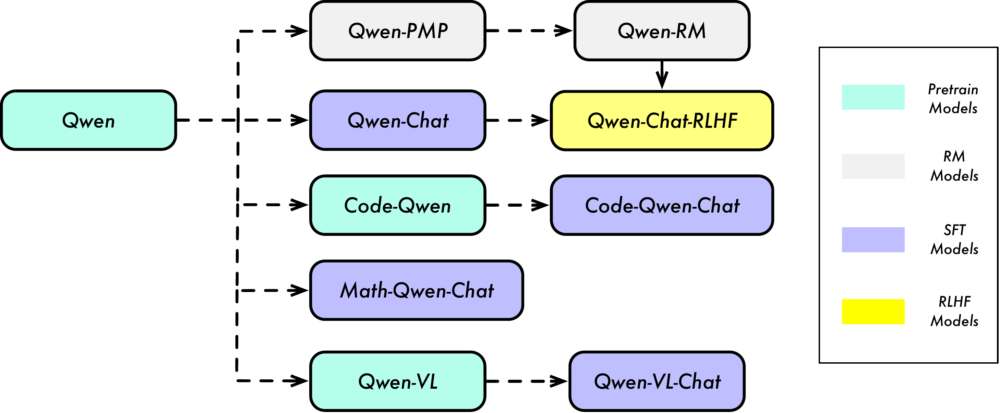
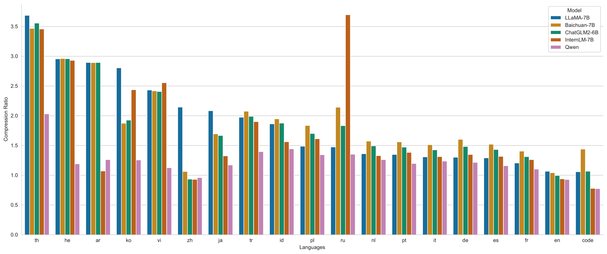
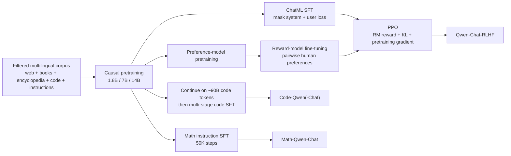
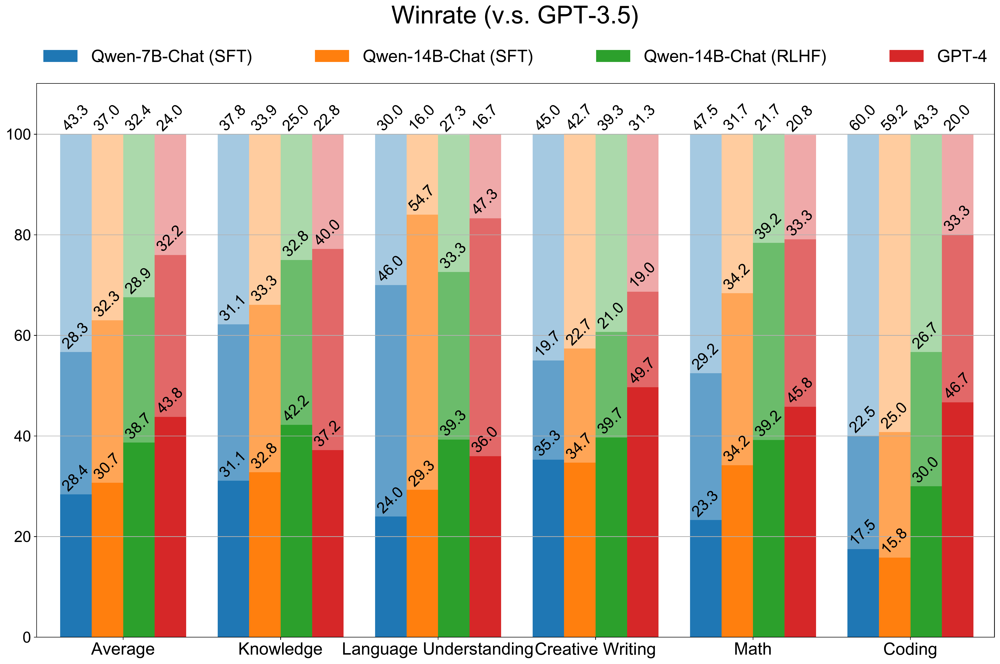

# Qwen Technical Report — Bai et al., 2023

> **arXiv:** 2309.16609v1 · **Date:** 28 September 2023 · **Affiliation:** Qwen Team,
> Alibaba Group · **Scope:** Qwen-1.8B/7B/14B, Qwen-Chat, Code-Qwen, and Math-Qwen

## TL;DR
Qwen is Alibaba's first public family of decoder-only language models: **1.8B, 7B, and 14B**
base models pretrained on as many as **3 trillion tokens**, ChatML-formatted assistant models aligned
with **supervised fine-tuning (SFT)** and **reinforcement learning from human feedback (RLHF)**, and
specialist code and mathematics branches. Architecturally it is a LLaMA-like Transformer with
**untied input/output embeddings, RoPE, QKV biases, Pre-RMSNorm, SwiGLU, and FlashAttention**, plus an
unusually large approximately **152K-token multilingual vocabulary** derived from `tiktoken`'s
`cl100k_base`.

The report's central claim is not one new mechanism, but a **complete, scalable model-production
recipe**. Qwen-14B beats the reported open 13B-class baselines on all seven aggregate base-model
benchmarks (for example, **66.3 MMLU, 72.1 C-Eval, 61.3 GSM8K**); alignment makes Qwen-14B-Chat a
strong instruction follower; and continued domain training yields **66.4 HumanEval** for
Code-Qwen-14B-Chat and **69.8 GSM8K / 24.2 MATH** for Math-Qwen-14B-Chat. The paper also anticipates
later Qwen themes: multilingual token efficiency, inference-time context extension, tool use, code
execution, and branching specialists from a shared base model.

## Problem & motivation
In 2023, the strongest proprietary assistants exposed little about their data or training, while many
open models had one or more practical gaps: weak Chinese coverage, inefficient tokenization outside
English, limited instruction following, no preference alignment, short-context behavior, and weak
code/math/tool use. The report asks whether a model family in the **1.8B–14B range** can cover the full
path from general pretraining to useful assistants and domain specialists.

Qwen addresses four connected goals:

1. **Bilingual and multilingual efficiency.** A tokenizer optimized only for English turns Chinese and
   many other languages into long token sequences, increasing both training and serving cost. Qwen
   extends a modern byte-pair vocabulary with Chinese words/characters and other multilingual units.
2. **Strong small-to-mid-scale base models.** Rather than report only a flagship, the work trains three
   sizes and evaluates language understanding, Chinese exams, arithmetic, mathematics, code, and
   difficult reasoning.
3. **An assistant, not just a completion model.** SFT teaches roles and instructions; a preference model
   and PPO then optimize human preference while a KL penalty and pretraining gradient limit alignment
   tax.
4. **Useful specialization.** Code-Qwen and Math-Qwen test whether one general base can be continued on
   high-value domains without training every specialist from scratch. Tool-use and code-interpreter
   experiments extend the same idea from static answers to actions.

The relevant historical boundary matters: this September 2023 report evaluates **up to 14B**. The
later Qwen repository added Qwen-72B and revised model artifacts, but those are not evidence from this
paper and are intentionally excluded from the result tables below.

## Key idea
The key idea is a **shared-base model lineage**: invest most compute in a multilingual autoregressive
foundation model, then derive assistants, reward models, code models, math models, and multimodal models
through comparatively targeted post-training.



For a token sequence $x_{1:T}$, base pretraining minimizes causal negative log-likelihood:

$$
\mathcal{L}_{\mathrm{PT}}(\theta)
=-\sum_{t=1}^{T}\log p_\theta(x_t\mid x_{<t}).
$$

SFT uses the same next-token objective, but only assistant-response tokens contribute. If
$m_t=1$ for an assistant token and $0$ for system/user tokens,

$$
\mathcal{L}_{\mathrm{SFT}}(\theta)
=-\sum_{t=1}^{T}m_t\log p_\theta(x_t\mid x_{<t}).
$$

This masking is consequential: the model conditions on the complete conversation while learning to
generate the assistant side, rather than spending capacity reproducing arbitrary user inputs. The
same principle is reused for Math-Qwen, where problem statements and numbers should be conditions,
not prediction targets.

Preference alignment starts from comparisons $(x,y^+,y^-)$. A reward model $r_\phi$ is trained with
the standard pairwise logistic objective implied by the report's preferred/non-preferred response
pairs:

$$
\mathcal{L}_{\mathrm{RM}}(\phi)
=-\mathbb{E}\left[\log\sigma\left(r_\phi(x,y^+)-r_\phi(x,y^-)\right)\right].
$$

PPO then improves the policy without letting it drift freely from the SFT reference. A compact form of
the shaped reward is

$$
R(x,y)=r_\phi(x,y)-\beta D_{\mathrm{KL}}
\!\left(\pi_\theta(\cdot\mid x)\,\|\,\pi_{\mathrm{ref}}(\cdot\mid x)\right),
\qquad \beta=0.04,
$$

and the clipped policy objective is

$$
\mathcal{L}_{\mathrm{PPO}}(\theta)=
-\mathbb{E}_t\!\left[
\min\!\left(r_t(\theta)\hat A_t,
\operatorname{clip}(r_t(\theta),1-\epsilon,1+\epsilon)\hat A_t\right)
\right],
\quad
r_t(\theta)=\frac{\pi_\theta(a_t\mid s_t)}{\pi_{\theta_{\mathrm{old}}}(a_t\mid s_t)}.
$$

The report additionally mixes a **pretraining gradient** into RLHF. Conceptually, the optimized loss is
$\mathcal{L}_{\mathrm{PPO}}+\lambda_{\mathrm{PT}}\mathcal{L}_{\mathrm{PT}}$: the KL term preserves the
local policy distribution, while replaying substantially more pretraining data directly rehearses
general capabilities.

## How it works

### Base architecture
Qwen is a causal decoder-only Transformer. For hidden state $X\in\mathbb{R}^{T\times d}$, each block is
Pre-Norm: normalize before self-attention and before the feed-forward sublayer, then add residuals.
The normalization is [RMSNorm](attention_2019_rmsnorm.md):

$$
\operatorname{RMSNorm}(x)=g\odot
\frac{x}{\sqrt{\frac{1}{d}\sum_{i=1}^{d}x_i^2+\varepsilon}}.
$$

Self-attention uses ordinary multi-head causal attention,

$$
\operatorname{Attn}(Q,K,V)=
\operatorname{softmax}\!\left(\frac{QK^\top}{\sqrt{d_h}}+M_{\mathrm{causal}}\right)V,
$$

implemented with [FlashAttention](https://arxiv.org/abs/2205.14135). Qwen removes biases from most
linear layers but retains **QKV projection biases**, which the authors report helps length
extrapolation. Input embeddings and the output language-model head are **not tied**: this costs
approximately $Vd$ extra parameters but lets input and output token geometry specialize separately.

[Rotary positional embeddings](positional_2021_rope-roformer.md) rotate query/key coordinate pairs at
each position. For pair index $i$, frequency $\omega_i=10000^{-2i/d_h}$, and position $m$,

$$
R_{m,i}=
\begin{bmatrix}
\cos(m\omega_i)&-\sin(m\omega_i)\\
\sin(m\omega_i)& \cos(m\omega_i)
\end{bmatrix},\qquad
q'_{m,i}=R_{m,i}q_{m,i},\quad k'_{m,i}=R_{m,i}k_{m,i}.
$$

Qwen stores RoPE inverse frequencies in **FP32** even under BF16 mixed-precision training. The FFN uses
[SwiGLU](attention_2020_swiglu.md), with the nominal width reduced from $4d$ to roughly $8d/3$ to keep
parameter/computation scale controlled:

$$
\operatorname{SwiGLU}(x)=
\big(\operatorname{SiLU}(xW_g)\odot xW_u\big)W_d.
$$

The released configurations provide the concrete widths needed to instantiate the models:

| Model | Layers | Hidden $d$ | Heads | FFN width | Vocabulary | Released max positions |
|---|---:|---:|---:|---:|---:|---:|
| Qwen-1.8B | 24 | 2,048 | 16 | 5,504 | 151,936 | 8,192 |
| Qwen-7B | 32 | 4,096 | 32 | 22,016 | 151,936 | 8,192 |
| Qwen-14B | 40 | 5,120 | 40 | 27,392 | 151,936 | 8,192 |

The **released maximum** is not the base pretraining sequence length: the report trains the base models
at **2,048 tokens** and extends them at inference, described below.

### Tokenization
Qwen begins with OpenAI `tiktoken`'s `cl100k_base`, augments it with common Chinese characters/words
and units from other languages, and splits numbers into individual digits. The result is approximately
152K BPE tokens. A larger vocabulary increases embedding/output-head memory, especially because those
weights are untied, but shorter sequences reduce attention and serving cost.



The figure's ratio is relative to XLM-R (=1, omitted). Thus Qwen's low bar for Chinese means fewer
Qwen tokens encode the same corpus; it does **not** mean lower model accuracy. The paper says preliminary
experiments found no downstream degradation from enlarging the vocabulary, but does not provide that
ablation table.

### Context extension
Although pretrained at length 2,048, Qwen combines three training-free inference techniques:

- **Dynamic NTK-aware RoPE interpolation** changes the RoPE base as requested context grows, preserving
  more high-frequency positional information than uniform position interpolation.
- **LogN scaling** rescales attention logits as a function of current length versus training length to
  stabilize attention entropy.
- **Layer-wise window attention** gives lower layers shorter windows and upper layers longer windows,
  following the observation that lower layers were more sensitive to extrapolation.

On held-out arXiv text, unmodified Qwen-14B perplexity rises from **3.46 at 2K** to **22.79 at 4K**,
**334.65 at 8K**, and **3168.35 at 16K**. The complete extension recipe keeps it at **3.29, 3.18, and
3.42**, respectively (Table 3). This is a perplexity experiment, not proof of accurate long-context
retrieval or reasoning.

### Alignment and specialization flow


SFT conversations use **ChatML**, which serializes system, user, and assistant turns with explicit role
metadata. For RLHF, Qwen first performs preference-model pretraining (PMP), then fine-tunes a same-sized
Qwen reward model with a pooling head over a designated end token. Human prompts are balanced using
roughly **6,600 fine-grained tags** for diversity and complexity. PPO samples **two responses per
query**, warms the value model alone for 50 steps, and uses top-$p=0.9$ generation.

For agents, the team repeatedly self-instructs Qwen with a few examples, filters generations with rules
and human review, and mixes approximately **2,000 high-quality tool-use samples** into general SFT.
Their ReAct benchmark with up to five unseen tools scores tool relevance, tool selection/arguments, and
false-positive calls. Code-interpreter tests separately measure whether generated Python executes and
whether the final answer is correct.

Code-Qwen starts from Qwen, continues pretraining on about **90B code tokens** with contexts up to 8,192,
then uses multi-stage SFT. Math-Qwen-Chat instead applies math SFT directly to the base model, masking
system/user tokens as in general SFT.

## Training / data

### Pretraining corpus and filtering
The mixture reaches **2.2T, 2.4T, and 3.0T tokens** for 1.8B, 7B, and 14B. It includes public web pages,
encyclopedias, books, code, multilingual data with substantial English and Chinese, and high-quality
instruction data. The report describes this pipeline:

1. Extract text from HTML and identify its language.
2. Normalize and exact-deduplicate, then fuzzy-deduplicate with **MinHash + locality-sensitive hashing**.
3. Filter with rules, language models, text-quality scorers, and offensive/inappropriate-content
   classifiers; manually sample sources for quality review.
4. Up-sample selected high-quality sources.
5. Remove instruction examples having a **13-gram overlap** with the reported benchmark test sets.

The paper does **not** disclose source proportions, language percentages, dates, data licenses, or the
amount removed at each filter, so the corpus cannot be independently reproduced.

### Base-model optimization
| Model | Hidden | Heads | Layers | Peak LR | Global batch | Training tokens |
|---|---:|---:|---:|---:|---:|---:|
| Qwen-1.8B | 2,048 | 16 | 24 | $3\times10^{-4}$ | 4M tokens | 2.2T |
| Qwen-7B | 4,096 | 32 | 32 | $3\times10^{-4}$ | 4M tokens | 2.4T |
| Qwen-14B | 5,120 | 40 | 40 | $3\times10^{-4}$ | 4M tokens | 3.0T |

All use 2,048-token packed sequences, AdamW with $(\beta_1,\beta_2,\epsilon)=(0.9,0.95,10^{-8})$,
BF16 mixed precision, FlashAttention, and cosine decay to **10% of peak LR**. The report does not give
the base-model warmup length, weight decay, gradient clipping, hardware, wall-clock time, or total FLOPs.

### Post-training recipes
| Stage | Initialization | Sequence / batch | Learning rate | Duration / controls |
|---|---|---|---|---|
| General SFT | Qwen base | 2,048 / 128 examples | peak $2\times10^{-6}$ | 4,000 steps; 1,430-step warmup; WD 0.1; dropout 0.1; clip 1.0 |
| Reward model | same-size Qwen + pooling head | 2,048 / 64 | constant $3\times10^{-6}$ | 1 epoch after PMP |
| PPO policy | SFT policy | two responses/query | $1\times10^{-6}$ | KL coefficient 0.04; top-$p$ 0.9; normalized reward |
| PPO value | value model | same rollouts | $5\times10^{-6}$ | 50-step value warmup; value clip 0.15 |
| Code continued PT, 14B / 7B | Qwen base | up to 8,192 | $6\times10^{-5}$ / $3\times10^{-5}$ | ~90B tokens; 3% warmup; no decay |
| Code SFT, 14B / 7B | Code-Qwen | not reported | $2\times10^{-6}$ / $1\times10^{-5}$ | multi-stage; 3% warmup, then constant |
| Math SFT | Qwen base | 1,024 / not reported | peak $2\times10^{-5}$ | 50,000 steps; mask system/user input |

## Results

### Base models
The headline table mixes benchmark protocols, so each column must retain its shot setting. Scores are
accuracy or pass@1 percentages as reported in Table 2.

| Model | MMLU 5-shot | C-Eval 5-shot | GSM8K 8-shot | MATH 4-shot | HumanEval 0-shot | MBPP 3-shot | BBH 3-shot |
|---|---:|---:|---:|---:|---:|---:|---:|
| Qwen-1.8B | 44.6 | 54.7 | 21.2 | 5.6 | 17.1 | 14.8 | 28.2 |
| Qwen-7B | 58.2 | 63.5 | 51.7 | 11.6 | 29.9 | 31.6 | 45.0 |
| **Qwen-14B** | **66.3** | **72.1** | **61.3** | **24.8** | **32.3** | **40.8** | **53.4** |
| LLaMA 2-13B | 55.0 | 41.4 | 29.6 | 5.0 | 18.9 | 30.3 | 45.6 |
| Baichuan2-13B | 59.5 | 59.0 | 52.8 | 10.1 | 17.1 | 30.2 | 49.0 |

Qwen-14B leads the compared 13B-class open models in every shown column, and even exceeds the paper's
reported LLaMA 2-70B result on C-Eval, MATH, and HumanEval. Baseline values were collected from official
reports and OpenCompass rather than all being rerun under one harness, so cross-model differences may
include evaluation-pipeline effects.

### Aligned chat models
Qwen-14B-Chat reaches **64.6/66.5 MMLU** (zero-/five-shot), **69.8/71.7 C-Eval**,
**60.1/59.3 GSM8K**, **43.9 HumanEval**, and **46.9/58.7 BBH** (zero-/three-shot). The zero-shot numbers
test direct instruction following; the few-shot numbers are more comparable with traditional base-model
leaderboards. It trails GPT-3.5 and GPT-4 overall but is consistently stronger than similarly sized open
chat baselines in the report.



The human study covers knowledge, language understanding, creative writing, coding, and mathematics.
Each answer is ranked by three annotators for helpfulness, informativeness, validity, and related
qualities. The figure supports the narrower claim that **RLHF improves the 14B SFT policy under this
Chinese, GPT-3.5-relative protocol**; it is not a blinded general-purpose arena rating.

The reward-model ablation helps explain that gain. PMP versus final RM pairwise accuracy rises from
**62.68→74.78** on Qwen Helpful-base and **61.62→69.71** on Qwen Helpful-online, but changes little or
slightly falls on several external preference sets (Anthropic Helpful, OpenAI summarization, SHP,
PRM800K). Fine-tuning therefore improves in-domain preference fit more clearly than universal reward
modeling.

### Specialists
| Model | Params | HumanEval | MBPP | GSM8K | MATH | Math401 | Math23K |
|---|---:|---:|---:|---:|---:|---:|---:|
| Qwen-Chat | 7B | 37.2 | 35.8 | 50.3 | 6.8 | 57.4 | 51.2 |
| Code-Qwen-Chat | 7B | 43.3 | 44.2 | — | — | — | — |
| Math-Qwen-Chat | 7B | — | — | 62.5 | 17.2 | 80.8 | 75.4 |
| Qwen-Chat | 14B | 43.9 | 46.4 | 60.1 | 18.4 | 70.1 | 67.0 |
| **Code-Qwen-Chat** | **14B** | **66.4** | **52.4** | — | — | — | — |
| **Math-Qwen-Chat** | **14B** | — | — | **69.8** | **24.2** | **85.0** | **78.4** |

Code results are zero-shot pass@1 on HumanEval and three-shot pass@1 on MBPP; math uses greedy decoding.
Domain continuation gives large gains over the general chat model, especially +22.5 HumanEval points
for the 14B code assistant and +14.9 Math401 points for the 14B math assistant. Proprietary systems
still lead the most difficult columns: the paper reports GPT-4 at **86.6 HumanEval**, **92.0 GSM8K**, and
**42.5 MATH**.

## Limitations & follow-ups
- **Opaque data.** “Up to 3T tokens” is not a reproducible dataset specification. Mixture weights,
  collection dates, licenses, contamination beyond the selected 13-gram checks, and filtering yields
  are missing. This also prevents a clean attribution of gains to architecture versus data.
- **Baseline comparability.** Many baseline scores come from official reports or OpenCompass, and shot
  settings differ by benchmark. The strongest claims should be read as report-table comparisons, not a
  controlled retraining study with matched tokens and compute.
- **No compute accounting.** Hardware, training time, energy, FLOPs, throughput, failure rate, and total
  optimization steps for base pretraining are absent. The cost/efficiency frontier cannot be audited.
- **Limited alignment evaluation.** Human evaluation uses 300 Chinese instructions and relative rankings
  against one GPT-3.5 snapshot. Inter-annotator agreement, confidence intervals, prompt release status,
  and detailed safety red-team results are not reported.
- **Safety is described, not established.** Safety-related SFT data include violence, bias, and
  pornography, but the report gives no dedicated safety benchmark, subgroup analysis, jailbreak study,
  or deployment-risk evaluation.
- **Context evidence is perplexity-only.** Low 16K perplexity after dynamic NTK, LogN, and window
  attention does not establish retrieval, long-range reasoning, or generation quality at that length.
- **Specialization trade-offs are undermeasured.** Code and math gains are clear on domain benchmarks,
  but the report does not quantify forgetting of general language capabilities after continued
  pretraining/SFT.
- **A family snapshot, not the final Qwen1 release.** Qwen-72B appeared later in the repository and the
  original repository is now superseded by Qwen2. Follow-up reports should be used for claims about
  Qwen2/2.5/3 architecture, grouped-query attention, mixture-of-experts models, or longer contexts.

The most useful follow-ups are controlled tokenizer ablations, public data-mixture documentation,
matched-harness evaluations, long-context retrieval/reasoning tests, transparent safety evaluations,
and general-capability checks before and after specialization. Historically, later Qwen generations
addressed scale, longer context, multimodality, MoE variants, and broader multilingual coverage, while
retaining this report's shared-base/post-training lineage.

## Links
- **Paper:** [arXiv abstract](https://arxiv.org/abs/2309.16609) · [HTML](https://arxiv.org/html/2309.16609v1) · [PDF](https://arxiv.org/pdf/2309.16609v1)
- **Official artifacts:** [QwenLM/Qwen repository](https://github.com/QwenLM/Qwen) · [Qwen organization on Hugging Face](https://huggingface.co/Qwen) · [Qwen-14B model card and configuration](https://huggingface.co/Qwen/Qwen-14B)
- **Technical lineage:** [RoPE / RoFormer](positional_2021_rope-roformer.md) · [NTK-aware RoPE](positional_2023_ntk-aware-rope.md) · [RMSNorm](attention_2019_rmsnorm.md) · [SwiGLU](attention_2020_swiglu.md) · [FlashAttention](https://arxiv.org/abs/2205.14135)
- **In-repo:** [Qwen model-family overview](../qwen/overview.md)
- **BibTeX:**
  ```bibtex
  @article{bai2023qwen,
    title   = {Qwen Technical Report},
    author  = {Bai, Jinze and Bai, Shuai and Chu, Yunfei and Cui, Zeyu and
               Dang, Kai and Deng, Xiaodong and Fan, Yang and others},
    journal = {arXiv preprint arXiv:2309.16609},
    year    = {2023}
  }
  ```