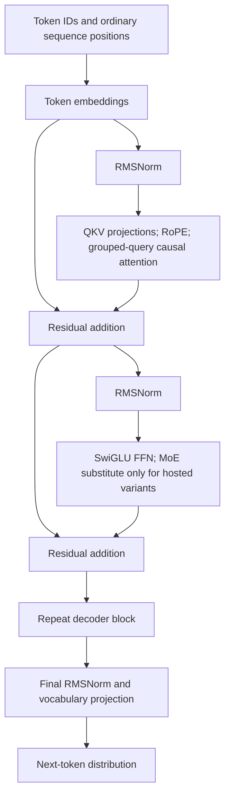
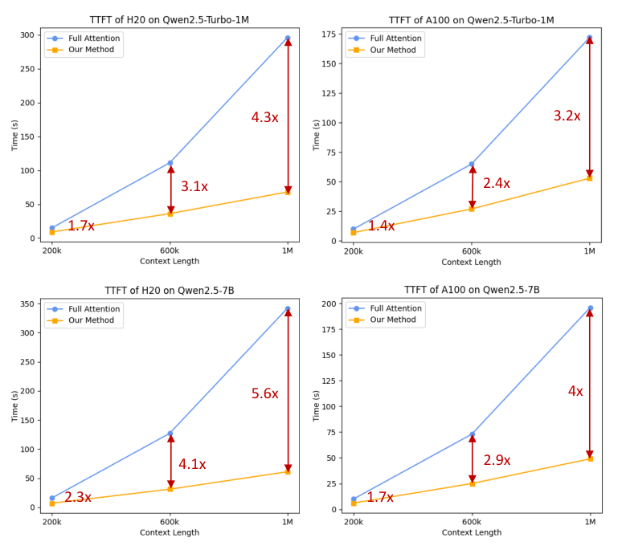
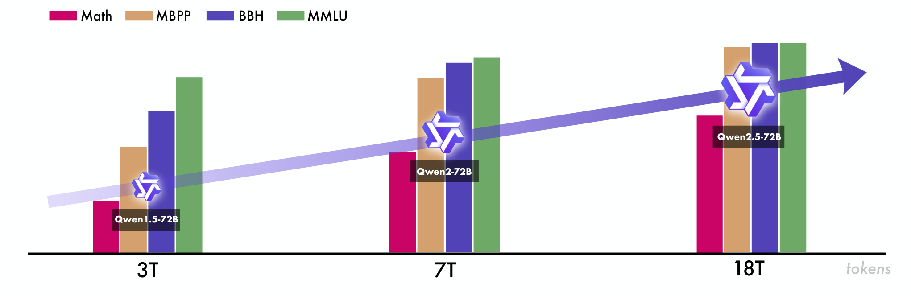
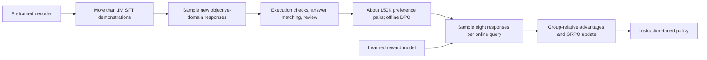
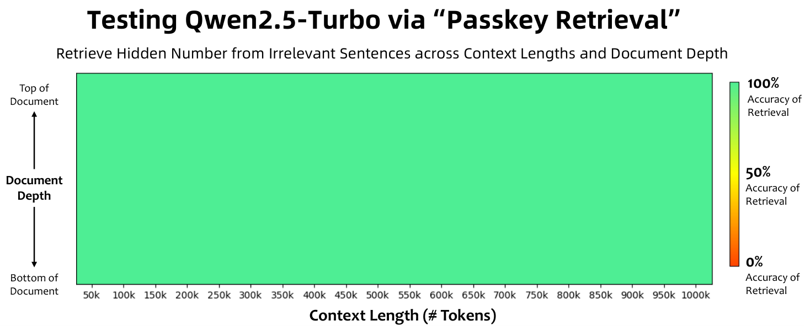

# Qwen2.5: Data Scaling and Multistage Alignment - Qwen Team, 2024

> **arXiv:** [2412.15115v2](https://arxiv.org/abs/2412.15115v2) (3 January 2025; first submitted 19 December 2024) · **Venue:** preprint / technical report · **Affiliation:** Qwen Team, Alibaba Group
>
> This recap follows version 2 of the *Qwen2.5 Technical Report*. Architectural dimensions omitted from its model table are supplemented with the released Instruct configurations. Equations that unpack standard decoder, DPO, and GRPO mechanisms are explanatory reconstructions, not additional numbered equations attributed to the report.

## TL;DR

Qwen2.5 retains the Qwen2 decoder design but improves the data and training pipeline: an **18T-token pretraining corpus**, more than **1M supervised instruction examples**, **offline DPO**, and **online GRPO** with a learned reward model. It offers seven open-weight dense sizes from 0.5B to 72B, alongside proprietary MoE services, and improves mathematics, instruction following, structured-data use, and long-response generation. Its long-context story separates trained lengths, inference extrapolation, and empirical quality: the larger dense releases advertise 128K context, while Qwen2.5-Turbo combines longer training with extrapolation for a 1M-token interface.

## Problem & motivation

### A strong base model still needs better data allocation

[Qwen2](backbone_2024_qwen2.md) already combines a capable multilingual decoder with grouped-query attention and a substantial pretraining corpus. Qwen2.5 does not replace that architecture with a radically different attention primitive. It asks how to improve general knowledge, domain expertise, and practical behavior by improving the training distribution and post-training signals.

Raw web frequency is a poor proxy for training value. Section 3.1 identifies repetitive e-commerce, entertainment, and social-media material as overrepresented, while scientific, technical, and academic content is comparatively underrepresented. The objective is not simply to collect more tokens: the mixture should allocate more training probability to information-rich domains while filtering weak or repetitive material across languages.

The report expands the stated corpus from Qwen2's 7T reference point to 18T tokens. That comparison describes the family-level data expansion, not a claim that every Qwen2 predecessor had exactly the same token budget or that the report discloses an identical per-checkpoint schedule for every Qwen2.5 size.

### Practical instruction following has several different failure modes

The report targets capabilities that generic short conversational examples do not teach reliably:

- **Long responses:** a model trained mostly on short completions may stop early or lose coherence when asked to produce a long document.
- **Constrained instructions and structured information:** fluent prose is insufficient when the answer must satisfy checkable requirements, reason over a table, or produce a valid structured output.
- **Objective reasoning and subjective response quality:** code correctness or a mathematical answer can often be checked, while helpfulness, relevance, and presentation require a different kind of judgment.
- **System-prompt and language variation:** performance should not depend excessively on one favored system prompt or only high-resource-language instructions.

These pressures motivate a broad SFT dataset and two preference-optimization stages rather than treating alignment as one undifferentiated operation.

### Context acceptance is not context competence

Long context introduces separate issues of positional extrapolation, learned behavior, memory use, and prefill latency. A service accepting a million tokens does not prove that it can reason perfectly over every part of them. Similarly, recovering one hidden passkey does not substitute for long-document question answering or instruction following.

Qwen2.5 addresses these issues through longer training, YaRN and Dual Chunk Attention (DCA), long-instruction fine-tuning for Turbo, and a sparse prefill mechanism. The evaluation distinguishes retrieval, broader long-context tasks, and time to first token.

## Key idea

### Keep the decoder, improve the training distribution and feedback

For a token sequence $x=(x_1,\ldots,x_T)$, the basic model is still

$$
p_\theta(x)=\prod_{t=1}^{T}p_\theta(x_t\mid x_{<t}),
\qquad
\mathcal L_{\mathrm{LM}}
=-\sum_{t=1}^{T}\log p_\theta(x_t\mid x_{<t}).
$$

$T$ is sequence length, $\theta$ denotes model parameters, and $x_{<t}$ is the preceding text. The main changes concern which sequences are sampled, which instruction responses receive supervision, and how generated responses are subsequently preferred or rewarded.

The training flow is

$$
\text{curated pretraining}
\rightarrow
\text{SFT}
\rightarrow
\text{offline DPO}
\rightarrow
\text{online GRPO}.
$$

Offline DPO uses checkable positive/negative responses in objective domains. Online GRPO generates groups of responses and uses reward-model scores to improve the policy relative to alternatives for the same query. These stages have different data-generation and feedback mechanisms.

### Separate three meanings of long-context support

The report's larger dense models undergo 32K-context training, then use extrapolation to support longer inference. Turbo receives additional progressive training to 256K and long-instruction SFT, followed by extrapolation toward 1M.

These are not interchangeable:

1. **Training length:** the sequence lengths actually used to adapt the model.
2. **Serving configuration:** the positional and attention implementation used to accept a longer request.
3. **Measured effective context:** the length at which a particular benchmark still succeeds.

The long-context results later in this recap preserve those distinctions.

## How it works

### 1. Open dense models and proprietary MoE models

Table 1 provides layers, head counts, embedding tying, advertised context/output lengths, and licenses. Hidden and FFN widths below come from the corresponding released Instruct configurations, not from a hidden architecture table in the report.

| Model | Layers | Hidden width | FFN width | Query / KV heads | Tied embeddings | Context / generation | License in Table 1 |
|---|---:|---:|---:|---|---|---|---|
| 0.5B | 24 | 896 | 4864 | 14 / 2 | Yes | 32K / 8K | Apache 2.0 |
| 1.5B | 28 | 1536 | 8960 | 12 / 2 | Yes | 32K / 8K | Apache 2.0 |
| 3B | 36 | 2048 | 11008 | 16 / 2 | Yes | 32K / 8K | Qwen Research |
| 7B | 28 | 3584 | 18944 | 28 / 4 | No | 128K / 8K | Apache 2.0 |
| 14B | 48 | 5120 | 13824 | 40 / 8 | No | 128K / 8K | Apache 2.0 |
| 32B | 64 | 5120 | 27648 | 40 / 8 | No | 128K / 8K | Apache 2.0 |
| 72B | 80 | 8192 | 29568 | 64 / 8 | No | 128K / 8K | Qwen |

Configuration sources: [0.5B](https://huggingface.co/Qwen/Qwen2.5-0.5B-Instruct/blob/main/config.json), [1.5B](https://huggingface.co/Qwen/Qwen2.5-1.5B-Instruct/blob/main/config.json), [3B](https://huggingface.co/Qwen/Qwen2.5-3B-Instruct/blob/main/config.json), [7B](https://huggingface.co/Qwen/Qwen2.5-7B-Instruct/blob/main/config.json), [14B](https://huggingface.co/Qwen/Qwen2.5-14B-Instruct/blob/main/config.json), [32B](https://huggingface.co/Qwen/Qwen2.5-32B-Instruct/blob/main/config.json), and [72B](https://huggingface.co/Qwen/Qwen2.5-72B-Instruct/blob/main/config.json).

The head width $d_h=d/H_q$ is 64 for 0.5B and 128 for the other dense models, where $d$ is hidden width and $H_q$ the query-head count. Quantized checkpoints are alternative numerical representations of these models, not additional expert architectures.

The open models are dense: every decoder layer uses its ordinary FFN. The two hosted variants, **Qwen2.5-Turbo** and **Qwen2.5-Plus**, use MoE layers with fine-grained experts, shared expert capacity, and top-$K$ routed experts. The report does not disclose their exact total/active parameter counts, expert counts, routing $K$, or full layer dimensions. Do not copy the Qwen2-57B-A14B topology into these services simply because the report cites the same architectural lineage.

“Open-weight” also does not mean every size has the same license or that training data are released. The custom-license entries above should be checked against the actual checkpoint license before use.

### 2. Decoder block and tensor shapes

The architecture retains [RMSNorm](attention_2019_rmsnorm.md) pre-normalization, [GQA](attention_2023_gqa.md), [RoPE](positional_2021_rope-roformer.md), [SwiGLU](attention_2020_swiglu.md), and attention QKV biases.

For a layer input $h_\ell\in\mathbb R^{B\times T\times d}$, with batch size $B$:

$$
u_\ell=\operatorname{RMSNorm}(h_\ell),
\qquad
h'_\ell=h_\ell+\operatorname{GQA}(u_\ell),
$$

$$
h_{\ell+1}
=h'_\ell+\operatorname{SwiGLU}
\big(\operatorname{RMSNorm}(h'_\ell)\big).
$$

RMSNorm scales a vector $z\in\mathbb R^d$ using

$$
\operatorname{RMSNorm}(z)
=g\odot
\frac{z}{\sqrt{\frac1d\sum_{i=1}^d z_i^2+\epsilon_{\mathrm{norm}}}},
$$

where $g$ is a learned elementwise scale, $\odot$ denotes elementwise multiplication, and $\epsilon_{\mathrm{norm}}$ stabilizes normalization. The released configurations use $\epsilon_{\mathrm{norm}}=10^{-6}$.

Attention projects the normalized state into query, key, and value tensors:

$$
Q\in\mathbb R^{B\times H_q\times T\times d_h},
\qquad
K,V\in\mathbb R^{B\times H_{kv}\times T\times d_h}.
$$

$H_{kv}$ is the number of KV heads. Each group of $H_q/H_{kv}$ query heads shares a KV head. After RoPE rotates query/key channel pairs according to position, attention computes the usual scaled dot-product operation with a causal mask:

$$
\operatorname{Attn}(Q,K,V)
=\operatorname{softmax}
\left(\frac{QK^\top}{\sqrt{d_h}}+M_{\mathrm{causal}}\right)V.
$$

The KV tensors are logically shared across query-head groups; the equation suppresses the head-group indexing. $M_{\mathrm{causal}}$ is zero for permitted past/current positions and negative infinity for future positions.

The FFN is

$$
\operatorname{SwiGLU}(z)
=W_{\mathrm{down}}
\left[
\operatorname{SiLU}(W_{\mathrm{gate}}z)
\odot(W_{\mathrm{up}}z)
\right].
$$

For intermediate width $m$, $W_{\mathrm{gate}},W_{\mathrm{up}}\in\mathbb R^{m\times d}$ and $W_{\mathrm{down}}\in\mathbb R^{d\times m}$. The decoder ends with a final normalization and vocabulary projection. Smaller models reuse the embedding weights for that projection; the larger models have separate input/output matrices.

The report contains no separate architecture figure. This is an original reconstruction:



### 3. Tokenizer vocabulary versus embedding-matrix size

Section 2 retains byte-level BPE with **151,643 regular tokens**, expanding the reported control-token set from three to **22**. Two of the added controls are for tool functionality; the remainder support other capabilities. This is a shared tokenization scheme rather than separate tokenizers for different parameter scales.

The report's logical count is therefore $151643+22=151665$. This is not the same thing as the number of rows allocated to an embedding tensor. The released configurations use `vocab_size=151936` for 0.5B, 1.5B, and 3B, and `152064` for 7B through 72B. These padded dimensions should not be interpreted as additional ordinary BPE vocabulary entries.

For conversational inference, use the checkpoint's chat template and generation delimiters. An instruction-tuned model is not interchangeable with a base model given arbitrary concatenated dialogue text. Better tool-related serialization and training also do not make external tool execution part of the decoder itself.

### 4. GQA helps memory, but long context remains expensive

For one sequence of $T$ cached tokens, an idealized unquantized KV cache requires

$$
M_{\mathrm{KV}}
=2\,L\,T\,H_{kv}\,d_h\,b,
$$

where $L$ is layer count and $b$ is bytes per stored element; the factor two is for keys and values.

For two-byte elements, the released dimensions imply:

| Model | KV storage per token | KV storage at 131,072 tokens |
|---|---:|---:|
| 7B | 56 KiB | 7 GiB |
| 72B | 320 KiB | 40 GiB |

These are derived tensor-size calculations, not measured deployment benchmarks. They exclude weights, activations, allocator overhead, and extra serving state. Batch size multiplies the sequence storage, while KV quantization or offloading changes the assumptions.

GQA reduces the number of stored KV heads, but does not make the advertised long context free. A faster sparse prefill implementation also does not automatically remove the entire KV cache.

### 5. Long-context training and extrapolation

Section 3.3 starts with 4096-token pretraining. For non-Turbo models, the final pretraining phase extends this to **32,768 tokens**, while raising the RoPE base from **10,000 to 1,000,000**.

For ordinary rotary frequency pair $j$, the positional angle is

$$
\varphi_{t,j}=t\,\omega_j,
\qquad
\omega_j=\theta^{-2j/d_h},
$$

where $t$ is position, $\theta$ the rotary base, and $j$ indexes the $d_h/2$ rotary pairs. Changing $\theta$ changes the frequency spectrum. It is a positional adaptation, not proof by itself that the model can use all newly accessible positions.

Turbo uses progressive context training at **32,768, 65,536, 131,072, and 262,144 tokens**, with a RoPE base of **10,000,000**. At each stage, 40% of sequences are at the current maximum length and 60% are shorter, preserving a mixture of long- and short-context practice.

For inference beyond trained lengths, the report combines [YaRN](positional_2023_yarn-context-extension.md) and [DCA](positional_2024_dca-dual-chunk-attention.md):

- **YaRN** adapts rotary frequencies for length extrapolation rather than treating every frequency band identically. It changes the positional mapping, with associated attention scaling in the underlying method.
- **DCA** divides long sequences into chunks and uses different relative-position constructions for attention within a chunk and across chunks. Its purpose is to keep useful attention distances within more familiar positional ranges while permitting cross-chunk information flow.

Together, these support a reported fourfold extension: 32K to 128K for the larger dense models and 256K toward 1M for Turbo. Section 3.3 uses broad wording about non-Turbo models; **Table 1 specifically advertises only 32K for 0.5B, 1.5B, and 3B**. The model-specific table is the appropriate guide, not an assumption that every small checkpoint is a supported 128K model.

### 6. Published evaluation path versus default serving configuration

The released 7B, 14B, 32B, and 72B Instruct configurations still set `max_position_embeddings=32768`, despite the advertised 128K context. The [7B model card](https://huggingface.co/Qwen/Qwen2.5-7B-Instruct#processing-long-texts) explicitly documents this and supplies a YaRN configuration with factor 4 and original maximum 32,768.

The paper's long-context evaluations use **YaRN plus DCA**. Adding a static YaRN field to a generic inference engine is not equivalent to installing that whole evaluation path. In particular, the model card warns that a static scaling factor can affect short-text performance, whereas Tables 16-17 say their YaRN+DCA setup does not change behavior within 32K.

There is no need to reconcile those statements by pretending the implementations are identical. The practical requirements are to choose a supported extrapolation implementation, configure the server's permitted sequence length, and validate both short and long workloads. Also, the presence of a `sliding_window` number in a configuration is not evidence of active sliding-window attention: these configurations set `use_sliding_window=false`.

### 7. Sparse prefill and the meaning of the 1M-token claim

Section 5.2.4 describes a sparse attention mechanism based on [MInference](https://arxiv.org/abs/2407.02490). For 1M-token sequences, the report claims a **12.5-fold reduction in attention computation**, with **3.2-4.3-fold Turbo TTFT speedups** in the tested configurations (Figure 3).



*Paper Figure 3: full-attention and optimized prefill curves for Turbo and 7B on H20 and A100 hardware. Attention-compute reduction and end-to-end time-to-first-token speedup are different measurements. The 7B kernel timing at 1M tokens is not evidence that the ordinary 7B checkpoint has been validated as a 1M-token reasoning model.*

The report does not fully specify the sparse pattern selection, complete serving stack, or a portable hardware-normalized throughput guarantee. The plotted TTFT gains are not decoding-token throughput, nor a claim that every component of inference becomes 12.5 times faster.

## Training / data

### 1. Corpus curation and mixture construction

Section 3.1 combines four improvements:

1. **Multilingual quality filtering:** Qwen2-Instruct models score and analyze candidate data. The stronger previous-generation models make quality filtering more sensitive to language and content than the older pipeline.
2. **Specialized mathematics and code data:** the pretraining mixture incorporates data developed for Qwen2.5-Math and Qwen2.5-Coder, transferring domain-specific corpus quality into the general model rather than reserving it for specialist checkpoints.
3. **Filtered synthetic data:** Qwen2-72B-Instruct and Qwen2-Math-72B-Instruct generate material in mathematics, code, and knowledge domains. A general reward model and Qwen2-Math-RM-72B filter the results.
4. **Domain rebalancing:** model-based classification supports downsampling overrepresented low-information web domains and upsampling scientific, technical, and academic material.

The resulting reported corpus is 18T tokens. The article does not publish exact source weights, all filtering thresholds, synthetic-data proportions, or a per-model exposure table sufficient to reconstruct every training run.



*Paper Figure 1: the Qwen1.5, Qwen2, and Qwen2.5 progression associates larger, better-curated corpora with stronger capability. Since both data quality/mixture and other training details change, it is not a controlled experiment isolating raw token count.*

### 2. Hyperparameter scaling studies

Section 3.2 uses scaling studies to choose learning rate and batch size, not only to select model size for a compute budget. The exploratory dense models span **44M to 14B parameters**, and MoE experiments span **44M to 1B active parameters**, with data sizes from **0.8B to 600B tokens**.

Conceptually, the fitted choices depend on model scale, data scale, and architecture:

$$
\mu_{\mathrm{opt}}=f_\mu(N,D,\mathcal A),
\qquad
B_{\mathrm{opt}}=f_B(N,D,\mathcal A).
$$

$N$ is the relevant model-size measure, $D$ the training-data scale, $\mathcal A$ the dense/MoE architectural choice, $\mu_{\mathrm{opt}}$ the selected learning rate, and $B_{\mathrm{opt}}$ the batch size. These equations summarize the stated dependencies; the report does not provide fitted functions and coefficients that make them executable recipes.

The authors also use these predictions to compare active/total MoE capacity against dense targets. Without the proprietary topologies or numerical fits, a reader cannot derive Turbo or Plus parameter counts from this discussion.

### 3. Supervised fine-tuning

Section 4.1 constructs **more than 1M SFT examples** across nine areas:

| Area | Construction and intended behavior |
|---|---|
| Long-sequence generation | Start from long pretraining texts, derive queries by back-translation, impose response-length constraints, and filter with Qwen2. Here back-translation means deriving an instruction from a desired long response, not necessarily a bilingual round trip. |
| Mathematics | Use Qwen2.5-Math chain-of-thought data from public tasks, school-level collections, and synthetic problems; apply rejection sampling with reward and answer guidance. |
| Coding | Incorporate Qwen2.5-Coder instruction data, with language-specific agents covering nearly 40 programming languages. Static analysis and a multilingual execution sandbox validate code and unit tests. |
| Instruction following | Generate instructions and verification code, cross-check with unit tests, and retain responses passing execution-based checks. This favors verifiable compliance over a purely stylistic judgment. |
| Structured data | Include tabular QA, fact verification, correction, structural interpretation, and more complex semi-structured reasoning. Reasoning chains connect the answer to the supplied structure. |
| Logical reasoning | Add 70,000 queries across multiple-choice, true/false, and open-ended formats. Iterative filtering removes incorrect answers and flawed reasoning. |
| Cross-lingual transfer | Translate high-resource instructions into lower-resource languages and check semantic consistency of response candidates. This is distinct from the long-response back-translation procedure above. |
| System-prompt robustness | Train with hundreds of varied general system prompts and maintain consistency between system conditions and dialogue. This reduces dependence on a single favored prompt. |
| Response filtering | Use critic-model and multi-agent assessments, retaining examples accepted by all scoring systems. Agreement among automated filters is a selection criterion, not proof that retained examples are error-free. |

The disclosed SFT settings are:

| Setting | Value | Source |
|---|---|---|
| Epochs | 2 | Section 4.1 |
| Sequence length | 32,768 tokens | Section 4.1 |
| Learning rate | Decrease from $7\times10^{-6}$ to $7\times10^{-7}$ | Section 4.1 |
| Weight decay | 0.1 | Section 4.1 |
| Maximum gradient norm | 1.0 | Section 4.1 |

An explanatory SFT objective is

$$
\mathcal L_{\mathrm{SFT}}
=-\mathbb E_{(c,y)}
\sum_{t\in\mathcal S}
\log p_\theta(y_t\mid c,y_{<t}),
$$

where $c$ is the instruction/conversation context, $y$ the target response, and $\mathcal S$ the supervised response positions. The report does not publish every packing and loss-mask detail, so this is a standard conditional next-token reconstruction rather than a complete training implementation.

### 4. Offline preference optimization: DPO

Section 4.2 targets objective domains such as mathematics, coding, instruction following, and logical reasoning. The SFT model samples responses to new queries. Execution feedback and answer matching distinguish successful responses from failed ones, with additional human and automated review.

The resulting dataset contains approximately **150,000 preference pairs**. Training lasts **one epoch**, uses a learning rate of **$7\times10^{-7}$**, and uses the [Online Merging Optimizer](https://arxiv.org/abs/2405.17931). The optimizer's name does not change this stage from offline preference learning into online policy sampling.

For preferred and rejected responses $y_w,y_l$ to context $c$, standard [DPO](https://arxiv.org/abs/2305.18290) uses

$$
\mathcal L_{\mathrm{DPO}}
=-\mathbb E_{(c,y_w,y_l)}
\log\sigma\left[
\beta_{\mathrm{DPO}}
\left(
\log\frac{\pi_\theta(y_w\mid c)}{\pi_{\mathrm{ref}}(y_w\mid c)}
-\log\frac{\pi_\theta(y_l\mid c)}{\pi_{\mathrm{ref}}(y_l\mid c)}
\right)\right].
$$

$\pi_\theta$ is the trainable policy, $\pi_{\mathrm{ref}}$ a reference policy, $\sigma$ the sigmoid, and $\beta_{\mathrm{DPO}}$ the reference-regularization scale. Sequence log probabilities sum token log probabilities. This explains the cited optimization method; the report does not disclose its chosen $\beta_{\mathrm{DPO}}$ or every optimizer/merging setting.

This stage supplies reliable discriminative signals where a generic learned reward may misjudge correctness. It is not a claim that every training example was labeled solely by humans or that every objective-domain answer admits a perfect verifier.

### 5. Online preference optimization: reward model plus GRPO

Section 4.3 builds reward data around truthfulness, helpfulness, conciseness, relevance, harmlessness, and debiasing. Queries combine public material with a more complex proprietary set. Responses come from Qwen checkpoints at different SFT/DPO/RL stages and from varied sampling temperatures; both human and automated preferences are used, including the offline DPO data.

The online policy uses **Group Relative Policy Optimization**, citing [DeepSeekMath](https://arxiv.org/abs/2402.03300). For each query $c$, sample $G=8$ responses $y_i$ and obtain scalar rewards $r_i=R_\psi(c,y_i)$ from reward model $R_\psi$.

A standard group-relative advantage is

$$
\bar r=\frac1G\sum_{i=1}^G r_i,
\qquad
\widehat A_i
=\frac{r_i-\bar r}{\operatorname{std}(r_1,\ldots,r_G)+\epsilon_{\mathrm{num}}},
$$

where $\epsilon_{\mathrm{num}}$ denotes a numerical stabilizer. Relative reward within the same query supplies a baseline, rather than requiring an independently trained value function as in a conventional actor-critic implementation.

For token $t$ in response $i$, define

$$
\rho_{i,t}(\theta)
=\frac{\pi_\theta(y_{i,t}\mid c,y_{i,<t})}
{\pi_{\mathrm{old}}(y_{i,t}\mid c,y_{i,<t})}.
$$

A standard explanatory clipped GRPO objective is

$$
J(\theta)=
\mathbb E\left[
\frac1G\sum_{i=1}^G\frac1{|y_i|}
\sum_{t=1}^{|y_i|}
\left(
\min\left[
\rho_{i,t}\widehat A_i,\,
\operatorname{clip}(\rho_{i,t},1-\varepsilon,1+\varepsilon)\widehat A_i
\right]
-\beta_{\mathrm{KL}}D_{\mathrm{KL},i,t}
\right)
\right].
$$

$\pi_{\mathrm{old}}$ is the sampling policy, $\varepsilon$ the clipping range, and $D_{\mathrm{KL},i,t}$ a divergence penalty between the current and reference policies at that response prefix; $\beta_{\mathrm{KL}}$ weights it. This expands the cited algorithm for understanding. The Qwen2.5 report does not specify its exact loss implementation, clipping threshold, KL coefficient/estimator, or all normalization conventions.

The actual settings it does disclose are **eight responses per query**, **2048 global batch size**, and **2048 samples per episode**, counting a query-response pair as one sample. Therefore 2048 samples should not be casually reinterpreted as 2048 distinct queries each with eight responses.

The reward-model training and RL stages use the same query set. Queries with greater variance in reward scores across responses are prioritized; the report does not supply a complete scheduling algorithm. This targets queries where generated alternatives receive distinguishable quality signals.

The overall post-training flow is reconstructed here:



### 6. Turbo-specific long-instruction alignment

Section 4.4 gives Turbo an additional SFT stage. First it uses short examples up to 32,768 tokens, with the ordinary models' initial SFT procedure. Then it mixes those with long instructions up to **262,144 tokens**.

RL still uses short instructions. The report cites the computational expense of long-context RL and the shortage of suitable long-context reward signals. Its finding that short-instruction RL can improve long-context alignment is empirical; it does not mean the policy receives direct RL feedback on every million-token task.

### 7. Decontamination and missing reproduction details

Section 5 describes excluding training sequences that match test material. Let $\ell=|\operatorname{LCS}(s_t,s_e)|$ be the reported longest-common-subsequence length between tokenized training sequence $s_t$ and evaluation sequence $s_e$. The stated removal criterion is

$$
\ell\geq13
\quad\text{and}\quad
\ell\geq0.6\min(|s_t|,|s_e|).
$$

The report describes this as n-gram matching while stating the criterion in LCS terms; it does not release a complete operational implementation. This is a contamination-reduction procedure, not proof that paraphrases, translated tasks, or all synthetic-data leakage were eliminated.

The report supplies unusually useful SFT/DPO settings and some online-RL batching details, but not a full pretraining optimizer schedule, complete data mixture, fitted scaling-law coefficients, compute accounting, or all reward/GRPO settings. Exact retraining and proprietary-model reproduction remain out of reach from the report alone.

## Results

### 1. Base models: broad improvement, with real regressions

The following are **base-model** results, not instruction-tuned scores. Values are transcribed from Table 2 of version 2.

| Benchmark | Qwen2-72B | Qwen2.5-72B | Source |
|---|---:|---:|---|
| MMLU | 84.2 | 86.1 | Table 2 |
| MMLU-Pro | 55.7 | 58.1 | Table 2 |
| MMLU-redux | 80.5 | 83.9 | Table 2 |
| BBH | 82.4 | 86.3 | Table 2 |
| GPQA | 37.4 | 45.9 | Table 2 |
| MATH | 50.9 | 62.1 | Table 2 |
| GSM8K | 89.0 | 91.5 | Table 2 |
| HumanEval | 64.6 | 59.1 | Table 2 |
| HumanEval+ | 56.1 | 51.2 | Table 2 |
| MBPP | 76.9 | 84.7 | Table 2 |
| MultiPL-E | 59.6 | 60.5 | Table 2 |
| Winogrande | 85.1 | 83.9 | Table 2 |
| TheoremQA | 42.8 | 42.4 | Table 2 |

The gains are substantial in mathematical and scientific tasks, but the base model does not uniformly improve every code benchmark: HumanEval and HumanEval+ decline, even while MBPP improves. Winogrande and TheoremQA also fall slightly. A high-level “better code data” claim should not hide those measured exceptions.

Section 5.1 uses few-shot protocols for many base tasks: for example, MMLU and GPQA are 5-shot, BBH is 3-shot, MATH and GSM8K are 4-shot, while the listed code tasks are 0-shot. These scores should not be mixed with the instruction-tuned evaluation as if the prompting protocols were identical.

### 2. Flagship instruction-tuned models

| Benchmark | Qwen2-72B Instruct | Qwen2.5-72B Instruct | Llama-3.1-405B Instruct | Qwen2.5-Plus | Source |
|---|---:|---:|---:|---:|---|
| MMLU-Pro | 64.4 | 71.1 | 73.3 | 72.5 | Table 6 |
| MMLU-redux | 81.6 | 86.8 | 86.2 | 86.3 | Table 6 |
| LiveBench 0831 | 41.5 | 52.3 | 53.2 | 54.6 | Table 6 |
| GPQA | 42.4 | 49.0 | 51.1 | 49.7 | Table 6 |
| MATH | 69.0 | 83.1 | 73.8 | 84.7 | Table 6 |
| GSM8K | 93.2 | 95.8 | 96.8 | 96.0 | Table 6 |
| HumanEval | 86.0 | 86.6 | 89.0 | 87.8 | Table 6 |
| MBPP | 80.2 | 88.2 | 84.5 | 85.5 | Table 6 |
| MultiPL-E | 69.2 | 75.1 | 73.5 | 77.0 | Table 6 |
| LiveCodeBench | 32.2 | 55.5 | 41.6 | 51.4 | Table 6 |
| IFEval | 77.6 | 84.1 | 86.0 | 86.3 | Table 6 |
| Arena-Hard | 48.1 | 81.2 | 69.3 | 81.4 | Table 6 |
| MT-Bench | 9.12 | 9.35 | 9.08 | 9.30 | Table 6 |

This supports strong competitiveness with a much larger Llama model, not superiority on every task. Llama-3.1-405B remains ahead on MMLU-Pro, GPQA, GSM8K, HumanEval, and IFEval in this table. Plus is also not uniformly better than the open 72B model: their strengths differ across coding and alignment rows.

Section 5.2.1 specifies IFEval's **strict-prompt** subset and the **2305-2409 LiveCodeBench** window. MT-Bench is on its own score scale, not a percentage, and Arena-Hard is a preference-oriented evaluation rather than the same kind of correctness test as a math benchmark. These are historical benchmark snapshots, not contemporary leaderboard standings.

### 3. What changes across the seven open sizes?

| Benchmark | 0.5B | 1.5B | 3B | 7B | 14B | 32B | 72B | Source |
|---|---:|---:|---:|---:|---:|---:|---:|---|
| MMLU-Pro | 15.0 | 32.4 | 43.7 | 56.3 | 63.7 | 69.0 | 71.1 | Tables 10, 9, 8, 7, 6 |
| MATH | 34.4 | 55.2 | 65.9 | 75.5 | 80.0 | 83.1 | 83.1 | Tables 10, 9, 8, 7, 6 |
| HumanEval | 35.4 | 61.6 | 74.4 | 84.8 | 83.5 | 88.4 | 86.6 | Tables 10, 9, 8, 7, 6 |
| IFEval | 27.9 | 42.5 | 58.2 | 71.2 | 81.0 | 79.5 | 84.1 | Tables 10, 9, 8, 7, 6 |

All entries are instruction-tuned models. Capability generally rises with scale, but individual metrics are not monotonic: the 32B model exceeds 72B on HumanEval in these results, and 14B exceeds 32B on IFEval. Model selection should reflect the task rather than assuming the largest checkpoint wins every benchmark.

For the proprietary cost-oriented model, a selected comparison is:

| Benchmark | Qwen2.5-Turbo | GPT-4o-mini | Source |
|---|---:|---:|---|
| MMLU-Pro | 64.5 | 63.1 | Table 7 |
| MATH | 81.1 | 70.2 | Table 7 |
| HumanEval | 86.6 | 88.4 | Table 7 |
| IFEval | 76.3 | 80.4 | Table 7 |
| Arena-Hard | 67.1 | 74.9 | Table 7 |

Turbo's mathematical result is strong, but the comparison is not a clean sweep. Since the report does not disclose its topology or a reproducible price/compute normalization, the benchmark table alone cannot establish a universal cost-efficiency ratio.

### 4. In-house English and Chinese evaluations

Tables 11-12 assess six dimensions: instruction following, knowledge, comprehension, coding, mathematics, and reasoning. Selected dimensions below show why model ordering depends on both task and language.

| Language | Model | Instruction following | Mathematics | Reasoning | Source |
|---|---|---:|---:|---:|---|
| English | GPT-4o-2024-11-20 | 80.06 | 49.74 | 67.07 | Table 11 |
| English | Claude-3.5-Sonnet-2024-10-22 | 84.22 | 48.67 | 70.20 | Table 11 |
| English | Qwen2.5-72B-Instruct | 82.65 | 59.73 | 65.90 | Table 11 |
| English | Qwen2.5-Plus | 83.18 | 62.52 | 66.92 | Table 11 |
| Chinese | GPT-4o-2024-11-20 | 42.71 | 66.04 | 62.04 | Table 12 |
| Chinese | Claude-3.5-Sonnet-2024-10-22 | 49.25 | 63.71 | 66.60 | Table 12 |
| Chinese | Qwen2.5-72B-Instruct | 37.22 | 68.39 | 63.02 | Table 12 |
| Chinese | Qwen2.5-Plus | 46.15 | 69.96 | 62.98 | Table 12 |

The Qwen models are strong on mathematics in this evaluation, while Claude leads the selected reasoning rows. The in-house instruction-following scores must not be confused with public IFEval. The report does not release enough evaluation material and judging detail to make these matrices as independently reproducible as a fully public benchmark.

### 5. Multilingual capability and cultural coverage

| Benchmark | Qwen2-72B Instruct | Qwen2.5-72B Instruct | GPT-4o-mini | Source |
|---|---:|---:|---:|---|
| Multilingual IFEval | 79.69 | 86.98 | 85.03 | Table 13 |
| AMMLU, Arabic | 68.85 | 72.44 | 69.73 | Table 13 |
| JMMLU, Japanese | 77.37 | 80.56 | 73.74 | Table 13 |
| Extended MGSM8K | 82.72 | 88.16 | 87.36 | Table 13 |
| BLEnD | 25.90 | 32.48 | 35.91 | Table 13 |

The multilingual instruction and knowledge improvements are broad, but cultural nuance is not solved by a strong translated exam score: BLEnD remains a counterexample to universal leadership. Table 14 separately evaluates smaller instruction-tuned models; its results should not be replaced with the 72B numbers.

### 6. Reward-model quality is not one scalar ranking

The report evaluates **Qwen2.5-RM-72B** independently of the conversational policy.

| Reward evaluation | Qwen2.5-RM-72B | Llama-3.1-Nemotron-70B-Reward | Athene-RM-70B | Source |
|---|---:|---:|---:|---|
| RewardBench overall score | 91.59 | 94.10 | 88.32 | Table 15 |
| RMB overall | 68.71 | 64.57 | 73.98 | Table 15 |
| PPE objective average | 69.85 | 63.62 | 69.09 | Table 15 |
| Chinese human-preference accuracy | 61.27 | 59.95 | 61.11 | Table 15 |

Different reward models lead different suites. Section 5.2.3 explicitly warns about over-optimizing a particular reward benchmark and, more importantly, observes that reward-benchmark scores do **not reliably predict the quality of the policy trained with that reward model**. A high reward-model score is therefore not a guarantee of better downstream RL alignment.

### 7. Long-context reasoning and the extrapolation ablation

Table 16 compares the same models with and without the combined YaRN+DCA extension:

| Model | RULER 64K, with | RULER 64K, without | RULER 128K, with | RULER 128K, without | Source |
|---|---:|---:|---:|---:|---|
| 7B Instruct | 82.3 | 74.5 | 55.1 | 31.4 | Table 16 |
| 14B Instruct | 86.7 | 82.3 | 78.1 | 53.0 | Table 16 |
| 32B Instruct | 90.3 | 85.3 | 82.0 | 57.7 | Table 16 |
| 72B Instruct | 93.0 | 88.5 | 88.4 | 67.0 | Table 16 |

“With” means the reported combined extrapolation path, not an arbitrary static YaRN setting. This is a useful controlled comparison of the combined extension, but does not isolate the contribution of YaRN from DCA individually. The 7B score also shows that advertising 128K does not imply uniformly high accuracy at that length.

For broader long-document tasks:

| Model | LV-Eval 16K | LV-Eval 128K | LV-Eval 256K | LongBench-Chat | Source |
|---|---:|---:|---:|---:|---|
| 7B Instruct | 55.9 | 41.1 | 36.9 | 7.42 | Table 17 |
| 14B Instruct | 53.0 | 43.6 | 39.4 | 8.04 | Table 17 |
| 32B Instruct | 56.0 | 45.3 | 41.0 | 8.70 | Table 17 |
| 72B Instruct | 60.4 | 50.9 | 45.2 | 8.72 | Table 17 |
| Turbo | 53.4 | 43.9 | 38.0 | 8.34 | Table 17 |

Section 5.2.4 uses **keyword recall** for LV-Eval to reduce false negatives from its original scoring. LongBench-Chat has its own scale and should not be averaged directly with the LV-Eval columns. The table's 256K tests for models advertised at 128K are further-extrapolation experiments, not a revised guarantee for every default deployment.

Turbo's 1M context claim is supported by an additional retrieval test:



*Paper Figure 2: Turbo achieves the reported 100% passkey-retrieval accuracy across the displayed lengths and document depths, up to 1M tokens. This verifies a narrow hidden-number retrieval task; it does not imply perfect multi-document reasoning or instruction following at the same length.*

RULER's Table 16 columns stop at 128K even for Turbo. Likewise, Table 17's LV-Eval columns stop at 256K. Keep those actual evaluation ranges separate from the million-token passkey test.

## Limitations & follow-ups

### The evidence supports an improved system, not an isolated cause

Data quantity, filtering, mixture, synthetic data, long-context adaptation, demonstrations, and preference optimization all change. Figure 1 is not an ablation proving that token count alone caused the gains. The report likewise does not give a complete controlled decomposition of SFT, offline DPO, and online GRPO contributions.

Base-model regressions, non-monotonic size comparisons, and mixed proprietary-model rankings are all visible in the tables. They matter more than a blanket “best model at every size” interpretation.

### Long context remains workload- and implementation-dependent

Context length, generation length, position scaling, attention implementation, and serving-engine limits must be configured consistently. The default configuration is not the complete reported YaRN+DCA system, and a narrow retrieval success is not equivalent to robust long-context reasoning.

The sparse-prefill speedups also do not remove memory constraints or establish a universal throughput ratio. Turbo/Plus service names can evolve over time, so historical API results should not be silently attributed to whatever endpoint currently uses a similar name.

### Reward and automatic evaluation have imperfect proxies

The paper's reward-model warning is a central limitation: better benchmark reward accuracy can fail to translate into a better RL policy. Preference-oriented benchmarks can also reflect style and judge biases rather than objective correctness.

Internal English/Chinese evaluations and some proprietary models are less reproducible than public checkpoints and open tasks. Automated data filtering, consistency checks, and decontamination reduce certain failure modes without proving the absence of hallucination, bias, annotation mistakes, or contamination.

### Open weights are not the entire training recipe

The report gives substantial architectural and post-training information, but omits complete datasets, pretraining schedules, scaling coefficients, proprietary MoE layouts, and all preference/RL hyperparameters. License terms also differ across sizes. Reproducing inference from a released checkpoint is much more feasible than reproducing the original end-to-end training run.

### Successor and specialist reports

[Qwen2.5-Coder](coding_2024_qwen2.5-coder.md) and [Qwen2.5-Math](math_2024_qwen2.5-math.md) detail specialist data and training pipelines that feed into this general-family recipe. Their benchmark numbers should not be substituted for those of the general Qwen2.5 checkpoints.

[Qwen2.5-1M](backbone_2025_qwen2.5-1m.md) later provides a dedicated long-context report; it is not the source of every 1M-token statement in this earlier report. [Qwen2.5-VL](multimodal_2025_qwen2.5-vl.md) and [Qwen2.5-Omni](https://arxiv.org/abs/2503.20215) add distinct multimodal systems, while the local [Qwen3 recap](backbone_2025_qwen3.md) covers a later family with thinking/non-thinking integration.

This general Qwen2.5 report does not itself introduce a dedicated switchable thinking mode or a native audio/video architecture. Those later capabilities should not be inferred from its use of GRPO or its role as a foundation for specialist models.

## Links

- **arXiv:** [abs, version 2](https://arxiv.org/abs/2412.15115v2) · [HTML, version 2](https://arxiv.org/html/2412.15115v2) · [PDF, version 2](https://arxiv.org/pdf/2412.15115v2)
- **Code:** [official Qwen2.5 repository](https://github.com/QwenLM/Qwen2.5) · [Qwen documentation](https://qwen.readthedocs.io/)
- **Hugging Face:** [Qwen organization](https://huggingface.co/Qwen) · [7B base](https://huggingface.co/Qwen/Qwen2.5-7B) · [7B Instruct](https://huggingface.co/Qwen/Qwen2.5-7B-Instruct) · [72B base](https://huggingface.co/Qwen/Qwen2.5-72B) · [72B Instruct](https://huggingface.co/Qwen/Qwen2.5-72B-Instruct)
- **Project page / blog:** [Qwen2.5: A Party of Foundation Models](https://qwenlm.github.io/blog/qwen2.5/)
- **Deployment reference:** [7B model-card long-context instructions and static-YaRN caveat](https://huggingface.co/Qwen/Qwen2.5-7B-Instruct#processing-long-texts)
- **Talks / videos:** no specific talk used as a source for this recap.
- **OpenReview / venue page:** not used; this recap follows the arXiv technical report.
- **Papers-with-Code:** not used; benchmark values are sourced directly from the version-pinned report.
- **Related / successor papers:** [Qwen](backbone_2023_qwen.md) · [Qwen2](backbone_2024_qwen2.md) · [GQA](attention_2023_gqa.md) · [RMSNorm](attention_2019_rmsnorm.md) · [SwiGLU](attention_2020_swiglu.md) · [RoPE](positional_2021_rope-roformer.md) · [YaRN](positional_2023_yarn-context-extension.md) · [DCA](positional_2024_dca-dual-chunk-attention.md) · [DPO](https://arxiv.org/abs/2305.18290) · [GRPO / DeepSeekMath](https://arxiv.org/abs/2402.03300) · [Qwen3](backbone_2025_qwen3.md)
- **Local context:** [Qwen-family overview](../qwen/overview.md)
- **BibTeX** (author list abbreviated):

```bibtex
@article{qwen2024qwen25,
  title={Qwen2.5 Technical Report},
  author={{Qwen} and Yang, An and Yang, Baosong and Zhang, Beichen and
          Hui, Binyuan and others},
  journal={arXiv preprint arXiv:2412.15115},
  year={2024}
}
```
