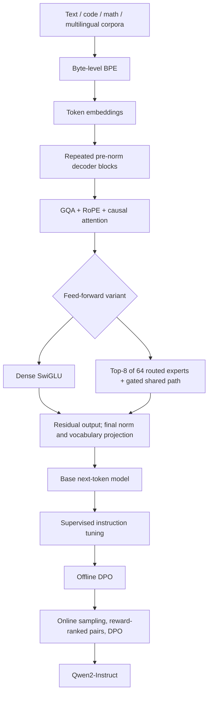
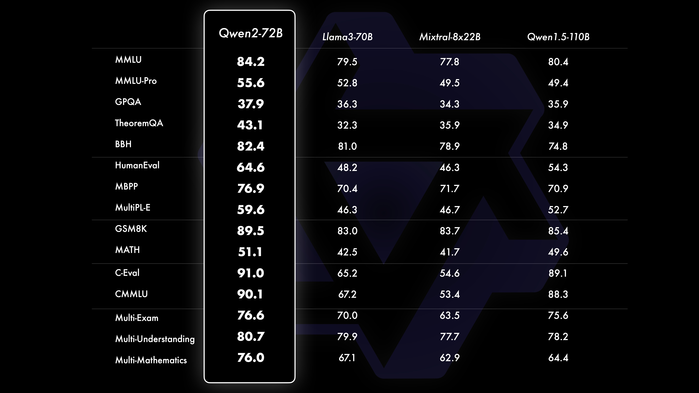
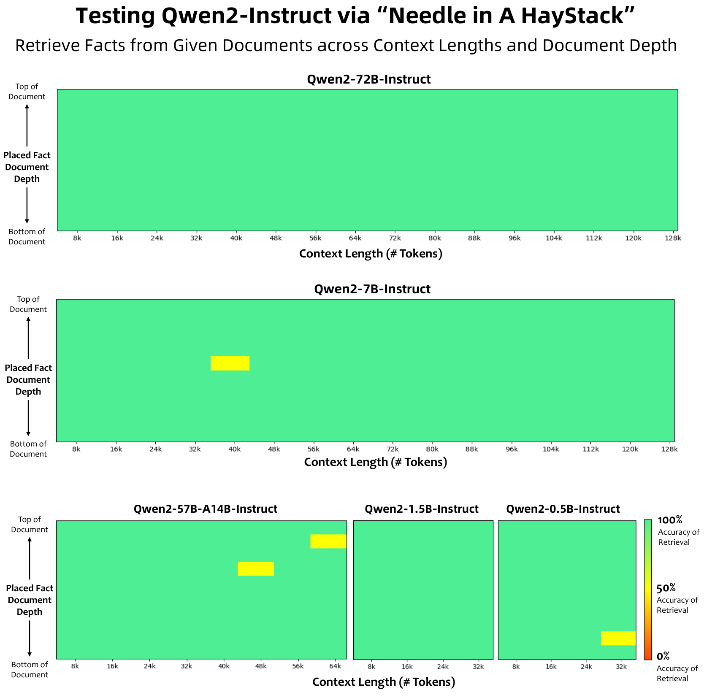

# Qwen2: Dense and Mixture-of-Experts Language Models - Yang et al., 2024

> **arXiv:** 2407.10671v4 (10 September 2024; first submitted 15 July 2024) · **Venue:** preprint / technical report · **Affiliation:** Alibaba Group

## TL;DR

Qwen2 is a family of four dense language models, from 0.5B to 72B, and a **57B-total / 14B-active Mixture-of-Experts model**, each released in base and instruction-tuned forms. It combines a largely conventional pre-normalized decoder with **grouped-query attention at every scale**, better multilingual/code/math data, long-context training followed by positional extrapolation, and scalable demonstration/preference-data construction. The large dense models use approximately 7T pretraining tokens, while the 0.5B model uses 12T and the MoE receives 4.5T additional tokens after upcycling. Qwen2-72B reaches **84.2 MMLU** as a base model, while its instruction-tuned counterpart reaches **86.0 HumanEval**, **69.0 MATH**, and **48.1 Arena-Hard** in the version-pinned report (Tables 2 and 6).

## Problem & motivation

The report aims to improve open-weight general-purpose language models across several competing requirements: strong English and Chinese performance, wider multilingual coverage, coding and mathematics, long-context use, and deployment at multiple memory/compute budgets. Simply scaling a bilingual dense model does not address all of these needs.

The main engineering pressures are:

- **Inference memory becomes important well before model quality saturates.** Long sequences require a key/value cache for every attention layer. Reducing the number of KV heads through [GQA](attention_2023_gqa.md) saves cache memory without reducing the number of query heads, making long-context inference more practical.
- **More training tokens are not automatically better training data.** The authors expand the corpus from the Qwen1.5 recipe, but find that relaxing quality filtering to reach 12T tokens does not yield a significant improvement over the higher-quality 7T version in their comparison (§3.1). They therefore prioritize the higher-quality mixture for larger models rather than treating raw corpus size as the sole objective.
- **Long-context handling has several distinct meanings.** A configuration may accept a large position index, yet retrieval or reasoning can still fail at that length. Qwen2 separates 32K training, extrapolation mechanisms, and empirical long-context evaluation, including tasks harder than a single inserted fact.
- **Human annotation is valuable but difficult to scale across domains.** Demonstrations and preferences for code, mathematics, constrained instructions, creative writing, role-play, and safety need different quality checks. Qwen2 combines human curation with automated, domain-specific supervision rather than relying on one generic model-generated score.
- **Active compute and stored capacity need not match.** The MoE model targets roughly 30B-class dense-model performance with fewer active parameters per token, while retaining a larger pool of stored expert weights. That is a different trade-off from simply shrinking a dense network.

Qwen2 is not a new attention primitive or a reasoning-mode architecture. Its contribution is the integrated model/data/alignment recipe and the evaluation of that recipe across a broad family. Later features such as Qwen3's hybrid thinking mode should not be read back into this report.

## Key idea

**Keep a well-understood autoregressive decoder, improve its efficiency and training distribution, and distinguish model capacity from per-token compute where useful.** All variants predict the next text token; dense variants use an ordinary gated FFN, while the MoE variant replaces FFNs with a routed/shared expert computation.

For token sequence $x=(x_1,\ldots,x_T)$:

$$
p_\theta(x)=\prod_{t=1}^{T}p_\theta(x_t\mid x_{<t}),
\qquad
\mathcal{L}_{\mathrm{LM}}
=-\sum_{t=1}^{T}\log p_\theta(x_t\mid x_{<t}).
$$

$\theta$ denotes model parameters, $T$ sequence length, and $x_{<t}$ the preceding tokens. This is the next-token training objective described by the report, written explicitly here for clarity.

The paper's numbered equations specify the routed part of the MoE:

$$
\mathbf{p}=\operatorname{softmax}(G(\mathbf{x})),
\tag{1}
$$

$$
\mathbf{y}_{\mathrm{routed}}
=\sum_{i\in\operatorname{TopK}(\mathbf{p})}
p_i E_i(\mathbf{x}).
\tag{2}
$$

$\mathbf{x}$ is a token's hidden vector, $G$ the learned router, $\mathbf{p}$ the expert-selection probabilities, $E_i$ expert $i$, $p_i$ its probability, and $\operatorname{TopK}$ the selected expert indices. Qwen2-57B-A14B has **64 routed experts, of which eight are selected per token**, plus shared expert capacity (Table 1). The shared path and its released implementation are explained below; Equation 2 alone is not the full layer output.

## How it works

### 1. Model family and exact architectural dimensions

The following values are from **Table 1 of v4**, not a mixture of later Qwen2.5 or Qwen3 configurations.

| Property | Qwen2-0.5B | Qwen2-1.5B | Qwen2-7B | Qwen2-72B | Qwen2-57B-A14B |
|---|---|---|---|---|---|
| Decoder layers | 24 | 28 | 28 | 80 | 28 |
| Hidden width $d$ | 896 | 1536 | 3584 | 8192 | 3584 |
| Query heads $H_q$ | 14 | 12 | 28 | 64 | 28 |
| KV heads $H_{kv}$ | 2 | 2 | 4 | 8 | 4 |
| Head dimension $d_h$ | 64 | 128 | 128 | 128 | 128 |
| FFN intermediate width | 4864 | 8960 | 18944 | 29568 | 2560 per fine-grained expert |
| Routed experts / selected | Not applicable | Not applicable | Not applicable | Not applicable | 64 / 8 |
| Shared expert count in report | Not applicable | Not applicable | Not applicable | Not applicable | 8 |
| Input/output embedding tying | Yes | Yes | No | No | No |
| Trained tokens | 12T | 7T | 7T | 7T | 4.5T additional after upcycling |

The MoE's eight selected experts **exclude** shared experts. Its "A14B" label denotes approximately 14B active parameters in the whole model, not eight experts of 14B each. Stored parameters remain approximately 57B, so active-parameter count is not a weight-memory estimate.

### 2. Tokenization, embeddings, and model interface

Section 2.1 retains the byte-level BPE tokenizer from [Qwen](backbone_2023_qwen.md). It reports **151,643 regular tokens plus three control tokens**, for a logical vocabulary of **151,646**. Byte-level coverage permits encoding arbitrary text, while the learned merges determine how efficiently different languages and code are represented.

The report explicitly distinguishes that vocabulary from the larger embedding allocation used for distributed-training convenience. For example, the inspected official [7B](https://huggingface.co/Qwen/Qwen2-7B/blob/main/config.json) and [72B](https://huggingface.co/Qwen/Qwen2-72B/blob/main/config.json) configurations specify 152,064 rows, while the [MoE configuration](https://huggingface.co/Qwen/Qwen2-57B-A14B/blob/main/config.json) specifies 151,936. These live configuration details supplement the report; they are not a reason to replace its logical vocabulary count with one universal padded size.

For a batch of token IDs $X\in\mathbb{N}^{B\times T}$, embedding lookup produces $H_0\in\mathbb{R}^{B\times T\times d}$, with batch size $B$, length $T$, and hidden width $d$. After the decoder stack and final normalization, a vocabulary projection produces next-token logits. The two smallest models share input and output embedding weights; the larger models do not.

Instruction-tuned models use the Qwen conversational template rather than a separate architecture. A typical serialized turn uses `<|im_start|>` and `<|im_end|>` around roles and content. Serving code should apply the released tokenizer's chat template, not substitute a later Qwen generation's thinking controls.

### 3. Dense decoder block

Qwen2 retains **RMSNorm pre-normalization, RoPE, SwiGLU, and attention QKV biases** (§2.2.1). An explanatory block formulation is:

$$
\widetilde{H}_{\ell}
=H_{\ell}+
\operatorname{Attention}_{\ell}
\left(\operatorname{RMSNorm}_{\ell,a}(H_{\ell})\right),
$$

$$
H_{\ell+1}
=\widetilde{H}_{\ell}+
\operatorname{FFN}_{\ell}
\left(\operatorname{RMSNorm}_{\ell,f}(\widetilde{H}_{\ell})\right).
$$

$H_\ell$ is the input to layer $\ell$, $\widetilde{H}_\ell$ the attention residual output, and the two RMSNorm operators have separate learned scales. The explicit equations reconstruct the standard components named in the report; they are not additional numbered paper equations.

For a vector $h\in\mathbb{R}^{d}$:

$$
\operatorname{RMSNorm}(h)
=\gamma\odot
\frac{h}{\sqrt{\frac{1}{d}\sum_{j=1}^{d}h_j^2+\epsilon}},
$$

where $\gamma$ is a learned scale, $\epsilon$ a numerical stabilizer, and $\odot$ elementwise multiplication. In the inspected official configurations, $\epsilon=10^{-6}$ for 7B/MoE and $10^{-5}$ for 72B; an implementation should read the model-specific value rather than assume one constant for every checkpoint.

The dense FFN is:

$$
\operatorname{FFN}(h)
=\left[\operatorname{SiLU}(hW_g)\odot(hW_u)\right]W_d,
$$

with gate/up projections $W_g,W_u\in\mathbb{R}^{d\times d_{\mathrm{ff}}}$ and down projection $W_d\in\mathbb{R}^{d_{\mathrm{ff}}\times d}$. $d_{\mathrm{ff}}$ is the intermediate width in Table 1. The gated product is the [SwiGLU](attention_2020_swiglu.md) computation; it is not a plain two-layer ReLU network.

### 4. Grouped-query attention and KV-cache implications

Given normalized hidden states $H\in\mathbb{R}^{B\times T\times d}$, the attention projections produce:

$$
Q\in\mathbb{R}^{B\times T\times H_q\times d_h},
\qquad
K,V\in\mathbb{R}^{B\times T\times H_{kv}\times d_h}.
$$

There are more query heads than KV heads. A group of $g=H_q/H_{kv}$ query heads shares one key/value head, so $g=7$ for Qwen2-7B and $g=8$ for Qwen2-72B. For query head $r$, mapped to KV head $j(r)$:

$$
\operatorname{Attn}_r
=\operatorname{softmax}\left(
\frac{\widehat{Q}_r\widehat{K}_{j(r)}^\top}{\sqrt{d_h}}
+M_{\mathrm{causal}}
\right)V_{j(r)}.
$$

$\widehat{Q},\widehat{K}$ are position-rotated query/key tensors and $M_{\mathrm{causal}}$ masks future positions. Head outputs are concatenated and projected back to width $d$. QKV biases are part of this generation's architecture; later Qwen3 changes should not silently remove them.

For an unquantized cache with $s$ bytes per scalar, $L$ layers, and one sequence of length $T$, the idealized storage is:

$$
\operatorname{KVBytes}
=2\,L\,T\,H_{kv}\,d_h\,s.
$$

The factor two is for keys and values. With two-byte values, this gives:

| Model | Ideal KV storage per token | Example full-sequence cache |
|---|---|---|
| Qwen2-7B | 56 KiB | 1.75 GiB at 32,768 tokens |
| Qwen2-72B | 320 KiB | 40 GiB at 131,072 tokens |

These are calculations from Table 1, not measured serving-memory results. They exclude weights, activations, allocator overhead, batching, and other state. GQA reduces this cache by the query/KV grouping factor relative to equally sized MHA; it does not make long-context inference free.

### 5. MoE feed-forward path

Qwen2-57B-A14B retains the 7B model's attention dimensions and replaces FFNs with fine-grained experts. Each routed expert is a SwiGLU network with intermediate width 2560. Smaller experts allow more combinations of specialization at a fixed overall active budget than selecting a small number of full-width dense FFNs (§2.2.2).

**Routing.** The router maps each token's width-3584 vector to 64 logits, computes softmax over all experts, and selects the eight largest probabilities. The released configuration sets `norm_topk_prob: false`, so selected probabilities are **not renormalized to sum to one**. Adding such a normalization would change the released computation.

**Shared capacity.** Table 1 counts eight shared experts. The reference implementation represents that capacity as one wider shared SwiGLU module with intermediate width:

$$
d_{\mathrm{shared}}=8\times2560=20480.
$$

It evaluates the shared path for every token and applies a learned scalar sigmoid gate:

$$
y_{\mathrm{MoE}}(h)
=\sum_{i\in\operatorname{Top8}(p)}p_iE_i(h)
+\sigma(w_s^\top h)\,E_s(h).
$$

$h$ is a token vector, $p$ the 64-way router distribution, $E_s$ the width-20480 shared module, $w_s$ the learned shared-path gate, and $\sigma$ the sigmoid function. This full expression is taken from the behavior of the [Transformers v4.41.2 reference implementation](https://github.com/huggingface/transformers/blob/v4.41.2/src/transformers/models/qwen2_moe/modeling_qwen2_moe.py), supplementing the report's routed-expert equations. It explains why the report's "eight shared experts" and the code's single `shared_expert` field are not contradictory.

**Auxiliary routing support.** The released MoE configuration exposes `router_aux_loss_coef: 0.001`, and the reference implementation supports a Switch-style load-balancing loss. The report does not fully document every routing-loss/training setting, so this configuration field should not be treated as a complete reconstruction of the internal training run.

### 6. Expert initialization through diversified upcycling

The MoE is initialized from Qwen2-7B rather than trained from random initialization (§2.2.2). The report describes the following procedure:

1. Let $h_E$ be the desired expert intermediate width, $n$ the number of experts being constructed, and $h_{\mathrm{FFN}}$ the original dense FFN width.
2. Replicate the source FFN enough times to supply the required intermediate channels:

   $$
   R=\left\lceil\frac{n\,h_E}{h_{\mathrm{FFN}}}\right\rceil.
   $$

3. Shuffle parameters along the intermediate dimension within each copy. For a SwiGLU block, channel reindexing must be coordinated across the gate/up outputs and the down-projection inputs so that channels remain correctly paired.
4. Extract fine-grained experts from those copies and discard leftover dimensions.
5. Randomly reinitialize **50% of each expert's parameters**, adding diversification beyond deterministic slicing.
6. Continue MoE pretraining for **4.5T additional tokens** (§3.1).

The coordinated-indexing explanation makes the report's intermediate-dimension shuffling implementable; it is not a claim that the paper publishes the exact random seeds, masks, or every initialization detail. A 4.5T-token MoE continuation inherits the source model's earlier learning, so it is not equivalent to a completely independent 4.5T-token-from-scratch run.

### 7. Long context: training, RoPE changes, and extrapolation

The concluding phase of pretraining expands sequence length from **4096 to 32,768 tokens** and increases the RoPE base from **10,000 to 1,000,000** (§3.2).

For head dimension $d_h$, RoPE applies a rotation to each coordinate pair using:

$$
\omega_j=b^{-2j/d_h},\qquad
R_j(m)=
\begin{bmatrix}
\cos(m\omega_j)&-\sin(m\omega_j)\\
\sin(m\omega_j)&\cos(m\omega_j)
\end{bmatrix},
$$

where $j\in\{0,\ldots,d_h/2-1\}$ indexes a coordinate pair, $m$ is token position, and $b$ the RoPE base. Raising $b$ changes the frequency distribution; it is not the same as training on every sequence length up to the inference limit.

The report additionally combines:

- **[YaRN](positional_2023_yarn-context-extension.md):** frequency-dependent positional rescaling and attention scaling for length extrapolation. Its purpose is to extend useful positional behavior beyond the training window, not to add new learned content or reduce the number of tokens processed.
- **[Dual Chunk Attention](positional_2024_dca-dual-chunk-attention.md):** chunk-aware handling of relative positions within and across chunks. It preserves the original attention behavior when the sequence fits the applicable chunk/window, while remapping long-range positional interactions for longer sequences.

The Qwen2 report names these mechanisms and evaluates their combination, but does not provide a complete kernel-level implementation or every per-checkpoint extrapolation hyperparameter. Setting `max_position_embeddings` alone does not install YaRN/DCA, and an ordinary dense-attention backend should not be assumed to implement DCA.

Three context claims must therefore stay separate:

| Claim | Evidence and scope |
|---|---|
| Training context | The long-context pretraining phase and SFT use 32,768-token sequences (§3.2, §4.2). |
| Single-needle retrieval | Figure 1 supports roughly 128K for 7B/72B Instruct, 64K for the MoE, and 32K for the smaller models under the stated evaluation. |
| Harder extrapolation tests | Table 12 evaluates NeedleBench and LV-Eval through 256K with explicit YaRN+DCA variants. These results quantify task-dependent degradation and recovery, not a blanket guarantee of native 256K competence. |

### 8. Architecture and training flow



This is a self-authored architectural/training reconstruction. The paper contains one principal figure, a long-context evaluation plot rather than an architecture diagram; that original figure is included in Results.

## Training / data

### Pretraining mixture and token budgets

Section 3.1 emphasizes **quality enhancement**, **data expansion**, and **distribution improvement**:

- Heuristic and model-based filtering remove lower-quality material; Qwen models also synthesize higher-quality pretraining examples.
- The corpus increases code, mathematics, and multilingual coverage. The report describes approximately 30 languages; the release announcement specifies English and Chinese plus 27 additional languages.
- Smaller proxy-model experiments guide the mixture across sources/domains. The report does not publish the complete optimized sampling weights.

The important budget distinctions are:

| Variant | Reported pretraining exposure | Interpretation |
|---|---|---|
| Qwen2-0.5B | 12T tokens | Uses the larger corpus obtained by relaxing the quality threshold. |
| Qwen2-1.5B / 7B / 72B | Approximately 7T each | Uses the preferred higher-quality mixture for the larger dense models. |
| Qwen2-57B-A14B | 4.5T additional tokens | Continues from upcycled Qwen2-7B weights rather than starting from scratch. |

*Source: Table 1 and §3.1. Introductory shorthand about the family using over 7T tokens does not supersede these per-model details.*

High-quality multi-task instruction examples are also mixed into pretraining to support in-context learning and instruction following. The report does not supply a complete corpus manifest, all filter thresholds, the exact long-context phase token budget, a complete pretraining optimizer/batch schedule, or a GPU-hour accounting. Those values should not be guessed from later Qwen recipes.

### Demonstration and preference data

Section 4.1 defines:

$$
\mathcal{D}=\{(x_i,y_i)\},\qquad
\mathcal{P}=\{(x_i,y_i^+,y_i^-)\}.
$$

$x_i$ is an instruction, $y_i$ a desired response, and $y_i^+,y_i^-$ preferred and dispreferred responses. $\mathcal{D}$ trains supervised instruction following; $\mathcal{P}$ trains preference alignment.

**Collaborative human/model annotation (§4.1.1).**

1. Apply InsTag to extract a fine-grained, open-set ontology from instruction corpora, then manually refine it.
2. Select instructions for tag diversity, semantic richness, complexity, and complete intent.
3. Evolve instructions by adding requirements and constraints, broadening difficulty.
4. Generate candidate responses with different Qwen models and generation strategies.
5. Have human annotators rank the candidates and ensure the chosen response meets the required quality, producing both demonstrations and preferences.

**Domain-specific automated synthesis (§4.1.2).**

| Strategy | How it generates supervision | Main caveat |
|---|---|---|
| Rejection sampling | Generate multiple mathematical reasoning paths, retain correct/reasonable solutions, and contrast correct with incorrect paths. | Correct final answers and model approval do not by themselves prove every reasoning step is valid. |
| Execution feedback | Generate code and tests, execute/compile solutions, and use outcomes for demonstrations/preferences. Generate verification functions for constrained instructions as well. | Generated tests and validators can be incomplete; executable checks are only as good as their coverage. |
| Data repurposing | Derive writing instructions from public-domain literary works; use character profiles and knowledge sources to construct grounded role-play examples. | The data source and conditioning profile determine what is supported, rather than unrestricted factual or stylistic correctness. |
| Constitutional feedback | Generate responses consistent or inconsistent with a set of principles, creating positive/negative examples for safety and values. | Principle-following feedback is not a proof of general safety or robustness to novel prompts. |

The strategies solve different annotation bottlenecks. They are not one interchangeable pool of unverified synthetic text.

### Supervised fine-tuning

Section 4.2 reports **more than 500,000 instruction examples**, spanning instruction following, code, mathematics, logic, role-play, multilingual tasks, and safety.

| SFT setting | Reported value |
|---|---|
| Epochs | 2 |
| Sequence length | 32,768 tokens |
| Learning rate | Decreased from $7\times10^{-6}$ to $7\times10^{-7}$ |
| Weight decay | 0.1 |
| Gradient clipping | Maximum 1.0 |

*Source: §4.2. The section does not specify a complete batch/optimizer configuration for every model size.*

A standard response-token SFT objective is:

$$
\mathcal{L}_{\mathrm{SFT}}
=-\mathbb{E}_{(x,y)\sim\mathcal{D}}
\sum_{t=1}^{|y|}
\log\pi_\theta(y_t\mid x,y_{<t}),
$$

where $\pi_\theta$ is the trainable response policy and $|y|$ the response length. This expresses the supervised objective, not an assertion that the report publishes every serialization or loss-mask detail.

### Offline and online preference alignment

Section 4.3 uses **DPO in two phases**, not PPO or GRPO:

1. **Offline DPO:** train on precompiled preferred/dispreferred response pairs.
2. **Online DPO:** sample several responses from the current policy, have a reward model select the most and least preferred, then use that pair for DPO in the episode.
3. Apply **Online Merging Optimizer** to mitigate the alignment tax, the capability loss that can accompany preference alignment. The report names this method but does not reproduce its complete update algorithm or all tuning settings.

The canonical DPO loss associated with the cited method is:

$$
\mathcal{L}_{\mathrm{DPO}}
=-\mathbb{E}_{(x,y^+,y^-)\sim\mathcal{P}}
\log\sigma\left(
\beta\left[
\log\frac{\pi_\theta(y^+\mid x)}{\pi_{\mathrm{ref}}(y^+\mid x)}
-\log\frac{\pi_\theta(y^-\mid x)}{\pi_{\mathrm{ref}}(y^-\mid x)}
\right]\right).
$$

$\pi_{\mathrm{ref}}$ is a reference policy, $\beta$ controls the preference/reference trade-off, and $\sigma$ is the sigmoid. The sequence log probabilities sum token log probabilities. The report does not provide a value for every DPO hyperparameter or fully specify reference-policy refresh behavior, so these cannot be reconstructed from this equation alone.

Online DPO changes where pairs come from: they are generated by the evolving policy rather than only by a fixed offline corpus. It does not imply that the model directly differentiates through a reward model or uses an actor-critic PPO objective.

## Results

### Scope and version discipline

The base-model tables generally use few-shot prompting unless specified otherwise (§5). Instruction-tuned tables use their own evaluation setups, so base-to-Instruct differences are not automatically controlled measurements of one training stage's causal effect.

All numerical tables below use **arXiv v4**. Some launch-blog images retain earlier values; for example, the launch Instruct panel lists different GSM8K/MATH numbers from v4 Table 6. The recap therefore uses the report's table values for those metrics and does not combine them with an older panel.

### Flagship base model

| Benchmark | Qwen2-72B | Llama-3-70B | Qwen1.5-110B | Source |
|---|---|---|---|---|
| MMLU | 84.2 | 79.5 | 80.4 | Table 2 |
| MMLU-Pro | 55.6 | 52.8 | 49.4 | Table 2 |
| GPQA | 37.9 | 36.3 | 35.9 | Table 2 |
| TheoremQA | 43.1 | 32.3 | 34.9 | Table 2 |
| BBH | 82.4 | 81.0 | 74.8 | Table 2 |
| HumanEval | 64.6 | 48.2 | 54.3 | Table 2 |
| MBPP | 76.9 | 70.4 | 70.9 | Table 2 |
| EvalPlus | 65.4 | 54.8 | 57.7 | Table 2 |
| MultiPL-E | 59.6 | 46.3 | 52.7 | Table 2 |
| GSM8K | 89.5 | 83.0 | 85.4 | Table 2 |
| MATH | 51.1 | 42.5 | 49.6 | Table 2 |
| C-Eval | 91.0 | 65.2 | 89.1 | Table 2 |
| CMMLU | 90.1 | 67.2 | 88.3 | Table 2 |

Qwen2 improves substantially over its predecessor and the listed contemporary baselines on many knowledge, code, math, and Chinese tasks. It does not win every row: Table 2 gives **87.6 HellaSwag** for Qwen2-72B versus **88.7** for Mixtral-8x22B, and **37.8 multilingual translation** versus **38.0** for Llama-3-70B.



*Supplementary figure from the official Qwen2 release announcement, not a second figure in the paper. The displayed base-model comparisons correspond to the report's Table 2; the version-pinned tables remain the source for the numerical discussion.*

### Family scaling and MoE trade-offs

| Base model | MMLU | HumanEval | GSM8K | MATH | Source |
|---|---|---|---|---|---|
| Qwen2-0.5B | 45.4 | 22.0 | 36.5 | 10.7 | Table 5 |
| Qwen2-1.5B | 56.5 | 31.1 | 58.5 | 21.7 | Table 5 |
| Qwen2-7B | 70.3 | 51.2 | 79.9 | 44.2 | Table 4 |
| Qwen2-57B-A14B | 76.5 | 53.0 | 80.7 | 43.0 | Table 3 |
| Qwen2-72B | 84.2 | 64.6 | 89.5 | 51.1 | Table 2 |

The table is a family comparison, not a pure parameter-scaling experiment: token budgets, upcycling history, and model architecture differ. The MoE is competitive with 30B-class dense models on many tasks, but is not universally superior. In Table 3, Yi-1.5-34B has **77.1 MMLU** and **82.7 GSM8K**, versus the MoE's **76.5** and **80.7**; Qwen2's MoE instead leads that comparator on **HumanEval, 53.0 versus 46.3**, and **MATH, 43.0 versus 41.7**.

The 7B model also shows strong improvements over the listed 8B baseline: Table 4 reports **70.3 versus 66.6 MMLU**, **51.2 versus 33.5 HumanEval**, and **44.2 versus 20.5 MATH** for Qwen2-7B versus Llama-3-8B. These are benchmark comparisons, not direct throughput measurements.

### Flagship instruction-tuned model

| Benchmark | Qwen2-72B-Instruct | Llama-3-70B-Instruct | Other relevant comparator | Source |
|---|---|---|---|---|
| MMLU | 82.3 | 82.0 | Qwen1.5-110B-Chat: 76.5 | Table 6 |
| MMLU-Pro | 64.4 | 56.2 | Mixtral-8x22B-Instruct: 56.1 | Table 6 |
| GPQA | 42.4 | 41.9 | Mixtral-8x22B-Instruct: 49.7 | Table 6 |
| HumanEval | 86.0 | 81.7 | Qwen1.5-110B-Chat: 74.4 | Table 6 |
| MBPP | 80.2 | 82.3 | Qwen1.5-110B-Chat: 76.4 | Table 6 |
| MultiPL-E | 69.2 | 63.4 | Qwen1.5-110B-Chat: 55.4 | Table 6 |
| LiveCodeBench v1 | 35.7 | 29.3 | Qwen1.5-110B-Chat: 25.3 | Table 6 |
| GSM8K | 93.2 | 93.0 | Qwen1.5-110B-Chat: 84.5 | Table 6 |
| MATH | 69.0 | 50.4 | Qwen1.5-110B-Chat: 42.0 | Table 6 |
| MT-Bench | 9.12 | 8.95 | Qwen1.5-110B-Chat: 8.88 | Table 6 |
| Arena-Hard | 48.1 | 41.1 | Qwen1.5-110B-Chat: 39.8 | Table 6 |
| IFEval, strict-prompt | 77.6 | 77.3 | Qwen1.5-110B-Chat: 57.5 | Table 6 |
| AlignBench | 8.27 | 7.42 | Qwen1.5-110B-Chat: 7.87 | Table 6 |

The instruction model is broadly strong, especially in code and mathematics, but Mixtral leads the listed GPQA comparison and Llama-3 leads MBPP. MT-Bench, Arena-Hard, and AlignBench are not interchangeable units or proof of equal real-world reliability.

### Smaller instruction models and the MoE

| Instruct model | MMLU | HumanEval | GSM8K | IFEval strict-prompt | Source |
|---|---|---|---|---|---|
| Qwen2-0.5B | 37.9 | 29.9 | 40.1 | 20.0 | Table 9 |
| Qwen2-1.5B | 52.4 | 47.0 | 61.6 | 29.0 | Table 9 |
| Qwen2-7B | 70.5 | 79.9 | 85.7 | 54.7 | Table 8 |
| Qwen2-57B-A14B | 75.4 | 79.9 | 85.3 | 59.9 | Table 7 |

Table 8 gives Qwen2-7B-Instruct **26.6 LiveCodeBench v1** and **52.9 MATH**, versus Llama-3-8B-Instruct's **17.3** and **30.0**. Conversely, Llama-3-8B-Instruct scores **72.1 IFEval strict-prompt**, above Qwen2-7B-Instruct's **54.7**. Strong coding performance therefore does not imply uniformly stronger constraint following at the same scale.

### Long-context evidence



*Paper Figure 1 (§5.2.3): 72B and 7B support strong single-fact retrieval through 128K, the MoE through 64K, and the smaller models through 32K under this test. YaRN is applied beyond 32K. This is an inserted-fact retrieval evaluation, not a general reasoning guarantee at every plotted length.*

Table 12 evaluates harder benchmarks with and without the explicit extrapolation combination:

| Model / setting | NeedleBench 128K | NeedleBench 256K | LV-Eval 64K | LV-Eval 128K | LV-Eval 256K |
|---|---|---|---|---|---|
| Qwen2-7B-Instruct | 38.77 | 2.92 | 28.03 | 11.01 | 0.55 |
| Qwen2-7B-Instruct + YaRN + DCA | 66.32 | 60.71 | 42.14 | 36.64 | 34.72 |
| Qwen2-72B-Instruct | 73.05 | 17.13 | 42.92 | 31.79 | 2.88 |
| Qwen2-72B-Instruct + YaRN + DCA | 90.27 | 85.21 | 53.03 | 48.83 | 42.35 |

*Source for every value: Table 12. Its merged cells indicate unchanged behavior at the shorter lengths within 32K; the added rows are not five consecutive columns starting at the first benchmark field.*

These results provide direct evidence that the inference-time positional mechanisms matter. They also show why the nearly solid-green single-needle plot is not a sufficient summary: LV-Eval remains much harder, and the unmodified setting degrades sharply at very long lengths.

### In-house evaluation and multilingual human judgments

The report includes internal Chinese and English automatic evaluations across several domains (§5.2.2). Qwen2-72B-Instruct averages **69.58** on the Chinese suite versus **68.87** for GPT-4o-2024-05-13 (Table 10), but averages **72.94** on the English suite versus **74.06** for Llama-3-70B-Instruct and **76.11** for GPT-4o (Table 11). These are suite-specific internal scores, not a controlled universal ranking.

For multilingual human evaluation, one professional annotator per language grades responses on a 1-to-5 scale (§5.2.4). Table 13 reports:

| Model | Average across the reported ten languages |
|---|---|
| GPT-3.5-Turbo-1106 | 3.16 |
| GPT-4-Turbo-0409 | 3.98 |
| GPT-4o-0513 | 4.09 |
| Claude-3-Opus-0229 | 4.15 |
| Qwen2-72B-Instruct | 3.93 |

*Source: Table 13. The evaluated languages are Arabic, French, Indonesian, Japanese, Korean, Portuguese, Russian, Spanish, Thai, and Vietnamese.*

The average is a clear improvement over the listed GPT-3.5 version, but still below the leading listed proprietary models. One annotator per language and a bounded set of test cases limit the strength of conclusions about all multilingual users or domains.

### Safety and responsibility evaluation

Table 14 measures the proportion of unsafe responses, where lower is better:

| Risk category | Qwen2-72B-Instruct | GPT-4 | Mixtral-8x22B-Instruct |
|---|---|---|---|
| Illegal activity | 0.00 | 0.00 | 6.87 |
| Fraud | 2.41 | 3.40 | 8.49 |
| Pornography | 22.91 | 23.63 | 33.82 |
| Privacy | 2.47 | 3.37 | 15.03 |

*Source: Table 14; percentages, lower is better.*

These measurements support a comparative claim on this evaluation, not a proof that harmful responses are impossible. Zero observed failures in a category is a finite-sample result, and the nonzero categories remain important.

### Contamination analysis

Section 5.2.6 distinguishes two procedures:

1. During training-data filtering, normalize away symbols/punctuation, tokenize, and remove a training sequence $s_t$ if a test sequence $s_e$ satisfies both:

   $$
   |\operatorname{LCS}(s_t,s_e)|\geq13,
   \qquad
   |\operatorname{LCS}(s_t,s_e)|
   \geq0.6\,\min(|s_t|,|s_e|).
   $$

   $\operatorname{LCS}$ denotes the longest common subsequence under the report's terminology.
2. For the audit, remove **any test sample with a 13-gram overlap** with pretraining or post-training data, without the LCS constraint, and reevaluate the remaining subset.

| Test set | Flagged by strict overlap test | 72B original / retained subset | 7B original / retained subset | Source |
|---|---|---|---|---|
| MMLU | 11.2% | 82.3 / 83.2 | 70.5 / 71.3 | Table 15 |
| GPQA | 1.0% | 42.4 / 41.8 | 34.3 / 34.1 | Table 15 |
| HumanEval | 75.0% | 86.0 / 87.0 | 79.9 / 87.8 | Table 15 |
| MBPP | 29.6% | 80.2 / 79.7 | 67.2 / 69.0 | Table 15 |
| GSM8K | 0.7% | 93.2 / 92.8 | 85.7 / 85.6 | Table 15 |
| MATH | 31.7% | 69.0 / 74.6 | 52.9 / 57.6 | Table 15 |
| IFEval | 0.9% | 77.6 / 77.4 | 54.7 / 53.7 | Table 15 |

The authors attribute many flagged cases to common mathematical/code expressions and argue that retained-subset performance does not show a broad collapse. That is useful evidence, but **not proof of no memorization**: removing examples changes the evaluation distribution and, for heavily filtered sets, leaves a much smaller sample. The recap reports original and retained-subset scores directly rather than relying on every printed delta in the source table.

## Limitations & follow-ups

- **The full training run is not reproducible from the report alone.** The architecture is precise, but corpus manifests, mixture weights, much of the pretraining execution recipe, several preference-training settings, and total compute are incomplete.
- **Contributions are not cleanly isolated.** Data quality, language coverage, token budgets, attention changes, synthetic supervision, and preference alignment all change. Benchmark improvements do not establish that one architectural component caused the whole gain.
- **MoE active size is not deployment memory.** The stored expert pool remains large; realized speed depends on routing, expert kernels, batching, communication, and hardware. The report does not make a 14B-active MoE identical to a 14B dense model.
- **Long-context behavior depends on the inference implementation.** Training at 32K, a large configuration limit, YaRN, DCA, single-fact retrieval, and multi-fact reasoning are separate concepts. A checkpoint loaded without the evaluated positional mechanisms need not reproduce the reported extrapolation results.
- **Alignment is not uniformly beneficial across every metric.** Instruct models have different strengths and failure modes from base models. The reported 7B constraint-following gap is particularly important when choosing a model for exact output requirements.
- **Multilingual quality is uneven.** The training covers roughly 30 languages, while the human study covers ten and uses one annotator per language. Code-switching, lower-resource languages, and task-specific fluency need additional evaluation.
- **Safety and contamination audits have bounded scope.** Neither refusal rates on one suite nor overlapping-text filtering establishes universal safety or absence of memorization.
- **This report's architecture is text-only.** It describes the language backbones and instruction models. Qwen2-VL and Qwen2-Audio require additional modality-specific architectures and separate reports.

[Qwen](backbone_2023_qwen.md) is the original predecessor, while [Qwen3](backbone_2025_qwen3.md) later adds a different reasoning/alignment recipe and architectural changes. The next main text-generation report is [Qwen2.5](https://arxiv.org/abs/2412.15115). The multimodal branches are covered separately by [Qwen2-VL](multimodal_2024_qwen2-vl.md) and [Qwen2-Audio](https://arxiv.org/abs/2407.10759).

## Links

- **arXiv:** [abstract](https://arxiv.org/abs/2407.10671v4) · [HTML](https://arxiv.org/html/2407.10671v4) · [PDF](https://arxiv.org/pdf/2407.10671v4)
- **Code:** [official Qwen2 repository](https://github.com/QwenLM/Qwen2)
- **Hugging Face:** [Qwen2-0.5B](https://huggingface.co/Qwen/Qwen2-0.5B) · [Qwen2-1.5B](https://huggingface.co/Qwen/Qwen2-1.5B) · [Qwen2-7B](https://huggingface.co/Qwen/Qwen2-7B) · [Qwen2-57B-A14B](https://huggingface.co/Qwen/Qwen2-57B-A14B) · [Qwen2-72B](https://huggingface.co/Qwen/Qwen2-72B) · [Qwen2-72B-Instruct](https://huggingface.co/Qwen/Qwen2-72B-Instruct)
- **Project page / blog posts:** [official Qwen2 announcement](https://qwenlm.github.io/blog/qwen2/)
- **Implementation:** [MoE reference code, Transformers v4.41.2](https://github.com/huggingface/transformers/blob/v4.41.2/src/transformers/models/qwen2_moe/modeling_qwen2_moe.py) · [7B configuration](https://huggingface.co/Qwen/Qwen2-7B/blob/main/config.json) · [72B configuration](https://huggingface.co/Qwen/Qwen2-72B/blob/main/config.json) · [MoE configuration](https://huggingface.co/Qwen/Qwen2-57B-A14B/blob/main/config.json). Model-card configuration links are live `main` files, unlike the version-pinned report and tagged reference code.
- **Figure sources:** [paper Figure 1](https://arxiv.org/html/2407.10671v4/needle_in_haystack.png) · [official base-model release panel](https://qianwen-res.oss-accelerate-overseas.aliyuncs.com/assets/blog/qwen2/qwen2-72b.jpg)
- **Talks / videos:** Not used as a source for this recap.
- **OpenReview / venue page:** Not used as a source for this recap.
- **Papers-with-Code:** Not used as a source for this recap.
- **Related / successor papers:** [Qwen](backbone_2023_qwen.md) · [GQA](attention_2023_gqa.md) · [RMSNorm](attention_2019_rmsnorm.md) · [SwiGLU](attention_2020_swiglu.md) · [RoPE](positional_2021_rope-roformer.md) · [YaRN](positional_2023_yarn-context-extension.md) · [DCA](positional_2024_dca-dual-chunk-attention.md) · [DeepSeek-MoE](moe_2024_deepseek-moe.md) · [DPO](https://arxiv.org/abs/2305.18290) · [Online Merging Optimizers](https://arxiv.org/abs/2405.17931) · [Qwen2.5](https://arxiv.org/abs/2412.15115) · [Qwen3](backbone_2025_qwen3.md)
- **Context:** [Qwen family overview](../qwen/overview.md)
- **BibTeX:** Minimal arXiv citation; the author list is abbreviated.

```bibtex
@article{yang2024qwen2,
  title = {{Qwen2} Technical Report},
  author = {Yang, An and Yang, Baosong and Hui, Binyuan and others},
  journal = {arXiv preprint arXiv:2407.10671},
  year = {2024},
  url = {https://arxiv.org/abs/2407.10671v4}
}
```
