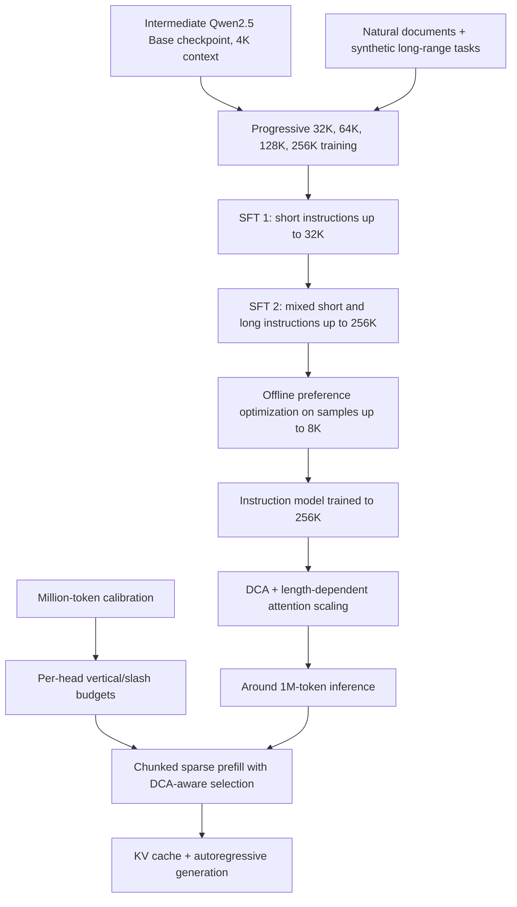
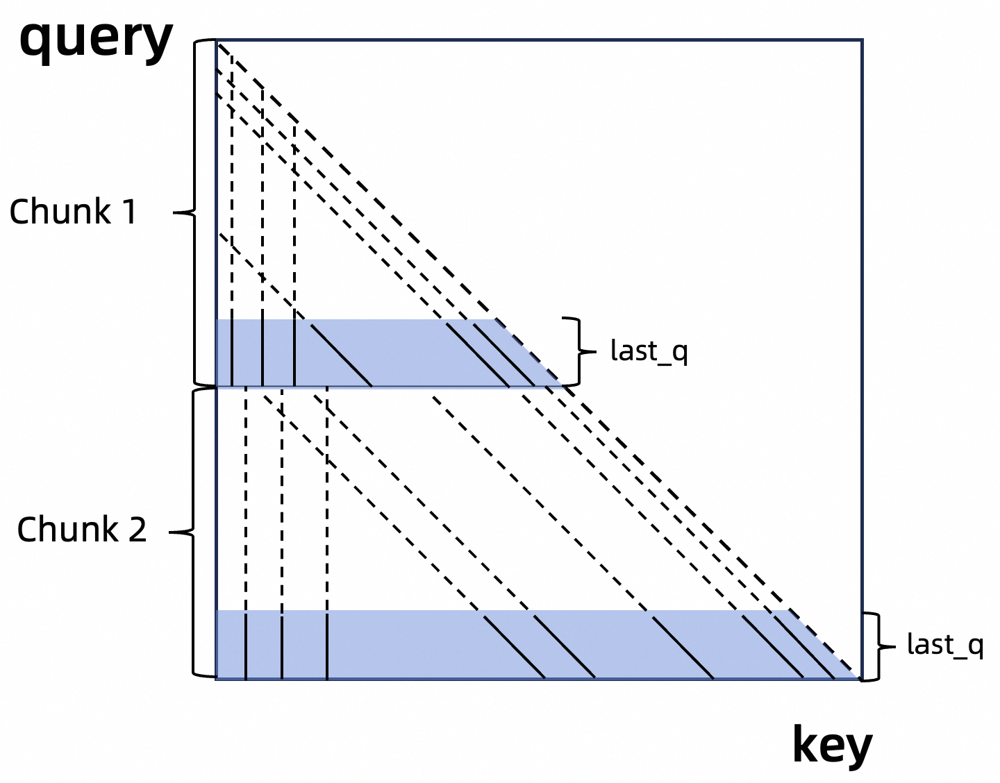
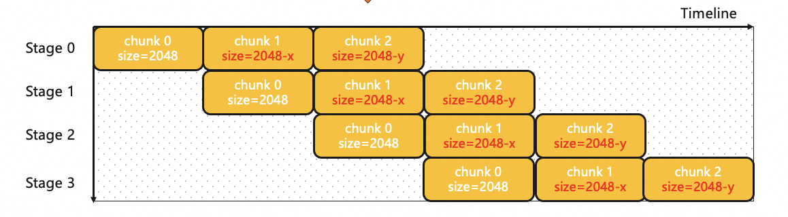
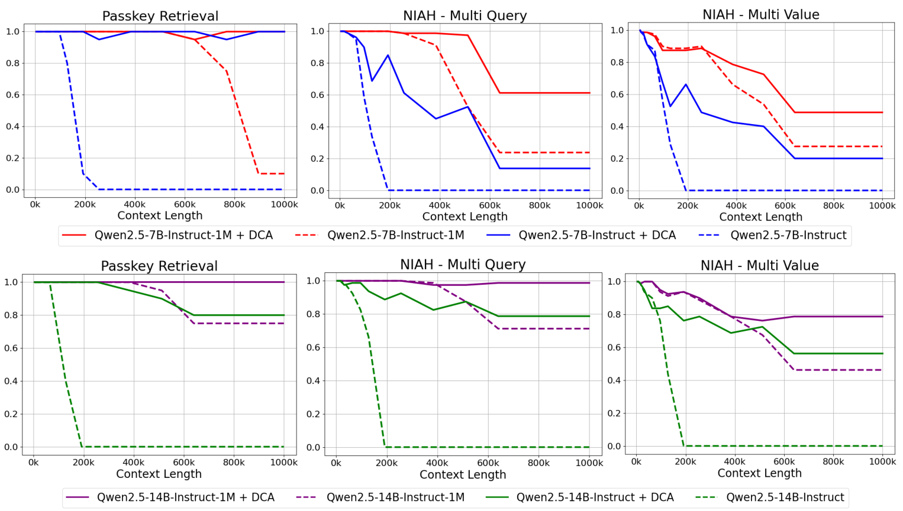
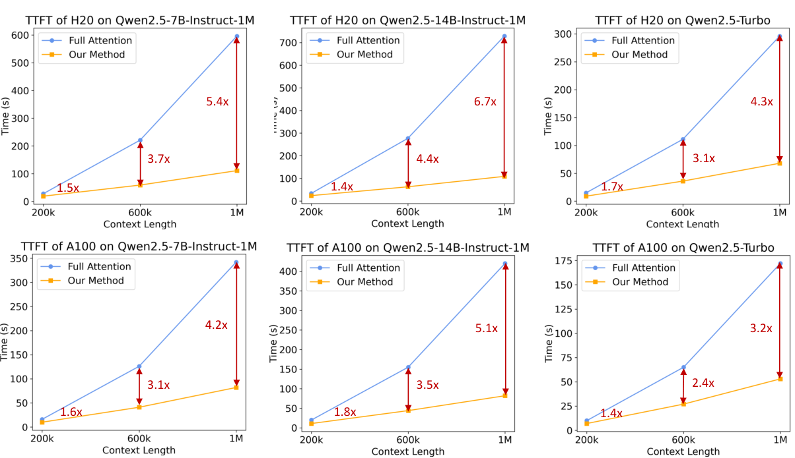

# Qwen2.5-1M: Training to 256K, Extrapolating to 1M, and Making Prefill Practical - Yang et al., 2025

> **arXiv:** [2501.15383v1](https://arxiv.org/abs/2501.15383v1) (26 January 2025) · **Venue:** preprint / technical report · **Affiliation:** Qwen Team, Alibaba Group
>
> The report covers the open-weight Qwen2.5-7B-Instruct-1M and Qwen2.5-14B-Instruct-1M, plus the API-served MoE Qwen2.5-Turbo. Implementation details below are distinguished from paper claims and use the released configurations and Qwen's vLLM commit `47b8640114dd4a2318b3a2dbe1ec1964b7393a08`, dated 26 January 2025.

## TL;DR

Qwen2.5-1M combines **progressive training to 262,144 tokens** with **DCA positional remapping and YaRN attention-temperature scaling at inference**, rather than training the released models on million-token sequences. Natural and synthetic long documents, two-stage instruction tuning, and short-context offline preference optimization improve real long-context tasks beyond simple passkey retrieval. An adapted MInference sparse-attention pipeline adds chunked prefill, DCA-compatible token selection, and million-token sparsity calibration, while BladeLLM contributes kernel and scheduling optimizations. The report measures **3.2-6.7x lower time to first token at 1M tokens** under its tested configurations, but retaining a million-token context still requires substantial KV-cache memory and does not guarantee perfect long-document reasoning.

## Problem & motivation

### A large context limit is not the same as useful long-context behavior

Extending a model's maximum position setting can make a long sequence load without teaching it to combine evidence across distant passages. Natural documents often permit next-token prediction using local context, so simply presenting longer text does not necessarily train strong long-range dependencies.

The report separates three problems:

1. **Learning:** teach retrieval, ordering, reasoning, and instruction following over long inputs.
2. **Extrapolation:** handle relative positional distances beyond those used during training.
3. **Execution:** process the input fast enough and within available GPU memory.

These problems need different solutions. Long-context training improves the model, DCA changes inference-time positional geometry, and sparsity plus engine engineering reduces execution costs.

### Million-token prefill is not ordinary chat inference

For sequence length $L$, dense attention has approximately quadratic attention arithmetic, $O(L^2d)$ for head dimension $d$. At $L=10^6$, an explicitly materialized attention matrix would have $10^{12}$ entries. FlashAttention avoids storing that full matrix, but does not eliminate the underlying dense attention arithmetic.

The report states that attention can exceed 90% of forward-pass time at this scale. It also identifies an independent memory problem: activations in one Qwen2.5-7B MLP layer can consume **71 GB** when a million-token sequence is processed together (Section 5.2). Neither problem is solved merely by using grouped-query attention or increasing `max_position_embeddings`.

### Do not confuse four meanings of “long”

The paper's training maximum is **262,144 tokens**. “1M” is the advertised inference regime, while released configurations set the full sequence limit to **1,010,000 tokens** and report generation support of **8,192 tokens**.

These are not interchangeable with 1,048,576 tokens, which is exactly four times 262,144. “Fourfold extrapolation” describes the approximate extension scale; applications must use their runtime's actual limit and reserve space for generated output and chat-template tokens.

## Key idea

### A staged capability pipeline plus a separate inference pipeline

The model learns over progressively longer inputs:

$$
4096\rightarrow32768\rightarrow65536\rightarrow131072\rightarrow262144.
$$

At inference, DCA remaps out-of-range query/key relative positions into a bounded range, while YaRN-derived attention scaling sharpens attention over the larger set of candidate tokens. This avoids requiring a full million-token training stage.

Sparse attention then avoids evaluating most query/key pairs. Its candidate selection must account for DCA's unusual relative positions, and its per-head budgets must be calibrated on genuinely long inputs rather than assumed to transfer from short sequences.



The inference extensions and sparsity calibration are not substitutes for long-context training. Conversely, the learned checkpoint does not automatically activate all inference optimizations in an arbitrary loader.

## How it works

### 1. Backbone: ordinary Qwen2.5 blocks, not a new recurrent architecture

The two public models retain Qwen2.5's decoder-only transformer: grouped-query attention, biased Q/K/V projections, SwiGLU FFNs, RoPE, RMSNorm, and pre-normalization.

| Public model | Layers | Hidden width | FFN width | Query / KV heads | Head width | Tied embeddings | License |
|---|---:|---:|---:|---|---:|---|---|
| 7B | 28 | 3,584 | 18,944 | 28 / 4 | 128 | No | Apache 2.0 |
| 14B | 48 | 5,120 | 13,824 | 40 / 8 | 128 | No | Apache 2.0 |

*Sources: Table 1 for layers, heads, tying, and licenses; released configurations for widths.*

Both configurations have vocabulary size **152,064**, RoPE base **10,000,000**, `max_position_embeddings=1010000`, and `use_sliding_window=false`. A numeric `sliding_window` field is not evidence that sliding-window attention is enabled.

Qwen2.5-Turbo is a separate **MoE** model accessed through an API. This report does not disclose a complete parameter/expert specification for reconstructing it. Its speed and quality should not be attributed to a public 7B or 14B checkpoint.

### 2. Progressive positional adaptation during training

For a rotary head of width $d$, a standard RoPE frequency construction is

$$
\omega_j=B^{-2j/d},\qquad j=0,\ldots,d/2-1.
$$

A token at position $m$ rotates pair $j$ through angle $m\omega_j$. $B$ is the RoPE base; changing it changes the wavelength distribution. The training recipe calls this **Adaptive Base Frequency (ABF)**.

| Training stage | Maximum sequence length | RoPE base |
|---|---:|---:|
| Initial Qwen2.5 training | 4,096 | 10,000 |
| First extension | 32,768 | 1,000,000 |
| Second extension | 65,536 | 1,000,000 |
| Third extension | 131,072 | 5,000,000 |
| Final extension | 262,144 | 10,000,000 |

*Source: Section 3. The long-context run starts from an intermediate Qwen2.5 Base checkpoint, not merely the final public 128K Instruct model.*

The last three stages use **75% sequences at the current maximum length and 25% shorter sequences**. The wording describes a sequence mixture; it is not a stated 75/25 token or compute split.

ABF during training should not be conflated with inference-time YaRN frequency interpolation. In this report, the explicitly described YaRN ingredient is **attention scaling**, paired with DCA.

### 3. DCA: three positional regimes without dropping the prefix

Ordinary RoPE makes attention depend on relative position. Beyond the trained range, queries and keys can encounter relative distances whose behavior was not learned.

Dual Chunk Attention partitions the sequence and changes the rotary positions used for three disjoint key regions:

| Region for a query | Purpose |
|---|---|
| Same chunk | Preserve ordinary within-chunk relative positions and causal masking. |
| Immediately previous chunk | Preserve local continuity across the chunk boundary, then compress larger relative distances. |
| Earlier chunks | Reuse bounded positional coordinates instead of allowing relative distance to grow indefinitely. |

DCA is a positional extrapolation method, **not intrinsically a sparse attention mask**. Distant keys remain available in the full-attention version.

#### Concrete reconstruction of the released implementation

Both checkpoint configurations specify:

```json
{
  "dual_chunk_attention_config": {
    "chunk_size": 262144,
    "local_size": 8192,
    "original_max_position_embeddings": 262144
  }
}
```

The pinned implementation defines the actual chunk stride as

$$
S=C-W=262144-8192=253952,
$$

where $C$ is the configuration's `chunk_size` and $W$ its local continuity allowance. This is not the original DCA paper's generic three-quarter-window example.

For query position $i$ and key position $j\leq i$, define

$$
a_i=\left\lfloor i/S\right\rfloor,\quad
a_j=\left\lfloor j/S\right\rfloor,\quad
r_i=i\bmod S,\quad r_j=j\bmod S.
$$

Keys use rotary position $r_j$. The released rotary code provides query positions

$$
P_q(i,j)=
\begin{cases}
r_i,&a_i=a_j,\\
\min(r_i+S,C),&a_i=a_j+1,\\
C,&a_i>a_j+1.
\end{cases}
$$

Thus the effective relative rotary coordinate is

$$
\Delta_{ij}=P_q(i,j)-r_j.
$$

This reconstructs the **implementation's clamp-at-$C$ convention**, rather than silently substituting the $C-1$ convention sometimes used to explain DCA. The distant-chunk coordinate is bounded by $C$ and does not grow with the number of preceding chunks.

At the beginning of a new chunk, the successive-chunk branch keeps true short distances across the seam. Farther away it saturates. Different distant chunks may share positional coordinates, but their key/value contents remain distinct; the method does not merge those tokens into one memory slot.

#### Merge attention partitions with their normalization constants

If attention is computed separately over regions $g$, let

$$
Z_g=\sum_{j\in g}\exp(\ell_{ij}),\qquad
o_g=\frac{\sum_{j\in g}\exp(\ell_{ij})v_j}{Z_g}.
$$

$\ell_{ij}$ is the final attention logit and $v_j$ the value vector. The correct combined output is

$$
o_i=\frac{\sum_g Z_go_g}{\sum_g Z_g}.
$$

Implementations use log-sum-exp values for numerical stability. Averaging the three independently normalized outputs would be incorrect because the regions can carry very different total attention mass.

### 4. YaRN attention scaling: the multiplier is squared

The paper's Equation 1 is

$$
\operatorname{softmax}\left(
\frac{q^\top k}{t\sqrt d}
\right),
\qquad
\sqrt{\frac1t}=1+0.1\ln s.
$$

Here $q,k$ are rotary-transformed query/key vectors, $d$ is head width, $t$ is temperature, and $s$ is inference length divided by training length.

Writing $\alpha=1+0.1\ln s$ makes the distinction explicit:

$$
\frac1t=\alpha^2.
$$

The logit multiplier is **not just** $1+0.1\ln s$. Scaling both query and key by $\alpha$, or applying an equivalent factor through the attention kernel, gives the required square.

For the illustrative case $s=4$, $\alpha\approx1.1386$ and the logit multiplier is approximately **1.2965**. This sharpens the softmax relative to unscaled attention; it does not change which keys are causally visible.

The pinned implementation clamps the length-dependent factor to at least one, so short inputs are not softened. DCA and this scaling preserve ordinary behavior within the trained context range; changing the model's learned weights through long-context training can still change short-task scores.

### 5. MInference-style sparse attention

The main sparse pattern contains:

- **Vertical lines:** selected key positions that many query positions attend to.
- **Slash lines:** selected relative offsets, producing diagonal bands of query/key pairs.

Offline search establishes per-head budgets for the two kinds of line. At runtime, attention from a small set of representative query tokens to all available keys identifies the important columns and offsets. The actual attention computation evaluates the resulting sparse union.

For query $i$ and selected causal keys $\mathcal C_i$, the approximation is

$$
\widetilde o_i=
\frac{\sum_{j\in\mathcal C_i}\exp(\ell_{ij})v_j}
{\sum_{j\in\mathcal C_i}\exp(\ell_{ij})}.
$$

This reduces the main attention work when $|\mathcal C_i|\ll i+1$, but selecting the set also costs computation. It is not a proof of linear end-to-end runtime, and the attention subset is not a promise that every omitted token is semantically irrelevant.

### 6. Chunked prefill: use queries available now, not at the end of the request

Original MInference probes the final query tokens of the complete input. That assumes the whole sequence has been encoded together. Chunked prefill processes the input sequentially, so later chunks' representations are not available when earlier chunks are being evaluated.

Qwen's adaptation probes the **last 64 query tokens within each current chunk**, selects critical tokens for that chunk, then executes sparse attention. Each chunk can have different vertical/slash selections.



*Blue regions mark the available `last_q` queries for each chunk. Earlier cached keys remain eligible; chunked prefill does not restrict attention to the current chunk.*

Section 5.2 gives **32,768 tokens** as an example prefill chunk size, reducing MLP activation memory by **96.7%** relative to processing 1M tokens together. The released deployment example instead uses a **131,072-token batched prefill budget**. These are different operating choices, not competing definitions of the model context.

Keep the meanings separate:

| Quantity | Meaning |
|---|---|
| 262,144-token training limit | Largest sequence length used in the stated training recipe. |
| DCA stride 253,952 | Position-remapping partition size in the pinned implementation. |
| 8,192-token DCA local allowance | Controls continuity across DCA boundaries; not a KV-cache retention window. |
| Prefill chunk / batched token budget | Controls activation memory and scheduling; does not reset conversation positions. |
| Pipeline chunk | Work unit whose size BladeLLM may vary to balance stage times. |

### 7. DCA-compatible critical-token selection

DCA's clipped/repeated positions can disrupt MInference's diagonal patterns. A selector based directly on those discontinuous coordinates may miss important keys.

The report therefore uses more continuous relative positions **only during candidate selection**. The pinned rotary implementation supplies:

$$
P^{\mathrm{select}}_{q,\mathrm{succ}}=r_i+S,\qquad
P^{\mathrm{select}}_{q,\mathrm{inter}}=r_i+C.
$$

These replace the clipped successor query and constant inter-chunk query while scoring candidates. Final attention still uses the bounded DCA query positions from the earlier piecewise definition.

This two-geometry design is central: selection wants recognizable diagonal structure, while final attention wants the extrapolation behavior learned within a bounded relative-position range. The paper does not replace DCA with ordinary unbounded RoPE for the final attention weights.

### 8. Million-token sparsity refinement with attention-mass recall

A head configuration searched on sequences below 32K may omit important attention mass at 1M. The report recalibrates budgets using a set of **million-token sequences**.

For a query $q_i$, Equations 2 and 3 define

$$
\operatorname{LSE}_{\mathrm{full}}
=\log\sum_{j=0}^{i}
\exp\left(\frac{q_i^\top k_j}{\sqrt d}\right),
$$

$$
\operatorname{LSE}_{\mathrm{sparse}}
=\log\sum_{j\in\mathcal C_i}
\exp\left(\frac{q_i^\top k_j}{\sqrt d}\right).
$$

These are **logarithms of sums** of unnormalized weights, not the sums themselves. Equation 4 computes

$$
R_i=\exp\left(
\operatorname{LSE}_{\mathrm{sparse}}
-\operatorname{LSE}_{\mathrm{full}}
\right)\in[0,1].
$$

$R_i$ is the fraction of dense attention probability mass retained by the sparse set. For an implementation that includes DCA and temperature scaling, full and sparse calculations must use the same final logits to preserve that interpretation.

FlashAttention can return the full log-normalizer without materializing the entire attention matrix. **It saves score-matrix memory, not the quadratic arithmetic of the dense calibration pass.**

Algorithm 1 can be reconstructed as:

```text
For each layer and query head on the calibration data:
    Compute full-attention output and its log-normalizer.
    Load the head's existing vertical/slash budgets.
    Compute sparse attention and its log-normalizer.
    Compute retained attention mass from the two log-normalizers.
    If retained mass is below Threshold:
        Increase the vertical and slash budgets for that head.
```

The report's algorithm shows a conditional increase, not a fully specified iterative convergence procedure. It does not give the numeric threshold, budget increments, calibration-set size, or the rule for aggregating query-level recalls into the head-level decision. These details must not be filled in with an invented “95% recall” setting.

Mass recall is a useful proxy, not a guarantee of identical answers. A low-mass value can still carry a task-critical distinction, and approximation errors propagate through later layers.

### 9. Engine optimizations beyond sparse masks

**Sparse kernels.** BladeLLM pipelines sparse KV loads and performs instruction-level optimization for irregular access. Section 5.3.1 reports attention-kernel speedups of **13.7x for MInference** and **27.8x for BladeLLM** relative to FlashAttention on A100 at 1M with the same sparsity configuration. These are **kernel** numbers, not the end-to-end TTFT improvements.

**MoE kernels.** Qwen2.5-Turbo's decode path receives memory-access and Tensor Core optimizations, including fine-grained warp specialization. The report gives peak H20 memory-access throughput of **3.4 TB/s**, **55% above** its vLLM FusedMoE baseline (Section 5.3.1). This is not a decode-throughput measurement for the two dense public models.

**Dynamic chunked pipeline parallelism (DCPP).** Equal token counts can take unequal time because later prefill chunks attend to longer histories. BladeLLM adjusts chunk sizes to equalize execution time and reduce pipeline bubbles instead of keeping every chunk equally large.



*The figure uses shrinking chunk sizes as a schematic example. Its initial 2,048-token label is not a universal prefill setting for the released models.*

**Totally Asynchronous Generator (TAG).** The scheduler, model runner, and decoder use separate processes and queues. The scheduler reserves KV space for anticipated next tokens without waiting for the preceding model step; the model runner sends sampled token IDs to the decoder and starts new work; the decoder asynchronously converts IDs into text. Shared memory reduces inter-process communication overhead. This removes unnecessary serial CPU/GPU waiting, not causal dependencies in the generated text.

The report distinguishes the production **BladeLLM** engine from optimizations released through Qwen's **custom vLLM branch**. Do not assume every production feature is present in every public vLLM version or that installing generic vLLM reproduces all reported curves.

### 10. KV-cache arithmetic and practical deployment boundaries

Sparse prefill does not by itself prune the KV cache. For $N_\ell$ layers, $H_{\mathrm{KV}}$ KV heads, head width $d$, cached length $L$, and $b$ bytes per element, an unquantized cache requires

$$
M_{\mathrm{KV}}
=2N_\ell H_{\mathrm{KV}}dLb.
$$

The leading two accounts for keys and values. At $L=1,000,000$ and BF16/FP16 $b=2$:

| Public model | Raw KV cache, decimal GB | Raw KV cache, GiB |
|---|---:|---:|
| 7B | 57.344 | 53.4 |
| 14B | 196.608 | 183.1 |

*Derived from the public configurations; these are theoretical cache bytes, not measured total VRAM. They exclude weights, activations, allocation overhead, and runtime workspaces.*

The release guide recommends aggregate GPU memory of at least **120 GB for 7B** and **320 GB for 14B** at 1M. Those historical deployment recommendations are not universal mathematical minima for every quantization and runtime.

The model cards explicitly warn that ordinary Qwen2.5-compatible inference can lose accuracy beyond 262,144 tokens without the specialized extrapolation path. `rope_scaling=null` in the checkpoint does not negate this: the custom runtime reads `dual_chunk_attention_config`. Architectural loading compatibility and long-context semantic compatibility are different requirements.

## Training / data

### 1. Natural data plus tasks that force long-range use

Section 3 combines Common Crawl, arXiv, books, and code repositories with synthetic tasks:

| Synthetic task | Why it trains a different dependency |
|---|---|
| Fill in the middle | The missing span must be inferred from surrounding context, potentially far apart. The report does not specify a complete FIM token-serialization recipe here. |
| Keyword-based retrieval | The model retrieves a relevant paragraph from a long document using a keyword cue rather than relying only on nearby text. |
| Position-based retrieval | The model recalls paragraphs before or after a specified location, teaching positional and ordering relationships. |
| Paragraph reordering | Shuffled paragraphs must be arranged into a coherent sequence, encouraging global structure rather than isolated local continuation. |

The progressive length/base schedule is given above. The report does **not** disclose the total additional long-context token budget, all natural/synthetic mixture ratios, optimizer schedule, exact GPU-hours, or full data filtering thresholds. In particular, it does not establish a universal “only about 1B training tokens” recipe.

A standard causal objective explaining this stage is

$$
\mathcal L_{\mathrm{LM}}
=-\mathbb E_x\sum_i\log p_\theta(x_i\mid x_{<i}),
$$

where $x$ is the serialized natural or synthetic example and $\theta$ the model parameters. This is explanatory notation; the report does not publish a complete per-task loss-mask implementation.

### 2. Agent-assisted long instruction synthesis

Human annotation of long contexts is costly and error-prone. The authors:

1. Select a long pretraining document.
2. Randomly extract a segment and prompt Qwen2.5 to create a query based on it.
3. Ask **Qwen-Agent** to answer using the **full document**, with retrieval, chunk-by-chunk reading, and step-by-step reasoning.
4. Assemble the full document, generated query, and agent-produced response into a training example.

Tasks include summarization, retrieval, multi-hop QA, reasoning, and coding. The agent's intermediate retrieval/chunk-reading procedure is a **data-generation tool**, not a requirement that the final trained model invoke RAG for every inference request.

This design yields broad full-document supervision, but synthetic answers and reasoning can still contain errors. A query generated from one segment is not automatically evidence that the example requires every part of the document.

### 3. Two-stage SFT

The first SFT stage uses instructions up to **32,768 tokens** and the same number of steps as the ordinary Qwen2.5 instruction run. This anchors short-task behavior before introducing long examples.

The second stage mixes short instructions with long ones up to **262,144 tokens**. The authors balance the mixture to reduce forgetting, but do not publish the exact ratio.

The response-conditioned objective can be written

$$
\mathcal L_{\mathrm{SFT}}
=-\mathbb E_{(c,y)}
\sum_t\log p_\theta(y_t\mid c,y_{<t}),
$$

where $c$ is the document/instruction context and $y$ its response. The long input length is not a claim of equally long output generation.

### 4. Short preference data generalizes to long-context alignment

Section 4 describes **offline RL similar to DPO**, reusing ordinary Qwen2.5 preference pairs whose samples are at most **8,192 tokens**. It does not describe online rollout training at 1M, nor a GRPO stage.

For intuition, canonical DPO compares preferred and rejected responses relative to a reference model:

$$
\mathcal L_{\mathrm{DPO}}
=-\mathbb E
\log\sigma\left[
\beta\left(
\log\frac{\pi_\theta(y^+\mid c)}{\pi_{\mathrm{ref}}(y^+\mid c)}
-
\log\frac{\pi_\theta(y^-\mid c)}{\pi_{\mathrm{ref}}(y^-\mid c)}
\right)\right].
$$

$y^+,y^-$ are the preferred/rejected responses, $\pi_\theta$ the policy, $\pi_{\mathrm{ref}}$ a reference, $\sigma$ the logistic sigmoid, and $\beta$ a preference-strength parameter. This is a **method-reference equation**, not a claim that the report discloses its exact loss, reference construction, or numerical $\beta$.

The measured benefit on LongBench-Chat is documented below. It supports transfer of preference alignment over these tasks, not the stronger claim that short preference training teaches all missing million-token reasoning abilities.

## Results

### 1. What each evaluation actually tests

All numbers are reported results, not model executions reproduced for this recap.

- **Passkey retrieval / needle tests:** find a planted item amid distractors, including tests approaching 1M. These establish a useful retrieval capability, but are simpler than synthesizing evidence across an entire real document.
- **RULER:** multiple needles/queries and aggregation-style synthetic tasks, evaluated up to **128K** in the main table.
- **LV-Eval:** simultaneous evidence understanding, evaluated up to **256K**. The authors **modify the original metric** to reduce false negatives from strict matching, so these scores are not automatically comparable to numbers from the unmodified benchmark.
- **LongBench-Chat:** long-context preference alignment, with examples up to **100K** according to the report.

The main RULER/LV-Eval/LongBench-Chat tables therefore do **not** directly measure broad natural-document understanding at 1M. The longest retrieval ablations supply a different form of evidence.

### 2. RULER: training and extrapolation both matter

| Model / inference | RULER average | 4K | 8K | 16K | 32K | 64K | 128K |
|---|---:|---:|---:|---:|---:|---:|---:|
| GLM4-9b-Chat-1M | 89.9 | 94.7 | 92.8 | 92.1 | 89.9 | 86.7 | 83.1 |
| Llama-3-8B-Instruct-Gradient-1048k | 88.3 | 95.5 | 93.8 | 91.6 | 87.4 | 84.7 | 77.0 |
| Llama-3.1-70B-Instruct | 89.6 | 96.5 | 95.8 | 95.4 | 94.8 | 88.4 | 66.6 |
| GPT-4o-mini | 87.3 | 95.0 | 92.9 | 92.7 | 90.2 | 87.6 | 65.8 |
| GPT-4 | 91.6 | 96.6 | 96.3 | 95.2 | 93.2 | 87.0 | 81.2 |
| Qwen2.5-32B-Instruct / RoPE | 88.0 | 96.9 | 97.1 | 95.5 | 95.5 | 85.3 | 57.7 |
| Qwen2.5-32B-Instruct / DCA+YaRN | 92.9 | 96.9 | 97.1 | 95.5 | 95.5 | 90.3 | 82.0 |
| Qwen2.5-72B-Instruct / RoPE | 90.8 | 97.7 | 97.2 | 97.7 | 96.5 | 88.5 | 67.0 |
| Qwen2.5-72B-Instruct / DCA+YaRN | 95.1 | 97.7 | 97.2 | 97.7 | 96.5 | 93.0 | 88.4 |
| Qwen2.5-7B-Instruct / RoPE | 80.1 | 96.7 | 95.1 | 93.7 | 89.4 | 74.5 | 31.4 |
| Qwen2.5-7B-Instruct / DCA+YaRN | 85.4 | 96.7 | 95.1 | 93.7 | 89.4 | 82.3 | 55.1 |
| Qwen2.5-7B-Instruct-1M | 91.8 | 96.8 | 95.3 | 93.0 | 91.1 | 90.4 | 84.4 |
| Qwen2.5-14B-Instruct / RoPE | 86.5 | 97.7 | 96.8 | 95.9 | 93.4 | 82.3 | 53.0 |
| Qwen2.5-14B-Instruct / DCA+YaRN | 91.4 | 97.7 | 96.8 | 95.9 | 93.4 | 86.7 | 78.1 |
| Qwen2.5-14B-Instruct-1M | 95.7 | 97.5 | 97.1 | 94.6 | 94.9 | 94.9 | 92.2 |
| Qwen2.5-Turbo | 93.1 | 97.5 | 95.7 | 95.5 | 94.8 | 90.8 | 84.5 |

*Source: Table 4. Repeated short-length cells are expanded from the source's merged cells. “RoPE” versus “DCA+YaRN” denotes the inference mode, not separately retrained weights. The new 1M rows use ordinary behavior within training length and extrapolation beyond it.*

The table labels one baseline **GPT-4**, while surrounding prose also mentions GPT-4o. The label is preserved here rather than silently renaming the evaluated system.

The 14B-1M row prints an average of **95.7**, although the simple mean of its six displayed length-specific scores is **95.2**. The report does not explain this aggregation discrepancy; the table above preserves the reported value.

The old 7B/14B models improve with extrapolation alone, but the dedicated 1M models improve further. The largest gains appear at the long end; 14B-1M's short RULER scores are not all higher than the older 14B model.



*Solid versus dashed curves isolate the extrapolation effect, while different model versions expose the training effect. Strong single-passkey retrieval can coexist with much weaker multi-query or multi-value retrieval. Curves are not converted into invented exact table entries.*

### 3. LV-Eval and LongBench-Chat

| Model / inference | LV 16K | LV 32K | LV 64K | LV 128K | LV 256K | LongBench-Chat |
|---|---:|---:|---:|---:|---:|---:|
| GLM4-9B-Chat-1M | 46.4 | 43.2 | 42.9 | 40.4 | 37.0 | 7.82 |
| Llama-3-8B-Instruct-Gradient-1048k | 31.7 | 31.8 | 28.8 | 26.3 | 21.1 | 6.20 |
| Llama-3.1-70B-Instruct | 48.6 | 47.4 | 42.9 | 26.2 | N/A | 6.80 |
| GPT-4o-mini | 52.9 | 48.1 | 46.0 | 40.7 | N/A | 8.48 |
| Qwen2.5-32B-Instruct / RoPE | 56.0 | 53.6 | 40.1 | 20.5 | 0.7 | - |
| Qwen2.5-32B-Instruct / DCA+YaRN | 56.0 | 53.6 | 48.8 | 45.3 | 41.0 | 8.70 |
| Qwen2.5-72B-Instruct / RoPE | 60.4 | 57.5 | 47.4 | 27.0 | 2.4 | - |
| Qwen2.5-72B-Instruct / DCA+YaRN | 60.4 | 57.5 | 53.9 | 50.9 | 45.2 | 8.72 |
| Qwen2.5-7B-Instruct / RoPE | 55.9 | 49.7 | 33.1 | 13.6 | 0.5 | - |
| Qwen2.5-7B-Instruct / DCA+YaRN | 55.9 | 49.7 | 48.0 | 41.1 | 36.9 | 7.42 |
| Qwen2.5-7B-Instruct-1M | 52.5 | 49.4 | 48.6 | 48.3 | 42.7 | 8.08 |
| Qwen2.5-14B-Instruct / RoPE | 53.0 | 50.8 | 37.0 | 18.4 | 0.8 | - |
| Qwen2.5-14B-Instruct / DCA+YaRN | 53.0 | 50.8 | 46.8 | 43.6 | 39.4 | 8.04 |
| Qwen2.5-14B-Instruct-1M | 54.5 | 53.5 | 50.1 | 47.6 | 43.3 | 8.76 |
| Qwen2.5-Turbo | 53.4 | 50.0 | 45.4 | 43.9 | 38.0 | 8.34 |

*Source: Table 5, using the authors' modified LV-Eval metric. N/A and missing results are retained. Short LV-Eval cells shared across inference modes are expanded from merged cells.*

14B-1M is stronger than GPT-4o-mini across the displayed comparable LV-Eval lengths and on LongBench-Chat. However, extrapolated **72B remains higher on every LV-Eval length**, showing that context training does not erase the benefit of a much larger language model. Turbo also does not lead the two public 1M models across every long-context metric.

### 4. Progressive-training ablation

| 14B-1M training maximum | RULER average | 4K | 8K | 16K | 32K | 64K | 128K |
|---|---:|---:|---:|---:|---:|---:|---:|
| 32,768 | 82.3 | 96.8 | 94.7 | 95.9 | 92.2 | 76.4 | 37.6 |
| 65,536 | 86.8 | 96.5 | 95.5 | 93.6 | 92.5 | 86.7 | 56.0 |
| 131,072 | 92.5 | 96.5 | 95.9 | 93.0 | 92.6 | 93.0 | 83.8 |
| 262,144 | 92.7 | 95.6 | 93.8 | 93.1 | 94.1 | 91.9 | 87.6 |

*Source: Table 2, pretraining-stage measurements, not the final post-trained values in Table 4.*

Longer training particularly improves the longest evaluated RULER column. The final stage is not best in every shorter column. Since this table stops at 128K, it does not measure the entire value of 256K training on tasks exceeding that range.

### 5. Preference optimization on short samples

| Model | Before offline RL | After offline RL | Printed gain |
|---|---:|---:|---:|
| Qwen2.5-7B-Instruct-1M | 7.32 | 8.08 | +0.75 |
| Qwen2.5-14B-Instruct-1M | 8.56 | 8.76 | +0.20 |
| Qwen2.5-Turbo | 7.60 | 8.34 | +0.74 |

*Source: Table 3, LongBench-Chat. Its printed 7B gain is +0.75, while subtracting the displayed endpoints yields +0.76; unreported underlying precision may explain the discrepancy. Both the endpoints and printed gain are preserved.*

These results support transfer of short preference optimization to this long-context preference benchmark. They do not isolate which preference categories improve or establish equal transfer to every long-context reasoning task.

### 6. Short-context preservation is approximate, not exact

| Benchmark | GPT-4o-mini | Qwen2.5 7B | Qwen2.5 7B-1M | Qwen2.5 14B | Qwen2.5 14B-1M | Qwen2.5-Turbo |
|---|---:|---:|---:|---:|---:|---:|
| MMLU-Pro | 63.1 | 56.3 | 54.3 | 63.7 | 63.3 | 64.5 |
| MMLU-redux | 81.5 | 75.4 | 74.8 | 80.0 | 80.7 | 81.7 |
| LiveBench 0831 | 31.1 | 35.9 | 35.2 | 44.4 | 44.6 | 42.3 |
| GPQA | 40.2 | 36.4 | 41.4 | 45.5 | 39.9 | 42.3 |
| MATH | 70.2 | 75.5 | 72.9 | 80.0 | 79.5 | 81.1 |
| GSM8K | 93.2 | 91.6 | 91.7 | 94.8 | 94.8 | 93.8 |
| HumanEval | 88.4 | 84.8 | 86.0 | 83.5 | 88.4 | 86.6 |
| MBPP | 85.7 | 79.2 | 75.9 | 82.0 | 80.2 | 82.8 |
| MultiPL-E | 75.0 | 70.4 | 72.4 | 72.8 | 77.1 | 73.7 |
| LiveCodeBench | 40.7 | 28.7 | 28.0 | 42.6 | 38.6 | 37.8 |
| IFEval | 80.4 | 71.2 | 73.0 | 81.0 | 84.3 | 76.3 |
| Arena-Hard | 74.9 | 52.0 | 48.1 | 68.3 | 70.2 | 67.1 |
| MTbench | - | 8.75 | 8.30 | 8.88 | 8.89 | 8.81 |

*Source: Table 6. Section 6.2 identifies LiveCodeBench 2305-2409 and strict prompt-level IFEval. These are Instruct-model comparisons under this report's evaluation, not interchangeable with every earlier Qwen2.5 table.*

Retention is broadly successful but not lossless. For example, 14B loses GPQA and LiveCodeBench points while gaining HumanEval and IFEval; 7B loses MATH, MBPP, Arena-Hard, and MTbench points. The paper's phrase “without compromising” should be interpreted as overall preservation, not equality on each benchmark.

### 7. Accuracy under sparsification

Section 5.2 and Figure 6 compare full attention, original MInference, and the modified sparse method on 7B-1M. The original sparsity setup can drop to **60% accuracy or less beyond 400K**, whereas continuous-position candidate selection plus long-sequence budget refinement recovers most of the full-attention performance while retaining about **4x prefill acceleration**.

The experiment demonstrates why short-context sparsity search alone is insufficient. It combines the two corrective changes rather than providing a complete independent ablation for every calibration choice.

### 8. TTFT: hardware-specific end-to-end gains



*The plotted quantity is seconds to first token, dominated by prefill for very long inputs. It is not output tokens per second or total time to generate an arbitrarily long answer.*

| Model | H20 speedup at 1M | A100 speedup at 1M | Tensor-parallel degree |
|---|---:|---:|---:|
| Qwen2.5-7B-Instruct-1M | 5.4x | 4.2x | 4 |
| Qwen2.5-14B-Instruct-1M | 6.7x | 5.1x | 8 |
| Qwen2.5-Turbo | 4.3x | 3.2x | 8 |

*Sources: Figure 11 and Section 6.3. Batch size is 1 in all reported speed experiments. These are comparisons with full attention on the corresponding hardware/model setup.*

The H20 examples in Section 6.3 reduce 14B TTFT from **12.2 minutes to 109 seconds** and Turbo from **4.9 minutes to 68 seconds**. These are still substantial waits; the result is a practical reduction, not instantaneous million-token interaction.

The 7B experiment uses four-way tensor parallelism because of its four KV heads, while 14B and Turbo use eight-way partitioning. The speedup table should not be interpreted as a controlled comparison of model sizes on an identical single GPU.

## Limitations & follow-ups

- **Training and advertised inference lengths differ.** Million-token support relies on the intended extrapolation path beyond 262,144. A larger configuration limit alone is not the full method.
- **Main quality tables stop short of 1M.** Passkey and needle tests reach the advertised regime, but the main broader tasks stop at 128K, 256K, or about 100K. Perfect passkey retrieval is not proof of robust global reasoning.
- **Long-range position is coarsened.** DCA deliberately aliases distant relative coordinates. It preserves access to content, not exact absolute separation among all remote chunks.
- **Sparsification is approximate.** Critical-token selection can miss evidence, and high retained mass does not prove identical generated answers. Calibration needs dense long-sequence computation even though the final serving path is sparse.
- **Cache cost remains large.** Chunked prefill reduces transient activation memory; it does not automatically compress or discard a million tokens of KV state.
- **The complete training and calibration recipe is undisclosed.** Token budgets, some data ratios, schedules, calibration thresholds, budget increments, and aggregation rules are missing. The report does not justify a fixed ~1B-token reproduction budget.
- **Synthetic instruction quality depends on the teacher/agent.** Agent-generated full-document answers can be wrong or weakly grounded, and segment-generated queries need not always test global understanding.
- **Short-task scores can regress.** The actual tables contain trade-offs, including science, mathematics, coding, and preference benchmarks.
- **Comparisons are protocol-dependent.** LV-Eval uses a modified metric; one GPT baseline has a prose/table naming mismatch; timing uses batch size one and different parallel degrees. Kernel speedups are not end-to-end speedups.
- **Open weights and the API are not the same artifact.** Turbo is an incompletely specified MoE service, and BladeLLM optimizations are not all guaranteed to be available in an arbitrary public vLLM release.

The direct predecessor is [Qwen2.5](backbone_2024_qwen2.5.md). The reusable method lineage is [RoPE](positional_2021_rope-roformer.md), [YaRN](positional_2023_yarn-context-extension.md), and [DCA](positional_2024_dca-dual-chunk-attention.md). [Qwen3](backbone_2025_qwen3.md) is a later language-model family, not the source of this report's long-context recipe.

## Links

- **arXiv:** [abs](https://arxiv.org/abs/2501.15383v1) · [html](https://arxiv.org/html/2501.15383v1) · [pdf](https://arxiv.org/pdf/2501.15383v1).
- **Code:** [Qwen2.5 project](https://github.com/QwenLM/Qwen2.5) · [release-era custom vLLM branch](https://github.com/QwenLM/vllm/tree/dev/dual-chunk-attn).
- **Pinned implementation:** [DCA rotary positions](https://github.com/QwenLM/vllm/blob/47b8640114dd4a2318b3a2dbe1ec1964b7393a08/vllm/model_executor/layers/rotary_embedding.py) · [DCA, sparse selection, scaling, and attention backend](https://github.com/QwenLM/vllm/blob/47b8640114dd4a2318b3a2dbe1ec1964b7393a08/vllm/attention/backends/dual_chunk_flash_attn.py).
- **Hugging Face:** [7B Instruct-1M](https://huggingface.co/Qwen/Qwen2.5-7B-Instruct-1M) · [14B Instruct-1M](https://huggingface.co/Qwen/Qwen2.5-14B-Instruct-1M).
- **Configuration sources:** [7B](https://huggingface.co/Qwen/Qwen2.5-7B-Instruct-1M/blob/main/config.json) · [14B](https://huggingface.co/Qwen/Qwen2.5-14B-Instruct-1M/blob/main/config.json).
- **Project page / blog / historical deployment guide:** [Qwen2.5-1M release](https://qwenlm.github.io/blog/qwen2.5-1m/).
- **Talks / videos:** no specific presentation is identified in the report.
- **OpenReview / venue page:** not specified; this recap uses the arXiv technical report.
- **Papers-with-Code:** not used as a primary source.
- **Method sources:** [MInference](https://arxiv.org/abs/2407.02490) · [ABF / effective long-context scaling](https://arxiv.org/abs/2309.16039) · [DPO](https://arxiv.org/abs/2305.18290) · [Qwen-Agent](https://github.com/QwenLM/Qwen-Agent) ([framework review](agentic_2023_qwen-agent.md)).
- **Related local recaps:** [Qwen2.5](backbone_2024_qwen2.5.md) · [RoPE](positional_2021_rope-roformer.md) · [YaRN](positional_2023_yarn-context-extension.md) · [DCA](positional_2024_dca-dual-chunk-attention.md) · [Qwen3](backbone_2025_qwen3.md).
- **Family / context hubs:** [Qwen overview](../qwen/overview.md) · [Positional encoding](../qwen/positional/positional.md) · [Attention](../qwen/attention/attention.md).
- **BibTeX:** abbreviated author list; the paper notes that authors are ordered alphabetically by surname.

```bibtex
@article{yang2025qwen25oneM,
  title         = {Qwen2.5-1M Technical Report},
  author        = {Yang, An and Yu, Bowen and Li, Chengyuan and Liu, Dayiheng
                   and Huang, Fei and Huang, Haoyan and Jiang, Jiandong
                   and Tu, Jianhong and others},
  year          = {2025},
  eprint        = {2501.15383},
  archivePrefix = {arXiv},
  primaryClass  = {cs.CL},
  url           = {https://arxiv.org/abs/2501.15383v1}
}
```
