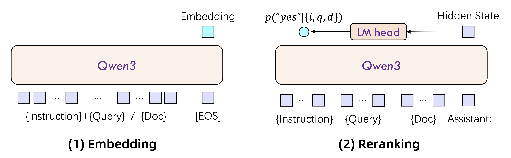
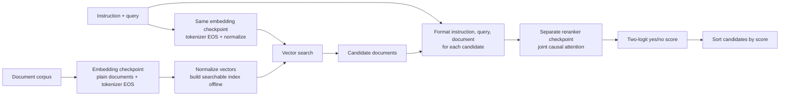
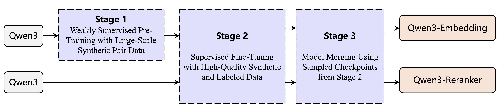

# Qwen3 Embedding and Reranking - Zhang et al., 2025

> **arXiv:** [2506.05176v3](https://arxiv.org/abs/2506.05176v3), 11 June 2025
> (v1: 5 June 2025) · **Venue:** preprint · **Affiliation:** Tongyi Lab, Alibaba Group
> **Full title:** *Qwen3 Embedding: Advancing Text Embedding and Reranking Through Foundation Models*
> **Authors:** Yanzhao Zhang, Mingxin Li, Dingkun Long, et al. · **Release license:** Apache-2.0

## TL;DR

Qwen3 Embedding adapts dense [Qwen3](backbone_2025_qwen3.md) models into separate
embedding and point-wise reranking checkpoints at 0.6B, 4B, and 8B scales.
Embedders combine contrastive training on approximately 150M synthetic pairs,
SFT on approximately 7M labeled plus 12M selected synthetic pairs, and checkpoint
merging; rerankers skip the first contrastive stage (Sections 3.2-3.3, Table 6).
The 8B embedder reaches **70.58 multilingual mean-task** and **80.68 code retrieval**
(Tables 2-3), while the rerankers improve many retrieval results but do not
uniformly beat either their smaller siblings or every baseline (Table 4).

## Problem & motivation

Retrieval needs two different capabilities. A first-stage system must cheaply
search a large collection, so it encodes documents once and compares their vectors
with a query vector. A second-stage system can spend more computation inspecting
the query and each shortlisted document together, recovering relevance details
that a single independently computed vector may lose.

Large language models offer a useful initialization for both jobs: multilingual
text understanding, code knowledge, and instruction following. However, next-token
pretraining does not automatically produce a vector space in which cosine distance
matches relevance. Nor does an instruction-tuned chatbot automatically provide
stable, inexpensive ranking scores. The models need different output interfaces
and task-specific training objectives.

The paper's main training problem is obtaining sufficiently varied relevance
supervision. Mining existing question-answer forums or document pairs provides
useful weak labels, but gives limited control over language, task, query length,
and difficulty. The proposed alternative is to generate pairs with Qwen3-32B,
select a higher-quality subset for later training, and combine fine-tuning
checkpoints to improve generalization. This is a data-and-training contribution
on top of the Qwen3 architecture, not a new attention mechanism.

## Key idea

**Use the same foundation-model family in two different computational roles.**
The embedding model independently maps an instructed query and an uninstructed
document into the same vector space. The reranker jointly reads an instruction,
query, and document, then scores the next-token alternatives `yes` and `no`.
These are separate checkpoints, not two modes of a single released model.

For the embedding interface, an explicit reconstruction of the inference
computation is:

$$
h_q=\operatorname{Pool}\!\left(F_\theta(T_I(q))\right),\qquad
h_d=\operatorname{Pool}\!\left(F_\theta(T(d))\right),
$$
$$
e_q=\frac{h_q}{\|h_q\|_2},\qquad
e_d=\frac{h_d}{\|h_d\|_2},\qquad
s(q,d)=e_q^\top e_d.
$$

Here $q$ is a query, $d$ a document, $I$ a task instruction, $T_I$ the instructed
query tokenizer, $T$ the document tokenizer, $F_\theta$ the embedding checkpoint,
and $\operatorname{Pool}$ its final non-padding-token pooling operation.
The pooled vectors $h_q,h_d$ have the model's hidden width; $e_q,e_d$ are their
L2-normalized versions. Their dot product $s$ is cosine similarity. This
normalization requires a nonzero pooled vector.

For reranking, the executable score used by the official inference example is:

$$
r(q,d\mid I)=
\frac{\exp(z_{\mathrm{yes}})}
{\exp(z_{\mathrm{yes}})+\exp(z_{\mathrm{no}})}
=\sigma(z_{\mathrm{yes}}-z_{\mathrm{no}}),
\qquad \sigma(x)=\frac{1}{1+\exp(-x)}.
$$

$z_{\mathrm{yes}}$ and $z_{\mathrm{no}}$ are **raw next-token logits** after the
formatted joint input, not already normalized probabilities. The report's
Section 2 writes an exponentiated $P(\cdot)$ expression; the reference code
disambiguates it by selecting these two logits and applying a two-class
log-softmax. If full-vocabulary probabilities $p_{\mathrm{yes}}$ and
$p_{\mathrm{no}}$ are available instead, the equivalent operation is
$p_{\mathrm{yes}}/(p_{\mathrm{yes}}+p_{\mathrm{no}})$, **not** a softmax of
those two probabilities.

The result is a probability conditional on the two permitted answer tokens,
not the model's full-vocabulary probability of `yes`, and not a demonstrated
calibrated probability that a document is relevant. Ranking needs the ordering
of these scores; deploying a global relevance threshold requires separate
validation.

## How it works

### Model lineup and context-length boundaries

All six models use dense Qwen3 decoder backbones with causal attention. The
embedding checkpoints expose hidden states; the rerankers expose a causal-LM
vocabulary head. Table 1 specifies the following lineup:

| Model | Layers | Advertised sequence length | Full embedding dimension | MRL | Instruction-aware |
|---|---:|---:|---:|---|---|
| Qwen3-Embedding-0.6B | 28 | 32K | 1024 | Yes | Yes |
| Qwen3-Embedding-4B | 36 | 32K | 2560 | Yes | Yes |
| Qwen3-Embedding-8B | 36 | 32K | 4096 | Yes | Yes |
| Qwen3-Reranker-0.6B | 28 | 32K | - | - | Yes |
| Qwen3-Reranker-4B | 36 | 32K | - | - | Yes |
| Qwen3-Reranker-8B | 36 | 32K | - | - | Yes |

Do not conflate this advertised 32K length with either a demo's truncation
setting or a configuration field. In the released `config.json` files,
`max_position_embeddings` is **32768** for Embedding-0.6B and **40960** for the
other five checkpoints. That does not establish evaluated 40960-token retrieval
quality. The official raw-Transformers examples use **8192** as their chosen
`max_length`, not as the model family's architectural maximum
([release examples](https://github.com/QwenLM/Qwen3-Embedding#usage);
[0.6B embedding config](https://huggingface.co/Qwen/Qwen3-Embedding-0.6B/blob/main/config.json);
[4B embedding config](https://huggingface.co/Qwen/Qwen3-Embedding-4B/blob/main/config.json);
[8B embedding config](https://huggingface.co/Qwen/Qwen3-Embedding-8B/blob/main/config.json);
[reranker configs](https://huggingface.co/Qwen/Qwen3-Reranker-0.6B/tree/main)).



*Paper Figure 1, Section 2. Left: a final EOS representation summarizes a
causally processed input. Right: the reranker reads the entire pair and uses
the answer-token distribution. Only the embedding path permits offline
document-vector precomputation.*

### Embedding: formatting, EOS, pooling, and normalization

1. **Construct the query with a task instruction.** The public implementation
   uses `Instruct: {task_description}\nQuery:{query}`. The task description tells
   the encoder what notion of relevance is intended; the query remains the
   actual information need. For retrieval, documents are passed as plain text,
   without the query instruction.
2. **Tokenize with the embedding checkpoint's tokenizer.** The report describes
   appending `<|endoftext|>` and pooling that EOS token. The public example does
   not append it manually because the released fast-tokenizer
   `TemplateProcessing` postprocessor already appends it for all three embedding
   sizes. Thus EOS pooling in the report and last-non-padding-token pooling in
   the example agree. Do not append another EOS blindly, or disable special-token
   processing without deliberately reproducing that ending.
3. **Run the causal decoder once per input.** For a batch of $B$ sequences padded
   to length $L$, its last hidden states have shape $B\times L\times D$, where
   $D$ is the embedding dimension in Table 1. Because attention is causal, the
   final EOS state can attend to the entire preceding instruction and text.
   This is not mean pooling or a newly added bidirectional encoder.
4. **Select the last valid position, not a pad token.** With attention mask
   $a_{bt}\in\{0,1\}$, use
   $p_b=\max\{t:a_{bt}=1\}$ and $h_b=H_{b,p_b,:}$, where $H$ is the final hidden
   tensor and $t$ indexes token positions. For left-padded batches this is
   `H[:, -1]`; for right padding it is at `attention_mask.sum(1) - 1`.
   The latter expression is not a general left-padding index.
5. **L2-normalize and compare.** Stack the normalized vectors into a
   $B\times D$ matrix. For $n_q$ queries and $n_d$ documents, matrix multiplication
   produces an $n_q\times n_d$ cosine-score matrix. An approximate nearest-neighbor
   index can replace exhaustive scoring for large collections; that is the
   standard retrieval deployment pattern, not a new index proposed by this paper.

The tokenizer postprocessor's pooled EOS is `<|endoftext|>` (token ID **151643**).
Do not infer that token from `config.json.eos_token_id` alone: the 4B/8B embedding
configs use **151645**, while their tokenizer postprocessors still append
**151643**. The tokenizer's actual encoding pipeline is the relevant source
([0.6B tokenizer](https://huggingface.co/Qwen/Qwen3-Embedding-0.6B/blob/main/tokenizer.json),
[4B tokenizer](https://huggingface.co/Qwen/Qwen3-Embedding-4B/blob/main/tokenizer.json),
[8B tokenizer](https://huggingface.co/Qwen/Qwen3-Embedding-8B/blob/main/tokenizer.json)).
The released
[pooling configuration](https://huggingface.co/Qwen/Qwen3-Embedding-0.6B/blob/main/1_Pooling/config.json)
also explicitly selects last-token rather than mean pooling.

### Flexible dimensions: what MRL support does and does not specify

Table 1 marks all three embedding models as supporting Matryoshka Representation
Learning (MRL): useful information is available in shorter prefixes of the
full vector. An explicit inference reconstruction for a requested dimension
$m\leq D$ is:

$$
e^{(m)}(x)=
\frac{h(x)_{1:m}}{\|h(x)_{1:m}\|_2}.
$$

$x$ is the input, $h(x)$ its full pooled vector, and $h(x)_{1:m}$ its first $m$
coordinates. **Truncate, then normalize again**, and use the same dimension and
preprocessing for queries and indexed documents. A prefix of an already
normalized full vector generally no longer has unit norm.

The [8B model card](https://huggingface.co/Qwen/Qwen3-Embedding-8B) advertises
requested dimensions from **32 to 4096**. The paper does not disclose the
complete training-time prefix set, its loss weights, or a reduced-dimension
quality curve, so MRL support is not evidence that every shorter dimension
preserves full-vector benchmark quality. Dimension truncation also does not
shrink the decoder itself: it primarily reduces vector storage and comparison
cost, not the backbone's forward-pass computation. It is distinct from weight
or embedding quantization.

### Reranking: preserve the template and score the next token

The reference implementation assembles the following chat structure; placeholders
are inserted as plain text. The final empty thinking block closes before the
answer-token prediction:

```text
<|im_start|>system
Judge whether the Document meets the requirements based on the Query and the Instruct provided. Note that the answer can only be "yes" or "no".<|im_end|>
<|im_start|>user
<Instruct>: {instruction}
<Query>: {query}
<Document>: {document}<|im_end|>
<|im_start|>assistant
<think>

</think>

```

The literal suffix is
`<|im_end|>\n<|im_start|>assistant\n<think>\n\n</think>\n\n`.
There is no need to generate a chain of thought or even an answer string.
Run the causal LM and take the vocabulary logits at the last input position.
The lowercase class tokens are `no` and `yes`; the released 0.6B reranker
tokenizer maps them directly to IDs **2152** and **9693**, respectively.
The implementation obtains IDs from the tokenizer rather than assuming them
([reranker tokenizer](https://huggingface.co/Qwen/Qwen3-Reranker-0.6B/blob/main/tokenizer.json);
[official scoring code](https://github.com/QwenLM/Qwen3-Embedding#reranker-model)).

For a batch of $B$ pairs, full logits have shape $B\times L\times V$, with $V$
the vocabulary size. Select the final-position logits for `[no, yes]`, yielding
$B\times2$; apply `log_softmax` over those two columns and exponentiate the
`yes` column. Left padding makes `logits[:, -1, :]` refer to the end of each
prompt. Right padding without position-aware gathering would score after
padding instead.

The example reserves tokens for the fixed system/user prefix and assistant
suffix **before** truncating the formatted pair body, then pads the assembled
inputs. This matters because truncation that removes the instruction, document,
or answer prefix changes the task. Long queries can also consume the document
budget. The report does not publish a complete per-benchmark truncation recipe.

### Reconstructed two-stage retrieval system



*Original reconstruction. Document encoding is reusable across queries; joint
reranker evaluation is not. Table 4 fixes the first stage to Embedding-0.6B
and reranks its top-100 candidates, rather than changing the candidate generator
with each reranker.*

## Training / data

### Improved contrastive objective

Both embedding training stages use the improved InfoNCE objective from
Section 3.1, Equation 1:

$$
\mathcal{L}_{\mathrm{embedding}}
=-\frac{1}{N}\sum_{i=1}^{N}
\log\frac{\exp(s(q_i,d_i^+)/\tau)}{Z_i},
$$
$$
\begin{aligned}
Z_i={}&\exp(s(q_i,d_i^+)/\tau)\\
&+\sum_{k=1}^{K}m_{ik}\exp(s(q_i,d_{i,k}^-)/\tau)\\
&+\sum_{j\ne i}m_{ij}\exp(s(q_i,q_j)/\tau)\\
&+\sum_{j\ne i}m_{ij}\exp(s(d_i^+,d_j)/\tau)\\
&+\sum_{j\ne i}m_{ij}\exp(s(q_i,d_j)/\tau).
\end{aligned}
$$

Here $N$ is the batch size; $q_i$ is instance $i$'s query; $d_i^+$ its positive
document; $d_{i,k}^-$ its $k$th hard negative; $K$ the hard-negative count;
$d_j$ a document contributed by another in-batch instance; $s$ cosine
similarity; and $\tau>0$ the temperature. The mask coefficients $m_{ik}$ and
$m_{ij}$ determine whether the corresponding negative contributes.
The denominator includes the positive, explicit hard negatives, other queries,
document-document comparisons, **and** query-document in-batch comparisons.
Omitting the final term changes the reported objective.

The source's false-negative mask is:

$$
m_{ij}=
\begin{cases}
0,&s_{ij}>s(q_i,d_i^+)+0.1
   \ \text{or}\ d_j=d_i^+,\\
1,&\text{otherwise}.
\end{cases}
$$

$s_{ij}$ is the corresponding negative comparison score; the report explicitly
describes query-document and query-query cases. A candidate more similar than
the labeled positive by **strictly more than 0.1 cosine units**, or an identical
positive document, is excluded from negative competition. This avoids forcing
some plausible alternative positives apart. It is not a rule that discards
every negative merely close to the positive, and the margin is applied to
cosine scores before temperature scaling.

**Notation and reproducibility boundary:** the paper reuses $m_{ij}$ for several
comparison families but does not fully spell out the document-document masking
convention or the complete candidate bookkeeping. The equation above preserves
that notation rather than inventing a precise negative sampler. Numerical
values for $\tau$ and $K$ are not supplied in the report.

### Reranker supervision

Section 3.1, Equation 2 trains the correct answer token with:

$$
\mathcal{L}_{\mathrm{reranking}}
=-\log p_\phi\!\left(l\mid\mathcal{P}(I,q,d)\right),
\qquad l\in\{\mathrm{yes},\mathrm{no}\}.
$$

$\phi$ denotes reranker parameters, $\mathcal{P}$ the formatted prompt, and $l$
the relevance label: `yes` for a positive document and `no` for a negative.
$p_\phi$ is the LM's next-token probability. This is supervised answer-token
training, not contrastive vector training, pairwise ranking loss, or a stated
two-class replacement head. At inference, the two selected vocabulary logits
are renormalized as described above; do not silently replace the published
training loss with that inference normalization.

### Stage structure and data budgets



*Paper Figure 2, Section 3.2. Embedding checkpoints receive synthetic weak
supervision, high-quality SFT, and merging. Rerankers receive SFT and merging,
not the first weakly supervised embedding stage.*

| Stage | Embedding path | Reranker path | Reported data |
|---|---|---|---|
| Weakly supervised training | Improved contrastive loss | Skipped | Approximately 150M synthetic pairs |
| High-quality SFT | Same contrastive objective | Yes/no answer-token loss | Approximately 7M labeled plus 12M selected synthetic pairs |
| Model merging | Merge SFT checkpoints with slerp | Merge SFT checkpoints with slerp | No additional dataset size reported |

*Source: Sections 3.1-3.3 and Table 6. The paper gives the data pools, not a
complete task-by-size consumption schedule.*

The first stage is **task-specific contrastive training**, not another round
of ordinary next-token foundation-model pretraining. The second stage is
likewise not simply "12M pairs": Table 6 separately lists the labeled pool.
Named labeled sources include MS MARCO, NQ, HotpotQA, NLI, Dureader, T2-Ranking,
SimCLUE, MIRACL, MLDR, Mr.TyDi, Multi-CPR, and CodeSearchNet. These span retrieval,
semantic relationships, multilingual text, and code. The table is not an
exhaustive per-dataset sampling manifest.

### How the synthetic data is generated and selected

Section 3.3 and Appendix A.1 describe four synthetic task families:
**retrieval, bitext mining, classification, and semantic textual similarity
(STS)**. Qwen3-32B generates the pairs. The report gives the most concrete
prompting details for document-to-query retrieval synthesis:

1. Start with a document from Qwen3's multilingual pretraining corpus.
2. Retrieve the **top five** relevant role/persona candidates from Persona Hub.
   These are candidate user perspectives, not five independently required
   queries for each document.
3. Ask the generator to select a **Character**, **Question_Type**, and
   **Difficulty**. The appendix's query-type options are `keywords`,
   `acquire_knowledge`, `summary`, `yes_or_no`, and `background`; difficulty
   options are `high_school`, `university`, and `phd`. The configuration is
   returned as English JSON.
4. Generate a query from that character's perspective using the selected
   configuration, an explicitly requested word length, and a requested query
   language. The document language and query language are separately
   parameterized, supporting cross-lingual variation. The result is JSON
   with an English key and a value in the requested language.
5. Use the resulting approximately **150M** multi-task pairs for the weakly
   supervised embedding stage.
6. Randomly sample synthetic pairs and keep pairs whose cosine similarity is
   **greater than 0.7**, producing approximately **12M** high-quality synthetic
   pairs for the second-stage pool.

The appendix's prompt templates contain placeholder examples rather than the
complete production prompts. The report does not publish the exact corpus
mixture, every generation parameter, or a fully specified filter-checkpoint
selection procedure. The **0.7** pair-selection threshold and **0.1**
false-negative margin are different mechanisms: one selects SFT data, the
other masks negative terms during contrastive optimization.

### Checkpoint merging

The paper states that checkpoints saved during SFT are merged using spherical
linear interpolation, or **slerp**, to improve robustness across distributions.
The following standard two-checkpoint equation is explanatory background,
**not a fully specified merging recipe supplied by this report**:

$$
\Omega=\arccos\frac{\theta_a^\top\theta_b}
{\|\theta_a\|_2\|\theta_b\|_2},\qquad
\theta(t)=
\frac{\sin((1-t)\Omega)}{\sin\Omega}\theta_a+
\frac{\sin(t\Omega)}{\sin\Omega}\theta_b.
$$

$\theta_a,\theta_b$ are two compatible parameter vectors, $\Omega$ their angle,
and $t\in[0,1]$ the interpolation weight. Actual implementations need numerical
handling for degenerate angles. The paper does not specify the checkpoint
count, selection criterion, interpolation weights, merge order, or whether
interpolation is applied globally or tensor by tensor. Its contribution here
is evidence for the stage's usefulness, not enough detail to regenerate the
released weights exactly.

### What is not disclosed

The report does not provide a complete optimizer, learning-rate schedule,
batch-size, epoch-count, hardware, or compute-budget recipe. It also leaves
the MRL prefix-loss configuration, complete hard-negative mining setup, and
merge settings underdetermined. The public repository is useful for inference,
but should not be mistaken for a full reproducible training pipeline.

## Results

### Evaluation scope and how to read the scores

Section 4.1 evaluates **216 tasks**: **131 multilingual**, **41 English v2**,
**32 Chinese**, and **12 code retrieval** tasks. This is a selected evaluation
suite within the larger MMTEB ecosystem, not an assertion that the models
were evaluated on every task or language available in that benchmark.

**Mean (Task)** averages tasks; **Mean (Type)** first balances task categories.
Their different weighting can change the impression of a model's strengths.
The category scores also do not all measure ordinary accuracy: instruction
retrieval can be negative, so a small or negative score must be interpreted
using that benchmark's metric.

Table 2's baseline scores were taken from the online leaderboard on
**4 June 2025**. Table 3 additionally imports some code results from other
publications: its alpha-marked scores are from the MMTEB paper and gamma-marked
scores from the Gemini Embedding paper. These are historical comparisons,
not a claim about today's leaderboard, nor uniformly controlled reruns.

### Multilingual aggregate and task-type results

**Source: Table 2.**

| Model | Mean (Task) | Mean (Type) |
|---|---:|---:|
| NV-Embed-v2 | 56.29 | 49.58 |
| GritLM-7B | 60.92 | 53.74 |
| BGE-M3 | 59.56 | 52.18 |
| multilingual-e5-large-instruct | 63.22 | 55.08 |
| gte-Qwen2-7b-Instruct | 62.51 | 55.93 |
| text-embedding-3-large | 58.93 | 51.41 |
| Cohere-embed-multilingual-v3.0 | 61.12 | 53.23 |
| Gemini Embedding | 68.37 | 59.59 |
| Qwen3-Embedding-0.6B | 64.33 | 56.00 |
| Qwen3-Embedding-4B | 69.45 | 60.86 |
| Qwen3-Embedding-8B | 70.58 | 61.69 |

The small Qwen3 model beats the listed open-source baselines on mean-task score;
the larger two surpass the listed Gemini result. However, aggregate leadership
does not imply dominance in each category:

**Source: Table 2, category columns.**

| Model | Bitext mining | Classification | Clustering | Instruction retrieval | Multilabel | Pair classification | Rerank | Retrieval | STS |
|---|---:|---:|---:|---:|---:|---:|---:|---:|---:|
| Gemini Embedding | 79.28 | 71.82 | 54.59 | 5.18 | 29.16 | 83.63 | 65.58 | 67.71 | 79.40 |
| Qwen3-Embedding-0.6B | 72.22 | 66.83 | 52.33 | 5.09 | 24.59 | 80.83 | 61.41 | 64.64 | 76.17 |
| Qwen3-Embedding-4B | 79.36 | 72.33 | 57.15 | 11.56 | 26.77 | 85.05 | 65.08 | 69.60 | 80.86 |
| Qwen3-Embedding-8B | 80.89 | 74.00 | 57.65 | 10.06 | 28.66 | 86.40 | 65.63 | 70.88 | 81.08 |

For example, the 4B model is stronger than 8B on instruction retrieval, and
Gemini remains stronger on multilabel classification (Table 2). The evidence
supports a strong overall embedding family, not universal category wins.

### English, Chinese, and code aggregates

**Source: Table 3.** A dash means not reported. Gamma-marked code results retain
the paper's external-source distinction.

| Model | English mean-task | English mean-type | Chinese mean-task | Chinese mean-type | Code |
|---|---:|---:|---:|---:|---:|
| Gemini Embedding | 73.30 | 67.67 | - | - | 74.66 (gamma) |
| gte-Qwen2-7b-instruct | 70.72 | 65.77 | 71.62 | 72.19 | 56.41 (gamma) |
| Qwen3-Embedding-0.6B | 70.70 | 64.88 | 66.33 | 67.44 | 75.41 |
| Qwen3-Embedding-4B | 74.60 | 68.09 | 72.26 | 73.50 | 80.06 |
| Qwen3-Embedding-8B | 75.22 | 68.70 | 73.83 | 75.00 | 80.68 |

All three Qwen3 sizes exceed the listed Gemini code result, but 0.6B is
essentially tied with, and slightly below, gte-Qwen2-7B on English mean-task
and substantially below it on Chinese mean-task (Table 3). This matters when
choosing a small model for a particular language rather than a global average.

### Controlled reranking comparison

Every row below uses the **same top-100 candidate pool from
Qwen3-Embedding-0.6B**. MTEB-R, CMTEB-R, and MMTEB-R are the retrieval subsets
of the English, Chinese, and multilingual suites. MLDR tests multilingual
long-document retrieval; FollowIR tests instruction-sensitive retrieval.
These scores therefore measure reranking on a fixed first stage, not
end-to-end systems with independently optimized retrievers.

**Source: Section 4.2 and Table 4.**

| Model | MTEB-R | CMTEB-R | MMTEB-R | MLDR | MTEB-Code | FollowIR |
|---|---:|---:|---:|---:|---:|---:|
| Qwen3-Embedding-0.6B | 61.82 | 71.02 | 64.64 | 50.26 | 75.41 | 5.09 |
| Jina-multilingual-reranker-v2-base | 58.22 | 63.37 | 63.73 | 39.66 | 58.98 | -0.68 |
| gte-multilingual-reranker-base | 59.51 | 74.08 | 59.44 | 66.33 | 54.18 | -1.64 |
| BGE-reranker-v2-m3 | 57.03 | 72.16 | 58.36 | 59.51 | 41.38 | -0.01 |
| Qwen3-Reranker-0.6B | 65.80 | 71.31 | 66.36 | 67.28 | 73.42 | 5.41 |
| Qwen3-Reranker-4B | 69.76 | 75.94 | 72.74 | 69.97 | 81.20 | 14.84 |
| Qwen3-Reranker-8B | 69.02 | 77.45 | 72.94 | 70.19 | 81.22 | 8.05 |

The 4B/8B rerankers outperform all listed baseline rerankers across these
columns, but the report's accompanying prose overstates the universality of
the result for **all three** sizes. The 0.6B reranker trails both mGTE and BGE
on Chinese retrieval and trails the embedding baseline on code. Moreover,
4B beats 8B on English retrieval and FollowIR. The 8B model wins the other
four columns, not all six (Table 4).

Reranking also cannot recover relevant documents absent from the candidate
pool. Candidate recall and per-pair inference cost remain separate deployment
constraints; this table does not supply a latency or throughput comparison.

### Training ablations

**Source: Table 5, all rows use the 0.6B embedding model.**

| Training variant | MMTEB | English v2 | CMTEB | Code v1 |
|---|---:|---:|---:|---:|
| Only synthetic data | 58.49 | 60.63 | 59.78 | 66.79 |
| Without synthetic data | 61.21 | 65.59 | 63.37 | 74.58 |
| Without model merge | 62.56 | 68.18 | 64.76 | 74.89 |
| Full pipeline | 64.33 | 70.70 | 66.33 | 75.41 |

Section 4.3 describes the first row as synthetic-only training without
subsequent stages, and the second as removing weakly supervised pretraining.
Its "without synthetic data" label should not be turned into a more precise
claim about every second-stage mixture than the text establishes.
The non-merged comparison uses task-balancing data sampling, so this is not
a fully specified, single-variable account of every optimization choice.

The full pipeline is stronger on all four aggregates. Subtracting the
non-merged row gives **1.77 / 2.52 / 1.57 / 0.52** points, respectively
(calculated from Table 5). This supports merging and synthetic pretraining
within this experiment; it does not prove that either stage is universally
necessary at every scale or under another training budget.

### English and Chinese category breakdowns

**Source: Appendix Table 7, English v2.**

| Model | Mean-task | Mean-type | Classification | Clustering | Pair classification | Rerank | Retrieval | STS | Summarization |
|---|---:|---:|---:|---:|---:|---:|---:|---:|---:|
| Gemini Embedding | 73.30 | 67.67 | 90.05 | 59.39 | 87.70 | 48.59 | 64.35 | 85.29 | 38.28 |
| Qwen3-Embedding-0.6B | 70.70 | 64.88 | 85.76 | 54.05 | 84.37 | 48.18 | 61.83 | 86.57 | 33.43 |
| Qwen3-Embedding-4B | 74.60 | 68.09 | 89.84 | 57.51 | 87.01 | 50.76 | 68.46 | 88.72 | 34.39 |
| Qwen3-Embedding-8B | 75.22 | 68.70 | 90.43 | 58.57 | 87.52 | 51.56 | 69.44 | 88.58 | 34.83 |

The 8B model's aggregate advantage is not a summarization, clustering, or
pair-classification win over Gemini. Even within Qwen3, 4B has slightly better
STS than 8B (Table 7). The `Rerank` column here is a benchmark category evaluated
with embedding models, not the separate yes/no reranker comparison in Table 4.

**Source: Appendix Table 8, Chinese v1.**

| Model | Mean-task | Mean-type | Classification | Clustering | Pair classification | Rerank | Retrieval | STS |
|---|---:|---:|---:|---:|---:|---:|---:|---:|
| gte-Qwen2-7B-instruct | 71.62 | 72.19 | 75.77 | 66.06 | 81.16 | 69.24 | 75.70 | 65.20 |
| Qwen3-Embedding-0.6B | 66.33 | 67.44 | 71.40 | 68.74 | 76.42 | 62.58 | 71.03 | 54.52 |
| Qwen3-Embedding-4B | 72.26 | 73.50 | 75.46 | 77.89 | 83.34 | 66.05 | 77.03 | 61.26 |
| Qwen3-Embedding-8B | 73.84 | 75.00 | 76.97 | 80.08 | 84.23 | 66.99 | 78.21 | 63.53 |

Chinese clustering and retrieval improve strongly with scale, but the gte
baseline remains stronger on the reranking category and STS (Table 8).
This is another reason to evaluate the target task, not only mean-task rank.

### Code retrieval by dataset

**Source: Appendix Table 9, nDCG@10.** `E` means Qwen3-Embedding and `R` means
Qwen3-Reranker; sizes are in parameters. This transposes the paper's rows to
make within-task trade-offs visible.

| Dataset | E-0.6B | E-4B | E-8B | R-0.6B | R-4B | R-8B |
|---|---:|---:|---:|---:|---:|---:|
| Average | 75.41 | 80.06 | 80.68 | 73.42 | 81.20 | 81.22 |
| Apps | 75.34 | 89.18 | 91.07 | 69.43 | 94.25 | 94.55 |
| COIR-CodeSearchNet | 84.69 | 87.93 | 89.51 | 85.09 | 90.91 | 91.88 |
| CodeEditSearch | 64.42 | 76.49 | 76.97 | 72.37 | 82.53 | 84.58 |
| CodeFeedback-MT | 90.82 | 93.21 | 93.70 | 83.83 | 95.25 | 95.64 |
| CodeFeedback-ST | 86.39 | 89.51 | 89.93 | 78.05 | 88.54 | 88.43 |
| CodeSearchNet-CCR | 91.72 | 95.59 | 96.35 | 94.76 | 97.58 | 95.67 |
| CodeSearchNet | 91.01 | 92.34 | 92.66 | 88.80 | 92.48 | 92.78 |
| CodeTransOcean-Contest | 86.05 | 90.99 | 93.73 | 84.69 | 93.66 | 90.83 |
| CodeTransOcean-DL | 31.36 | 35.04 | 32.81 | 33.94 | 36.78 | 34.89 |
| CosQA | 36.48 | 37.98 | 38.04 | 36.83 | 35.14 | 37.43 |
| StackOverflowQA | 89.99 | 94.32 | 94.75 | 93.24 | 97.11 | 97.30 |
| SyntheticText2SQL | 76.74 | 78.21 | 78.75 | 62.48 | 75.06 | 73.40 |

The larger rerankers have the highest averages, but do not improve every
dataset. All three rerankers trail their same-size embedders on
SyntheticText2SQL, and the larger rerankers are below their same-size
embedders on CodeFeedback-ST (Table 9). The architecture adds joint reasoning
capacity; it does not guarantee a better ordering for every data distribution.

### Small discrepancies and source boundaries

- **Chinese aggregate:** Table 3 prints **73.83** for Embedding-8B mean-task;
  Appendix Table 8 prints **73.84**. Both are retained at their respective
  locations above; the report does not explain the difference.
- **Embedding retrieval baseline:** Table 4 gives **61.82 / 71.02** for English
  and Chinese retrieval, whereas Tables 7-8 give **61.83 / 71.03** in their
  category columns. Do not replace one protocol's source values with the other.
- **Code baseline provenance:** gte-Qwen2-7B is **56.41** in Table 3's externally
  sourced gamma-marked code result but **62.17** in Table 9. The source tables
  are not interchangeable evidence for a single controlled baseline run.
- **Mutable release tables:** the current official README lists English
  mean-type **68.10** for Embedding-4B, while the pinned report's Tables 3 and 7
  say **68.09**. This recap uses the versioned report for benchmark tables and
  release files only to explain the inference interface.

## Limitations & follow-ups

- **Incomplete training reproducibility.** The high-level stages and data budgets
  are clear, but missing optimizer, negative-mining, MRL, and merge settings
  prevent exact independent reconstruction of the training run. The standard
  slerp formula above is not a substitute for those missing decisions.
- **Synthetic supervision inherits generator and selection biases.** Persona
  conditioning increases controllability, but neither a fluent synthetic query
  nor high cosine similarity guarantees correct or representative relevance.
  The report does not provide a full language-by-language or persona-bias audit.
- **Aggregate scores hide nonuniform behavior.** Larger models and reranking
  generally help, but the English/Chinese category results, FollowIR, and code
  dataset breakdown show meaningful exceptions. No error bars establish whether
  very small differences are statistically reliable.
- **Long input support is not a complete long-context study.** MLDR is useful
  evidence for long-document retrieval, but the report supplies neither a
  controlled length-scaling curve nor all truncation settings. A positional
  configuration limit is not proof of quality at that limit.
- **Point-wise judging has structural costs.** Each query-document pair needs
  a joint forward pass, and documents are scored independently rather than
  compared in a listwise context. First-stage recall and candidate count bound
  what the reranker can improve. The paper does not supply a complete
  quality/latency/memory frontier.
- **Instruction following needs task-specific validation.** The public release
  recommends descriptive task instructions and English instructions for
  multilingual use, but this is not a guarantee of robustness to arbitrary
  wording. Treat documents as data; the report does not establish resistance
  to adversarial text embedded inside a reranking prompt.
- **Keep the output contract straight.** This paper trains a standalone pooled
  retrieval vector or a pairwise relevance score. Using dense per-token hidden
  states as a downstream soft-token representation is a separate adaptation,
  not an evaluated result of this report. For the underlying architecture and
  its generative training, see the [Qwen3 recap](backbone_2025_qwen3.md).

## Links

- **arXiv:** [abs, v3](https://arxiv.org/abs/2506.05176v3) ·
  [HTML, v3](https://arxiv.org/html/2506.05176v3) ·
  [PDF, v3](https://arxiv.org/pdf/2506.05176v3).
- **Code and reference inference:** [QwenLM/Qwen3-Embedding](https://github.com/QwenLM/Qwen3-Embedding).
- **Hugging Face embeddings:**
  [0.6B](https://huggingface.co/Qwen/Qwen3-Embedding-0.6B) ·
  [4B](https://huggingface.co/Qwen/Qwen3-Embedding-4B) ·
  [8B](https://huggingface.co/Qwen/Qwen3-Embedding-8B).
- **Hugging Face rerankers:**
  [0.6B](https://huggingface.co/Qwen/Qwen3-Reranker-0.6B) ·
  [4B](https://huggingface.co/Qwen/Qwen3-Reranker-4B) ·
  [8B](https://huggingface.co/Qwen/Qwen3-Reranker-8B).
- **Project page / release blog:** [Qwen3 Embedding](https://qwenlm.github.io/blog/qwen3-embedding/).
- **Talks / videos:** no specific accompanying talk used for this recap.
- **OpenReview / venue page:** preprint; no separate venue page used.
- **Papers-with-Code:** no separate record used.
- **Related papers:** [Qwen3](backbone_2025_qwen3.md) ·
  [T5 / prefix-LM](backbone_2019_t5-prefix-lm.md) ·
  [RoPE](positional_2021_rope-roformer.md) ·
  [RMSNorm](attention_2019_rmsnorm.md) · [GQA](attention_2023_gqa.md).
- **Collection navigation:** [Qwen overview](../qwen/overview.md) ·
  [backbone guide](../context/backbone/backbone.md).
- **BibTeX:**

```bibtex
@misc{zhang2025qwen3embedding,
  title={Qwen3 Embedding: Advancing Text Embedding and Reranking Through Foundation Models},
  author={Zhang, Yanzhao and Li, Mingxin and Long, Dingkun and others},
  year={2025},
  eprint={2506.05176},
  archivePrefix={arXiv},
  primaryClass={cs.CL},
  url={https://arxiv.org/abs/2506.05176v3}
}
```
