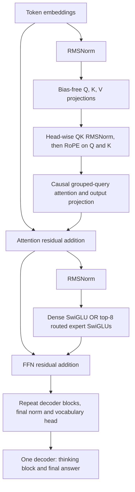
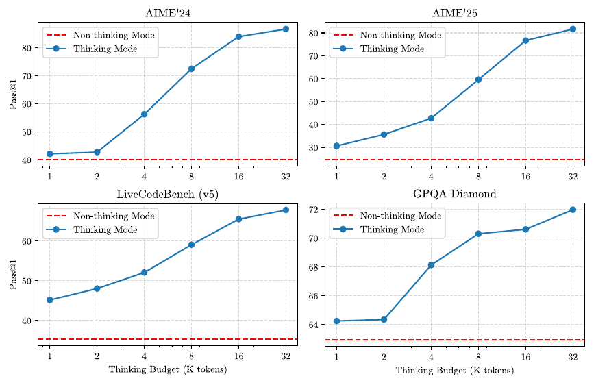
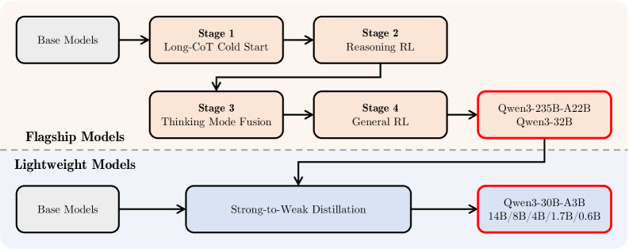

# Qwen3: Unified Thinking and Non-Thinking Models - Yang et al., 2025

> **arXiv:** [2505.09388v1](https://arxiv.org/abs/2505.09388v1), 14 May 2025 · **Venue:** preprint · **Affiliation:** Qwen Team, Alibaba Group
>
> **Scope:** the original six dense and two MoE models, their base/post-trained evaluations, and the training experiments in this report. Later `Instruct-2507`, `Thinking-2507`, Qwen3-Next, and multimodal releases are separate artifacts. Checkpoint/implementation observations below are explicitly distinguished from the paper.

## TL;DR

Qwen3 combines thinking and non-thinking behavior in the same post-trained checkpoint, with template/prompt controls and an inference-time thinking budget. The family uses a largely familiar causal Transformer with head-wise QK normalization, bias-free QKV projections, and two fine-grained MoE models; pretraining grows to **36T tokens across 119 languages and dialects**. A four-stage post-training pipeline builds the large teachers, while response distillation followed by student-on-policy logit distillation transfers their behavior to smaller models. The results show strong reasoning and parameter efficiency, but not universal dominance: reasoning can hurt long-context retrieval, mode fusion/general RL involve trade-offs, and the headline distillation-cost advantage comes from a bounded experiment.

## Problem & motivation

Earlier systems often required choosing between a fast instruction model and a slower reasoning model. That choice complicated deployment and made it difficult to change behavior inside a conversation. A reasoning model could also spend many tokens on a simple request, while a direct-answer model lacked an explicit way to devote more test-time computation to a difficult problem.

Qwen3 addresses three related problems ([report][Report], §1):

- **Behavioral fragmentation.** A single checkpoint should answer directly or reason before answering, with the selected mode communicated through the chat interface rather than a model swap.
- **Inference-time cost control.** A user should be able to stop the reasoning portion early and still obtain a final answer, instead of truncating the whole response at an arbitrary output limit.
- **Expensive family-wide post-training.** Repeating an elaborate reasoning/alignment pipeline separately for every model size is costly. Strong teachers may transfer both task competence and mode control more efficiently.

The architecture is therefore not a wholly new attention mechanism. Much of the contribution lies in data construction, the interaction of post-training stages, the control format, and a scalable route from flagship teachers to smaller students.

## Key idea

**Train one model to handle both complete and empty thinking blocks, then use that behavioral flexibility to control reasoning length.** A normal thinking response has a reasoning block followed by an answer; a non-thinking response retains an empty block for format consistency. Mixed-mode training also makes it possible to terminate an incomplete reasoning block and continue into an answer.

The following is an explanatory dependency model, not a printed paper equation:

$$
p_\theta(R,A\mid X,m)
=p_\theta(R\mid X,m)\,
 p_\theta(A\mid X,m,R).
$$

$X$ is the conversation, $m$ the mode control, $R$ the generated reasoning-token sequence, and $A$ the final answer. Non-thinking operation uses an empty $R$. With a thinking budget $B$, decoding stops the reasoning portion after at most $B$ tokens, inserts the prescribed transition/closing text if needed, and generates $A$ from the resulting prefix.

This factorization does not introduce separate reasoning and answering networks. Both are generated by the **same causal decoder**. Nor is a thinking budget identical to `max_new_tokens`: the latter can terminate the answer as well as the reasoning and must leave enough space for the answer.

The second idea is **strong-to-weak distillation**. Teacher-generated responses first teach students the two output modes; student-generated prefixes are then used for logit alignment with a stronger teacher. The latter is on-policy with respect to the **student**, not necessarily the teacher.

## How it works

### 1. Family and decoder architecture

The report releases six dense scales and two MoE scales. The table combines **report Tables 1-2** with the explicitly identified **original-name checkpoint configurations**: widths and FFN sizes are configuration observations, while the final context column reproduces the report's advertised capability.

| Model | Layers | Residual width | Q / KV heads | Dense FFN / routed-expert width | Tied embeddings | Report context |
|---|---:|---:|---|---:|---|---|
| Qwen3-0.6B | 28 | 1,024 | 16 / 8 | 3,072 | Yes | 32K |
| Qwen3-1.7B | 28 | 2,048 | 16 / 8 | 6,144 | Yes | 32K |
| Qwen3-4B | 36 | 2,560 | 32 / 8 | 9,728 | Yes | 128K |
| Qwen3-8B | 36 | 4,096 | 32 / 8 | 12,288 | No | 128K |
| Qwen3-14B | 40 | 5,120 | 40 / 8 | 17,408 | No | 128K |
| Qwen3-32B | 64 | 5,120 | 64 / 8 | 25,600 | No | 128K |
| Qwen3-30B-A3B | 48 | 2,048 | 32 / 4 | 768 per expert | No | 128K |
| Qwen3-235B-A22B | 94 | 4,096 | 64 / 4 | 1,536 per expert | No | 128K |

All inspected configurations specify **head dimension 128**. Consequently, query-projection width need not equal residual width: Qwen3-4B has a 2,560-wide residual stream but $32\times128=4096$ query channels. Deriving head dimension as residual width divided by query-head count would implement the wrong model. For MoE experts, use `moe_intermediate_size`, not the separately present `intermediate_size`.

The report gives a byte-level BPE vocabulary of **151,669**. The inspected checkpoints use a **151,936-row** embedding/output dimension; the tokenizer vocabulary and the padded/configured matrix dimension are different quantities, not interchangeable implementation constants.

### 2. Attention, normalization, and feed-forward computation

The following equations reconstruct the architecture described in §2 and made concrete by the [pinned implementation][Implementation]; the report itself does not print a complete forward-pass equation set.

For a token vector $x\in\mathbb R^d$, RMS normalization is:

$$
\operatorname{RMSNorm}(x)
=g\odot\frac{x}{\sqrt{d^{-1}\sum_{i=1}^d x_i^2+\epsilon}},
$$

where $g$ is a learned scale, $\epsilon$ a stabilizer, and $\odot$ element-wise multiplication. Each decoder block is pre-normalized and has attention and FFN residual branches:

$$
u=x+\operatorname{Attention}(\operatorname{RMSNorm}(x)),\qquad
x'=u+\operatorname{FFN}(\operatorname{RMSNorm}(u)).
$$

For a batch of $L$ tokens, the projections produce query, key, and value tensors with respective head counts $H_q,H_{kv},H_{kv}$ and head width $d_h$. **QK-Norm applies an RMSNorm independently over each head's $d_h$ coordinates**, before RoPE:

$$
\widetilde q_{t,h}
=\operatorname{RoPE}_t\!\left(\operatorname{RMSNorm}_{q}(W_{q,h}x_t)\right),
\quad
\widetilde k_{s,g}
=\operatorname{RoPE}_s\!\left(\operatorname{RMSNorm}_{k}(W_{k,g}x_s)\right).
$$

$t,s$ are sequence positions, $h$ a query head, and $g$ its assigned KV group. Attention weights are the causal softmax of
$\widetilde q_{t,h}^{\mathsf T}\widetilde k_{s,g}/\sqrt{d_h}$ over $s\leq t$, applied to the value vectors. Values are not subjected to this QK normalization. GQA shares a KV head across multiple query heads; the output projection returns the concatenated query-head outputs to residual width $d$.

Unlike Qwen2's biased QKV projections, Qwen3 removes QKV bias. The dense FFN remains SwiGLU:

$$
\operatorname{FFN}(x)
=W_{\mathrm{down}}
\left[\operatorname{SiLU}(W_{\mathrm{gate}}x)
\odot W_{\mathrm{up}}x\right].
$$

The gate/up projections map from residual width to FFN width, and the down projection maps back. These operations preserve the familiar [Qwen2.5](backbone_2024_qwen2.5.md) block structure while changing attention normalization and projection bias.



*Original architecture reconstruction. Thinking/non-thinking is a trained decoding behavior, not a second network branch inside every layer.*

### 3. Fine-grained MoE

Both MoE models have **128 routed experts**, activating **8 per token**, with **no shared expert**. The absence of a shared expert is an explicit change from Qwen2.5-MoE (report, §2).

The inference router in [Transformers v4.51.3][Implementation] is summarized by:

$$
p_e(x)=\operatorname{softmax}(W_r x)_e,\quad
\mathcal S(x)=\operatorname{TopK}_{8}\{p_e(x)\}_{e=1}^{128},
\quad
\operatorname{MoE}(x)=
\sum_{e\in\mathcal S(x)}
\frac{p_e(x)}{\sum_{j\in\mathcal S(x)}p_j(x)}E_e(x).
$$

$W_r$ is the router projection, $p_e$ expert probability, $\mathcal S$ the selected expert set, and $E_e$ an expert SwiGLU. The inspected checkpoints enable renormalization of selected routing weights. Attention and residual processing remain shared; sparsity changes the FFN branch, not the causal attention graph.

The paper uses a **global-batch load-balancing loss** to encourage useful expert specialization. The essential distinction is that balancing statistics can be aggregated across the global batch rather than requiring every individual sequence to use experts uniformly. The report does not disclose a complete distributed trainer or aggregation schedule, so an inference implementation's auxiliary-loss helper should not be mistaken for a reproduction of the original pretraining system.

The names **30B-A3B** and **235B-A22B** distinguish total and approximately activated parameters. Activating a small subset of experts reduces arithmetic relative to a dense model with the same total parameters, but all expert weights still need storage or a serving strategy. Activated parameters are not total device-memory requirements, and $8/128$ times the total model size does not account correctly for all shared components.

### 4. Context length: training, report capability, and default configuration

The long-context training stage uses **32,768 tokens**. The report describes a **four-fold inference extension** through YaRN and Dual Chunk Attention after increasing the RoPE base from **10,000 to 1,000,000** (report, §3.2).

Keep three different statements separate:

1. **Training length:** 32,768 in the final pretraining stage.
2. **Report model table:** 32K for the two smallest models, 128K for the others.
3. **Checkpoint defaults:** all eight inspected original-name configurations specify `max_position_embeddings=40960`, `rope_theta=1000000`, and `rope_scaling=null`. Their default configuration therefore does not automatically activate the report's 128K inference recipe.

Running a long sequence requires compatible positional scaling, a suitable serving implementation, memory, and evaluation of the resulting quality. Simply changing a maximum-length integer is not the YaRN/DCA algorithm. Conversely, a loaded configuration's 40,960-token field does not mean the models were pretrained at that length.

RoPE base adaptation, YaRN, and DCA are not synonyms. Base adaptation changes positional frequencies during training; YaRN provides extrapolation-related scaling; DCA remaps positional relationships for long contexts. None of these statements means causal attention inherently becomes sparse. See the [YaRN](positional_2023_yarn-context-extension.md) and [DCA](positional_2024_dca-dual-chunk-attention.md) recaps for the separate mechanisms.

### 5. Mode selection and output format

The report's training templates have the schematic form (Table 9):

```text
user: {request} /think
assistant: <think>{reasoning tokens}</think>{answer}

user: {request} /no_think
assistant: <think></think>{answer}
```

These are format placeholders, not example reasoning traces. Thinking is the default, and training also includes thinking samples without an explicit flag. In multi-turn training, the model is taught to obey the last applicable `/think` or `/no_think` flag encountered in the conversation.

There are two different controls:

- **Prompt-level selection:** `/think` and `/no_think` are learned textual instructions, allowing conversational switching.
- **Template-level disabling:** `enable_thinking=False` appends an empty thinking block to the assistant prefix. The model starts after that block rather than being asked in ordinary text to avoid opening it. The inspected [tokenizer template][Template] implements this behavior.

An empty thinking block is an output-format convention. It does not mean the Transformer performs no internal computation. A generation client also needs to parse the special-token format correctly rather than treating all emitted tokens as the final user-facing answer.

### 6. Budgeted reasoning

The inference procedure in §4.3 is:

1. Begin a thinking-mode response.
2. Count generated reasoning tokens and monitor whether the model naturally closes the block.
3. If the budget is reached first, halt that portion and append the report's stop-thinking instruction plus the closing marker.
4. Continue decoding a final answer from the accumulated prefix, with a separate remaining output allowance.

The paper says this ability **emerges from thinking-mode fusion**; it does not describe explicitly training a supervised loss for every possible intermediate budget. It also does not establish that a plain output-token cap invokes the transition automatically in every serving library.



*Report Figure 2, cropped from the versioned PDF. The tested budgets range from 1K to 32K tokens and show improving curves against non-thinking references. This is evidence for the tested settings, not a theorem that every extra token improves every answer or that gains continue indefinitely.*

The discussion treats further output-length extension beyond 32K as future exploration. No exact values have been reverse-engineered from this plot; the results tables below retain their own reported evaluation numbers.

## Training / data

### 1. Data construction and pretraining curriculum

The report describes **36T tokens covering 119 languages and dialects**, versus the earlier family's 29-language coverage (report, §3.1). The corpus includes code, STEM, reasoning, books, multilingual text, and synthetic material.

Two substantial data-expansion routes are described. Qwen2.5-VL recognizes text in PDF-like documents and Qwen2.5 refines it, adding trillions of text tokens. Qwen2.5, Qwen2.5-Math, and Qwen2.5-Coder synthesize further textbook, question-answer, instruction, and code content. These are text-data construction pipelines, not evidence that the resulting Qwen3 language decoder accepts images directly.

A multilingual annotation system labels **over 30T tokens** for educational value, fields/domains, safety, and related attributes. Small proxy-model ablations guide **instance-level** data-mixture selection, rather than selecting mixtures only by source/domain.

The stages are (report, §3.2):

| Pretraining stage | Token budget as reported | Sequence length | Purpose |
|---|---|---:|---|
| General | Over 30T | 4,096 | Language and broad world knowledge |
| Reasoning | About 5T | 4,096 | Increase STEM, code, reasoning, synthetic content; accelerate learning-rate decay |
| Long context | Hundreds of billions | 32,768 | Long-context adaptation and RoPE-base change |

The long-context mixture is **75%** text of length **16,384-32,768** and **25%** text of length **4,096-16,384**. The phase totals are approximate descriptions, not exact quantities that should be made to sum to an invented more precise total.

A standard next-token objective describes causal pretraining:

$$
\mathcal L_{\mathrm{LM}}
=-\mathbb E_{z\sim\mathcal D}\sum_t
\log p_\theta(z_t\mid z_{<t}),
$$

where $\mathcal D$ is the training distribution and $z$ a token sequence. This is an explanatory objective; the report does not supply every training-mask, optimizer, loss-weight, or distributed-training detail needed to reproduce its implementation. Learning-rate schedules and batch sizes are selected through scaling-law experiments, but complete per-model numerical recipes and total compute accounting are not published.

### 2. Four-stage post-training for the teachers



*Report Figure 1. Qwen3-235B-A22B and Qwen3-32B follow the flagship path; the other five dense models and the 30B-A3B MoE follow the distillation path.*

**Stage 1: long-CoT cold start.** Curate math, code, logic, and STEM questions with verified answers or executable tests. Qwen2.5-72B-Instruct filters out difficult-to-verify questions and those it can already solve without reasoning; domain labels maintain coverage. QwQ-32B produces candidate responses, followed by filtering for correctness, repetition, unsupported guessing, reasoning/summary inconsistency, inappropriate language/style changes, and suspected validation similarity. A small selected subset and restrained training establish a reasoning pattern without prematurely exhausting its potential (report, §4.1).

**Stage 2: reasoning RL.** Collect **3,995 query-verifier pairs** that were not used for cold start, are learnable but challenging for the initialized model, and cover diverse subdomains. Apply **GRPO**, with large batches, many rollouts, off-policy reuse, and entropy control described qualitatively. Qwen3-235B-A22B's AIME 2024 score rises from **70.1 to 85.1 over 170 steps** in the reported run. These are training-run observations, not the final post-trained Table 11 scores (report, §4.2).

A group-relative advantage explains the mechanism:

$$
\widehat A_i=
\frac{r_i-\overline r}{s_r+\epsilon},
\qquad
\overline r=G^{-1}\sum_{j=1}^G r_j.
$$

$G$ is the number of sampled responses for a prompt, $r_i$ the verifier reward for response $i$, $s_r$ the group's reward standard deviation, and $\epsilon$ a stabilizer. A conventional clipped policy update favors higher-advantage responses:

$$
\max_\theta\ \mathbb E\left[
\min\left(\rho_{i,t}\widehat A_i,
\operatorname{clip}(\rho_{i,t},1-\delta,1+\delta)\widehat A_i\right)
-\beta D_{\mathrm{KL}}(\pi_\theta\|\pi_{\mathrm{ref}})
\right],
\quad
\rho_{i,t}=
\frac{\pi_\theta(o_{i,t}\mid x,o_{i,<t})}
{\pi_{\mathrm{old}}(o_{i,t}\mid x,o_{i,<t})}.
$$

Here $x$ is the prompt, $o_i$ a sampled response, $t$ its token index, $\pi_{\mathrm{old}}$ the sampling policy, $\pi_{\mathrm{ref}}$ a reference policy, $\delta$ a clipping threshold, and $\beta$ a reference-regularization weight. **These equations explain a GRPO-style update, not a fully specified Qwen3 loss.** The report does not disclose enough to fix all normalization conventions, KL treatment, clipping coefficients, rollout counts, or entropy-control details.

**Stage 3: thinking-mode fusion.** Continue SFT on the reasoning model with both thinking and non-thinking examples. Thinking examples are rejection-sampled by the Stage 2 model on Stage 1 queries; direct-answer data covers code, mathematics, instructions, languages, writing, QA, and role play. Automatically generated checklists assess direct-answer quality, and translation data is increased for low-resource languages. The mode templates and their empty thinking blocks are introduced here (report, §4.3).

**Stage 4: general RL.** Train on **over 20 tasks**, covering instruction following, output/mode formatting, preference alignment, real multi-turn tool interactions, and specialized scenarios such as RAG. Rewards include rule-based checks, Qwen2.5-72B-Instruct scoring against reference answers, and a preference-trained scalar reward model without references. These reward sources solve different evaluation problems; a rule-based check does not by itself guarantee freedom from reward hacking (report, §4.4).

### 3. Strong-to-weak distillation

The students are **0.6B, 1.7B, 4B, 8B, 14B**, and **30B-A3B**. They are not each reported as independently repeating the complete flagship pipeline (report, §4.5).

1. **Off-policy response distillation.** Mix teacher-generated thinking and non-thinking responses. Supervised learning teaches the student task behavior, output format, and mode switching. The source of sequences is the teacher rather than the current student.
2. **On-policy logit distillation.** Sample prompts and let the student generate in either mode. Evaluate the stronger teacher, Qwen3-32B or Qwen3-235B-A22B, on those student prefixes, and align output distributions using a KL-based objective.

An explanatory form of the latter is:

$$
\mathcal L_{\mathrm{OPD}}
=\mathbb E_{x,\ y\sim\pi_S(\cdot\mid x)}
\sum_t
\mathcal D\left(
p_T(\cdot\mid x,y_{<t}),
p_S(\cdot\mid x,y_{<t})
\right).
$$

$\pi_S$ is the student sampling policy, $p_T,p_S$ teacher/student next-token distributions, and $\mathcal D$ the KL-based alignment term. The report does **not** specify its full direction/temperature/weighting recipe, so this expression identifies where distillation is applied without pretending to recover a uniquely specified loss.

Student-generated prefixes matter because teacher-generated trajectories may omit mistakes and uncertain states the student actually visits. Soft teacher distributions supply more information than a single sampled answer token. The reported pass@64 improvements suggest better exploration in this experiment, but do not prove that every teacher/student pairing or domain benefits equally.

## Results

### 1. Evaluation protocols and interpretation

All values below come from **2505.09388v1**. Base and post-trained models have separate protocols and must not be conflated.

- **Base models:** the report uses 15 benchmarks with specified few-shot/CoT settings. EvalPlus is an average over HumanEval, MBPP, HumanEval+, and MBPP+, not simply HumanEval pass@1 (report, §3.3).
- **Post-trained reasoning:** GPQA-Diamond averages **10 samples per question**. AIME averages accuracy over **64 samples for each of 30 questions per year**. It is not a single deterministic attempt, nor is that mean accuracy the same metric as pass@64 (report, §4.6).
- **Coding/tools:** LiveCodeBench v5 covers **2024.10-2025.02**, with different thinking/non-thinking prompts. Codeforces allows **up to eight independent reasoning attempts per problem**. Qwen3 BFCL uses FC format, while some baseline leaderboard entries take the better of FC and Prompt formats; multi-turn evaluation uses YaRN at **64K** (report, §4.6).
- **Multilingual:** INCLUDE and MMMLU use **10% subsets**; MMMLU covers **14 languages**, excluding Yoruba. Coverage of 119 training languages/dialects is not evidence of equal proficiency in every one.

Higher is better for the displayed benchmark scores, but percentages, ratings, and judge scores are different units.

### 2. Base models: scaling and parameter efficiency

Source: **Tables 3-4**. All four columns are **base** models.

| Benchmark | DeepSeek-V3 | Qwen3-235B-A22B | Qwen2.5-72B | Qwen3-32B |
|---|---:|---:|---:|---:|
| MMLU | 87.19 | 87.81 | 86.06 | 83.61 |
| MMLU-Redux | 86.14 | 87.40 | 83.91 | 83.41 |
| MMLU-Pro | 59.84 | 68.18 | 58.07 | 65.54 |
| SuperGPQA | 41.53 | 44.06 | 36.20 | 39.78 |
| BBH | 86.22 | 88.87 | 86.30 | 87.38 |
| GPQA | 41.92 | 47.47 | 45.88 | 49.49 |
| GSM8K | 87.57 | 94.39 | 91.50 | 93.40 |
| MATH | 62.62 | 71.84 | 62.12 | 61.62 |
| EvalPlus | 63.75 | 77.60 | 65.93 | 72.05 |
| MultiPL-E | 62.26 | 65.94 | 58.70 | 67.06 |
| MBPP | 74.20 | 81.40 | 76.00 | 78.20 |
| CRUX-O | 76.60 | 79.00 | 66.20 | 72.50 |
| MGSM | 82.68 | 83.53 | 82.40 | 83.06 |
| MMMLU | 85.88 | 86.70 | 84.40 | 83.83 |
| INCLUDE | 75.17 | 73.46 | 69.05 | 67.87 |

The flagship beats DeepSeek-V3 on **14 of 15** displayed base benchmarks; INCLUDE is the exception. Its **235B total / 22B activated** parameters compare with DeepSeek-V3's **671B / 37B** (Table 3), but these are parameter comparisons, not measured throughput ratios. Qwen3-32B beats Qwen2.5-72B on **10 of 15** rows; it is not better on every knowledge, math, or multilingual benchmark.

Tables 5-8 extend the comparison to smaller models. The paper argues that the MoE bases can approach dense Qwen3 performance with fewer activated parameters, and that dense Qwen3 bases often approach larger Qwen2.5 scales. Those are empirical family-level trends, not a universal fixed multiplier for every task.

### 3. Flagship reasoning: strengths and counterexamples

Source: **Table 11**, thinking-mode comparisons. The final column is included from **Table 12** to show the same Qwen3 model without thinking; it is not another baseline reasoning model.

| Benchmark | DeepSeek-R1 | Gemini 2.5 Pro | Qwen3 thinking | Qwen3 non-thinking |
|---|---:|---:|---:|---:|
| MMLU-Redux | 92.9 | 93.7 | 92.7 | 89.2 |
| GPQA-Diamond | 71.5 | 84.0 | 71.1 | 62.9 |
| C-Eval | 91.8 | 82.9 | 89.6 | 86.1 |
| LiveBench 2024-11-25 | 71.6 | 82.4 | 77.1 | 62.5 |
| IFEval strict prompt | 83.3 | 89.5 | 83.4 | 83.2 |
| Arena-Hard | 92.3 | 96.4 | 95.6 | 96.1 |
| AlignBench v1.1 | 8.76 | 9.03 | 8.94 | 8.91 |
| Creative Writing v3 | 85.5 | 86.0 | 84.6 | 80.4 |
| WritingBench | 7.71 | 8.09 | 8.03 | 7.70 |
| MATH-500 | 97.3 | 98.8 | 98.0 | 91.2 |
| AIME 2024 | 79.8 | 92.0 | 85.7 | 40.1 |
| AIME 2025 | 70.0 | 86.7 | 81.5 | 24.7 |
| ZebraLogic | 78.7 | 87.4 | 80.3 | 37.7 |
| AutoLogi | 86.1 | 85.4 | 89.0 | 83.3 |
| BFCL v3 | 56.9 | 62.9 | 70.8 | 68.0 |
| LiveCodeBench v5 | 64.3 | 70.4 | 70.7 | 35.3 |
| Codeforces rating | 2029 | 2001 | 2056 | 1387 |
| Multi-IF | 67.7 | 77.8 | 71.9 | 70.2 |
| INCLUDE | 82.7 | 85.1 | 78.7 | 75.6 |
| MMMLU, 14 languages | 86.4 | 86.9 | 84.3 | 79.8 |
| MT-AIME2024 | 73.5 | 76.9 | 80.8 | 32.4 |
| PolyMath | 47.1 | 52.2 | 54.7 | 27.0 |
| MLogiQA | 73.8 | 75.6 | 77.1 | 67.6 |

Thinking greatly improves the difficult-math and coding scores relative to the same model's direct-answer mode. It is not superior on every benchmark: the flagship's non-thinking Arena-Hard score is higher. Qwen3 also trails Gemini on GPQA, AIME, and several knowledge/alignment tasks, while beating it on the displayed BFCL, translated-math, and PolyMath results.

### 4. Non-thinking baseline comparison

Source: **Table 12**, selected rows. All Qwen3 values here are for **235B-A22B non-thinking**.

| Benchmark | DeepSeek-V3 | Qwen2.5-72B-Instruct | Qwen3 |
|---|---:|---:|---:|
| GPQA-Diamond | 59.1 | 49.0 | 62.9 |
| LiveBench 2024-11-25 | 60.5 | 51.4 | 62.5 |
| IFEval strict prompt | 86.1 | 84.1 | 83.2 |
| Arena-Hard | 85.5 | 81.2 | 96.1 |
| MATH-500 | 90.2 | 83.6 | 91.2 |
| AIME 2025 | 28.8 | 15.0 | 24.7 |
| BFCL v3 | 57.6 | 63.4 | 68.0 |
| LiveCodeBench v5 | 33.1 | 30.7 | 35.3 |

Non-thinking remains useful, but it is neither a reasoning-mode substitute on hard problems nor a universal improvement over prior direct-answer models. In particular, IFEval trails both displayed baselines and AIME 2025 trails DeepSeek-V3.

### 5. Thinking across every model scale

Source: **Tables 11, 13, 15, 17, and 19**. This table gives thinking-mode results, not base-model capability.

| Model | GPQA-Diamond | AIME 2024 | AIME 2025 | LiveCodeBench v5 |
|---|---:|---:|---:|---:|
| 0.6B | 27.9 | 10.7 | 15.1 | 12.3 |
| 1.7B | 40.1 | 48.3 | 36.8 | 33.2 |
| 4B | 55.9 | 73.8 | 65.6 | 54.2 |
| 8B | 62.0 | 76.0 | 67.3 | 57.5 |
| 14B | 64.0 | 79.3 | 70.4 | 63.5 |
| 32B | 68.4 | 81.4 | 72.9 | 65.7 |
| 30B-A3B | 65.8 | 80.4 | 70.9 | 62.6 |
| 235B-A22B | 71.1 | 85.7 | 81.5 | 70.7 |

Source: **Tables 12, 14, 16, 18, and 20**, corresponding non-thinking results.

| Model | GPQA-Diamond | AIME 2024 | AIME 2025 | LiveCodeBench v5 |
|---|---:|---:|---:|---:|
| 0.6B | 22.9 | 3.4 | 2.6 | 3.6 |
| 1.7B | 28.6 | 13.4 | 9.8 | 11.6 |
| 4B | 41.7 | 25.0 | 19.1 | 21.3 |
| 8B | 39.3 | 29.1 | 20.9 | 22.8 |
| 14B | 54.8 | 31.7 | 23.3 | 29.0 |
| 32B | 54.6 | 31.0 | 20.2 | 31.3 |
| 30B-A3B | 54.8 | 32.8 | 21.6 | 29.8 |
| 235B-A22B | 62.9 | 40.1 | 24.7 | 35.3 |

The distilled 30B-A3B is close to the 14B dense model on these reasoning tasks despite its smaller activated-parameter count. The rows also refute strict monotonicity by total model size: for example, 4B non-thinking GPQA is above 8B, and 14B non-thinking AIME is above 32B.

### 6. Controlled distillation experiment

Source: **Table 21**, Qwen3-8B. Parentheses contain **pass@64**, while the preceding AIME score is average accuracy. Both continuation methods start from the **same off-policy distilled checkpoint** and use math/code-related queries.

| Method | AIME 2024 (pass@64) | AIME 2025 (pass@64) | MATH500 | LiveCodeBench v5 | MMLU-Redux | GPQA-Diamond | Additional GPU hours |
|---|---:|---:|---:|---:|---:|---:|---:|
| Off-policy distillation | 55.0 (90.0) | 42.8 (83.3) | 92.4 | 42.0 | 86.4 | 55.6 | - |
| + RL | 67.6 (90.0) | 55.5 (83.3) | 94.8 | 52.9 | 86.9 | 61.3 | 17,920 |
| + On-policy distillation | 74.4 (93.3) | 65.5 (86.7) | 97.0 | 60.3 | 88.3 | 63.3 | 1,800 |

The displayed cost ratio is approximately **9.96 to 1**, derived from Table 21. This supports the report's approximately one-tenth claim for this comparison; it does **not** give the total cost of creating teachers, generating all data, or pretraining the family. Nor does it establish a universal tenfold reduction against every possible full post-training implementation.

Distillation improves pass@64 from **90.0 to 93.3** and **83.3 to 86.7**, whereas the RL continuation leaves those displayed values unchanged (Table 21). The controlled-ablation 8B scores are not identical to the final 8B release table, so they should not be substituted for one another.

### 7. Stage-by-stage trade-offs

Source: **Table 22**, Qwen3-32B. Asterisks mark in-house datasets. The table preserves endpoint scores rather than copying the source's rounded change annotations.

| Benchmark | Stage 2 thinking | Stage 3 thinking | Stage 3 non-thinking | Stage 4 thinking | Stage 4 non-thinking |
|---|---:|---:|---:|---:|---:|
| LiveBench 2024-11-25 | 68.6 | 70.9 | 57.1 | 74.9 | 59.8 |
| Arena-Hard | 86.8 | 89.4 | 88.5 | 93.8 | 92.8 |
| CounterFactQA* | 50.4 | 61.3 | 64.3 | 68.1 | 66.4 |
| IFEval strict prompt | 73.0 | 78.4 | 78.4 | 85.0 | 83.2 |
| Multi-IF | 61.4 | 64.6 | 65.2 | 73.0 | 70.7 |
| LengthCtrl* | 62.6 | 70.6 | 84.9 | 73.5 | 87.3 |
| ThinkFollow* | - | 88.7 | 88.7 | 98.9 | 98.9 |
| BFCL v3 | 69.0 | 68.4 | 61.5 | 70.3 | 63.0 |
| ToolUse* | 63.3 | 70.4 | 73.2 | 85.5 | 86.5 |
| MMLU-Redux | 91.4 | 91.0 | 86.7 | 90.9 | 85.7 |
| GPQA-Diamond | 68.8 | 69.0 | 50.4 | 68.4 | 54.6 |
| AIME 2024 | 83.8 | 81.9 | 28.5 | 81.4 | 31.0 |
| LiveCodeBench v5 | 68.4 | 67.2 | 31.1 | 65.7 | 31.3 |

Fusion and general RL improve mode compliance, instruction following, tools, and several preference-oriented tasks. They do **not** preserve every reasoning score: AIME and LiveCodeBench decline along the thinking path, as does MMLU-Redux. These explicit trade-offs are more informative than a blanket claim that all post-training stages improve everything.

### 8. Long-context evaluation

Source: **Appendix Table 23**, selected lengths plus the report's average across all tested lengths. `NT` means non-thinking and `T` thinking. Qwen2.5 rows are instruction models without that mode split.

| Model / mode | Reported average | 32K | 128K |
|---|---:|---:|---:|
| Qwen2.5-7B-Instruct | 85.4 | 89.4 | 55.1 |
| Qwen2.5-14B-Instruct | 91.4 | 93.4 | 78.1 |
| Qwen2.5-32B-Instruct | 92.9 | 95.5 | 82.0 |
| Qwen2.5-72B-Instruct | 95.1 | 96.5 | 88.4 |
| Qwen3-4B NT | 85.2 | 87.8 | 66.0 |
| Qwen3-8B NT | 89.1 | 91.2 | 77.4 |
| Qwen3-14B NT | 94.6 | 96.1 | 85.1 |
| Qwen3-32B NT | 93.7 | 94.4 | 85.6 |
| Qwen3-30B-A3B NT | 91.6 | 92.4 | 79.2 |
| Qwen3-235B-A22B NT | 95.0 | 95.1 | 90.6 |
| Qwen3-4B T | 83.5 | 83.2 | 67.2 |
| Qwen3-8B T | 84.4 | 80.8 | 72.0 |
| Qwen3-14B T | 90.1 | 91.9 | 79.0 |
| Qwen3-32B T | 91.0 | 92.5 | 83.5 |
| Qwen3-30B-A3B T | 86.6 | 86.6 | 75.0 |
| Qwen3-235B-A22B T | 92.2 | 92.3 | 86.0 |

On RULER, **all six Qwen3 models shown have a lower reported average in thinking mode**. Individual cells can differ from that trend, but more reasoning is not a substitute for long-context retrieval quality. Accepting a 128K request also does not imply retaining short-context accuracy.

### 9. Multilingual breadth and uneven performance

The main post-training tables already distinguish regional knowledge, multilingual knowledge, instruction following, translated math, and logical reasoning. Appendix Tables **24-35** provide language-specific breakdowns rather than one score proving uniform capability.

Source: **Appendix Table 37**, selected Belebele language-family columns. Table 36 enumerates **80 language/script entries** for this evaluation; that is not the full 119-language/dialect pretraining claim.

| Model | Indo-European | Sino-Tibetan | Afro-Asiatic | Dravidian | Other |
|---|---:|---:|---:|---:|---:|
| Gemma-3-27B-IT | 89.2 | 86.3 | 85.9 | 83.5 | 87.0 |
| Qwen2.5-32B-Instruct | 85.5 | 82.3 | 80.4 | 67.8 | 72.6 |
| Qwen3-32B thinking | 90.7 | 89.7 | 84.8 | 84.5 | 83.1 |
| Qwen3-32B non-thinking | 89.1 | 88.0 | 82.3 | 84.0 | 81.3 |

Qwen3 improves markedly over Qwen2.5 in several families, but Gemma retains stronger scores in some columns. Breadth of training coverage and strength of mathematical reasoning should not be confused with universal regional-knowledge or language-family leadership.

## Limitations & follow-ups

1. **The paper is not a full training reproduction package.** It does not publish all corpus details, mixtures, optimizer schedules, rollout counts, reward/regularization coefficients, KL orientation, or distributed expert-balancing implementation. Released configurations make inference architecture much more concrete than the original training system.
2. **Thinking control has costs and failure modes.** Reasoning consumes output tokens, cache, and latency. A prompt flag is learned behavior, a template prefix is a different control surface, and a hard reasoning budget requires a client capable of transitioning to answer generation rather than merely stopping.
3. **Budget curves are conditional evidence.** Figure 2 shows the tested model and tasks; no universal strict monotonicity or guaranteed benefit beyond the tested range follows. RULER and the non-thinking Arena-Hard comparison supply direct counterexamples to "more thinking always helps."
4. **Alignment and reasoning are not perfectly compatible objectives.** Table 22 exposes modest regressions in AIME, coding, and knowledge alongside major gains in mode/format compliance and tools. In-house datasets also limit independent interpretation.
5. **Parameter efficiency is not a hardware benchmark.** Total/activated parameter counts do not determine memory, communication, batching, or wall-clock speed by themselves. The distillation GPU-hour comparison is especially easy to overgeneralize beyond its controlled 8B setup.
6. **Benchmark protocols matter.** Repeated sampling, different coding prompts, BFCL format choices, multilingual subsets, and model-judge scores limit cross-table and external-leaderboard comparisons. AIME mean accuracy, pass@64, and Codeforces ratings are different measurements.
7. **The original hybrid family is not every later Qwen3 checkpoint.** July `Instruct-2507` and `Thinking-2507` releases separate behaviors and change capabilities/configuration. The May report's hybrid recipe and context settings should not be silently attributed to a later checkpoint with a similar name.
8. **Downstream branches need their own reports.** [Qwen3-Embedding/Reranker](backbone_2025_qwen3-embedding.md) changes the task and training objective, while [Qwen3-VL](multimodal_2025_qwen3-vl.md) adds a separate multimodal system. Their performance is not part of this language-model report.

## Links

- **arXiv:** [abs](https://arxiv.org/abs/2505.09388v1) · [HTML][Report] · [PDF](https://arxiv.org/pdf/2505.09388v1)
- **Code / release history:** [QwenLM/Qwen3](https://github.com/QwenLM/Qwen3)
- **Hugging Face:** [Qwen3 collection](https://huggingface.co/collections/Qwen/qwen3-67dd247413f0e2e4f653967f) · [Qwen3-32B](https://huggingface.co/Qwen/Qwen3-32B) · [Qwen3-235B-A22B](https://huggingface.co/Qwen/Qwen3-235B-A22B)
- **Configuration sources:** original-name checkpoints `Qwen3-{0.6B,1.7B,4B,8B,14B,32B,30B-A3B,235B-A22B}` under the Qwen organization; representative [4B configuration](https://huggingface.co/Qwen/Qwen3-4B/blob/main/config.json) · [MoE configuration](https://huggingface.co/Qwen/Qwen3-235B-A22B/blob/main/config.json). These are release observations, not a dated snapshot of the training run.
- **Implementation supplement:** [Transformers v4.51.3 MoE model][Implementation] · [original 32B tokenizer/chat template][Template]
- **Project page / blog:** [Qwen3 launch](https://qwenlm.github.io/blog/qwen3/)
- **Documentation:** [official Qwen documentation](https://qwen.readthedocs.io/)
- **Talks / videos:** no separate talk used as a source.
- **OpenReview / venue page:** no venue version used; this recap follows the arXiv preprint.
- **Papers-with-Code:** not used as a numerical source.
- **BibTeX:** [arXiv export](https://arxiv.org/bibtex/2505.09388)
- **Related papers:** [Qwen2](backbone_2024_qwen2.md) · [Qwen2.5](backbone_2024_qwen2.5.md) · [Qwen2.5-1M](backbone_2025_qwen2.5-1m.md) · [Qwen3-Embedding/Reranker](backbone_2025_qwen3-embedding.md) · [Qwen3-VL](multimodal_2025_qwen3-vl.md)
- **Architectural background:** [RoPE](positional_2021_rope-roformer.md) · [RMSNorm](attention_2019_rmsnorm.md) · [SwiGLU](attention_2020_swiglu.md) · [GQA](attention_2023_gqa.md) · [QK-Norm](attention_2020_qk-norm.md) · [YaRN](positional_2023_yarn-context-extension.md) · [DCA](positional_2024_dca-dual-chunk-attention.md)
- **Context guides:** [Qwen overview](../qwen/overview.md) · [backbone components](../context/backbone/backbone.md)

[Report]: https://arxiv.org/html/2505.09388v1 "Qwen3 Technical Report, v1"
[Implementation]: https://github.com/huggingface/transformers/blob/v4.51.3/src/transformers/models/qwen3_moe/modeling_qwen3_moe.py "Pinned Qwen3-MoE inference implementation"
[Template]: https://huggingface.co/Qwen/Qwen3-32B/blob/main/tokenizer_config.json "Qwen3-32B chat template"
