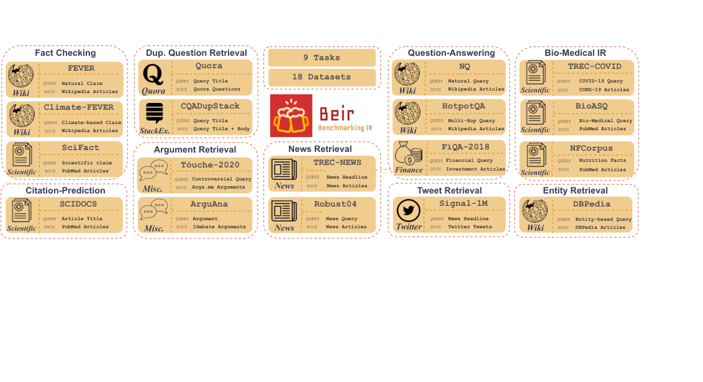
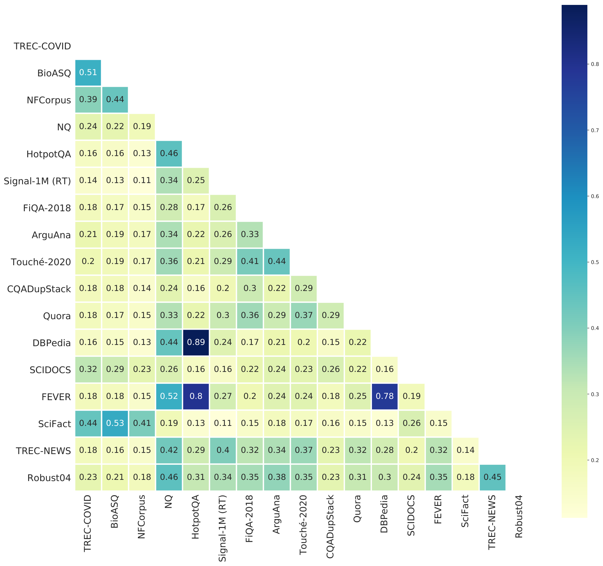

# BEIR: Heterogeneous Zero-shot Retrieval Evaluation - Thakur et al., 2021

> **arXiv:** 2104.08663v4 · **Venue:** NeurIPS 2021 Datasets and Benchmarks Track · **Affiliation:** Ubiquitous Knowledge Processing Lab, Technical University of Darmstadt

## TL;DR

BEIR turns retrieval evaluation from a mostly in-domain exercise into a zero-shot stress test spanning 18 English datasets, nine retrieval tasks, and corpora from 3.6K to 14.9M documents. Its paper-era comparison of ten systems showed that strong MS MARCO performance did not predict transfer: BM25 remained difficult to beat, while BM25 plus a cross-encoder and ColBERT generalized best on average but imposed much larger latency or index costs. The benchmark also exposed a deeper measurement problem: incomplete relevance pools can favor lexical systems and understate the quality of semantically retrieved documents.

## Problem & motivation

Neural retrievers were commonly trained and evaluated on the same narrow distribution. MS MARCO provided 532,761 training query-passage pairs and Natural Questions about 133K training examples, but both emphasize short question-like queries and passage retrieval. A model could beat BM25 in that setting without showing that it transfers to biomedical search, fact checking, argument retrieval, duplicate questions, news, or citation prediction.

Earlier multi-dataset efforts did not provide the same test. MultiReQA covered eight question-answering datasets, five based on Wikipedia, and six with fewer than 100K candidates. KILT covered several knowledge-intensive tasks but always retrieved from Wikipedia. Neither isolated broad zero-shot retrieval generalization across task types, domains, corpus scales, and annotation processes (§§1-2).

BEIR asks a stricter question: given a retriever trained elsewhere, how well does it rank an unseen target corpus without using that target's relevance labels? The benchmark deliberately varies:

- **Task:** biomedical IR, question answering, tweet retrieval, news, argument retrieval, duplicate-question retrieval, entity retrieval, citation prediction, and fact checking.
- **Domain and text type:** Wikipedia, biomedical and scientific publications, finance, Twitter, news, StackExchange, debates, and DBpedia.
- **Scale:** 3,633 documents in NFCorpus through 14,914,602 in BioASQ.
- **Length:** average queries range from 3.30 words in NFCorpus to 192.98 in ArguAna; average documents range from 11.44 words in Quora to 634.79 in TREC-NEWS.
- **Judgments:** binary and graded relevance, with average relevant-document counts from about one to 493.5 per query.

The paper's contribution is therefore both a curated benchmark and an empirical warning: in-domain ranking quality is not a reliable proxy for out-of-distribution retrieval.

## Key idea

Every dataset is converted to one interface: a corpus $D$, queries $Q$, and relevance judgments (qrels) $y(q,d)$. A system assigns each document a score $s(q,d)$, sorts the corpus for each query, and is evaluated with the same primary metric, nDCG@10. The zero-shot aggregate excludes MS MARCO because most tested neural systems were trained on it.

For a query $q$, discounted cumulative gain at cutoff $k$ is

$$
\operatorname{DCG@}k(q)=\sum_{i=1}^{k}\frac{2^{r_i}-1}{\log_2(i+1)},
$$

where $r_i$ is the relevance grade of the document at rank $i$. Normalization against the ideal ordering makes scores comparable across queries with different numbers and grades of relevant documents:

$$
\operatorname{nDCG@}k(q)=
\frac{\operatorname{DCG@}k(q)}{\operatorname{IDCG@}k(q)},
\qquad
\operatorname{BEIR}(m)=\frac{1}{|T|}\sum_{t\in T}
\frac{1}{|Q_t|}\sum_{q\in Q_t}\operatorname{nDCG@10}_{m,t}(q).
$$

Here $m$ is a retrieval model, $T$ is the set of 18 zero-shot datasets, and $Q_t$ is dataset $t$'s test-query set. The paper uses `pytrec_eval`, the Python interface to TREC's evaluator. It also reports Recall@100, using capped recall when a query has more than 100 relevant documents:

$$
R_{\mathrm{cap}}@k=
\frac{1}{|Q|}\sum_{q\in Q}
\frac{|A_q^{(k)}\cap A_q^*|}{\min(k,|A_q^*|)},
$$

where $A_q^{(k)}$ is the top-$k$ retrieved set and $A_q^*$ is the relevant set (Appendix G).

BEIR also quantifies lexical domain overlap. If $S_w$ and $T_w$ are normalized frequencies of word $w$ in two datasets, their weighted Jaccard similarity is

$$
J(S,T)=\frac{\sum_w \min(S_w,T_w)}{\sum_w \max(S_w,T_w)}.
$$

Low pairwise overlap supports the claim that the suite contains meaningful domain shifts rather than many copies of one vocabulary distribution (Appendix F).

## How it works

### Benchmark construction

The authors selected public datasets using four criteria: diverse tasks, diverse domains, sufficient difficulty, and varied annotation strategies. Eighteen target datasets form the zero-shot benchmark; MS MARCO is retained only as an in-domain reference. Data is normalized into corpus, query, and qrels files so one retrieval output can be scored consistently (§3).



| Task | Datasets | Query means | Relevant output |
|---|---|---|---|
| Biomedical IR | TREC-COVID, NFCorpus, BioASQ | Scientific or health information need | Biomedical articles or passages |
| Open-domain QA | Natural Questions, HotpotQA, FiQA-2018 | Question | Answer-bearing passage |
| Tweet retrieval | Signal-1M (RT) | News headline | Related tweet |
| News retrieval | TREC-NEWS, Robust04 | Topic or article description | Background/relevant news |
| Argument retrieval | ArguAna, Touché-2020 | Argument or controversial question | Counterargument or relevant argument |
| Duplicate questions | CQADupStack, Quora | User question | Duplicate question |
| Entity retrieval | DBPedia-Entity | Entity-bearing query | DBpedia entity page |
| Citation prediction | SCIDOCS | Paper title | Cited paper |
| Fact checking | FEVER, Climate-FEVER, SciFact | Claim | Evidence passage |

The exact paper-era dataset statistics are important because a single benchmark average hides radically different search conditions (Table 1):

| Dataset | Test queries | Corpus | Relevance | Avg. relevant/query |
|---|---:|---:|---|---:|
| TREC-COVID | 50 | 171,332 | 3-level | 493.5 |
| NFCorpus | 323 | 3,633 | 3-level | 38.2 |
| BioASQ | 500 | 14,914,602 | Binary | 4.7 |
| Natural Questions | 3,452 | 2,681,468 | Binary | 1.2 |
| HotpotQA | 7,405 | 5,233,329 | Binary | 2.0 |
| FiQA-2018 | 648 | 57,638 | Binary | 2.6 |
| Signal-1M (RT) | 97 | 2,866,316 | 3-level | 19.6 |
| TREC-NEWS | 57 | 594,977 | 5-level | 19.6 |
| Robust04 | 249 | 528,155 | 3-level | 69.9 |
| ArguAna | 1,406 | 8,674 | Binary | 1.0 |
| Touché-2020 | 49 | 382,545 | 3-level | 19.0 |
| CQADupStack | 13,145 | 457,199 | Binary | 1.4 |
| Quora | 10,000 | 522,931 | Binary | 1.6 |
| DBPedia-Entity | 400 | 4,635,922 | 3-level | 38.2 |
| SCIDOCS | 1,000 | 25,657 | Binary | 4.9 |
| FEVER | 6,666 | 5,416,568 | Binary | 1.2 |
| Climate-FEVER | 1,535 | 5,416,593 | Binary | 3.0 |
| SciFact | 300 | 5,183 | Binary | 1.1 |



### Evaluation flow

```mermaid
flowchart LR
    A[Pretrained retriever] --> B{Target adaptation?}
    B -->|None| C[Zero-shot target corpus]
    B -->|GenQ only| D[Generate synthetic target queries]
    D --> C
    C --> E[Build lexical sparse dense or token index]
    F[Target test queries] --> G[Retrieve ranked documents]
    E --> G
    G --> H[Optional BM25 top-100 reranking]
    G --> I[Qrels evaluation]
    H --> I
    I --> J[nDCG@10 primary]
    I --> K[Recall@100 secondary]
    J --> L[Average across 18 targets]
```

This diagram separates two easily confused ideas. Standard BEIR evaluation does not train on target qrels. GenQ is a transductive, label-free adaptation condition that generates pseudo-queries from target documents, while BM25+CE is a two-stage inference system whose cross-encoder only sees BM25's top 100.

### Compared retrieval families

1. **Lexical:** Anserini BM25 indexes title and passage separately with Lucene defaults $k_1=0.9$ and $b=0.4$. It is the zero-shot baseline.
2. **Learned sparse:** DeepCT predicts token weights; SPARTA stores a 30K-dimensional sparse representation with 2,000 nonzeros; docT5query generates 40 likely queries per document and appends them before BM25 indexing.
3. **Dense bi-encoders:** Multi-DPR uses BERT encoders trained on four QA datasets; ANCE uses a RoBERTa checkpoint trained on MS MARCO for 600K steps with ANN-mined negatives; TAS-B combines topic-aware sampling, in-batch negatives, and Margin-MSE distillation.
4. **Target-adapted dense:** GenQ fine-tunes a T5-base query generator on MS MARCO for two epochs, samples five pseudo-queries per target document with top-$k=25$ and top-$p=0.95$, caps adaptation at 100K documents, then continues TAS-B training. It creates a separate model per dataset without using target labels.
5. **Late interaction:** ColBERT stores 128-dimensional token vectors, retrieves with FAISS at depth 100, and scores each query token by its maximum dot product with a document token before summing. The paper trains BERT-base for 300K MS MARCO steps with maximum sequence length 300.
6. **Cross-encoder reranking:** BM25+CE retrieves 100 candidates and jointly encodes each query-document pair with a six-layer, hidden-size-384 MiniLM cross-encoder distilled from BERT-base, BERT-large, and ALBERT-large teachers.

For all neural systems, documents are truncated to the first 512 word pieces unless the model's own limit is smaller (§4). This is part of the historical protocol, not a claim that current BEIR tooling or models must use the same truncation.

### Annotation-selection audit

Qrels are usually produced by pooling candidates from existing systems; unpooled documents are treated as nonrelevant even when nobody judged them. The paper measures `Hole@10`, the percentage of a system's top ten that lacks a judgment, then manually judges 980 such TREC-COVID query-document pairs while hiding system identity (§6).

This audit is essential to interpreting BEIR. A semantic retriever can retrieve relevant documents outside a lexically constructed pool and be penalized precisely because it behaves differently from the systems used to create the test collection.

## Training / data

BEIR is primarily an evaluation resource, so it does not prescribe one common training objective. It evaluates released checkpoints under a common inference and scoring protocol. Most neural baselines were trained on MS MARCO's 8.8M passages and 532,761 labeled pairs; Multi-DPR instead used NQ, TriviaQA, WebQuestions, and CuratedTREC. MS MARCO's 6,980-query development set is reported as an in-domain reference but excluded from the 18-dataset zero-shot aggregate (Appendix C).

For dense models using in-batch negatives, the paper writes the contrastive objective as

$$
\mathcal{L}_q=-\log
\frac{\exp\left(\tau\,\operatorname{sim}(q,d^+)\right)}
{\sum_{i=0}^{n}\exp\left(\tau\,\operatorname{sim}(q,d_i)\right)},
$$

where $q$ is a query, $d^+$ its positive document, $d_i$ ranges over the positive and $n$ negatives, $\tau$ scales logits, and `sim` is cosine similarity or dot product. Appendix H holds architecture and training fixed in a DistilBERT experiment and changes only this similarity. Dot product raises TREC-COVID nDCG@10 from 0.482 to 0.635 but lowers Touché-2020 from 0.261 to 0.243; the same change also shifts retrieved document lengths. Similarity choice is therefore part of a retriever's domain behavior, not an interchangeable implementation detail.

The benchmark itself reuses public data and inherits each source's license and collection process. Four of the 19 paper datasets including MS MARCO lacked a reported license in the cited paper or repository: NFCorpus, FiQA-2018, Quora, and Climate-FEVER. BioASQ, Signal-1M, TREC-NEWS, and Robust04 also require separate reproduction/access steps rather than being freely redistributed by the current repository (Appendix E and the repository dataset table).

For the paper's efficiency study, the authors sample one million DBpedia documents. CPU latency uses an 8-core Intel Xeon Platinum 8168 at 2.70 GHz; GPU latency uses one NVIDIA Tesla V100 with CUDA 11.0. Dense retrieval uses exact search, while ColBERT uses its ANN configuration (§5.1). The paper reports hardware type but not total experimental compute or error bars.

## Results

### Zero-shot effectiveness

The following is the complete 18-dataset nDCG@10 comparison for representative systems from Table 2. Values are fractions, not percentages. Bold marks the best of these displayed columns; the original table additionally includes DeepCT, SPARTA, DPR, ANCE, and GenQ.

| Dataset | BM25 | docT5query | TAS-B | ColBERT | BM25+CE | Source |
|---|---:|---:|---:|---:|---:|---|
| TREC-COVID | 0.656 | 0.713 | 0.481 | 0.677 | **0.757** | Table 2 |
| BioASQ | 0.465 | 0.431 | 0.383 | 0.474 | **0.523** | Table 2 |
| NFCorpus | 0.325 | 0.328 | 0.319 | 0.305 | **0.350** | Table 2 |
| Natural Questions | 0.329 | 0.399 | 0.463 | 0.524 | **0.533** | Table 2 |
| HotpotQA | 0.603 | 0.580 | 0.584 | 0.593 | **0.707** | Table 2 |
| FiQA-2018 | 0.236 | 0.291 | 0.300 | 0.317 | **0.347** | Table 2 |
| Signal-1M (RT) | 0.330 | 0.307 | 0.289 | 0.274 | **0.338** | Table 2 |
| TREC-NEWS | 0.398 | 0.420 | 0.377 | 0.393 | **0.431** | Table 2 |
| Robust04 | 0.408 | 0.437 | 0.427 | 0.391 | **0.475** | Table 2 |
| ArguAna | 0.315 | 0.349 | 0.429 | 0.233 | 0.311 | Table 2; GenQ leads at 0.493 |
| Touché-2020 | **0.367** | 0.347 | 0.162 | 0.202 | 0.271 | Table 2 |
| CQADupStack | 0.299 | 0.325 | 0.314 | 0.350 | **0.370** | Table 2 |
| Quora | 0.789 | 0.802 | 0.835 | **0.854** | 0.825 | Table 2 |
| DBPedia-Entity | 0.313 | 0.331 | 0.384 | 0.392 | **0.409** | Table 2 |
| SCIDOCS | 0.158 | 0.162 | 0.149 | 0.145 | **0.166** | Table 2 |
| FEVER | 0.753 | 0.714 | 0.700 | 0.771 | **0.819** | Table 2 |
| Climate-FEVER | 0.213 | 0.201 | 0.228 | 0.184 | **0.253** | Table 2 |
| SciFact | 0.665 | 0.675 | 0.643 | 0.671 | **0.688** | Table 2 |

The aggregate row in Table 2 reports performance relative to BM25 rather than raw means. BM25+CE is 11.0% above BM25, ColBERT 2.5% above, and docT5query 1.6% above. TAS-B is 2.8% below, ANCE 7.4% below, DeepCT 27.9% below, and DPR 47.7% below. Those averages conceal strong reversals: BM25 wins among the displayed systems on Touché-2020, GenQ is strongest on ArguAna, and ColBERT leads Quora.

The transfer counts tell the same story (§5):

- BM25+CE beats BM25 on 16 of 18 datasets, failing on the two argument tasks, ArguAna and Touché-2020.
- docT5query beats BM25 on 11 of 18; learned term weighting with DeepCT and SPARTA generally does not transfer.
- ColBERT beats BM25 on 9 of 18.
- TAS-B is the strongest tested plain dense retriever, beating ANCE on 14 of 18 and DPR on 17 of 18, but still trails BM25 on average.
- GenQ helps specialized scientific, financial, and StackExchange domains but can hurt broad Wikipedia domains; label-free target adaptation is not uniformly beneficial.

### In-domain performance does not predict transfer

On MS MARCO, BM25 scores 0.228 nDCG@10, while ANCE, ColBERT, TAS-B, and BM25+CE score 0.388, 0.401, 0.408, and 0.413 respectively (Table 2). Yet ANCE and TAS-B are below BM25 on the zero-shot average. Models with nearly identical in-domain rankings therefore diverge materially across target tasks.

### Efficiency tradeoff

| System | GPU latency/query | CPU latency/query | Index per 1M DBpedia docs | Source |
|---|---:|---:|---:|---|
| BM25+CE | 450 ms | 6,100 ms | 0.4 GB | Table 3 |
| ColBERT | 350 ms | n/a | 20 GB | Table 3 |
| docT5query | n/a | 30 ms | 0.4 GB | Table 3 |
| BM25 | n/a | 20 ms | 0.4 GB | Table 3 |
| TAS-B / GenQ | 14 ms | 125 ms | 3 GB | Table 3 |
| ANCE | 20 ms | 275 ms | 3 GB | Table 3 |
| SPARTA | n/a | 20 ms | 12 GB | Table 3 |
| DeepCT | n/a | 25 ms | 0.4 GB | Table 3 |
| DPR | 19 ms | 230 ms | 3 GB | Table 3 |

Interaction-heavy quality is expensive. BM25+CE and ColBERT exceed 350 ms on GPU in this setup, while dense systems take 14-20 ms. ColBERT's token vectors require 20 GB per million DBpedia documents; the paper estimates about 900 GB for BioASQ's roughly 15M documents versus 18 GB for BM25 (§5.1). These are paper-era measurements on one software/hardware stack, not timeless deployment benchmarks.

### Incomplete judgments change conclusions

| Model | Hole@10 | Original TREC-COVID | After 980 added judgments | Change | Source |
|---|---:|---:|---:|---:|---|
| BM25 | 6.4% | 0.656 | 0.668 | +0.012 | Table 4 |
| docT5query | 2.8% | 0.713 | 0.714 | +0.001 | Table 4 |
| DPR | 30.6% | 0.332 | 0.445 | +0.113 | Table 4 |
| ANCE | 14.4% | 0.654 | 0.735 | +0.081 | Table 4 |
| TAS-B | 31.8% | 0.481 | 0.555 | +0.074 | Table 4 |
| ColBERT | 12.4% | 0.677 | 0.735 | +0.058 | Table 4 |
| BM25+CE | 1.6% | 0.757 | 0.760 | +0.003 | Table 4 |

ANCE moves from slightly below BM25 to 0.067 above it after missing judgments are added. The experiment does not invalidate BEIR; it demonstrates that benchmark scores combine model quality with the coverage and biases of the relevance pool.

## Limitations & follow-ups

- **English-only paper suite.** The original 18 targets do not test multilingual or cross-lingual retrieval. The current repository documents additional multilingual datasets, but those are later resources and should not be retroactively treated as part of the 2021 experiment.
- **Little long-document retrieval.** Most corpora average a few hundred words, and all tested neural runs truncate at 512 word pieces. The protocol does not establish retrieval quality over full long documents.
- **Text-only, mostly one- or two-field search.** It omits authority, recency, PageRank, clicks, user context, and rich metadata fields that production search commonly uses.
- **Generic-model objective.** BEIR rewards broad transfer. A specialized retriever may be better for one deployed domain without ranking highly on the aggregate.
- **Pooling and lexical selection bias.** Unjudged documents are treated as nonrelevant. The TREC-COVID audit shows that this can disproportionately penalize dense systems; a high average is not independent of how qrels were built.
- **Dataset licensing and access are heterogeneous.** Some source licenses were absent or restrictive, and several corpora cannot simply be redistributed. The current BEIR repository explicitly leaves permission checks to users.
- **Averages hide dataset dependence.** Eighteen heterogeneous nDCG values are reduced to one unweighted mean despite different query counts, judgment density, and uncertainty. The 2024 *Resources for Brewing BEIR* follow-up adds reproducible reference implementations and effect-size meta-analysis to make comparisons more interpretable.
- **No uncertainty estimates or total compute.** The paper evaluates released checkpoints without retraining many of them, so it reports no seed variance. Hardware is specified for latency, but total experimental compute is not.
- **Paper protocol versus living repository.** The paper describes 18 zero-shot targets and ten systems. The current repository advertises 17 directly prepared datasets, omits unrestricted downloads for four datasets, supports newer model APIs, and maintains a later leaderboard. Reproduction must pin data versions, model checkpoints, preprocessing, scoring code, and the exact target subset.

BEIR became a foundation for later retrieval and embedding evaluations. [MTEB](benchmark_2022_mteb.md) reused 15 public BEIR retrieval datasets inside a broader embedding-task suite; [Contriever](retrieval_2021_contriever.md), [ColBERTv2](retrieval_2021_colbertv2.md), [E5](retrieval_2022_e5.md), and many later retrievers use BEIR to report domain transfer. Those scores are only directly comparable when dataset subsets and protocols match.

## Links

- **arXiv:** [abs](https://arxiv.org/abs/2104.08663v4) · [html](https://arxiv.org/html/2104.08663v4) · [pdf](https://arxiv.org/pdf/2104.08663v4)
- **Code:** [beir-cellar/beir](https://github.com/beir-cellar/beir) (paper URL redirects from the original UKPLab repository)
- **Hugging Face:** [BEIR organization](https://huggingface.co/BeIR)
- **Project page:** [BEIR wiki](https://github.com/beir-cellar/beir/wiki)
- **Blog posts:** —
- **Talks / videos:** —
- **OpenReview / venue page:** [NeurIPS 2021 Datasets and Benchmarks](https://openreview.net/forum?id=wCu6T5xFjeJ)
- **Papers-with-Code:** [BEIR benchmark](https://paperswithcode.com/dataset/beir)
- **BibTeX:** [official repository citation](https://github.com/beir-cellar/beir#-citing--authors)
- **Related / successor papers:** [MTEB](benchmark_2022_mteb.md) · [Contriever](retrieval_2021_contriever.md) · [ColBERTv2](retrieval_2021_colbertv2.md) · [E5](retrieval_2022_e5.md) · [Resources for Brewing BEIR](https://arxiv.org/abs/2306.07471)