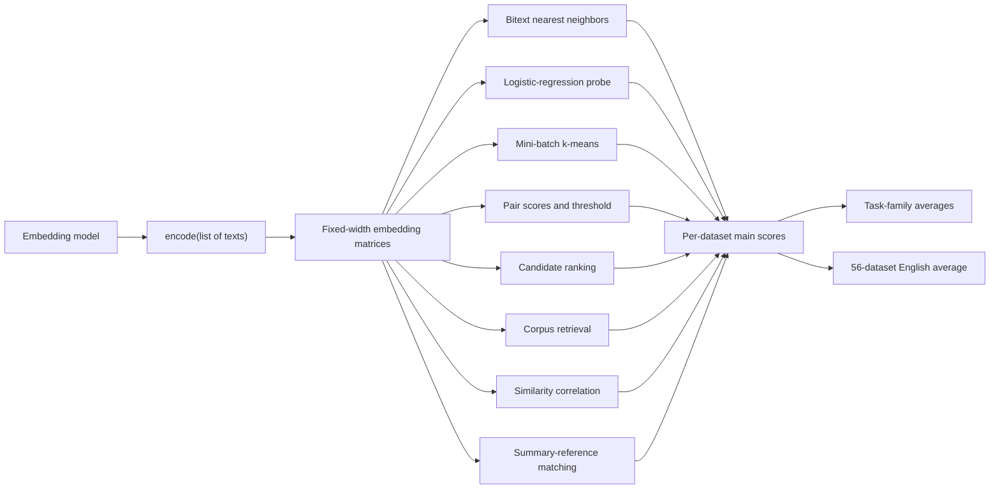
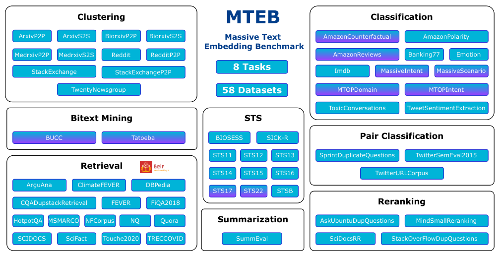
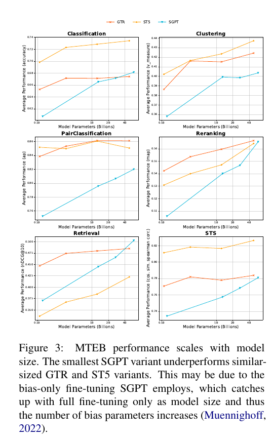
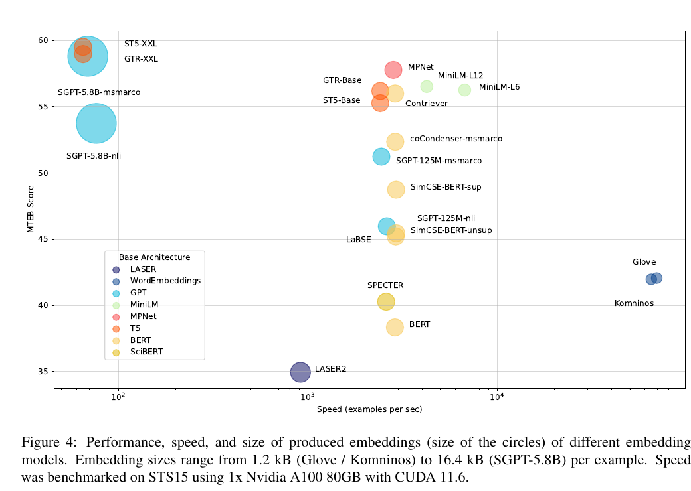
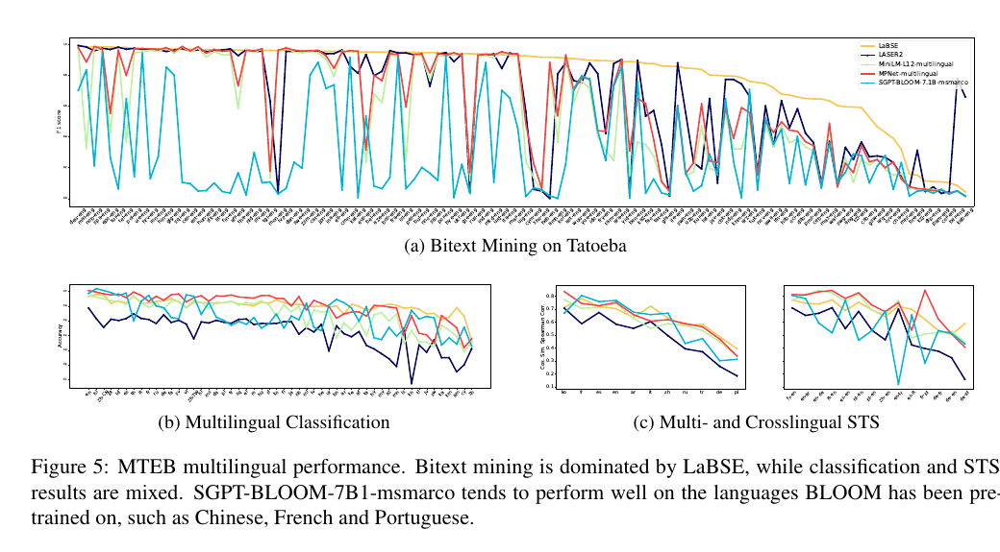

# MTEB: Massive Text Embedding Benchmark — Muennighoff et al., 2022

> **arXiv:** 2210.07316v3 · **Venue:** EACL 2023 · **Affiliation:** Hugging Face and cohere.ai

## TL;DR

MTEB replaces narrow sentence-embedding evaluation with one reproducible harness spanning eight task types, 58 datasets, 112 languages, and sentence-to-sentence, paragraph-to-paragraph, and sentence-to-paragraph inputs. A model only needs to map a list of texts to fixed-width vectors; MTEB then applies task-specific evaluators and metrics. Across 33 models and close to 5,000 experiments, the paper finds no universal winner: ST5-XXL leads the 56-dataset English aggregate at 59.51, while other models lead retrieval, reranking, pair classification, and multilingual bitext mining (Tables 1 and 11–14). The lasting contribution is therefore the evaluation protocol and its diagnosis of specialization, not any one leaderboard row.

## Problem & motivation

Before MTEB, embedding papers commonly evaluated on a narrow slice of possible uses. Semantic textual similarity (STS) and classification dominated Sentence-BERT and SimCSE-style evaluations; SentEval added several related datasets but omitted retrieval and clustering; USEB focused mainly on reranking; and BEIR covered heterogeneous zero-shot retrieval rather than the full range of embedding applications (§§1–2.1). A model could therefore be called state of the art after excelling at one geometry, even though deployment might require another:

- **Symmetric similarity:** two texts have the same semantic role, as in STS or duplicate detection.
- **Asymmetric retrieval:** a short query and a longer document have different roles and distributions.
- **Global geometry:** clustering requires coherent distances among many examples, not only good pairwise scores.
- **Feature quality:** classification asks whether a simple supervised head can recover labels from frozen embeddings.
- **Cross-lingual alignment:** bitext mining asks whether translations share a neighborhood across languages.

Evaluation code was another confounder. Different preprocessing, splits, classifiers, ranking implementations, distance functions, and hyperparameters could make an apparent model improvement partly an evaluator improvement. Reimplementing every pipeline also imposed repeated engineering cost.

MTEB standardizes that layer. Its four desiderata are diversity, a simple model interface, extensibility through declarative task metadata and evaluator implementations, and reproducibility through versioned software, datasets, and released result JSON (§3.1). The paper’s historical scope is precise:

- **58 datasets and eight task types overall**, including two multilingual bitext-mining datasets.
- **10 multilingual datasets and 112 languages** overall (§3.1).
- **56 datasets and seven task types in the English aggregate** of Tables 1 and 11. Bitext mining is absent because that task is inherently cross-lingual.
- **33 evaluated models** in the abstract; the conclusion summarizes the campaign as over 30 models and close to 5,000 experiments.

Those numbers describe arXiv v3 and the EACL 2023 paper. They must not be silently replaced by counts, prompts, task versions, modalities, or scores from later MTEB releases, MTEB v2, or MMTEB.

## Key idea

MTEB reduces model integration to a shared encoder contract. Given a batch of texts $X=(x_1,\ldots,x_B)$, an embedding model $f_\theta$ returns one fixed-width vector per item:

$$
f_\theta:X\longmapsto
\mathbf E=
\begin{bmatrix}
f_\theta(x_1)^\top\\
\vdots\\
f_\theta(x_B)^\top
\end{bmatrix}
\in\mathbb R^{B\times d}.
$$

Here $B$ is the batch size and $d$ is model-specific but constant within an evaluation. MTEB does not prescribe an architecture, tokenizer, pooling rule, embedding width, or training objective. It supplies datasets and turns $\mathbf E$ into predictions with a fixed evaluator for each task family.

Most pairwise evaluators use cosine similarity,

$$
s_{\cos}(\mathbf u,\mathbf v)
=\frac{\mathbf u^\top\mathbf v}
{\lVert\mathbf u\rVert_2\lVert\mathbf v\rVert_2},
$$

where $\mathbf u,\mathbf v\in\mathbb R^d$. The same scalar has different meanings under different protocols: it selects a translation in bitext mining, thresholds a pair label, orders candidates for reranking or retrieval, and acts as a predicted similarity for STS.

For a task family $t$ with datasets $D_t$, the paper reports a category score as a macro-average of that family’s main metric:

$$
S_t(f)=\frac{1}{|D_t|}\sum_{D\in D_t}m_D(f).
$$

The English overall score averages the main score of each of its 56 datasets, not the seven displayed category means:

$$
S_{\mathrm{English}}(f)
=\frac{1}{56}\sum_{D\in D_{\mathrm{English}}}m_D(f).
$$

Consequently, categories with many datasets contribute more than summarization, which has one. The aggregate is also a mean of heterogeneous quantities such as accuracy, v-measure, average precision, MAP, nDCG@10, and Spearman correlation. It is a compact model-selection summary, not a single statistically homogeneous measurement.

## How it works



### Dataset and input organization



*Official Figure 1. The original suite contains 58 datasets in eight task families; purple entries are multilingual. The English Table 1/11 aggregate drops the two bitext-mining datasets and therefore contains 56 datasets in seven families.*

MTEB groups datasets by the semantic roles and lengths being compared (§3.3):

- **S2S, sentence to sentence:** both sides are short texts, including most STS, duplicate-question, and classification data.
- **P2P, paragraph to paragraph:** both sides are longer. MTEB imposes no input-length limit itself; each model may truncate. Several clustering datasets have both title-only S2S and title-plus-content P2P variants.
- **S2P, sentence to paragraph:** typically an asymmetric retrieval query against a longer document.

The 56-dataset English breakdown in Table 1 is 12 classification, 11 clustering, 3 pair-classification, 4 reranking, 15 retrieval, 10 STS, and 1 summarization dataset. BUCC and Tatoeba provide the remaining two datasets and the eighth task, multilingual bitext mining (Figure 1; Tables 1–2).

### Eight evaluators

**1. Bitext mining.** Encode two sentence sets in different languages. For each source sentence, select the closest target by cosine similarity and compare predicted translation pairs with gold pairs. The main metric is F1,

$$
F_1=\frac{2PR}{P+R},\qquad
P=\frac{TP}{TP+FP},\quad
R=\frac{TP}{TP+FN}.
$$

Accuracy, precision, and recall are also emitted. BUCC covers four language pair settings and Tatoeba reaches 112 languages (§3.2 and Appendix A.4).

**2. Classification.** Encode train and test examples once, fit logistic regression on the frozen training vectors with at most 100 iterations, and predict test labels. Accuracy is primary; average precision and F1 are secondary (§3.2). This measures linear accessibility of labels, not end-to-end model fine-tuning.

**3. Clustering.** Encode all texts, fit mini-batch $k$-means with batch size 32 and $k$ equal to the number of gold classes, then compare assignments with labels using v-measure (§3.2). With homogeneity $h$ and completeness $c$,

$$
V=\frac{2hc}{h+c}.
$$

Because v-measure is invariant to cluster-label permutations, arbitrary cluster IDs do not need alignment with class IDs.

**4. Pair classification.** Encode both members of each usually binary duplicate/paraphrase pair. MTEB computes cosine, dot-product, Euclidean, and Manhattan scores and finds the best binary threshold for each. The main metric is cosine-based average precision; accuracy, F1, precision, and recall are also reported (§3.2). For ranked examples with binary relevance $y_k$,

$$
\operatorname{AP}
=\frac{1}{\sum_k y_k}
\sum_{k=1}^{N}P@k\cdot y_k.
$$

**5. Reranking.** Each query comes with a restricted list of relevant and irrelevant candidates. Encode query and references, sort candidates by cosine similarity, score each query, then average over queries. MAP is primary and mean reciprocal rank at $k$ is secondary (§3.2). Unlike corpus retrieval, the candidate pool is supplied per query.

**6. Retrieval.** Encode every query and corpus document, rank the corpus by cosine similarity, and reuse BEIR’s evaluation. The primary metric is nDCG@10; MRR, MAP, precision, and recall are also computed at several cutoffs (§3.2):

$$
\operatorname{DCG}@k
=\sum_{i=1}^{k}\frac{2^{rel_i}-1}{\log_2(i+1)},
\qquad
\operatorname{nDCG}@k
=\frac{\operatorname{DCG}@k}{\operatorname{IDCG}@k}.
$$

$rel_i$ is the graded relevance of the item at rank $i$, and IDCG is the best possible ordering. The paper evaluates test splits except MS MARCO, for which it follows BEIR and uses development (§4.1).

**7. Semantic textual similarity.** Encode each labeled text pair, compute several distances, and correlate them with continuous human similarity judgments. The main score is Spearman rank correlation for cosine similarity (§3.2):

$$
\rho_s=\operatorname{corr}(\operatorname{rank}(s),\operatorname{rank}(y)),
$$

where $s$ is the vector of cosine similarities and $y$ the gold scores. Pearson correlation and alternate distances are secondary outputs.

**8. Summarization.** Encode machine and human summaries. Score each machine summary by its closest human reference, then correlate those scores with human quality judgments. Cosine-based Spearman correlation is primary and Pearson is secondary (§3.2). This is reference-based embedding evaluation on SummEval, not generation or learned factuality evaluation.

### Reporting discipline

The protocol produces per-dataset JSON, task-family summaries, and an overall English score. A reproducible claim therefore needs the model checkpoint and pooling/prefix behavior, benchmark software and dataset versions, selected languages/tasks, split, main metric, and aggregation rule. The paper’s fixed protocol has no task instructions or prompt benchmark layer; those belong to later embedding practice and cannot be retroactively assumed here.

## Training / data

MTEB is a benchmark, not a training recipe. It does not update the submitted embedding model and introduces no shared embedding loss, optimizer, learning-rate schedule, or pretraining corpus. The only fitted components are evaluator-side models:

- logistic regression with a 100-iteration maximum for classification;
- mini-batch $k$-means with batch size 32 and gold class count $k$ for clustering;
- score thresholds for pair classification.

All other task families evaluate distances or rankings directly from frozen embeddings (§3.2). The paper evaluates test splits except for MS MARCO development (§4.1), releases result JSON, and lists public checkpoints in Table 10. The evaluated set deliberately spans different origins:

- contextual and non-contextual self-supervised baselines such as BERT, SimCSE-unsupervised, GloVe, and Komninos;
- supervised BERT/SciBERT-family encoders such as SimCSE-supervised, coCondenser, Contriever, SPECTER, LaBSE, MPNet, and MiniLM;
- T5 encoders specialized by NLI/STS-like training (ST5) or MS MARCO retrieval training (GTR);
- GPT-family SGPT bi-encoders specialized on NLI or MS MARCO, plus the OpenAI Ada Similarity API;
- LASER2 as a context-aware non-Transformer multilingual baseline (§4.1 and Table 10).

This heterogeneity is intentional, but it means MTEB compares finished embedding systems rather than controlling architecture, parameter count, pretraining data, fine-tuning data, tokenizer, pooling, embedding dimension, or contamination. SGPT retrieval models also use role-specific special tokens for queries and documents; on non-retrieval tasks the paper uses their query representation (§4.1).

The datasets themselves range across domains and scales. The English retrieval slice imports 15 public BEIR datasets; clustering includes title-only and title-plus-body scientific/community corpora; classification includes sentiment, intent, toxicity, reviews, and multilingual assistants; STS includes BIOSSES, SICK-R, STS12–17, STS22, and STSBenchmark; and SummEval supplies the sole summarization dataset (Appendix A and Table 2). MTEB imposes no common maximum input length, so truncation remains model-dependent (§3.3).

## Results

### English aggregate and specialization

| Model | Class. | Clust. | Pair class. | Rerank. | Retrieval | STS | Summ. | Overall |
|---|---:|---:|---:|---:|---:|---:|---:|---:|
| ST5-XXL | **73.42** | **43.71** | 85.06 | 56.43 | 42.24 | **82.63** | 30.08 | **59.51** |
| GTR-XXL | 67.41 | 42.42 | **86.12** | 56.65 | 48.48 | 78.38 | 30.64 | 58.97 |
| SGPT-5.8B-msmarco | 68.13 | 40.35 | 82.00 | 56.56 | **50.25** | 78.10 | 24.75 | 58.81 |
| MPNet | 65.07 | 43.69 | 83.04 | **59.36** | 43.81 | 80.28 | 27.49 | 57.78 |
| MiniLM-L12 | 63.21 | 41.81 | 82.41 | 58.44 | 42.69 | 79.80 | 27.90 | 56.53 |
| Contriever | 66.68 | 41.10 | 82.53 | 53.14 | 41.88 | 76.51 | 30.36 | 56.00 |
| SimCSE-BERT-unsup | 62.50 | 29.04 | 70.33 | 46.47 | 20.29 | 74.33 | 31.15 | 45.45 |
| BERT mean pooling | 61.66 | 30.12 | 56.33 | 43.44 | 10.59 | 54.36 | 29.82 | 38.33 |

*Source: Table 1; the identical all-English overall values appear in Table 11. Values are percentages of each category’s primary metric. Bold marks the best value among rows shown, not necessarily the full table; SummEval’s full-table maximum is MPNet-multilingual at 31.57 (Tables 1 and 11).*

The main result is rank instability. ST5-XXL has the best overall score and leads classification and STS, but SGPT-5.8B-msmarco is 8.01 points better on retrieval, MPNet is 2.93 points better on reranking, and GTR-XXL is 1.06 points better on pair classification (Table 1). Pair classification resembles STS structurally, yet GTR and ST5 rank differently there (§4.2). Likewise, SimCSE-BERT-supervised reaches 79.12 STS but only 33.43 clustering and 21.82 retrieval, showing that a strong pairwise-similarity geometry does not guarantee global grouping or asymmetric search (Table 1).

The overall number also conceals uneven evidence. Its 56-dataset macro-average gives 15/56 of the weight to retrieval, 12/56 to classification, 11/56 to clustering, and only 1/56 to summarization (Table 1; Appendix B). It should be read alongside the task columns, not as a universal utility function.



*Official Figure 3. GTR, ST5, and SGPT generally improve with parameter count across six English task families, but their order remains task-dependent. The paper attributes the weak smallest SGPT point partly to bias-only fine-tuning, whose trainable capacity grows with model size.*

Scale helps, but specialization survives scaling. Within SGPT-msmarco, retrieval rises from 37.04 at 125M to 44.49 at 1.3B, 46.54 at 2.7B, and 50.25 at 5.8B; its STS scores remain below ST5-XXL’s 82.63 (Table 1). Within ST5, the overall score rises from 55.27 for Base to 57.06 for Large, 57.87 for XL, and 59.51 for XXL, while retrieval remains behind the MS MARCO-tuned SGPT family (Table 1).

### Dataset-level evidence and contamination

Table 11 makes the category averages concrete:

- On SciDocsRR reranking, MPNet scores 88.65 and MiniLM-L12 scores 87.20, versus 77.96 for GTR-XXL and 76.09 for ST5-XXL. The authors warn that SciDocsRR material likely appeared in MPNet/MiniLM training data (§4.2; Table 11).
- On the largely symmetric QuoraRetrieval dataset, SGPT-5.8B-nli scores 84.68 versus 84.58 for SGPT-5.8B-msmarco, even though the MS MARCO model wins retrieval overall (§4.2; Table 11).
- On asymmetric MS MARCO, the ordering reverses sharply: SGPT-5.8B-msmarco scores 39.91 versus 15.83 for SGPT-5.8B-nli (Table 11).
- ST5-XXL scores 90.23 on IMDb classification and 89.32 on STS15, but only 14.63 on ClimateFEVER retrieval (Table 11). A single model can therefore be excellent and weak within the same aggregate.

### Efficiency frontier



*Official Figure 4. Horizontal position is STS15 encoding throughput on one Nvidia A100 80GB with CUDA 11.6, vertical position is English MTEB score, and circle area represents per-example embedding storage. Embeddings range from 1.2 kB for GloVe/Komninos to 16.4 kB for SGPT-5.8B.*

The plot separates three operational regimes (§4.3): word embeddings maximize throughput but sacrifice quality; multi-billion-parameter GTR/ST5/SGPT variants maximize benchmark score but are slow, with SGPT-5.8B also producing the largest embeddings; and MPNet/MiniLM occupy the middle frontier. MPNet’s 57.78 overall is only 1.73 points below ST5-XXL’s 59.51, while Figure 4 places MPNet in the thousands rather than tens of examples per second (Table 1; Figure 4). Exact throughput should be treated as hardware- and workload-specific because it was measured only on STS15 with the stated A100 setup.

### Multilingual behavior



*Official Figure 5. LaBSE is consistently strong across Tatoeba languages; multilingual classification and STS have mixed winners. SGPT-BLOOM-7.1B-msmarco is strongest mainly on languages well represented in BLOOM pretraining.*

| Multilingual aggregate | LASER2 | LaBSE | MiniLM multilingual | MPNet multilingual | SGPT-BLOOM-7.1B-msmarco |
|---|---:|---:|---:|---:|---:|
| Bitext mining F1 | 67.42 | **81.75** | 57.98 | 63.38 | 31.08 |
| Classification accuracy | 42.85 | **60.77** | 54.87 | 60.39 | 54.40 |
| STS Spearman | 51.55 | 65.67 | 64.23 | **67.71** | 57.81 |

*Sources: Tables 12–14. The STS table also includes Komninos at 22.14, omitted here because it is not present in Tables 12–13.*

LaBSE dominates the broad bitext average, while MPNet has the best multilingual STS average and nearly matches LaBSE on classification. Aggregate behavior hides language exposure: SGPT-BLOOM reaches 92.62 F1 on Portuguese–English Tatoeba and 91.44 on French–English, but 6.15 on Turkish–English and 0.42 on Georgian–English (Table 12). The paper connects these swings to BLOOM’s pretraining-language distribution and notes that all models can degrade on unseen languages (§4.4).

## Limitations & follow-ups

- **The headline average is imbalanced and heterogeneous.** Retrieval contributes 15 datasets while summarization contributes one; all 56 main metrics are averaged despite measuring different statistical objects. A score can move because of suite composition rather than a uniform capability gain (Table 1; Appendix B.2).
- **Long documents are missing.** S2S, P2P, and S2P broaden length coverage, but the longest datasets contain only a few hundred words. Model-specific truncation is unconstrained, so long-context retrieval is not established (§3.3; Appendix B.1).
- **Multilingual breadth is concentrated.** The original multilingual data covers bitext mining, classification, and STS; retrieval and clustering are English-only. Counting 112 languages therefore does not mean all eight task types exist in 112 languages (Appendix B.3).
- **There is no code or multimodal evaluation.** The paper explicitly identifies code retrieval and embedding use as features for other modalities as missing. The 2023 benchmark is text-only (Appendix B.3–B.4).
- **Training-data contamination is not controlled.** The authors identify SciDocsRR overlap as a likely reason for MPNet/MiniLM’s reranking strength, state that controlling overlap is difficult at this scale, and leave overlap in MTEB scores (§4.2). Averaging many datasets may dilute contamination but does not prove that it is insignificant.
- **The model comparison is observational.** Architectures, parameter counts, embedding dimensions, pooling, pretraining, supervised data, language coverage, and APIs differ. Figure 3 supports within-family scaling trends more cleanly than cross-family causal claims.
- **The efficiency result is one setup.** Figure 4 uses STS15 on one A100 80GB with CUDA 11.6. It does not establish CPU latency, batch-one service latency, energy use, index-build time, approximate-nearest-neighbor behavior, or throughput on long documents.
- **Evaluator fitting is not uniformly zero-shot.** Classification trains logistic regression on in-domain labels, clustering is given the gold number of classes, and pair classification selects a best threshold. These protocols are valid representation tests, but differ from direct zero-shot ranking and should not be described as one adaptation regime (§3.2).
- **Correlated datasets reduce effective diversity.** Figure 2 finds identical or closely related corpora, including FEVER/ClimateFEVER, CQADupstack variants, paired S2S/P2P datasets, and scientific datasets across task families. The nominal dataset count exceeds the number of independent domains.
- **A leaderboard is versioned evidence, not a timeless rank.** New datasets, corrected implementations, prompts, task metadata, and model behavior can change scores. Reproducible follow-up work should pin task and software versions and report task-level results.

The immediate successors broaden the coverage rather than invalidate the original finding. [MMTEB](benchmark_2025_mmteb.md) expands multilingual evaluation to more than 250 languages, while the current MTEB repository includes later task versions and modalities. Those are distinct protocols; historical Table 1 values should only be compared under the original 56-dataset English setup.

## Links

- **Paper:** [arXiv abstract](https://arxiv.org/abs/2210.07316v3) · [v3 HTML](https://arxiv.org/html/2210.07316v3) · [v3 PDF](https://arxiv.org/pdf/2210.07316v3)
- **Venue:** [ACL Anthology](https://aclanthology.org/2023.eacl-main.148/) · [DOI](https://doi.org/10.18653/v1/2023.eacl-main.148) · [EACL video](https://aclanthology.org/2023.eacl-main.148.mp4)
- **Code:** [official MTEB repository](https://github.com/embeddings-benchmark/mteb)
- **Hugging Face:** [MTEB organization](https://huggingface.co/mteb) · [paper results dataset](https://huggingface.co/datasets/mteb/results)
- **Source map:** motivation and prior benchmarks (§§1–2); desiderata and evaluator definitions (§3.1–3.2); dataset modes and composition (§3.3 and Appendix A); evaluated model families (§4.1 and Table 10); English aggregate and per-dataset evidence (§4.2, Tables 1 and 11); efficiency (§4.3, Figure 4); multilingual evidence (§4.4, Figure 5, Tables 12–14); acknowledged coverage gaps (Appendix B); task/model correlations (Appendix D).
- **BibTeX:**

  ```bibtex
  @inproceedings{muennighoff-etal-2023-mteb,
    title     = {{MTEB}: Massive Text Embedding Benchmark},
    author    = {Muennighoff, Niklas and Tazi, Nouamane and Magne, Loic and Reimers, Nils},
    booktitle = {Proceedings of the 17th Conference of the European Chapter of the Association for Computational Linguistics},
    pages     = {2014--2037},
    publisher = {Association for Computational Linguistics},
    year      = {2023},
    doi       = {10.18653/v1/2023.eacl-main.148}
  }
  ```

- **Related local recaps:** [MiniLM](distill_2020_minilm.md) · [E5](retrieval_2022_e5.md) · [GTE](retrieval_2023_gte.md)
- **Related benchmarks and extensions:** [BEIR](benchmark_2021_beir.md) · [MMTEB](benchmark_2025_mmteb.md)