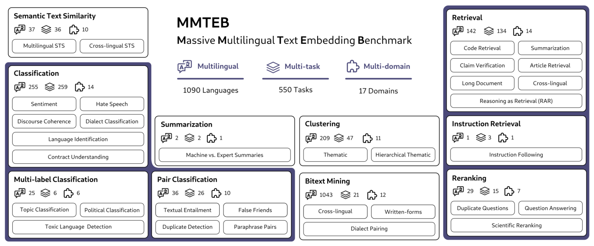

# MMTEB: Massive Multilingual Text Embedding Benchmark — Enevoldsen et al., 2025

> **arXiv:** 2502.13595v4 · **Venue:** ICLR 2025 · **Affiliation:** Aarhus University and a large open collaboration

## TL;DR

MMTEB expands MTEB into a community-built collection of more than 500 quality-controlled embedding tasks spanning more than 250 languages outside bitext mining, more than 1,000 language codes overall, ten task categories, and many domains. Its central contribution is as much about *benchmark engineering* as scale: strict metadata and review gates, rank-preserving task selection, hard-negative retrieval subsets, reusable clustering samples, and embedding caches make broad evaluation tractable. On the paper's 132-task multilingual suite, the 560M-parameter `multilingual-e5-large-instruct` ranks first and averages 63.2, outperforming two 7B embedding models overall, especially on lower-resource languages.

## Problem & motivation

The original MTEB unified evaluation across many embedding uses, but its multilingual coverage was uneven: much of it came from machine translation or bitext mining, while many languages had little or no coverage in retrieval, classification, clustering, reranking, or semantic similarity. Existing alternatives also usually vary one axis at a time: BEIR emphasizes heterogeneous retrieval domains, MIRACL multilingual retrieval, and language-specific MTEB variants particular regions or languages. None jointly covers a broad set of languages, task families, domains, and newer capabilities such as instruction following, long-document retrieval, reasoning-as-retrieval, and code retrieval.

Merely accumulating tasks creates a second problem. A benchmark with hundreds of corpora can be prohibitively expensive, which particularly harms the low-resource communities the multilingual expansion is intended to serve. The paper calls this the **low-resource double bind**: communities with the least data also tend to have the least evaluation compute. The original English MTEB could take up to two days for a moderately sized LLM on one A100. MMTEB therefore asks two coupled questions:

1. How can embedding evaluation become genuinely multilingual and multi-domain rather than mostly English plus translated data?
2. How can a large benchmark preserve model discrimination and rankings while encoding far fewer texts?

The result is both a task collection and a recipe for deriving smaller, purpose-specific benchmark suites from it.

## Key idea

MMTEB treats benchmark construction as **quality-controlled feature selection**. Each task is a feature describing model behavior. If the scores on the retained tasks accurately predict scores on another task, that task is redundant for ranking the current model population and can be removed, subject to safeguards for language and task-category coverage.

Let $M$ be the evaluated models, $T$ the candidate tasks, and $s_{t,m}$ the score of model $m$ on task $t$. For a candidate held-out task $t$, fit an estimator using the other task scores:

$$
\hat{s}_{t,m} = f_t\!\left(\{s_{j,m}:j\in S,\;j\ne t\}\right),
$$

where $S\subseteq T$ is the current retained task set. Training and prediction are leave-one-model-out: each model is predicted by an estimator fitted without that model. The predictability of task $t$ is measured by Spearman rank correlation,

$$
\rho_t = \rho_{\mathrm{Spearman}}
\left(
\{s_{t,m}\}_{m\in M},
\{\hat{s}_{t,m}\}_{m\in M}
\right).
$$

The task with the largest $\rho_t$ is the best candidate for removal: its ranking signal is most reproducible from the remaining tasks. Iteration stops once no candidate exceeds the suite-specific correlation threshold, or coverage constraints prevent further removal. The multilingual suite uses a threshold of $0.8$ and retains tasks whose removal would erase a language from a task category or whose prediction error exceeds $0.5$ standard deviations. MTEB(eng, v2) uses a $0.9$ correlation threshold and a stricter $0.2$-standard-deviation error safeguard.

For the final model ranking, every task acts as a voter. With $K=|M|$ models, a simple Borda contribution is

$$
b_{t,m}=K-r_{t,m},
\qquad
B_m=\sum_{t\in T} b_{t,m},
$$

where $r_{t,m}$ is model $m$'s rank on task $t$ and $B_m$ is its aggregate Borda score. The implementation uses tournament Borda count to handle ties. This emphasizes consistent rank across tasks rather than allowing the scale or variance of a few raw metrics to dominate.

## How it works

### 1. Open task collection and quality gates

Contributors submit task implementations through the public MTEB repository. A task must include structured metadata covering its name and description, task type and text granularity, source and citation, evaluation split, ISO 639-3 language and ISO 15924 script, date range, primary score, form, license, domain, annotation source, dialect, text-creation process, sample count, and average length.

Every task receives at least one core-contributor review. Submitters also run two reference models, `multilingual-e5-small` and multilingual MiniLM-L12. A task is manually investigated when either model is within 2% of random, performance is nearly perfect, or the two models are suspiciously similar. These are diagnostics rather than automatic rejection rules: a genuinely difficult task may correctly sit near random. Native or proficient speakers are consulted when possible.

The paper's collection pipeline can be summarized as follows:

### 2. Task protocols

MMTEB standardizes heterogeneous downstream uses around a model that maps text to a fixed-dimensional embedding. The principal protocols are:

- **Classification:** sample 8–16 training examples per label, fit logistic regression for at most 100 iterations, evaluate on held-out data, and repeat ten times. The primary metric follows the source task where possible; otherwise accuracy is the default, with $F_1$ preferred for imbalanced labels.
- **Pair classification:** embed both members of each pair, compute a model-specified or standard distance (cosine, Euclidean, dot product, or Manhattan), choose the best binary threshold, and evaluate labels. Average precision is the default primary metric.
- **Bitext mining:** embed paired multilingual sentences and recover the nearest matching sentence by cosine similarity. The default primary metric is $F_1$.
- **Clustering and hierarchical clustering:** embed documents, sample ten subsets, cluster each with k-means, and compare clusters with gold labels using V-measure. Hierarchical tasks repeat evaluation at each hierarchy level.
- **Retrieval:** independently encode queries and corpus documents, rank documents by the model's similarity function, and compare the ranking with relevance judgments. The usual primary metric is nDCG@10.
- **Reranking:** score a provided candidate list against each query and average ranking quality. The paper describes MAP@1000 as the main protocol, while individual datasets can preserve their source metric.
- **Semantic textual similarity (STS):** compare embedding distances for sentence pairs with continuous similarity labels. The primary metric is the best Spearman correlation among supported similarity functions.
- **Multi-label classification:** form ten small, stratified training samples with eight instances per unique label, fit k-nearest-neighbor classifiers, and report accuracy, $F_1$, and label-ranking average precision (LRAP).
- **Instruction retrieval:** combine each query with a query-specific relevance instruction and retrieve documents under that criterion. The main metric is Robustness@10.
- **Summarization similarity:** compare system summaries through embedding-based similarity on the retained summarization task.

For ranked retrieval with binary or graded gains, the common normalized discounted cumulative gain is

$$
\operatorname{nDCG@}k =
\frac{
\sum_{i=1}^{k}\frac{2^{\mathrm{rel}_i}-1}{\log_2(i+1)}
}{
\operatorname{IDCG@}k
},
$$

where $\mathrm{rel}_i$ is the relevance grade at rank $i$ and $\operatorname{IDCG@}k$ is the score of the ideal ranking. MMTEB does not collapse every task to this metric; each task retains a semantically appropriate primary score before rank aggregation.

### 3. Rank-preserving compute reductions

**Clustering.** Instead of repeatedly encoding distinct predefined sets, MMTEB encodes a stratified 4% corpus sample once and draws ten sets without replacement from those cached embeddings. Across nine English clustering tasks and 13 models, this yields an average 16.11x speedup while preserving score-based model ranks with mean Spearman correlation 0.9634 (Table 6). The significant-rank correlation averages 0.9195 (Table 7). Some tasks require fixed caps such as 32,768 samples rather than exactly 4%.

**Retrieval.** Full corpora can contain millions of documents. MMTEB uses TREC-style pooling: several retrievers contribute top-ranked hard negatives, the top 250 documents per query are retained and merged, and datasets above 1,000 queries are randomly capped at 1,000 queries. Validation on sparsely judged Natural Questions and densely judged TREC-COVID showed that rankings and absolute scores become unstable below roughly 100 hard negatives, motivating the conservative 250-document setting. The largest collections fall from more than 5 million documents to at most 250,000.

**Bitext mining.** Parallel datasets often reuse a sentence in many language pairs. Caching unique sentence embeddings changes repeated encoding growth from roughly quadratic in languages to linear. For English texts in FLORES, the paper reports a reduction from about 410,000 encodings to 1,012.

**Dataset-level reduction.** Contributors are encouraged to submit smaller stratified variants, provided that comparisons against the original split show that the reduced task still differentiates models and preserves their order.

### 4. Constructing named suites

The full collection is a registry from which focused suites are derived:

| Suite | Initial scope | After filtering | Final suite | Main goal |
|---|---:|---:|---:|---|
| MTEB(Multilingual) | 550 | 343 | 132 | broad multilingual and task coverage |
| MTEB(Europe) | 420 | 228 | 74 | European and recognized regional languages |
| MTEB(Indic) | 55 | 44 | 23 | Indic-language coverage |
| MTEB(eng, v2) | 56 | 54 | 41 in Table 1 | faster, zero-shot-oriented English evaluation |

Counts in prose and later analysis differ slightly for some suites (for example, 131 versus 132 multilingual tasks and 40 versus 41 English tasks), reflecting manual review or paper-version bookkeeping. Reproduction should therefore use the pinned benchmark definition from the package/results repository rather than reconstructing a suite from prose counts.

MTEB(Multilingual) removes machine-translated tasks, unclear licenses, and very narrow domains such as code before backward selection. MTEB(eng, v2) replaces tasks with optimized variants and removes heavily trained-on tasks such as MS MARCO and Natural Questions to better approximate zero-shot evaluation. Before final task selection, the optimized English set correlates with MTEB(eng, v1) at Spearman $0.97$ and Pearson $0.99$; the final v2 model ranking correlates with v1 at Spearman $0.90$ and Pearson $0.96$.

### 5. Optional abstention metric

For retrieval and reranking, the appendix adds a calibration-oriented normalized area under the metric-abstention curve. Given confidence $c$, threshold $\tau$, and task metric $m$, keep only examples whose confidence exceeds $\tau$, evaluate at many thresholds, and integrate the resulting curve. Normalize the model's area between a flat-performance lower bound and an oracle upper bound:

$$
\operatorname{nAUC}_{\text{model}} =
\frac{
\operatorname{AUC}_{\text{model}}-\operatorname{AUC}_{-}
}{
\operatorname{AUC}_{+}-\operatorname{AUC}_{-}
}.
$$

Here $\operatorname{AUC}_{-}$ is the area obtained if abstention never improves the metric, and $\operatorname{AUC}_{+}$ is the oracle area obtained by retaining the best instances at each abstention rate. This separates confidence quality from a model's raw retrieval score.

## Training / data

MMTEB is an evaluation paper; it does not train a new embedding model and therefore has no shared optimizer, loss, or training schedule. Its reproducibility recipe concerns data transformation, task versions, prompts, and model revisions.

The paper evaluates 12 representative encoders spanning English-only and multilingual MiniLM/MPNet models, LaBSE, multilingual E5 variants, the instruction-tuned 560M-parameter `multilingual-e5-large-instruct`, and two Mistral-based 7B encoders (`e5-mistral-7b-instruct` and `GritLM-7B`). Appendix G pins every Hugging Face revision. Prompts and model wrappers live in the MTEB model registry; generic task prompts are used when a model requires instructions rather than tuning a prompt separately for every dataset.

Because debugging and task development occurred during a very large evaluation, not every run used the same package revision. The stronger reproducibility guarantee is **within task**: all compared models for a given task use the same task version. The versioned results repository records model metadata, task/package versions, metrics, runtime, evaluation time, and estimated CO2 emissions. This is important because a leaderboard score without task revisions, model revision, prompt, pooling, and benchmark edition is not a fully specified experiment.

Several datasets are newly constructed or substantially reformulated. Examples include PublicHealthQA; WebLINX HTML-element reranking; WikiClustering for 14 languages; and multilingual Wikipedia retrieval/reranking in which GPT-4o generates a query from the middle paragraph of a nine-paragraph window, the middle paragraph is positive, and the surrounding eight paragraphs are hard negatives. The synthetic German retrieval ranking correlates with GermanQuAD at Spearman 0.93 with a 95% confidence interval of $[0.69,1.0]$ (Figure 7).

## Results

### Multilingual suites

| Benchmark / measure | Best model | Score | Comparison | Source |
|---|---|---:|---|---|
| MTEB(Multilingual), Borda rank | multilingual-e5-large-instruct | 1st (1375) | GritLM-7B 2nd (1258) | Table 2 |
| MTEB(Multilingual), mean across 132 tasks | multilingual-e5-large-instruct | 63.2 | GritLM-7B 60.9; e5-mistral-7b-instruct 60.3 | Table 2 |
| MTEB(Multilingual), retrieval | GritLM-7B | 58.3 | multilingual-e5-large-instruct 57.1 | Table 2 |
| MTEB(Europe), Borda rank / mean | GritLM-7B | 1st (757) / 63.0 | multilingual-e5-large-instruct 2nd / 62.2 | Table 2 |
| MTEB(Indic), Borda rank / mean | multilingual-e5-large-instruct | 1st (209) / 70.2 | multilingual-e5-large 2nd / 66.4 | Table 2 |
| MTEB(eng, v2), Borda rank / mean | e5-mistral-7b-instruct | 1st (393) / 67.0 | GritLM-7B 2nd / 66.4 | Table 18 |
| MTEB(Code), Borda rank / mean | GritLM-7B | 1st (88) / 73.6 | e5-mistral-7b-instruct 2nd / 69.2 | Table 19 |

Three findings matter more than the exact leaderboard positions:

1. **Instruction tuning helps broadly.** `multilingual-e5-large-instruct` improves over its non-instruction counterpart from 58.6 to 63.2 mean on MTEB(Multilingual), with especially large gains in bitext mining and clustering (Table 2). This occurs even with generic task prompts.
2. **Scale is not a substitute for multilingual pretraining.** The XLM-R-based 560M model beats Mistral-based 7B encoders overall on MTEB(Multilingual) and across MTEB(Indic). The gap grows and the Mistral models become more volatile as speaker population decreases, consistent with broader language coverage in XLM-R pretraining.
3. **No model dominates every slice.** GritLM-7B remains strongest on multilingual retrieval, code, and is near the top on English v2; LaBSE remains comparatively strong in bitext mining; English-only MiniLM and MPNet models fall sharply outside English.

### Efficiency and fidelity

| Optimization result | Value | Source |
|---|---:|---|
| Clustering mean speedup | 16.11x | Table 6 |
| Clustering mean rank correlation | 0.9634 | Table 6 |
| Optimized English set vs MTEB(eng, v1), before final selection | Spearman 0.97; Pearson 0.99 | §2.4 |
| Final MTEB(eng, v2) vs v1 | Spearman 0.90; Pearson 0.96 | §4 |
| GritLM-7B runtime on MTEB(eng, v2), H100 | 3.11 hours | §4 |
| all-MiniLM-L12 runtime on MTEB(eng, v2), H100 | 0.81 hours | §4 |
| Documents retained by English v2 | 2% of original; 6% by characters | Abstract / §1 |
| Multilingual synthetic Wikipedia retrieval vs GermanQuAD | Spearman 0.93, 95% CI $[0.69,1.0]$ | Figure 7 |

The English-v2 comparison also reveals why benchmark updates can change rankings for legitimate reasons: smaller English encoders perform worse after MS MARCO and Natural Questions are removed, plausibly because those datasets were part of their training. The new suite is not simply a cheaper numerical approximation; it deliberately shifts toward less contaminated zero-shot evaluation.

## Limitations & follow-ups

The benchmark is broad but not balanced. English has hundreds of tasks, while many languages occur only in bitext mining or classification. A claim of “1,000+ languages” includes bitext language codes; the paper's more meaningful non-bitext breadth is over 250 languages. Aggregating all of them can hide severe gaps by task, domain, dialect, and script, so deployment decisions should inspect the relevant slices rather than only the global Borda rank.

Filtering machine-translated datasets does not eliminate English leakage. Human translations and label transfer from English can still favor English-centric pretraining. Some newly generated retrieval data uses an LLM, which introduces generator-specific artifacts even though the German validation suggests useful rank agreement.

Task selection is empirical and model-population dependent. A task predictable from the 12 models used in construction may become uniquely informative for a future architecture. Safeguards preserve languages and high-error tasks, but every compressed benchmark should eventually be revalidated against newer model families.

The paper also acknowledges imperfect credit assignment in its point-based collaboration system, heterogeneous task provenance and data quality, and environmental cost despite substantial efficiency work. Results were not all produced under one package revision; exact task and model versions in the result files are therefore part of the experimental specification.

Follow-up work should add genuinely authored data for underrepresented languages, fill sparse task-language cells beyond bitext mining, audit translated and synthetic artifacts, and periodically rerun task-selection analyses on a larger and more diverse model panel. Benchmark users should report suite version, package version, task revisions, model revision, prompts, pooling, and per-task results alongside any aggregate.

## Links

- **arXiv:** [abs](https://arxiv.org/abs/2502.13595v4) · [html](https://arxiv.org/html/2502.13595v4) · [pdf](https://arxiv.org/pdf/2502.13595v4)
- **Code:** [embeddings-benchmark/mteb](https://github.com/embeddings-benchmark/mteb)
- **Hugging Face:** [MTEB leaderboard](https://huggingface.co/spaces/mteb/leaderboard)
- **Project page:** [MTEB documentation](https://embeddings-benchmark.github.io/mteb/)
- **Blog posts:** —
- **Talks / videos:** —
- **OpenReview / venue page:** [ICLR 2025](https://openreview.net/forum?id=zl3pfz4VCV)
- **Papers-with-Code:** —
- **BibTeX:** [arXiv export](https://arxiv.org/bibtex/2502.13595)
- **Predecessor:** [MTEB: Massive Text Embedding Benchmark](benchmark_2022_mteb.md)
- **Versioned results:** [paper result snapshot](https://github.com/embeddings-benchmark/results/tree/9a79f7e07542ad2f5cb47490fa1e5ac2ba57d7a8)
