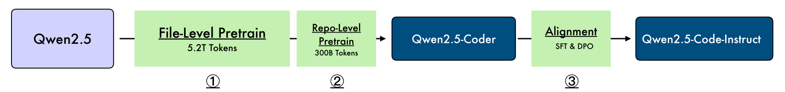
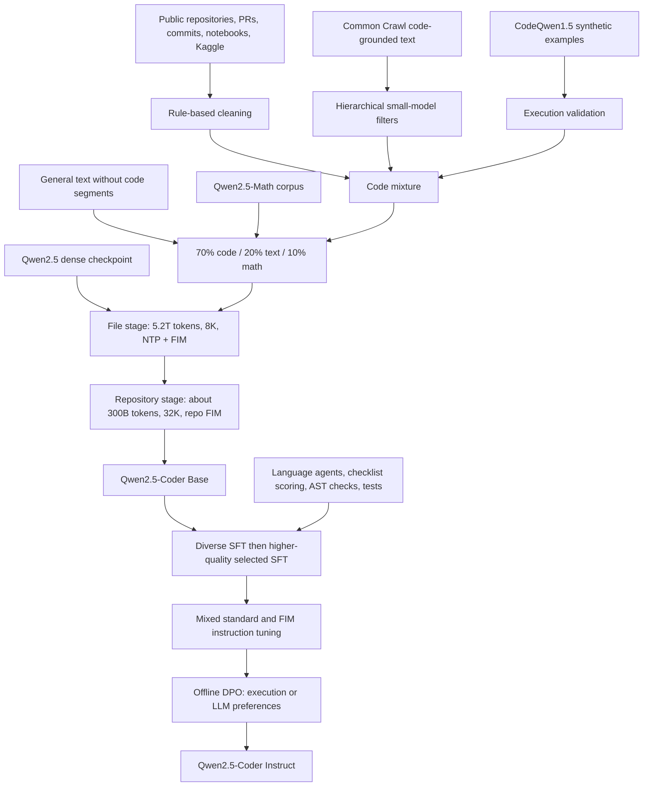
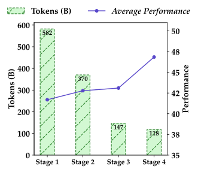
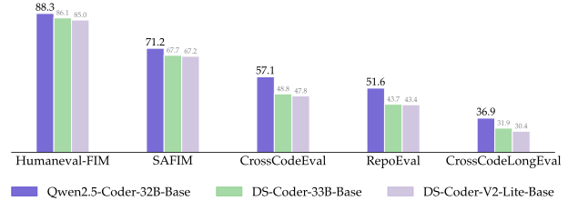
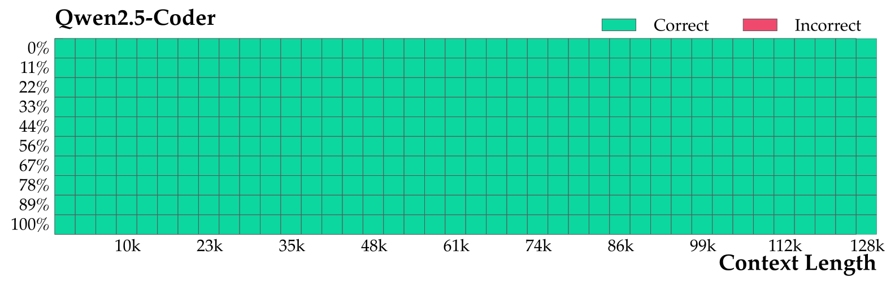

# Qwen2.5-Coder: File-to-Repository Training and Execution-Guided Alignment - Hui et al., 2024

> **arXiv:** [2409.12186v3](https://arxiv.org/abs/2409.12186v3) (12 November 2024; first submitted 18 September 2024) · **Venue:** preprint / technical report · **Affiliation:** Qwen Team, Alibaba Group
>
> This recap follows the expanded six-size report, not just the initial 1.5B/7B release. Released checkpoint configurations supplement its architecture table, and explicit discrepancies are retained below. Equations unpacking standard decoder, FIM, SFT, and DPO mechanisms are explanatory reconstructions unless identified as a formula stated in the report.

## TL;DR

Qwen2.5-Coder specializes the Qwen2.5 dense decoder family through approximately **5.5T additional training tokens**, progressing from **8K file-level training** to **32K repository-level training**, then code-focused instruction tuning and **offline DPO**. Its main contribution is the data and training pipeline: source code, code-grounded web text, executable synthetic data, a **70% code / 20% text / 10% math** mixture, multilingual instruction synthesis, and execution-based feedback where code is self-contained. Six Base and six Instruct checkpoints span 0.5B to 32B; the largest Instruct model is competitive with contemporary proprietary systems on several coding benchmarks, but it is not uniformly superior and the report does not establish autonomous software-engineering competence.

## Problem & motivation

### Programming assistance is more than generating a short function

CodeQwen1.5 and other code-specialist models had already shown that a general language model could become a useful coding model through additional code training. The next challenge was broader coverage: completing an unfinished file, following dependencies across files, inferring program behavior, editing an existing program, debugging in different languages, and converting natural-language questions into SQL.

These tasks place different demands on the model. A left-to-right completion model sees preceding text, while an editor must often respect both the prefix and suffix around a missing block. Repository tasks require surrounding files and paths rather than a detached function. Instruction-following systems also need to produce answers in the format expected by their caller, not simply continue whatever code appears in the prompt.

The report therefore separates **Base models**, useful for completion and further training, from **Instruct models**, aligned for natural-language coding requests. Their benchmark scores use different prompt formats and should not be treated as one interchangeable leaderboard.

### More raw code is not the complete solution

The training distribution needs both code and explanations of code. Repository source exposes syntax, implementations, and dependencies; documentation and tutorials connect those artifacts to natural-language concepts and requests. Synthetic examples can extend coverage, but generated code can be invalid or solve the wrong problem.

There is also a specialization trade-off. Removing all general and mathematical data can weaken reasoning and language understanding. Section 3.1.2 studies a mixture rather than assuming the highest code fraction is always optimal. The selected mixture improves the overall balance, although its own ablation does **not** improve every coding metric over code-only training.

### Long input acceptance is not enough

A model can be configured to accept a large sequence without understanding an entire repository reliably. Qwen2.5-Coder combines longer repository training with positional extrapolation, then evaluates both cross-file completion and a synthetic retrieval task.

Those evaluations answer different questions. The cross-file benchmarks use restricted retrieved context, while Needle in the Code asks the model to reproduce a small function hidden in a long codebase. Neither alone demonstrates reliable multi-file implementation, dependency resolution, or end-to-end issue solving at the maximum context length.

## Key idea

### Preserve the backbone; change the examples, serialization, and feedback

The pipeline has three broad stages:

1. **File-level continued pretraining:** learn from code and related material using next-token prediction and fill-in-the-middle (FIM), with sequences up to 8,192 tokens.
2. **Repository-level continued pretraining:** serialize related files together, retain FIM, and train at 32,768 tokens. Change the RoPE base and use YaRN for longer inference.
3. **Post-training:** move from diverse instruction examples to higher-quality selected examples, preserve infilling through mixed SFT, then optimize preferences using execution feedback and model judgments.



*Figure 2 distinguishes the 5.2T-token file stage from the approximately 300B-token repository stage. The Base checkpoint is produced before SFT and DPO; the Instruct checkpoint includes post-training.*

For a training sequence $x=(x_1,\ldots,x_T)$, a causal decoder learns

$$
p_\theta(x)=\prod_{t=1}^{T}p_\theta(x_t\mid x_{<t}),
\qquad
\mathcal L_{\mathrm{NTP}}
=-\mathbb E_{x\sim\mathcal D}\sum_{t=1}^{T}
\log p_\theta(x_t\mid x_{<t}).
$$

$\theta$ denotes model parameters, $T$ is sequence length, $\mathcal D$ is the sampled training distribution, and $x_{<t}$ is the preceding serialized sequence. FIM changes that sequence so that both sides of a gap precede the missing code.

If a file is split into prefix $P$, missing middle $M$, and suffix $S$, infilling exposes the conditional distribution

$$
p_\theta(M\mid P,S)
=\prod_{j=1}^{|M|}
p_\theta(M_j\mid P,S,M_{<j}).
$$

The actual input uses special boundary tokens, detailed below. This equation explains the desired completion behavior; it does not assert that pretraining applies loss only to the middle, since the report does not specify every token-level loss mask.

### Original reconstruction of the data flow



This diagram reconstructs the report's components rather than adding a new training stage. Post-training includes general preference data as well as code data. Unlike the later general-family [Qwen2.5 report](backbone_2024_qwen2.5.md), this report does **not** describe online GRPO.

## How it works

### 1. Dense causal decoder and released dimensions

The architecture is inherited from Qwen2.5: pre-normalized decoder blocks with RMSNorm, grouped-query attention (GQA), rotary position embeddings, attention QKV bias, and a SwiGLU feed-forward network. The family is dense, not a mixture-of-experts family.

The following dimensions use the released **Instruct configurations**, linked in the Links section. They agree with most of Table 1 but correct two important entries.

| Size | Layers | Hidden width | FFN width | Query / KV heads | Head width | Tied embeddings | Embedding vocabulary |
|---|---:|---:|---:|---|---:|---|---:|
| 0.5B | 24 | 896 | 4,864 | 14 / 2 | 64 | Yes | 151,936 |
| 1.5B | 28 | 1,536 | 8,960 | 12 / 2 | 128 | Yes | 151,936 |
| 3B | 36 | 2,048 | 11,008 | 16 / 2 | 128 | Yes | 151,936 |
| 7B | 28 | 3,584 | 18,944 | 28 / 4 | 128 | No | 152,064 |
| 14B | 48 | 5,120 | 13,824 | 40 / 8 | 128 | No | 152,064 |
| 32B | 64 | 5,120 | 27,648 | 40 / 8 | 128 | No | 152,064 |

**Report/checkpoint discrepancies:** Table 1 prints a head width of 128 for every size and an FFN width of 4,864 for 3B. The released configurations imply a head width of $896/14=64$ for 0.5B and specify an FFN width of 11,008 for 3B. Table 1 also prints a vocabulary size of 151,646, while its listed control-token IDs extend beyond that number; the embedding dimensions above are the values needed to instantiate the released checkpoints. Do not silently replace the original table and then attribute the corrected values to the paper.

For input IDs of shape $B\times T$, embedding lookup produces $X\in\mathbb R^{B\times T\times d}$, where $B$ is batch size and $d$ is hidden width. In a decoder block:

$$
\begin{aligned}
\widetilde X&=\operatorname{RMSNorm}(X),\\
Q&=\widetilde XW_Q+b_Q,\quad
K=\widetilde XW_K+b_K,\quad
V=\widetilde XW_V+b_V,\\
Q'&=\operatorname{RoPE}(Q),\quad K'=\operatorname{RoPE}(K),\\
Z&=X+\operatorname{GQA}(Q',K',V)W_O,\\
X_{\mathrm{next}}&=Z+
\left[\operatorname{SiLU}(UW_g)\odot(UW_u)\right]W_d,
\quad U=\operatorname{RMSNorm}(Z).
\end{aligned}
$$

$W_Q,W_K,W_V,W_O$ are attention projections, $b_Q,b_K,b_V$ are biases, and $W_g,W_u,W_d$ are the gate, up, and down projections of the FFN. $\odot$ is elementwise multiplication and $\operatorname{SiLU}(a)=a\sigma(a)$. With $h_q$ query heads, $h_{kv}$ KV heads, and head width $d_h$, the attention tensors have shapes

$$
Q':B\times T\times h_q\times d_h,\qquad
K',V:B\times T\times h_{kv}\times d_h.
$$

Each KV head is shared by $h_q/h_{kv}$ query heads. Per query head, attention applies a causal mask:

$$
\operatorname{Attn}(Q',K',V)
=\operatorname{softmax}
\left(\frac{Q'K'^\top}{\sqrt{d_h}}+C\right)V.
$$

$C$ is zero at permitted positions and negative infinity at future positions. GQA saves KV-cache storage but does not remove the cost of processing a long input. The final normalized hidden states project to vocabulary logits; small models share that output matrix with input embeddings.

### 2. File-level FIM: an autoregressive model can fill an interior gap

Figure 3 specifies prefix-suffix-middle serialization:

```text
<|fim_prefix|>{code_pre}<|fim_suffix|>{code_suf}<|fim_middle|>{code_mid}<|endoftext|>
```

At inference, supply the sequence through `<|fim_middle|>` and generate the missing middle. The suffix is **conditioning information**, not something the model must rediscover after predicting the gap. This makes the same causal model useful for editor-style completion without changing attention into a bidirectional encoder.

For example, splitting the original file around the body of `add` gives:

```text
<|fim_prefix|>def add(a, b):
<|fim_suffix|>
print(add(2, 3))
<|fim_middle|>
```

The intended continuation is the function body, such as `    return a + b`, followed by a sequence boundary. This is an explanatory example, not a benchmark item or an assertion that generation is guaranteed correct.

Table 2 gives the control tokens:

| Token | ID | Role |
|---|---:|---|
| `<|endoftext|>` | 151643 | End of a sequence |
| `<|fim_prefix|>` | 151659 | Begin prefix context |
| `<|fim_middle|>` | 151660 | Begin the missing code to generate |
| `<|fim_suffix|>` | 151661 | Begin suffix context |
| `<|fim_pad|>` | 151662 | FIM padding |
| `<|repo_name|>` | 151663 | Introduce repository identity |
| `<|file_sep|>` | 151664 | Introduce a file and its path |

The report does not disclose the FIM sampling probability, the full distribution over cut points, or every packing rule. Those are necessary reproduction details, not values to infer from a predecessor.

### 3. Repository FIM: related files become preceding context

Figure 4 extends the same representation:

```text
<|repo_name|>{repo_name}
<|file_sep|>{file_path1}
{file_content1}
<|file_sep|>{file_path2}
{file_content2}
<|file_sep|>{file_path3}
<|fim_prefix|>{code_pre}<|fim_suffix|>{code_suf}<|fim_middle|>{code_fim}<|endoftext|>
```

The target file can now condition on definitions and usage patterns from other files. Paths and repository boundaries are explicit text in the context; they are not access to an external filesystem or an automatically maintained dependency graph.

A practical implementation must choose which files to include, their order, and how to truncate or pack them. The report says it follows repository-FIM methods associated with StarCoder2, but does not provide a complete deterministic file-ordering and sampling algorithm. There is also no claim that the model itself performs retrieval whenever an arbitrary repository is supplied: retrieval is an external part of several evaluation pipelines.

### 4. Longer training and positional extrapolation

The file stage uses a maximum length of **8,192**, and the repository stage increases this to **32,768**. Section 3.2.2 changes the RoPE base from **10,000** to **1,000,000**, then applies [YaRN](positional_2023_yarn-context-extension.md) for inference up to **131,072** tokens.

For a rotary coordinate pair $j$, the usual base-dependent angular frequency can be written

$$
\omega_j=\theta_{\mathrm{base}}^{-2j/d_h}.
$$

At position $m$, that pair rotates by $m\omega_j$. Here $\theta_{\mathrm{base}}$ is the RoPE base and $d_h$ the head width. Increasing the base changes the frequency spectrum; YaRN additionally rescales positional behavior to extrapolate beyond the trained length. Neither operation means the model was pretrained on full 128K examples.

The released Instruct configurations inspected for this recap all set `max_position_embeddings` to **32768** and `rope_theta` to **1000000**. The [32B model card](https://huggingface.co/Qwen/Qwen2.5-Coder-32B-Instruct#processing-long-texts) recommends YaRN with factor **4.0** and original length **32768** when longer inputs are needed. Its warning about static YaRN potentially hurting short-input performance should not be replaced by a blanket instruction to enable scaling for every request. Serving-library configuration syntax can change; the important distinction is the default configuration versus a supported long-context deployment.

The KV-cache footprint is also significant. For $L$ layers, $T$ cached tokens, $h_{kv}$ KV heads, head width $d_h$, and $s$ bytes per element:

$$
\operatorname{KVBytes}=2LTh_{kv}d_hs.
$$

The factor two stores keys and values. With two-byte elements, the 32B configuration requires **256 KiB per token**, or **32 GiB at 131,072 tokens**, for the KV tensors alone. These are derived sizes, not measured GPU-memory benchmarks; weights, activations, batching, and runtime overhead are additional.

## Training / data

### 1. Five data sources, not 5.5T tokens of source code alone

Section 3.1.1 describes five components:

| Component | Construction and purpose |
|---|---|
| Source code | Public GitHub repositories created before February 2024, covering 92 programming languages, with rule-based filtering. Pull requests, commits, Jupyter notebooks, and Kaggle data broaden the source material beyond ordinary standalone files. |
| Text-code grounding | Common Crawl documentation, tutorials, blogs, and related text connect code to explanations. A hierarchical coarse-to-fine pipeline uses smaller classifiers such as fastText; the authors report no significant benefit from replacing these filters with larger models in their experiments. |
| Synthetic code | CodeQwen1.5 generates additional training material. An executor validates it and retains executable code, reducing invalid output but not proving correctness against every possible specification. |
| Mathematics | Qwen2.5-Math pretraining data adds mathematical reasoning material. The report refers readers to that specialist report for collection and cleaning details. |
| General text | High-quality Qwen2.5 text preserves language and general knowledge. Code segments are removed from this component to reduce overlap with the separately managed code data. |



*Figure 1 illustrates a quality/quantity trade-off, not simply a benefit from retaining more tokens. Section 3.1.1 reports that the 1.5B experiment's average HumanEval/MBPP score rises from 41.6% to 46.8% after four-stage filtering. The exact scoring thresholds and trained filter weights are not supplied.*

The abstract and architecture discussion summarize approximately 5.5T training tokens, whereas Section 3.1.2 calls the selected dataset 5.2T. Figure 2 and Section 3.2 explain the stage accounting: **5.2T file-level tokens plus approximately 300B repository-level tokens**. This is continued pretraining from Qwen2.5, not the total amount of all upstream training already embodied in the starting checkpoint. The report does not establish that the two stages contain entirely disjoint unique tokens.

### 2. Mixture selection and the actual ablation

The selected sampling mixture is

$$
\mathcal D_{\mathrm{mix}}
=0.70\mathcal D_{\mathrm{code}}
+0.20\mathcal D_{\mathrm{text}}
+0.10\mathcal D_{\mathrm{math}}.
$$

The three $\mathcal D$ terms denote source distributions, not three separate model objectives. Table 3 tests mixtures on the 7B model. Two unambiguous rows are reproduced below; these are ablation results, **not** the final released 7B checkpoint scores.

| Code / text / math | Coding Common | BCB | MATH | GSM8K | MMLU | CEval | HellaSwag |
|---|---:|---:|---:|---:|---:|---:|---:|
| 100 / 0 / 0 | 49.8 | 40.3 | 10.3 | 23.8 | 42.8 | 35.9 | 58.3 |
| 70 / 20 / 10 | 48.3 | 38.3 | 33.2 | 64.5 | 62.9 | 64.0 | 73.5 |

*Source: Table 3. “Common” is the table's coding-column label; the report does not fully define that aggregate here.*

The mixture greatly improves the displayed mathematics and general-language scores but slightly reduces both displayed coding scores relative to code-only training. Thus, the defensible conclusion is **better overall balance**, not a uniform coding improvement.

Table 3's intermediate row prints **85 / 15 / 5**, while the surrounding prose says **85 / 10 / 5**. The former sums to 105. Its reported Average column also should not be assumed to be a transparent arithmetic mean with a fully specified aggregation rule. This recap does not silently repair that row or use it to derive a new mixture.

### 3. Pretraining stages and what remains undisclosed

| Stage | Starting point | Data and sequence length | Objective or adaptation |
|---|---|---|---|
| File-level continued pretraining | Corresponding Qwen2.5 model | 5.2T tokens; maximum 8,192 | Next-token prediction and file FIM |
| Repository-level continued pretraining | File-stage checkpoint | Approximately 300B tokens; maximum 32,768 | Long repository context and repository FIM; RoPE base changed to 1M |
| Inference extension | Trained Coder checkpoint | Up to 131,072 with appropriate serving configuration | YaRN; not another disclosed 128K pretraining stage |

*Source: Sections 3.2.1-3.2.2 and Figure 2.*

The report does not disclose a complete optimizer configuration, learning-rate schedule, batch-size schedule, hardware/compute budget, exact FIM rate, or all stage-wise data sampling details. Reimplementing the mechanisms is possible from the description; reproducing the released weights exactly is not.

### 4. Instruction construction and multilingual coverage

Section 4.1 combines several mechanisms rather than relying on a single synthetic prompt:

1. **Programming-language identification.** A fine-tuned CodeBERT classifies documents into nearly 100 language categories. Mainstream-language examples are retained, some long-tail examples are randomly discarded, and most samples classified as having no programming language are removed. The report says excessive code-free instruction data hurt code-generation evaluation; “nearly 100” classifier categories is not the same as an equal training allocation to every language.
2. **Code-to-instruction synthesis.** An LLM derives instructions from code snippets within a 1,024-token limit, then a code LLM generates responses. An LLM scorer filters the pairs. Open instruction data, including McEval-Instruct, supplement this code-derived seed set.
3. **Language-specific agents.** Agents initialized with language-specific examples collaboratively create instructions and solutions. The described framework includes structured discussion, generation-history memory to reduce repetition, cross-language knowledge sharing, a proposed synergy metric, and adaptive generation for coverage gaps.
4. **Checklist scoring.** Each instruction-response pair is scored for multiple kinds of quality rather than only fluency.
5. **Static and dynamic verification.** AST parsing rejects syntax errors, and executable self-contained snippets are checked in a multilingual sandbox.

The six agent-framework components are described at a high level. The report does not give the synergy metric's mathematical definition, a complete memory/update algorithm, agent prompts, or a quantitatively reproducible scheduling policy. “Multi-agent” therefore identifies the data-synthesis organization, not a fully specified inference-time agent system released with each checkpoint.

The checklist's nine considerations are Q&A consistency/correctness, computer-domain relevance, difficulty, code presence, code correctness, naming/indentation/best practices, clarity, useful comments, and educational value. The report explicitly aggregates scores using

$$
s=\sum_{i=1}^{n}w_i s_i.
$$

$s_i$ is criterion $i$'s score, $w_i$ its predefined weight, $n$ the number of criteria, and $s$ the aggregate score. The numeric weights, scales, and acceptance thresholds are not provided.

The sandbox has five described parts: a language-support module with parsers and execution environments; a sample-code repository organized by language, difficulty, and concepts; a unit-test generator; an execution engine; and a result analyzer comparing outputs to expected results and reporting failures. Only **self-contained** snippets are sent through dynamic verification. A generated unit test can itself be incomplete or wrong, so passing it is evidence, not a proof of arbitrary program correctness.

### 5. Coarse-to-fine SFT and preserving infilling

Section 4.2 first trains on **tens of millions** of diverse, lower-quality synthesized instruction examples. A second stage uses **millions** of higher-quality examples, with rejection sampling: generate several candidates for a query, score them using an LLM, and retain the best for supervised training.

A standard response-supervised objective is

$$
\mathcal L_{\mathrm{SFT}}
=-\mathbb E_{(q,a)\sim\mathcal D_{\mathrm{SFT}}}
\sum_{t=1}^{|a|}
\log p_\theta(a_t\mid q,a_{<t}).
$$

$q$ is an instruction with its context, $a$ the selected answer, and $\mathcal D_{\mathrm{SFT}}$ the instruction dataset. This is an explanatory formulation; the report does not specify every implementation mask or normalization.

Most ordinary instructions are short, so standard SFT could weaken the Base model's completion behavior. The authors retain a small fraction of FIM instruction examples alongside a majority of standard SFT examples. They use `tree-sitter-languages` to parse code and sample AST nodes at multiple levels as missing blocks, exposing expressions, statements, functions, and nested constructs rather than only arbitrary character spans.

Conceptually, the mixture can be represented as

$$
\mathcal L_{\mathrm{mixed}}
=(1-\alpha)\mathcal L_{\mathrm{standard\ SFT}}
+\alpha\mathcal L_{\mathrm{FIM\ instruction}}.
$$

$\alpha$ is an explanatory mixing coefficient. The report calls the FIM fraction small but supplies no numeric value; this equation must not be read as a disclosed hyperparameter.

### 6. Offline DPO with two sources of preferences

After SFT, the model receives **offline direct preference optimization**:

- For algorithmic, self-contained code, generated tests provide execution feedback in languages including Python and Java.
- For complex code that is not amenable to that setup, an LLM judge decides which response is better.
- Code preference examples are mixed with general preference examples.

For a query $q$, preferred answer $a^+$, rejected answer $a^-$, current policy $\pi_\theta$, and fixed reference policy $\pi_{\mathrm{ref}}$, standard DPO is

$$
\mathcal L_{\mathrm{DPO}}
=-\mathbb E_{(q,a^+,a^-)}
\log\sigma\left[
\beta\left(
\log\frac{\pi_\theta(a^+\mid q)}{\pi_{\mathrm{ref}}(a^+\mid q)}
-
\log\frac{\pi_\theta(a^-\mid q)}{\pi_{\mathrm{ref}}(a^-\mid q)}
\right)\right].
$$

$\sigma$ is the logistic sigmoid and $\beta$ controls preference strength relative to the reference. Sequence probabilities multiply token probabilities, or equivalently sum their log probabilities. The objective increases the relative likelihood of preferred versus rejected responses compared with the reference.

This equation explains [DPO](https://arxiv.org/abs/2305.18290); the Coder report does not state $\beta$, the full preference dataset size, candidate counts, training epochs, or optimizer settings. It also does not describe an online RL stage. Execution-based labeling and LLM judging should remain distinct: the latter can encode presentation preferences without establishing functional correctness.

### 7. Decontamination

Section 5 reports decontamination of both pretraining and post-training data, naming HumanEval, MBPP, GSM8K, and MATH. A training item with a **10-word-gram overlap** against test data is removed.

This is stronger evidence than no filtering, but exact lexical overlap does not rule out paraphrased problems, translations, synthetic derivatives, or all contamination from other benchmarks. The filtering description also does not publish a complete audit trail of removed examples.

## Results

### Reading the tables correctly

All values below are reported scores, not measurements reproduced by running the models for this recap. Most are percentages; benchmark-specific EM, edit similarity, and win-rate metrics must not be averaged indiscriminately.

HumanEval/MBPP test short code generation; their **“+” variants use expanded tests** and are not extra model sizes. BigCodeBench evaluates more involved library-using tasks and has **Complete** and **Instruct** prompt variants. LiveCodeBench is date-sensitive: Section 7.1 specifies July-September 2024, while Section 8's scaling discussion describes July-November 2024. Numbers from those different windows should not be combined.

### 1. Base-model generation

| Base model | HumanEval | HumanEval+ | MBPP | MBPP+ | BCB Complete Full | BCB Complete Hard |
|---|---:|---:|---:|---:|---:|---:|
| Qwen2.5-Coder-0.5B | 28.0 | 23.8 | 52.9 | 47.1 | 16.1 | 4.7 |
| Qwen2.5-Coder-1.5B | 43.9 | 36.6 | 69.2 | 58.6 | 34.6 | 9.5 |
| Qwen2.5-Coder-3B | 52.4 | 42.7 | 72.2 | 61.4 | 41.1 | 11.5 |
| Qwen2.5-Coder-7B | 61.6 | 53.0 | 76.9 | 62.9 | 45.8 | 16.2 |
| Qwen2.5-Coder-14B | 64.0 | 57.9 | 81.0 | 66.7 | 51.8 | 22.3 |
| Qwen2.5-Coder-32B | 65.9 | 60.4 | 83.0 | 68.2 | 53.6 | 26.4 |
| CodeQwen1.5-7B | 51.8 | 45.7 | 72.2 | 60.2 | 45.6 | 15.5 |
| DS-Coder-V2-Base | 50.0 | 43.3 | 82.5 | 65.7 | 48.7 | 21.6 |

*Source: Table 5. DS-Coder-V2-Base is an MoE model listed as 21B active / 236B total parameters, not a 21B dense model.*

The new 7B model improves over CodeQwen1.5-7B especially on HumanEval, but the BigCodeBench Complete improvement is modest. The 32B model leads the displayed generation columns, yet benchmark success does not establish success on arbitrary repository changes.

### 2. Instruct-family generation

| Instruct size | HumanEval | HumanEval+ | MBPP | MBPP+ | BCB Instruct Full | BCB Instruct Hard | LiveCodeBench |
|---|---:|---:|---:|---:|---:|---:|---:|
| 0.5B | 61.6 | 57.3 | 52.4 | 43.7 | 11.1 | 1.4 | 2.0 |
| 1.5B | 70.7 | 66.5 | 69.2 | 59.4 | 32.5 | 6.8 | 6.1 |
| 3B | 84.1 | 80.5 | 73.6 | 62.4 | 35.8 | 14.2 | 10.8 |
| 7B | 88.4 | 84.1 | 83.5 | 71.7 | 41.0 | 18.2 | 18.2 |
| 14B | 89.6 | 87.2 | 86.2 | 72.8 | 48.4 | 22.2 | 23.4 |
| 32B | 92.7 | 87.2 | 90.2 | 75.1 | 49.6 | 27.0 | 31.4 |

*Source: Table 16; LiveCodeBench is the Section 7.1 July-September 2024 evaluation.*

The 32B result is strong, but a small model's high HumanEval score does not imply comparable competitive-programming ability: 3B reaches 84.1 on HumanEval yet only 10.8 on this LiveCodeBench split.

**Source inconsistency:** Section 7.1's LiveCodeBench prose assigns **37.6%** to 7B, whereas Table 16 gives **18.2%**. The table value is used above. The conflicting prose is not a basis for mixing in a different date window.

### 3. Contemporary 32B comparison, not a universal GPT-4o replacement

| Model | HumanEval | HumanEval+ | MBPP | MBPP+ | BCB Instruct Full | BCB Instruct Hard | LiveCodeBench |
|---|---:|---:|---:|---:|---:|---:|---:|
| Qwen2.5-Coder-32B-Instruct | 92.7 | 87.2 | 90.2 | 75.1 | 49.6 | 27.0 | 31.4 |
| DS-Coder-V2-Instruct | 85.4 | 82.3 | 89.4 | 75.1 | 48.2 | 24.3 | 27.9 |
| GPT-4o-2024-08-06 | 92.1 | 86.0 | 86.8 | 72.5 | 50.1 | 25.0 | 34.6 |
| Claude-3.5-Sonnet-20241022 | 92.1 | 86.0 | 91.0 | 74.6 | 45.3 | 23.6 | 31.6 |
| o1-mini | 97.6 | 90.2 | 93.9 | 78.3 | 46.3 | 23.0 | 60.0 |

*Source: Table 16. API versions are part of the comparison, and these are historical report results.*

Qwen2.5-Coder-32B surpasses GPT-4o on several displayed short-generation metrics but trails it on BCB Full and LiveCodeBench. It also trails o1-mini sharply on LiveCodeBench. “Matching GPT-4o” is a summary of competitive capability in this evaluation suite, not equality on every task or every software-engineering workflow.

### 4. Completion and cross-file context



*Figure 5 summarizes different completion tasks. Some use execution-based correctness and others exact match or edit similarity, so their plotted scales are task-specific.*

| Base model | HumanEval-FIM avg. | CrossCodeEval EM | CrossCodeEval ES | CrossCodeLongEval EM | CrossCodeLongEval ES | RepoEval EM | RepoEval ES |
|---|---:|---:|---:|---:|---:|---:|---:|
| Qwen2.5-Coder-7B | 86.2 | 49.3 | 83.1 | 33.4 | 63.8 | 46.3 | 75.1 |
| Qwen2.5-Coder-14B | 87.7 | 55.4 | 86.1 | 36.1 | 65.8 | 50.6 | 79.0 |
| Qwen2.5-Coder-32B | 88.3 | 57.1 | 86.8 | 36.9 | 66.4 | 51.6 | 78.5 |
| CodeQwen1.5-7B | 83.3 | 48.3 | 82.3 | 27.3 | 54.1 | 36.9 | 67.8 |
| DS-Coder-33B-Base | 86.2 | 48.8 | 83.7 | 32.0 | 62.1 | 43.7 | 74.3 |

*Sources: Tables 7, 8, 9, and 10, respectively. HumanEval-FIM values retain the report's Average column rather than recomputing an unweighted mean of the printed language columns. EM means exact match; ES means edit similarity.*

The evaluation setup matters:

- **CrossCodeEval:** maximum sequence length 8,192, maximum output 50 tokens, at most 2,048 tokens of cross-file context, using the benchmark's BM25 retrieval.
- **CrossCodeLongEval:** maximum sequence length still 8,192, with 2,048 cross-file tokens; function completion permits 256 output tokens, other tasks 50. A benchmark named “Long” does not mean this experiment uses the model's full 128K context.
- **RepoEval:** the same sequence/context limits and 256-versus-50 output limits, with its official sparse retriever; tasks cover lines, APIs, and function bodies.
- **SAFIM:** syntax-aware infilling evaluates algorithmic blocks and control-flow expressions using pass@1, but API completion using EM. Its 17,720 examples from 8,590 files are described in Section 6.2; these are not a single universal exact-match metric.

The larger model does not dominate every completion score: 14B has higher average RepoEval ES than 32B. In Table 9, even 32B obtains only **16.4 EM** on function completion, versus **57.3 EM** on chunk completion. Multi-line exact matching remains difficult, and high edit similarity is not equivalent to an executable repair.

### 5. Multilingual generation and debugging

| Instruct model | Python | Java | C++ | C# | TypeScript | JavaScript | PHP | Bash | Average |
|---|---:|---:|---:|---:|---:|---:|---:|---:|---:|
| Qwen2.5-Coder-7B | 87.8 | 76.5 | 75.6 | 80.3 | 81.8 | 83.2 | 78.3 | 48.7 | 76.5 |
| Qwen2.5-Coder-32B | 92.7 | 80.4 | 79.5 | 82.9 | 86.8 | 85.7 | 78.9 | 48.1 | 79.4 |
| DS-Coder-V2 | 90.2 | 82.3 | 84.8 | 82.3 | 83.0 | 84.5 | 79.5 | 52.5 | 79.9 |
| GPT-4o-2024-08-06 | 90.9 | 83.5 | 76.4 | 81.0 | 83.6 | 90.1 | 78.9 | 48.1 | 79.1 |

*Source: Table 17, instruction-format MultiPL-E. The shortened Qwen and DS names in this table all denote Instruct checkpoints.*

The 32B model is close to the displayed GPT-4o and DeepSeek-Coder-V2 averages, not best in every language. In particular, 7B slightly exceeds 32B on Bash here.

Section 7.1 also evaluates **McEval** across 40 languages and 16,000 test cases, and **MdEval** debugging across 18 languages with 1.2K samples containing buggy code and example tests. Figures 7-8 show broad multilingual strength, but these counts should not be conflated with the 92 languages in pretraining or nearly 100 classifier categories.

**CodeArena** uses nearly 400 internally curated coding prompts and pairwise judging by GPT-4o (Section 7.1; Figure 9). This measures model-judged preference on human-curated prompts, not an independent crowd-voted arena or universal execution correctness. The report shows an advantage over its selected open-model comparisons.

### 6. Program reasoning

[CRUXEval's own definition](https://crux-eval.github.io/) distinguishes **Input prediction** (infer an input that yields a known output) from **Output prediction** (infer the output for a given input). Section 6.3 of the Coder report reverses those task descriptions in prose. The table labels below preserve Input-CoT / Output-CoT in their standard meanings.

| Model | Input-CoT | Output-CoT |
|---|---:|---:|
| Qwen2.5-Coder-7B Base | 56.5 | 56.0 |
| Qwen2.5-Coder-32B Base | 62.5 | 69.4 |
| Qwen2.5-Coder-7B-Instruct | 65.8 | 65.9 |
| Qwen2.5-Coder-32B-Instruct | 75.2 | 83.4 |
| DS-Coder-V2-Instruct | 70.0 | 75.1 |
| GPT-4o-2024-08-06 | 78.6 | 89.2 |
| Claude-3.5-Sonnet-20241022 | 84.4 | 87.2 |
| o1-mini | 91.6 | 96.2 |

*Sources: Table 11 for Base, Table 18 for Instruct; all use the reported chain-of-thought settings.*

The instruction pipeline improves these reasoning scores as well as code generation, but the strongest proprietary comparison remains substantially ahead. CoT here is textual reasoning about execution, not the model actually running each program as a tool.

### 7. Editing existing code

| Instruct model | Aider Pass@1 | Aider Pass@2 |
|---|---:|---:|
| Qwen2.5-Coder-0.5B | 14.3 | 14.3 |
| Qwen2.5-Coder-1.5B | 28.6 | 31.6 |
| Qwen2.5-Coder-3B | 33.8 | 39.1 |
| Qwen2.5-Coder-7B | 55.6 | 68.4 |
| Qwen2.5-Coder-14B | 58.6 | 69.2 |
| Qwen2.5-Coder-32B | 60.9 | 73.7 |
| DS-Coder-V2 | 51.9 | 73.7 |
| GPT-4o-2024-08-06 | 56.8 | 74.4 |
| Claude-3.5-Sonnet-20241022 | 71.4 | 86.5 |
| o1-preview | 69.9 | 88.0 |

*Source: Table 19. The report uses Aider's whole-file edit format consistently, on 133 Python Exercism exercises.*

This setup tests both solving the requested change and formatting it so the harness can apply it. Its Pass@2 result reflects the benchmark's additional attempt, not a general guarantee about two independent completions. It is not the later Aider polyglot benchmark or an unrestricted repository-agent evaluation.

**Source inconsistency:** Section 7.3 assigns **51.9%** Pass@1 to the Qwen 7B model; Table 19 assigns **55.6%** to it and 51.9% to DeepSeek-Coder-V2. The table values are used here.

**CodeEditorBench** evaluates debugging, translation, switching, and polishing, aggregating category win rates (Section 7.3; Figure 11). It broadens the editing evidence, but its win-rate metric should not be substituted for Aider's unit-test success rate.

### 8. Mathematical and general capability retention

Base-model results demonstrate that code specialization need not discard the inherited mathematics and knowledge capabilities:

| Base benchmark | Qwen Coder 7B | Qwen Coder 32B | DS-Coder-V2-Base |
|---|---:|---:|---:|
| MATH, 4-shot | 46.6 | 57.2 | 50.6 |
| GSM8K, 4-shot | 83.9 | 91.1 | 85.8 |
| MMLU STEM, 5-shot | 67.6 | 75.1 | 76.0 |
| TheoremQA, 5-shot | 34.0 | 43.1 | 39.4 |
| ARC-Challenge | 60.9 | 70.5 | 64.3 |
| TruthfulQA | 50.6 | 54.2 | 41.4 |
| WinoGrande | 72.9 | 80.8 | 83.7 |
| HellaSwag | 76.8 | 83.0 | 86.0 |

*Sources: Table 12 for the first four rows; Table 14 for the final four. “Qwen Coder” abbreviates Qwen2.5-Coder Base.*

Table 13 additionally reports MMLU / MMLU-Pro / MMLU-Redux scores of **68.0 / 40.1 / 66.6** for 7B and **79.1 / 50.4 / 77.5** for 32B. These are Base evaluations, not the Instruct results below.

| Instruct benchmark | Qwen Coder 7B | Qwen Coder 32B | DS-Coder-V2-Instruct |
|---|---:|---:|---:|
| MATH | 66.8 | 76.4 | 74.2 |
| GSM8K | 86.7 | 93.0 | 94.5 |
| GaoKao2023en | 60.5 | 68.3 | 65.7 |
| OlympiadBench | 29.8 | 42.5 | 37.8 |
| CollegeMath | 43.5 | 47.7 | 45.9 |
| AIME24 | 10.0 | 20.0 | 6.7 |
| AMC23 | 42.5 | 55.0 | 52.5 |
| MMLU | 68.7 | 77.6 | 76.7 |
| MMLU-Pro | 45.6 | 62.3 | 65.6 |
| IFEval | 58.6 | 79.9 | 40.9 |
| CEval | 61.4 | 68.9 | 73.4 |
| GPQA | 35.6 | 41.8 | 44.3 |

*Source: Table 20, both panels. “Qwen Coder” abbreviates Qwen2.5-Coder-Instruct.*

Retention does not mean universal dominance: DeepSeek-Coder-V2 remains higher on several displayed knowledge and reasoning metrics. Nor does the report establish that every specialized checkpoint improves over the corresponding general Qwen2.5 model on every non-code task.

### 9. SQL and table understanding

Section 7.4 evaluates **Spider** and **BIRD** using a unified text-to-SQL prompt containing table representations, example table contents, optional additional knowledge, and the question. Figure 12 reports strong results against similarly sized code models. The standardized prompt reduces one source of comparison variance, but the experiment should not be equated with a complete production database assistant.

Section 7.6 evaluates **TableBench**, covering 18 fields in four broad table-QA categories, under textual chain-of-thought prompting. Figure 13 and its accompanying prose give the 32B Instruct model a score of **45.1**. That result concerns the reported table-understanding setup, not a percentage of all possible spreadsheet or SQL tasks.

### 10. Long-context retrieval and scaling



*Figure 6 supports function retrieval across the tested 128K range. It does not test arbitrary repository changes or all forms of long-context reasoning.*

The task inserts a simple custom function into the Megatron-LM codebase at different positions and asks the model to reproduce it at the end. Section 6.6 reports successful retrieval through the tested range, supporting the longer-context recipe. It does not provide equivalent evidence for synthesizing a correct multi-file implementation at every insertion depth or context length.

Section 8's Figure 14 compares model sizes using Base **MBPP 3-shot** and Instruct **LiveCodeBench**. The overall scaling trend is positive, but it is an empirical trend over this family, not a claim that size alone replaces data quality, verification, or alignment. Its July-November LiveCodeBench window differs from Table 16's stated window; this recap does not merge the two.

## Limitations & follow-ups

### Reproduction and evidence boundaries

- **The full recipe is not released in the report.** Key optimizer settings, FIM rates, exact instruction counts, mixture schedules, sandbox details, preference-construction thresholds, and multi-agent algorithms remain unspecified. Checkpoints and evaluation resources are valuable, but they are not a complete reproducible training run.
- **Several source inconsistencies require care.** The architecture table, vocabulary count, intermediate mixture row, CRUXEval prose, and 7B LiveCodeBench/Aider prose all contain discrepancies noted above. Released configurations guide implementation; benchmark tables guide the recap's scores. Neither should be silently rewritten as if the report were internally consistent.
- **Verification coverage is selective.** Self-contained code can be tested, while integration-heavy code relies more on model judgments. Generated tests and judges can share errors with generated solutions. Static parsing checks syntax, not full behavior.
- **Contamination controls are limited evidence.** Ten-word-gram filtering and dated benchmarks reduce some risks but cannot prove independence from every paraphrase or synthetic derivative. Different LiveCodeBench windows are distinct evaluations.
- **Language coverage is uneven.** Pretraining languages, identification categories, instruction allocation, and evaluation languages are different sets. Some long-tail instruction examples are deliberately discarded; broad multilingual claims do not imply equal performance or equal verification support.
- **Long context is not an agent.** Repository serialization and 128K retrieval do not supply a planner, retrieval policy, execution environment, iterative repair loop, or a guarantee of cross-file semantic correctness. The report does not present a SWE-bench-style issue-resolution evaluation.
- **Alignment measurements are not all human judgments.** CodeArena prompts are human-curated, but pairwise comparisons use GPT-4o. Such results complement, rather than replace, execution-based evaluations.
- **Licensing is checkpoint-specific.** The 3B Instruct model card identifies the Qwen Research license; the other five Instruct sizes identify Apache 2.0. The report's broad permissive-licensing language should not erase the 3B exception. Consult the exact checkpoint license before deployment.

### Position in the model family

[Qwen2.5](backbone_2024_qwen2.5.md) explains the shared backbone and general-purpose data/alignment strategy. This Coder report describes the specialist continuation and code-specific post-training; its approximately 5.5T tokens and offline DPO should not be conflated with the general report's 18T corpus or online GRPO stage.

[Qwen2.5-Math](math_2024_qwen2.5-math.md) is a sibling specialist and a source of mathematical pretraining data, not a successor to this coding model. The earlier **CodeQwen1.5** is the direct code-family predecessor and a synthetic-data generator in this recipe. Later [Qwen3-Coder](https://qwenlm.github.io/blog/qwen3-coder/) work moves toward more explicitly agentic coding; its architecture and agent-evaluation results are separate evidence, not retroactive properties of Qwen2.5-Coder.

## Links

- **arXiv:** [abs](https://arxiv.org/abs/2409.12186v3) · [html](https://arxiv.org/html/2409.12186v3) · [pdf](https://arxiv.org/pdf/2409.12186v3).
- **Code / evaluation:** [Qwen2.5-Coder repository cited by the report](https://github.com/QwenLM/Qwen2.5-Coder). Repository content may evolve beyond the historical release.
- **Hugging Face:** [32B Base](https://huggingface.co/Qwen/Qwen2.5-Coder-32B) · [32B Instruct and long-context deployment notes](https://huggingface.co/Qwen/Qwen2.5-Coder-32B-Instruct) · [3B Instruct and its license](https://huggingface.co/Qwen/Qwen2.5-Coder-3B-Instruct).
- **Configuration sources:** [0.5B](https://huggingface.co/Qwen/Qwen2.5-Coder-0.5B-Instruct/blob/main/config.json) · [1.5B](https://huggingface.co/Qwen/Qwen2.5-Coder-1.5B-Instruct/blob/main/config.json) · [3B](https://huggingface.co/Qwen/Qwen2.5-Coder-3B-Instruct/blob/main/config.json) · [7B](https://huggingface.co/Qwen/Qwen2.5-Coder-7B-Instruct/blob/main/config.json) · [14B](https://huggingface.co/Qwen/Qwen2.5-Coder-14B-Instruct/blob/main/config.json) · [32B](https://huggingface.co/Qwen/Qwen2.5-Coder-32B-Instruct/blob/main/config.json).
- **Project page / blog:** [Qwen2.5-Coder family release](https://qwenlm.github.io/blog/qwen2.5-coder-family/) · [initial Qwen2.5-Coder release](https://qwenlm.github.io/blog/qwen2.5-coder/).
- **Documentation:** [Qwen documentation](https://qwen.readthedocs.io/).
- **Talks / videos:** no specific presentation is cited in the report.
- **OpenReview / venue page:** not specified; this recap uses the arXiv technical report.
- **Papers-with-Code:** not used as a primary source.
- **Method references:** [FIM: Efficient Training of Language Models to Fill in the Middle](https://arxiv.org/abs/2207.14255) · [DPO](https://arxiv.org/abs/2305.18290) · [StarCoder2](https://arxiv.org/abs/2402.19173) · [CRUXEval task definitions](https://crux-eval.github.io/).
- **Related local recaps:** [Qwen2](backbone_2024_qwen2.md) · [Qwen2.5](backbone_2024_qwen2.5.md) · [GQA](attention_2023_gqa.md) · [RMSNorm](attention_2019_rmsnorm.md) · [SwiGLU](attention_2020_swiglu.md) · [RoPE](positional_2021_rope-roformer.md) · [YaRN](positional_2023_yarn-context-extension.md).
- **Family hub:** [Qwen overview](../qwen/overview.md).
- **BibTeX:** the author list below is deliberately abbreviated; `others` denotes omitted coauthors.

```bibtex
@article{hui2024qwen25coder,
  title         = {Qwen2.5-Coder Technical Report},
  author        = {Hui, Binyuan and Yang, Jian and Cui, Zeyu and Yang, Jiaxi
                   and Liu, Dayiheng and Zhang, Lei and Liu, Tianyu
                   and Zhang, Jiajun and others},
  year          = {2024},
  eprint        = {2409.12186},
  archivePrefix = {arXiv},
  primaryClass  = {cs.CL},
  url           = {https://arxiv.org/abs/2409.12186v3}
}
```
