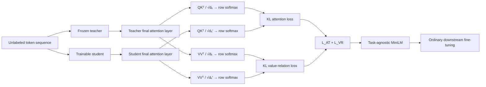
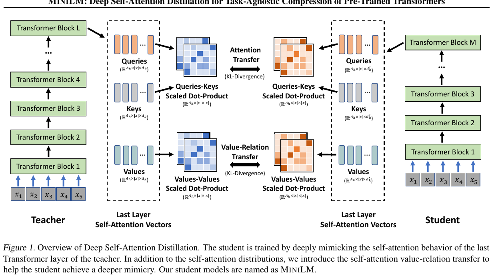
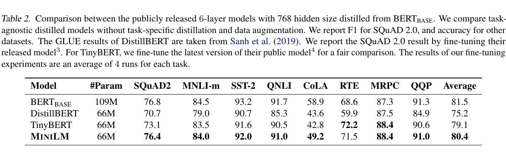
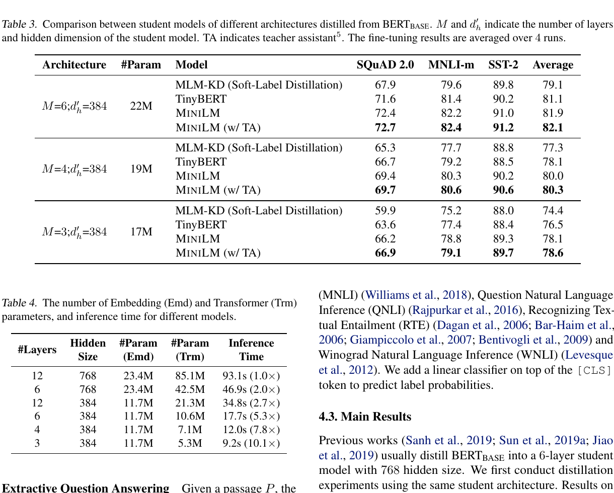
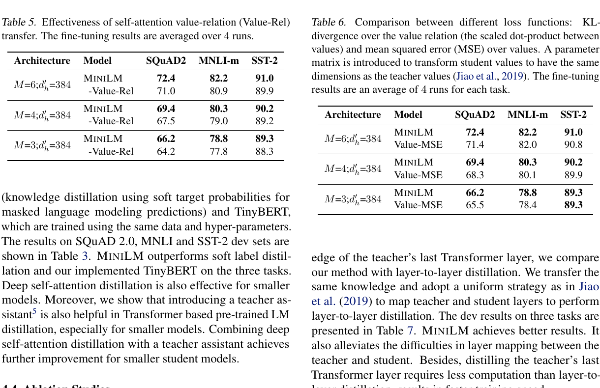

# MiniLM: Deep Self-Attention Distillation — Wang et al., 2020

> **arXiv:** 2002.10957v2 · **Venue:** NeurIPS 2020 · **Affiliation:** Microsoft Research

## TL;DR

MiniLM compresses a pretrained Transformer by making the student's final self-attention layer reproduce two token-to-token relations from the teacher's final layer: query-key attention distributions and a new value-value relation. Because both targets are sequence-by-sequence matrices, the student may have a different depth and hidden width without layer mapping or learned width projections. A 6-layer, width-768 MiniLM reaches 80.4 versus BERT-base's 81.5 average over SQuAD 2.0 and seven GLUE development metrics, with 66M versus 109M parameters and 2.0× inference speed on the paper's single-P100 setup (Tables 2 and 4).

## Problem & motivation

Task-specific distillation requires fine-tuning a large teacher separately for every downstream task. Task-agnostic distillation instead produces one compact pretrained model that can later be fine-tuned normally, but prior methods impose architectural coupling:

- [DistilBERT](distill_2019_distilbert.md) initializes the student from selected teacher layers, which keeps the teacher's hidden width and requires choosing layers.
- [TinyBERT](distill_2019_tinybert.md) matches intermediate hidden states and attention matrices layer by layer. Different widths require learned projections, and different depths require an explicit teacher-student layer map.
- MobileBERT designs matching bottlenecks and uses equal teacher/student depth for progressive layer-wise transfer.

Those constraints make the distillation target depend on the architecture. MiniLM asks whether the teacher can instead expose **dimension-independent behavior**. Its answer is to compare token-to-token relation matrices. A teacher head of width $d_k$ and a student head of width $d_k'$ both reduce to an $n\times n$ matrix for a sequence of length $n$.

The paper also observes that ordinary attention transfer constrains how tokens retrieve information through $QK^\top$, but not the geometry of the content vectors being aggregated. Its second contribution, value-relation transfer, adds the missing $VV^\top$ view.

## Key idea

For Transformer layer $l$ and attention head $a$, let the previous hidden states be $\mathbf H^{l-1}\in\mathbb R^{n\times d_h}$. Standard self-attention forms

$$
\mathbf Q_{l,a}=\mathbf H^{l-1}\mathbf W^Q_{l,a},\qquad
\mathbf K_{l,a}=\mathbf H^{l-1}\mathbf W^K_{l,a},\qquad
\mathbf V_{l,a}=\mathbf H^{l-1}\mathbf W^V_{l,a},
$$

where $\mathbf W^Q_{l,a},\mathbf W^K_{l,a},\mathbf W^V_{l,a}\in\mathbb R^{d_h\times d_k}$ and $n=|x|$ is the token count. Its attention distribution is

$$
\mathbf A_{l,a}
=\operatorname{softmax}\!\left(
\frac{\mathbf Q_{l,a}\mathbf K_{l,a}^{\top}}{\sqrt{d_k}}
\right)
\in\mathbb R^{n\times n},
$$

with row-wise softmax. Let the teacher have $L$ layers, the student $M$ layers, and both expose $A_h$ heads. MiniLM compares only their final layers:

$$
\mathcal L_{AT}
=\frac{1}{A_h n}
\sum_{a=1}^{A_h}\sum_{t=1}^{n}
D_{KL}\!\left(
\mathbf A^T_{L,a,t}\,\Vert\,\mathbf A^S_{M,a,t}
\right),
$$

where $\mathbf A_{l,a,t}$ is row $t$, a categorical distribution over key positions. This removes depth-wise layer correspondence.

MiniLM then creates a second distribution from values:

$$
\mathbf{VR}^T_{L,a}
=\operatorname{softmax}\!\left(
\frac{\mathbf V^T_{L,a}(\mathbf V^T_{L,a})^{\top}}{\sqrt{d_k}}
\right),
$$

$$
\mathbf{VR}^S_{M,a}
=\operatorname{softmax}\!\left(
\frac{\mathbf V^S_{M,a}(\mathbf V^S_{M,a})^{\top}}{\sqrt{d_k'}}
\right).
$$

Here $\mathbf V^T_{L,a}\in\mathbb R^{n\times d_k}$ and $\mathbf V^S_{M,a}\in\mathbb R^{n\times d_k'}$, but both relation matrices lie in $\mathbb R^{n\times n}$. Their loss is

$$
\mathcal L_{VR}
=\frac{1}{A_h n}
\sum_{a=1}^{A_h}\sum_{t=1}^{n}
D_{KL}\!\left(
\mathbf{VR}^T_{L,a,t}\,\Vert\,\mathbf{VR}^S_{M,a,t}
\right).
$$

The complete objective is simply

$$
\boxed{\mathcal L=\mathcal L_{AT}+\mathcal L_{VR}}.
$$

There is no hidden-state MSE, embedding loss, masked-language-model soft-label loss, or task-label loss in the stated MiniLM v1 distillation objective (Equations 6–10). The equal coefficient is implicit in the unweighted sum.

## How it works



### Final-layer relation transfer

For each unlabeled batch:

1. Tokenize with the teacher's WordPiece vocabulary and build the normal token, position, and segment embeddings.
2. Run the frozen teacher and trainable student on the same length-$n$ sequence.
3. Retain $Q$, $K$, and $V$ only from each model's final Transformer layer.
4. For every head, construct row-normalized $QK^\top$ attention and $VV^\top$ value-relation matrices.
5. Average teacher-to-student row-wise KL divergence across tokens and heads for both relation types.
6. Backpropagate their sum through the student only.

The paper's v1 models use $A_h=12$ relation heads for both teacher and student. Thus depth and head width may differ, but head count is still aligned head by head. [MiniLMv2](https://arxiv.org/abs/2012.15828) later generalizes the relation construction to remove that head-count restriction.



*Official Figure 1. Teacher and student depths and per-head widths differ, yet their final-layer $QK^\top$ and $VV^\top$ paths both produce shape $A_h\times n\times n$ relation tensors.*

### Why $VV^\top$ is width-independent

Directly matching teacher and student values with MSE requires equal widths or a learned matrix $\mathbf W\in\mathbb R^{d_k'\times d_k}$. MiniLM instead compares pairwise token geometry. For token values $\mathbf v_i$ and $\mathbf v_j$, the $(i,j)$ logit is their scaled inner product. The resulting matrix records which tokens carry mutually similar value content, while eliminating the feature-axis mismatch. Table 6 confirms that this relation target beats projected value MSE across the tested student sizes.

### Teacher assistant for a large capacity gap

If the final student is at most half the teacher's depth and width,

$$
M\le \frac{L}{2},\qquad d_h'\le\frac{d_h}{2},
$$

the optional teacher-assistant route first distills the teacher into an assistant with $L$ layers and student width $d_h'$, then uses that assistant as the final student's teacher. For BERT-base to a 6×384 student, this means BERT-base $\rightarrow$ 12×384 assistant $\rightarrow$ 6×384 student. Tables label these runs “w/ TA”; unmarked MiniLM rows are directly distilled.

## Training / data

### Public BERT-base teacher track

- **Teacher:** uncased BERT-base, 12 layers, width 768, 12 heads, approximately 109M parameters.
- **Students:** 6×768 and compact 6×384, 4×384, and 3×384 architectures; all use 12 relation heads.
- **Corpus:** English Wikipedia snapshot `enwiki-20181101` plus BookCorpus, following BERT preprocessing and its 30,522-token uncased WordPiece vocabulary.
- **Context:** maximum sequence length 512.
- **Optimizer:** Adam with $\beta_1=0.9$, $\beta_2=0.999$, weight decay 0.01, dropout 0.1.
- **Schedule:** 4,000-step linear warmup followed by linear decay; mixed-precision training on 8 V100 GPUs.
- **6×768 run:** batch 1,024, peak learning rate $5\times10^{-4}$, 400,000 steps.
- **Other BERT-distilled architectures:** batch 256 and peak learning rate $3\times10^{-4}$. Section 4.1 does not explicitly restate their step count, student initialization, random seed, or data sampling mixture, which limits exact reproduction from the paper alone.

### Stronger in-house teacher track

The paper also distills a private BERT-base-sized UniLM-family teacher pretrained on 160 GB from Wikipedia, BookCorpus, OpenWebText, CC-News, and Stories. This track is not directly reproducible from the released BERT teacher.

- **12×384:** batch 2,048, Adam $\beta_2=0.98$, peak learning rate $6\times10^{-4}$, 400,000 steps.
- **6×384:** batch 512, peak learning rate $4\times10^{-4}$, with 12×384 as teacher assistant.
- Other hyperparameters follow the public-teacher setup.

### Multilingual track

XLM-R-base is distilled into 12×384 and 6×384 students using the same corpora as that teacher; the 12×384 model assists the 6×384 model. Adam uses $(\beta_1,\beta_2)=(0.9,0.999)$. The 12-layer run uses batch 256, peak learning rate $3\times10^{-4}$, and 1,000,000 steps; the 6-layer run uses batch 512, $6\times10^{-4}$, and 400,000 steps.

### Downstream adaptation

- **SQuAD 2.0:** length 384, document stride 128, 3 epochs. BERT-distilled students use batch 32 and peak learning rate $6\times10^{-5}$; the in-house-teacher 12×384 model uses batch 48 and $4\times10^{-5}$ (Appendix B).
- **GLUE:** length 128, batch 32 for BERT-distilled students, learning rate selected from $\{2,3,4,5\}\times10^{-5}$, and epochs from $\{3,4,5\}$. CoLA, RTE, and MRPC may run up to 10 epochs. Results are development-set means over four fine-tuning runs where the table captions specify averaging.
- **Inference timing:** average of 100 QNLI-training-set batches on one P100 GPU, using the same evaluation hyperparameters (§4.1 and Table 4). These are hardware/workload-specific measurements.

## Results

### Matched 6×768 task-agnostic students



*Official Table 2. SQuAD 2.0 uses F1; the seven GLUE columns use accuracy. MiniLM, TinyBERT, and the reported fine-tuning results are averaged over four runs; no task-specific distillation or data augmentation is used.*

| Model | Params | SQuAD 2.0 | MNLI-m | SST-2 | QNLI | CoLA | RTE | MRPC | QQP | Average |
|---|---:|---:|---:|---:|---:|---:|---:|---:|---:|---:|
| BERT-base | 109M | 76.8 | 84.5 | 93.2 | 91.7 | 58.9 | 68.6 | 87.3 | 91.3 | 81.5 |
| DistilBERT | 66M | 70.7 | 79.0 | 90.7 | 85.3 | 43.6 | 59.9 | 87.5 | 84.9 | 75.2 |
| TinyBERT | 66M | 73.1 | 83.5 | 91.6 | 90.5 | 42.8 | **72.2** | **88.4** | 90.6 | 79.1 |
| **MiniLM** | **66M** | **76.4** | **84.0** | **92.0** | **91.0** | **49.2** | 71.5 | **88.4** | **91.0** | **80.4** |

*Source: Table 2, development sets.* MiniLM recovers $76.4/76.8=99.5\%$ of teacher SQuAD F1 and $84.0/84.5=99.4\%$ of MNLI-m accuracy. Its 80.4 aggregate is 1.3 points above the task-agnostic TinyBERT checkpoint and 5.2 above DistilBERT under the paper's comparison protocol.

### Smaller students and efficiency



*Official Tables 3–4. Table 3 compares equal-size methods and teacher-assistant variants; Table 4 separates embedding and Transformer parameters and measures one-P100 QNLI timing.*

| Student | Params | SQuAD 2.0 | MNLI-m | SST-2 | Direct avg | With assistant avg | P100 time | Speedup |
|---|---:|---:|---:|---:|---:|---:|---:|---:|
| 6×384 | 22M | 72.4 | 82.2 | 91.0 | 81.9 | 82.1 | 17.7 s | 5.3× |
| 4×384 | 19M | 69.4 | 80.3 | 90.2 | 80.0 | 80.3 | 12.0 s | 7.8× |
| 3×384 | 17M | 66.2 | 78.8 | 89.3 | 78.1 | 78.6 | 9.2 s | 10.1× |

*Sources: Tables 3–4.* The three-task average covers SQuAD 2.0 F1, MNLI-m accuracy, and SST-2 accuracy. At every size, direct MiniLM beats the same-data/hyperparameter MLM-KD and TinyBERT implementations. The assistant adds 0.2, 0.3, and 0.5 points as the student shrinks, supporting the capacity-gap rationale.

The complete Table 4 timing progression is 93.1 s for 12×768, 46.9 s for 6×768, 34.8 s for 12×384, 17.7 s for 6×384, 12.0 s for 4×384, and 9.2 s for 3×384. It also shows why total parameter count needs care. The shared embedding table is 11.7M parameters for all width-384 models, while Transformer parameters fall from 21.3M at 12 layers to 5.3M at 3 layers. Runtime follows the Transformer reduction more strongly than total checkpoint size.

### Ablations



*Official Tables 5–6. Results are four-run development means on SQuAD 2.0, MNLI-m, and SST-2.*

- **Remove value relations (Table 5):** SQuAD F1 drops 72.4→71.0 for 6×384, 69.4→67.5 for 4×384, and 66.2→64.2 for 3×384. MNLI falls by 1.3, 1.3, and 1.0 points; SST-2 falls by 1.1, 1.0, and 1.0.
- **Relation KL versus projected value MSE (Table 6):** value-relation transfer beats MSE on every non-tied entry and improves SQuAD by 1.0, 1.1, and 0.7 points across the three sizes, without adding a width projection.
- **Final layer versus layer-to-layer (Table 7):** direct final-layer MiniLM averages 81.9, 80.0, and 78.1; adding uniform layer-to-layer transfer yields 81.3, 79.0, and 77.0. More supervision is not automatically better, and final-layer transfer is also cheaper.

### Stronger teacher, generation, and multilingual transfer

These experiments broaden the claim but use different teachers or adaptation procedures:

- **Private in-house teacher (Table 8):** 12×384 MiniLM reaches 83.1 average and 81.7 SQuAD F1 versus BERT-base's 81.5 and 76.8, with 33M parameters and 2.7× timing speedup. The 6×384 assistant-trained model reaches 79.6 and 75.6 with 22M parameters. The stronger training corpus/teacher prevents attributing these gains solely to compression.
- **Question generation (Table 9):** 12×384 MiniLM reaches 21.07 BLEU-4, 24.09 METEOR, and 49.14 ROUGE-L on the Du/Cardie split, and 23.27/25.15/50.60 on the Zhao split.
- **Summarization (Table 10):** the same model reaches 42.66/19.91/39.73 ROUGE-1/2/L on CNN/DailyMail and 40.43/17.72/32.60 on XSum. These generation experiments adapt MiniLM as a sequence-to-sequence system with a UniLM-style attention mask; this is downstream fine-tuning, not a seq2seq distillation objective.
- **Multilingual classification (Table 11):** 12×384 MiniLM scores 71.1 versus XLM-R-base's 74.5 average XNLI accuracy; 6×384 scores 68.0, above mBERT's reported 66.3.
- **Multilingual parameter accounting (Table 12):** 12×384 MiniLM has 21M Transformer parameters versus XLM-R-base's 85M, but their large shared vocabularies require 96M and 192M embedding parameters respectively. Transformer compression therefore overstates total-checkpoint compression.
- **Multilingual QA (Table 13):** 12×384 scores 63.2 F1 / 44.7 EM on MLQA versus the authors' XLM-R-base fine-tune at 64.9 / 46.9; 6×384 scores 53.7 / 36.6.

## Limitations & follow-ups

- **Head count is not fully architecture-independent.** V1 fixes 12 relation heads for teacher and students and compares corresponding heads. MiniLMv2's multi-head relation distillation is the direct follow-up that removes this restriction.
- **Only the final attention layer is supervised.** This is efficient and avoids mapping, but it assumes the teacher's final relations provide enough learning signal for all student layers. The paper does not test different teacher-layer choices.
- **Quadratic relation tensors remain.** Both targets are $A_h\times n\times n$, so distillation memory and computation scale quadratically with sequence length even when the student is narrow.
- **The public method is not a complete training artifact.** The repository releases checkpoints and downstream fine-tuning examples, but not a self-contained v1 distillation pipeline. Student initialization, some compact-run schedule details, seeds, and corpus sampling are absent from the paper.
- **Stronger headline models use a private teacher.** The 12×384 result exceeding BERT-base comes from an in-house teacher and 160 GB corpus, so it is not an apples-to-apples result for the public BERT-base track.
- **Speed is hardware and workload specific.** Table 4 averages QNLI batches on one P100; it does not establish latency on CPU/mobile hardware, at batch size one, or for long sequences.
- **Evaluation predates modern robustness and retrieval suites.** English evidence centers on SQuAD/GLUE and selected generation datasets; multilingual evidence covers XNLI/MLQA. Calibration, out-of-domain robustness, retrieval, and long-context behavior are not measured.
- **Relations preserve behavior, not an explicit language-model distribution.** The objective omits MLM logits, so it does not directly guarantee token-probability matching. The paper empirically compares relation KD with MLM soft-label KD but does not combine or deeply analyze both.

## Links

- **Paper:** [arXiv abstract](https://arxiv.org/abs/2002.10957v2) · [v2 HTML](https://arxiv.org/html/2002.10957v2) · [v2 PDF](https://arxiv.org/pdf/2002.10957v2)
- **Venue:** [NeurIPS 2020 proceedings](https://proceedings.neurips.cc/paper/2020/hash/3f5ee243547dee91fbd053c1c4a845aa-Abstract.html) · [author feedback](https://proceedings.neurips.cc/paper_files/paper/2020/file/3f5ee243547dee91fbd053c1c4a845aa-AuthorFeedback.pdf)
- **Code and models:** [official Microsoft UniLM repository](https://github.com/microsoft/unilm/tree/master/minilm)
- **Hugging Face:** [MiniLM-L12-H384-uncased](https://huggingface.co/microsoft/MiniLM-L12-H384-uncased) · [Multilingual-MiniLM-L12-H384](https://huggingface.co/microsoft/Multilingual-MiniLM-L12-H384)
- **Source map:** self-attention preliminaries (Equations 1–4); relation objectives (§3.1–3.2, Equations 6–10); teacher assistant (§3.3); distillation setup (§4.1); matched and compact results (Tables 2–4); ablations (Tables 5–7); stronger teacher, NLG, and multilingual evidence (Tables 8–13); fine-tuning settings (Appendices B–C).
- **BibTeX:**

  ```bibtex
  @inproceedings{wang2020minilm,
    title     = {{MiniLM}: Deep Self-Attention Distillation for Task-Agnostic Compression of Pre-Trained Transformers},
    author    = {Wang, Wenhui and Wei, Furu and Dong, Li and Bao, Hangbo and Yang, Nan and Zhou, Ming},
    booktitle = {Advances in Neural Information Processing Systems 33},
    year      = {2020}
  }
  ```

- **Related local recaps:** [Hinton knowledge distillation](distill_2015_hinton-kd.md) · [DistilBERT](distill_2019_distilbert.md) · [TinyBERT](distill_2019_tinybert.md)
- **Successor:** [MiniLMv2: Multi-Head Self-Attention Relation Distillation](https://arxiv.org/abs/2012.15828)