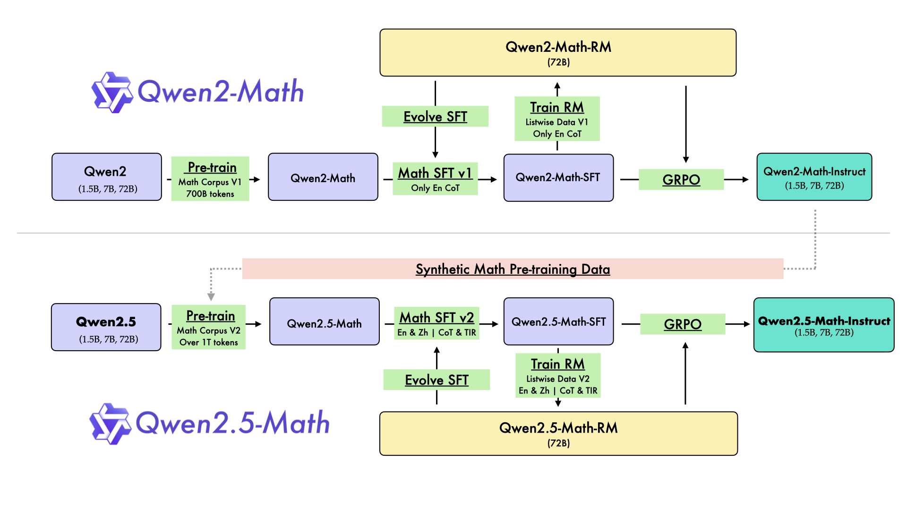
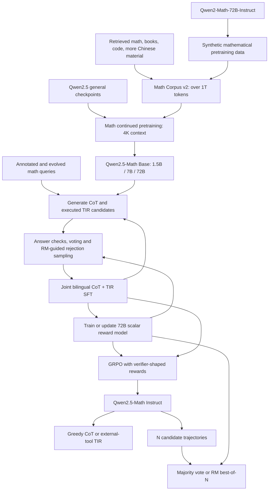
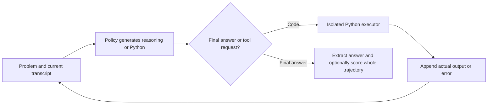
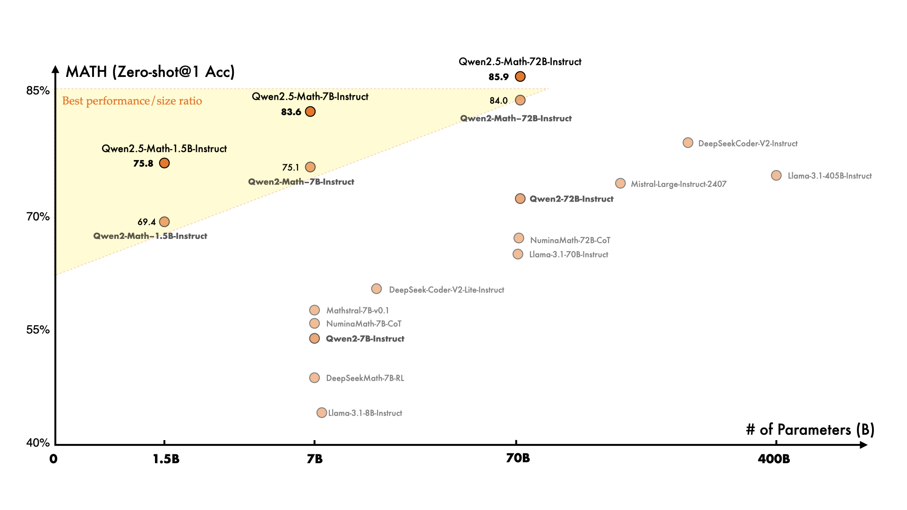
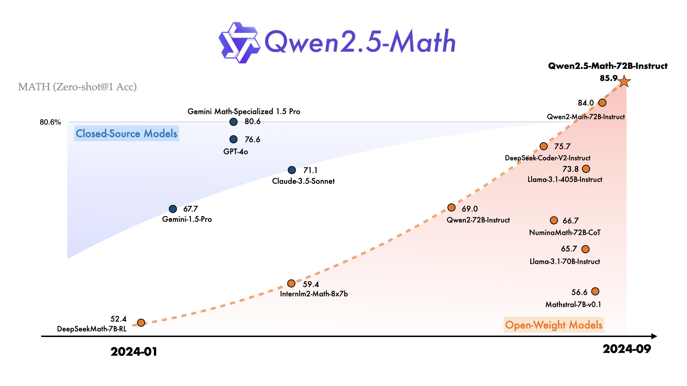
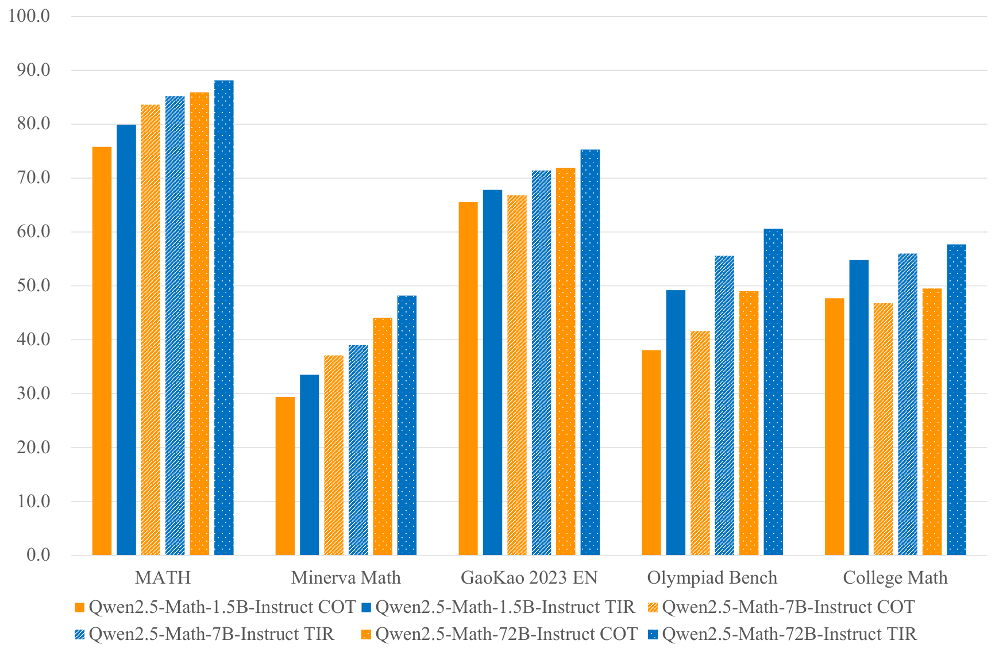

# Qwen2.5-Math: Mathematical Self-Improvement with Reward Models and Tools - Yang et al., 2024

> **arXiv:** [2409.12122v1](https://arxiv.org/abs/2409.12122v1) (18 September 2024) · **Venue:** preprint / technical report · **Affiliation:** Alibaba Group
>
> Full title: *Qwen2.5-Math Technical Report: Toward Mathematical Expert Model via Self-Improvement*. This recap uses the report's tables for benchmark values and distinguishes them from release-card numbers where they differ. Architecture details omitted from the report are supplemented with released configurations and reward-model code.

## TL;DR

Qwen2.5-Math improves mathematical language models through a **self-improvement pipeline spanning data synthesis, supervised fine-tuning, reward modeling, reinforcement learning, and inference-time selection**. It continues pretraining Qwen2.5 checkpoints on a mathematical corpus of **over 1T tokens**, jointly teaches English/Chinese chain-of-thought (CoT) and tool-integrated reasoning (TIR), and uses a **72B outcome-supervised reward model** for response selection and GRPO training. The released policies come in 1.5B, 7B, and 72B sizes; strong results depend on the inference setup, so greedy CoT, Python-assisted TIR, majority voting, and reward-model best-of-N must be compared separately. In particular, the headline **39/40 AMC 2023** result uses **72B TIR with RM@256**, not one unassisted model completion (Table 5).

## Problem & motivation

### Mathematical expertise needs more than general-language pretraining

General models learn some mathematics incidentally, but a sufficiently rich mathematical distribution is uncommon in an undifferentiated web corpus. The report develops the Qwen2-Math and Qwen2.5-Math generations together to show how specialized retrieval, filtering, synthetic data, and stronger initialization change that distribution.

The earlier **Qwen Math Corpus v1** contains approximately 700B tokens. Qwen2.5-Math uses **Corpus v2**, expanded beyond 1T tokens with additional synthetic material and more high-quality Chinese mathematics. Importantly, the new models initialize from **Qwen2.5 general checkpoints**, not simply from the old Qwen2-Math weights. Both improved initialization and improved data contribute; the report does not isolate every contribution with a controlled ablation.

### A correct final answer is useful supervision, but an incomplete account of reasoning

Automatically checking the answer to a math problem is often easier than annotating a full solution. This enables large-scale generation and rejection sampling, but two traces can arrive at the same answer through very different reasoning, and an incorrect answer can result from either a conceptual error or a small arithmetic mistake.

Qwen2.5-Math trains a reward model to distinguish successful from unsuccessful **whole responses**. The model can learn features associated with better reasoning, but its labels come from final-answer correctness: it is **not** a process reward model with independently supervised judgments for every mathematical step.

### Computation and conceptual reasoning have different failure modes

An LLM may choose a reasonable method yet make an arithmetic, symbolic-manipulation, or algorithmic error. TIR lets it delegate computations to a Python interpreter and then continue reasoning with the returned result.

The interpreter does not choose a correct mathematical formulation automatically. A wrong equation, flawed program, or misinterpreted tool result can still yield a wrong answer. Tools therefore complement the policy rather than replacing the need for mathematical reasoning or evaluation.

## Key idea

### Reuse better models as generators and judges

The report's self-improvement loop has three distinct roles:

1. **Generate better training material.** Qwen2-Math-Instruct helps synthesize the mathematical corpus for the next generation. Within post-training, stronger intermediate policies generate better candidate solutions.
2. **Select and optimize responses.** A learned reward model guides rejection sampling for SFT and contributes to the GRPO reward, alongside a rule-based answer verifier.
3. **Spend more computation at inference.** Generate several candidate solutions and use majority voting or reward-model ranking to select an answer.



*Figure 2 separates the old English-CoT pipeline from the newer English/Chinese CoT-and-TIR pipeline. The previous Instruct model supplies synthetic data, but the next policy's parameter initialization comes from the corresponding general model family.*

For a problem $q$, a policy $\pi_\theta$ generates a response or tool-using trajectory $y$. A reward model $r_\phi(q,y)$ supplies a scalar ranking score. A verifier supplies $v(q,y)\in\{0,1\}$ when a reference answer is available.

The pipeline uses these signals differently:

$$
\begin{aligned}
\text{SFT selection:}&\quad
\text{retain reliable, high-scoring generated solutions},\\
\text{RL reward:}&\quad
r=\sigma(0.5\,r_\phi(q,y))+(v(q,y)-1),\\
\text{best-of-}N\text{:}&\quad
y^*=\arg\max_{y_i,\ i=1,\ldots,N}r_\phi(q,y_i).
\end{aligned}
$$

$\theta$ and $\phi$ are policy and reward-model parameters, $\sigma$ is the logistic sigmoid, and $N$ is the number of sampled responses. The middle expression is the report's reward-shaping rule (Equation 3). The other lines summarize selection behavior; they are not additional paper equations.

**Inference-time best-of-N does not use the hidden gold answer to select a candidate.** Gold-answer verification is available during training and evaluation scoring, whereas the deployed reward model predicts which candidate is best.

### Original reconstruction of the self-improvement loop



The loop is model-assisted dataset improvement, not an assertion that every iteration is guaranteed to improve or that all correctness labels are independent of model-generated answers.

## How it works

### 1. Policy architecture and context length

The mathematical specialization retains a dense Qwen decoder: RMSNorm, grouped-query attention, RoPE, attention QKV bias, and SwiGLU feed-forward layers. It does not introduce a separate theorem-proving architecture or a mixture-of-experts router.

The report concentrates on training rather than providing a dimension table. The released Instruct configurations give:

| Size | Layers | Hidden width | FFN width | Query / KV heads | Tied embeddings | Embedding vocabulary | Configured context |
|---|---:|---:|---:|---|---|---:|---:|
| 1.5B | 28 | 1,536 | 8,960 | 12 / 2 | Yes | 151,936 | 4,096 |
| 7B | 28 | 3,584 | 18,944 | 28 / 4 | No | 152,064 | 4,096 |
| 72B | 80 | 8,192 | 29,568 | 64 / 8 | No | 152,064 | 4,096 |

All three use a head width of 128 and a RoPE base of **10,000**. These are mathematical-checkpoint settings, not the general Qwen2.5 family's longer-context configuration. The paper trains with **4K context**; it does not establish native 128K mathematical reasoning.

For input IDs of shape $B\times T$, embeddings produce hidden states $H\in\mathbb R^{B\times T\times d}$, with batch size $B$, length $T$, and hidden width $d$. A decoder block can be unpacked as

$$
\begin{aligned}
U&=\operatorname{RMSNorm}(H),\\
H'&=H+\operatorname{GQA}
\left(\operatorname{RoPE}(UW_Q+b_Q),
\operatorname{RoPE}(UW_K+b_K),UW_V+b_V\right)W_O,\\
V&=\operatorname{RMSNorm}(H'),\\
H_{\mathrm{next}}&=H'
+[\operatorname{SiLU}(VW_g)\odot(VW_u)]W_d.
\end{aligned}
$$

$W_Q,W_K,W_V,W_O$ are the attention projections, $b_Q,b_K,b_V$ their QKV biases, and $W_g,W_u,W_d$ the gated FFN projections. $\odot$ is elementwise multiplication. Attention uses a causal mask: future policy tokens cannot be seen during generation.

The query tensor has shape $B\times T\times h_q\times128$, while keys and values have shape $B\times T\times h_{kv}\times128$. $h_q$ and $h_{kv}$ are the query and KV head counts in the table. GQA shares each KV head across several query heads, reducing the KV cache. The LM head maps the final normalized hidden states to vocabulary logits.

These equations explain the inherited decoder; the novelty lies primarily in mathematical data, alignment, reward shaping, and tool-assisted inference.

### 2. CoT and TIR are two trajectory formats

**CoT** produces natural-language reasoning and a final answer. The released examples ask for the answer in `\boxed{...}` so the evaluator can extract it. This is an output convention, not a formal proof checker.

**TIR** interleaves model-generated reasoning and Python code with outputs from an external executor:



A minimal reconstructed interaction is:

````text
Problem: Find the sum of the squares of the integers from 1 through 5.
Model: I will calculate the finite sum.
```python
print(sum(k * k for k in range(1, 6)))
```
Executor output: 55
Model: The requested sum is \boxed{55}.
````

The nested code fences above illustrate transcript roles, not one literal prompt template. A real runner must distinguish code generated by the policy from trusted executor output; simply generating text that looks like an output is not tool use.

The [released evaluator](https://github.com/QwenLM/Qwen2.5-Math/blob/main/evaluation/math_eval.py) implements generation, code extraction, execution, and reinsertion of results inside `output` blocks. It bounds the generation/execution loop and can return an execution report when a program fails. A production implementation also needs execution isolation and resource limits; a model's mathematical training does not make arbitrary generated Python safe to run.

During **TIR reinforcement learning**, the paper explicitly masks tokens provided by the Python executor. They are observations, not actions sampled by the policy. The same masking principle must be reflected in policy-probability ratios and the policy loss; the paper does not specify every SFT masking detail.

### 3. The reward model: one score per complete solution

Section 3.2 initializes the RM from an SFT model and replaces the next-token LM head with a two-layer scalar head. The released 72B implementation makes this concrete:

$$
H=\operatorname{Decoder}_\phi(q,y),\qquad
z_t=W_2\operatorname{ReLU}(W_1H_t+b_1)+b_2,
\qquad
r_\phi(q,y)=z_{t_*}.
$$

For the 72B checkpoint, $H_t\in\mathbb R^{8192}$, the first linear map is $8192\rightarrow8192$, and the second is $8192\rightarrow1$. $t_*$ is the selected sequence-end position. The released code uses the final position when no padding token is configured, otherwise its padding-aware sequence-end index. Correct chat formatting, padding, and pooling are therefore part of reproducing scores.

The output is an **unbounded scalar**, not a calibrated probability of correctness. The head is applied to hidden states and one end-of-sequence score is selected. Although the score can reflect the full preceding reasoning trace, the released model does not return a separately trained reward for every proof step.

#### Outcome-derived preference lists

The old Qwen2-Math RM uses **206K English problems**, each with six sampled responses. Qwen2.5-Math RM expands this to **361K English and 257K Chinese problems**, again with six responses each, and adds TIR support.

Responses whose final answers match the reference are positive; the others are negative. Queries for which all six are correct or all six are wrong are removed because they provide no positive-versus-negative contrast. Candidates from different intermediate checkpoints and model sizes broaden the difficulty distribution.

If query $q$ has $k$ positive responses and $6-k$ negatives, then $1\leq k\leq5$ and there are $k(6-k)$ valid preference pairs. An expanded valid-pair form of the ranking loss in **Equation 1** is

$$
\mathcal L_{\mathrm{RM}}(\phi)
=-\mathbb E_q\left[
\frac{1}{k_q(6-k_q)}
\sum_{i\in\mathcal P_q}\sum_{j\in\mathcal N_q}
\log\sigma\left(r_\phi(q,y_i)-r_\phi(q,y_j)\right)
\right].
$$

$\mathcal P_q$ and $\mathcal N_q$ are the positive and negative index sets, and $k_q=|\mathcal P_q|$. The report describes computing valid pairs together in a **listwise** implementation, avoiding repeatedly processing a response as a separate training pair. The underlying supervision remains a ranking between outcome-labeled candidates, not a softmax classification over a single correct answer.

Normalizing by the number of pairs prevents a query with three positives and three negatives from automatically contributing more pair terms than one with only one positive. It also explains why all-positive/all-negative groups must be excluded.

### 4. GRPO: improve a policy using relative group rewards

For each query $q$, sample $G$ responses $o_1,\ldots,o_G$ from a sampling policy $\pi_{\mathrm{old}}$. Score them to obtain $r_1,\ldots,r_G$ and define

$$
\widehat A_i=
\frac{r_i-\operatorname{mean}(r_1,\ldots,r_G)}
{\operatorname{std}(r_1,\ldots,r_G)}.
$$

The response-level advantage $\widehat A_i$ is applied to each policy-generated token in that response. GRPO does not train a separate value-function model as PPO commonly does. The RM is still required here: “no critic” does not mean “no reward model.”

Writing the token probability ratio as

$$
\rho_{i,t}(\theta)=
\frac{\pi_\theta(o_{i,t}\mid q,o_{i,<t})}
{\pi_{\mathrm{old}}(o_{i,t}\mid q,o_{i,<t})},
$$

the objective in **Equation 2** can be written

$$
\mathcal J_{\mathrm{GRPO}}(\theta)
=\mathbb E\left[
\frac{1}{G}\sum_{i=1}^{G}\frac{1}{|o_i|}
\sum_{t=1}^{|o_i|}
\left\{
\min\left[
\rho_{i,t}\widehat A_i,\,
\operatorname{clip}(\rho_{i,t},1-\epsilon,1+\epsilon)\widehat A_i
\right]
-\beta D_{\mathrm{KL}}[\pi_\theta\Vert\pi_{\mathrm{ref}}]
\right\}\right].
$$

$\pi_\theta$ is the trainable policy, $\pi_{\mathrm{old}}$ the rollout policy, and $\pi_{\mathrm{ref}}$ the fixed reference. $\epsilon$ is the clipping threshold, $\beta$ the KL coefficient, and $|o_i|$ the response length. The expectation covers sampled queries and rollout groups. The KL term discourages excessive departure from the reference policy.

This is the paper's unmasked notation; executor-observation tokens are excluded from policy optimization in its TIR implementation. The report does not specify the clipping threshold, exact KL estimator, or zero-variance stabilization rule. A complete implementation must handle zero group standard deviation explicitly rather than divide by zero.

#### Why the shaped reward preserves answer correctness

For raw RM score $r_m\in\mathbb R$ and verifier outcome $r_v\in\{0,1\}$, **Equation 3** is

$$
r=\sigma(\alpha r_m)+(r_v-1),
\qquad \alpha=0.5.
$$

For finite scores in exact arithmetic:

$$
\begin{cases}
0<r<1,&r_v=1,\\
-1<r<0,&r_v=0.
\end{cases}
$$

Thus every verifier-correct response ranks above every verifier-incorrect response, while the RM differentiates candidates **within** each correctness group. For example, a zero RM score gives reward $0.5$ if correct and $-0.5$ if incorrect; these are derived illustrations, not measured results.

This limits one form of reward hacking: a high learned score cannot overcome the verifier's negative correctness band. It does not protect against a faulty answer extractor, an incorrect reference answer, or an incomplete mathematical equivalence checker.

### 5. Majority voting and RM selection are not the same computation

Let $a(y_i)$ extract a normalized final answer from candidate $i$. Majority voting selects

$$
a_{\mathrm{maj}}
=\arg\max_a\sum_{i=1}^{N}\mathbf1[a(y_i)=a],
$$

where $\mathbf1[\cdot]$ is an indicator. Equivalent mathematical expressions need appropriate normalization or checking before their votes can be grouped.

**RM@N** instead scores each entire candidate and selects the highest-scoring response. It can select an answer that appears only once, unlike majority voting. Conversely, a strong judge cannot choose a correct response if no correct candidate was generated. Neither RM@N nor Maj@N is the oracle **pass@N** metric that counts a problem correct whenever any candidate is correct.

Section 3.1 also uses **weighted majority voting** while constructing some synthetic training answers. The report does not fully specify its weighting and tie-breaking scheme; that training procedure should not be conflated with plain Maj@N or RM best-of-N.

## Training / data

### 1. From Corpus v1 to Corpus v2

Section 2 constructs the first mathematical corpus through:

1. **Recall:** train a fastText classifier from high-quality mathematical seeds and general text, iterate with additional mathematical data, and use metadata such as URLs to expand retrieval.
2. **Deduplication:** apply methods including MinHash to remove similar documents.
3. **Quality filtering:** use prompted Qwen2-0.5B-Instruct to score potential entries, prioritizing higher-quality material.
4. **Synthesis:** use Qwen2-72B-Instruct with retrieved references both to extract/refine existing Q&A and to generate new Q&A.
5. **Mixture experiments:** use Qwen2-Math-1.5B to study data mixtures before constructing the approximately 700B-token Corpus v1.

Sources include mathematical web text, code snippets, encyclopedias, exam questions, and synthetic examples. Qwen2-Math initializes from intermediate Qwen2 checkpoints and continues pretraining at 4K context.

For **Corpus v2**, the authors add synthetic pretraining material generated by **Qwen2-Math-72B-Instruct**, collect more high-quality material across multiple recall cycles, and particularly increase Chinese content from web documents, books, and code repositories. The corpus exceeds 1T tokens. Qwen2.5-Math initializes from Qwen2.5 base checkpoints and continues mathematical pretraining at the same 4K length.

The ordinary causal objective is

$$
\mathcal L_{\mathrm{LM}}
=-\mathbb E_{x\sim\mathcal D_{\mathrm{math}}}
\sum_{t=1}^{|x|}\log p_\theta(x_t\mid x_{<t}),
$$

where $x$ is a sampled corpus sequence and $\mathcal D_{\mathrm{math}}$ the curated distribution. The report does not publish all numerical mixture weights, pretraining optimizer settings, hardware costs, or the complete data corpus.

### 2. CoT data: query counts versus response counts

The CoT query pool contains **580K English and 500K Chinese mathematical problems**. Annotated sources include GSM8K training, MATH training, and NuminaMath; Chinese coverage also draws on exclusive K-12 problem collections. MuggleMath-style evolution creates additional problems, and a difficulty-scoring model helps balance complexity.

For each iteration, the current best policy generates multiple solutions:

- With a reference answer, retain correct-final-answer paths and select the top-$k$ paths.
- Without a definitive answer, use weighted majority voting to infer plausible answers, then select high-reward paths.
- Use stronger policies and the RM to improve the next training set; Qwen2.5-Math adds an iteration using Qwen2-Math-Instruct to polish responses.

The final CoT dataset contains **2M English samples and 500K Chinese samples**. These are training examples, not 2.5M distinct mathematical problems: multiple responses can correspond to a single query. The report does not state a single universal value for the selection parameter $k$.

### 3. TIR data: online rejection fine-tuning

The TIR pool contains **190K annotated** and **205K synthesized problems**, drawing on GSM8K, MATH, CollegeMath, and NuminaMath training material. Query evolution uses MuggleMath and DotaMath techniques. A further **75K annotated problems are translated into Chinese using Qwen2-72B**; translation does not make them independent new mathematical problems.

For annotated queries, online rejection fine-tuning repeatedly:

1. Samples executed TIR trajectories from the current best policy using nucleus sampling at varied temperatures.
2. Allocates more samples to difficult queries.
3. Keeps trajectories whose final answers match the reference.
4. Deduplicates the accepted responses.
5. Fine-tunes on the resulting data, then repeats.

For synthesized queries, the best policy from this process generates candidate trajectories and majority voting selects plausible solutions. The paper does not provide a complete per-iteration sample schedule or the final TIR response count. “Online RFT” here is iterative generate-filter-supervise training; it is distinct from the later GRPO policy-gradient stage.

### 4. Joint SFT recipe

CoT and TIR datasets are combined for supervised training. A response-supervised formulation is

$$
\mathcal L_{\mathrm{SFT}}
=-\mathbb E_{(q,y)}
\sum_t\log\pi_\theta(y_t\mid q,y_{<t}).
$$

$q$ is the problem/prompt and $y$ the target response or trajectory. This is an explanatory standard objective; exact token masks and dataset mixing weights are not fully specified by the report.

| Policy size | Epochs | Sequence length | Batch size | Initial learning rate | Final learning rate |
|---|---:|---:|---:|---:|---:|
| 1.5B / 7B | 3 | 4,096 | 128 | $2\times10^{-5}$ | $7\times10^{-7}$ |
| 72B | 3 | 4,096 | 256 | $5\times10^{-6}$ | $7\times10^{-7}$ |

*Source: Section 3.1. The learning rate gradually decays; the complete scheduler and optimizer configuration are not stated.*

### 5. RM training and RL curriculum

The RM sees six responses per query, while **RL query selection** resamples **eight** responses using SFT policies of different sizes. These are different sample counts for different purposes.

The authors retain RL queries with **2-5 correct responses out of eight**. They exclude the hardest queries, where the policy rarely finds a correct answer, and the easiest, where it is already reliable. This leaves **66K RL queries**, selected from the RM training query pool.

Actual GRPO rollouts use **32 responses per query**, and all policy sizes use the **same reward model**. The implementation uses [ChatLearn](https://github.com/alibaba/ChatLearn).

| RL setting | 7B | 72B |
|---|---:|---:|
| Responses per rollout query | 32 | 32 |
| Query-response pairs per episode | 4,096 | 2,048 |
| Global batch size | 512 | 512 |
| Learning rate | $1\times10^{-5}$ | $5\times10^{-6}$ |
| KL coefficient $\beta$ | $1\times10^{-3}$ | $1\times10^{-3}$ |
| Reward sigmoid scale $\alpha$ | 0.5 | 0.5 |

*Source: Section 3.3. An episode “sample” is a query-response pair, not a distinct query containing 32 responses. The report does not give a corresponding 1.5B episode size or learning rate, so those should not be inferred from the 7B recipe.*

The reward-model filtering and RL curriculum exploit outcome labels but create selection bias toward queries with mixed success. They are not a demonstrated universal curriculum for problems the current model never solves.

### 6. Decontamination and benchmark protocol

Section 4 describes normalized **13-gram matching** and an additional **longest-common-subsequence ratio above 0.6** criterion. The report does not fully define the ratio's denominator or every detail of the combined matching procedure, so it should not be silently replaced with a later report's exact formula.

Pretraining filtering explicitly names GSM8K and MATH. For SFT, RM training, and the RL query set, the authors filter against all reported evaluation datasets, including the main English/Chinese suites and AIME24/AMC23. They also remove closely related training problems even when they differ in constants or wording, as illustrated by Table 1.

For Base models, Table 2 uses few-shot CoT: GSM8K 8-shot, MATH 4-shot, MMLU STEM 4-shot, CMATH 6-shot, GaoKao Math Cloze 5-shot, and GaoKao Math QA 4-shot.

For Instruct evaluation, Section 5.2 reports greedy, Maj@8, and RM@8. Most tasks use zero-shot prompts; multiple-choice subsets use five examples. The English suite contains seven benchmarks, and the Chinese suite contains GaoKao, CMATH, and CN Middle School 24. Chinese GaoKao combines several sources rather than being identical to the Base table's separate Cloze and QA columns.

The [released README](https://github.com/QwenLM/Qwen2.5-Math) specifies **temperature 0.7 / top-p 0.8** for Qwen2.5-Math sampling, versus **1.0 / 0.9** for Qwen2-Math. The released greedy evaluation script uses temperature zero and one sample. Sampling comparisons across generations therefore involve both different models and different stated decoding settings.

## Results

### 1. Base models: specialization helps, but not uniformly

| Base model | GSM8K | MATH | MMLU STEM | CMATH | GaoKao Cloze | GaoKao QA |
|---|---:|---:|---:|---:|---:|---:|
| Qwen2-7B | 79.9 | 44.2 | 67.6 | 76.7 | 37.3 | 51.6 |
| Qwen2-72B | 89.5 | 51.1 | 79.9 | 85.4 | 55.9 | 72.6 |
| DeepSeekMath-Base-7B | 64.2 | 36.2 | 56.5 | 71.7 | 20.3 | 40.7 |
| Qwen2-Math-1.5B | 71.3 | 44.4 | 50.4 | 79.6 | 37.3 | 50.7 |
| Qwen2-Math-7B | 80.4 | 50.4 | 65.7 | 83.2 | 48.3 | 57.3 |
| Qwen2-Math-72B | 89.1 | 60.5 | 79.1 | 86.4 | 72.9 | 69.5 |
| Qwen2.5-Math-1.5B | 76.8 | 49.8 | 51.3 | 83.0 | 47.5 | 54.1 |
| Qwen2.5-Math-7B | 91.6 | 55.4 | 67.8 | 85.0 | 57.6 | 69.5 |
| Qwen2.5-Math-72B | 90.8 | 66.8 | 82.8 | 89.7 | 72.9 | 86.3 |

*Source: Table 2, with the few-shot protocol described above. All values are reported benchmark scores, not results reproduced by running the models for this recap.*

The 7B specialist exceeds general Qwen2-72B on GSM8K and MATH, but not on every column. The 72B specialist leads MATH and several Chinese evaluations, yet 7B scores slightly higher on GSM8K. The old and new 72B specialists tie on GaoKao Cloze.

**Source arithmetic inconsistency:** the introduction describes the MATH improvement from Qwen2-Math-72B as 5.3 points. Table 2 gives 60.5 to 66.8, a **6.3-point** difference, also stated later in Section 5.1. The table values are retained here.

### 2. English greedy CoT

| Instruct model | GSM8K | MATH | Minerva Math | GaoKao 2023 EN | OlympiadBench | CollegeMath | MMLU STEM | Reported avg. |
|---|---:|---:|---:|---:|---:|---:|---:|---:|
| GPT-4o-2024-08-06 | 92.9 | 81.1 | 36.8 | 67.5 | 43.3 | 48.5 | 64.2 | 62.0 |
| Llama-3.1-70B-Instruct | 94.1 | 65.7 | 34.2 | 54.0 | 27.7 | 42.5 | 80.4 | 56.9 |
| Qwen2-Math-1.5B-Instruct | 84.2 | 69.4 | 29.4 | 59.7 | 31.3 | 44.2 | 54.9 | 53.3 |
| Qwen2-Math-7B-Instruct | 89.9 | 75.1 | 34.6 | 62.1 | 38.2 | 45.9 | 63.8 | 58.5 |
| Qwen2-Math-72B-Instruct | 96.7 | 84.0 | 40.1 | 68.3 | 43.0 | 47.9 | 79.9 | 65.7 |
| Qwen2.5-Math-1.5B-Instruct | 84.8 | 75.8 | 29.4 | 65.5 | 38.1 | 47.7 | 57.5 | 56.9 |
| Qwen2.5-Math-7B-Instruct | 95.2 | 83.6 | 37.1 | 66.8 | 41.6 | 46.8 | 71.9 | 62.9 |
| Qwen2.5-Math-72B-Instruct | 95.9 | 85.9 | 44.1 | 71.9 | 49.0 | 49.5 | 80.8 | 68.2 |

*Source: Table 3, Chain-of-Thought block. “Reported avg.” preserves the table's rounded aggregate rather than introducing a new cross-benchmark metric.*



*Figure 3 illustrates improved performance at a given size, not a controlled causal attribution to a single training change. The 7B model's MATH result approaches the previous 72B specialist, but its English average remains below that model's average.*



*Figure 1 is a historical overview, not interchangeable with the versioned Table 3 comparisons. In particular, it plots a GPT-4o score of 76.6, while Table 3's explicitly named GPT-4o-2024-08-06 scores 81.1. The table above uses the latter comparison.*

Claims that 7B simply “beats the old 72B” need a metric and inference mode. The new 7B is competitive, but the old 72B has a higher greedy English average and slightly higher MATH in this table.

### 3. English greedy TIR

| Instruct size | GSM8K | MATH | Minerva Math | GaoKao 2023 EN | OlympiadBench | CollegeMath | MMLU STEM | Reported avg. |
|---|---:|---:|---:|---:|---:|---:|---:|---:|
| 1.5B | 83.7 | 79.9 | 33.5 | 67.8 | 49.2 | 54.8 | 56.9 | 60.8 |
| 7B | 94.6 | 85.2 | 39.0 | 71.4 | 55.6 | 56.0 | 70.1 | 67.4 |
| 72B | 95.8 | 88.1 | 48.2 | 75.3 | 60.6 | 57.7 | 82.3 | 72.6 |

*Source: Table 3, Tool-integrated Reasoning block. These results include actual external computation.*



*Figure 4 shows particularly strong benefits on OlympiadBench and CollegeMath. It is a selected subset: Table 3 also contains tasks where TIR is slightly worse than CoT, including GSM8K for all three sizes.*

**Report versus release-card discrepancy:** Table 3 gives TIR MATH scores of **79.9 / 85.2 / 88.1** for 1.5B / 7B / 72B. The [72B model card](https://huggingface.co/Qwen/Qwen2.5-Math-72B-Instruct) lists **79.7 / 85.3 / 87.8**, and the report's abstract also uses 85.3 for 7B. This recap pins the report table rather than mixing those series.

### 4. English sampling: more candidates and better selection

| Size | Mode | MATH greedy | MATH Maj@8 | MATH RM@8 | Avg. greedy | Avg. Maj@8 | Avg. RM@8 |
|---|---|---:|---:|---:|---:|---:|---:|
| 1.5B | CoT | 75.8 | 80.3 | 83.9 | 56.9 | 60.6 | 64.5 |
| 7B | CoT | 83.6 | 87.1 | 88.5 | 62.9 | 66.2 | 68.9 |
| 72B | CoT | 85.9 | 88.6 | 89.8 | 68.2 | 70.2 | 70.8 |
| 1.5B | TIR | 79.9 | 85.3 | 88.9 | 60.8 | 64.8 | 70.8 |
| 7B | TIR | 85.2 | 89.9 | 91.4 | 67.4 | 70.1 | 73.7 |
| 72B | TIR | 88.1 | 91.8 | 92.9 | 72.6 | 75.4 | 76.8 |

*Source: Table 3. Each majority/RM result uses eight sampled candidates, not eight independent benchmark repetitions.*

The RM often selects more effectively than majority voting, including for small policies. However, those policies are assisted by a **72B scorer**, so RM@8 is not the inference cost of the policy alone.

The improvement is not universal: for 72B CoT on MMLU STEM, **RM@8 is 80.1 versus Maj@8 at 84.9** (Table 3). A stronger average does not imply that the RM is a perfect verifier or always improves every dataset.

### 5. Chinese greedy results

| Instruct model | Mode | GaoKao | CMATH | CN Middle School 24 | Reported avg. |
|---|---|---:|---:|---:|---:|
| GPT-4o-2024-08-06 | CoT | 42.6 | 92.5 | 60.4 | 65.2 |
| Qwen2-72B-Instruct | CoT | 54.6 | 92.2 | 74.3 | 73.7 |
| Qwen2-Math-72B-Instruct | CoT | 59.8 | 92.8 | 77.2 | 76.6 |
| Qwen2.5-Math-1.5B-Instruct | CoT | 62.4 | 89.7 | 76.2 | 76.1 |
| Qwen2.5-Math-7B-Instruct | CoT | 66.3 | 91.8 | 73.3 | 77.1 |
| Qwen2.5-Math-72B-Instruct | CoT | 68.6 | 94.3 | 79.2 | 82.7 |
| Qwen2.5-Math-1.5B-Instruct | TIR | 59.6 | 89.3 | 71.3 | 73.4 |
| Qwen2.5-Math-7B-Instruct | TIR | 62.9 | 90.5 | 75.2 | 76.2 |
| Qwen2.5-Math-72B-Instruct | TIR | 68.5 | 93.0 | 78.2 | 79.9 |

*Source: Table 4. Its GaoKao aggregate is not the separate Base-model Cloze/QA evaluation.*

The smaller new specialist approaches the old 72B's Chinese average, and the new 72B gives a substantial improvement over the listed general baselines. But **TIR lowers the reported Chinese greedy average at every size**. Section 5.2 acknowledges that its Chinese TIR advantage is not established; English tool-use gains should not be generalized automatically to Chinese.

| Size | Mode | Chinese avg. greedy | Chinese avg. Maj@8 | Chinese avg. RM@8 |
|---|---|---:|---:|---:|
| 1.5B | CoT | 76.1 | 78.4 | 80.6 |
| 7B | CoT | 77.1 | 79.7 | 82.6 |
| 72B | CoT | 82.7 | 83.2 | 84.1 |
| 1.5B | TIR | 73.4 | 79.1 | 78.5 |
| 7B | TIR | 76.2 | 80.3 | 82.4 |
| 72B | TIR | 79.9 | 81.2 | 83.1 |

*Source: Table 4. In the 1.5B TIR row, RM selection is worse than majority voting on the reported average, another exception to blanket RM superiority.*

### 6. Competition problems: keep the sample budget visible

| Size | Mode | Selection | AIME24 solved / 30 | AMC23 solved / 40 |
|---|---|---|---|---|
| 1.5B | CoT | Greedy | 3/30 | 24/40 |
| 1.5B | CoT | RM@256 | 10/30 | 29/40 |
| 7B | CoT | Greedy | 5/30 | 25/40 |
| 7B | CoT | RM@256 | 10/30 | 30/40 |
| 72B | CoT | Greedy | 9/30 | 28/40 |
| 72B | CoT | RM@256 | 13/30 | 30/40 |
| 1.5B | TIR | Greedy | 7/30 | 20/40 |
| 1.5B | TIR | Maj@64 | 9/30 | 31/40 |
| 1.5B | TIR | RM@64 | 18/30 | 36/40 |
| 1.5B | TIR | Maj@256 | 9/30 | 32/40 |
| 1.5B | TIR | RM@256 | 19/30 | 36/40 |
| 7B | TIR | Greedy | 6/30 | 27/40 |
| 7B | TIR | Maj@64 | 13/30 | 31/40 |
| 7B | TIR | RM@64 | 21/30 | 33/40 |
| 7B | TIR | Maj@256 | 14/30 | 31/40 |
| 7B | TIR | RM@256 | 21/30 | 35/40 |
| 72B | TIR | Greedy | 12/30 | 28/40 |
| 72B | TIR | Maj@64 | 14/30 | 36/40 |
| 72B | TIR | RM@64 | 18/30 | 37/40 |
| 72B | TIR | Maj@256 | 16/30 | 36/40 |
| 72B | TIR | RM@256 | 19/30 | 39/40 |

*Source: Table 5. These are counts on small competition sets, not percentages or repeated-trial confidence estimates.*

The flagship AMC result combines tools, 256 candidate trajectories, and reward-model selection. Its greedy TIR result is 28/40, so claiming that the policy alone solves almost every AMC problem would conceal most of the inference setup.

The 7B TIR policy reaches **21/30 AIME** under RM selection, above the displayed 72B result. Thus neither larger parameter count nor a larger sample budget guarantees a higher score on these small sets. The selected model still needs a correct candidate, and the judge can make mistakes.

Appendix A contains worked competition-style examples in number theory, algebra, counting/probability, and geometry. They illustrate solution behavior but are not a separate audited proof-correctness benchmark; the reported tables principally score extracted final answers.

## Limitations & follow-ups

- **Outcome supervision is not proof supervision.** Correct final answers can accompany invalid reasoning, while answer-extraction or symbolic-equivalence errors can mislabel valid work. The RM's full-trace input does not turn its training labels into step-level annotations.
- **Self-improvement can preserve shared errors.** Synthesized queries, voted answers, policy outputs, and learned judgments are not independent sources of truth. Verification with reference answers reduces some risks, but unsupported synthetic answers still depend on model consensus and scoring quality.
- **Tool use has scope and runtime requirements.** TIR needs a real executor, bounded interaction, and appropriate isolation. Correct Python execution does not prove that the chosen mathematical model or algorithm matches the question.
- **The context window is specialized and short.** Released configurations and training use 4K, not the general Qwen2.5 family's advertised long-context setup. Long trajectories and multiple tool turns consume that window.
- **Inference budgets materially change the result.** RM@8 and RM@256 include a 72B scorer and multiple candidate generations; TIR adds execution cost. These should not be presented as policy-only or equal-compute comparisons with greedy baselines.
- **Improvements have counterexamples.** Chinese greedy TIR averages fall below CoT, some RM-selected scores fall below majority voting, and smaller policies sometimes beat larger ones. The paper's headline language is broader than these task-specific results justify.
- **The report and release artifacts differ.** TIR MATH figures differ between Table 3, the abstract, and model cards; some prose arithmetic and average-improvement claims are inconsistent. This recap retains source-specific numbers rather than merging them into a single purported result.
- **Exact reproduction remains incomplete.** Pretraining mixtures and costs, detailed synthesis schedules, RM optimizer settings, full iteration counts, GRPO clipping, and parts of the verifier/decontamination specification are not released in the report.
- **Decontamination is not a guarantee.** Lexical matching and structural-example removal are useful, but cannot establish that all paraphrases, synthetic variants, or inherited knowledge from upstream checkpoints are absent.
- **Use and licensing are checkpoint-specific.** The official cards recommend these models for English/Chinese mathematics rather than general tasks. The 1.5B and 7B Instruct cards specify Apache 2.0; 72B Instruct and the 72B RM specify the Qwen license. Consult the exact artifact's license.

[Qwen2](backbone_2024_qwen2.md) supplies the earlier general-family context, while [Qwen2.5](backbone_2024_qwen2.5.md) describes the new general backbone and how mathematical specialist data feed the broader model family. [Qwen2.5-Coder](coding_2024_qwen2.5-coder.md) is a sibling specialist using mathematical data, not a substitute evaluation of this policy.

Later mathematical process-reward work, such as [Qwen2.5-Math-PRM](https://arxiv.org/abs/2501.07301), investigates explicit process supervision. It should not be retroactively attributed to this report's outcome-supervised Qwen2.5-Math-RM-72B.

## Links

- **arXiv:** [abs](https://arxiv.org/abs/2409.12122v1) · [html](https://arxiv.org/html/2409.12122v1) · [pdf](https://arxiv.org/pdf/2409.12122v1).
- **Code / evaluation:** [Qwen2.5-Math repository](https://github.com/QwenLM/Qwen2.5-Math) · [report's original Qwen2-Math repository URL](https://github.com/QwenLM/Qwen2-Math) · [evaluation runner](https://github.com/QwenLM/Qwen2.5-Math/blob/main/evaluation/math_eval.py) · [greedy evaluation script](https://github.com/QwenLM/Qwen2.5-Math/blob/main/evaluation/sh/eval.sh).
- **Training infrastructure:** [ChatLearn](https://github.com/alibaba/ChatLearn).
- **Tool demo:** [Qwen-Agent](https://github.com/QwenLM/Qwen-Agent) ([framework review](agentic_2023_qwen-agent.md)).
- **Hugging Face:** [1.5B Instruct](https://huggingface.co/Qwen/Qwen2.5-Math-1.5B-Instruct) · [7B Instruct](https://huggingface.co/Qwen/Qwen2.5-Math-7B-Instruct) · [72B Base](https://huggingface.co/Qwen/Qwen2.5-Math-72B) · [72B Instruct](https://huggingface.co/Qwen/Qwen2.5-Math-72B-Instruct) · [72B outcome reward model](https://huggingface.co/Qwen/Qwen2.5-Math-RM-72B).
- **Configuration sources:** [1.5B](https://huggingface.co/Qwen/Qwen2.5-Math-1.5B-Instruct/blob/main/config.json) · [7B](https://huggingface.co/Qwen/Qwen2.5-Math-7B-Instruct/blob/main/config.json) · [72B](https://huggingface.co/Qwen/Qwen2.5-Math-72B-Instruct/blob/main/config.json).
- **RM implementation:** [two-layer scalar head and sequence pooling](https://huggingface.co/Qwen/Qwen2.5-Math-RM-72B/blob/main/modeling_qwen2_rm.py).
- **Project page / blog:** [Qwen2.5-Math release](https://qwenlm.github.io/blog/qwen2.5-math/) · [Qwen2-Math predecessor release](https://qwenlm.github.io/blog/qwen2-math/).
- **Talks / videos:** no specific presentation is identified by the report.
- **OpenReview / venue page:** not specified; this recap uses the arXiv report.
- **Papers-with-Code:** not used as a primary source.
- **Method references:** [DeepSeekMath / GRPO](https://arxiv.org/abs/2402.03300) · [ToRA / tool-integrated reasoning](https://arxiv.org/abs/2309.17452) · [later process-reward study](https://arxiv.org/abs/2501.07301).
- **Related local recaps:** [Qwen2](backbone_2024_qwen2.md) · [Qwen2.5](backbone_2024_qwen2.5.md) · [Qwen2.5-Coder](coding_2024_qwen2.5-coder.md).
- **Family hub:** [Qwen overview](../qwen/overview.md).
- **BibTeX:** author names are listed in the report's order.

```bibtex
@article{yang2024qwen25math,
  title         = {Qwen2.5-Math Technical Report: Toward Mathematical Expert Model
                   via Self-Improvement},
  author        = {Yang, An and Zhang, Beichen and Hui, Binyuan and Gao, Bofei
                   and Yu, Bowen and Li, Chengpeng and Liu, Dayiheng and Tu, Jianhong
                   and Zhou, Jingren and Lin, Junyang and Lu, Keming and Xue, Mingfeng
                   and Lin, Runji and Liu, Tianyu and Ren, Xingzhang and Zhang, Zhenru},
  year          = {2024},
  eprint        = {2409.12122},
  archivePrefix = {arXiv},
  primaryClass  = {cs.CL},
  url           = {https://arxiv.org/abs/2409.12122v1}
}
```
