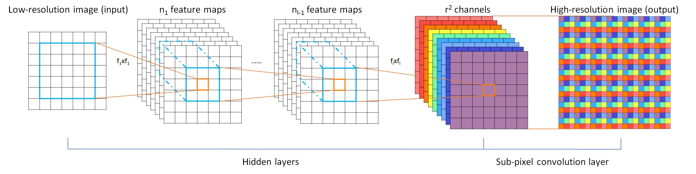
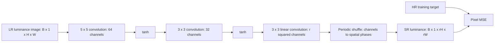
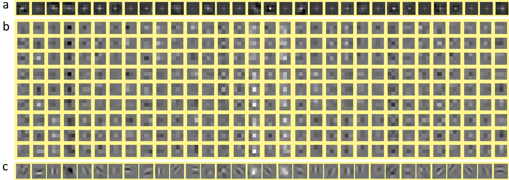
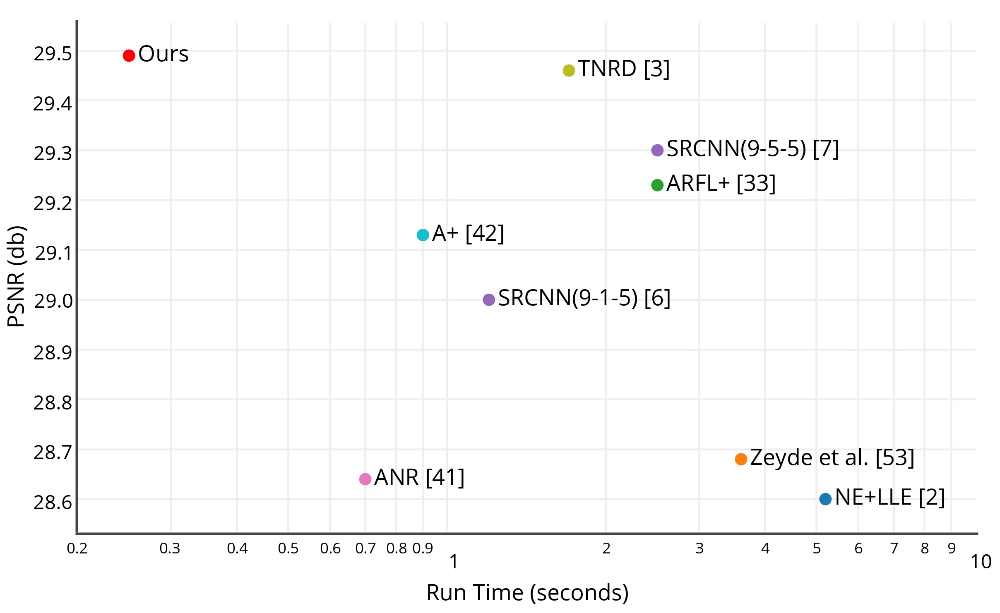

# Efficient Sub-Pixel CNN (ESPCN / PixelShuffle) - Shi et al., 2016

> **Title:** Real-Time Single Image and Video Super-Resolution Using an Efficient
> Sub-Pixel Convolutional Neural Network
>
> **Authors:** Wenzhe Shi, Jose Caballero, Ferenc Huszar, Johannes Totz,
> Andrew P. Aitken, Rob Bishop, Daniel Rueckert, Zehan Wang
>
> **arXiv:** [1609.05158v2][paper], 23 September 2016; first submitted
> 16 September 2016
>
> **Venue:** [CVPR 2016][venue], pp. 1874-1883
>
> **Affiliation:** Twitter, as listed in the updated arXiv version
>
> **Scope:** The version-2 paper and the official [CVPR supplementary archive][supp].
> Modern tensor-layout explanations are checked against the
> [PyTorch v2.5.1 implementation][torch-source]; this is an implementation
> reference, not the original authors' training code.

## TL;DR

ESPCN does expensive feature extraction on the **low-resolution grid** and
upsamples only at the end: a learned convolution predicts $r^2$ output
phases per image channel, and a parameter-free periodic shuffle places those
values into their high-resolution pixel locations.
The final ImageNet-trained model improves the paper's image-benchmark average
over SRCNN by **0.13 dB at 3x** and **0.15 dB at 4x** (Table 2), with
reported 1080p frame times of **38 ms** and **29 ms**, respectively, on a
K2 GPU (Section 3.5).
It is a small, single-frame, pixel-MSE-trained super-resolution network,
not a temporal video model; **the convolution learns the reconstruction,
while PixelShuffle only rearranges it**.

## Problem & motivation

### Why upsampling before feature extraction is expensive

Single-image super-resolution estimates a high-resolution image from one
low-resolution observation. The paper models the observation process as
Gaussian blur followed by downsampling:

$$
I^{LR}=\downarrow_r\!\left(G*I^{HR}\right),
$$

where $I^{HR}$ is the target image, $G$ is a blur kernel, $*$ denotes
convolution, and $\downarrow_r$ retains samples at an integer spatial scale
$r$. The target has shape $rH\times rW\times C$ when the input has shape
$H\times W\times C$, with $C$ image channels.
The experiments use the luminance channel, so $C=1$ there.
This degradation is the paper's synthetic setup, not a claim that arbitrary
camera images always follow a known Gaussian model.

Blur and subsampling discard information. Many sharp images can correspond
to the same LR image, so SR must use learned image statistics rather than
literally invert a lossless transformation.
Bicubic interpolation increases the number of samples but supplies no
additional observed detail.

The earlier [SRCNN][srcnn] pipeline first bicubically enlarges the input,
then applies a CNN on the HR grid. At scale $r$, that grid has $r^2$
times as many spatial positions. Intermediate feature maps, not just the
final output, therefore incur HR-grid computation and memory.
ESPCN instead asks whether the network can infer its features before paying
that spatial expansion cost.

### A different place to perform the same necessary expansion

The output still needs $r^2HW$ pixels per channel; ESPCN does not evade
that requirement. Its contribution is to move most learned processing
**before** the expansion and to make the expansion learned rather than a
fixed preprocessing step.

This distinction also separates two kinds of efficiency:

- **Grid efficiency:** hidden convolutions run on $H\times W$, not
  $rH\times rW$. For otherwise identical layers, this removes a factor
  of $r^2$ from their spatial work.
- **Model efficiency:** the evaluated network uses $5$-$3$-$3$ kernels
  rather than the stronger SRCNN baseline's $9$-$5$-$5$ kernels.
  The measured speedup consequently combines architecture changes,
  parameter count, implementation, and hardware; it is not an isolated
  benchmark of a permutation operator.



*Original Figure 1. The colored final feature maps represent different
sub-pixel phases. Each supplies a different position inside every output
block. No bicubic enlargement is required before the hidden layers.*

## Key idea

### Predict output phases as channels

Let $F_{L-1}$ be the last hidden feature tensor and let $W_L,b_L$ be the
final convolution's weights and biases. The network predicts

$$
Z=W_L*F_{L-1}+b_L,\qquad
I^{SR}=\mathcal{PS}_r(Z).
\tag{3}
$$

Here $Z$ has $Cr^2$ channels, $I^{SR}$ is the reconstructed image, and
$\mathcal{PS}_r$ is periodic shuffling. If the convolution produces a
spatial grid $H'\times W'$, then

$$
\mathcal{PS}_r:
\mathbb{R}^{H'\times W'\times Cr^2}
\longrightarrow
\mathbb{R}^{rH'\times rW'\times C}.
$$

The primes matter: valid convolutions shrink the grid, whereas appropriately
padded convolutions can preserve $H'=H$ and $W'=W$.
The paper writes the nominal full-image mapping as
$H\times W\times Cr^2\rightarrow rH\times rW\times C$.

For each LR location, the last convolution predicts an entire $r\times r$
block of output pixels. Neighboring blocks are not independent in their
inputs: the convolutions use overlapping LR neighborhoods.
The shuffle merely assigns each prediction to the appropriate location.

### Learned upsampling is convolution plus routing, not routing alone

$\mathcal{PS}_r$ has **no learned weights, interpolation coefficients,
or nonlinearities**. It preserves the number of elements and is invertible
when the scale and layout are known.
The preceding convolution has different learned weights for the output
phases, allowing different positions inside the enlarged block to respond
differently to the same LR neighborhood.

Calling the whole final stage a *sub-pixel convolution* is useful.
Calling the shuffle itself a learned reconstruction filter is not:
all newly inferred values already exist in $Z$ before they are moved.

## How it works

### 1. Extract features using ordinary LR convolutions

For a network with $L$ convolutional layers, define

$$
F_0=I^{LR},\qquad
F_l=\phi(W_l*F_{l-1}+b_l),\quad 1\leq l<L.
\tag{1--2}
$$

$F_l$ is the feature tensor at layer $l$, $n_l$ its channel count,
$W_l$ the kernel tensor, $b_l$ its per-output-channel bias, and $\phi$
the pointwise activation. All these convolutions use unit stride.
In common output-channel-first notation,
$W_l\in\mathbb{R}^{n_l\times n_{l-1}\times k_l\times k_l}$,
where $k_l$ is the kernel side length and $n_0=C$.
The paper lists the input/output channel axes in the opposite order;
that is a storage convention, not a different operation.

The evaluated architecture is:

| Stage | Kernel | Input channels | Output channels | Activation |
|---|---|---|---|---|
| Feature extraction 1 | $5\times5$ | $C$ | 64 | tanh in final models |
| Feature extraction 2 | $3\times3$ | 64 | 32 | tanh in final models |
| Phase prediction | $3\times3$ | 32 | $Cr^2$ | None |
| Periodic shuffle | No convolution | $Cr^2$ | $C$ | None |

These are the settings in Section 3.2.
The ReLU models in Table 1 are ablations; they are not the activation
choice of the final model in Tables 2-4.
In particular, **the output convolution is linear**: the paper explicitly
does not apply an activation after it.
There is no residual bicubic skip, batch normalization, attention,
distillation, or adversarial loss in this architecture.

For a padded, luminance-only 3x example, the tensor flow is

$$
B\times1\times H\times W
\rightarrow B\times64\times H\times W
\rightarrow B\times32\times H\times W
\rightarrow B\times9\times H\times W
\rightarrow B\times1\times3H\times3W,
$$

where $B$ is batch size and the layout is NCHW.
At 4x, the phase-prediction layer instead outputs 16 channels.
For an RGB model, the corresponding counts would be 27 and 48;
that is an architectural extension, not the reported luminance experiment.



*Authored diagram. Shapes assume size-preserving padding; padding and
training-crop provenance are discussed below. Each video frame follows
this same path independently.*

### 2. Define the channel ordering before implementing the shuffle

Different valid phase orderings exist. They describe the same class of
networks, but they are **not interchangeable for a fixed checkpoint**.

The corrected version-2 paper prints, in HWC notation,

$$
\mathcal{PS}(T)_{x,y,c}
=T_{\lfloor x/r\rfloor,\lfloor y/r\rfloor,\,
Cr(y\bmod r)+C(x\bmod r)+c}.
\tag{4}
$$

Use zero-based indices: $x,y$ are the first and second output spatial
coordinates, $c\in\{0,\ldots,C-1\}$, and $r$ is the positive integer
scale. Writing $x=rh+a$ and $y=rw+b$, with $0\leq a,b<r$, makes the
phase/channel rule explicit:

$$
Y[rh+a,rw+b,c]=T[h,w,C(rb+a)+c].
$$

This is the paper's printed convention, treating its first spatial axis
as the first array axis. Its channels interleave color within phase and
order the two phase coordinates as $(b,a)$.
An equivalent NHWC reshape/permutation is

```text
(B, H, W, r*r*C)
  -> reshape (B, H, W, r_b, r_a, C)
  -> transpose axes (0, 1, 4, 2, 3, 5)
  -> reshape (B, H*r, W*r, C)
```

By contrast, the common **PyTorch NCHW** convention is

$$
Y[n,c,rh+a,rw+b]
=Z[n,cr^2+ar+b,h,w].
\tag{6}
$$

Here $n$ indexes the batch; $h,w$ index the LR grid; and $a,b$ are row
and column offsets inside the enlarged block.
The [pinned framework implementation][torch-source] splits channels
as $(C,r_a,r_b)$, then interleaves those phase axes with height and width:

```text
(B, C*r*r, H, W)
  -> reshape (B, C, r_a, r_b, H, W)
  -> transpose axes (0, 1, 4, 2, 5, 3)
  -> reshape (B, C, H*r, W*r)
```

The output-channel permutation needed to convert the paper ordering to
this ordering is

$$
Z[n,cr^2+ar+b,h,w]
=T[n,h,w,C(rb+a)+c].
$$

Apply the same permutation to the final convolution's output filters
**and its biases** when converting trained weights.
Changing only NHWC to NCHW does not fix a different phase ordering.
When training from scratch, either consistent convention can be learned.

For a one-pixel, one-channel, 2x example, a channel vector
$[0,1,2,3]$ becomes

$$
\begin{bmatrix}0&1\\2&3\end{bmatrix}
\quad\text{in the PyTorch convention, versus}\quad
\begin{bmatrix}0&2\\1&3\end{bmatrix}
\quad\text{under the printed paper convention}.
$$

For two horizontally adjacent LR locations, the PyTorch convention maps
phase vectors $[0,1,2,3]$ and $[4,5,6,7]$ to

$$
\begin{bmatrix}
0&1&4&5\\
2&3&6&7
\end{bmatrix}.
$$

These examples are indexing illustrations, not learned image values.
A direct reshape without the intervening permutation generally gives
the wrong spatial arrangement.

### 3. Understand the inverse and the training-time shortcut

The inverse, often called **PixelUnshuffle** or space-to-depth, moves
spatial phases back into channels:

$$
Z[n,cr^2+ar+b,h,w]
=Y[n,c,rh+a,rw+b].
$$

For this inverse, both HR spatial dimensions must be divisible by $r$.
For the forward shuffle, the input channel count must be divisible by
$r^2$; the LR height and width do not have that divisibility requirement.
The operation does not average, discard pixels, or learn a projection.

Because a permutation preserves squared Euclidean distance,

$$
\left\|\mathcal{PS}_r(Z)-I^{HR}\right\|_2^2
=\left\|Z-\mathcal{PS}_r^{-1}(I^{HR})\right\|_2^2.
$$

Section 2.2 therefore observes that training can pre-unshuffle the target
and compute MSE directly on the phase channels, omitting a shuffle from
the forward loss path. Gradients are just permuted back in the opposite
direction. This equivalence requires the **same phase convention, crop,
and loss normalization** on both sides.
It does not remove the need to form an HR image at inference.

The paper additionally claims a $\log_2(r^2)$ training-time advantage over
a deconvolution layer and an $r^2$ advantage over upsample-then-convolve
implementations. These are implementation claims from Section 2.2,
not general runtime laws for all modern kernels or hardware.

### 4. Relate sub-pixel convolution to transposed convolution

The paper interprets upsampling as a fractional-stride convolution:
different output coordinates activate different subsets, or **polyphase
components**, of a larger filter. There are exactly $r^2$ spatial phases.
Instead of materializing an HR grid containing inserted zeros and
performing unnecessary arithmetic on it, predict the phases with ordinary
dense LR convolutions and then interleave them.

For an HR-space filter of side $k_s$, the paper gives a particularly
simple equivalence when $k_s$ is divisible by $r$:
the LR kernels have side $k_L=k_s/r$.
The divisibility condition concerns that filter decomposition, not a
requirement that every input image dimension be a multiple of $r$.

One explicit weight mapping makes the relationship precise. Use
cross-correlation-style LR convolution, modern phase ordering, square
kernel side $k$, and LR zero padding $p$. Let
$K[q,i,u,v]$ be the LR convolution weights, where $q=cr^2+ar+b$,
$i$ indexes input features, and $0\leq u,v<k$.
Construct a stride-$r$ transposed-convolution kernel

$$
G[i,c,r(k-1-u)+a,r(k-1-v)+b]
=K[cr^2+ar+b,i,u,v].
$$

With kernel side $rk$ and transposed-convolution padding
$p_t=r(k-1-p)$, the **linear, zero-bias** outputs agree, including the
appropriate output size. The reversed kernel coordinates account for
the LR cross-correlation convention.
Other storage conventions need the corresponding rotations and axis
permutations.

There are two important qualifications:

- **Biases:** ESPCN has a separate bias for every output phase. An ordinary
  transposed convolution has one bias per output image channel.
  Exact equivalence of the affine layers therefore requires either
  phase-tied biases or an additional phase-dependent bias field.
- **Boundaries:** padding, image extension, and output cropping must agree.
  A zero-padded algebraic identity does not automatically reproduce a
  reflect-padded benchmark implementation.

Thus sub-pixel convolution is a useful reparameterization and execution
strategy for learned upsampling, not an inverse of a generic convolution
or a guarantee of greater expressive power than every transposed-convolution
variant.



*Original Figure 4, 3x ImageNet/ReLU models. Row (a) shows SRCNN's final
filters; (b) shows the separate ESPCN phase filters; (c) arranges the
ESPCN weights into their HR geometry. Patterns that look unrelated as
individual LR kernels can form coherent structures after phase placement.
This is a weight visualization, not a quantitative ablation.*

### 5. Account for receptive field, padding, and parameter count

Three unit-stride kernels of sizes $5,3,3$ have an LR receptive-field
side of

$$
R=1+(5-1)+(3-1)+(3-1)=9.
$$

Each reconstructed HR pixel therefore depends on a $9\times9$ LR
neighborhood away from boundaries. The different phases can use
different weights over that neighborhood.

Without padding, a $17\times17$ LR training patch becomes
$13\times13$, then $11\times11$, then $9\times9$ before shuffling.
With size-preserving padding of $2,1,1$, it remains $17\times17$
throughout. These are explicit implementation choices, not two identical
training protocols.
The supplement records `padMode: reflect` and `cropResultsBy: 3` or `4`
for the corresponding benchmark scale. Those evaluation settings do
not, by themselves, specify every layer's training padding.

For $C=1$, including biases, the parameter count derived from the
reported architecture is

$$
P=(25\cdot64+64)+(9\cdot64\cdot32+32)
 +(9\cdot32+1)r^2
=20\,128+289r^2.
$$

| Derived model count | Parameters including biases |
|---|---|
| ESPCN, 3x | 22,729 |
| ESPCN, 4x | 24,752 |
| SRCNN 9-5-5 with widths 64 and 32, luminance | 57,281 |

The last row uses the baseline's $9$-$5$-$5$ architecture and the same
hidden widths. It explains the paper's approximate **2.5x fewer
parameters** at 3x; the ratio changes with the upscale factor.
These are derived counts, not a separate parameter table reported by
the authors.

Ignoring borders, biases, nonlinearities, and shuffle memory traffic, the
ESPCN multiply-accumulate count is

$$
\operatorname{MAC}_{ESPCN}
\approx HW\left(20\,032+288r^2\right),
$$

whereas the corresponding SRCNN 9-5-5 count on the HR grid is

$$
\operatorname{MAC}_{SRCNN}
\approx r^2HW\cdot57\,184.
$$

At 3x, their ratio is about **22.75**, consistent with the paper's
rough $2.5r^2$ complexity explanation in Section 3.5.
At 4x, the same derived calculation gives about **37.13**, rather than
treating the 3x parameter ratio as a universal constant.
Neither analytical ratio is a measured wall-clock speedup.
The phase tensor itself has as many elements as the final image, so
PixelShuffle can still involve substantial memory movement.

## Training / data

### Datasets and degradation

Section 3.1 uses the following image datasets:

| Role | Dataset | Size used |
|---|---|---|
| Small-data training / ablations | Standard SR training collection | 91 images |
| Final training | Randomly selected ImageNet images | 50,000 images |
| Testing | Set5 | 5 images |
| Testing | Set14 | 14 images |
| Testing | BSD300 test split | 100 images |
| Testing | BSD500 test split | 200 images |
| Testing | SuperTexture | 136 texture images |

The names BSD300 and BSD500 describe the datasets, not the numbers
used in the paper's test splits.
The reported experiment operates on **Y luminance in YCbCr**, not
joint RGB reconstruction. An RGB display pipeline additionally needs a
choice for the chroma channels; such a choice must not be confused with
the reported Y-channel score.

A separate network is trained for each scale.
For training, Section 3.2 extracts $17r\times17r$ HR subimages,
blurs with a Gaussian, and subsamples by $r$ to obtain $17\times17$
LR patches. The paper does not fully specify the Gaussian parameters
or every normalization and color-conversion detail.
Replacing this with an arbitrary framework's bicubic resize is a
different degradation pipeline, not a documented exact reproduction.

For video, the paper evaluates:

- **Xiph:** eight $1920\times1080$ sequences, approximately ten seconds
  long each.
- **Ultra Video Group:** seven $1920\times1080$ sequences, five seconds
  long each.

Those are HR reference resolutions. The corresponding 3x and 4x LR
inputs would be $640\times360$ and $480\times270$.
The reported experiment does **not** mean feeding 1080p input into
a model to produce a 3x- or 4x-larger-than-1080p output.
The image-trained network processes each frame independently, without
optical flow, recurrent state, neighboring-frame input, or temporal loss.

### Objective and optimization

For the luminance experiment, the paper's objective is per-output-pixel
squared error. A minibatch version of its Equation 5 is

$$
\mathcal{L}(\theta)
=\frac{1}{M r^2H'W'}
\sum_{n=1}^{M}
\sum_{x=0}^{rH'-1}
\sum_{y=0}^{rW'-1}
\left[
I^{HR}_n[x,y]-f_\theta(I^{LR}_n)[x,y]
\right]^2.
$$

$\theta$ collects every convolution weight and bias, $M$ is minibatch
size, and $H',W'$ are the LR-equivalent supervised output dimensions
after any cropping. Targets must match that support.
For a multi-channel extension, also sum over $c$ and divide by $C$
if using a mean over all scalar image values.
The printed Equation 5 repeats the $x$ summation index; the expression
above uses the intended distinct spatial indices and explicitly
averages over the minibatch.

The reported settings are:

| Item | Paper setting / qualification |
|---|---|
| Hidden activation | tanh for final models; ReLU ablations in Table 1 |
| Output activation | None |
| Initial learning rate | 0.01 |
| Final learning rate | 0.0001 |
| Schedule trigger | Reduce gradually when cost improvement is below a threshold $\mu$ |
| Final-layer learning rate | Ten times slower than the other layers |
| Stopping | No improvement after 100 epochs, in the paper's wording |
| 3x training time on 91 images | Roughly three hours on a K2 GPU |
| 3x training time on ImageNet subset | Roughly seven days on a K2 GPU |

These are from Section 3.2.
The exact threshold $\mu$, named optimizer configuration, batch size,
initialization, and full schedule are not supplied there.
The stopping sentence also does not give a fully executable
patience/scheduling specification; do not silently substitute a modern
Adam recipe and call it the original one.

**A crop-stride ambiguity is worth preserving.** The paper prints LR
extraction stride

$$
s=17-\sum_l\operatorname{mod}(f_l,2)
$$

and HR stride $rs$, where $f_l$ denotes the filter side lengths in
that paragraph. For $5,3,3$, the printed rule gives $s=14$.
It claims that every ground-truth pixel is then used exactly once.
However, fully valid convolutions on a 17-pixel LR patch produce
only nine supervised LR-equivalent positions, not fourteen.
Padding/cropping choices needed to reconcile these statements are not
fully described. An implementation should explicitly choose and
document its support and stride rather than silently replacing the
printed expression with $17-\sum_l(f_l-1)$.

### Evaluation and supplementary provenance

PSNR is

$$
\operatorname{PSNR}
=10\log_{10}\!\left(\frac{A^2}{\operatorname{MSE}}\right),
$$

where $A$ is the image value range's peak, such as 1 for an appropriately
normalized image or 255 for an 8-bit-valued image.
Higher PSNR means lower squared error under the same channel, value
range, crop, and degradation protocol.
Mean per-image PSNR is not generally the same as PSNR computed from
a dataset-wide mean MSE.

The official supplementary archive supplies benchmark settings,
per-example CSVs, summary CSVs, and video comparisons.
The inspected settings use reflective padding and crop the result by
the scale factor. Its README says baseline outputs were generated
using the respective authors' MATLAB code; Section 3.5 separately
describes Python/Theano convolution implementations for timing.

**The archive and final paper do not contain identical image scores.**
For example:

| Source | 3x Set14 ESPCN PSNR-Y | 4x overall ESPCN PSNR-Y |
|---|---|---|
| Final paper, Table 2 | 29.49 | 26.53 |
| Supplement, `ImageResults/Ours` summary CSVs | 29.4170 | 26.5006 |

The 3x summary also lists Set5 as 32.9968 rather than Table 2's
33.13, despite a tanh model name in its overall row.
The archive does not establish a complete reconciliation of these
differences. The tables below therefore preserve the versioned paper's
results; the CSVs are an additional provenance source, not a reason to
quietly overwrite them or claim that all released artifacts represent
the identical checkpoint.

## Results

### 1. Sub-pixel layer and activation ablations

The following is **paper Table 1**, at 3x, in dB.
Here SRCNN is the **9-1-5** baseline discussed in Section 3.3.1;
it is not the stronger 9-5-5 baseline used in Tables 2-4.
The unqualified ESPCN (91) column uses tanh.

| Dataset | Scale | SRCNN (91) | ESPCN (91, ReLU) | ESPCN (91, tanh) | SRCNN (ImageNet) | ESPCN (ImageNet, ReLU) |
|---|---|---|---|---|---|---|
| Set5 | 3 | 32.39 | 32.39 | 32.55 | 32.52 | 33.00 |
| Set14 | 3 | 29.00 | 28.97 | 29.08 | 29.14 | 29.42 |
| BSD300 | 3 | 28.21 | 28.20 | 28.26 | 28.29 | 28.52 |
| BSD500 | 3 | 28.28 | 28.27 | 28.34 | 28.37 | 28.62 |
| SuperTexture | 3 | 26.37 | 26.38 | 26.42 | 26.41 | 26.69 |
| Average | 3 | 27.76 | 27.76 | 27.82 | 27.83 | 28.09 |

The small-data ReLU model essentially matches SRCNN's reported average;
it is not uniformly better on every dataset.
Switching its hidden activation to tanh improves that average by
0.06 dB. More training data benefits ESPCN substantially:
the ImageNet/ReLU average is 0.33 dB above its 91-image/ReLU
counterpart and 0.26 dB above the ImageNet SRCNN baseline in this
table (differences of Table 1 values).
The table caption reports a paired-test significance claim of
$p<0.001$; it does not provide repeated-training-run uncertainty.

### 2. Final image reconstruction quality

This is **paper Table 2**, in dB.
SRCNN is now the **9-5-5 ImageNet model**; TNRD is the
$7\times7$, five-stage trainable nonlinear reaction-diffusion model;
ESPCN is the **ImageNet/tanh** model.

| Dataset | Scale | Bicubic | SRCNN | TNRD | ESPCN |
|---|---|---|---|---|---|
| Set5 | 3 | 30.39 | 32.75 | 33.17 | 33.13 |
| Set14 | 3 | 27.54 | 29.30 | 29.46 | 29.49 |
| BSD300 | 3 | 27.21 | 28.41 | 28.50 | 28.54 |
| BSD500 | 3 | 27.26 | 28.48 | 28.59 | 28.64 |
| SuperTexture | 3 | 25.40 | 26.60 | 26.66 | 26.70 |
| Average | 3 | 26.74 | 27.98 | 28.07 | 28.11 |
| Set5 | 4 | 28.42 | 30.49 | 30.85 | 30.90 |
| Set14 | 4 | 26.00 | 27.50 | 27.68 | 27.73 |
| BSD300 | 4 | 25.96 | 26.90 | 27.00 | 27.06 |
| BSD500 | 4 | 25.97 | 26.92 | 27.00 | 27.07 |
| SuperTexture | 4 | 23.97 | 24.93 | 24.95 | 25.07 |
| Average | 4 | 25.40 | 26.38 | 26.45 | 26.53 |

ESPCN improves on SRCNN across these rows, but it does not defeat
every competing method everywhere: **TNRD is 0.04 dB ahead on Set5
at 3x**.
The average advantages over TNRD are 0.04 dB at 3x and 0.08 dB
at 4x; the larger contribution is the quality/speed trade-off rather
than a huge absolute PSNR gap.
The paper reports $p<0.01$ against SRCNN in the table caption,
not an equivalent significance result against every baseline.

The image-table averages are consistent, to rounding, with pooling
the **455 test entries** using weights $5,14,100,200,136$, rather than
giving each of the five datasets equal weight.
This is a derivation from the dataset sizes and table values; it does
not establish that every test image across the Berkeley collections
is a distinct, deduplicated example.

The paper's qualitative Figures 5-6 show sharper edges and textures
than bicubic and improvements over SRCNN, but individual examples
also illustrate that ESPCN and TNRD can be very close.
Those illustrations do not measure temporal consistency or perceptual
realism separately from reconstruction error.

### 3. Frame-by-frame video reconstruction

The next two tables reproduce **paper Tables 3 and 4**, in dB.
The learned models are again SRCNN 9-5-5/ImageNet and
ESPCN/ImageNet/tanh.

**Xiph, Table 3:**

| Xiph sequence | Scale | Bicubic | SRCNN | ESPCN |
|---|---|---|---|---|
| SunFlower | 3 | 41.72 | 43.29 | 43.36 |
| Station2 | 3 | 36.42 | 38.17 | 38.32 |
| PedestrianArea | 3 | 37.65 | 39.21 | 39.27 |
| SnowMnt | 3 | 26.00 | 27.23 | 27.20 |
| Aspen | 3 | 32.75 | 34.65 | 34.61 |
| OldTownCross | 3 | 31.20 | 32.44 | 32.53 |
| DucksTakeOff | 3 | 26.71 | 27.66 | 27.69 |
| CrowdRun | 3 | 26.87 | 28.26 | 28.39 |
| Average | 3 | 32.41 | 33.86 | 33.92 |
| SunFlower | 4 | 38.99 | 40.57 | 41.00 |
| Station2 | 4 | 34.13 | 35.72 | 35.91 |
| PedestrianArea | 4 | 35.49 | 36.94 | 36.94 |
| SnowMnt | 4 | 24.14 | 24.87 | 25.13 |
| Aspen | 4 | 30.06 | 31.51 | 31.83 |
| OldTownCross | 4 | 29.49 | 30.43 | 30.54 |
| DucksTakeOff | 4 | 24.85 | 25.44 | 25.64 |
| CrowdRun | 4 | 25.21 | 26.24 | 26.40 |
| Average | 4 | 30.30 | 31.47 | 31.67 |

**Ultra Video Group, Table 4:**

| UVG sequence | Scale | Bicubic | SRCNN | ESPCN |
|---|---|---|---|---|
| Bosphorus | 3 | 39.38 | 41.07 | 41.25 |
| ReadySetGo | 3 | 34.64 | 37.33 | 37.37 |
| Beauty | 3 | 39.77 | 40.46 | 40.54 |
| YachtRide | 3 | 34.51 | 36.07 | 36.18 |
| ShakeNDry | 3 | 38.79 | 40.26 | 40.47 |
| HoneyBee | 3 | 40.97 | 42.66 | 42.89 |
| Jockey | 3 | 41.86 | 43.62 | 43.73 |
| Average | 3 | 38.56 | 40.21 | 40.35 |
| Bosphorus | 4 | 36.47 | 37.53 | 38.06 |
| ReadySetGo | 4 | 31.69 | 33.69 | 34.22 |
| Beauty | 4 | 38.79 | 39.48 | 39.60 |
| YachtRide | 4 | 32.16 | 33.17 | 33.59 |
| ShakeNDry | 4 | 35.68 | 36.68 | 37.11 |
| HoneyBee | 4 | 38.76 | 40.51 | 40.87 |
| Jockey | 4 | 39.85 | 41.55 | 41.92 |
| Average | 4 | 36.20 | 37.52 | 37.91 |

The average SRCNN-to-ESPCN gains are **0.06 / 0.20 dB** on Xiph
and **0.14 / 0.39 dB** on UVG at 3x / 4x, respectively.
Thus the abstract's **+0.39 dB on video** is specifically supported
by the UVG 4x average, not a universal improvement for every clip
or scale.
At 3x, SRCNN is slightly better on SnowMnt and Aspen; at 4x,
PedestrianArea ties to the shown precision.

**Use the official supplement's statistical correction.** The printed
Table 3 caption states $p<0.01$, but `ReadMe.txt` explicitly changes
the **3x comparison to $p<0.05$** and says SnowMnt/3x should favor
SRCNN rather than ESPCN in the boldface.
The numerical table above already makes that comparison visible.
Table 4 reports $p<0.01$. These are paired-test claims from the
authors, not independently recomputed significance tests here.

### 4. Accuracy versus speed and the meaning of real time



*Original Figure 2. Mean Set14 PSNR and runtime at 3x on a single
2.0 GHz CPU core. The horizontal axis is runtime in seconds.
This is a CPU quality/speed plot, not the K2 GPU frame-rate experiment.*

Section 3.5 uses Python/Theano convolution implementations for the
convolutional methods and MATLAB implementations for other methods.
The plot supports the paper's strong quality/speed trade-off, while
also making implementation differences part of the comparison.
Exact runtimes should not be read as hardware-independent properties
of each algorithm.

For the K2 GPU, the separately reported 1080p timings are:

| Output / scale | SRCNN seconds per frame | ESPCN seconds per frame | Derived speedup | Derived ESPCN fps |
|---|---|---|---|---|
| 1080p, 3x | 0.435 | 0.038 | 11.45x | 26.32 |
| 1080p, 4x | 0.434 | 0.029 | 14.97x | 34.48 |

The first two numeric columns are **Section 3.5** values; the last
two are arithmetic conversions.
The 3x result exceeds 24 fps but not 30 fps; the 4x result exceeds
30 fps. Consequently, "real time" needs a target frame rate and
the stated hardware, not just an unqualified label.
At a fixed HR output size, 4x has a smaller LR feature grid than
3x, which helps explain why its runtime can be lower even though
it predicts more phase channels per LR location.

The same section reports an average **4.7 ms per Set14 image**
on the K2 GPU at 3x. That is a different image-size workload
from the 1080p frame times.
None of these numbers by itself certifies a complete video
decode, transfer, super-resolution, and re-encode pipeline or
latency on a different GPU.

## Limitations & follow-ups

### What the original experiment does not establish

- **It does not use temporal information.** Applying the image network
  to video frames gives a fast baseline, but does not exploit motion
  or constrain flicker. The paper's Section 5 proposes multi-frame
  spatio-temporal processing as future work.
- **It is supervised for a particular synthetic degradation and scale.**
  Unknown blur, sensor noise, compression, and real-camera processing
  can differ from Gaussian blur plus subsampling.
  Separate scale-specific models do not provide arbitrary continuous
  upscaling.
- **High PSNR is not a complete perceptual criterion.** Pixel MSE rewards
  accurate reconstruction under the reference protocol, but can favor
  averaged detail when several HR interpretations are plausible.
  The paper does not demonstrate adversarially realistic texture,
  an uncertainty estimate, or faithful recovery of every lost detail.
- **The receptive field and capacity are small.** A three-convolution
  network is efficient but limited in the context it can use.
  Its success motivates LR-space computation; it does not establish
  that three layers suffice for all SR tasks.
- **Independent phases can produce periodic artifacts.** A parameter-free
  shuffle does not guarantee smooth phase relationships after arbitrary
  filter initialization or training. The original filter visualization
  is suggestive, not a proof of artifact-free outputs.
- **Reproduction needs more than the layer diagram.** The printed crop
  stride, incomplete optimization details, paper/CSV score differences,
  corrected significance statement, and boundary conventions all matter.
  The measured speedups are also tied to the reported implementations.

### Where the idea leads

[FSRCNN][fsrcnn], another 2016 efficient SR design, also moves mapping
to LR space but uses a compact shrinking/mapping/expanding architecture
and a final deconvolution layer. It is a useful comparison for separating
the general advantage of LR-space processing from the particular
phase-channel parameterization in ESPCN.

[Real-Time Video Super-Resolution with Spatio-Temporal Networks and
Motion Compensation][vespcn] follows the video direction with multiple
frames, temporal fusion, and learned motion compensation.
Those mechanisms are not hidden components of the original ESPCN;
they address information that its frame-independent pipeline leaves unused.

[Aitken et al.'s checkerboard-artifact note][icnr] studies sub-pixel
initialization and proposes initialization equivalent to a convolution
followed by nearest-neighbor resizing.
It targets checkerboard behavior **at initialization**; it is not a
retroactive claim that ESPCN originally specified that initialization
or that all later training artifacts are impossible.

Finally, distinguish spatial rearrangement from learned visual
compression. PixelUnshuffle packs a spatial neighborhood into channels
without losing elements. [Swin's patch merging][swin] additionally
normalizes and projects grouped features, while [ViT's patch
embedding][vit] learns a projection of image patches.
The reshape/grouping intuition is related, but neither a learned
projection nor an SR reconstruction network is just a permutation.

## Links

- **arXiv:** [abs][paper] / [HTML][html] / [PDF][pdf].
- **Venue:** [CVPR 2016 paper page and BibTeX][venue].
- **Supplement:** [Official CVPR ZIP][supp], including results,
  benchmark settings, videos, and the Table 3 correction in `ReadMe.txt`.
- **Code:** [PyTorch super-resolution example][example], a modern
  illustrative implementation, not the authors' original training release.
  Its README uses BSD300 training crops rather than the paper's final
  ImageNet subset, so its outputs should not be presented as the paper's
  benchmark reproduction.
- **Operator reference:** [PixelShuffle documentation][torch-docs] and
  [pinned PyTorch v2.5.1 shuffle/unshuffle implementation][torch-source].
- **Hugging Face:** No author-endorsed model or dataset release is identified
  in the inspected paper and supplementary material.
- **Project page:** No separate project page is needed beyond the
  [venue page][venue] and supplementary archive.
- **Blog posts / talks:** Not used as primary evidence in this recap.
- **Papers-with-Code:** Not used as a source of benchmark values.
- **Related papers:** [SRCNN][srcnn], [FSRCNN][fsrcnn],
  [spatio-temporal video SR][vespcn], [checkerboard-free initialization][icnr],
  and the local [ViT][vit] and [Swin][swin] recaps.

```bibtex
@inproceedings{shi2016realtime,
  title     = {Real-Time Single Image and Video Super-Resolution Using
               an Efficient Sub-Pixel Convolutional Neural Network},
  author    = {Shi, Wenzhe and Caballero, Jose and Huszar, Ferenc and
               Totz, Johannes and Aitken, Andrew P. and Bishop, Rob and
               Rueckert, Daniel and Wang, Zehan},
  booktitle = {Proceedings of the IEEE Conference on Computer Vision
               and Pattern Recognition},
  pages     = {1874--1883},
  year      = {2016},
  eprint    = {1609.05158},
  archivePrefix = {arXiv}
}
```

[paper]: https://arxiv.org/abs/1609.05158v2
[html]: https://arxiv.org/html/1609.05158v2
[pdf]: https://arxiv.org/pdf/1609.05158v2
[venue]: https://openaccess.thecvf.com/content_cvpr_2016/html/Shi_Real-Time_Single_Image_CVPR_2016_paper.html
[supp]: https://openaccess.thecvf.com/content_cvpr_2016/supplemental/Shi_Real-Time_Single_Image_2016_CVPR_supplemental.zip
[torch-docs]: https://docs.pytorch.org/docs/2.15/generated/torch.nn.PixelShuffle.html
[torch-source]: https://github.com/pytorch/pytorch/blob/v2.5.1/aten/src/ATen/native/PixelShuffle.cpp
[example]: https://github.com/pytorch/examples/tree/main/super_resolution
[srcnn]: https://arxiv.org/abs/1501.00092
[fsrcnn]: https://arxiv.org/abs/1608.00367
[vespcn]: https://arxiv.org/abs/1611.05250
[icnr]: https://arxiv.org/abs/1707.02937
[vit]: multimodal_2020_vit.md
[swin]: multimodal_2021_swin-transformer.md
