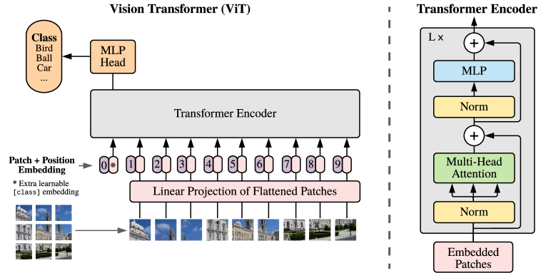
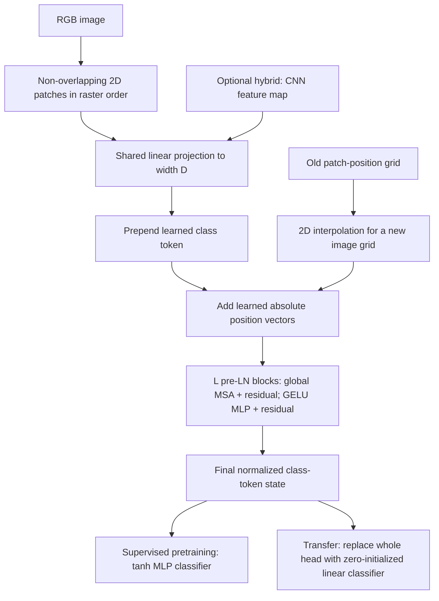
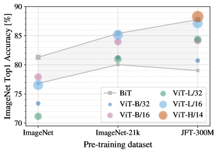
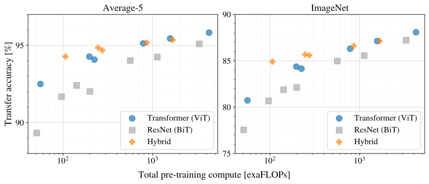
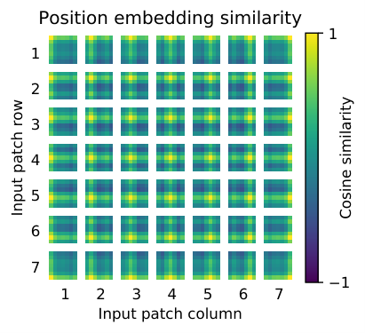

# An Image Is Worth 16×16 Words: Vision Transformer (ViT) - Dosovitskiy et al., 2020

> **Title:** An Image is Worth 16x16 Words: Transformers for Image Recognition at Scale
>
> **Authors:** Alexey Dosovitskiy, Lucas Beyer, Alexander Kolesnikov,
> Dirk Weissenborn, Xiaohua Zhai, Thomas Unterthiner, Mostafa Dehghani,
> Matthias Minderer, Georg Heigold, Sylvain Gelly, Jakob Uszkoreit, Neil Houlsby
>
> **arXiv:** [2010.11929v2][paper], 3 June 2021; first submitted 22 October 2020
>
> **Venue / affiliation:** ICLR 2021 / Google Research, Brain Team
>
> **Scope:** The camera-ready paper and all appendices. Version 2 corrects
> the exaFLOP accounting in Figure 5 / Table 6 and adds the class-token
> versus global-average-pooling discussion. Implementation details are
> distinguished from the paper and checked at official-code commit
> [`64801f1b3b367b3611cc27a3d45cc22870a36fb3`][code], 1 August 2026.

## TL;DR

ViT turns an image into a sequence of non-overlapping patch embeddings
and processes them with a standard, globally attending Transformer encoder.
Its central finding is about **scale and transfer**: with sufficiently large
supervised pretraining, the plain architecture competes with strong CNNs
without building convolutions into every layer.
The best JFT-pretrained ViT-H/14 reaches **88.55% ImageNet top-1** and
**77.63% VTAB mean accuracy**, while the public-ImageNet-21k-pretrained
ViT-L/16 reaches **85.30% ImageNet top-1** (Table 2).
The result does not mean that Transformers have no inductive biases,
that this recipe is data-efficient from scratch, or that the largest model
wins every downstream task.

## Problem & motivation

### Can the standard Transformer work without a CNN feature extractor?

Before ViT, many vision-attention systems retained a convolutional backbone,
replaced selected convolutional layers, or used specialized local/axial
attention. Such systems could be effective, but often required vision-specific
architecture and implementation work.

ViT asks a deliberately simpler question: can the same scalable
[Transformer encoder][transformer] used for token sequences process
images after a minimal input conversion? An image is split into patches,
each patch becomes one vector, and the model learns how to combine them.
The paper's contribution is not the first use of patch attention; it is
the demonstration that a largely standard architecture becomes a strong
image-recognition and transfer learner at sufficient pretraining scale.

### Patches make global attention affordable, but do not remove its cost

For image height $H$, width $W$, channels $C$, and square patch side $P$,
the number of patch tokens is

$$
N=\frac{HW}{P^2}.
$$

The simple form assumes dimensions divisible by $P$. The class-token
model's actual sequence length is $S=N+1$.
At 224 pixels with $16\times16$ patches, this gives 196 image tokens,
not 224 squared pixel tokens. "16x16 words" means one **image patch**
plays the role of one input token; the model does not convert an image
into literal words or use a text tokenizer.

Halving patch side quadruples patch count and approximately multiplies
attention-score storage by sixteen. Higher image resolution has the
same effect. ViT reduces the starting sequence length, rather than
turning global attention into a linear-complexity operation.

### Less image-specific bias changes the data requirement

CNNs build locality and spatial weight sharing into repeated layers.
ViT's self-attention is global, and its learned absolute position vectors
do not initially encode which patches are spatial neighbors.
The model must learn much of that structure from data.

This is **less image-specific inductive bias**, not no bias at all.
Patch extraction is a local spatial grouping; the patch projection and
per-token MLPs share weights; and resolution transfer explicitly uses a
two-dimensional grid. The paper's small-data results show why those
differences matter: under its training recipes, large ViTs overfit more
than comparable CNNs, while larger pretraining datasets reverse the trade-off.

## Key idea

### Represent the image as a sequence and leave the encoder mostly unchanged

Let $\mathbf x_p^i\in\mathbb R^{P^2C}$ be flattened patch $i$ in
raster order, $D$ the encoder width, and $\mathbf E$ a shared patch
projection. The input sequence is

$$
\mathbf z_0=
[\mathbf x_{\mathrm{class}};
 \mathbf x_p^1\mathbf E;
 \cdots;
 \mathbf x_p^N\mathbf E]
+\mathbf E_{\mathrm{pos}},
\qquad
\mathbf E\in\mathbb R^{P^2C\times D},
\quad
\mathbf E_{\mathrm{pos}}\in\mathbb R^{(N+1)\times D}.
\tag{1}
$$

Semicolons concatenate sequence positions.
$\mathbf x_{\mathrm{class}}\in\mathbb R^D$ is a learned vector
prepended once per image; it is not the image's ground-truth label.
$\mathbf E_{\mathrm{pos}}$ is a learned absolute position table,
including the class position. The class vector is shared across images
at input and becomes image-dependent after attention.

After the final encoder block, the normalized state at position zero
is used as the image representation for classification. The patch states
remain available, but this paper's principal evaluated task is image
classification and transfer, not dense pixel prediction.



*Original Figure 1. The input adaptation is small: patchify, project,
prepend a learned token, and add position vectors. The right-hand block
is a pre-normalized Transformer encoder with residual attention and MLP
branches. A single projected patch can contain many pixels.*

## How it works

### 1. Patchify without mixing up spatial and channel axes

For a batch of $b$ images, a correct row-major rearrangement is

$$
\begin{aligned}
&b\times H\times W\times C\\
&\longrightarrow b\times(H/P)\times P\times(W/P)\times P\times C\\
&\longrightarrow b\times(H/P)\times(W/P)\times P\times P\times C\\
&\longrightarrow b\times N\times(P^2C).
\end{aligned}
$$

The middle operation transposes axes so that pixels belonging to each
two-dimensional patch stay together. A direct reshape to
$b\times N\times(P^2C)$ generally does not implement that grouping.

Apply the same linear projection to every patch, producing
$b\times N\times D$. A convolution with kernel and stride $P$
is an equivalent implementation of this **single patch projection**;
the official code uses that form. "Pure Transformer" distinguishes
the encoder from a deep CNN backbone, not the low-level library
operator used for a linear embedding.

For RGB and $P=16$, each flattened patch has 768 values. The projection
need not reduce dimension: its output is 768 in ViT-Base, 1,024 in
ViT-Large, and 1,280 in ViT-Huge. Calling it universally a compression
to a smaller vector would be incorrect.

### 2. Add the class token and learned position table

Broadcast the class vector over the batch, prepend it, and add
Equation 1's position table. Hidden tensors then have shape
$b\times S\times D$, with $S=N+1$ throughout all $L$ encoder layers.
There is no patch merging or spatial pyramid in the plain model.

The default positional scheme is a learned **one-dimensional table**
indexed by raster-order sequence position. It is not sinusoidal,
relative-position attention, RoPE, or a separately constructed 2D
coordinate embedding. Nearby patches acquire related vectors through
learning, as the representation analysis shows.

### 3. Use pre-LayerNorm residual blocks

The encoder and readout follow the paper's Equations 2-4:

$$
\begin{aligned}
\mathbf z'_\ell
&=\operatorname{MSA}(\operatorname{LN}(\mathbf z_{\ell-1}))
  +\mathbf z_{\ell-1},\\
\mathbf z_\ell
&=\operatorname{MLP}(\operatorname{LN}(\mathbf z'_\ell))
  +\mathbf z'_\ell,\qquad \ell=1,\ldots,L,\\
\mathbf y&=\operatorname{LN}(\mathbf z_L^0).
\end{aligned}
\tag{2--4}
$$

$\operatorname{LN}$ normalizes channels independently at each token,
$\operatorname{MSA}$ is multihead self-attention,
and superscript zero selects the class token.
The encoder MLP has two dense layers, GELU activation, and hidden size
$D_{\mathrm{MLP}}=4D$ for the main variants.

The block preserves both sequence length and channel width.
Dropout, when enabled in the paper's recipe, is applied after dense
layers except the QKV projections and immediately after adding position
embeddings (Appendix B.1). Do not silently substitute every regularizer
from a later ViT training recipe.

### 4. Attend globally and bidirectionally

For one head with width $D_h$, Appendix A gives

$$
[Q,K,V]=ZU_{\mathrm{qkv}},
\qquad
U_{\mathrm{qkv}}\in\mathbb R^{D\times3D_h},
\tag{5}
$$

$$
A=\operatorname{SoftMax}\left(\frac{QK^\top}{\sqrt{D_h}}\right),
\qquad
\operatorname{SA}(Z)=AV,
\tag{6--7}
$$

$$
\operatorname{MSA}(Z)=
[\operatorname{SA}_1(Z);\ldots;\operatorname{SA}_k(Z)]U_{\mathrm{msa}},
\qquad
U_{\mathrm{msa}}\in\mathbb R^{kD_h\times D}.
\tag{8}
$$

$Z\in\mathbb R^{S\times D}$ is one image's input feature sequence;
$Q,K,V\in\mathbb R^{S\times D_h}$ are queries, keys, and values.
$A\in\mathbb R^{S\times S}$ contains attention probabilities,
normalized over keys for each query. The concatenation in Equation 8
is along channels, and $k$ denotes head count.

Every patch and the class token can attend to all positions.
There is **no autoregressive causal mask**. The square score matrix
includes the class token, and a head's default dimension is $D/k$.

### 5. Separate the pretraining head from the transfer head

The supervised pretraining readout is a small classification MLP:
one hidden layer with **tanh**, followed by the dataset's output layer
(Appendix D.3). This tanh belongs to the **classification head**;
the encoder MLP uses GELU.

For downstream fine-tuning, remove the **entire two-layer head** and
attach a single, zero-initialized $D\times K$ linear classifier,
where $K$ is the downstream class count. The encoder is fine-tuned,
not frozen, in this protocol. The paper finds replacing both head
layers slightly more robust than reinitializing only the last layer.

The official model exposes this distinction through its optional
`representation_size` / `pre_logits` layer. A contemporary checkpoint
with a different classifier configuration is not automatically identical
to the paper's pretraining setup.

### 6. Transfer to a larger image grid

Keep $P$ fixed when changing image resolution. Patch projection and
Transformer weights have no spatial-size-specific matrix, but the
learned position table has the old sequence length.

To adapt it:

1. Separate the class-position vector from the patch-position vectors.
2. Reshape the patch vectors to the original grid
   $(H_0/P)\times(W_0/P)\times D$.
3. Interpolate that grid to $(H_1/P)\times(W_1/P)\times D$.
4. Flatten back in the same raster order and restore the unchanged
   class-position vector.
5. Fine-tune the adapted model with the new classification head.

The paper states **2D interpolation**; it does not prescribe that every
implementation use bicubic interpolation. The pinned official loader
uses `scipy.ndimage.zoom(..., order=1)`, a linear interpolation along
the grid axes, and explicitly asserts square old and new patch grids.
A rectangular-grid implementation must carry the actual two grid
dimensions rather than infer both from a square root.

Some useful token counts, calculated from the architecture:

| Image side | Patch side | Patch grid | Patch tokens | Sequence with class |
|---|---:|---|---:|---:|
| 224 | 32 | 7 by 7 | 49 | 50 |
| 224 | 16 | 14 by 14 | 196 | 197 |
| 384 | 16 | 24 by 24 | 576 | 577 |
| 512 | 16 | 32 by 32 | 1024 | 1025 |
| 224 | 14 | 16 by 16 | 256 | 257 |
| 518 | 14 | 37 by 37 | 1369 | 1370 |

The 512- and 518-pixel settings explain the special ImageNet
evaluations for ViT-L/16 and ViT-H/14 in Table 2. Arbitrary sequence
length support does not eliminate memory limits, image divisibility
requirements, or the need to resize positional parameters.

### 7. Distinguish the pure model from the hybrid

The hybrid feeds a CNN feature map into the same token encoder.
The patch projection operates on feature-map patches, often of size
$1\times1$, rather than raw RGB patches. Class and position vectors
are then added in the same way.

The paper's hybrids use a modified ResNet-50 with GroupNorm and
standardized convolutions. They either take the normal stage-4 output,
or remove stage 4 and move its layers into stage 3 to retain depth
while producing a four-times-longer sequence.
For names such as `R50+ViT-L/16`, the trailing number denotes the
CNN's **total spatial downsampling ratio**, not a raw-image patch
projection with side sixteen (Section 4.4).

### 8. Choose a model size and understand the compute

All entries below reproduce **Table 1**. Parameter counts are the
paper's rounded model-size summaries; embeddings and classifier choices
can change exact counts.

| Model family | Layers | Hidden width | MLP width | Heads | Parameters |
|---|---:|---:|---:|---:|---:|
| ViT-Base | 12 | 768 | 3072 | 12 | 86M |
| ViT-Large | 24 | 1024 | 4096 | 16 | 307M |
| ViT-Huge | 32 | 1280 | 5120 | 16 | 632M |

`ViT-L/16` means Large with $16\times16$ raw-image patches.
Head width is 64 for Base/Large but **80 for Huge**, not universally 64.
The main encoder does not halve resolution as it gets deeper.

As an explanatory operation count, ignoring normalization, softmax,
biases, and activations, one attention module costs approximately

$$
4SD^2+2S^2D,
$$

and its width-$4D$ MLP adds approximately $8SD^2$.
These expressions explain why smaller patches increase compute much
more than parameters. They do not convert the paper's measured
TPUv3-core-days into hardware-independent FLOPs per second.



*Authored data-flow diagram. The encoder keeps one constant-resolution
sequence. Interpolation changes patch-position vectors, not patch size
or the class-position vector.*

## Training / data

### Pretraining datasets and downstream tasks

Section 4.1 compares ImageNet-1K (**1.3M images / 1K classes**),
ImageNet-21k (**14M / 21K**), and JFT (**303M / 18K**).
"JFT-300M" is the conventional rounded dataset name.
The authors deduplicate pretraining datasets against downstream test
sets following BiT's procedure.

Downstream evaluations include ImageNet with original and ReaL labels,
CIFAR-10/100, Oxford-IIIT Pets, Flowers-102, and VTAB-1k.
ReaL is an alternative labeling of ImageNet evaluation images, not
another independent collection of images. VTAB contains **19 tasks**
with **1,000 training examples per task**: seven Natural, four
Specialized, and eight Structured tasks.

Pretraining on hundreds of millions of images and then adapting with
1,000 examples is low-data **transfer**, not training an effective
large model from 1,000 total examples.

### Supervised pretraining recipe

All models, including the controlled ResNet baselines, use Adam with
$\beta_1=0.9$, $\beta_2=0.999$, batch size **4,096**, and
**10,000 warmup steps**. Training image resolution is **224**.
The complete **Appendix B, Table 3** is:

| Pretraining models | Dataset | Epochs | Base LR | LR decay | Weight decay | Dropout |
|---|---|---|---|---|---:|---:|
| ViT-B/{16,32} | JFT-300M | 7 | 8e-4 | Linear | 0.1 | 0.0 |
| ViT-L/32 | JFT-300M | 7 | 6e-4 | Linear | 0.1 | 0.0 |
| ViT-L/16 | JFT-300M | 7/14 | 4e-4 | Linear | 0.1 | 0.0 |
| ViT-H/14 | JFT-300M | 14 | 3e-4 | Linear | 0.1 | 0.0 |
| R50x{1,2} | JFT-300M | 7 | 1e-3 | Linear | 0.1 | 0.0 |
| R101x1 | JFT-300M | 7 | 8e-4 | Linear | 0.1 | 0.0 |
| R152x{1,2} | JFT-300M | 7 | 6e-4 | Linear | 0.1 | 0.0 |
| R50+ViT-B/{16,32} | JFT-300M | 7 | 8e-4 | Linear | 0.1 | 0.0 |
| R50+ViT-L/32 | JFT-300M | 7 | 2e-4 | Linear | 0.1 | 0.0 |
| R50+ViT-L/16 | JFT-300M | 7/14 | 4e-4 | Linear | 0.1 | 0.0 |
| ViT-B/{16,32} | ImageNet-21k | 90 | 1e-3 | Linear | 0.03 | 0.1 |
| ViT-L/{16,32} | ImageNet-21k | 30/90 | 1e-3 | Linear | 0.03 | 0.1 |
| ViT variants | ImageNet-1K | 300 | 3e-3 | Cosine | 0.3 | 0.1 |

For ImageNet training, the paper additionally clips global gradient
norm to **1**. Smaller-data experiments tune weight decay, dropout,
and label smoothing; this is not the later DeiT/AugReg recipe.
The table's alternative epoch counts are retained as reported, not
arbitrarily assigned to an unspecified released checkpoint.

The principal objective is supervised image-label prediction.
For a downstream single-label task, ordinary cross-entropy is

$$
\mathcal L_{\mathrm{cls}}
=-\sum_{c=1}^{K}y_c\log p_\theta(c\mid I),
$$

where $I$ is the image, $\theta$ the parameters, $K$ class count,
and $y$ the target distribution. This notation explains classification,
not a new ViT loss. The paper does not fully restate every detail of
JFT's label processing/loss implementation; the private pretraining
pipeline should not be inferred from a downstream softmax example.

The public implementation supplies models and transfer code, but
the principal JFT dataset is not a public reproduction resource.
The later official repository also contains MLP-Mixer, AugReg,
and other work; their settings are not automatically part of this paper.

### End-to-end fine-tuning

Appendix B.1.1 uses SGD, momentum **0.9**, batch **512**, cosine LR
decay, **no weight decay**, and gradient clipping at global norm **1**.
The default fine-tuning resolution is **384**.

| Transfer dataset | Steps | Base-LR search as printed in Table 4 |
|---|---:|---|
| ImageNet | 20000 | 0.003, 0.01, 0.03, 0.06 |
| CIFAR-100 | 10000 | 0.001, 0.003, 0.01, 0.03 |
| CIFAR-10 | 10000 | 0.001, 0.003, 0.01, 0.03 |
| Oxford-IIIT Pets | 500 | 0.001, 0.003, 0.01, 0.03 |
| Oxford Flowers-102 | 500 | 0.001, 0.003, 0.01, 0.03 |
| VTAB | 2500 | 0.01 |

The prose describes 0.06 as an additional ImageNet sweep value for
ResNets/hybrids, while Table 4 prints it in the ImageNet row without
that qualification. Preserve that distinction when reconstructing
a model-specific sweep.

Development splits are **10%** for Pets/Flowers, **2%** for CIFAR,
and **1%** for ImageNet. Final runs use the full training split.
ResNet fine-tuning also tries BiT's original setup and selects the
best result across that run and the sweep.

For Table 2's special ImageNet results, ViT-L/16 uses resolution
**512**, ViT-H/14 **518**, and Polyak averaging with factor
**0.9999** (Section 4.1). Do not confuse those numbers with
the standard 384-pixel appendix results.

VTAB uses one shared LR/schedule setting across tasks, selected with
200-example validation sets, rather than an unrestricted per-task search.
The paper retains the common 384-pixel resolution for every task.

### Frozen few-shot evaluation is a different protocol

Some scaling and ablation figures use frozen representations and
regularized least-squares classification rather than end-to-end tuning.
With feature matrix $F\in\mathbb R^{m\times D}$ and target matrix
$Y\in\{-1,+1\}^{m\times K}$, the explanatory ridge-regression objective is

$$
W^*=\arg\min_W\|FW-Y\|_F^2+\lambda\|W\|_F^2,
\qquad
W^*=(F^\top F+\lambda I)^{-1}F^\top Y.
$$

$m$ is the number of labeled training examples, $\lambda>0$ the
regularization coefficient, and $I$ the identity matrix.
The equation states the closed-form solution described in Section 4.1,
not every preprocessing/solver convention of the evaluation code.
Numerically, solve the linear system rather than explicitly invert it.
"5-shot" denotes labeled examples per class, not five model samples.

### Preliminary self-supervision: predict a masked patch's mean color

This is **not the source of the main Table 2 results**.
Appendix B.1.2 selects **50% of patch embeddings** for a BERT-like
corruption task. Of those selected positions, **80%** receive a learned
mask vector, **10%** a random other patch embedding, and **10%**
remain unchanged. The model still receives the full sequence.

For each selected patch, the target quantizes its mean RGB color to
three bits **per channel**: eight levels for each of R/G/B, hence
$8^3=512$ classes, not eight total colors. One equivalent class encoding is

$$
t_i=64q_R(i)+8q_G(i)+q_B(i),
\qquad q_R,q_G,q_B\in\{0,\ldots,7\}.
$$

For selected-position set $\mathcal C$, its classification objective
can be expressed as

$$
\mathcal L_{\mathrm{mask}}
=-\frac1{|\mathcal C|}
\sum_{i\in\mathcal C}
\log p_\theta(t_i\mid\widetilde I),
$$

where $\widetilde I$ denotes the corrupted patch sequence. Positions
selected but left unchanged still have prediction targets.
The equations make the described target/task explicit; exact
quantization thresholds are not specified by the paper.

The run uses **1M steps**, roughly **14 JFT epochs**, batch **4,096**,
Adam, LR **2e-4**, **10K warmup steps**, and cosine decay.
Other tested targets are a $4\times4$ downsized patch with 16 color
predictions, and full-patch RGB L2 regression. All worked reasonably;
the mean-color target gave the best few-shot result, and L2 was
slightly worse. A 15% corruption rate also performed slightly worse
on the few-shot metrics.

The paper observes diminishing returns after about **100K steps**
and similar gains from ImageNet pretraining, so JFT-scale data is
not claimed necessary for this preliminary self-supervised gain.

## Results

### Main transfer comparison: report every metric, not only the winners

The complete **Table 2** follows. Values are accuracy percentages,
with mean and standard deviation over three fine-tuning runs where
reported. Missing entries mean unreported results.

| Benchmark | H/14, JFT | L/16, JFT | L/16, I21k | BiT-L R152x4 | Noisy Student |
|---|---:|---:|---:|---:|---:|
| ImageNet | 88.55 ± 0.04 | 87.76 ± 0.03 | 85.30 ± 0.02 | 87.54 ± 0.02 | 88.4 / 88.5* |
| ImageNet ReaL | 90.72 ± 0.05 | 90.54 ± 0.03 | 88.62 ± 0.05 | 90.54 | 90.55 |
| CIFAR-10 | 99.50 ± 0.06 | 99.42 ± 0.03 | 99.15 ± 0.03 | 99.37 ± 0.06 | n/a |
| CIFAR-100 | 94.55 ± 0.04 | 93.90 ± 0.05 | 93.25 ± 0.05 | 93.51 ± 0.08 | n/a |
| Oxford-IIIT Pets | 97.56 ± 0.03 | 97.32 ± 0.11 | 94.67 ± 0.15 | 96.62 ± 0.23 | n/a |
| Flowers-102 | 99.68 ± 0.02 | 99.74 ± 0.00 | 99.61 ± 0.02 | 99.63 ± 0.03 | n/a |
| VTAB mean | 77.63 ± 0.23 | 76.28 ± 0.46 | 72.72 ± 0.21 | 76.29 ± 1.70 | n/a |
| TPUv3-core-days | 2.5k | 0.68k | 0.23k | 9.9k | 12.3k |

The starred Noisy Student 88.5 is a later slightly improved result
cited by the paper; it is not another ViT run.
TPUv3-core-days are **pretraining resource consumption**, not accuracy
or total end-to-end experimentation cost.

Important qualifications to the headline:

- L/16-JFT beats BiT-L on the listed individual dataset means, but
  ties its ReaL mean and has **76.28 versus 76.29** on VTAB.
  "Wins every metric" is not literally supported, and the VTAB
  difference is negligible relative to the reported variability.
- H/14 improves most difficult benchmarks but is lower than L/16
  on Flowers: **99.68 versus 99.74**.
- BiT-L and ViT use supervised JFT transfer, whereas Noisy Student
  is a different semi-supervised system. The headline cost comparison
  is not an architecture-only experiment.
- From the rounded core-day entries, BiT-L uses about **14.6 times**
  the L/16-JFT pretraining resources and **4.0 times** H/14's.
  The paper's separate **2-4 times** compute claim comes from the
  controlled scaling curves, not those Table 2 ratios.

### Data scale changes the model-size trade-off



*Original Figure 3, not Figure 2. Larger ViT variants underperform on
the smallest pretraining corpus but benefit more as data increases.
The shaded comparison range is BiT models, not an uncertainty band
for one ViT model.*

The complete **Table 5**, underlying the data-scaling analysis,
uses standard **384-pixel fine-tuning**:

| Pretraining data | Transfer dataset | B/16 | B/32 | L/16 | L/32 | H/14 |
|---|---|---:|---:|---:|---:|---:|
| ImageNet | CIFAR-10 | 98.13 | 97.77 | 97.86 | 97.94 | n/a |
| ImageNet | CIFAR-100 | 87.13 | 86.31 | 86.35 | 87.07 | n/a |
| ImageNet | ImageNet | 77.91 | 73.38 | 76.53 | 71.16 | n/a |
| ImageNet | ImageNet ReaL | 83.57 | 79.56 | 82.19 | 77.83 | n/a |
| ImageNet | Flowers-102 | 89.49 | 85.43 | 89.66 | 86.36 | n/a |
| ImageNet | Pets | 93.81 | 92.04 | 93.64 | 91.35 | n/a |
| ImageNet-21k | CIFAR-10 | 98.95 | 98.79 | 99.16 | 99.13 | 99.27 |
| ImageNet-21k | CIFAR-100 | 91.67 | 91.97 | 93.44 | 93.04 | 93.82 |
| ImageNet-21k | ImageNet | 83.97 | 81.28 | 85.15 | 80.99 | 85.13 |
| ImageNet-21k | ImageNet ReaL | 88.35 | 86.63 | 88.40 | 85.65 | 88.70 |
| ImageNet-21k | Flowers-102 | 99.38 | 99.11 | 99.61 | 99.19 | 99.51 |
| ImageNet-21k | Pets | 94.43 | 93.02 | 94.73 | 93.09 | 94.82 |
| JFT-300M | CIFAR-10 | 99.00 | 98.61 | 99.38 | 99.19 | 99.50 |
| JFT-300M | CIFAR-100 | 91.87 | 90.49 | 94.04 | 92.52 | 94.55 |
| JFT-300M | ImageNet | 84.15 | 80.73 | 87.12 | 84.37 | 88.04 |
| JFT-300M | ImageNet ReaL | 88.85 | 86.27 | 89.99 | 88.28 | 90.33 |
| JFT-300M | Flowers-102 | 99.56 | 99.27 | 99.56 | 99.45 | 99.68 |
| JFT-300M | Pets | 95.80 | 93.40 | 97.11 | 95.83 | 97.56 |

These are not interchangeable with Table 2's enhanced ImageNet runs.
For example, L/16-JFT has **87.12** here versus **87.76** there.
Even ImageNet-pretrained models are fine-tuned again on ImageNet
because the resolution changes.

A second experiment uses random JFT subsets of **9M, 30M, and 90M**
plus the full dataset, without retuning regularization. It reports
early-stopped frozen **linear 5-shot** ImageNet accuracy (Figure 4),
not full fine-tuning accuracy. ViTs overfit more on smaller subsets,
but outperform comparable CNNs on larger ones. This isolates a useful
trend without establishing a universal data threshold for all recipes.

### Controlled compute study: pure and hybrid models



*Original Figure 5 from version 2. The left panel averages five transfer
datasets; the right shows ImageNet. The paper corrects these exaFLOP
values relative to version 1. Hybrids help at smaller budgets, but
their advantage diminishes as pure ViT scales.*

The complete **Table 6** reports JFT pretraining and transfer percentages.
`ExaFLOPs` is total estimated pretraining work in units of $10^{18}$
operations, not inference GFLOPs:

| Scaling model | Epochs | ImageNet | ReaL | CIFAR-10 | CIFAR-100 | Pets | Flowers | ExaFLOPs |
|---|---:|---:|---:|---:|---:|---:|---:|---:|
| ViT-B/32 | 7 | 80.73 | 86.27 | 98.61 | 90.49 | 93.40 | 99.27 | 55 |
| ViT-B/16 | 7 | 84.15 | 88.85 | 99.00 | 91.87 | 95.80 | 99.56 | 224 |
| ViT-L/32 | 7 | 84.37 | 88.28 | 99.19 | 92.52 | 95.83 | 99.45 | 196 |
| ViT-L/16 | 7 | 86.30 | 89.43 | 99.38 | 93.46 | 96.81 | 99.66 | 783 |
| ViT-L/16 | 14 | 87.12 | 89.99 | 99.38 | 94.04 | 97.11 | 99.56 | 1567 |
| ViT-H/14 | 14 | 88.08 | 90.36 | 99.50 | 94.71 | 97.11 | 99.71 | 4262 |
| ResNet50x1 | 7 | 77.54 | 84.56 | 97.67 | 86.07 | 91.11 | 94.26 | 50 |
| ResNet50x2 | 7 | 82.12 | 87.94 | 98.29 | 89.20 | 93.43 | 97.02 | 199 |
| ResNet101x1 | 7 | 80.67 | 87.07 | 98.48 | 89.17 | 94.08 | 95.95 | 96 |
| ResNet152x1 | 7 | 81.88 | 87.96 | 98.82 | 90.22 | 94.17 | 96.94 | 141 |
| ResNet152x2 | 7 | 84.97 | 89.69 | 99.06 | 92.05 | 95.37 | 98.62 | 563 |
| ResNet152x2 | 14 | 85.56 | 89.89 | 99.24 | 91.92 | 95.75 | 98.75 | 1126 |
| ResNet200x3 | 14 | 87.22 | 90.15 | 99.34 | 93.53 | 96.32 | 99.04 | 3306 |
| R50x1+ViT-B/32 | 7 | 84.90 | 89.15 | 99.01 | 92.24 | 95.75 | 99.46 | 106 |
| R50x1+ViT-B/16 | 7 | 85.58 | 89.65 | 99.14 | 92.63 | 96.65 | 99.40 | 274 |
| R50x1+ViT-L/32 | 7 | 85.68 | 89.04 | 99.24 | 92.93 | 96.97 | 99.43 | 246 |
| R50x1+ViT-L/16 | 7 | 86.60 | 89.72 | 99.18 | 93.64 | 97.03 | 99.40 | 859 |
| R50x1+ViT-L/16 | 14 | 87.12 | 89.76 | 99.31 | 93.89 | 97.36 | 99.11 | 1668 |

Section 4.4 estimates **2-4 times less compute** to reach comparable
average-five-dataset performance than ResNets. It is a curve-level
comparison, not the ratio of two arbitrarily selected rows.

The H/14 entries also differ across appendix tables: Table 5 has
**88.04 ImageNet / 97.56 Pets**, while Table 6 has
**88.08 / 97.11**. The paper does not give a single explicit
reconciliation for all these nominally similar rows. Values are
preserved with their table provenance, not merged into one synthetic
checkpoint result.

Appendix D.5 times the models on TPUv3 and searches batch sizes
for peak per-core throughput. It observes that the theoretical
quadratic-in-token-count attention term only begins to dominate
measured scaling at the largest tested sizes/resolutions.
That observation is not evidence that the underlying attention
algorithm has linear asymptotic complexity.

### CNN optimizer control

**Table 7** compares transfer after JFT pretraining with Adam or SGD.
This tests the choice of **pretraining optimizer**, not whether all
fine-tuning used Adam:

| Transfer task | R50 Adam | R50 SGD | R152x2 Adam | R152x2 SGD |
|---|---:|---:|---:|---:|
| ImageNet | 77.54 | 78.24 | 84.97 | 84.37 |
| CIFAR-10 | 97.67 | 97.46 | 99.06 | 99.07 |
| CIFAR-100 | 86.07 | 85.17 | 92.05 | 91.06 |
| Pets | 91.11 | 91.00 | 95.37 | 94.79 |
| Flowers-102 | 94.26 | 92.06 | 98.62 | 99.32 |
| Average | 89.33 | 88.79 | 94.01 | 93.72 |

Adam improves the average for both sizes, but not every cell.
The appendix notes that these ResNets were pretrained for seven
epochs rather than BiT's longer 30-epoch runs, another reason not
to collapse the controlled study and headline system comparison.

### Position encodings, class tokens, and model shape

All values below reproduce **Table 8** and are **accuracy fractions**
on ImageNet **5-shot linear** evaluation with ViT-B/16:

| Positional scheme | At input / stem | Every layer | Every layer, shared |
|---|---:|---:|---:|
| None | 0.61382 | n/a | n/a |
| Learned 1D | 0.64206 | 0.63964 | 0.64292 |
| Learned 2D | 0.64001 | 0.64046 | 0.64022 |
| Relative | 0.64032 | n/a | n/a |

Some positional information helps, but explicit 2D encoding does not
improve on the default in this experiment. The 2D variant concatenates
learned row and column embeddings, each of width $D/2$.
The relative variant adds query-dependent relative-position logits;
it is not Swin's later scalar 2D bias table.
The three placement columns test position information at the stem,
at every layer independently, or shared across layers.



*Only the center panel of Figure 7, for ViT-L/32. Each tile compares
one patch position with all others by cosine similarity. Row/column
and neighborhood structure emerge despite the table being learned
as a sequence of independent absolute position vectors.*

The class token is also **not essential in principle**. Figure 9
compares class-token pooling at LR **8e-4**, global average pooling
at the same LR, and GAP with LR **3e-4**. GAP's apparent initial
failure disappears after learning-rate adjustment. The main experiments
retain the class-token/tanh-head convention; this ablation shows that
one pooling choice cannot be judged independently of optimization.

Appendix D.2 varies depth, encoder width, MLP width, and patch size
around an **eight-layer, width-1,024, MLP-2,048, patch-32** reference.
Depth helps most, with diminishing returns visible after 16 layers
but improvements still seen up to 64; width alone helps least.
Smaller patches improve accuracy mainly by increasing token-level
compute, not by adding many model parameters. These are frozen
5-shot findings, not a proof of one universally optimal scaling rule.

### What the representation visualizations actually show

Section 4.5 / Appendix D.7 find a mixture of local and global heads
in early layers; later heads generally integrate more distant
patches. Hybrids have less early local attention, consistent with
the CNN already performing local processing.

The mean attention distance averages spatial distances weighted by
attention probabilities. It is a descriptive attention statistic,
not a measured causal receptive-field boundary. Likewise, Figures 6
and 14 use **attention rollout**: average across heads and compose
attention matrices across layers to visualize class-to-image mixing.
They are not simply the final layer's raw attention, nor a proof
that the highlighted pixels uniquely explain the prediction.

### VTAB tasks, self-supervision, and ObjectNet

The transposed **Table 9** retains its printed one-decimal values:

| VTAB task | H/14 JFT | L/16 JFT | L/16 I21k |
|---|---:|---:|---:|
| Caltech101 | 95.3 | 95.4 | 90.8 |
| CIFAR-100 | 85.5 | 81.9 | 84.1 |
| DTD | 75.2 | 74.3 | 74.1 |
| Flowers102 | 99.7 | 99.7 | 99.3 |
| Pets | 97.2 | 96.7 | 92.7 |
| SUN397 | 65.0 | 63.5 | 61.0 |
| SVHN | 88.9 | 87.4 | 80.9 |
| Camelyon | 83.3 | 83.6 | 82.5 |
| EuroSAT | 96.7 | 96.5 | 95.6 |
| RESISC45 | 91.4 | 89.7 | 85.2 |
| Retinopathy | 76.6 | 77.1 | 75.3 |
| CLEVR count | 91.7 | 86.4 | 70.3 |
| CLEVR distance | 63.8 | 63.1 | 56.1 |
| DMLab | 53.1 | 49.7 | 41.9 |
| dSprites location | 79.4 | 74.5 | 74.7 |
| dSprites orientation | 63.3 | 60.5 | 64.9 |
| KITTI distance | 84.5 | 82.2 | 79.9 |
| SmallNORB azimuth | 33.2 | 36.2 | 30.5 |
| SmallNORB elevation | 51.2 | 51.1 | 41.7 |
| Mean, printed | 77.6 | 76.3 | 72.7 |

The group analysis in Figure 2 finds the strongest gains on Natural
and Structured tasks, with similar leading performance on Specialized
tasks. The table shows substantial variation: H/14 is not best on
every task, and some tasks remain difficult despite large pretraining.

The preliminary masked-color ViT-B/16 reaches **79.9% ImageNet top-1**,
about **two percentage points above training from scratch** and about
**four below supervised pretraining** (Section 4.6). Those deltas
are the paper's rounded descriptions, not separately tabulated exact
baseline values.

The flagship H/14 also achieves **61.7% top-1 / 82.1% top-5** on
ObjectNet under BiT's evaluation protocol (Appendix D.9).
This adds a different evaluation setting, not a general guarantee
of robustness to every distribution shift.

## Limitations & follow-ups

### The evidence concerns a recipe and scale, not a permanent data law

Large ViTs underperform CNNs on smaller datasets in this study,
even with its tuned basic regularization. That is not proof that
Transformers cannot learn from ImageNet alone under different recipes.
The subsequent [DeiT paper][deit] explicitly improves data-efficient
training and adds a distillation-token strategy.

The principal JFT results depend on a private 303M-image pretraining
resource. Public ImageNet-21k transfer is demonstrated, but it does
not reproduce the strongest JFT checkpoint simply by using the
same architecture. Data size, label quality, optimization, resolution,
and training horizon all matter.

### Global attention is expensive at high resolution

ViT's full-resolution token grid persists across layers; attention
memory grows quadratically with sequence length. The main paper does
not establish a ready-made multiscale detector or segmenter.
[Swin][swin] later addresses those requirements through a hierarchy
and shifted local windows. It changes the architecture rather than
merely renaming a ViT checkpoint.

Learned absolute position embeddings also require explicit adaptation
to changed grids. [CPVT][cpvt] explores conditional positional
encodings; it is a different proposal, not the positional scheme
used by the original ViT.

### Supervised and masked-pretraining results must remain separate

The BERT-like 50%-corrupted mean-color experiment is preliminary.
It retains masked positions in the encoder and predicts coarse
patch labels; it is not the later [MAE][mae] design that encodes
only visible patches and uses a separate reconstruction decoder.
Do not attribute MAE's architecture, 75% masking recipe, or outcomes
to this paper.

### Cost claims and visualizations have limited scope

Table 2 compares strong historical complete systems, while the
controlled Figure 5/Table 6 study better isolates architecture
trade-offs. Neither is a universal latency or energy ranking.
Appendix D.6 makes the distinction concrete: axial variants can look
reasonable in accuracy/FLOP plots while the tested implementations
are slow on TPUs; they also add an extra MLP per row/column pair.

Attention maps and attention distances help describe internal
representations, but are not causal explanations or proof of
human-like visual reasoning. Fine-tuning variability is measured
over three runs in Table 2, not over independently repeated massive
pretraining runs.

### Reproduction boundaries

The formulas, architecture, schedules, and reported tables are
sufficient to understand the method. Exact result reproduction also
requires the corresponding data, preprocessing, checkpoints,
fine-tuning selection, and hardware budget. Later official code
contains multiple papers' variants, so pinning it avoids confusing
current options with the original claims.

Nominally similar entries across Tables 2, 5, and 6 must retain their
provenance. Where the source provides no reconciliation, a recap
should not invent one. The validation of this document's numbers
and discrete operations is not a retraining of the models.

## Links

- **arXiv:** [abstract][paper] · [versioned HTML][html] · [versioned PDF][pdf].
- **OpenReview / venue:** [ICLR 2021 paper record][openreview].
  The versioned arXiv camera-ready is the primary source used here.
- **Code / models:** [official JAX/Flax repository][repo] ·
  [pinned code snapshot][code] · [model implementation][model-code] ·
  [position-table adaptation][checkpoint-code].
- **Hugging Face:** [ViT documentation][hf], including links to the
  Google checkpoint collection. Public checkpoints should not be
  confused with a release of the private JFT dataset or every
  headline model from the paper.
- **Project page:** The [official repository][repo] hosts released
  models, fine-tuning examples, and Colab links.
- **Blog posts / talks:** No unverified secondary article or video
  is used as evidence for the numerical results.
- **Papers-with-Code:** No separate entry is used as a source.
- **Figures:** Figure 1 and Figure 3 retained locally; version-2
  Figure 5 and the center panel of Figure 7 added. The pipeline
  diagram is authored for this recap.
- **Related / successors:** [Transformer][transformer] · [DeiT][deit] ·
  [CPVT][cpvt] · [Swin][swin] · [MAE][mae].

```bibtex
@inproceedings{dosovitskiy2021image,
  title     = {An Image is Worth 16x16 Words:
               Transformers for Image Recognition at Scale},
  author    = {Dosovitskiy, Alexey and Beyer, Lucas and Kolesnikov, Alexander
               and Weissenborn, Dirk and Zhai, Xiaohua and Unterthiner, Thomas
               and Dehghani, Mostafa and Minderer, Matthias and Heigold, Georg
               and Gelly, Sylvain and Uszkoreit, Jakob and Houlsby, Neil},
  booktitle = {International Conference on Learning Representations},
  year      = {2021},
  url       = {https://openreview.net/forum?id=YicbFdNTTy},
  eprint    = {2010.11929},
  archivePrefix = {arXiv}
}
```

[paper]: https://arxiv.org/abs/2010.11929v2
[html]: https://arxiv.org/html/2010.11929v2
[pdf]: https://arxiv.org/pdf/2010.11929v2
[openreview]: https://openreview.net/forum?id=YicbFdNTTy
[repo]: https://github.com/google-research/vision_transformer
[code]: https://github.com/google-research/vision_transformer/tree/64801f1b3b367b3611cc27a3d45cc22870a36fb3
[model-code]: https://github.com/google-research/vision_transformer/blob/64801f1b3b367b3611cc27a3d45cc22870a36fb3/vit_jax/models_vit.py
[checkpoint-code]: https://github.com/google-research/vision_transformer/blob/64801f1b3b367b3611cc27a3d45cc22870a36fb3/vit_jax/checkpoint.py
[hf]: https://huggingface.co/docs/transformers/model_doc/vit
[transformer]: attention_2017_transformer.md
[deit]: https://arxiv.org/abs/2012.12877
[cpvt]: multimodal_2021_cpvt.md
[swin]: multimodal_2021_swin-transformer.md
[mae]: https://arxiv.org/abs/2111.06377
