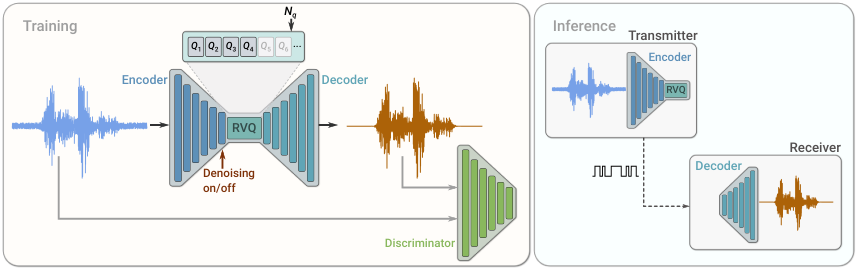
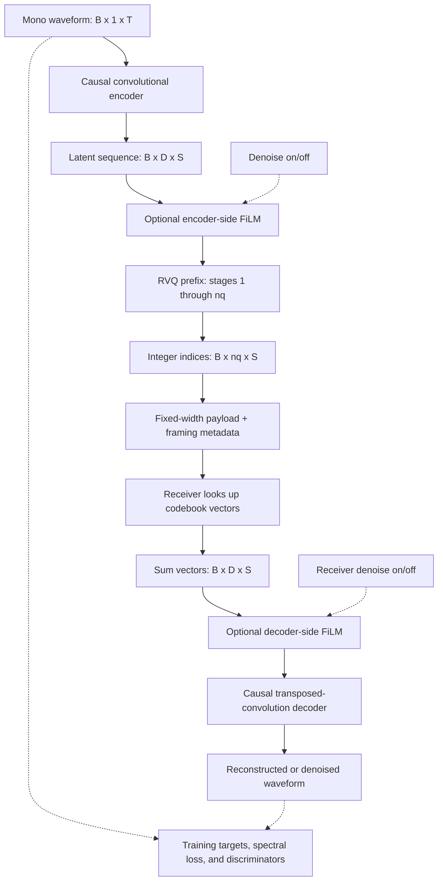
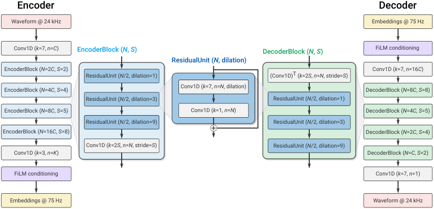
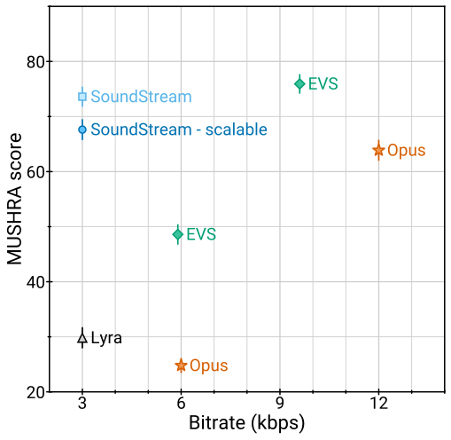
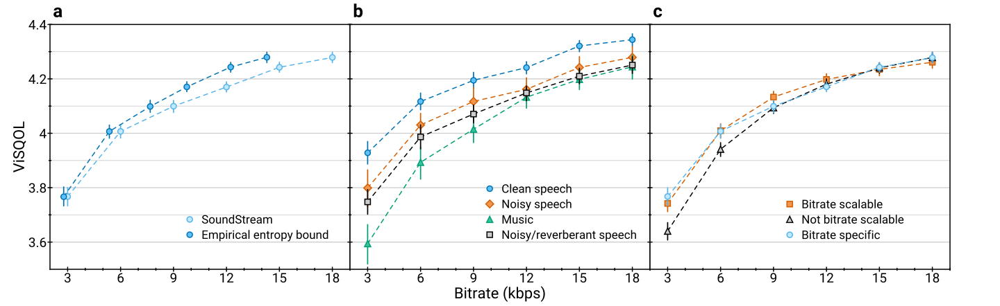

# SoundStream: An End-to-End Neural Audio Codec - Zeghidour et al., 2021

> **arXiv:** [2107.03312v1](https://arxiv.org/abs/2107.03312v1), 7 July 2021.
> **Venue:** IEEE/ACM Transactions on Audio, Speech, and Language Processing, volume 30, pp. 495-507, 2022; [DOI](https://doi.org/10.1109/TASLP.2021.3129994).
> **Authors:** Neil Zeghidour, Alejandro Luebs, Ahmed Omran, Jan Skoglund, Marco Tagliasacchi.
> **Affiliation:** Google.
> **Scope:** This recap follows the original arXiv v1, the only version listed on arXiv. Journal bibliographic metadata is checked against the DOI record. Later Lyra releases and EnCodec implementations are not silently treated as the original experimental system.

## TL;DR

SoundStream learns a causal, fully convolutional waveform encoder and decoder around a residual vector quantizer. Multiple small codebooks refine each latent vector additively, making useful bitrates practical without an exponentially large single codebook; randomly truncating the quantizer stack during training lets one model serve multiple rates.

The paper reports that 3 kbps SoundStream outperforms Opus at 12 kbps and approaches EVS at 9.6 kbps on its mixed-content subjective evaluation, while the default model runs faster than real time on one Pixel 4 CPU thread (abstract; Sections V-A and V-D). Optional FiLM conditioning jointly enables compression and background-noise removal without adding a separate processing stage, but the reported entropy-coding savings are **estimates**, not measurements of a deployed entropy-coded bitstream.

## Problem & motivation

### Waveform codecs, speech models, and very low bitrate

Traditional waveform codecs aim to reproduce the input waveform using transforms, quantization, entropy coding, and perceptual bit allocation. They work across content types, but quality deteriorates at very low rates. Speech-specific parametric or neural codecs can do better by imposing a strong speech prior, but that same prior can make music and environmental audio difficult.

SoundStream targets a representation that is learned end-to-end from audio, reconstructs more than speech, supports streaming, and is computationally practical on a phone. It avoids an autoregressive waveform generator that must sequentially synthesize individual samples.

For context, 16-bit mono PCM sampled at 24 kHz requires

$$
R_{\mathrm{PCM}}=24000\cdot16=384000\ \text{bits/s}.
$$

A 3 kbps payload is a nominal 128-fold reduction relative to that representation, before headers and transport overhead. This arithmetic does not imply lossless reconstruction.

### Why one ordinary vector quantizer does not scale

The encoder's default stride product is 320, so a second of 24 kHz audio becomes 75 latent frames. At 6 kbps, each frame receives

$$
b_{\mathrm{frame}}=\frac{6000}{75}=80\ \text{bits}.
$$

A single vector quantizer representing all 80 bits would require $2^{80}$ entries. The problem is not merely training such a table: storing and searching it is infeasible.

Residual vector quantization replaces that single enormous choice with a sequence of much smaller choices. The method is related to classical multi-stage vector quantization; the contribution is its learned integration into a streaming audio codec and its use for bitrate-scalable training, not the invention of multi-stage quantization itself (Section III-C).

### Why variable-rate training and joint enhancement matter

A codec should adapt to network conditions without loading a different neural network for every bitrate. Simply removing later quantizers from a fixed-rate model changes the decoder's input distribution and can reduce quality.

Noise removal is another practical concern. A separate denoiser before or after a codec adds a model and potentially another buffering delay. SoundStream asks whether the compressed representation itself can support denoising, optionally controlled at inference time.

## Key idea

### Additive residual refinement preserves the decoder interface

Write the input waveform as $x$, the encoder as $E$, and the decoder as $G$. For latent frame $y_t=E(x)_t$, initialize residual $r_{1,t}=y_t$. With codebook $\mathcal C_q=\{e_{q,k}\}_{k=0}^{N-1}$ at stage $q$,

$$
i_{q,t}=\underset{k}{\arg\min}\,
\|r_{q,t}-e_{q,k}\|_2^2,
\qquad
v_{q,t}=e_{q,i_{q,t}},
\qquad
r_{q+1,t}=r_{q,t}-v_{q,t}.
$$

The quantized latent and reconstructed waveform are

$$
\hat y_t=\sum_{q=1}^{n_q}v_{q,t},
\qquad
\hat x=G(\hat y).
$$

Here $N$ is the number of entries per codebook, $n_q$ the number of active stages, and $t$ a latent time index. Each stage approximates the error left by its predecessors. The receiver only needs the indices, shared codebooks, and decoder; it does not repeat nearest-neighbor search.

Because the selected vectors are **summed**, not concatenated, $\hat y_t$ keeps the same dimensionality at every bitrate. A shared decoder can therefore accept any trained prefix length.

### The rate is a product of frame rate and codebook depth

For sample rate $f_s$ and total downsampling factor $M$,

$$
f_{\mathrm{latent}}=\frac{f_s}{M},
\qquad
R=f_{\mathrm{latent}}\,n_q\log_2N.
$$

$R$ is the fixed-width index payload in bits/s. Under the paper's worked example, $f_s=24000$, $M=320$, and $N=1024$, so each active quantizer contributes $75\cdot10=750$ bits/s. Eight 1,024-entry codebooks provide the desired 6 kbps rate without a $2^{80}$-entry codebook.

### Train the decoder on prefixes, not only the full sum

For each training example, draw

$$
n_q\sim\operatorname{Uniform}\{1,\ldots,N_q\},
$$

where $N_q$ is the maximum quantizer depth. Use only stages $1,\ldots,n_q$ for that example. This is **structured prefix dropout**, not independently dropping arbitrary codebooks. Earlier stages become useful at low rates, and later stages refine a representation the decoder already knows how to reconstruct.

## How it works

### 1. Training and deployment paths



*Original Figure 2. Training includes discriminators and reconstruction losses. Deployment retains the encoder and quantizer on the sender and the decoder on the receiver. Denoising control is optional; the discriminator is never transmitted or run to decode a packet.*

The following authored diagram makes the representation and optional control explicit:



In this diagram, $B$ is batch size, $D$ latent width, $T$ input samples, and $S=T/M$ latent frames for a stride-aligned input. The displayed channels-first tensor layout is an explanatory convention; the paper writes the unbatched encoder output as $S\times D$.

Encoder-side and decoder-side FiLM are evaluated as separate configurations. The diagram does not imply that the experiments require both conditioning locations simultaneously.

### 2. Causal convolutional encoder



*Original Figure 3. Four strided blocks reduce the sample rate to 75 latent frames/s. Local residual units use dilations 1, 3, and 9; these are not long skip connections between encoder and decoder.*

Sections III-A and III-B describe a fully convolutional SEANet-derived architecture, without encoder-to-decoder skip connections. Such long skips would bypass the compressed representation and could not simply be sent for free.

The encoder consists of:

1. A causal kernel-7 convolution producing $C_{\mathrm{enc}}$ channels.
2. Four encoder blocks. Each first applies three local residual units with dilations $1,3,9$, then a strided convolution.
3. Downsampling strides $2,4,5,8$, with convolution kernel width twice the stride.
4. A final kernel-3, stride-1 convolution projecting to latent width $D$.

Figure 3 shows a kernel-7 dilated convolution followed by a kernel-1 convolution inside a residual unit, plus a local additive shortcut. The number of channels doubles at each encoder downsampling stage. ELU is used, and the paper explicitly applies **no normalization** in the codec.

For the default $C_{\mathrm{enc}}=32$, a stride-aligned one-second input has:

| Encoder stage | Channels | Kernel / stride | Samples or frames |
|---|---:|---|---:|
| Mono input | 1 | - | 24,000 |
| Initial convolution | 32 | 7 / 1 | 24,000 |
| First block output | 64 | downsample 4 / 2 | 12,000 |
| Second block output | 128 | downsample 8 / 4 | 3,000 |
| Third block output | 256 | downsample 10 / 5 | 600 |
| Fourth block output | 512 | downsample 16 / 8 | 75 |
| Final latent projection | $D$ | 3 / 1 | 75 |

These shapes follow the stated causal-padding and stride rules. The paper does not give a single explicit numerical default for $D$ in the method text, so it remains a parameter here rather than being borrowed from a later codec.

### 3. Mirrored waveform decoder

The decoder starts with a kernel-7 convolution expanding the summed latent to $16C_{\mathrm{dec}}$ channels. Four blocks then apply transposed convolutions with strides $8,5,4,2$, followed by the same three dilated residual units. Channel width halves at each upsampling stage. A final kernel-7 convolution produces one waveform channel.

For $C_{\mathrm{dec}}=32$, the intended progression is 512, 256, 128, 64, then 32 channels, and finally one waveform channel. The decoder need not have the same base width as the encoder, as the capacity experiments demonstrate.

**Diagram caution:** Figure 3 labels decoder-block residual units as `N/2` after a transposed convolution labeled with `N` output channels. Those labels are not a literal shape-consistent residual addition unless a width convention or projection is supplied. The progression above follows the main text's explicit rule that width halves at each upsampling stage; a reimplementation must make each residual branch and shortcut shape-compatible rather than blindly copying the labels.

There are no LSTM blocks in this architecture. Importing the recurrent blocks or normalization of a later [EnCodec implementation](multimodal_2022_encodec.md) would produce a different codec.

### 4. Streaming, state, and architectural latency

All codec convolutions are causal: offline/training padding supplies only past context, and streaming inference instead retains the needed past samples/activations. Transposed-convolution outputs must be aligned with their stride boundaries and any overlap handled consistently.

The default stride product is

$$
M=2\cdot4\cdot5\cdot8=320,
\qquad
\tau_{\mathrm{frame}}=\frac{320}{24000}
\approx13.3\ \text{ms}.
$$

This is the paper's architectural framing latency, not total call latency. It excludes computation, packetization, network jitter buffers, and playback buffering. A causal receptive field can use substantial **past** context without adding corresponding future lookahead.

A practical streaming implementation must preserve convolution history, a consistent sample/frame phase, and any unconsumed samples. Calling an offline encoder independently on short chunks with fresh padding is not automatically equivalent to stateful streaming. End-of-stream padding and final output trimming also need explicit conventions, which the paper does not specify as a complete wire format.

### 5. Residual quantizer operation and codebook learning

Algorithm 1 can be implemented framewise as:

```text
residual = encoder_frame
quantized = zero_vector
for q in 1 .. active_quantizer_count:
    index = nearest_codebook_entry(codebook[q], residual)
    selected = codebook[q][index]
    transmit index
    quantized += selected
    residual -= selected
decoder_input = quantized
```

The residual changes after each stage. Quantizing the original latent independently with every codebook would not implement this algorithm.

For intuition, in a scalar toy example an input of 0.9 might first choose 1.0, leaving residual -0.1. A second codebook can select -0.1, so the sum becomes 0.9. In the actual codec these are $D$-dimensional vectors, and residual error reduction does not guarantee a strict perceptual improvement on every individual sample.

The paper adopts VQ-VAE-style quantization trained with backpropagation and EMA-maintained codebooks. The straight-through principle can be expressed as

$$
y_{\mathrm{st}}=y+\operatorname{sg}(\hat y-y),
$$

where $\operatorname{sg}$ stops gradients: the forward value is quantized while the encoder receives an identity surrogate derivative. This explains the differentiability convention, not a claim that nearest-neighbor index selection has an ordinary derivative.

Section III-C adds two important codebook-usage measures:

- **K-means initialization:** initialize each codebook using centroids fitted to its input distribution on the first training batch, instead of arbitrary random vectors.
- **Dead-code replacement:** track assignments to each entry with EMA decay 0.99; if an entry's usage statistic falls below 2, replace it with an input vector sampled from the current batch.

Codebook centroids themselves use EMA updates following VQ-VAE-2. The paper does not provide every initialization/update implementation detail, such as a k-means iteration count. It also does not separately spell out a VQ commitment coefficient in its displayed overall objective; a reproduction should report its chosen VQ training details rather than claim they are all fixed by Equation 6.

### 6. Bitrate-scalable prefixes

For the worked 1,024-entry codebooks at 75 latent frames/s, the following operating points follow directly:

| Active codebooks | Bits per frame | Nominal bitrate |
|---:|---:|---:|
| 4 | 40 | 3 kbps |
| 8 | 80 | 6 kbps |
| 12 | 120 | 9 kbps |
| 16 | 160 | 12 kbps |
| 20 | 200 | 15 kbps |
| 24 | 240 | 18 kbps |

This is rate arithmetic, not a claim that the paper publishes a separate checkpoint for each row. With this parameterization, a model whose maximum rate is 18 kbps uses at most 24 stages. The prefix-dropout rule mathematically includes shorter prefixes, but the main quality curves evaluate **3-18 kbps**; quality below 3 kbps is not established by those curves.

Training samples $n_q$ **per input example**, whereas the later EnCodec recipe samples a rate for an entire batch. Prefix dropout also means early codebooks receive more training exposure:

$$
\Pr(\text{stage }q\text{ is active})
=\frac{N_q-q+1}{N_q}.
$$

That equation is a consequence of uniform prefix sampling, not an additional loss or sampling rule. At inference, both endpoints must agree on the active depth. Changing it does not alter the latent vector width or require swapping the waveform networks.

### 7. Two kinds of training discriminator

SoundStream uses both waveform and spectral discrimination (Section III-D), unlike the simplified multi-scale STFT-only family selected by EnCodec.

**Waveform multi-scale discriminator.** Three structurally identical networks see the original waveform, a two-times downsampled waveform, and a four-times downsampled waveform. Each contains:

1. One initial plain convolution.
2. Four grouped convolutions, with group size 4, downsampling factor 4, and channel multiplier 4, capped at 1,024 channels.
3. Two final plain convolutions producing a time sequence of real/fake logits.

The paper refers to the MelGAN discriminator architecture for further details rather than listing every kernel setting in this paragraph.

**Single-resolution complex-STFT discriminator.** Use window 1,024 and hop 256, keeping real and imaginary components rather than only magnitude. The network begins with a 32-channel $7\times7$ convolution and then six residual blocks. Each has a $3\times3$ convolution followed by a downsampling convolution; time/frequency strides alternate between $(1,2)$ and $(2,2)$, with corresponding $3\times4$ or $4\times4$ kernels.

After these blocks, frequency has been reduced by $2^6$ and time by $2^3$. The paper describes the output grid as

$$
\frac{T}{256\cdot2^3}\ \times\ \frac{F_{\mathrm{spec}}}{2^6},
\qquad F_{\mathrm{spec}}=1024/2.
$$

Its terminal convolution spans the remaining frequency dimension to produce one logit sequence along time. Exact STFT endpoint conventions and convolution padding must be chosen consistently with that terminal width.

An authored summary of the adversarial path is:

```text
real audio / reconstructed audio
  |
  +-- waveform at 1x --> convolutional discriminator --> time logits
  +-- waveform at 1/2x --> same structure ------------> time logits
  +-- waveform at 1/4x --> same structure ------------> time logits
  |
  +-- complex STFT, window 1024 / hop 256
      --> 7x7 Conv, 32 channels
      --> 6 residual blocks, alternating (1,2)/(2,2) strides
      --> frequency-spanning final convolution ------> time logits
```

These discriminators encourage perceptual quality during training. They are not additional payload channels or decoder-side enhancement networks.

### 8. Conditional compression and denoising

Training examples are triples $(x,x^\star,c)$, where $c$ is the denoise control and $x^\star$ the desired target:

| Input | Control | Target |
|---|---|---|
| Noisy speech | Denoise off | Original noisy speech |
| Noisy speech | Denoise on | Corresponding clean speech |
| Clean speech or music | Either control | Original clean input |

The last row teaches the model not to damage clean input just because denoising is enabled.

FiLM, feature-wise linear modulation, transforms bottleneck activations:

$$
\tilde a_{t,c}=\gamma_{t,c}a_{t,c}+\beta_{t,c},
\qquad
[\gamma_t,\beta_t]=W_{\mathrm{FiLM}}u_t+b_{\mathrm{FiLM}}.
$$

Here $a_{t,c}$ is the activation at latent time $t$ and channel $c$, and $u_t$ is a two-dimensional one-hot encoding of denoise on/off. A linear layer produces per-channel affine parameters; the control can change over time (Equation 7).

The authors found bottleneck conditioning effective and saw no further gains from adding FiLM at multiple depths:

- **Before quantization:** the encoder can avoid representing unwanted noise, potentially making the index stream more compressible.
- **After quantization:** the receiver can choose whether to suppress noise without re-encoding the sender's representation, but the transmitted representation may still contain noise information.

“No additional latency” means no additional architectural buffering stage compared with this codec. It is not a statement that denoising has zero compute cost, perfect noise removal, or no possible effect on wanted background sounds.

### 9. Entropy estimates are not an implemented entropy codec

The evaluated codec uses a constant number of fixed-width bits per latent frame. Section V-B estimates a lower rate using the empirical entropy of each stage's symbols, treating each stage as a discrete memoryless source:

$$
H_q=-\sum_{k=1}^{N}p_k^{(q)}\log_2p_k^{(q)},
\qquad
R_{\mathrm{entropy}}\approx
f_{\mathrm{latent}}\sum_{q=1}^{n_q}H_q.
$$

This estimate does not exploit temporal dependence or dependence between codebooks. A deployable coder would additionally need synchronized probability models, finite-precision coding, framing, and overhead handling.

For denoising experiments, the authors estimate symbol probabilities $p$ on 3,200 training samples, estimate test frequencies $r$ on 1,000 samples, and compute cross-entropy:

$$
H(r,p)=-\sum_q\sum_k r_k^{(q)}\log_2p_k^{(q)}.
$$

Multiplying this per-frame quantity by latent frame rate yields the corresponding idealized bits/s estimate. Practical zero-probability handling and probability-model storage are not specified as a complete compression format.

## Training / data

### 1. Data preparation and target domains

Section IV-A trains on three types of 24 kHz mono audio:

| Content | Source | Preparation |
|---|---|---|
| Clean speech | LibriTTS | Random three-second crops, peak normalization |
| Noisy speech | LibriTTS speech mixed with Freesound noise | Noise mixing gain sampled uniformly from -30 to 0 dB |
| Music | MagnaTagATune | Included as a non-speech training domain |

The paper describes peak normalization and random three-second crops in its data preparation. It does not publish an exact training-mixture sampling ratio, unique hour count, or all dataset split identifiers.

Evaluation uses disjoint splits of these sources plus an additional real-world dataset of near-/far-field, sometimes noisy/reverberant speech. Unless stated otherwise, the main objective and subjective set has **200 clips of 2-4 seconds**, with 50 clips from each of four categories: clean speech, noisy speech, music, and noisy/reverberant speech.

Joint-denoising training changes the target according to the control table above. It is supervised enhancement with paired clean targets, not a guarantee of learning denoising merely by reconstructing arbitrary noisy recordings.

### 2. Adversarial loss

The paper indexes the spectral discriminator by $k=0$ and waveform scales by $k=1,\ldots,K$, with $K=3$. For output length $T_k$, the discriminator hinge objective is

$$
\mathcal L_D=
\mathbb E_x\left[
\frac1K\sum_{k=0}^{K}\frac1{T_k}\sum_t
\left\{
\max(0,1-D_{k,t}(x))+
\max(0,1+D_{k,t}(\hat x))
\right\}
\right].
$$

The generator adversarial objective is

$$
\mathcal L_G^{\mathrm{adv}}=
\mathbb E_x\left[
\frac1K\sum_{k=0}^{K}\frac1{T_k}\sum_t
\max(0,1-D_{k,t}(\hat x))
\right].
$$

These reproduce Equations 1 and 2, including the paper's **hinge generator loss**, rather than replacing it without notice by $-\operatorname{mean}D(\hat x)$. Generated audio is detached for discriminator optimization, but not when obtaining the generator's gradient through a fixed discriminator.

**Normalization caveat:** the printed equations divide by $K=3$ while the described sum includes four discriminators, $k=0,\ldots,3$. The expressions above preserve that convention. A literal average over all four would divide by $K+1$ and change the loss scale; a reproduction should disclose that choice.

### 3. Discriminator feature matching

For discriminator $k$, internal layer $l$, and its time length $T_{k,l}$,

$$
\mathcal L_G^{\mathrm{feat}}=
\mathbb E_x\left[
\frac1{KL}\sum_{k,l}
\frac1{T_{k,l}}\sum_t
\left|
D_{k,t}^{(l)}(x)-D_{k,t}^{(l)}(\hat x)
\right|
\right].
$$

$L$ is the number of compared internal layers, and the absolute differences are reduced over the layer's features (Equation 3). The real-audio features provide a target; the generated features must retain the gradient path into the codec.

This is plain feature matching, not EnCodec's later feature loss normalized by real-feature magnitude. Nor does SoundStream introduce EnCodec's output-gradient balancer.

### 4. Multi-resolution spectral reconstruction

Let $\mathcal S_t^s(x)$ be a 64-bin Mel-spectrogram frame computed with window length $s$ and hop $s/4$. The reconstruction loss is

$$
\mathcal L_G^{\mathrm{rec}}=
\sum_{s\in\{2^6,\ldots,2^{11}\}}\sum_t
\left[
\|\mathcal S_t^s(x)-\mathcal S_t^s(\hat x)\|_1
+
\alpha_s
\|\log\mathcal S_t^s(x)-\log\mathcal S_t^s(\hat x)\|_2
\right],
\qquad
\alpha_s=\sqrt{s/2}.
$$

This is the complete expression split across Equations 4 and 5. It combines a linear-magnitude L1 difference with a **log-Mel L2 norm**. It is not a sample-domain waveform L1 loss, and the second term is not a squared L2 loss as printed.

The six window lengths are 64, 128, 256, 512, 1,024, and 2,048 samples, with hops 16 through 512. Multiple resolutions simultaneously penalize short-time and long-time spectral errors. Implementations need an explicit floor before taking logarithms and a consistent Mel/STFT convention; the paper does not give every numerical detail.

For joint denoising, the desired clean or unchanged target $x^\star$ replaces $x$ on the target side of the reconstruction and perceptual comparison.

### 5. Overall objective and disclosed recipe

The stated generator objective is

$$
\mathcal L_G=
\lambda_{\mathrm{adv}}\mathcal L_G^{\mathrm{adv}}+
\lambda_{\mathrm{feat}}\mathcal L_G^{\mathrm{feat}}+
\lambda_{\mathrm{rec}}\mathcal L_G^{\mathrm{rec}},
\qquad
(\lambda_{\mathrm{adv}},\lambda_{\mathrm{feat}},\lambda_{\mathrm{rec}})
=(1,100,1).
$$

Source: Equation 6 and Section III-E. The following separates stated settings from unknowns:

| Setting | What arXiv v1 reports |
|---|---|
| Training signal | 24 kHz mono |
| Crop duration | 3 seconds |
| Default codec base widths | $C_{\mathrm{enc}}=C_{\mathrm{dec}}=32$ |
| Default encoder strides | $(2,4,5,8)$ |
| Codec activations / normalization | ELU / none |
| Residual-unit dilations | 1, 3, 9 in each block |
| Quantizer usage EMA decay / dead threshold | 0.99 / 2 |
| Quantizer initialization | K-means on the first training batch |
| Scalable-rate training | Uniform random active prefix length per example |
| Generator loss weights | Adversarial 1, feature matching 100, reconstruction 1 |
| Optimizer, learning rate, schedule | Not specified |
| Batch size, update count, epochs | Not specified |
| Training accelerator count / wall time | Not specified |
| Numeric default latent width and complete VQ auxiliary-loss configuration | Not fully specified |

The unreported entries should not be filled with values from an unofficial reimplementation or from EnCodec. The paper gives a detailed mechanism and architecture but not a fully reproducible training command or production bitstream specification.

A faithful conceptual iteration is: sample and prepare data; choose a denoising target/control if applicable; sample an RVQ prefix for scalable training; encode, quantize, and decode; compute the three generator losses and the VQ training terms required by the chosen VQ-VAE implementation; update generator and codebook statistics; and optimize the discriminators on real targets versus detached generated audio. The paper does not specify every update-order/frequency detail.

## Results

### 1. Human evaluation protocol

Section IV-B uses a **MUSHRA-inspired crowdsourced test**, with a hidden reference but **no lowpass-filtered anchor**. Each of the 200 clips is rated 20 times. Listeners must be native English speakers using headphones.

The post-screening excludes listeners who:

- Rate the reference below 90 **more than 20%** of the time.
- Rate non-reference samples above 90 **more than 50%** of the time.

These are not EnCodec's later reference/low-anchor filtering rules. In particular, SoundStream's first condition is strictly greater than 20%, not greater than or equal to 20%.

The authors use ViSQOL for development and ablations because it is freely available and correlated with their early subjective evaluations. Higher ViSQOL is better, but an objective estimator does not by itself establish listener preference or universal transparency.

### 2. Main rate-quality comparison



*Original Figure 1. The SoundStream points use 3 kbps; conventional codecs are also shown at higher rates. This gives the headline rate-quality comparison, not a comparison in which all systems use the same bitrate.*

The main subjective comparison is in Figures 5 and 6. The paper does not print every plotted MUSHRA point as a numeric table, so the following retains the explicitly stated rates and conclusions without inventing digitized scores.

| SoundStream operating point | Comparison reported by the authors | Source |
|---|---|---|
| 3 kbps | Better than Opus at 6 kbps and EVS at 5.9 kbps; better than original Lyra at 3 kbps | Section V-A, Figure 5a |
| 3 kbps | Abstract reports outperforming Opus at 12 kbps and approaching EVS at 9.6 kbps | Abstract; Figure 1 |
| 3 kbps | Approximately 3.2-4 times as many bits needed by EVS/Opus for comparable quality | Section V-A |
| 6 kbps | Reported conventional-codec rate premium about 2.2-2.6 times | Section V-A, Figure 5b |
| 12 kbps | Reported conventional-codec rate premium about 1.3-1.6 times | Section V-A, Figure 5c |

The advantage is therefore strongest at the lowest operating rates. Figure 6 breaks results down by content type; the paper emphasizes that music remains usable at 3 kbps rather than the codec being restricted to speech. That is a result on its selected test domains, not proof of equal fidelity on arbitrary audio.

The baseline called Lyra here is the **original autoregressive 3 kbps Lyra**, not the later SoundStream-based Lyra-v2 system.

### 3. Objective rate curves and quantizer dropout



*Original Figure 7. Left: raw constant-rate points versus an empirical entropy bound. Center: content-dependent quality. Right: fixed-rate models, a model truncated without dropout training, and a prefix-dropout-trained scalable model. Error bars denote 95% confidence intervals.*

Sections V-B and V-C report:

- Across the main 3-18 kbps curve, the aggregate ViSQOL remains above 3.7 even at the lowest tested rate.
- The memoryless entropy estimate suggests **7-20% potential rate savings**. This is not a measured runtime or wire-size result.
- Clean speech is easier than music in the objective breakdown.
- Truncating a model trained only at 18 kbps retains some quality but loses more as the mismatch between training and inference rate grows.
- Prefix-dropout training largely closes that gap. The scalable model is only slightly worse than a rate-specific model in the 3 kbps subjective test and matches it at 6 and 12 kbps.
- The objective scalable curve marginally exceeds rate-specific models at 9 and 12 kbps; the authors suggest a regularization effect, not a guarantee that dropout always improves every rate.

### 4. Learning the encoder matters

| Configuration | Bitrate | ViSQOL |
|---|---:|---:|
| Learned encoder, ablation reference | 6 kbps | 3.96 |
| Fixed Mel-filterbank encoder; learned quantizer and decoder | 6 kbps | 3.33 |
| Learned encoder at lower rate | 3 kbps | 3.76 |

*Source: Section V-D, “Advantage of learning the encoder.” No confidence interval is printed for these prose values.*

Replacing the encoder with fixed Mel features loses more objective quality than halving the rate of the learned codec in this experiment. This supports joint representation learning; it is not an assertion that all uses of Mel spectrograms are inferior.

### 5. Encoder/decoder capacity and phone throughput

The paper defines real-time factor as

$$
\mathrm{RTF}=
\frac{\text{audio duration}}
{\text{encoding or decoding time}}.
$$

**RTF greater than one is faster than real time.** It is the inverse of the processing-time/audio-duration convention used in some other audio literature.

| $C_{\mathrm{enc}}$ | $C_{\mathrm{dec}}$ | Parameters, M | Encoder RTF | Decoder RTF | ViSQOL |
|---:|---:|---:|---:|---:|---:|
| 32 | 32 | 8.4 | 2.4 | 2.3 | 4.01 +/- 0.03 |
| 16 | 16 | 2.4 | 7.5 | 7.1 | 3.98 +/- 0.03 |
| 16 | 32 | 5.5 | 7.5 | 2.3 | 4.02 +/- 0.03 |
| 8 | 32 | 4.8 | 18.6 | 2.3 | 3.99 +/- 0.03 |
| 32 | 16 | 5.3 | 2.4 | 7.1 | 3.97 +/- 0.03 |
| 32 | 8 | 4.4 | 2.4 | 17.1 | 3.90 +/- 0.03 |

*Source: Table I, 6 kbps, single CPU thread on a Pixel 4 smartphone. The uncertainty values are retained as printed; unlike Table IV, this table's caption does not explicitly define their statistic.*

A much smaller encoder with the default decoder retains similar objective quality and substantially improves encoding speed. Shrinking the decoder has a larger quality cost. This is useful for asymmetric sender/receiver compute budgets and supports the choice not to tie their widths.

**Source discrepancy:** the accompanying capacity prose uses a 3.96 reference and changes to 3.94 / 3.84, whereas Table I prints 4.01, 3.99, and 3.90 for the corresponding base/smallest-encoder/smallest-decoder configurations. The table above preserves Table I rather than silently reconciling those values or mixing them with the separate fixed-encoder ablation.

### 6. RVQ depth versus codebook size

| Quantizer stages | Entries per codebook | Bits per frame | ViSQOL |
|---:|---:|---:|---:|
| 8 | 1,024 | 80 | 4.01 +/- 0.03 |
| 16 | 32 | 80 | 3.98 +/- 0.03 |
| 80 | 2 | 80 | 3.92 +/- 0.03 |

*Source: Table II, all at 6 kbps. Bits per frame are derived as $n_q\log_2N$.*

Fewer larger codebooks perform best here, but an extremely deep sequence of 80 one-bit quantizers remains trainable and loses only modest objective quality. This illustrates the storage/search/quality tradeoff rather than establishing that a larger codebook is always the most efficient implementation on every device.

### 7. Architectural latency versus throughput

| Encoder strides | Reported latency | Active quantizers | Encoder RTF | Decoder RTF | ViSQOL |
|---|---:|---:|---:|---:|---:|
| (1, 4, 5, 8) | 7.5 ms | 4 | 1.6 | 1.5 | 4.01 +/- 0.02 |
| (2, 4, 5, 8) | 13 ms | 8 | 2.4 | 2.3 | 4.01 +/- 0.03 |
| (4, 4, 5, 8) | 26 ms | 16 | 4.1 | 4.0 | 4.01 +/- 0.03 |

*Source: Table III, 6 kbps. Latencies are copied as printed, not recomputed to overwrite the source.*

Changing the frame size changes both latent frame rate and the number of bits required per frame. With 1,024-entry codebooks, the three configurations use 40, 80, and 160 bits per frame, respectively, and all give 6 kbps.

**Arithmetic discrepancy:** the first stride product is $1\cdot4\cdot5\cdot8=160$ samples. At 24 kHz that is about **6.67 ms**, not the printed 7.5 ms. The corresponding 320- and 640-sample durations are about 13.33 and 26.67 ms; the table uses coarser 13 and 26 ms labels. The paper does not explain an additional delay that would turn the first 160-sample duration into 7.5 ms.

The nearly equal ViSQOL entries indicate that, within these settings, throughput improves as the codec handles fewer, longer frames. This does not mean end-to-end interactive delay improves: larger architectural frames explicitly increase buffering time.

### 8. Joint denoising and compression

Section V-E evaluates 1,000 synthesized noisy-speech samples against clean references. Encoder-side FiLM, decoder-side FiLM, and a model always trained to denoise are compared in Figure 8. Enabling denoising improves the clean-reference score, and the flexible conditioned models show no substantial loss relative to fixed denoising in those plots.

The same figure also reports **estimated** entropy-coded rates. Encoder-side or fixed denoising offers larger potential savings than decoder-side denoising, consistent with removing noise before allocating codebook indices to it. These are not measurements of an implemented adaptive entropy coder.

Table IV compares one joint model against two-stage pipelines on **VCTK**, which was not used to train either SoundStream or the separate SEANet denoiser:

| Input SNR | Joint SoundStream | SoundStream then SEANet | SEANet then SoundStream |
|---|---:|---:|---:|
| 0 dB | 2.93 +/- 0.02 | 3.02 +/- 0.03 | 3.05 +/- 0.02 |
| 5 dB | 3.18 +/- 0.02 | 3.30 +/- 0.02 | 3.31 +/- 0.02 |
| 10 dB | 3.42 +/- 0.02 | 3.51 +/- 0.02 | 3.50 +/- 0.02 |
| 15 dB | 3.58 +/- 0.02 | 3.64 +/- 0.02 | 3.63 +/- 0.02 |

*Source: Table IV and Section V-F. Entries are ViSQOL with 95% confidence intervals. At each SNR the authors evaluate 1,000 two-second clips, silence-cropped and resampled to 24 kHz.*

The joint model is cheaper and adds no separate enhancement-stage architectural delay, but **does not equal the two-stage quality in these rows**. The paper describes its compute as about half that of the disjoint setup; it does not provide a complete per-pipeline device timing table. The quality gap narrows as input SNR rises.

## Limitations & follow-ups

### Scope and reproducibility limits

- **Perceptual reconstruction is lossy.** Adversarial training can produce plausible audio without preserving exact sample values or every background detail. Low-bitrate quality is not archival fidelity.
- **The principal experiments are 24 kHz mono.** The paper does not establish stereo, fullband music, or arbitrary-domain performance simply because the architecture could be extended.
- **Bitrate adaptability is learned, not free.** Prefix truncation without dropout training has a larger quality penalty, especially far below the training rate. The evidence covers specific tested rates and data.
- **Noise suppression is task-conditioned.** Clean-target supervision and denoising control matter. A useful background sound is not necessarily “noise,” and the paper does not provide a universal preservation guarantee.
- **Causality is not a network protocol.** Buffering, state management, packet loss, framing, and end-of-stream behavior still require engineering. Reported architectural latency excludes transport and compute.
- **The entropy result is an estimated opportunity, not a finished system.** The paper estimates ideal memoryless coding rates; it does not demonstrate a complete synchronized entropy-coding implementation with measured overhead and throughput.
- **The training recipe is incomplete.** Optimizer settings, compute budget, numeric latent-width defaults, and some VQ details are not fully specified. The real-world evaluation collection and some source discrepancies also limit exact reproduction.
- **Human-test conclusions are bounded.** The MUSHRA-inspired protocol has no lowpass anchor and uses selected clips, native-English listeners, and headphone screening. Reported preference is not universal perceptual transparency; ViSQOL is not a replacement for listening.

### Relationship to later systems

[EnCodec](multimodal_2022_encodec.md) directly develops this codec family with a different convolutional/recurrent architecture, a multi-scale STFT discriminator, output-gradient loss balancing, and an actual optional Transformer/range-coding path. Its mono/stereo settings and benchmarks should not be read as if they were SoundStream results.

The [official Lyra repository](https://github.com/google/lyra) later incorporates SoundStream-derived technology and describes different rates and framing. That later release is not the original 3 kbps autoregressive Lyra baseline in this paper, nor a guarantee that its current training/configuration reproduces every 2021 result.

[AudioLM](https://arxiv.org/abs/2209.03143) subsequently uses acoustic-codec representations in audio generation. Sequence modeling of codec tokens is a downstream use of a reconstructive representation, not a capability evaluated by this compression paper. For comparison, [Whisper](multimodal_2022_whisper.md) predicts textual transcripts rather than a code stream meant to reconstruct the waveform.

## Links

- **arXiv:** [abstract, v1](https://arxiv.org/abs/2107.03312v1) · [HTML, v1](https://arxiv.org/html/2107.03312v1) · [PDF, v1](https://arxiv.org/pdf/2107.03312v1).
- **Code:** [official SEANet / SoundStream project repository](https://github.com/google-research/seanet), associated with the samples page; not a complete original SoundStream training release. [google/lyra](https://github.com/google/lyra) is a later deployment lineage, with different configurations.
- **Hugging Face:** No original-author model card is identified here as the checkpoint used for the 2021 paper; third-party implementations should be labeled as such.
- **Project page / samples:** [official SoundStream audio examples](https://google-research.github.io/seanet/soundstream/examples/).
- **Blog posts:** [Google Research: SoundStream, an end-to-end neural audio codec](https://research.google/blog/soundstream-an-end-to-end-neural-audio-codec/).
- **Talks / videos:** The official blog and project page contain audio demonstrations; no separate talk is used as a technical source.
- **OpenReview / venue page:** [IEEE Xplore record](https://ieeexplore.ieee.org/document/9625818) · [DOI](https://doi.org/10.1109/TASLP.2021.3129994) · [Google publication record](https://research.google/pubs/soundstream-an-end-to-end-neural-audio-codec/).
- **Papers-with-Code:** [paper record](https://paperswithcode.com/paper/soundstream-an-end-to-end-neural-audio-codec); not used for benchmark values.
- **Related / successor papers:** [EnCodec recap](multimodal_2022_encodec.md) · [Whisper recap](multimodal_2022_whisper.md) · [AudioLM](https://arxiv.org/abs/2209.03143) · [VQ-VAE](https://arxiv.org/abs/1711.00937) · [VQ-VAE-2](https://arxiv.org/abs/1906.00446) · [MelGAN](https://arxiv.org/abs/1910.06711).

```bibtex
@article{zeghidour2022soundstream,
  title={SoundStream: An End-to-End Neural Audio Codec},
  author={Zeghidour, Neil and Luebs, Alejandro and Omran, Ahmed and
          Skoglund, Jan and Tagliasacchi, Marco},
  journal={IEEE/ACM Transactions on Audio, Speech, and Language Processing},
  volume={30},
  pages={495--507},
  year={2022},
  doi={10.1109/TASLP.2021.3129994},
  eprint={2107.03312},
  archivePrefix={arXiv}
}
```
