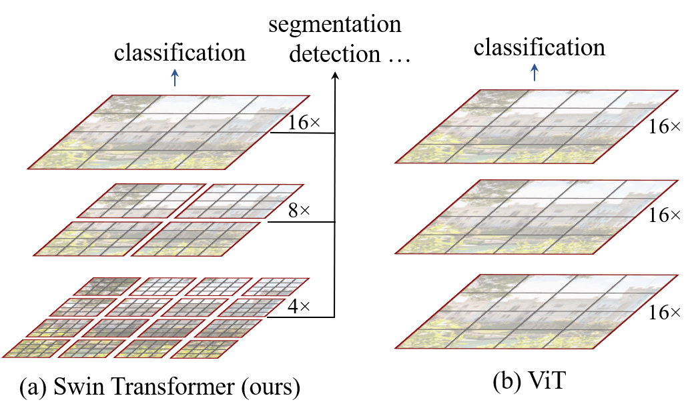
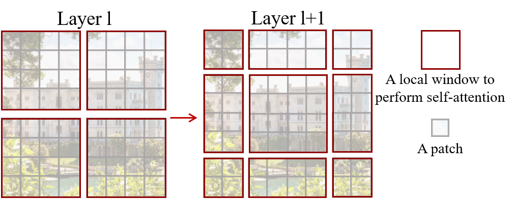
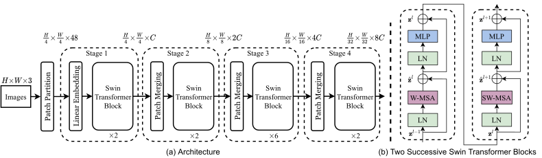
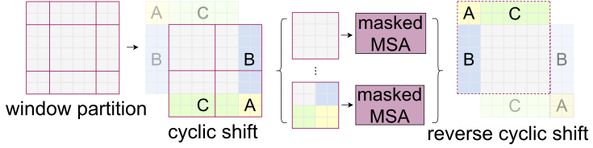
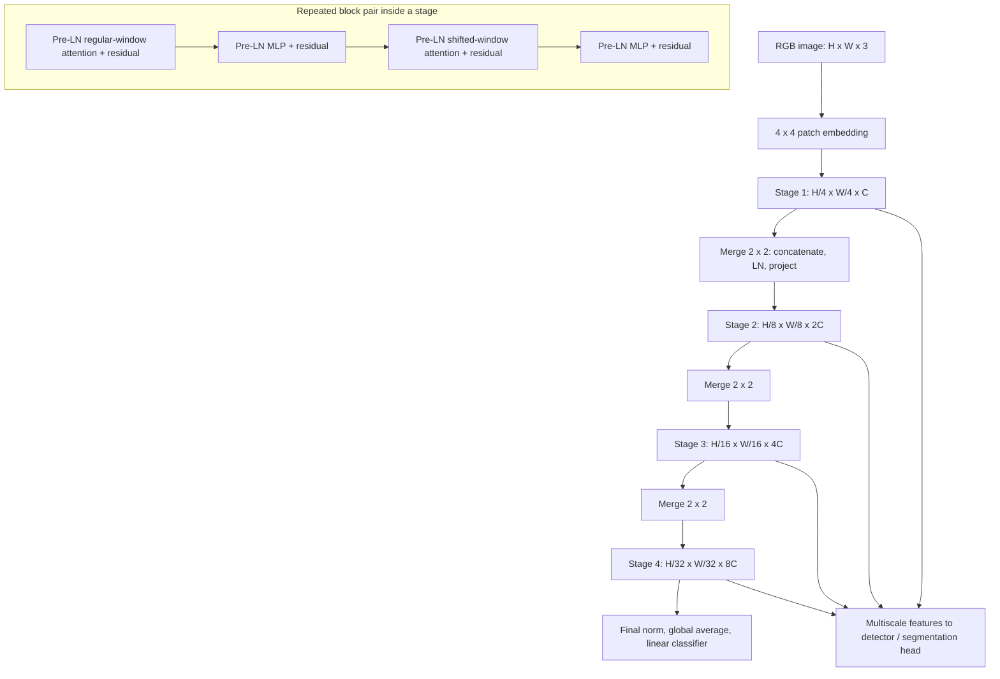

# Swin Transformer - Liu et al., 2021

> **Title:** Swin Transformer: Hierarchical Vision Transformer using Shifted Windows
>
> **Authors:** Ze Liu, Yutong Lin, Yue Cao, Han Hu, Yixuan Wei, Zheng Zhang,
> Stephen Lin, Baining Guo
>
> **arXiv:** [2103.14030v2][paper], 17 August 2021; first submitted 25 March 2021
>
> **Venue:** [ICCV 2021][venue], pp. 10012-10022
>
> **Affiliation:** Microsoft Research Asia
>
> **Scope:** The versioned paper, including its appendices. Implementation
> details are checked against the official Swin-V1 code at
> [`f82860bfb5225915aca09c3227159ee9e1df874d`][code], 15 July 2024;
> this later snapshot is not asserted to reproduce every paper-era configuration.

## TL;DR

Swin makes a Transformer a practical multiscale vision backbone by combining
small input patches, progressively merged feature maps, and attention inside
non-overlapping windows whose boundaries alternate between consecutive blocks.
The shifted partition lets information cross earlier window boundaries, while
cyclic shifting and a mask implement it without allocating extra windows.
It achieves **87.3% ImageNet-1K top-1**, **58.7 box / 51.1 mask AP on COCO
test-dev**, and **53.5 ADE20K validation mIoU**, but those headline results
use different task-specific systems and ImageNet-22K-pretrained models
(Tables 1-3), not a single small model trained only on ImageNet-1K.
Its main contribution is an efficient hierarchical backbone, not instantaneous
global attention, a new decoder, or the claim that FLOPs alone predict speed.

## Problem & motivation

### A classification token grid is not yet a general-purpose vision backbone

[ViT][vit] showed that image patches can be processed with a Transformer.
However, a single coarse grid is awkward for object detection and segmentation,
where fine boundaries and objects at different scales matter. Simply reducing
the patch size increases the number of tokens and makes global attention
much more expensive.

If an image has height $H$, width $W$, and patch side length $P$, its initial
token count is

$$
N=\frac{HW}{P^2}.
$$

With compatible image dimensions, halving $P$ multiplies $N$ by four and
the number of pairwise global-attention scores by sixteen. Increasing
image resolution poses the same difficulty. The score matrix grows as
$N^2$, even before accounting for multiple heads and layers.

CNN backbones address related requirements using a spatial hierarchy:
fine, relatively narrow early maps and coarse, wider late maps. Dense
prediction frameworks already know how to consume such multiscale features.
Swin combines that hierarchy with a Transformer block rather than requiring
every layer to retain the same token count.



*Original Figure 1. Patch merging changes spatial scale as the network gets
deeper. Attention remains local at each scale, allowing fine early maps
without paying the global-attention cost at that resolution.*

### Why not use an independently sliding attention window at every pixel?

Sliding-window attention also limits the number of keys per query. But
neighboring queries then gather overlapping, differently aligned neighborhoods,
which can have poor memory-access efficiency on available hardware.
Swin batches complete **non-overlapping windows** instead: all queries
in a window share the same key set.

The difficulty is connectivity. If every block uses exactly the same partition,
tokens cannot exchange information across those boundaries within that stage.
Swin shifts the partition in alternating blocks, connecting neighboring
windows while keeping regular dense matrix multiplications.

## Key idea

### Hierarchy handles scale; shifted windows handle local communication

At each stage, keep a token grid and apply window self-attention plus
per-token MLPs. Between stages, merge each $2\times2$ neighborhood into
one token and double the channel width. Alternate regular-window attention
with shifted-window attention inside each stage.

Let $h,w$ be the current token-grid dimensions, $D$ its channel width,
and $M$ the window side length in **tokens**. The paper's attention-module
complexities, with $D$ substituted for its generic channel symbol $C$, are

$$
\Omega(\mathrm{MSA})=4hwD^2+2(hw)^2D,
\tag{1}
$$

$$
\Omega(\mathrm{W\!-\!MSA})=4hwD^2+2M^2hwD.
\tag{2}
$$

The first term includes the query/key/value and output projections.
The second includes score computation and weighted value aggregation.
As in the paper, these expressions omit softmax cost. With fixed $M$
and $D$, window attention is linear in token count $hw$; global attention's
pairwise term is quadratic.

This is **linear in image area/pixel count**, not linear in the side
length of a square image. It also assumes a fixed architecture and window
size, not a window that expands with the image.

### The shift changes who can communicate, not the number of tokens

For regular windows, use a grid anchored at the top-left corner. In the
next block, move the window boundaries by

$$
s=\left\lfloor\frac M2\right\rfloor
$$

along both spatial axes. For the default $M=7$, $s=3$. Tokens formerly
separated by a window boundary can now attend to each other.
Each block still has local attention; distant information propagates
through successive blocks and the hierarchy rather than through an
all-pairs operation in every layer.



*Original Figure 2 uses an $8\times8$ example with $4\times4$ windows,
not the default $7\times7$ setting. The shifted layer combines tokens from
different windows of the preceding layer.*

## How it works

### 1. Embed small image patches

Start with an RGB image of shape $b\times H\times W\times3$, where $b$
is the batch size. Split it into non-overlapping $4\times4$ patches.
Flattening a patch yields 48 raw values, and a learned linear projection
maps those values to $C$ channels:

$$
b\times H\times W\times3
\longrightarrow
b\times\frac H4\times\frac W4\times48
\longrightarrow
b\times\frac H4\times\frac W4\times C.
$$

$C$ denotes the **first-stage** width. The official implementation realizes
the projection with a convolution of kernel and stride four, followed
by optional patch normalization, enabled in the standard model.
This is equivalent to applying a shared linear projection to flattened
non-overlapping patches. A class token is not required.

### 2. Build four stages with three patch-merging operations

The stage outputs have these shapes for compatible dimensions:

| Stage | Spatial stride | Grid at 224-pixel input | Channels |
|---|---:|---|---|
| 1 | 4 | 56 by 56 | $C$ |
| 2 | 8 | 28 by 28 | $2C$ |
| 3 | 16 | 14 by 14 | $4C$ |
| 4 | 32 | 7 by 7 | $8C$ |

This is the structure shown in **Figure 3 and Appendix Table 7**.
A patch merge concatenates the four vectors in a $2\times2$ neighborhood,
forming $4D$ channels, and projects them to $2D$:

$$
U_{i,j}=
[X_{2i,2j};X_{2i+1,2j};X_{2i,2j+1};X_{2i+1,2j+1}],
\qquad
Y_{i,j}=W_{\mathrm{merge}}\operatorname{LN}(U_{i,j}).
$$

Here $X$ is the input feature grid of width $D$, semicolons denote
channel concatenation, $\operatorname{LN}$ is LayerNorm over $4D$
channels, and $W_{\mathrm{merge}}$ maps $4D$ to $2D$.
The concatenation order and normalization-before-projection detail are
from the [official `PatchMerging` implementation][model-code].
This is a learned reduction, not averaging, max pooling, or a token shuffle.

There are four times fewer spatial tokens and twice as many channels
after a merge, so the activation element count halves. No attention
is used to decide which tokens to merge.



*Original Figure 3. Swin-T uses block depths 2, 2, 6, 2. The two block
diagrams on the right show pre-normalized attention and MLP branches,
with regular and shifted attention alternating.*

### 3. Apply pre-normalized residual blocks

For two consecutive blocks, the paper gives

$$
\begin{aligned}
\hat z^\ell
&=\mathrm{W\!-\!MSA}(\operatorname{LN}(z^{\ell-1}))+z^{\ell-1},\\
z^\ell
&=\mathrm{MLP}(\operatorname{LN}(\hat z^\ell))+\hat z^\ell,\\
\hat z^{\ell+1}
&=\mathrm{SW\!-\!MSA}(\operatorname{LN}(z^\ell))+z^\ell,\\
z^{\ell+1}
&=\mathrm{MLP}(\operatorname{LN}(\hat z^{\ell+1}))+\hat z^{\ell+1}.
\end{aligned}
\tag{3}
$$

$z^\ell$ is the output of block $\ell$ and $\hat z^\ell$ its
post-attention residual feature. W-MSA uses regular windows; SW-MSA
uses shifted windows. Both preserve the current token count and width.

The MLP has two linear layers with a GELU activation and expansion ratio
four: $D\rightarrow4D\rightarrow D$. Stochastic depth is applied to
residual branches during training. These are **pre-LN** Swin-V1 blocks;
the residual-post-normalization changes in Swin V2 are not part of this paper.

### 4. Batch the regular windows

For a grid divisible by $M$, reshape

$$
X\in\mathbb R^{b\times h\times w\times D}
\longrightarrow
X_{\mathrm{win}}\in
\mathbb R^{(bn_w)\times M^2\times D},
\qquad
n_w=\frac{hw}{M^2}.
$$

There are $n_w$ windows per image. All windows in a block share
attention-projection weights. If the block has $k$ heads, head width
is $d=D/k$; the studied variants use $d=32$.
Each head forms an $M^2\times M^2$ score matrix per window.

For example, stage 1 at $224\times224$ has $56\times56=3,136$
tokens and 64 windows of $7\times7$ tokens. One head uses
**153,664** local score entries instead of **9,834,496** global entries,
a **64-fold** reduction in score count. These are calculations from
the architecture, **not** a 64-fold reduction in total block runtime:
projection and MLP costs remain.

### 5. Implement shifted windows with a roll and a mask

A naive shifted grid produces extra partial windows around the boundary.
For a $2\times2$ regular grid, padding each partial shifted window to
full size can turn four windows into nine, a **2.25-fold** increase
in that batched attention work (Section 3.2).

Instead, use the same number of windows as before:

1. Normalize the current feature tensor.
2. Cyclically roll it by $(-s,-s)$ along height and width.
3. Partition the rolled grid into regular $M\times M$ windows.
4. Compute attention using a mask that blocks artificial wraparound joins.
5. Reverse the partition and cyclically roll by $(+s,+s)$.
6. Add the residual, then apply the pre-LN MLP residual branch.



*Original Figure 4. Some rolled windows contain pieces brought together
from opposite image boundaries. Those pieces are separate subwindows:
the mask prevents the cyclic implementation from making the image a torus.*

#### Constructing the wraparound mask

For a divisible grid, split each axis into three intervals:

```text
height: [0, h-M), [h-M, h-s), [h-s, h)
width:  [0, w-M), [w-M, w-s), [w-s, w)
```

Give the resulting nine rectangular regions distinct integer labels.
Partition this **label map without rolling it** into the same regular
windows used for the rolled features. Within each label window, set

$$
A_{ij}=
\begin{cases}
0,&\text{if the two region labels are equal},\\
-\infty,&\text{otherwise}.
\end{cases}
$$

$A$ is an additive attention-logit mask. The fixed-resolution reference
implementation uses **-100.0**, not literal negative infinity, for
disallowed entries. Its mask has shape
$n_w\times M^2\times M^2$ and is broadcast over batches and heads.
There is no causal triangular mask: allowed image tokens attend
bidirectionally within their valid subwindow.

The mask must exclude **only the artificial edge joins**, not every
pair that belonged to different regular windows before the shift.
Masking all such pairs would remove the very cross-window connections
the method is intended to create.

#### Padding and the single-window edge case

The paper notes bottom/right padding when a feature grid is not divisible
by the window size. A variable-resolution implementation must also handle
valid extents, reversal/cropping, and odd-sized patch merges consistently.
Its padding policy is separate from the cyclic wraparound mask.

Do not assume the pinned classification module accepts arbitrary image
shapes unchanged: it checks a configured input resolution, and its patch
merger asserts even grid dimensions. For a stage no larger than a window,
it reduces the effective window size and disables shifting. In the
standard $224$ / window-7 configuration, the final $7\times7$ map
therefore has one attention window covering the whole coarse grid.

### 6. Add learned two-dimensional relative position bias

For one head and one window, attention is

$$
\operatorname{Attention}(Q,K,V)
=\operatorname{SoftMax}
\left(\frac{QK^\top}{\sqrt d}+B+A\right)V.
\tag{4}
$$

$Q,K,V\in\mathbb R^{M^2\times d}$ are projected queries, keys,
and values; $d$ is head width. $B\in\mathbb R^{M^2\times M^2}$
is relative position bias and $A$ is the shifted-window mask,
zero for an ordinary unmasked window. The paper's Equation 4 displays
$B$; $A$ makes its described masking step explicit here.
Softmax is taken over keys independently for each query.

For coordinates $(r_i,c_i)$ and $(r_j,c_j)$ inside a window, define
$\Delta r=r_i-r_j$ and $\Delta c=c_i-c_j$. Both offsets lie between
$-(M-1)$ and $M-1$. A learned table for each head stores one scalar
for every offset:

$$
B^{(a)}_{ij}
=\hat B^{(a)}_{\Delta r+M-1,\;\Delta c+M-1},
\qquad
\hat B^{(a)}\in\mathbb R^{(2M-1)\times(2M-1)}.
$$

$a$ indexes the attention head. The reference code flattens the lookup as

$$
\operatorname{index}(i,j)
=(\Delta r+M-1)(2M-1)+(\Delta c+M-1).
$$

With $M=7$, there are **169 learned bias scalars per head**, not an
independently learned parameter for each of the 2,401 ordered token
pairs. The expanded score matrix still has 2,401 entries; the smaller
table reduces **parameters**, not the attention matrix's dimensions.
Parameters are shared across windows of that block, not universally
across every stage or head.

The standard model does not add absolute position embeddings.
For a changed window size, the paper transfers relative bias by bicubic
interpolation of each head's two-dimensional table. It is not RoPE,
continuous position bias, or attention based only on position.

### 7. Select depth and width

The complete variant settings follow **Section 3.3 and Appendix Table 7**:

| Variant | Initial width $C$ | Blocks by stage | Channels by stage | Heads by stage |
|---|---:|---|---|---|
| Swin-T | 96 | 2, 2, 6, 2 | 96, 192, 384, 768 | 3, 6, 12, 24 |
| Swin-S | 96 | 2, 2, 18, 2 | 96, 192, 384, 768 | 3, 6, 12, 24 |
| Swin-B | 128 | 2, 2, 18, 2 | 128, 256, 512, 1024 | 4, 8, 16, 32 |
| Swin-L | 192 | 2, 2, 18, 2 | 192, 384, 768, 1536 | 6, 12, 24, 48 |

The defaults are patch side four, window side seven, head width 32,
and MLP expansion four. Window size is not necessarily seven in
every released high-resolution model: the official
[384-pixel Swin-B configuration][config-384] uses window side **12**.
Choose the configuration associated with the intended checkpoint,
not a hardcoded default copied from an architectural summary.

### 8. Attach the task head

For classification, normalize the final feature sequence, globally
average its spatial tokens, and apply a linear classifier.
For dense tasks, expose the multiscale stage outputs to the detector
or segmentation framework instead of pooling them to one vector.
The model does not predict boxes, masks, or semantic labels without
those task-specific heads.



*Authored reconstruction. Every stage uses the block pattern, with its
own width, head count, and depth; the separate subgraph expands that pattern.
The detector/segmenter consumes a hierarchy rather than the pooled
classification vector.*

## Training / data

### Classification recipes

The following settings are from **Section 4.1 and Appendix A2.1**.
ImageNet-1K contains about **1.28M training / 50K validation images**
and 1,000 classes. ImageNet-22K contains **14.2M images** and about
22K classes.

| Setting | Epochs | Batch | Learning rate | Weight decay | Schedule / warmup |
|---|---:|---:|---|---|---|
| ImageNet-1K, 224-pixel training | 300 | 1024 | 0.001 | 0.05 | Cosine decay; 20-epoch linear warmup |
| ImageNet-1K, higher-resolution adaptation | 30 | Not separately restated in the appendix paragraph | 1e-5 | 1e-8 | Constant LR |
| ImageNet-22K pretraining, 224 pixels | 90 | 4096 | 0.001 | 0.01 | Linear decay; 5-epoch linear warmup |
| ImageNet-1K adaptation after 22K pretraining | 30 | 1024 | 1e-5 | 1e-8 | Constant LR |

All use AdamW. For 1K training, the paper additionally specifies
gradient clipping at norm **1**; RandAugment, Mixup, CutMix, random
erasing, and stochastic depth; and **no repeated augmentation or EMA**.
Maximum stochastic-depth rates are **0.2 / 0.3 / 0.5** for T/S/B.
Higher-resolution adaptation uses the same augmentations but stochastic
depth **0.1**. The paper evaluates single-crop top-1 accuracy.

The supervised classification head is trained using image labels;
the paper does not introduce a new classification loss. For a
probability target $y$ and predicted class probabilities $p_\theta$,
the ordinary cross-entropy can be written

$$
\mathcal L_{\mathrm{cls}}
=-\sum_{c=1}^{K}y_c\log p_\theta(c\mid I).
$$

$I$ is the input image, $K$ the class count, and $y_c$ can be a
soft target under the stated augmentation/regularization methods.
This is explanatory notation, not a paper-specific auxiliary objective.

The pinned later release is useful for understanding mechanics but is
not identical to the written recipe: for example, its 384-pixel Swin-B
fine-tuning YAML sets base LR **2e-5** and **five warmup epochs**.
Do not silently substitute that YAML for the paper's stated constant
1e-5 adaptation recipe.

### Detection and instance segmentation

COCO 2017 contains approximately **118K training**, **5K validation**,
and **20K test-dev** images. The controlled comparisons in Table 2(a,b)
use ImageNet-initialized backbones in Cascade Mask R-CNN, ATSS,
RepPointsV2, or Sparse R-CNN, keeping the other settings unchanged
(Section 4.2; Appendix A2.2).

The common settings are AdamW, initial LR **1e-4**, weight decay
**0.05**, batch **16**, and a **36-epoch / 3x** schedule with LR
reduced tenfold at epochs **27 and 33**. Training resizes the short
side within **480-800**, with the long side at most **1,333**.
Stochastic depth is **0.2** for all Swin models.

The stronger **HTC++** system is a different recipe: ImageNet-22K
initialization, instaboost, short-side training scales **400-1,400**
with long side at most **1,600**, **72 epochs / 6x**, LR drops at
**63 and 69**, soft-NMS, and an **extra global self-attention layer**
after the backbone's final stage. The best test-dev result also uses
multi-scale testing. Thus that complete system is not strictly an
all-local-attention network.

The backbone is optimized through the selected detector's existing
classification, localization, and mask objectives. Swin does not propose
one universal new loss shared by all four detection frameworks.
DeiT baselines require additional deconvolution layers to supply
hierarchical features.

### Semantic segmentation

ADE20K covers **150 categories** and about **20K train / 2K validation /
3K test images**. The paper uses UperNet in mmsegmentation
(Section 4.3; Appendix A2.3):

- AdamW, initial LR **6e-5**, weight decay **0.01**, linear LR decay,
  and **1,500 warmup iterations**.
- **160K iterations**, eight GPUs, two images per GPU; stochastic
  depth **0.2** for all Swin variants.
- Random horizontal flips, rescaling in **[0.5, 2.0]**, and photometric
  distortion.
- Training crops of **512 by 512** for T/S; **640 by 640** for the
  ImageNet-22K-pretrained B/L models in Table 3.
- Multi-scale inference with factors **0.5, 0.75, 1.0, 1.25, 1.5, 1.75**.
  Models submitted to the test set use both train and validation images
  for training, so test scores do not have the same training split as
  validation scores.

The task head and framework supply the segmentation objective.
Neither the paper's headline mIoU nor its test score is a classification
accuracy measured with the ImageNet head.

### Compute accounting

The paper reports parameters, theoretical inference FLOPs, and measured
throughput rather than a complete training-energy or GPU-hour ledger.
ImageNet throughput uses a V100 and the benchmark procedure cited in
Table 1; Table 5 also measures its attention implementations on a V100.

Always distinguish **backbone/classifier** counts in Table 1 from
**complete detector or segmenter** counts in Tables 2-3. Likewise,
an attention module's milliseconds, classifier images/second, and
detector FPS are not interchangeable quantities.

## Results

### ImageNet-1K training without 22K pretraining

All rows below reproduce **Table 1(a)**. Input size is the square
image's side length; accuracy is top-1 in percent and throughput is
images/second on the reported V100 setup.

| Model, 1K training | Input side | Parameters | FLOPs | Images/s | Top-1 |
|---|---:|---:|---:|---:|---:|
| RegNetY-4G | 224 | 21M | 4.0G | 1156.7 | 80.0 |
| RegNetY-8G | 224 | 39M | 8.0G | 591.6 | 81.7 |
| RegNetY-16G | 224 | 84M | 16.0G | 334.7 | 82.9 |
| EfficientNet-B3 | 300 | 12M | 1.8G | 732.1 | 81.6 |
| EfficientNet-B4 | 380 | 19M | 4.2G | 349.4 | 82.9 |
| EfficientNet-B5 | 456 | 30M | 9.9G | 169.1 | 83.6 |
| EfficientNet-B6 | 528 | 43M | 19.0G | 96.9 | 84.0 |
| EfficientNet-B7 | 600 | 66M | 37.0G | 55.1 | 84.3 |
| ViT-B/16 | 384 | 86M | 55.4G | 85.9 | 77.9 |
| ViT-L/16 | 384 | 307M | 190.7G | 27.3 | 76.5 |
| DeiT-S | 224 | 22M | 4.6G | 940.4 | 79.8 |
| DeiT-B | 224 | 86M | 17.5G | 292.3 | 81.8 |
| DeiT-B | 384 | 86M | 55.4G | 85.9 | 83.1 |
| Swin-T | 224 | 29M | 4.5G | 755.2 | 81.3 |
| Swin-S | 224 | 50M | 8.7G | 436.9 | 83.0 |
| Swin-B | 224 | 88M | 15.4G | 278.1 | 83.5 |
| Swin-B | 384 | 88M | 47.0G | 84.7 | 84.5 |

Swin-T gains **1.5 percentage points** over DeiT-S at similar FLOPs,
but is **slower** in this classifier benchmark: 755.2 versus 940.4
images/s. Swin-B at 384 pixels gains **1.4 points** over DeiT-B,
with slightly lower measured throughput despite fewer FLOPs.
These results support a speed-accuracy trade-off, not blanket dominance
in every speed column.

**Source inconsistency:** Table 1(a) reports **83.5** for Swin-B at
224 pixels, but the Section 4.1 comparison and Appendix Table 8 use
**83.3**. The prose's 1.5-point improvement over DeiT-B and its
1.8-1.9-point pretraining gain match 83.3. This recap preserves
each table's printed value; it does not silently choose one as corrected.

### ImageNet-22K pretraining

All rows reproduce **Table 1(b)**; the final evaluation is ImageNet-1K.
Missing throughput is unreported, not zero.

| Model, 22K pretraining | Input side | Parameters | FLOPs | Images/s | Top-1 |
|---|---:|---:|---:|---:|---:|
| R-101x3 | 384 | 388M | 204.6G | n/a | 84.4 |
| R-152x4 | 480 | 937M | 840.5G | n/a | 85.4 |
| ViT-B/16 | 384 | 86M | 55.4G | 85.9 | 84.0 |
| ViT-L/16 | 384 | 307M | 190.7G | 27.3 | 85.2 |
| Swin-B | 224 | 88M | 15.4G | 278.1 | 85.2 |
| Swin-B | 384 | 88M | 47.0G | 84.7 | 86.4 |
| Swin-L | 384 | 197M | 103.9G | 42.1 | 87.3 |

At 384 pixels, Swin-B exceeds ViT-B by **2.4 points** with similar
throughput, and Swin-L improves another **0.9 points** over Swin-B.
The headline 87.3 is **not** the result of training Swin-L only on 1K.

### COCO: changing the backbone in four detection frameworks

These are **Table 2(a)** results. Parameters and FLOPs include the
detector, not just the classification backbone.

| Detection framework | Backbone | Box AP | Box AP50 | Box AP75 | Parameters | FLOPs | FPS |
|---|---|---:|---:|---:|---:|---:|---:|
| Cascade Mask R-CNN | R-50 | 46.3 | 64.3 | 50.5 | 82M | 739G | 18.0 |
| Cascade Mask R-CNN | Swin-T | 50.5 | 69.3 | 54.9 | 86M | 745G | 15.3 |
| ATSS | R-50 | 43.5 | 61.9 | 47.0 | 32M | 205G | 28.3 |
| ATSS | Swin-T | 47.2 | 66.5 | 51.3 | 36M | 215G | 22.3 |
| RepPointsV2 | R-50 | 46.5 | 64.6 | 50.3 | 42M | 274G | 13.6 |
| RepPointsV2 | Swin-T | 50.0 | 68.5 | 54.2 | 45M | 283G | 12.0 |
| Sparse R-CNN | R-50 | 44.5 | 63.4 | 48.2 | 106M | 166G | 21.0 |
| Sparse R-CNN | Swin-T | 47.9 | 67.3 | 52.3 | 110M | 172G | 18.4 |

The box-AP gains are **4.2, 3.7, 3.5, and 3.4**, respectively,
with slightly increased parameter/FLOP counts and lower FPS.
The backbone improves accuracy consistently, not inference speed
relative to these CNN baselines.

### COCO: scaling the backbone under Cascade Mask R-CNN

The complete **Table 2(b)** is below. `X101-32/64` denote the paper's
ResNeXt-101 variants. DeiT-S uses added deconvolution layers.

| Cascade backbone | Box AP | Box AP50 | Box AP75 | Mask AP | Mask AP50 | Mask AP75 | Parameters | FLOPs | FPS |
|---|---:|---:|---:|---:|---:|---:|---:|---:|---:|
| DeiT-S, adapted | 48.0 | 67.2 | 51.7 | 41.4 | 64.2 | 44.3 | 80M | 889G | 10.4 |
| R50 | 46.3 | 64.3 | 50.5 | 40.1 | 61.7 | 43.4 | 82M | 739G | 18.0 |
| Swin-T | 50.5 | 69.3 | 54.9 | 43.7 | 66.6 | 47.1 | 86M | 745G | 15.3 |
| X101-32 | 48.1 | 66.5 | 52.4 | 41.6 | 63.9 | 45.2 | 101M | 819G | 12.8 |
| Swin-S | 51.8 | 70.4 | 56.3 | 44.7 | 67.9 | 48.5 | 107M | 838G | 12.0 |
| X101-64 | 48.3 | 66.4 | 52.3 | 41.7 | 64.0 | 45.1 | 140M | 972G | 10.4 |
| Swin-B | 51.9 | 70.9 | 56.5 | 45.0 | 68.4 | 48.7 | 145M | 982G | 11.6 |

Swin-B gains **3.6 box AP / 3.3 mask AP** over X101-64.
Swin-T gains **2.5 / 2.3 AP** over adapted DeiT-S and is faster
in this high-resolution dense task, unlike the 224-pixel classifier
comparison. That distinction is central to the backbone argument.

### COCO: the strongest complete systems

Selected rows from **Table 2(c)** retain the historical comparison
baselines and separate validation from test-dev. A star means multi-scale
testing. `n/a` means the table does not supply the value.

| Complete detection system | Val box AP | Val mask AP | Test-dev box AP | Test-dev mask AP | Parameters | FLOPs |
|---|---:|---:|---:|---:|---:|---:|
| DetectoRS* | n/a | n/a | 55.7 | 48.5 | n/a | n/a |
| Copy-paste | 55.9 | 47.2 | 56.0 | 47.4 | 185M | 1440G |
| X101-64, HTC++ | 52.3 | 46.0 | n/a | n/a | 155M | 1033G |
| Swin-B, HTC++ | 56.4 | 49.1 | n/a | n/a | 160M | 1043G |
| Swin-L, HTC++ | 57.1 | 49.5 | 57.7 | 50.2 | 284M | 1470G |
| Swin-L, HTC++* | 58.0 | 50.4 | 58.7 | 51.1 | 284M | n/a |

The headline multi-scale system improves on Copy-paste's test-dev box
AP by **2.7** and DetectoRS's test-dev mask AP by **2.6**, as stated
in Section 4.2. These are different reference systems for the two
metrics, not a single matched-backbone ablation. HTC++ also contributes
stronger training and the extra global-attention layer described above.

### ADE20K: multiscale features for semantic segmentation

Selected rows from **Table 3** cover the principal comparators and
all Swin variants. Pretraining on ImageNet-22K is marked `22K`;
DeiT-S is adapted with deconvolutions.

| Segmentation framework | Backbone | Val mIoU | Test score | Parameters | FLOPs | FPS |
|---|---|---:|---:|---:|---:|---:|
| UperNet | ResNet-101 | 44.9 | n/a | 86M | 1029G | 20.1 |
| DeepLab v3+ | ResNeSt-101 | 46.9 | 55.1 | 66M | 1051G | 11.9 |
| SETR | T-Large, 22K | 50.3 | 61.7 | 308M | n/a | n/a |
| UperNet | DeiT-S, adapted | 44.0 | n/a | 52M | 1099G | 16.2 |
| UperNet | Swin-T | 46.1 | n/a | 60M | 945G | 18.5 |
| UperNet | Swin-S | 49.3 | n/a | 81M | 1038G | 15.2 |
| UperNet | Swin-B, 22K | 51.6 | n/a | 121M | 1841G | 8.7 |
| UperNet | Swin-L, 22K | 53.5 | 62.8 | 234M | 3230G | 6.2 |

Swin-S exceeds the UperNet/ResNet-101 baseline by **4.4 mIoU**.
The headline Swin-L validation result exceeds SETR by **3.2 mIoU**;
the **62.8** test entry is explicitly labeled a **test score**, not
silently treated as test mIoU. The systems also differ in backbone
size, crop size, initialization, and throughput.

### Ablation: shifting and relative position both matter

The complete **Table 4**, using Swin-T:

| Swin-T ablation | 1K top-1 | 1K top-5 | COCO box AP | COCO mask AP | ADE20K mIoU |
|---|---:|---:|---:|---:|---:|
| No shifting | 80.2 | 95.1 | 47.7 | 41.5 | 43.3 |
| Shifted windows | 81.3 | 95.6 | 50.5 | 43.7 | 46.1 |
| No position term | 80.1 | 94.9 | 49.2 | 42.6 | 43.8 |
| Absolute position | 80.5 | 95.2 | 49.0 | 42.4 | 43.2 |
| Absolute + relative | 81.3 | 95.6 | 50.2 | 43.4 | 44.0 |
| Relative, no appearance term | 79.3 | 94.7 | 48.2 | 41.9 | 44.1 |
| Relative position, default | 81.3 | 95.6 | 50.5 | 43.7 | 46.1 |

Shifting contributes **1.1 top-1 points**, **2.8 box / 2.2 mask AP**,
and **2.8 mIoU** over fixed partitions. Relative bias improves
on no position term by **1.2 top-1 points**, **1.3 box / 1.1 mask AP**,
and **2.3 mIoU**.

The "no appearance term" row removes $QK^\top/\sqrt d$, not the
value vectors or the entire network's content dependence. It produces
position-based attention weights but still aggregates learned content
features. Its lower scores show that position bias alone is not
a replacement for content-based attention.

Adding absolute embeddings to relative bias does not improve top-1 here
and hurts the dense metrics, supporting the choice to omit them.
The duplicated default rows correspond to separate ablation groups.

### Real speed: the batching strategy is part of the contribution

All entries are from **Table 5**, on a V100. Stage columns measure
the reported MSA computation in milliseconds; the last columns are
complete T/S/B architecture throughput.

| Attention implementation | Stage 1 ms | Stage 2 ms | Stage 3 ms | Stage 4 ms | T FPS | S FPS | B FPS |
|---|---:|---:|---:|---:|---:|---:|---:|
| Sliding, naive | 122.5 | 38.3 | 12.1 | 7.6 | 183 | 109 | 77 |
| Sliding, specialized kernel | 7.6 | 4.7 | 2.7 | 1.8 | 488 | 283 | 187 |
| Performer | 4.8 | 2.8 | 1.8 | 1.5 | 638 | 370 | 241 |
| Regular windows, no shift | 2.8 | 1.7 | 1.2 | 0.9 | 770 | 444 | 280 |
| Shifted windows, padded | 3.3 | 2.3 | 1.9 | 2.2 | 670 | 371 | 236 |
| Shifted windows, cyclic | 3.0 | 1.9 | 1.3 | 1.0 | 755 | 437 | 278 |

The cyclic method improves complete-model throughput over naive padded
shifts by approximately **13%, 18%, and 18%** for T/S/B, respectively
(Section 4.4). It remains slightly slower than never shifting, so
cross-window communication has a small real cost.

Against specialized sliding kernels, overall throughput is roughly
**1.5 times** higher. The very large stage-1 ratio against the naive
sliding implementation is not a universal hardware-independent
speedup against every local-attention implementation.

**Table 6** compares accuracy under the alternative attention mechanisms:

| Attention method | Backbone | Top-1 | Top-5 | Box AP | Mask AP | mIoU |
|---|---|---:|---:|---:|---:|---:|
| Sliding window | Swin-T | 81.4 | 95.6 | 50.2 | 43.5 | 45.8 |
| Performer | Swin-T | 79.0 | 94.2 | n/a | n/a | n/a |
| Shifted window | Swin-T | 81.3 | 95.6 | 50.5 | 43.7 | 46.1 |

Sliding and shifted attention have similar accuracy. Swin's argument
is therefore not that shifting beats sliding in every score, but that
it achieves comparable modeling quality with a more efficient layout.

### Appendix: resolution and optimizer controls

All entries below reproduce **Table 8**. Each pair is top-1 percentage
and images/second:

| Input side | T top-1 | T images/s | S top-1 | S images/s | B top-1 | B images/s |
|---|---:|---:|---:|---:|---:|---:|
| 224 | 81.3 | 755.2 | 83.0 | 436.9 | 83.3 | 278.1 |
| 256 | 81.6 | 580.9 | 83.4 | 336.7 | 83.7 | 208.1 |
| 320 | 82.1 | 342.0 | 83.7 | 198.2 | 84.0 | 132.0 |
| 384 | 82.2 | 219.5 | 83.9 | 127.6 | 84.5 | 84.7 |

Larger input improves accuracy with lower throughput. The inconsistent
Swin-B 224-pixel value is retained as printed, as discussed above.
These rows do not establish that one unchanged fixed-resolution
implementation accepts every listed input.

The following selected metrics from **Table 9** explain the optimizer
control in the detector comparison:

| CNN backbone | Optimizer | Box AP | Mask AP |
|---|---|---:|---:|
| R50 | SGD | 45.0 | 38.5 |
| R50 | AdamW | 46.3 | 40.1 |
| X101-32x4d | SGD | 47.8 | 40.4 |
| X101-32x4d | AdamW | 48.1 | 41.6 |
| X101-64x4d | SGD | 48.8 | 41.4 |
| X101-64x4d | AdamW | 48.3 | 41.7 |

The authors use AdamW for CNN baselines as well as Swin. It generally
helps, especially for smaller models, but the X101-64 box-AP row
shows it does not improve every metric. The backbone comparison
should not be described as Swin/AdamW versus an unadapted CNN/SGD recipe.

### Appendix: the hierarchy and shift also transfer to MLP mixing

**Table 10** replaces attention with window-based MLP mixing while
retaining the hierarchy and shift. `D` in these model names is the
paper's **channels per head**, not block depth.

| Mixer comparison | Input side | Parameters | FLOPs | Images/s | Top-1 |
|---|---:|---:|---:|---:|---:|
| MLP-Mixer-B/16 | 224 | 59M | 12.7G | n/a | 76.4 |
| ResMLP-S24 | 224 | 30M | 6.0G | 715 | 79.4 |
| ResMLP-B24 | 224 | 116M | 23.0G | 231 | 81.0 |
| Swin-T/D24, Transformer | 256 | 28M | 5.9G | 563 | 81.6 |
| Swin-Mixer-T/D24 | 256 | 20M | 4.0G | 807 | 79.4 |
| Swin-Mixer-T/D12 | 256 | 21M | 4.0G | 792 | 79.6 |
| Swin-Mixer-T/D6 | 256 | 23M | 4.0G | 766 | 79.7 |
| Swin-Mixer-B/D24, no shift | 224 | 61M | 10.4G | 409 | 80.3 |
| Swin-Mixer-B/D24 | 224 | 61M | 10.4G | 409 | 81.3 |

The matched B/D24 shift adds **1.0 top-1 point** at unchanged
reported FLOPs and throughput. Its **81.3 versus 76.4** comparison
with MLP-Mixer changes more than shifting alone, so that full
**4.9-point** difference cannot be attributed solely to the shift.
The result supports the usefulness of the hierarchy and window pattern
beyond content-based attention.

## Limitations & follow-ups

### Local attention is a structured inductive bias, not all-pairs communication

Each block only connects a window or valid shifted subwindow. A pair
of distant fine-scale tokens need not interact directly after one block
pair. Deeper layers and merging expand receptive fields, and the final
coarse map may fit in one window, but that is not identical to preserving
full-resolution global attention at every layer.

Patch merging also trades spatial detail for efficiency. Dense tasks
need access to earlier maps and appropriate heads to recover useful
boundaries; pooling the final classifier feature does not retain
all those dense predictions.

### Linear attention complexity is not a universal linear-runtime guarantee

Equations 1-2 concern an attention module under fixed dimensions.
Projection, MLP, normalization, window rearrangement, padding, and memory
traffic still matter. Changing window size with resolution changes
the coefficient, and attaching a task head or global-attention layer
can change the complexity of the complete system.

The V100 measurements are evidence for the tested implementations.
Different kernels, accelerators, precision, batching, or compilers may
alter the ordering. The paper explicitly notes that its PyTorch
implementation is not optimized to the same extent as cuDNN CNN kernels.

### Separate backbone evidence from system-level records

The most controlled evidence is the backbone swap and the within-Swin
ablation. The largest numbers also incorporate more pretraining data,
longer detector training, different crop sizes, multi-scale inference,
and extra components. The paper's historical state-of-the-art claims
describe its 2021 comparison set, not the current frontier.

ADE20K val mIoU and its test score are not interchangeable; COCO val
and test-dev are different evaluation splits; adapted DeiT baselines
contain extra layers; and complete-system parameter counts must not
be confused with backbone counts.

### Resolution transfer and reproducibility require explicit choices

Discrete relative-bias tables need resizing when window dimensions
change. Padding, odd feature-map sizes, window choices, and fixed-input
assertions must be handled deliberately. The paper's 83.5/83.3
inconsistency and later YAML/recipe differences should be preserved
as provenance caveats, not "resolved" by mixing values from different
sources.

The public code and checkpoints make the architecture practical to
use, but this recap's algorithm and table checks are not a retraining
of the reported systems. Full benchmark reproduction requires the
stated datasets, downstream framework settings, checkpoints, and compute.

### Successor: Swin Transformer V2

[Swin Transformer V2][swin-v2] explicitly targets training instability,
resolution-transfer gaps, and dependence on labeled data. It introduces
residual-post-norm with cosine attention, log-spaced continuous position
bias, and SimMIM pretraining. Those changes address limitations of scaling
the original approach; they should not be retroactively inserted into
the V1 equations or attributed to this paper.

For the architectural lineage, read the [original Transformer][transformer]
for attention and residual blocks, then [ViT][vit] for patch-based vision.
Swin's distinct contribution is the hierarchical, efficiently shifted
window backbone and its demonstrated transfer to dense prediction.

## Links

- **arXiv:** [abstract][paper] · [versioned HTML][html] · [versioned PDF][pdf].
- **Venue:** [ICCV 2021 record, paper, supplement, and BibTeX][venue].
- **Code / models:** [official repository][repo] · [pinned snapshot][code].
  The repository contains later developments as well as the original model;
  this recap's implementation discussion uses `swin_transformer.py`.
- **Implementation:** [Swin-V1 model code][model-code] ·
  [224-pixel tiny configuration][config-tiny] ·
  [384-pixel base fine-tuning configuration][config-384].
- **Hugging Face:** [Transformers Swin documentation][hf], a downstream
  implementation guide, not the source of the paper's numerical results.
- **Project page:** The [official repository][repo] hosts implementation,
  checkpoints, and downstream detection/segmentation links.
- **Blog posts / talks:** No additional unverified article or video is
  needed as evidence for the paper's method or tables.
- **OpenReview / Papers-with-Code:** The verified archival reference here
  is the ICCV proceedings record; no separate entry is used as evidence.
- **Figures:** Four originals from the versioned arXiv HTML:
  Figures 1-2 as PNG, Figures 3-4 as SVG. The pipeline diagram is authored.
- **Related / successor papers:** [Transformer][transformer] · [ViT][vit] ·
  [Swin Transformer V2][swin-v2].

```bibtex
@InProceedings{Liu_2021_ICCV,
  author    = {Liu, Ze and Lin, Yutong and Cao, Yue and Hu, Han
               and Wei, Yixuan and Zhang, Zheng and Lin, Stephen
               and Guo, Baining},
  title     = {Swin Transformer: Hierarchical Vision Transformer
               Using Shifted Windows},
  booktitle = {Proceedings of the IEEE/CVF International Conference
               on Computer Vision (ICCV)},
  month     = {October},
  year      = {2021},
  pages     = {10012--10022}
}
```

[paper]: https://arxiv.org/abs/2103.14030v2
[html]: https://arxiv.org/html/2103.14030v2
[pdf]: https://arxiv.org/pdf/2103.14030v2
[venue]: https://openaccess.thecvf.com/content/ICCV2021/html/Liu_Swin_Transformer_Hierarchical_Vision_Transformer_Using_Shifted_Windows_ICCV_2021_paper.html
[repo]: https://github.com/microsoft/Swin-Transformer
[code]: https://github.com/microsoft/Swin-Transformer/tree/f82860bfb5225915aca09c3227159ee9e1df874d
[model-code]: https://github.com/microsoft/Swin-Transformer/blob/f82860bfb5225915aca09c3227159ee9e1df874d/models/swin_transformer.py
[config-tiny]: https://github.com/microsoft/Swin-Transformer/blob/f82860bfb5225915aca09c3227159ee9e1df874d/configs/swin/swin_tiny_patch4_window7_224.yaml
[config-384]: https://github.com/microsoft/Swin-Transformer/blob/f82860bfb5225915aca09c3227159ee9e1df874d/configs/swin/swin_base_patch4_window12_384_finetune.yaml
[hf]: https://huggingface.co/docs/transformers/model_doc/swin
[transformer]: attention_2017_transformer.md
[vit]: multimodal_2020_vit.md
[swin-v2]: https://arxiv.org/abs/2111.09883
