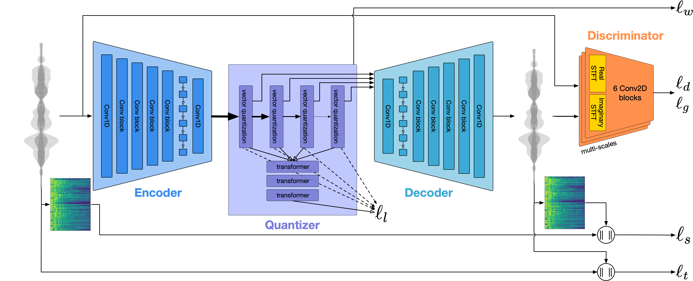
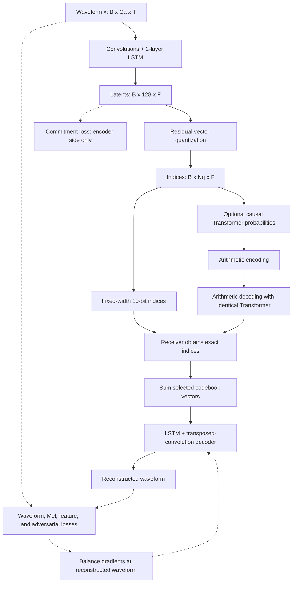
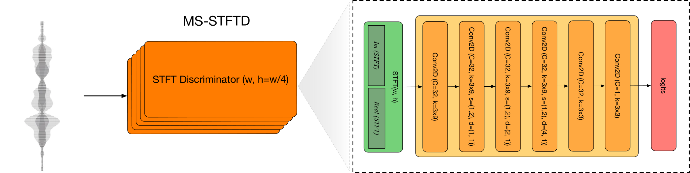

# EnCodec: High Fidelity Neural Audio Compression - Defossez et al., 2022

> **arXiv:** [2210.13438v1](https://arxiv.org/abs/2210.13438v1), 24 October 2022.
> **Venue:** Transactions on Machine Learning Research, 2023.
> **Authors:** Alexandre Defossez, Jade Copet, Gabriel Synnaeve, Yossi Adi.
> **Affiliation:** Meta AI / FAIR, Paris and Tel Aviv.
> **Scope:** The method, equations, tables, and appendix below follow the original arXiv v1. Release details are checked against the [26 October 2022 implementation](https://github.com/facebookresearch/encodec/tree/30838f83b744b096261a03e26beca07dcf0269c4), not silently substituted for the paper. The later venue PDF was access-restricted during this review.

## TL;DR

EnCodec is a learned waveform codec: a convolutional encoder with LSTMs produces a slow sequence of continuous vectors, residual vector quantization turns them into discrete codebook indices, and a neural decoder reconstructs audio from those indices. Its main contributions are a simple multi-scale complex-STFT adversary, an output-gradient loss balancer that makes reconstruction and adversarial weights easier to control, and an optional small Transformer that losslessly compresses the already-lossy code sequence.

The paper studies a **24 kHz causal mono codec** for varied audio and a **48 kHz noncausal stereo codec** for music; they are not interchangeable operating modes of one checkpoint. At 48 kHz, EnCodec at 6 kbps and Opus at 24 kbps both score 82.9 MUSHRA in the reported test, while optional entropy coding reduces that EnCodec payload to 4.2 kbps; the entropy-coded stereo configuration is nevertheless slower than real time on the tested CPU (Tables 4 and 5).

## Problem & motivation

### A codec must preserve perceived sound, not only sample accuracy

Uncompressed PCM is expensive because it represents every sample independently. For a sample rate $f_s$, $C_a$ audio channels, and $b$ bits per sample, its nominal bitrate is

$$
B_{\mathrm{PCM}}=f_s C_a b.
$$

For example, 16-bit, 24 kHz mono audio requires 384 kbps, and 16-bit, 48 kHz stereo requires 1,536 kbps. These are arithmetic reference rates, not measured file sizes. A 6 kbps codec therefore compresses those representations by nominal factors of 64 and 256, respectively, before container and framing overhead.

Traditional codecs such as Opus and EVS are strong at moderate rates but lose considerable perceptual quality at very low rates, particularly on music and general audio. A learned decoder can use statistical regularities of sound to reconstruct a plausible waveform from a much smaller representation. This does not make reconstruction lossless: perceptually convincing audio can differ substantially from the original sample sequence.

### Four requirements pull in different directions

1. **Quality across domains.** Clean speech, noisy speech, music, and general sound do not share one simple spectral distribution. A speech-specialized codec is not automatically a good music codec.
2. **Adjustable bitrate.** Shipping a separate neural network for every rate is inconvenient. The desired codec should decode several prefix lengths of one residual code representation.
3. **Stable perceptual training.** Waveform, spectral, adversarial, and feature-matching losses have different units and gradient scales. Ordinary scalar weighting can become brittle as a discriminator changes.
4. **Practical latency and computation.** A low nominal bitrate is not enough if one must wait for future audio or perform expensive autoregressive computation before transmitting it.

The closest predecessor is [SoundStream](multimodal_2021_soundstream.md), which already combines a neural encoder-decoder, residual vector quantization, variable-rate training, and adversarial losses. EnCodec is an improvement to this family, not the invention of residual quantization or of neural audio compression. The paper's additions concern the architecture/training combination, the discriminator, explicit gradient balancing, and optional entropy coding.

## Key idea

### Separate representation learning from lossless coding of the representation

For an input waveform $x$, the basic codec is

$$
z=E(x),\qquad z_q=Q(z),\qquad \hat{x}=G(z_q).
$$

$E$ is the encoder, $Q$ is residual vector quantization, and $G$ is the decoder. Only the integer indices selected by $Q$, plus necessary metadata, need to be transmitted. The receiver has the same codebooks and decoder.

With $f_z$ latent frames per second, $N_q$ active codebooks, and $K$ entries in each codebook, fixed-width index coding costs

$$
B_{\mathrm{raw}}=f_zN_q\log_2K
\quad\text{bits per second}.
$$

Here $K=1024$, so each codebook contributes 10 bits per frame. An optional Transformer estimates probabilities of these indices; arithmetic coding can then spend fewer than 10 bits on predictable indices on average. Crucially, entropy coding changes the number of transmitted bits, **not the recovered indices or the reconstructed waveform**.

### Train against perceptual errors without letting loss units dictate the mixture

The other central idea operates during training. For each waveform-dependent loss $\ell_i$, compute its gradient $g_i$ with respect to the reconstructed waveform, estimate its typical norm, normalize that gradient, and apply an interpretable relative weight:

$$
g_i=\frac{\partial\ell_i}{\partial\hat{x}},
\qquad
\tilde g_i=
R\frac{\lambda_i}{\sum_j\lambda_j}
\frac{g_i}{\langle\|g_i\|_2\rangle_\beta}.
$$

$\lambda_i$ is the chosen positive weight, $R$ is a reference gradient scale, and $\langle\cdot\rangle_\beta$ denotes an exponential moving average with decay $\beta$. The paper uses $R=1$ and $\beta=0.999$ (Equation 5, Section 3.4). Backpropagating $\sum_i\tilde g_i$ makes the intended balance less sensitive to whether a raw loss naturally produces gradients of magnitude 0.01 or 100.

This is a change to the optimization rule, not just another way to write a fixed weighted sum of scalar losses. Its precise scope, numerical handling, and caveats are explained below.

## How it works

### 1. End-to-end data flow



*Original Figure 1. The solid waveform path is the lossy codec. The Transformer is an optional probability model for the quantized units, not an additional waveform decoder. Reconstruction/adversarial losses supervise the reconstructed audio; the commitment term supervises the encoder-side representation.*

The following authored diagram separates training-only machinery from the transmitted representation:



In the diagram, $B$ is batch size, $C_a$ the number of waveform channels, $T$ the number of samples, and $F$ the latent sequence length. At deployment the discriminators, reconstruction losses, balancer, and commitment loss are absent. The Transformer is needed only if the optional entropy-coded bitstream is used.

### 2. Encoder geometry

Section 3.1 describes a SEANet-style 1D convolutional encoder with base width $C=32$, four downsampling blocks, ELU activations, and a two-layer LSTM. The release fixes latent width $D=128$.

| Stage | Channels | Kernel / stride | Length for 1 second at 24 kHz |
|---|---:|---|---:|
| Waveform input | 1 | - | 24,000 |
| Initial convolution | 32 | kernel 7, stride 1 | 24,000 |
| Residual unit + downsampling | 64 | downsampling kernel 4, stride 2 | 12,000 |
| Residual unit + downsampling | 128 | downsampling kernel 8, stride 4 | 3,000 |
| Residual unit + downsampling | 256 | downsampling kernel 10, stride 5 | 600 |
| Residual unit + downsampling | 512 | downsampling kernel 16, stride 8 | 75 |
| Two-layer LSTM | 512 | sequence processing | 75 |
| Final convolution | 128 | kernel 7, stride 1 | 75 |

This table combines the paper's stride sequence with the pinned encoder defaults. Appropriate padding preserves the indicated stride-1 lengths and produces the downsampled lengths; arbitrary nonaligned inputs need final padding and output trimming. The product of strides is

$$
H=2\cdot4\cdot5\cdot8=320,\qquad
f_z=\frac{f_s}{H}.
$$

Thus the latent rates are 75 frames/s at 24 kHz and 150 frames/s at 48 kHz. A 48 kHz stereo second enters as $[B,2,48000]$ and yields $[B,128,150]$; the two audio channels do not independently double the latent sequence length.

**Paper/release distinction.** Section 3.1 describes two kernel-3 convolutions in each residual unit. The pinned release instead uses a kernel-3 convolution followed by a kernel-1 convolution, with an intermediate width compressed by a factor of two. Its default residual shortcut is a learned kernel-1 convolution. A checkpoint-compatible reimplementation should follow those released details rather than silently treating the prose as an exact module specification.

The encoder's public `ratios` argument is listed as `[8,5,4,2]`, but the constructor reverses it for downsampling. The actual encoder order is therefore `[2,4,5,8]`, as above; reading only the argument list would give the wrong intermediate shapes.

The released `SLSTM` wrapper also adds its input to the two-layer LSTM output, giving a residual recurrent block rather than only a bare LSTM transform. Both encoder and decoder use that wrapper.

### 3. Decoder and padding

The decoder reverses the compression:

1. Project the 128-dimensional summed quantized latent to 512 channels with a kernel-7 convolution.
2. Apply a two-layer LSTM.
3. Upsample with transposed convolutions of strides $8,5,4,2$ and kernel sizes $16,10,8,4$.
4. Halve the channel count at each upsampling stage and apply its residual unit.
5. Use a final kernel-7 convolution to produce one mono channel or two stereo channels.

The released decoder uses ELU inside the network and has no final `tanh` enabled by default. Quantization creates the bitrate bottleneck; it is not achieved by clipping the final waveform to a low-precision output.

For a convolution with kernel width $K_c$ and stride $S$, the paper assigns total padding $K_c-S$:

- **Causal configuration:** put the padding before the signal. Transposed-convolution contributions must be retained/trimmed consistently across frames rather than introducing future-audio dependence.
- **Noncausal configuration:** split the padding across both sides, putting one extra sample before the signal when the total is odd.

The release implements these operations with its convolution wrappers, including padding needed for arbitrary input lengths. A plain `Conv1d(..., padding=K_c//2)` is not a generally equivalent replacement.

### 4. Mono streaming and stereo chunking are different systems

| Property | 24 kHz checkpoint | 48 kHz checkpoint |
|---|---|---|
| Waveform channels | Mono | Stereo |
| Training domain | Speech, noisy speech, music, general audio | Music |
| Causality | Causal / streamable design | Noncausal |
| Codec normalization | Weight normalization | Time-inclusive layer normalization; release uses `time_group_norm` |
| Per-chunk amplitude normalization | Not enabled in released model | Enabled |
| Segmentation | No fixed one-second segmentation in released model | One-second segments, 1% overlap |
| Nominal latent rate | 75 frames/s | 150 frames/s |
| Advertised raw rates | 1.5, 3, 6, 12, 24 kbps | 3, 6, 12, 24 kbps |
| Initial algorithmic latency | About 13.3 ms | 1 second |

Sources: Sections 3.1, 3.2, and 4.6; pinned model constructors. Timing measurements are reported separately below.

The streaming model can emit a block of 320 samples once 320 samples have arrived: $320/24000\approx13.3$ ms. This is initial algorithmic delay, **excluding computation and any network buffering**. A causal architecture does not by itself guarantee that a naive repeated call to the offline Python encoder preserves the necessary convolution and recurrent states.

The noncausal model normalizes each one-second chunk, which requires seeing that chunk before encoding it. In the release, for stereo chunk $x$,

$$
m_t=\frac{x_{L,t}+x_{R,t}}{2},
\qquad
s=10^{-8}+\sqrt{\operatorname{mean}_t m_t^2},
\qquad
x'=\frac{x}{s}.
$$

Here $m$ is the mono channel average and $s$ is one scale shared by both channels, not a separately computed RMS for each channel. The encoder transmits a scale with the indices; the decoder rescales the reconstructed chunk and combines overlapping chunks with linear overlap-add. One-second chunks advance by 0.99 seconds in the release.

The nominal rate formula counts latent indices, not every container byte, transmitted scale, or overlap-induced framing cost. In particular, do not interpret a nominal stereo rate as an exact size guarantee for every short file.

### 5. Residual vector quantization

Let $z_t\in\mathbb R^{128}$ be one encoder vector. Each stage $c$ owns a separate codebook $\mathcal C_c=\{e_{c,k}\}_{k=0}^{K-1}$, with $K=1024$. Starting with $r_{1,t}=z_t$,

$$
i_{c,t}=\underset{k}{\arg\min}\,
\|r_{c,t}-e_{c,k}\|_2^2,
\qquad
q_{c,t}=e_{c,i_{c,t}},
\qquad
r_{c+1,t}=r_{c,t}-q_{c,t}.
$$

After $N_q$ stages, the decoder receives

$$
z_{q,t}=\sum_{c=1}^{N_q}q_{c,t}.
$$

The first codebook approximates the original vector; each later one approximates what the earlier codebooks failed to explain. The receiver does not need to reconstruct residual searches: it looks up the transmitted indices and sums the corresponding entries.

For example, a scalar toy analogue with input 0.9 might choose 1.0 at the first stage, leaving residual -0.1, and then choose -0.1 at the second stage, yielding a sum of 0.9. This illustrates refinement, not a guarantee of monotonic perceptual quality for every additional real codebook.

The index tensor has shape $[B,N_q,F]$, rather than the continuous latent shape $[B,128,F]$. The codebook index axis is not another time axis.

| Nominal raw bitrate | 24 kHz: active codebooks | 48 kHz: active codebooks |
|---:|---:|---:|
| 1.5 kbps | 2 | Not an advertised setting |
| 3 kbps | 4 | 2 |
| 6 kbps | 8 | 4 |
| 12 kbps | 16 | 8 |
| 24 kbps | 32 | 16 |

Derived from the paper's 10-bit codebooks and frame rates. For instance, the mono 6 kbps representation is $75\cdot8\cdot10=6000$ bits/s, while the stereo 6 kbps representation is $150\cdot4\cdot10=6000$ bits/s.

**A small inconsistency in Section 3.2:** the prose says the randomly selected number of codebooks is a multiple of four, while also listing the 1.5 kbps mono operating point. That point requires **two** codebooks. The advertised rates, codebook arithmetic, and released bandwidth interface resolve the operating points above; the phrase “multiple of four” should not be used to exclude the two-codebook mode.

### 6. Learning and maintaining the codebooks

The paper uses a straight-through estimator to pass gradients through nearest-neighbor quantization to the encoder. Conceptually, a forward quantized value can be written

$$
z_{\mathrm{st}}=z+\operatorname{sg}(z_q-z),
$$

where $\operatorname{sg}$ is stop-gradient. The forward value is $z_q$ while the encoder sees an identity derivative through this expression; nearest-index selection is not differentiated as if it were smooth.

Codebook vectors are maintained with exponential-moving-average assignment statistics, not simply treated as ordinary gradient-descent parameters. With assignments $a_{c,k,t}=\mathbf1[i_{c,t}=k]$, a conceptual EMA update is

$$
n_{c,k}\leftarrow
\gamma n_{c,k}+(1-\gamma)\sum_t a_{c,k,t},
\qquad
v_{c,k}\leftarrow
\gamma v_{c,k}+(1-\gamma)\sum_t a_{c,k,t}r_{c,t},
\qquad
e_{c,k}\leftarrow\frac{v_{c,k}}{n_{c,k}}.
$$

Here $\gamma=0.99$; practical code adds smoothing to the count normalization. Dead entries are replaced by vectors sampled from the current batch. The pinned quantizer uses k-means initialization with 50 iterations and a dead-code EMA-count threshold of 2. These are release defaults enriching Section 3.2, not extra numerical settings printed in the main paper.

The commitment loss, detailed under training, discourages encoder residuals from drifting arbitrarily far from the entries selected for them.

### 7. Optional Transformer probability model

The codec can transmit fixed-width indices without a language model. Alternatively, a separately trained small causal Transformer predicts a distribution over each codebook's next index from all previous frames.

For indices $i_{c,t}$, its factorization is

$$
p(I)=\prod_t\prod_{c=1}^{N_q}
p_c\!\left(i_{c,t}\mid I_{<t}\right).
$$

Within one time step, codebook outputs are conditionally independent given the past. This is **not** a serialization with $N_q$ autoregressive Transformer steps for every audio frame.

At time $t$:

1. Look up a learned embedding for each codebook's index at $t-1$.
2. Sum those embeddings into one 200-dimensional input vector.
3. Run the causal Transformer using its cached state.
4. Apply one distinct output projection per codebook, each producing 1,024 logits.
5. Convert logits to probabilities and encode/decode the current indices.

The release reserves input index 0 as the initial/missing symbol and shifts actual codebook indices by one on the embedding input. The output alphabet is still the 1,024 genuine codebook entries.

| Probability-model setting | Paper / release value |
|---|---|
| Transformer layers | 5 |
| Attention heads | 8 |
| Hidden width | 200 |
| Feed-forward width | 800 |
| Dropout | None |
| Training sequence duration | 5 seconds |
| Causal attention context | 3.5 seconds per layer |
| Positional representation | Sinusoidal, with randomly offset initial positions during training |
| Output heads | One 1,024-class head per active codebook |

Source: Section 3.3. The release converts the attention window to `int(3.5 * frame_rate)`, giving 262 frames for mono and 525 for stereo. Those are per-layer windows; they should not be confused with a claim that the entire stacked network has exactly that total receptive field.

For frozen codec indices, the usual probability-model objective is cross-entropy,

$$
\ell_{\mathrm{LM}}=
-\sum_t\sum_{c=1}^{N_q}
\log p_c(i_{c,t}\mid I_{<t}).
$$

The idealized coded length is the same sum using base-2 logarithms. A model that predicts skewed index distributions well can beat uniform 10-bit coding; it does not reduce the number of latent frames or the number of active codebooks.

### 8. Arithmetic coding and numerical agreement

The paper uses a range-based arithmetic coder. Encoder and decoder must generate the **same integer probability ranges** at every step: the receiver does not receive a floating-point probability vector for every symbol.

Section 3.3 reports:

- Round estimated probabilities at precision $10^{-6}$ before constructing ranges.
- Use a total range width of $2^{24}$.
- Assign a minimum range width of 2.

The authors observed differences exceeding $10^{-8}$ between batched model evaluation and the streaming evaluation used for decoding. Tiny probability differences can change an integer interval and corrupt the decoded stream. They explicitly caution that broader evaluation is needed for practical deployment; rounding alone is not proof of portable, bit-exact behavior on every hardware/software combination.

Arithmetic coding is lossless **with respect to the quantized index stream**. It cannot recover information discarded by the waveform encoder and quantizer. It also introduces buffering latency: the paper notes an additional roughly 13 ms in the mono case because an arithmetic-coded frame cannot be independently flushed at every step without overhead.

### 9. Alternative quantizers explored in the appendix

RVQ is the selected main method. Appendix A.2 also develops two differentiable alternatives; their role matters when interpreting the appendix ablations.

**DiffQ-style scalar quantization.** Each latent dimension $j$ learns a bit allocation

$$
b_j=15\,\operatorname{sigmoid}(5v_j),
$$

where $v_j$ is trainable. Using dimension-wise mean $m_j$ and standard deviation $\sigma_j$ over batch and time, training approximates quantization with clipped values plus noise:

$$
z_{q,\mathrm{train}}^{(j)}
=
\operatorname{clamp}(z^{(j)},m_j-3\sigma_j,m_j+3\sigma_j)
+3\sigma_j\frac{\mathcal U[-1,1]}{2^{b_j}}.
$$

This is Equation 6 with the paper's $L=3$. The symbol $L$ here is a clipping-range multiplier, not the number of discriminator layers used later. The appendix reports that this clipping leaves values unclipped 99.5% of the time in its observed latents.

For a sequence of $F$ latent steps representing $d$ seconds, the differentiable raw-rate estimate is

$$
w_{\mathrm{DiffQ}}=\frac{F}{d}\sum_j b_j.
$$

A bandwidth penalty is applied while this estimate exceeds the target. At test time, statistics come from a training EMA with decay 0.9. Define

$$
u_j=\operatorname{clamp}
\left(\frac{3+(z^{(j)}-m_j)/\sigma_j}{6},0,1\right),
\qquad
N_j=\operatorname{round}(2^{b_j}),
$$

$$
i_j=\min\bigl(\lfloor N_ju_j\rfloor,N_j-1\bigr),
\qquad
z_q^{(j)}=m_j+3\sigma_j
\left(2\frac{i_j+0.5}{N_j}-1\right).
$$

The minimum handles the boundary $u_j=1$ correctly (Equation 7). To make vanishing bit allocations actually remove information, the appendix further scales the signal by $\min(b_j,1)$ and the noise by $\sqrt{\min(b_j,1)}$; the relative noise dominates as $b_j\to0$. Merely adding finite noise without this step would still leak information about the input.

**Gumbel-softmax vector quantization.** For codebook $c$ with centroid matrix $C_c\in\mathbb R^{\Omega\times D}$, a learned bias $a_c$, and latent $z$, define

$$
q_c(z)=\operatorname{softmax}(C_cz+a_c),
\qquad
z_{q,\mathrm{train}}=
\sum_c
\operatorname{GS}(\log q_c(z),\tau)^\top C_c,
\quad \tau=0.5.
$$

$\operatorname{GS}$ is a differentiable Gumbel-softmax sample and $\Omega$ is codebook cardinality (Equation 8). At test time the appendix samples from $q_c$, rather than claiming that this expression becomes deterministic nearest-neighbor RVQ. A learned prior $p_c=\operatorname{softmax}(l_c)$ supports arithmetic coding, with a cross-entropy rate penalty proportional to

$$
w_{\mathrm{GS}}=
-\sum_c\sum_{k=1}^{\Omega}q_{c,k}(z)\log p_{c,k}.
$$

This is a per-latent rate surrogate, requiring the appropriate time conversion/logarithm base to express bits/s. It is not the main method's autoregressive Transformer prior. Section 4.5 says the alternatives gave similar or worse preliminary results and selects RVQ; it does not provide a complete comparative Gumbel-softmax benchmark table.

## Training / data

### 1. Training sources and splits

The following is Appendix Table A.1. Hours are source inventory statistics, **not** the number of unique hours consumed after applying the training splits or mixing strategy.

| Dataset | Domain | Source sample rate | Channels | Hours | License as reported |
|---|---|---|---|---:|---|
| Common Voice 7.0 | Speech | 48 kHz | Mono | 9,096 | CC0 |
| DNS Challenge 4 | Speech | 48 kHz | Mono | 2,425 | Multiple licenses* |
| AudioSet | General audio | 48 kHz | Stereo | 4,989 | CC BY 4.0* |
| FSD50K | General audio | 44.1 kHz | Mono | 108 | CC* |
| Jamendo | Music | Multiple rates | Stereo | 919 | CC* |

An asterisk means licenses vary by sample/source; the table is not a blanket relicensing of all audio. Inputs are converted to the sample rate and channel configuration of the model being trained.

Appendix A.1 specifies:

- **Common Voice:** random 99.5% / 0.25% / 0.25% train/validation/test.
- **DNS clean speech:** 98% / 1% / 1%.
- **AudioSet:** unbalanced training split for training; divide evaluation segments equally between validation and test.
- **FSD50K:** development split for training; divide evaluation samples equally between validation and test.
- **Jamendo:** split by artists, using 96% / 2% / 2%, so artists do not overlap across splits.

The stereo model is music-only. The mono mixed-domain training uses four sampling strategies (Section 4.1):

| Strategy | Probability |
|---|---:|
| One Jamendo music source | 0.32 |
| One source from the nonmusic datasets | 0.32 |
| Mix two sources from all datasets | 0.24 |
| Mix three sources from all datasets except music | 0.12 |

Audio is normalized by file and receives random gain between -10 and +6 dB; clipped samples are rejected. Reverberation is applied with probability 0.2 using DNS room impulse responses with RT60 between 0.3 and 1.3 seconds, except for single-source music. File-level data preprocessing should not be confused with the stereo codec's transmitted per-chunk scale.

Evaluation categories are clean DNS speech; clean speech mixed with FSD50K audio; Jamendo music (“Music 1”); and a proprietary music test set (“Music 2”). The proprietary set is a reproducibility limitation.

### 2. Reconstruction losses

Let $\hat{x}=G(Q(E(x)))$. The waveform loss is

$$
\ell_t(x,\hat{x})=\|x-\hat{x}\|_1.
$$

The frequency loss compares **64-bin Mel spectrograms at seven resolutions**. For scale $i\in\mathcal E=\{5,\ldots,11\}$, $\mathcal S_i$ uses normalized STFT with window $2^i$ and hop $2^i/4$:

$$
\ell_f(x,\hat{x})
\propto
\sum_{i\in\mathcal E}
\left[
\|\mathcal S_i(x)-\mathcal S_i(\hat{x})\|_1
+\alpha_i\|\mathcal S_i(x)-\mathcal S_i(\hat{x})\|_2
\right],
\qquad \alpha_i=1.
$$

This gives window lengths 32, 64, 128, 256, 512, 1,024, and 2,048 samples, with hops 8 through 512. The linear and quadratic terms complement one another across transient and sustained spectral errors.

**Notation caution:** the printed Equation 1 uses the denominator $|\alpha|\cdot|s|$ although its scale set is named $e$ and $s$ is not defined there. The proportional expression above preserves the stated terms without inventing a missing definition. A reimplementation should state its reductions/averaging convention explicitly; the balancer reduces sensitivity to a common positive loss scale but does not make arbitrary objective changes equivalent.

### 3. Multi-scale complex-STFT discriminator



*Original Figure 2. Each subnetwork receives real and imaginary STFT components as channels, downsamples the frequency axis, and increases time dilation. Multiple resolutions inspect different time-frequency structure without requiring a second waveform or periodic discriminator.*

For 24 kHz audio, the discriminator uses five window sizes:

$$
\mathcal W=\{2048,1024,512,256,128\},
\qquad h_w=w/4.
$$

These are **linear complex STFTs**, not the 64-bin Mel spectrograms of the reconstruction objective. Real and imaginary components are concatenated; discarding phase by feeding only magnitude is not the described discriminator.

The released per-resolution subnetwork is:

1. Normalized Hann-window complex STFT, with `center=False`.
2. Concatenate real and imaginary channels and arrange axes as channel, time, frequency.
3. A 32-channel 2D convolution with kernel $(3,9)$.
4. Three 32-channel convolutions, kernel $(3,9)$, stride $(1,2)$, with time dilations $1,2,4$.
5. A 32-channel $(3,3)$ convolution.
6. A final one-channel $(3,3)$ prediction convolution.

LeakyReLU, with released negative slope 0.2, follows the intermediate convolutions; weight normalization is used. Logits are a map of local real/fake scores, not a single class probability.

**Two reproduction traps:** Section 3.4 prints kernel $(3,8)$, whereas Figure 2 and the pinned reference code use $(3,9)$. Also, the released `MultiScaleSTFTDiscriminator` helper defaults to **three** FFT sizes; reproducing the paper requires explicitly passing its five resolutions. The reference class alone is not the complete training recipe.

For 48 kHz, double the window sizes, preserve the quarter-window hops, and evaluate stereo channels separately. This preserves the physical durations of the analysis windows. The paper updates the discriminator with probability $2/3$ at 24 kHz and $1/2$ at 48 kHz, rather than assuming it is optimized on every generator update.

### 4. Adversarial, feature-matching, and commitment terms

Write $\langle\cdot\rangle$ for an average over a discriminator's score-map positions, and let $K_D$ be the number of discriminator resolutions. The paper's generator hinge objective is

$$
\ell_g(\hat{x})
=\frac1{K_D}\sum_{k=1}^{K_D}
\left\langle\max(0,1-D_k(\hat{x}))\right\rangle.
$$

The discriminator objective is

$$
L_d(x,\hat{x})
=\frac1{K_D}\sum_{k=1}^{K_D}
\left[
\left\langle\max(0,1-D_k(x))\right\rangle
+
\left\langle\max(0,1+D_k(\hat{x}))\right\rangle
\right].
$$

The generator expression follows the paper's hinge form, not an unannounced replacement with the frequently used $-\operatorname{mean}D(\hat{x})$ objective. During discriminator optimization, the generated audio is detached from the generator.

Feature matching compares intermediate discriminator activations on real and reconstructed audio:

$$
\ell_{\mathrm{feat}}(x,\hat{x})
=\frac1{K_DL_D}
\sum_{k=1}^{K_D}\sum_{l=1}^{L_D}
\frac{\|D_k^l(x)-D_k^l(\hat{x})\|_1}
{\operatorname{mean}(\|D_k^l(x)\|_1)}.
$$

This is the relative feature normalization of Equation 2; $D_k^l$ is layer $l$ of discriminator $k$, and $L_D$ is the number of compared layers. The paper says the denominator mean covers all dimensions. The important distinction from an unnormalized feature loss is division by the real-feature scale; practical implementations need consistent tensor reductions and protection against a zero denominator.

The released subnetwork exposes five intermediate feature maps for this purpose; its final prediction convolution is not part of that feature-map list.

The encoder commitment penalty is

$$
\ell_w=
\sum_{c=1}^{N_q}
\left\|r_c-\operatorname{sg}\bigl(q_c(r_c)\bigr)\right\|_2^2.
$$

Here $r_c$ is the residual entering RVQ stage $c$; the selected codebook value receives no gradient from this term (Equation 3). The paper writes a sum over stages, whereas the released quantizer returns a mean of stage commitment losses after per-stage MSE reduction. That reduction choice changes the effective commitment scale when $N_q$ changes and should be recorded rather than hidden.

Section 4.4 does not state the external coefficient $\lambda_w$. The released inner VQ block defaults to `commitment_weight=1`, but that default is not evidence for an otherwise unspecified outer training coefficient.

The nominal generator objective is

$$
L_G=
\lambda_t\ell_t+
\lambda_f\ell_f+
\lambda_g\ell_g+
\lambda_{\mathrm{feat}}\ell_{\mathrm{feat}}+
\lambda_w\ell_w.
$$

Equation 4 names the terms; the actual waveform-dependent gradients are combined using the balancer, so this scalar expression alone does not specify the complete optimization procedure.

### 5. What the gradient balancer actually guarantees

For each loss depending on $\hat{x}$, obtain $g_i=\partial\ell_i/\partial\hat{x}$ without yet backpropagating that loss through the generator. Estimate a gradient norm $n_i$, update its EMA, and send

$$
g_{\mathrm{combined}}
=
\sum_i
\frac{R\,a_i}{\epsilon+\bar n_i}\,g_i,
\qquad
a_i=\frac{\lambda_i}{\sum_j\lambda_j},
\qquad
\bar n_i=\operatorname{EMA}_{0.999}(n_i)
$$

through $\hat{x}$ into the model. The release uses $\epsilon=10^{-12}$, $R=1$, bias-corrected EMA estimates, and, by default, the mean of per-example waveform-gradient norms. It includes distributed averaging of the norm statistics.

Three distinctions prevent overinterpreting this mechanism:

- **Weights refer to normalized contribution scales.** They are not literal fractions of a final parameter-gradient norm. The generator Jacobian and directions of different gradients still matter.
- **The final gradient norm need not equal $R$.** Opposing normalized gradients can cancel; aligned gradients add. For example, equally weighted scalar gradients -1 and +100 yield an ordinary weighted sum of +99, but normalized contributions of -0.5 and +0.5 cancel to zero.
- **The commitment term is excluded.** It depends on encoder latents, not solely on $\hat{x}$, so it is backpropagated separately. Discriminator training and the separate entropy-model objective are not waveform-generator balancer terms either.

Multiplying all $\lambda_i$ by the same positive constant leaves $a_i$ unchanged. Rescaling one loss by a positive constant is approximately canceled once its EMA has adapted; abrupt changes can still produce transients. The method is a useful scale controller, not a general resolution of gradient conflicts or a proof of GAN stability.

### 6. Multi-bandwidth training and optimizer recipe

Select one supported bandwidth for the entire batch, use the corresponding RVQ prefix, and optimize reconstruction at that rate. The paper finds a dedicated discriminator per target bandwidth beneficial, so only the discriminator for the sampled rate is evaluated and updated. The encoder, codebooks, and decoder remain shared across rates.

| Setting | Paper value |
|---|---|
| Epochs | 300 |
| Updates per epoch | 2,000 |
| Total updates | 600,000, derived from the two rows above |
| Batch | 64 examples |
| Training example duration | 1 second |
| Optimizer | Adam |
| Learning rate | $3\cdot10^{-4}$ |
| Adam $\beta_1,\beta_2$ | 0.5, 0.9 |
| Hardware | 8 NVIDIA A100 GPUs |
| Mono balancer weights $(\lambda_t,\lambda_f,\lambda_g,\lambda_{\mathrm{feat}})$ | $(0.1,1,3,3)$ |
| Stereo balancer weights | $(0.1,1,4,4)$ |
| Balancer reference norm / EMA decay | 1 / 0.999 |
| Codebook EMA decay | 0.99 |

Source: Sections 3.2, 3.4, and 4.4. An “epoch” is defined as 2,000 updates, not as one complete pass over the heterogeneous source inventory. The paper does not give a wall-clock training budget or a complete separate optimizer/schedule specification for the entropy Transformer. Those omissions should not be filled by assuming contemporary training defaults.

A practical training iteration is:

1. Sample and augment a waveform batch; select one target bandwidth.
2. Encode it, quantize with the selected RVQ prefix, and decode it.
3. Compute waveform and multi-resolution Mel losses.
4. Evaluate the selected rate's discriminator, compute generator hinge and relative feature-matching terms, and obtain waveform gradients of these four losses.
5. Normalize/combine those gradients with the balancer and backpropagate through the decoder and encoder.
6. Add the separate encoder commitment gradient; update generator parameters and codebook EMA statistics consistently.
7. With the stated discriminator-update probability, optimize that rate's discriminator on real and detached reconstructed audio.
8. Train the optional entropy model separately on indices from the codec; do not make reconstruction depend on a differentiable arithmetic coder.

Exact implementation also requires a consistent commitment reduction, distributed synchronization, padding, and normalization behavior. The release includes reference balancer/discriminator modules but is not a complete public script that reproduces every training experiment.

## Results

### 1. Evaluation protocol and metric interpretation

The main subjective metric is MUSHRA-style comparative human scoring, using hidden references and low anchors. Section 4.3 selects **50 five-second samples per category**, with at least **10 ratings per sample**. Annotators are excluded if they score the reference below 90 in at least 20% of cases or score the low anchor above 80 more than 50% of the time.

All reported `mean +/- value` MUSHRA entries below are **95% confidence intervals**, not standard deviations. Overlapping intervals and different audio categories make a blanket “wins on every sample” interpretation inappropriate.

Objective metrics are SI-SNR, measuring scale-invariant waveform fidelity, and ViSQOL, a perceptual-quality estimator. Higher is better for both in these tables. Neither substitutes for the human test: perceptually plausible reconstruction can score differently from waveform-accurate reconstruction.

### 2. Main 24 kHz mono comparison

The complete Table 1 is reproduced below. “Entropy” is the average entropy-coded bitrate for the same EnCodec reconstruction, not another trained quality setting. A dash means not reported/applicable.

| Model | Raw kbps | Entropy kbps | Clean speech | Noisy speech | Music 1 | Music 2 |
|---|---:|---:|---:|---:|---:|---:|
| Reference | - | - | 95.5 +/- 1.6 | 93.9 +/- 1.8 | 93.2 +/- 2.5 | 97.1 +/- 1.3 |
| Opus | 6 | - | 30.1 +/- 2.8 | 19.1 +/- 5.9 | 20.6 +/- 5.8 | 17.9 +/- 5.3 |
| Opus | 12 | - | 76.5 +/- 2.3 | 61.9 +/- 2.1 | 77.8 +/- 3.2 | 65.4 +/- 2.7 |
| EVS | 9.6 | - | 84.4 +/- 2.5 | 80.0 +/- 2.4 | 89.9 +/- 2.3 | 87.7 +/- 2.3 |
| Lyra-v2 | 3 | - | 53.1 +/- 1.9 | 52.0 +/- 4.7 | 69.3 +/- 3.3 | 42.3 +/- 3.5 |
| Lyra-v2 | 6 | - | 66.2 +/- 2.9 | 59.9 +/- 3.3 | 75.7 +/- 2.6 | 48.6 +/- 2.1 |
| EnCodec | 1.5 | 0.9 | 49.2 +/- 2.4 | 41.3 +/- 3.6 | 68.2 +/- 2.2 | 66.5 +/- 2.3 |
| EnCodec | 3 | 1.9 | 67.0 +/- 1.5 | 62.5 +/- 2.3 | 89.6 +/- 3.1 | 87.8 +/- 2.9 |
| EnCodec | 6 | 4.1 | 83.1 +/- 2.7 | 69.4 +/- 2.3 | 92.9 +/- 1.8 | 91.3 +/- 2.1 |
| EnCodec | 12 | 8.9 | 90.6 +/- 2.6 | 80.1 +/- 2.5 | 91.8 +/- 2.5 | 92.9 +/- 1.2 |

*Source: Table 1, streamable 24 kHz setting. The Lyra row labels follow the printed table; Section 4.2 describes the lower Lyra operating rate as 3.2 kbps.*

The gains depend on domain. EnCodec at 3 kbps achieves music scores close to EVS at 9.6 kbps, but its clean-speech score is lower. At 6 kbps, its music scores are high while noisy speech remains more difficult. This is more informative than treating the abstract's broad superiority statement as dominance over every competing row and bitrate.

The entropy reduction is largest at the lowest shown rate: $1-0.9/1.5=40\%$. At 6 kbps it is about $31.7\%$, from the rounded 4.1 kbps entry; at 12 kbps it is about $25.8\%$. “Up to 40%” is not a constant factor that should be applied to all settings.



*Original Figure 3, extracted from the paper's inline SVG with standalone namespace support. Solid and hollow EnCodec markers have the same quality but different horizontal positions: entropy coding saves bits without altering the decoded code sequence. Error bars indicate 95% confidence intervals.*

### 3. Discriminator ablation

| Discriminator configuration | SI-SNR | ViSQOL | MUSHRA |
|---|---:|---:|---:|
| MSD + mono-resolution STFT | 5.99 | 4.22 | 62.91 +/- 2.62 |
| MPD | 7.35 | 4.24 | 60.7 +/- 2.8 |
| MS-STFT + MPD | 6.55 | 4.34 | 79.0 +/- 1.9 |
| MS-STFT | 6.67 | 4.35 | 77.5 +/- 1.8 |

*Source: Table 2. MSD is a multi-scale waveform discriminator; MPD is a multi-period waveform discriminator; MS-STFT is the proposed multi-scale complex-spectral family.*

The MPD-only model has the best SI-SNR here but the worst human score. Conversely, MS-STFT markedly improves human preference without maximizing SI-SNR. The combination MS-STFT + MPD has a slightly higher reported MUSHRA mean than MS-STFT alone, so the selected simpler adversary is not an unqualified winner on every metric. The evidence supports its favorable quality/simplicity tradeoff.

### 4. Cost of streamability

| Model | Streamable | SI-SNR | ViSQOL |
|---|---|---:|---:|
| Opus | Yes | 2.45 | 2.60 |
| EVS | Yes | 1.89 | 2.74 |
| EnCodec | Yes | 6.67 | 4.35 |
| EnCodec | No | 7.46 | 4.39 |

*Source: Table 3, 6 kbps comparison. This causal/noncausal ablation is not the separate 48 kHz stereo benchmark.*

Allowing noncausal processing improves the reported objective measures modestly. The causal model sacrifices some reconstruction quality to avoid future-context delay. These rows do not establish equal human preference, since this table reports objective metrics.

### 5. Fullband 48 kHz stereo music

| Model | Raw kbps | Entropy kbps | Nominal PCM compression | MUSHRA |
|---|---:|---:|---:|---:|
| Reference | - | - | 1x | 95.1 +/- 1.8 |
| MP3 | 64 | - | 24x | 82.7 +/- 3.2 |
| Opus | 6 | - | 256x | 17.7 +/- 5.9 |
| Opus | 24 | - | 64x | 82.9 +/- 3.7 |
| EnCodec | 6 | 4.2 | 256x | 82.9 +/- 2.4 |
| EnCodec | 12 | 8.9 | 128x | 88.0 +/- 2.7 |
| EnCodec | 24 | 19.4 | 64x | 87.5 +/- 2.6 |

*Source: Table 4. Compression factors use 16-bit stereo PCM at 48 kHz and divide by the **raw** bitrate, not the entropy-coded bitrate.*

The 6 kbps EnCodec model matches the Opus 24 kbps point estimate and is close to MP3 at 64 kbps on this test. Entropy coding reduces the 6 kbps payload to 4.2 kbps without changing that score. At higher rates the observed means are not strictly monotonic: 12 kbps scores 88.0 and 24 kbps 87.5, with overlapping intervals. That is not evidence that more codebooks intrinsically harm every music sample.

### 6. Latency and CPU throughput

The paper defines

$$
\mathrm{RTF}_{\mathrm{paper}}
=\frac{\text{audio duration}}{\text{processing time}}.
$$

**Greater than one is faster than real time.** This is the inverse of the processing-time/audio-duration convention used in many other audio reports.

| Model | Initial latency | Encode RTF | Decode RTF | Encode + EC RTF | Decode + EC RTF |
|---|---|---:|---:|---:|---:|
| Lyra-v2, 32 kHz | - | 27.4 | 67.2 | - | - |
| EnCodec, 24 kHz | 13 ms | 9.8 | 10.4 | 1.6 | 1.6 |
| EnCodec, 48 kHz | 1 second | 6.8 | 5.1 | 0.68 | 0.66 |

*Source: Table 5, all at nominal 6 kbps, on a single thread of a 2019 MacBook Pro CPU. “EC” means entropy coding. The paper rounds the mono latency to 13 ms in the table; the text gives 13.3 ms.*

Without entropy coding, both neural codecs run faster than real time in this benchmark. Adding the Transformer and arithmetic coder substantially reduces throughput: mono remains above one, but **the stereo entropy-coded configuration is slower than real time**. The abstract's real-time framing must not be generalized to that configuration.

Algorithmic delay and throughput are separate quantities. A codec can process a one-second chunk in much less than a second yet still require waiting for that chunk before starting. The listed initial latency also does not include every entropy-coder buffering effect discussed in Section 4.6.

### 7. Appendix comparison with a SoundStream reimplementation

| Model | Raw kbps | MUSHRA |
|---|---:|---:|
| Reference | - | 96.1 +/- 1.41 |
| Opus | 6 | 21.1 +/- 2.62 |
| EVS | 6 | 62.9 +/- 2.18 |
| SoundStream, authors' reimplementation | 3 | 71.8 +/- 1.51 |
| EnCodec with DiffQ | 3 | 72.3 +/- 1.18 |
| EnCodec with RVQ | 3 | 76.8 +/- 1.31 |

*Source: Table A.2. This is a separate evaluation from Table 1, including a different EVS rate and its own reference scores.*

The authors reconstructed SoundStream because a full original implementation/training recipe was not public. They used their own training hyperparameters and modified discriminator normalization/relative feature matching as described in Sections 4.2 and A.1. Therefore this is evidence against **their reimplementation**, not a controlled comparison with every official SoundStream checkpoint.

Lyra-v2 in the main comparison is a distinct released system associated with the SoundStream family. It must not be conflated with the appendix reimplementation.

### 8. Architecture ablations

| Architecture | Encode RTF | Decode RTF | SI-SNR | ViSQOL |
|---|---:|---:|---:|---:|
| Base, $C=32$ | 9.8 | 10.4 | 6.67 | 4.35 |
| $C=16$ | 26.0 | 25.7 | 6.40 | 4.32 |
| $C=64$ | 1.3 | 3.1 | 6.70 | 4.38 |
| No normalization | 10.1 | 10.4 | 6.45 | 4.29 |
| No LSTM | 15.0 | 14.6 | 6.40 | 4.35 |
| Three residual layers, no LSTM | 6.0 | 7.3 | 6.32 | 4.35 |

*Source: Table A.3; streamable multi-target 24 kHz models evaluated at 6 kbps, with the same single-thread CPU convention.*

Doubling width from 32 to 64 gives small objective gains at a large speed cost. Halving width is much faster with a modest objective loss. Removing the LSTM improves throughput, but replacing it by more residual convolution layers does not recover the base SI-SNR or its speed. Equal ViSQOL values are not proof that the architectures sound identical.

### 9. Balancer robustness, with its experimental scope preserved

Table A.4 uses **DiffQ quantization trained on Jamendo**, not the full mixed-domain RVQ recipe. Below, each row pairs the original with/without-balancer runs. Weight order is $(\lambda_t,\lambda_f,\lambda_g,\lambda_{\mathrm{feat}})$.

| Weights | SI-SNR, balanced | SI-SNR, unbalanced | ViSQOL, balanced | ViSQOL, unbalanced |
|---|---:|---:|---:|---:|
| (1, 1, 1, 1) | 10.32 | 6.16 | 4.16 | 3.89 |
| (1, 1, 2, 1) | 10.08 | 5.01 | 4.12 | 3.77 |
| (1, 2, 2, 1) | 10.06 | 3.84 | 4.17 | 3.67 |
| (1, 2, 4, 1) | 9.93 | 1.72 | 4.17 | 3.52 |
| (1, 2, 100, 1) | 8.41 | -35.83 | 4.05 | 2.82 |
| (2, 1, 1, 4) | 10.53 | 7.66 | 4.06 | 4.03 |
| (2, 2, 2, 4) | 10.19 | 7.16 | 4.13 | 3.98 |
| (2, 2, 10, 4) | 9.82 | 3.98 | 4.11 | 3.66 |
| (2, 2, 100, 4) | 8.52 | -34.31 | 4.03 | 2.91 |
| (10, 1, 1, 1) | 10.53 | 8.16 | 3.65 | 4.00 |
| (10, 1, 4, 1) | 10.72 | 5.99 | 3.62 | 3.74 |
| (10, 1, 4, 2) | 10.71 | 7.03 | 3.73 | 3.88 |
| (10, 2, 100, 2) | 9.23 | -33.78 | 4.07 | 2.85 |
| (10, 2, 100, 4) | 9.22 | -16.39 | 4.09 | 2.95 |

*Source: Table A.4; all 14 coefficient settings and both conditions are retained.*

The strongest evidence is resistance to severe instability when adversarial weights become large. However, the balancer does **not** improve every metric for every coefficient choice: with several time-loss-heavy settings, balanced SI-SNR improves while ViSQOL falls. That is consistent with the distinction between waveform accuracy and perceived quality, and with the balancer changing the optimization rule.

## Limitations & follow-ups

### What the paper establishes, and what it does not

- **Lossy and perceptual, not archival fidelity.** The neural decoder can reconstruct plausible sound without reproducing the exact waveform. Entropy coding is lossless only after quantization.
- **Two coverage regimes.** The general-audio evidence concerns the mono model; the stereo model is trained and evaluated for music. The paper does not demonstrate universal high-quality stereo speech/general-audio compression.
- **Streaming has a quality cost.** The causal model gives up noncausal context, and optional entropy coding adds buffering and substantial compute. The reported stereo entropy-coded implementation misses real-time throughput on the tested CPU.
- **Training losses still require judgment.** The balancer controls scales, not gradient directions, domain coverage, or the choice of perceptual objective. Its appendix robustness table has narrower DiffQ/music scope than the final main codec.
- **Reproduction needs more than the headline architecture.** Kernel discrepancies, commitment reductions, explicitly configured STFT resolutions, chunk normalization, and bitstream probability agreement all affect reproducibility. The proprietary music evaluation set is unavailable, and the paper omits some auxiliary-model training details.
- **Subjective results have limited scope.** Confidence intervals summarize these sample/listener tests; they are not guarantees for every music genre, speaker, impairment, or deployment device. Objective metrics can rank models differently from listeners.
- **A compression paper is not a generative-model evaluation.** Discrete codec indices can later serve as audio language-model tokens, but these experiments do not establish semantic token quality, speech recognition accuracy, text-to-audio controllability, or downstream generation quality.
- **License and deployment constraints remain.** Source datasets have heterogeneous terms. The [release README](https://github.com/facebookresearch/encodec/tree/30838f83b744b096261a03e26beca07dcf0269c4#license) distinguishes code and pretrained-model licensing; public availability does not imply unrestricted commercial use.

Appendix A.4 motivates accessibility under poor connectivity and reduced storage/network requirements. It is a motivation for efficient compression, not a measured energy-savings or inclusion study; those outcomes would require separate evidence.

### Position in the audio-modeling lineage

[SoundStream](multimodal_2021_soundstream.md) is the immediate codec predecessor and the most useful comparison for understanding what EnCodec changes. [AudioLM](https://arxiv.org/abs/2209.03143) provides contemporaneous context for modeling audio token sequences, whereas [MusicGen](https://arxiv.org/abs/2306.05284) later uses EnCodec representations in conditional music generation. Those generative systems add sequence models and objectives beyond reconstructive codec training.

For contrast, [Whisper](multimodal_2022_whisper.md) maps audio into text tokens rather than a code stream designed for waveform reconstruction. The [Qwen-Audio](multimodal_2023_qwen-audio.md) and [Qwen2-Audio](multimodal_2024_qwen2-audio.md) recaps cover audio understanding/instruction-following systems, not interchangeable alternatives to an audio compression codec.

## Links

- **arXiv:** [abstract, v1](https://arxiv.org/abs/2210.13438v1) · [HTML, v1](https://arxiv.org/html/2210.13438v1) · [PDF, v1](https://arxiv.org/pdf/2210.13438v1).
- **Code:** [facebookresearch/encodec](https://github.com/facebookresearch/encodec) · [release snapshot used here](https://github.com/facebookresearch/encodec/tree/30838f83b744b096261a03e26beca07dcf0269c4).
- **Architecture references:** [SEANet encoder/decoder](https://github.com/facebookresearch/encodec/blob/30838f83b744b096261a03e26beca07dcf0269c4/encodec/modules/seanet.py) · [model constructors, chunk normalization, and entropy model](https://github.com/facebookresearch/encodec/blob/30838f83b744b096261a03e26beca07dcf0269c4/encodec/model.py).
- **Training references:** [reference loss balancer](https://github.com/facebookresearch/encodec/blob/30838f83b744b096261a03e26beca07dcf0269c4/encodec/balancer.py) · [reference MS-STFT discriminator](https://github.com/facebookresearch/encodec/blob/30838f83b744b096261a03e26beca07dcf0269c4/encodec/msstftd.py) · [RVQ wrapper](https://github.com/facebookresearch/encodec/blob/30838f83b744b096261a03e26beca07dcf0269c4/encodec/quantization/vq.py) · [core quantizer](https://github.com/facebookresearch/encodec/blob/30838f83b744b096261a03e26beca07dcf0269c4/encodec/quantization/core_vq.py).
- **Hugging Face:** [24 kHz model](https://huggingface.co/facebook/encodec_24khz) · [48 kHz model](https://huggingface.co/facebook/encodec_48khz); these are later integration surfaces, not the pinned original code.
- **Project / samples:** [official audio examples](https://ai.honu.io/papers/encodec/samples.html).
- **Blog posts:** No separate blog is needed as a primary source; use the paper, released code, and audio examples.
- **Talks / videos:** [official demonstration video](https://ai.honu.io/papers/encodec/final.mp4).
- **OpenReview / venue page:** [TMLR record](https://openreview.net/forum?id=ivCd8z8zR2); access to the page/PDF was restricted during source verification.
- **Papers-with-Code:** [paper record](https://paperswithcode.com/paper/high-fidelity-neural-audio-compression); not used for result values.
- **Related / successor papers:** [SoundStream](multimodal_2021_soundstream.md) · [AudioLM](https://arxiv.org/abs/2209.03143) · [MusicGen](https://arxiv.org/abs/2306.05284) · [Whisper recap](multimodal_2022_whisper.md) · [Qwen-Audio recap](multimodal_2023_qwen-audio.md) · [Qwen2-Audio recap](multimodal_2024_qwen2-audio.md).

```bibtex
@article{defossez2022high,
  title={High Fidelity Neural Audio Compression},
  author={D{\'e}fossez, Alexandre and Copet, Jade and Synnaeve, Gabriel and Adi, Yossi},
  journal={arXiv preprint arXiv:2210.13438},
  year={2022},
  url={https://arxiv.org/abs/2210.13438}
}
```
