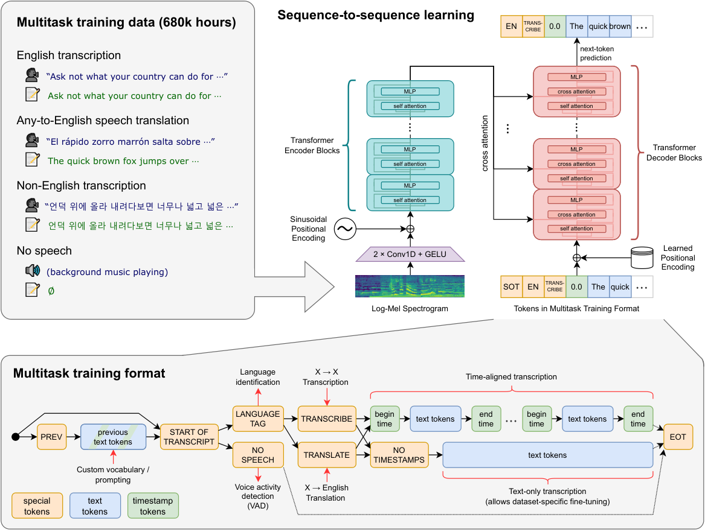
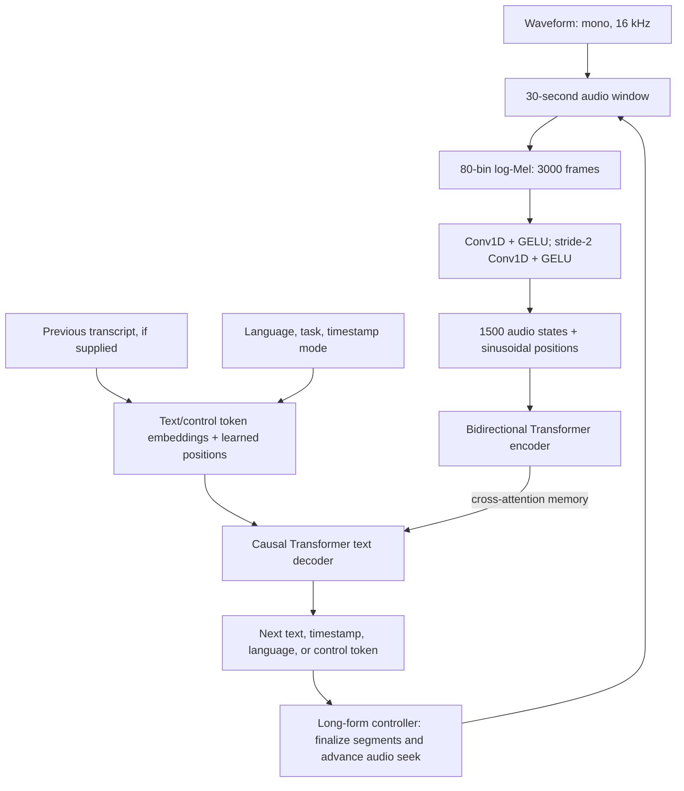
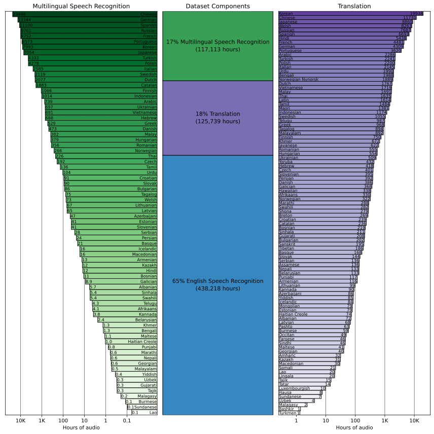
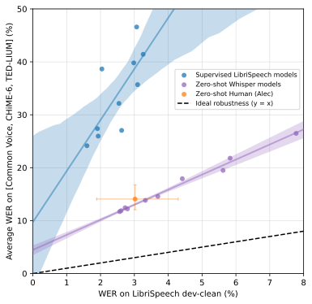
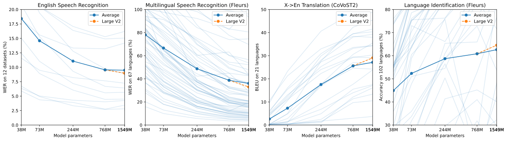

# Whisper: Robust Speech Recognition via Large-Scale Weak Supervision — Radford et al., 2022

> **arXiv:** [2212.04356v1](https://arxiv.org/abs/2212.04356v1), 6 December 2022 · **Venue:** ICML 2023, PMLR 202:28492–28518 · **Affiliation:** OpenAI
>
> **Authors:** Alec Radford, Jong Wook Kim, Tao Xu, Greg Brockman,
> Christine McLeavey, Ilya Sutskever.
> This recap follows the versioned paper, including its **Large V2**
> update and appendices. Implementation details are checked against
> the [6 December 2022 inference-code snapshot][code-pin], not assumed
> from the current library. The models were first released in
> September 2022; the arXiv submission and conference publication
> occurred later.

## TL;DR

Whisper trains a conventional audio encoder–text decoder Transformer
on approximately **680,000 hours of weakly supervised internet audio**
to produce transcripts, English translations, language labels, and
segment timestamps through one token interface. Its central result is
**robust zero-shot transfer**: a model with unremarkable clean
LibriSpeech performance can generalize much better to other recording
conditions and domains, with a reported **55.2% average relative error
reduction** over a matched LibriSpeech-trained baseline (Table 2).
The paper also reports **29.1 BLEU on CoVoST2 X→English translation**
without dataset-specific fine-tuning (Table 4), but shows substantial
remaining language and domain gaps. Long recordings are handled by
timestamp-guided **30-second windows plus decoding heuristics**, not
by feeding hours of audio into a single unlimited-context forward pass.

## Problem & motivation

### A good speech representation is not a complete recognizer

Self-supervised speech encoders can learn from huge amounts of raw
audio, but generally still need a supervised decoder or fine-tuning
to produce useful text. Such adaptation makes deployment more complex
and can reward dataset-specific conventions that do not transfer to
other microphones, speakers, domains, or transcript styles (§1).

Whisper asks whether **supervised pretraining of the complete
audio-to-text system** can be scaled enough to work out of the box.
The relevant contrast is not “labels versus no labels” in the final
metric; it is a broadly trained recognizer that directly predicts text
versus a representation-learning system normally adapted separately
to each downstream benchmark.

### In-distribution recognition and robustness are different abilities

A recognizer trained extensively on LibriSpeech and tested on held-out
LibriSpeech measures in-distribution generalization. A person asked to
transcribe that benchmark without learning its training set is
performing something closer to zero-shot transfer. A machine beating
that person on one clean read-speech test does not imply it is a
generally more robust transcriber (§3.3).

The paper therefore examines both ordinary accuracy and **effective
robustness**: performance on other distributions relative to what
one would expect from a model's reference-dataset performance.
This controls, imperfectly but usefully, for the fact that a generally
better model can improve every dataset without necessarily improving
its resistance to distribution shift.

### More labeled audio is possible if the labels need not be pristine

High-quality academic collections provide limited coverage. The
paper cites SpeechStew's **5,140 hours across seven datasets**, versus
unlabeled speech pretraining at approximately a million hours (§1).
Whisper seeks a middle ground: vastly more audio paired with
existing internet transcripts, filtered to remove obvious poor labels.

“Weak supervision” here means that the web transcripts are noisy,
not necessarily complete, perfectly aligned, or professionally
validated for ASR. It does **not** mean that Whisper learns its main
recognition objective without text targets, nor that it primarily
creates pseudo-labels for its own unlabeled training audio.

## Key idea

### One conditional sequence model, multiple speech tasks

Let $x$ be an audio waveform, $X=\operatorname{LogMel}(x)$ its
time–frequency representation, and $H=f_\phi(X)$ the encoded audio.
An autoregressive decoder predicts a sequence
$y=(y_1,\ldots,y_T)$:

$$
p_{\phi,\theta}(y\mid x,c)
=\prod_{t=1}^{T}
p_{\phi,\theta}(y_t\mid y_{<t},H,c),
$$

where $\phi$ and $\theta$ are encoder and decoder parameters, and
$c$ is optional preceding transcript context. The sequence $y$
can include language, task, formatting, timestamp, and text tokens.
Transcription and translation share the same decoder rather than
requiring separate output heads.

Training is next-token cross-entropy:

$$
\mathcal{L}(\phi,\theta)
=-\sum_{t\in\mathcal{S}}
\log p_{\phi,\theta}(y_t\mid y_{<t},f_\phi(X),c).
$$

$\mathcal{S}$ contains the supervised current-sequence positions.
Section 2.3 says that **only the preceding context text is masked
from the loss**; current-sequence special tokens are also prediction
targets. At inference, language/task/format tokens may instead
be supplied as a prefix to request a particular behavior.

This distinction matters: training a model to predict a language
label does not prevent an application from specifying the source
language, and supplying a task token does not imply there was a
separate translation classifier during training.

### Keep the architecture ordinary; scale coverage

The architecture is deliberately conventional so that large,
diverse supervision is not confounded with a novel speech
encoder. It has a bidirectional audio encoder and a causally
masked text decoder that **cross-attends to audio memory**.
There is no CTC objective, learned discrete audio codebook,
or separate pretrained GPT decoder in the main recipe (§2).

Unlike a decoder-only model that concatenates projected audio
features with text, Whisper stores audio states in encoder
memory and consults them through cross-attention. Its audio
and text sequence lengths are therefore separate dimensions.

## How it works

### 1. Waveform to log-Mel features

The paper's frontend (§2.2) resamples audio to **16 kHz** and
computes **80 Mel-frequency channels** using **25 ms windows**
with **10 ms stride**. For one padded 30-second input:

$$
N_{\mathrm{samples}}=30\times16000=480000,
\qquad
N_{\mathrm{frames}}=480000/160=3000.
$$

The pinned [audio implementation][audio-code] makes the following
details explicit:

1. Decode/downmix to mono and resample to 16 kHz. Integer PCM
   samples are converted to floating point.
2. Use a Hann-windowed STFT with **400 samples per window**
   and **160 samples per hop**.
3. Use squared complex magnitudes, project the resulting
   **201 frequency bins** through the 80-bin Mel filter bank,
   and take the base-10 logarithm.
4. Clamp the log spectrogram to an eight-unit dynamic range
   below its maximum, then apply a fixed affine rescaling.

Writing $S$ for the complex STFT, $M$ for the Mel matrix, and
$U=M|S|^2$, the release computes

$$
A=\log_{10}\!\left(\max(U,10^{-10})\right),
\qquad
A'=\max(A,\max(A)-8),
\qquad
X=\frac{A'+4}{4}.
$$

The max operations are elementwise except for the scalar maximum
over the log spectrogram. $X$ has shape
$B\times80\times3000$ for a batch of $B$ padded windows.
The centered STFT yields an additional terminal frame that
the release drops before forming the 3000-frame input.

The paper describes features as globally scaled to roughly
zero mean and a range around $[-1,1]$. The code above is the
reproduction detail: it is **not per-utterance mean/variance
normalization**, and the final affine transform is not an
explicit hard clamp of every possible input to $[-1,1]$.

### 2. Convolutional stem and audio encoder

Two temporal convolutions use kernel width **3**, padding **1**,
and GELU activations. The first maps 80 channels to model width
$d$ with stride 1; the second has width $d$ and stride 2.
Consequently:

$$
B\times80\times3000
\longrightarrow B\times d\times3000
\longrightarrow B\times d\times1500
\longrightarrow B\times1500\times d.
$$

Fixed sinusoidal positional embeddings are added after the stem.
The encoder then applies ordinary noncausal self-attention
blocks with pre-layer-normalized residual branches, followed
by a final layer normalization. Each frame in the encoded
sequence can use the entire current window.

The 1500-state sequence has a **20 ms nominal time stride**.
That is also the spacing used by the timestamp vocabulary,
but it does not mean predicted boundaries are guaranteed
accurate to 20 ms.

### 3. Decoder and cross-attention

The decoder embeds text/control tokens, adds **learned**
position embeddings, and applies blocks containing:

1. Causally masked self-attention over previous decoder tokens.
2. Cross-attention to the full audio encoder output.
3. A width-$4d$ GELU feed-forward network.

For decoder states $D$, audio memory $H$, and one attention head,
cross-attention has the usual form

$$
\operatorname{CA}(D,H)
=\operatorname{softmax}
\left(\frac{(DW_Q)(HW_K)^\top}{\sqrt{d_k}}\right)(HW_V),
$$

where $W_Q,W_K,W_V$ are learned projections and $d_k$ is
the head width. The attention matrix spans **decoder
positions × audio positions**; it is not the decoder's
causal self-attention mask applied to the audio.

The final decoder layer norm is followed by a vocabulary
projection tied to the input embedding matrix:

$$
\operatorname{logits}_t
=\operatorname{LN}(D_t)E^\top,
$$

with $E\in\mathbb{R}^{|\mathcal{V}|\times d}$ the shared
token embedding matrix. The pinned [model code][model-code]
uses the audio encoder's output as cross-attention memory
at every decoder layer and caches attention keys/values
during autoregressive decoding.

The released [Large V2 configuration][config] has
**1500 source positions**, **448 target positions**, and
**51,865 vocabulary entries**. These limits include the
relevant decoder prefix/control positions; 448 is not a
promise of 448 generated words. The audio states do not
consume positions from that 448-token decoder table.

### 4. Model family and what “32 layers” means

**Table 1** gives the following architecture sizes:

| Model | Layers per encoder / decoder | Width | Heads | Parameters |
|---|---:|---:|---:|---:|
| Tiny | 4 | 384 | 6 | 39M |
| Base | 6 | 512 | 8 | 74M |
| Small | 12 | 768 | 12 | 244M |
| Medium | 24 | 1024 | 16 | 769M |
| Large | 32 | 1280 | 20 | 1550M |

Encoder and decoder have the same width and block count.
Thus Large has **32 encoder blocks plus 32 decoder blocks**,
not 32 blocks divided between the two. The head width is
64 throughout this family. Large V2 retains the Large
architecture; its important changes are in training.

Tiny through Medium have both English-only `.en` and
multilingual variants. Large is multilingual, without
a corresponding `large.en` release in this paper.
The English-only models use GPT-2's byte-level BPE tokenizer;
the multilingual models refit the text vocabulary to
reduce fragmentation outside English (§2.2). This is
text tokenization, not quantization of the audio signal.



*Original Figure 1. The bottom panel is as important as
the Transformer drawing: it defines the shared task
interface. A single decoder learns text and control
sequences; separate classifier heads are not required
for each illustrated task.*



*Authored reconstruction. The feedback loop is an inference
controller around a fixed-window model, not recurrent
attention over the complete recording.*

### 5. Task specification and timestamp serialization

The multilingual interface includes:

| Token / group | Purpose |
|---|---|
| `<|startofprev|>` | Introduce preceding transcript context when provided. |
| `<|startoftranscript|>` | Begin the current prediction sequence. |
| Language token such as `<|en|>` | Identify or specify the spoken source language. |
| `<|transcribe|>` | Produce text in the source language. |
| `<|translate|>` | Produce an English translation of the speech. |
| `<|notimestamps|>` | Request text without timestamp tokens. |
| Timestamp tokens | Quantized segment boundaries relative to the current audio window. |
| `<|nospeech|>` | Predict absence of speech. |
| Terminal token | End the prediction sequence. |

The paper calls the terminal marker `<|endoftranscript|>`;
the release uses the tokenizer's end-of-text/EOT token.
Use the actual tokenizer IDs, not a literal invented
end-marker string, when constructing model inputs.

Two schematic timestamp-free prefixes are:

```text
Transcribe French:
<|startoftranscript|><|fr|><|transcribe|><|notimestamps|>...

Translate French speech into English:
<|startoftranscript|><|fr|><|translate|><|notimestamps|>...
```

The language token describes the **source speech**, not the
desired translation output language. Translation is
**X→English** in this work, not an arbitrary target-language
translation interface.

Timestamped transcription instead interleaves boundaries:

```text
SOT, source-language, TRANSCRIBE,
start-time, text segment 1, end-time,
start-time, text segment 2, end-time, ..., EOT
```

For a boundary at relative time $t$ seconds:

$$
k=\operatorname{round}(t/0.02),
\qquad
t_k=0.02k,
\qquad
0\leq k\leq1500.
$$

The inclusive 0–30 second range has **1501 timestamp
positions**. Time token $k$ maps to ID
$v_{\mathrm{timestamp\_begin}}+k$, where
$v_{\mathrm{timestamp\_begin}}$ is the tokenizer's first
timestamp ID. These values encode segment boundaries,
not word-level forced alignments or speaker identities.

If the end of a training window cuts through a transcript
segment, the timestamped target can include only that
segment's start boundary. This signals that the next
audio window should begin there so the partial segment
can be decoded with sufficient context (§2.3).

Language detection uses the decoder immediately after
the start token, suppressing non-language alternatives
and normalizing scores over language tokens. It is not
a separate encoder classifier. The paper's introduction
mentions 96 non-English languages in its non-English
data, §2.3 describes 99 language-token slots, and §3.4
describes ASR training coverage as 75 languages. These
are not interchangeable claims of equally effective
ASR supervision for every tokenized language.

### 6. Reliable long-form transcription

The model itself sees **30 seconds at a time**.
Long-form inference maintains an audio seek position,
a bounded text prompt, and decoded segment metadata.
Sections 3.8 and 4.5 describe the controller:

1. **Prepare the next window.** Extract/pad a 30-second
   Mel segment. Specify the task/language and include
   preceding decoded text when enabled.
2. **Decode at temperature zero.** The paper uses
   beam search with **five beams**, scored using
   token log probabilities.
3. **Retry suspicious output.** A mean token log
   probability below **−1** or a text compression
   ratio above **2.4** triggers temperature fallback.
   Try **0, 0.2, 0.4, 0.6, 0.8, 1.0** in order.
   A high compression ratio indicates repetitive,
   easily compressible output, not high confidence.
4. **Combine silence evidence.** A no-speech probability
   above **0.6** is combined with low text log probability
   before skipping a window. High no-speech probability
   by itself is not a sufficient silence detector.
5. **Parse timestamped segments.** End/start timestamp
   pairs identify completed segments. Commit the
   completed text and move the audio window according
   to the predicted boundary so a partial segment
   can be revisited rather than dropped.
6. **Manage the prompt.** Continue conditioning on prior
   decoded text after confident low-temperature output.
   Reset that history after high-temperature fallback
   to limit error propagation.
7. **Constrain the initial boundary.** The first timestamp
   must lie between **0 and 1 second**, reducing a failure
   mode where the decoder skips the beginning of speech.

For a window beginning at absolute time $s$, timestamp
$k$ represents

$$
t_{\mathrm{absolute}}=s+0.02k.
$$

Since one Mel frame represents 10 ms, a relative timestamp
step corresponds to **two Mel frames**. When the controller
uses the last completed boundary to advance, its seek
increment is $2k$ Mel frames, not $k$ frames or $0.02k$
sample indices.

The [pinned transcription code][transcribe-code] adds
important operational details:

- At positive temperatures it **disables beam search**;
  fallback is sampling, not “five-beam search at every
  temperature.” With the listed discrete schedule, the
  paper's below-0.5 history condition corresponds to
  retaining history through 0.4 and resetting after 0.6
  or higher; the code resets for temperature `> 0.5`.
- It skips when no-speech probability is above 0.6
  unless average text log probability is **greater
  than −1**. Thus equality at −1 is on the skip side
  in this snapshot.
- With consecutive timestamp tokens, it commits
  completed slices and advances according to the
  last completed boundary. If there are no such pairs,
  it can emit a single segment and advances a whole
  window; silence also advances the window.
- [Timestamp logit filters][decoding-code] enforce the
  opening timestamp and timestamp/text pairing, suppress
  the no-timestamps marker in timestamped decoding,
  and favor a timestamp when the total timestamp
  probability exceeds that of any individual text token.

These are pragmatic safeguards, not a proof of reliable
alignment. The paper explicitly treats them as workarounds
for repetition, omitted words, and hallucinated text.
The original model is not a native low-latency streaming
recognizer: its encoder uses bidirectional attention
within a window, and this buffered wrapper is distinct
from a continuously stateful streaming architecture.

## Training / data

### What the dataset contains

Appendix Figure 11 breaks down the collection as follows:

| Component | Hours | Rounded share | Target |
|---|---:|---:|---|
| English speech recognition | 438,218 | 65% | English audio → English transcript |
| Non-English speech recognition | 117,113 | 17% | Audio → transcript in the source language |
| Speech translation | 125,739 | 18% | Non-English audio → English transcript |
| **Sum of figure counts** | **681,070** | **100%** | Approximately 680K hours in the headline |

The exact figure sum also matches Table 6's full-data
row. The introduction rounds the translation component
to 125K hours, while the release model card rounds it
to 126K; Figure 11 gives the underlying 125,739-hour
value. These are provenance/rounding differences, not
an additional translation dataset.



*Original Appendix Figure 11. The middle panel gives
task totals; the flanking log-scale bars expose the
long tail of language coverage. A global 680K-hour
budget does not imply abundant supervised speech in
every language.*

### Filtering, alignment, and contamination precautions

Section 2.1 describes a substantially more selective
pipeline than simply accepting every available subtitle:

1. **Acquire audio/transcript pairs** from the internet,
   preserving natural written text rather than forcing
   a uniform uppercase, punctuation-free transcript style.
2. **Detect machine-generated transcripts.** Heuristics
   flag patterns such as uniformly uppercase/lowercase
   text or systematically absent punctuation, attempting
   to avoid learning the restricted “transcript-ese”
   of existing recognizers.
3. **Check speech/text language agreement.** A prototype
   audio detector is fine-tuned on VoxLingua107;
   transcript language is detected with CLD2.
   Matching pairs become recognition examples. If the
   languages differ but the transcript is English,
   retain the pair as X→English translation data;
   otherwise exclude it from the recognition path.
4. **Fuzzy-deduplicate transcript text** to reduce
   repeated and automatically generated material.
5. **Create 30-second chunks** with the corresponding
   transcript subset and timing information.
6. **Retain some non-speech chunks** to supervise
   no-speech output, but subsample them.
7. **Inspect high-error sources after initial training.**
   Rank sources using their error rate and size, then
   manually identify and remove poorly aligned,
   partially transcribed, or remaining machine-captioned
   collections.
8. **Deduplicate high-overlap evaluation sources** at
   transcript level, specifically TED-LIUM3.

The language filter is imperfect. Section 3.5 finds
that much supposedly Welsh translation data is actually
English speech misclassified as Welsh. The nominal
amount of data under a language label is therefore not
always the amount of valid supervision in that language.
Transcript deduplication also does not establish that
every possible form of evaluation overlap was eliminated.

### Baseline training recipe

**Appendix Table 17** gives:

| Hyperparameter | Baseline value |
|---|---|
| Updates | 1,048,576 ($2^{20}$) |
| Batch size | 256 audio segments |
| Warmup updates | 2048 |
| Maximum gradient norm | 1.0 |
| Optimizer | AdamW |
| Adam $\beta_1$ | 0.9 |
| Adam $\beta_2$ | 0.98 |
| Adam $\epsilon$ | $10^{-6}$ |
| Weight decay | 0.1 |
| Weight initialization | Gaussian fan-in |
| Learning-rate schedule | Linear decay |
| Speechless-audio subsample factor | 10× |
| Probability of conditioning on prior text | 50% |

The models use data parallelism, FP16 with dynamic loss
scaling, activation checkpointing, gradient clipping,
and linear decay to zero after warmup (§2.4). The
paper describes this as between two and three passes
over the data. Segment padding, sampling and the
mixture make “updates × nominal 30 seconds” an
imperfect substitute for measured unique-audio exposure.

For the original recipe, the authors do not use
additional augmentation/regularization of the kind
introduced for V2, relying instead on dataset diversity.
That statement should not be read as “no AdamW weight
decay,” which Table 17 explicitly sets to 0.1.

**Appendix Table 19** gives peak learning rates:

| Model | Maximum learning rate |
|---|---:|
| Tiny | $1.5\times10^{-3}$ |
| Base | $1\times10^{-3}$ |
| Small | $5\times10^{-4}$ |
| Medium | $2.5\times10^{-4}$ |
| Large | $1.75\times10^{-4}$ |
| Large V2 | $2.0\times10^{-4}$ |

The paper supplies update and batch budgets but not a
single hardware/wall-clock figure that would make its
whole model-family training cost reproducible. The
release is primarily **weights and inference code**;
the full collected training corpus and training pipeline
are not supplied as a turnkey reproduction package.

### Large V2 is a training change, not a larger architecture

The footnote in §2.4 says most headline results are
updated to **Large V2** unless otherwise stated.
**Appendix Table 18** lists its changes:

| Hyperparameter | Large V2 |
|---|---|
| Updates | 655,360 |
| Batch size | 1024 |
| BPE dropout | 0.1 |
| Stochastic depth | 0.1 |
| SpecAugment policy | LibriSpeech Basic |

Although V2 uses fewer updates, each update has four
times as many examples:

$$
\frac{655360\times1024}{1048576\times256}=2.5.
$$

Thus the paper's “2.5× more epochs” refers to increased
training exposure, not 2.5 times as many optimizer
steps or 2.5 times as many parameters. The LR also
changes as shown in Table 19. Do not mix the original
“no augmentation” claim with V2's explicit
SpecAugment, stochastic depth, and BPE dropout.

## Results

### Metrics and evaluation protocol

The main evaluation is **zero-shot transfer without
dataset-specific fine-tuning**, not absence of supervised
pretraining. For word error rate:

$$
\operatorname{WER}
=100\frac{S+D+I}{N},
$$

where $S,D,I$ are the minimum-edit substitution, deletion
and insertion counts between hypothesis and reference
words, and $N$ is the reference word count. Lower is
better. WER can exceed 100% when insertions are numerous.
It is not simply 100 minus token accuracy.

Text normalization is a major part of the protocol
(§3.2; Appendix C). For English, the authors remove
bracketed/parenthetical material and selected fillers,
normalize apostrophes and contractions, standardize
numbers/currencies, map British to American spellings,
and remove residual punctuation/whitespace differences.
Non-English normalization is simpler, using Unicode
normalization, removal of annotations and symbols,
lowercasing, and whitespace cleanup.

For **Chinese, Japanese, Thai, Lao, and Burmese**,
Appendix C additionally inserts spaces between
characters before scoring. The resulting quantity
is effectively **character error rate**, even where
the broader multilingual tables use the label WER.
A cross-language aggregate therefore does not
compare uniformly segmented words in every language.

Training on naturally formatted transcripts and
normalizing text **for scoring** are different steps.
The paper reports WER reductions of up to **50%** from
standardization on some datasets (§3.2), so scores
from incompatible normalizers are not directly
comparable. Section 4.4 checks against FairSpeech's
independently developed normalizer: effects are
mostly similar across systems, but Whisper benefits
more on WSJ, CallHome, and Switchboard because of
number and contraction conventions.

### Effective robustness: full Table 2

All values below are **per Table 2**, using the paper's
normalizer. The wav2vec 2.0 baseline is Large without
an external LM; Whisper is Large V2. RER denotes the
reported relative error reduction.

| Dataset | wav2vec 2.0 WER | Whisper WER | Reported RER (%) |
|---|---:|---:|---:|
| LibriSpeech Clean | 2.7 | 2.7 | 0.0 |
| Artie | 24.5 | 6.2 | 74.7 |
| Common Voice | 29.9 | 9.0 | 69.9 |
| Fleurs EN | 14.6 | 4.4 | 69.9 |
| TED-LIUM | 10.5 | 4.0 | 61.9 |
| CHiME6 | 65.8 | 25.5 | 61.2 |
| VoxPopuli EN | 17.9 | 7.3 | 59.2 |
| CORAAL | 35.6 | 16.2 | 54.5 |
| AMI IHM | 37.0 | 16.9 | 54.3 |
| Switchboard | 28.3 | 13.8 | 51.2 |
| CallHome | 34.8 | 17.6 | 49.4 |
| WSJ | 7.7 | 3.9 | 49.4 |
| AMI SDM1 | 67.6 | 36.4 | 46.2 |
| LibriSpeech Other | 6.2 | 5.2 | 16.1 |
| **Average, as reported** | **29.3** | **12.8** | **55.2** |

The point is the contrast between matched reference
performance and much better transfer, not a claim of
winning the clean LibriSpeech leaderboard. The
aggregate RER is reported as in the source; applying
one relative-reduction formula to the two rounded
average-WER cells does not reconstruct 55.2%.



*Original Figure 2. Effective robustness compares
models at similar reference performance, rather than
merely asking which system has the lowest single
WER. The human confidence interval concerns the
particular measured transcriber, not all humans,
languages, domains, or possible recording conditions.*

### Why 2.7 and 2.5 both appear for Large V2

**Appendix Tables 8–9** separately report greedy decoding
and beam search with temperature fallback. The full
Large V2 row, transposed below, is:

| Dataset | Greedy WER, Table 8 | Beam/fallback WER, Table 9 |
|---|---:|---:|
| LibriSpeech test-clean | 2.7 | 2.5 |
| LibriSpeech test-other | 5.2 | 4.9 |
| TED-LIUM3 | 4.0 | 3.7 |
| WSJ | 3.9 | 2.6 |
| CallHome | 17.6 | 16.4 |
| Switchboard | 13.8 | 13.6 |
| CommonVoice5.1 | 9.0 | 8.2 |
| Artie | 6.2 | 5.7 |
| CORAAL | 16.2 | 14.2 |
| CHiME6 | 25.5 | 24.9 |
| AMI-IHM | 16.9 | 17.4 |
| AMI-SDM1 | 36.4 | 39.9 |
| VoxPopuli EN | 7.3 | 7.0 |
| Fleurs EN-US | 4.4 | 4.2 |

Thus the 2.7 clean score in Table 2 and the 2.5 headline
in §3.3 need not be a model-version contradiction:
they correspond to different decoding settings.
More elaborate decoding is not uniformly better:
both AMI conditions worsen in this comparison.

### Multilingual recognition: full Table 3

All entries are **WER per Table 3**:

| Model | MLS | VoxPopuli |
|---|---:|---:|
| VP-10K + fine-tuning | — | 15.3 |
| XLS-R (1B) | 10.9 | 10.6 |
| mSLAM-CTC (2B) | 9.7 | 9.1 |
| Maestro | — | 8.1 |
| Zero-shot Whisper | 7.3 | 13.6 |

Whisper's MLS score is strong, but the authors
explicitly warn that text-standardization differences
prevent a clean state-of-the-art claim (§3.4).
It also trails several adapted systems on VoxPopuli.
The distinction is not “multilingual success everywhere.”

Fleurs provides broader language coverage. Figure 3
finds **$R^2=0.83$** between log per-language training
hours and log WER, with an estimated **halving of WER
per 16× more training data** (§3.4). This is an
observational cross-language relationship, not a
controlled guarantee for any chosen language.
Hebrew, Telugu, Chinese and Korean are among worse
than expected outliers; script, linguistic distance,
tokenization, and data quality are possible explanations.

### Speech translation: full Table 4

All entries are **CoVoST2 X→English BLEU per Table 4**;
higher is better:

| Model | High-resource | Mid-resource | Low-resource | All |
|---|---:|---:|---:|---:|
| XMEF-X | 34.2 | 20.2 | 5.9 | 14.7 |
| XLS-R (2B) | 36.1 | 27.7 | 15.1 | 22.1 |
| mSLAM-CTC (2B) | 37.8 | 29.6 | 18.5 | 24.8 |
| Maestro | 38.2 | 31.3 | 18.4 | 25.2 |
| Zero-shot Whisper | 36.2 | 32.6 | 25.2 | 29.1 |

The overall result is strong, especially on the
low-resource group, where the difference from mSLAM
is **6.7 BLEU** (derived from Table 4; discussed in §3.5).
Whisper does not lead the high-resource group.

Zero-shot means no CoVoST2-specific training, not
little translation supervision: §3.5 identifies
approximately **68K hours of translation data in the
relevant languages**, versus **861 hours** in the
CoVoST2 X→English training collection.

The authors also repurpose parallel Fleurs sentences
for translation using the English transcript as
reference. Training-hour correlation is weaker:
**$R^2=0.24$** for translation, versus 0.83 for ASR
(Figures 3–4; §3.5). The Welsh misclassification
example illustrates why nominal translated-hour
counts can be misleading.

### Language identification: full Table 5

All entries are **Fleurs accuracy per Table 5**:

| Model | Language-ID accuracy (%) |
|---|---:|
| w2v-bert-51 (0.6B) | 71.4 |
| mSLAM-CTC (2B) | 77.7 |
| Zero-shot Whisper | 64.5 |

Whisper has no training data for **20 of Fleurs'
102 languages**. Section 3.6 reports **80.3% accuracy
on the 82 overlapping languages**, but that restricted
evaluation is not the same as the full-benchmark
64.5% result. The source also quotes a 13.6-point
gap to prior supervised performance, which is not
the subtraction of the displayed 77.7 and 64.5
Table 5 cells (**13.2 points**); the comparison
behind that prose value is not reconciled in the
displayed table.

### Noise, long recordings, and human comparisons

**Additive noise (§3.7; Figure 5).** The study adds
white noise and more natural pub noise to LibriSpeech
test-clean, scaling noise by each example's signal
power. Several LibriSpeech-trained systems are
better at low noise, but Whisper is more robust
under the stronger pub-noise shift, particularly
below **10 dB SNR**. This does not imply equal
robustness to every sound corruption or unseen
recording condition.

**Long-form ASR (§3.8; Figure 6).** Seven datasets
span talks, television monologues, podcasts,
earnings calls, and interviews. Four commercial
services were queried using their default English
settings **as of 1 September 2022**, so those are
historical comparisons, not current product rankings.
The paper notes unknown possible commercial
training exposure to public test material.

Selected complete long-form rows from
**Appendix Table 16**, transposed:

| Dataset | Whisper Large V2 WER | NVIDIA Conformer-CTC Large WER |
|---|---:|---:|
| TED-LIUM3 | 3.5 | 4.0 |
| Meanwhile | 5.1 | 9.8 |
| Kincaid46 | 8.8 | 13.1 |
| Rev16 | 11.3 | 14.5 |
| Earnings-21 | 9.7 | 12.6 |
| Earnings-22 | 12.6 | 17.6 |
| CORAAL | 19.6 | 25.1 |

Whisper beats this open-source comparator on all
seven, but the remaining CORAAL error is substantial.
These are end-to-end buffered-inference results,
not a 30-second utterance-only evaluation.

**Humans (§3.9; Figure 7).** On **25 selected Kincaid46
recordings**, four human-only services and one
computer-assisted service provide a stronger reference
than a universal “human WER” constant. The assisted
service has aggregate WER **1.15 percentage points
below Whisper**, while pure-human services are only
a fraction of a point better. The result supports
near-human performance for this evaluated English
subset, not universal human parity or elimination
of failure cases.

### Model and data scaling



*Original Figure 8. Thin curves show dataset/language
variation behind the smoother averages. Large V2's
separate marker reflects a changed training recipe
and exposure; its improvement is not evidence that
parameter count alone explains the trend.*

**Model size (§4.1).** Multilingual ASR, translation,
and language identification continue improving with
scale. English ASR shows stronger diminishing returns.
The authors suggest proximity to human-level
performance as one possible explanation, not a
demonstrated universal irreducible-error limit.

**Training hours (§4.2; full Table 6).** These are
**Medium-sized models**, not the Large V2 headline:

| Dataset hours | English WER | Multilingual WER | X→English BLEU |
|---|---:|---:|---:|
| 3,405 | 30.5 | 92.4 | 0.2 |
| 6,811 | 19.6 | 72.7 | 1.7 |
| 13,621 | 14.4 | 56.6 | 7.9 |
| 27,243 | 12.3 | 45.0 | 13.9 |
| 54,486 | 10.9 | 36.4 | 19.2 |
| 681,070 | 9.9 | 29.2 | 24.8 |

English averages use the stated 12-dataset suite;
multilingual WER uses the overlapping Fleurs
languages; translation BLEU uses CoVoST2. Subsampled
models use validation-loss early stopping and a
parameter EMA smoothing rate of **0.9999** (§4.2).
The experiment therefore includes checkpoint-selection
and averaging details, not just swapping file lists
under an otherwise identical final checkpoint.

The full-data jump gives smaller English gains
than early scaling, while multilingual and
translation tasks retain more headroom.

**Multitask transfer (§4.3; Figure 9).** Small
multilingual/multitask models can underperform
English-only models. Transfer improves with scale,
and the largest experiments slightly outperform
English-only counterparts. The analysis controls
for the fact that only **65%** of joint-training
compute targets English ASR; without that control,
an apparent task-interference effect can be partly
undertraining of the English task.

### Long-form decoding ablation: full Table 7

All values below are **WER per Table 7**. Rows are
cumulative interventions, not independent changes:

| Intervention | TED-LIUM3 | Meanwhile | Kincaid46 | Rev16 | Earnings-21 | Earnings-22 | CORAAL | Average |
|---|---:|---:|---:|---:|---:|---:|---:|---:|
| Greedy only | 3.95 | 5.16 | 9.69 | 11.7 | 10.7 | 14.0 | 22.0 | 11.0 |
| +Beam search | 4.16 | 5.71 | 9.42 | 11.5 | 10.2 | 13.4 | 20.0 | 10.6 |
| +Temperature fallback | 4.16 | 5.71 | 9.42 | 11.5 | 10.2 | 13.4 | 20.0 | 10.6 |
| +Voice activity detection | 3.56 | 4.61 | 9.45 | 11.4 | 10.1 | 13.2 | 19.4 | 10.2 |
| +Previous-text conditioning | 3.42 | 6.16 | 8.72 | 11.0 | 9.63 | 13.3 | 18.1 | 10.0 |
| +Initial timestamp constraint | 3.51 | 5.26 | 8.41 | 11.5 | 9.73 | 12.6 | 19.1 | 10.0 |

The overall average improves from 11.0 to 10.0,
but no intervention is uniformly beneficial.
Temperature fallback has **no change in the
displayed rounded scores**; previous-text
conditioning worsens Meanwhile; the initial
timestamp constraint worsens several columns.
The ablation's final row is not numerically
identical to Appendix Table 16's final-model row,
so those tables are kept separate rather than
silently treated as one measurement.

## Limitations & follow-ups

### Errors that more acoustic accuracy does not automatically fix

Section 6 distinguishes ordinary perception errors
from stubborn sequence-generation failures:
repetition loops, missing beginnings/endings,
bad timestamps, and **complete hallucinations
unrelated to the audio**. Previous-text prompts
can propagate an error into later windows.
Silence thresholds and sampling retries reduce
some failures but do not certify correctness.

The authors propose better decoding, high-quality
fine-tuning, or reinforcement learning directly
targeting decoding behavior as possible directions.
Those are proposals, not objectives already used
to train the reported Whisper models.

### Unequal language, dialect, and domain coverage

The training mixture is English-heavy and many
languages have little supervision. Language
identification mistakes can corrupt the
translation mixture, and byte-level text
tokenization may fragment some scripts.
The published language-token inventory is not
a guarantee of good recognition in each language.

The [release model card][model-card] additionally
warns of disparate performance across accents,
dialects, and speaker groups. Deployment needs
evaluation on the actual intended population
and recording environment, not reliance on
an overall English mean.

### No native diarization or general audio understanding guarantee

The task interface simplifies transcription,
translation, language identification, and
no-speech prediction. Mentioning speaker
diarization as part of a broader speech pipeline
does not establish that the released model
provides robust speaker labels. The model card
does not present speaker classification or
diarization as well-validated capabilities.

Likewise, using a Whisper encoder later in an
audio-language model does not make the original
Whisper decoder an open-ended sound-reasoning
chatbot or a speech generator.

### Reproduction and evaluation boundaries

The full training collection is not released.
Internet supervision is imperfect, some
filtering is heuristic/manual, and high-risk
overlap checks are not a complete proof of
training/test separation. English scoring uses
a more sophisticated normalizer than the
non-English protocol, so cross-language score
comparisons require care.

The paper deliberately emphasizes zero-shot
results. It does not settle optimal
dataset-specific fine-tuning, the separate
contribution of encoder versus decoder to
robustness, or whether auxiliary self-supervised
objectives would improve the system further
(§6). Its conventional architecture is useful
evidence that scale and data diversity matter,
not proof that architecture never matters.

### Successors and related directions

- [Whisper Large V3][v3] is a later release.
  Its [configuration][v3-config] uses **128 Mel
  bins**, unlike the paper's 80-bin frontend.
  It must not be retroactively substituted into
  a reproduction of these experiments.
- [Distil-Whisper][distil] investigates a more
  efficient distilled recognition model rather
  than changing the meaning of the original
  weak-supervision result.
- [Qwen-Audio][qwen-audio] and
  [Qwen2-Audio][qwen2-audio] reuse/adapt
  Whisper-family audio encoding in broader
  audio-language systems. Their LLM adapters,
  conversational objectives and instruction
  recipes are not components of the original
  Whisper encoder–decoder ASR architecture.
- [Byte-level BPE][bpe] explains the text
  tokenization family. It should not be
  confused with a discrete neural audio codec.

## Links

- **arXiv:** [versioned abstract][paper] · [HTML][html] · [PDF][pdf].
- **Code:** [openai/whisper](https://github.com/openai/whisper);
  [6 December 2022 snapshot][code-pin].
- **Implementation anchors:** [audio frontend][audio-code],
  [encoder/decoder][model-code], [task tokenizer][tokenizer-code],
  [decoding and timestamp constraints][decoding-code],
  [long-form transcription][transcribe-code].
- **Hugging Face:** [Large V2][hf] and its [configuration][config].
- **Project / blog:** [Introducing Whisper](https://openai.com/index/whisper/)
  and [release README][readme].
- **Model card:** [release-era card][model-card].
- **Talks / videos:** no separate talk used as evidence in this recap.
- **Venue:** [ICML 2023 / PMLR paper page][venue].
- **Papers-with-Code:** [paper entry](https://paperswithcode.com/paper/robust-speech-recognition-via-large-scale-weak).
- **Related / successor papers:** [Qwen-Audio][qwen-audio],
  [Qwen2-Audio][qwen2-audio], [Distil-Whisper][distil],
  [byte-level BPE][bpe].

**Figure provenance.** The four local assets are original
versioned-paper figures: [Figure 1](https://arxiv.org/html/2212.04356v1/approach.png),
[Figure 2](https://arxiv.org/html/2212.04356v1/human_comparison_v14.svg),
[Figure 8](https://arxiv.org/html/2212.04356v1/scaling_v14.svg),
and [Appendix Figure 11](https://arxiv.org/html/2212.04356v1/dataset_stats.svg).
The Mermaid diagram and shape/timestamp derivations
are explanatory reconstructions, not new experiments.

**BibTeX** (venue entry; filename uses the initial arXiv year):

```bibtex
@InProceedings{pmlr-v202-radford23a,
  title     = {Robust Speech Recognition via Large-Scale Weak Supervision},
  author    = {Radford, Alec and Kim, Jong Wook and Xu, Tao and
               Brockman, Greg and Mcleavey, Christine and Sutskever, Ilya},
  booktitle = {Proceedings of the 40th International Conference
               on Machine Learning},
  pages     = {28492--28518},
  year      = {2023},
  volume    = {202},
  series    = {Proceedings of Machine Learning Research},
  publisher = {PMLR},
  url       = {https://proceedings.mlr.press/v202/radford23a.html}
}
```

[paper]: https://arxiv.org/abs/2212.04356v1
[html]: https://arxiv.org/html/2212.04356v1
[pdf]: https://arxiv.org/pdf/2212.04356v1
[venue]: https://proceedings.mlr.press/v202/radford23a.html
[code-pin]: https://github.com/openai/whisper/tree/fd8f80c8b880dd7c284c109ca7f03dbe978bc532
[readme]: https://github.com/openai/whisper/blob/fd8f80c8b880dd7c284c109ca7f03dbe978bc532/README.md
[model-card]: https://github.com/openai/whisper/blob/fd8f80c8b880dd7c284c109ca7f03dbe978bc532/model-card.md
[audio-code]: https://github.com/openai/whisper/blob/fd8f80c8b880dd7c284c109ca7f03dbe978bc532/whisper/audio.py
[model-code]: https://github.com/openai/whisper/blob/fd8f80c8b880dd7c284c109ca7f03dbe978bc532/whisper/model.py
[tokenizer-code]: https://github.com/openai/whisper/blob/fd8f80c8b880dd7c284c109ca7f03dbe978bc532/whisper/tokenizer.py
[decoding-code]: https://github.com/openai/whisper/blob/fd8f80c8b880dd7c284c109ca7f03dbe978bc532/whisper/decoding.py
[transcribe-code]: https://github.com/openai/whisper/blob/fd8f80c8b880dd7c284c109ca7f03dbe978bc532/whisper/transcribe.py
[hf]: https://huggingface.co/openai/whisper-large-v2
[config]: https://huggingface.co/openai/whisper-large-v2/raw/main/config.json
[v3]: https://huggingface.co/openai/whisper-large-v3
[v3-config]: https://huggingface.co/openai/whisper-large-v3/raw/main/config.json
[distil]: https://arxiv.org/abs/2311.00430
[qwen-audio]: multimodal_2023_qwen-audio.md
[qwen2-audio]: multimodal_2024_qwen2-audio.md
[bpe]: tokenization_2015_bpe-subword-units.md
