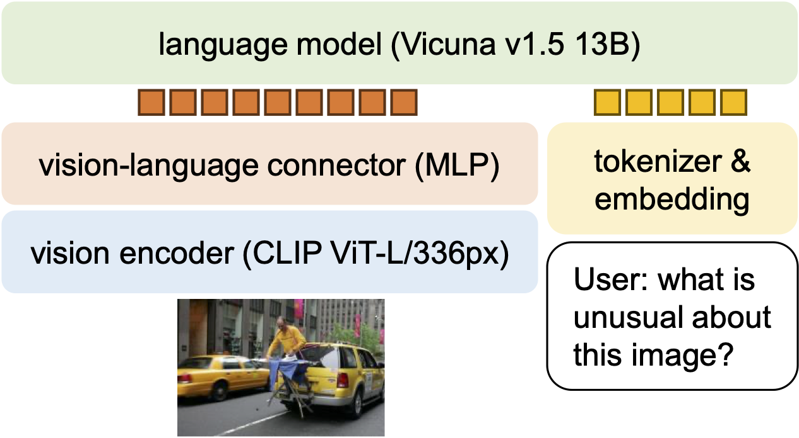
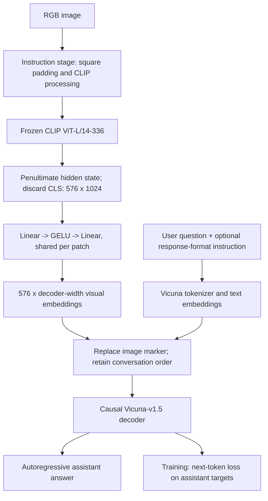
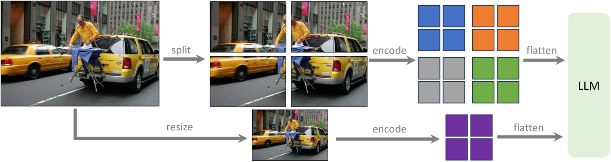
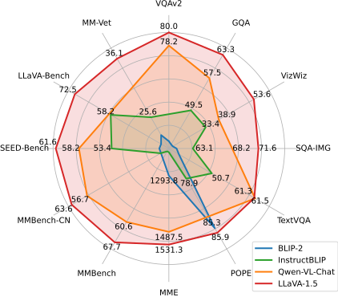
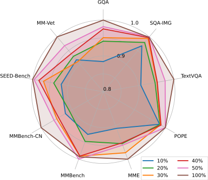

# Improved Baselines with Visual Instruction Tuning (LLaVA-1.5) — Liu et al., 2023

> **arXiv:** [2310.03744v2](https://arxiv.org/abs/2310.03744v2), 15 May 2024; first submitted 5 October 2023 · **Venue:** CVPR 2024, Highlight, pp. 26296–26306 · **Affiliation:** University of Wisconsin–Madison, Microsoft Research
>
> **Authors:** Haotian Liu, Chunyuan Li, Yuheng Li, Yong Jae Lee.
> This recap follows the camera-ready version, including its appendices.
> Implementation details are identified separately and pinned to the
> [31 October 2023 release-era code][code-pin]. The standard released
> LLaVA-1.5 models and the paper's exploratory **LLaVA-1.5-HD** are not
> interchangeable configurations.

## TL;DR

LLaVA-1.5 shows that a frozen CLIP encoder, a small **two-layer GELU MLP**,
and a fully instruction-tuned language model can be a strong multimodal
baseline without a learned-query resampler. Its decisive changes are
explicit response-format instructions, a broader public instruction-data
mixture, CLIP ViT-L/14 at **336 pixels**, and Vicuna-v1.5; the 13B model
reports **80.0 VQAv2, 63.3 GQA, 1531.3 MME-Perception, and 36.1 MM-Vet**
(Tables 3–4). The two multimodal training stages use **558K alignment
pairs plus approximately 665K instruction records** and take about
**6 + 20 hours on eight A100s** (§3.3), not training CLIP and the base
LLM from scratch with only 1.2M examples. A separate HD experiment
split-encodes native-resolution tiles, reconstructs their spatial layout,
and adds global context rather than interpolating CLIP's position table.

## Problem & motivation

### Short answers and useful conversations are different targets

The original [LLaVA][llava] was good at open-ended visual conversation
but often produced explanations where an academic VQA evaluator expected
a single word. It also tended to answer yes to yes/no questions, reflecting
the distribution of its instruction data. Adding short-answer VQA data
addresses that coverage problem, but can create the opposite failure:
the model answers tersely even when the user explicitly requests an
explanation (§3.1).

Table 1(a) illustrates this with an unusual image of a person ironing
beside/on the back of a car. Asked “Is this unusual? Please explain in
detail,” the illustrated InstructBLIP response is just “yes.” This is a
qualitative example of **task balancing**, not proof that every
InstructBLIP response has that problem.

The authors identify two interacting causes (§3.2). First, a template
such as `Q: ... A:` does not say whether the requested answer is short or
long. Second, when only a Q-Former is trained and the LLM remains frozen,
the visual-prefix module must also learn to control the LLM's response
style. LLaVA instead updates the LLM during visual instruction tuning
and places the formatting requirement in the user's instruction.

### Connector complexity and training scale were confounded

LLaVA used a linear map and roughly 600K alignment examples, whereas
BLIP-2/InstructBLIP used a Q-Former pretrained on **129M** image-text
pairs, and Qwen-VL reported much larger multimodal training collections
(§§2–3; Table 3). Comparing their final scores alone cannot establish
whether a complex connector, more data, a different language model,
or better instruction formatting caused the improvement.

The paper therefore builds a **cumulative baseline study**: change the
format prompt, projector, data sources, resolution, and LLM in stages,
then examine short-answer VQA, binary perception questions, and open-ended
visual conversation together. This is not an exhaustive factorial
experiment in which every combination is independently tested.

### Resolution constrains what the supervision can teach

An image caption can mention details that are no longer visible after
downsampling. Training on that caption then asks the model to describe
information its visual representation may not preserve. Higher
resolution can improve that mismatch, but naively changing a ViT's
position grid often entails position interpolation and additional
vision adaptation. The HD exploration asks whether independent encoding
of native-resolution tiles can retain detail without that extra
high-resolution pretraining (§3.4; §5.2).

## Key idea

### A nonlinear, token-preserving bridge

Let an RGB image $I$ be encoded by a frozen vision transformer
$f_\phi$. After selecting the penultimate hidden state and discarding
the class token, its patch features are

$$
Z=f_\phi(I)_{\mathrm{patch},-2}
\in\mathbb{R}^{N\times d_v}.
$$

Here $N$ is the number of image patches, $d_v=1024$ is CLIP's visual
hidden width, and $\phi$ denotes the frozen encoder parameters. The
release uses an MLP connector

$$
V=g_\psi(Z)
=\operatorname{GELU}(ZW_1+b_1)W_2+b_2
\in\mathbb{R}^{N\times d_\ell},
$$

with $W_1\in\mathbb{R}^{d_v\times d_\ell}$,
$W_2\in\mathbb{R}^{d_\ell\times d_\ell}$, and bias vectors
$b_1,b_2\in\mathbb{R}^{d_\ell}$. The trainable connector parameters
are $\psi$; $d_\ell$ is the language-model hidden width.
GELU is the elementwise Gaussian error linear unit,
$\operatorname{GELU}(x)=x\Phi(x)$, where $\Phi$ is the standard normal
cumulative distribution function.

The same MLP is applied independently to every patch. It changes
**feature width and representational capacity, not the patch count**.
There are no learned queries, cross-attention resampler, spatial pooling,
or token merging in this standard connector. CLIP has already mixed
patch information internally, and the causal LLM can mix projected
patches with subsequent text.

### Put the output contract in the question

For a question $q$ requiring a short answer, use

$$
q'=q\mathbin{\|}\text{“Answer the question using a single word or phrase.”},
$$

where $\|$ denotes textual concatenation. The resulting conditional
distribution is

$$
p_{\theta,\psi}(a\mid I,q')
=\prod_{t=1}^{|a|}
p_{\theta,\psi}(a_t\mid V,q',a_{<t}).
$$

Here $a=(a_1,\ldots,a_{|a|})$ is the answer-token sequence and
$\theta$ denotes the language-model parameters. Both $\theta$ and
$\psi$ are updated in instruction tuning, allowing the model to learn
when to be concise while retaining conversational responses under
different instructions.

This is **prompt-conditioned behavior**, not a constrained decoder.
The formatting instruction does not mathematically guarantee a
single word, valid JSON, a correct option letter, or factual grounding.
It also avoids the added step of asking ChatGPT to rewrite every
academic VQA answer into a conversational response (§3.2).

## How it works

### 1. Standard image path and exact shapes

The standard 7B and 13B releases use
[`openai/clip-vit-large-patch14-336`][clip-config], not the
224-pixel tower used in the original LLaVA configuration.
CLIP ViT-L/14 has 24 transformer layers, hidden width 1024,
16 attention heads, and a 14-pixel patch side. These are
vision-model settings; they are not the LLM's width or head count.

For a batch of $B$ images, the path is:

| Step | Shape | Meaning |
|---|---|---|
| RGB input after preprocessing | $B\times3\times336\times336$ | Standard single-image model input. |
| Patch grid | $24\times24$ | $336/14=24$ patches on each axis. |
| CLIP hidden sequence | $B\times577\times1024$ | 576 spatial patches plus the class token. |
| Selected patch features | $B\times576\times1024$ | Penultimate hidden layer, class token removed. |
| First MLP projection and GELU | $B\times576\times d_\ell$ | Nonlinear per-patch mapping. |
| Second MLP projection | $B\times576\times d_\ell$ | Continuous visual embeddings inserted into the LLM. |

The released [7B configuration][config7] uses $d_\ell=4096$,
32 decoder layers and 32 attention heads; the
[13B configuration][config13] uses $d_\ell=5120$,
40 layers and 40 heads. The language model is **Vicuna-v1.5**,
an instruction-tuned LLaMA-2-family decoder (§4.4; Appendix A.3).

Do not substitute CLIP's pooled **768-dimensional contrastive
embedding** for its 1024-dimensional patch hidden states.
The source [feature selector][clip-code] explicitly requests hidden
states, selects layer `-2`, and drops the first token.
Likewise, the MLP's GELU is distinct from the LLM's internal activation.

With both affine biases included, the connector contains

$$
P_{\mathrm{MLP}}=d_vd_\ell+d_\ell^2+2d_\ell
$$

parameters: **20,979,712 for 7B** and **31,467,520 for 13B**.
These are derived from the release shapes and
[projector builder][projector-code], not measured counts in a
paper table. There is no extra LayerNorm/RMSNorm or residual
connection in the selected `mlp2x_gelu` path.



*Original Figure 1, architecture panel. The orange squares are
continuous visual embeddings, not image tokens selected from a
discrete vocabulary. The figure illustrates the 13B variant; the
same structure is used for 7B with a different decoder width.*

### 2. Preserve the field of view when preparing instruction images

The release-era instruction-tuning script uses
`image_aspect_ratio=pad`. Its [dataset preprocessing][train-code]
centers a nonsquare image on a square canvas, filling the background
with CLIP's mean RGB color, then applies the CLIP image processor.
This avoids throwing away peripheral content through a square
center crop, although shrinking the entire canvas still reduces
the resolution of fine details.

This option is explicitly set in the **instruction-tuning** script;
the pinned pretraining script does not set it. Reproduction should
preserve the stage-specific preprocessing rather than infer that
all alignment images used the same padding path.

### 3. Replace the image marker with embeddings

A serialized conversation contains an image marker and ordinary text.
The [multimodal insertion routine][arch-code] finds the marker,
embeds the surrounding text, and replaces the marker's position with
the full visual feature block. In the standard release,
`mm_use_im_patch_token=False` and `mm_use_im_start_end=False`:
there is no need to add one learned textual token per patch or
surround the block with the original LLaVA image-boundary tokens.

If the serialized input has $T$ positions including one image
marker, insertion gives

$$
L=T-1+576.
$$

This is the length before any further truncation/padding.
The visual block consumes language-model context just as text
embeddings do. The original 224-pixel configuration had
$16^2=256$ patches, so 336 pixels increases the image-token
count by **2.25 times**, not merely the input width by 1.5 times.
The image-only pairwise attention term grows by
$(576/256)^2=5.0625$; the total decoder cost also depends on
text length, feed-forward layers, attention implementation,
and batching, so this is not a wall-clock slowdown prediction.



*Authored reconstruction. CLIP remains frozen in both stages.
The MLP is trained in both; the decoder is frozen for alignment
and updated for visual instruction tuning.*

### 4. Train against answers, not image-placeholder IDs

Projected patches have no vocabulary target. The implementation
assigns `IGNORE_INDEX=-100` to every inserted visual position.
It also masks the user/system portions of instruction conversations
and ignores padded targets. The model nevertheless **attends to**
the image and question to predict the assistant answer.

The stage-one `plain` preprocessor constructs an image-plus-caption
sequence. The stage-two `v1` preprocessor serializes alternating
user/assistant rounds, computes template-aware token lengths, and
masks their instruction spans. Exact separator/BOS offsets matter:
the pinned code applies a two-token correction when measuring the
instruction prefix and warns about tokenization mismatches, ignoring
the affected targets. Do not replace this with string-character
length masking or assume an arbitrary chat template is equivalent.

Causal supervision uses logits at position $j-1$ to predict the
unmasked label at position $j$. An ignored label removes a loss
term; it does not remove that position from the attention context.
During projector-only alignment, the frozen decoder must still
propagate gradients back to its **visual inputs**. Freezing its
weights is correct; putting the whole decoder forward pass under
`no_grad` would prevent the connector from learning.

For text-only ShareGPT records, there is no visual block. The
model can learn language instructions through the same decoder;
the image-capable training infrastructure does not imply that
ShareGPT contains paired images.

### 5. HD is a separate split–encode–merge experiment

Standard LLaVA-1.5 retains one fixed **336-pixel** view. The HD
recipe in **Appendix A.1** instead uses **CLIP ViT-L/14 at its
native 224-pixel resolution**. Its benchmark row is labeled
$448^2$, but its preprocessing description supports variable
aspect ratios and tile counts. It is not simply the standard
336 model run on a larger tensor.

1. **Select a target canvas.** Choose from predefined grids using
   detail preservation and resource efficiency: retain as much
   original detail as possible without selecting an unnecessarily
   large canvas for a small image. The appendix gives these
   criteria but no explicit scoring equation or tie-breaking rule.
2. **Resize/pad and split.** Prepare the target image and divide it
   into nonoverlapping $224\times224$ tiles. Tiles here are
   complete CLIP input images, not the transformer's 14-pixel
   patches.
3. **Encode independently.** Each tile yields a $16\times16$
   patch-feature map. No transformer attention crosses tile
   boundaries inside CLIP.
4. **Merge spatially.** Restore the tile rows and columns into
   one larger feature map. Concatenating each flattened tile
   consecutively is not equivalent to flattening the merged
   image in row-major spatial order.
5. **Remove padding features.** Discard feature positions that
   correspond exclusively to the padded canvas.
6. **Mark row boundaries.** Append a special row-end token to
   each remaining feature row, exposing its variable width and
   height to the LLM.
7. **Flatten and add a global view.** Serialize the merged map and
   concatenate features from a fixed-resolution downsampled
   image. Project visual features into decoder width and feed
   them with the text conversation.

If the tile grid has $g_h$ rows and $g_w$ columns, let
$s=224/14=16$. Writing the tile features as
$Z_{i,j,a,b,:}$, spatial reconstruction is

$$
F_{is+a,\;js+b,:}=Z_{i,j,a,b,:},
$$

where $0\leq i<g_h$, $0\leq j<g_w$, and
$0\leq a,b<s$. Before padding removal, $F$ has shape
$(sg_h)\times(sg_w)\times d_v$. If removal leaves
$H'\times W'$ features, write their projected decoder-space
map as $F'=g_\psi(F_{\mathrm{unpadded}})
\in\mathbb{R}^{H'\times W'\times d_\ell}$. Its row-major sequence is

$$
R=\mathop{\operatorname{concat}}_{u=0}^{H'-1}
\left(F'_{u,0,:},\ldots,F'_{u,W'-1,:},e_{\mathrm{row}}\right),
$$

where $e_{\mathrm{row}}\in\mathbb{R}^{d_\ell}$ denotes the
special row-end representation. This equation specifies the
serialization layout; the appendix does not fully specify
the row token's parameterization.
The tiled branch then has **$H'(W'+1)$ positions**.
A native 224-pixel global view contributes a further **256** patch
features. Thus, with an unpadded $2\times2$ grid, the local branch
has $32(32+1)=1056$ positions and the combined visual sequence
has **1312**, excluding ordinary text and any surrounding
serialization tokens. This is a derived geometry example, not
a paper-reported universal HD sequence length.



*Original Figure 2. Color groups identify different tiles; the
purple branch is the global view. The schematic omits the MLP
and the appendix's padding-removal/row-end details. The global
branch compensates for the lack of cross-tile visual attention
and for split-boundary artifacts; the LLM still has to integrate
the resulting representations.*

**Resolution-description caveat.** Appendix A.1 lists grids
`1x1, 1x2, 1x3, 1x4, 1x5, 1x6, 2x2, 2x3` and their
transposes, allowing up to six tiles. It then describes a
maximum resolution of **672×448 or 448×672**. That describes
the `2x3`/`3x2` canvas, but is not a universal maximum side
length if the listed `1x6` strips are supported:
six 224-pixel tiles imply **1344×224** or its transpose.
The recap preserves both the stated list and stated maximum
rather than silently imposing a 448-pixel limit or inventing
an unreported implementation restriction.

**HD training.** Appendix A.1.2 says that native-resolution tile
encoding requires neither additional vision pretraining nor
additional high-resolution projector pretraining. Instruction
tuning is performed directly on the higher-resolution images.
This does not mean that the vision encoder or connector starts
from random weights; it means no new **HD-specific alignment
pretraining** stage is inserted. Do not substitute a later
LLaVA-NeXT/1.6 AnyRes implementation for this paper's experiment
without separately verifying its initialization and serialization.

## Training / data

### Two stages and objective

The standard model follows the original LLaVA staged structure:

| Stage | Data | Trainable components | Frozen components |
|---|---|---|---|
| Vision-language alignment | 558K image-caption pairs | Two-layer MLP connector | CLIP and Vicuna |
| Visual instruction tuning | Approximately 665K instruction records | MLP connector and full Vicuna decoder | CLIP |

Table 3 reports the stage sizes. The pinned
[release README][readme] and [pretraining script][pretrain-code]
identify the first-stage collection as the **558K subset of
LAION–CC–SBU with BLIP captions**, distributed as LLaVA-Pretrain.
This is not the original recap's 595K CC3M selection, and it
is not a new contrastive CLIP-training dataset.

Both stages use autoregressive cross-entropy. Let $x$ be the
packed sequence containing visual embeddings and conversation
tokens, and let $\mathcal{S}$ contain its supervised caption or
assistant-target positions. The loss can be written as

$$
\mathcal{L}(\theta,\psi)
=-\frac{1}{|\mathcal{S}|}
\sum_{j\in\mathcal{S}}
\log p_{\theta,\psi}(x_j\mid x_{<j}).
$$

Here image embeddings condition the predictions but are not
vocabulary labels. In alignment, $\theta$ is held fixed; in
instruction tuning it is optimized along with $\psi$.
For a multi-turn record, later assistant turns condition on
the earlier user/assistant history and its image context.

### Instruction mixture: all sources in Table 7

Counts below are the **rounded conversation/record counts**
printed in Appendix Table 7, not necessarily numbers of
unique images or individual question-answer pairs.

| Source | Records | What it contributes and how responses are formatted |
|---|---:|---|
| LLaVA instruction data | 158K | Natural conversation, detailed description, and reasoning; no extra short-answer formatting prompt. |
| ShareGPT | 40K | Text-only language conversations, including multilingual behavior; no image-conditioned format prompt. |
| VQAv2 | 83K | General visual question answering; “Answer the question using a single word or phrase.” |
| GQA | 72K | Compositional/relational visual questions; the same single-word-or-phrase instruction. |
| OKVQA | 9K | Questions needing outside knowledge; the same short-answer instruction. |
| OCRVQA | 80K | Text-reading questions; the same short-answer instruction. |
| A-OKVQA | 66K | Knowledge-based multiple-choice questions; “Answer with the option’s letter from the given choices directly.” |
| TextCaps | 22K | Captioning images that contain text; “Provide a one-sentence caption for the provided image.” |
| RefCOCO family | 48K | Region descriptions/localization; randomly choose the region-description or box-prediction format. |
| Visual Genome | 86K | Additional region-level supervision; region-description/box-prediction formats. |
| **Total reported** | **665K** | Concatenated instruction mixture, including text-only records. |

The region-format instructions are “Provide a short description
for this region.” and “Provide the bounding box coordinate of
the region this sentence describes.” Table 7's layout groups
these formats across its region-data rows; it is not a claim
that every RefCOCO/VG record contains both tasks simultaneously.

The rounded source rows sum to **664K**, while the printed total
is **665K**. Since the counts are rounded, this is not evidence
that an unlisted extra dataset exists. Similarly,
$558K+665K=1.223M$ explains the abstract's **approximately
1.2M** public examples. Neither figure includes CLIP pretraining,
LLaMA-2 pretraining, or Vicuna's previous language instruction
tuning, and neither counts independent unique images across
all sources.

### Data construction and batching details

Appendix A.2 specifies the following preparation rules:

1. **Merge VQA turns by image.** Questions and answers for the
   same training image are combined into one conversation.
   One image encoding can therefore support several supervised
   question-answer turns.
2. **Filter and truncate ShareGPT.** Remove invalid conversations.
   Conversations longer than 2048 tokens are truncated, rather
   than split into multiple records as in the cited Vicuna
   preparation. This yields approximately 40K records.
3. **Augment A-OKVQA choices.** Each QA pair is augmented $k$
   times, where $k$ is the number of answer choices, to offset
   the relative scarcity of multiple-choice training examples.
   The paper does not fully specify the transformation for
   each duplicate, so use the released annotations rather
   than invent a particular choice permutation.
4. **Sample OCRVQA.** Use 80K conversations.
5. **Limit Visual Genome annotations.** For images with more
   annotations, sample 10 of them.
6. **Segment RefCOCO conversations.** Split them into groups
   described as containing fewer than 10 conversations.
7. **Group by modality/length.** Language conversations are
   often longer than visual ones. The paper batches by a
   single modality; the script enables
   `group_by_modality_length=True`. It reports a **25% training
   speedup** without changing the final outcome (Appendix A.2),
   not a 25% model-quality improvement.

The splits are concatenated and sampled without a reported
custom task-weighting schedule. Do not interpret “same
probability” as forcing every source dataset to have equal
frequency regardless of its number of records.

The 158K LLaVA source includes teacher-generated instruction
responses from the original [visual instruction tuning][llava]
pipeline. “Public data” therefore does not mean exclusively
human-authored annotations or absence of synthetic teacher
supervision. It means the multimodal collections are available
for the community to obtain.

### Hyperparameters, compute, and reproducible settings

**Appendix Table 9** gives:

| Hyperparameter | Alignment pretraining | Instruction tuning |
|---|---:|---:|
| Global batch size | 256 | 128 |
| Learning rate | $1\times10^{-3}$ | $2\times10^{-5}$ |
| Schedule | Cosine decay | Cosine decay |
| Warmup ratio | 0.03 | 0.03 |
| Weight decay | 0 | 0 |
| Epochs | 1 | 1 |
| Optimizer | AdamW | AdamW |
| DeepSpeed ZeRO stage | 2 | 3 |

The paper says the main pretraining LR is halved relative to
the earlier linear-projector recipe because it now uses an MLP.
Do not carry over the original LLaVA's three-epoch chat schedule.

The pinned [pretraining][pretrain-code] and
[finetuning][finetune-code] scripts use BF16, TF32,
gradient checkpointing, lazy preprocessing, and a
**2048-token tokenizer/model training limit**. On eight GPUs,
their per-device batches of 32 and 16 with one accumulation
step yield global batches $8\times32=256$ and $8\times16=128$.
Changing device count or per-device batch size should preserve
the intended global batch through gradient accumulation.

The released checkpoint configurations advertise
**4096 maximum positions**, whereas those scripts explicitly
set **2048** for the training pipeline. These are different
settings, not evidence that every training conversation filled
a 4096-token context. Visual-marker expansion also lengthens
the embedded sequence, so reproduce the pinned
tokenization/insertion behavior rather than treating a text
token limit as a universal post-insertion budget.

Section 3.3 reports about **6 hours alignment + 20 hours
instruction tuning on eight A100s** for the main recipe,
roughly twice the training duration of its LLaVA baseline.
The release README gives approximately **5.5 hours** for
13B alignment on eight A100-80GB GPUs and **3.5 hours** for
7B alignment. The README's finer estimate and the paper's
rounded six-hour estimate should not be conflated with a
precisely measured universal runtime.

Evaluation uses **greedy decoding**, not beam search or a
stochastic decoding configuration (Appendix A.3; release README).
The response prompts in **Appendix Table 8** are also part
of the evaluation protocol:

| Evaluation datasets | Added output instruction |
|---|---|
| LLaVA-Bench, MM-Vet | None; retain natural responses. |
| VQAv2, GQA, TextVQA, MME, POPE | “Answer the question using a single word or phrase.” |
| ScienceQA, MMBench, SEED-Bench | “Answer with the option’s letter from the given choices directly.” |
| VizWiz | “When the provided information is insufficient, respond with ‘Unanswerable’. Answer the question using a single word or phrase.” |

TextVQA additionally involves OCR text supplied with the question
in the evaluation setup discussed in §4.4. Its score should not
be assumed to measure only unaided reading from pixels.

## Results

### Reading the benchmarks correctly

The paper evaluates **12 benchmark families** (§4.1). Table 4
expands several into subcolumns, so counting columns does not
give the number of separate benchmarks.

- **VQAv2/GQA:** short-answer visual question answering. A star
  in Table 3 marks training-image/annotation exposure; the
  final LLaVA-1.5 models are not zero-shot on these sources.
- **VizWiz:** transfer to visual questions from visually
  impaired users, including cases with insufficient information.
- **ScienceQA-IMG:** the image subset of multiple-choice
  ScienceQA, evaluated here as zero-shot generalization.
  Its 71.6 score is not the original LLaVA paper's separately
  ScienceQA-tuned 90.92 overall accuracy or its GPT-4 ensemble.
- **TextVQA:** visual questions about text, with the
  OCR-assisted protocol noted above.
- **POPE:** **F1**, separately for random, popular/common,
  and adversarial negative-object sampling. These are not
  three ordinary accuracy columns.
- **MME:** the **Perception** score on binary questions,
  not MME-Perception plus Cognition and not a percentage.
- **MMBench/Chinese MMBench:** multiple-choice evaluation
  with answer-order shuffling; the Chinese set is a translated
  version used to probe cross-language transfer.
- **SEED-Bench:** overall, image, and video question accuracy.
  For video questions this paper samples the **middle frame**,
  not a temporal sequence or dedicated video encoder.
- **LLaVA-Wild/MM-Vet:** GPT-4-assisted evaluation of natural
  responses. LLaVA-Wild is a relative quality score, not
  ordinary classification accuracy or parity with GPT-4V.

### Controlled cumulative scaling: full Table 2

All numerical entries below are **per paper Table 2**.
“+” means the next cumulative modification, not an isolated
change evaluated against every other row. The comparator
is labeled “14B” in this table; its language backbone is
the Vicuna-13B model discussed in §3.1.

| Step | Method | LLM label | Input side | GQA | MME | MM-Vet |
|---|---|---|---:|---:|---:|---:|
| Reference | InstructBLIP | 14B | 224 | 49.5 | 1212.8 | 25.6 |
| 0 | LLaVA | 7B | 224 | — | 809.6 | 25.5 |
| 1 | +VQAv2 | 7B | 224 | 47.0 | 1197.0 | 27.7 |
| 2 | +Format prompt | 7B | 224 | 46.8 | 1323.8 | 26.3 |
| 3 | +MLP VL connector | 7B | 224 | 47.3 | 1355.2 | 27.8 |
| 4 | +OKVQA/OCR | 7B | 224 | 50.0 | 1377.6 | 29.6 |
| 5 | +Region-level VQA | 7B | 224 | 50.3 | 1426.5 | 30.8 |
| 6 | +Scale up resolution | 7B | 336 | 51.4 | 1450 | 30.3 |
| 7 | +GQA | 7B | 336 | 62.0* | 1469.2 | 30.7 |
| 8 | +ShareGPT | 7B | 336 | 62.0* | 1510.7 | 31.1 |
| 9 | +Scale up LLM | 13B | 336 | 63.3* | 1531.3 | 36.1 |

`*` means GQA training images were observed during training.
The early GQA rows and the GQA-trained final rows therefore
have different exposure conditions.

Several points qualify the headline:

- Adding VQAv2 without formatting already raises MME from
  809.6 to 1197.0. The 1323.8 row includes **both** VQAv2
  and formatting, so its **514.2-point** total gain cannot
  be attributed solely to prompt wording.
- Formatting's incremental MME gain is **126.8** points,
  while GQA and MM-Vet decrease slightly in that row.
- The MLP row improves all three scores relative to its
  immediately preceding row, but resolution scaling does
  not monotonically improve every benchmark: MM-Vet is
  30.8 before that change and 30.3 after.
- The jump from 51.4 to 62.0 GQA accompanies adding GQA
  training data; it is not clean evidence of zero-shot
  reasoning improvement.
- Scaling the decoder from 7B to 13B adds **5.0 MM-Vet
  points**, the largest single MM-Vet increment in this
  cumulative sequence (derived from Table 2).

### Academic-task results: full Table 3

All benchmark numbers and stage sizes in the following two
tables are **per paper Table 3**. The resource table separates
image resolution and training counts from the score columns.
`—` means unreported, not zero.

| Model / decoder | Image size | Alignment/pretraining data | Instruction data |
|---|---|---|---|
| BLIP-2 / Vicuna-13B | 224² | 129M | — |
| InstructBLIP / Vicuna-7B | 224² | 129M | 1.2M |
| InstructBLIP / Vicuna-13B | 224² | 129M | 1.2M |
| Shikra / Vicuna-13B | 224² | 600K | 5.5M |
| IDEFICS-9B / LLaMA-7B | 224² | 353M | 1M |
| IDEFICS-80B / LLaMA-65B | 224² | 353M | 1M |
| Qwen-VL / Qwen-7B | 448² | 1.4B† | 50M† |
| Qwen-VL-Chat / Qwen-7B | 448² | 1.4B* | 50M† |
| LLaVA-1.5 / Vicuna-7B | 336² | 558K | 665K |
| LLaVA-1.5 / Vicuna-13B | 336² | 558K | 665K |
| LLaVA-1.5-HD / Vicuna-13B | 448² | 558K | 665K |

The table's `†` denotes inclusion of nonpublic in-house data.
The Qwen-VL-Chat pretraining cell is printed as **1.4B***,
unlike the neighboring Qwen-VL **1.4B†** cell. That marker
is preserved rather than silently repaired; the paper's
broader public/nonpublic comparison should not rest on
interpreting this one inconsistent marker.

| Model | VQAv2 | GQA | VizWiz | ScienceQA-IMG | TextVQA |
|---|---:|---:|---:|---:|---:|
| BLIP-2 / Vicuna-13B | 65.0 | 41 | 19.6 | 61 | 42.5 |
| InstructBLIP / Vicuna-7B | — | 49.2 | 34.5 | 60.5 | 50.1 |
| InstructBLIP / Vicuna-13B | — | 49.5 | 33.4 | 63.1 | 50.7 |
| Shikra / Vicuna-13B | 77.4* | — | — | — | — |
| IDEFICS-9B | 50.9 | 38.4 | 35.5 | — | 25.9 |
| IDEFICS-80B | 60.0 | 45.2 | 36.0 | — | 30.9 |
| Qwen-VL | 78.8* | 59.3* | 35.2 | 67.1 | 63.8* |
| Qwen-VL-Chat | 78.2* | 57.5* | 38.9 | 68.2 | 61.5* |
| LLaVA-1.5-7B | 78.5* | 62.0* | 50.0 | 66.8 | 58.2 |
| LLaVA-1.5-13B | 80.0* | 63.3* | 53.6 | 71.6 | 61.3 |
| LLaVA-1.5-HD-13B | 81.8* | 64.7* | 57.5 | 71.0 | 62.5 |
| Specialist reference: PaLI-X-55B | 86.1* | 72.1* | 70.9* | — | 71.4* |

For scores, `*` denotes training-image/annotation exposure.
The specialist row is retained because it limits the scope
of “state of the art”: the main model does not surpass
every specialist system on those datasets.

Among the compared general-purpose models, the standard
13B model leads four of these five academic benchmarks
(Table 3 caption), while TextVQA remains stronger for Qwen-VL.
HD improves VQAv2, GQA, VizWiz and TextVQA relative to
standard 13B, but ScienceQA-IMG falls from 71.6 to 71.0.

### Instruction-following results: full Table 4

The following two tables reproduce **all Table 4 score
columns and model rows**, split only for readability.
The model labels follow that table. Table 3 separately identifies
the Vicuna-7B/13B backbones behind its InstructBLIP entries;
the 8B/14B labels here should not be read as evidence of a
different Vicuna language-model configuration.

| Model | POPE random F1 | POPE popular F1 | POPE adversarial F1 | MME-Perception | MMBench EN | MMBench CN |
|---|---:|---:|---:|---:|---:|---:|
| BLIP2-14B | 89.6 | 85.5 | 80.9 | 1293.8 | — | — |
| InstructBLIP-8B | — | — | — | — | 36 | 23.7 |
| InstructBLIP-14B | 87.7 | 77 | 72 | 1212.8 | — | — |
| Shikra-13B | — | — | — | — | 58.8 | — |
| IDEFICS-9B | — | — | — | — | 48.2 | 25.2 |
| IDEFICS-80B | — | — | — | — | 54.5 | 38.1 |
| Qwen-VL | — | — | — | — | 38.2 | 7.4 |
| Qwen-VL-Chat | — | — | — | 1487.5 | 60.6 | 56.7 |
| LLaVA-7B | 76.3 | 72.2 | 70.1 | 809.6 | 38.7 | 36.4 |
| LLaVA-1.5-7B | 87.3 | 86.1 | 84.2 | 1510.7 | 64.3 | 58.3 |
| LLaVA-1.5-13B | 87.1 | 86.2 | 84.5 | 1531.3 | 67.7 | 63.6 |
| LLaVA-1.5-HD-13B | 87.5 | 86.4 | 85.0 | 1500.1 | 68.8 | 61.9 |

| Model | SEED all | SEED image | SEED video | LLaVA-Wild | MM-Vet |
|---|---:|---:|---:|---:|---:|
| BLIP2-14B | 46.4 | 49.7 | 36.7 | 38.1 | 22.4 |
| InstructBLIP-8B | 53.4 | 58.8 | 38.1 | 60.9 | 26.2 |
| InstructBLIP-14B | — | — | — | 58.2 | 25.6 |
| Shikra-13B | — | — | — | — | — |
| IDEFICS-9B | — | 44.5 | — | — | — |
| IDEFICS-80B | — | 53.2 | — | — | — |
| Qwen-VL | 56.3 | 62.3 | 39.1 | — | — |
| Qwen-VL-Chat | 58.2 | 65.4 | 37.8 | — | — |
| LLaVA-7B | 33.5 | 37.0 | 23.8 | 62.8 | 25.5 |
| LLaVA-1.5-7B | 58.6 | 66.1 | 37.3 | 65.4 | 31.1 |
| LLaVA-1.5-13B | 61.6 | 68.2 | 42.7 | 72.5 | 36.1 |
| LLaVA-1.5-HD-13B | 62.6 | 70.1 | 41.3 | 72.0 | 39.4 |

The headline **11-benchmark** claim is the authors' broad
comparison across 12 benchmark families, not a claim that
every model size wins every subcolumn. For example,
BLIP2-14B has higher POPE-random F1 than either standard
LLaVA-1.5 model, while LLaVA-1.5 is stronger on the harder
adversarial split. HD improves MM-Vet from 36.1 to 39.4,
but lowers MME, MMBench-CN, SEED-video, and LLaVA-Wild
relative to standard 13B.



*Original Figure 1, radar panel. The plotted 85.9 POPE value
for LLaVA-1.5 corresponds to the rounded mean of its three
Table 4 F1 splits, $(87.1+86.2+84.5)/3$, not its random-split
87.1 alone. Scores on different spokes use different scales;
the polygon is an overview, not a calibrated aggregate
utility or a replacement for Tables 3–4.*

### Why the global view matters for HD

Section 4.2 reports a separate **unnumbered ablation**:

| HD visual context | GQA | MME | MM-Vet |
|---|---:|---:|---:|
| High-resolution patches only | 62.9 | 1425.8 | 31.9 |
| +Global context | 63.8 (+0.9) | 1497.5 (+71) | 35.1 (+3.2) |

The values above are per the §4.2 ablation, not the final
HD rows of Tables 3–4. Its strongest implication is that
high-detail tiles alone lose useful whole-image context:
a cheap additional global view helps the decoder integrate
the scene. The source prints the MME delta as **+71**;
subtracting its displayed scores gives **+71.7**.
Both the original printed delta and the arithmetic
qualification are retained.

### Language backbone and data-efficiency studies

**LLM choices (§4.4; Figure 3).** The authors compare
Vicuna-v1.1/v1.3 based on LLaMA, Vicuna-v1.5 based on
LLaMA-2, and RLHF-trained LLaMA-2-Chat. Vicuna-v1.3 and
v1.5 use the same approximately **150K ShareGPT** language
instruction data, about twice the amount used by v1.1.
This upstream language tuning is distinct from the
approximately 40K ShareGPT records added to the present
multimodal instruction mixture.

Vicuna-v1.5 is strongest overall in the relative-performance
plot. The LLaMA-2-based models generally beat their earlier
base-family counterparts; multilingual instruction exposure
also matters. LLaMA-2-Chat and Vicuna-v1.5 are close on
English MMBench, but Vicuna-v1.5 generalizes better to Chinese.
For TextVQA, handling noisy supplied OCR text is another
language-side demand. The paper gives this comparison as
a radar plot rather than a complete numerical table, so
no exact per-model scores are inferred from line positions.

**Data subsampling (§5.1; Figure 4).** Randomly subsampling
the instruction mixture at ratios from **10% to 50%** shows
that full data has the best overall knowledge coverage,
but **50% retains more than 98% of full-data performance**
as reported in the prose. MMBench, ScienceQA, and POPE
do not decline at 50%, and MMBench slightly improves;
several scores remain steady from 50% down to 30%.
This is not a guarantee of 98% retention on every task
or a statement that half the inherited CLIP/LLM pretraining
can be removed.



*Original Figure 4. Each spoke is normalized to the best
performing variant on that dataset, not necessarily to
the full-data model. Small gains from subsampling on
individual tasks coexist with losses on others. The
10–50% curves motivate better curation; they do not
replace benchmark-specific absolute results.*

### Emerging behaviors and what the evidence supports

**Unanswerable questions.** Applying the VizWiz evaluation
instruction raises performance on its unanswerable-question
subset from **11.1% to 67.8%** (§4.3). These are not overall
VizWiz scores, and should not be substituted for the
53.6 standard-13B entry in Table 3.

**Chinese transfer.** The 13B model reaches **63.6 MMBench-CN**
versus Qwen-VL-Chat's **56.7** (Table 4; §4.3). Their difference
is **6.9 percentage points**. Section 4.3 prints “+7.3%,”
which does not match those displayed numbers. This recap
preserves the source claim as a discrepancy rather than
reporting it as a verified arithmetic gain. The result is
consistent with text-only multilingual instruction behavior
transferring into visual conversations; it is not proof
that paired multilingual vision data never helps.

**Formatting and composition.** Tables 5–6 and Appendix B
show question-premise verification, JSON-shaped information
extraction, switching between brief and detailed answers
within a conversation, visually grounded travel writing,
and constrained image-generation prompt composition.
The JSON example still contains extraction mistakes;
producing the requested structure is not the same as
correctly reading every field. Figure 5 additionally shows
multilingual visual conversations, including errors in
Korean. These are illustrative examples, not a measured
JSON-validity rate or a comprehensive multilingual benchmark.

**Hallucination and resolution.** Section 5.2 reports that
hallucination in detailed descriptions is reduced at higher
resolution such as $448^2$. Its proposed explanation is a
mismatch between annotation granularity and visible detail,
rather than assuming all hallucination is caused by noisy
teacher captions. Table 4's POPE splits support improved
object-presence discrimination, but do not establish that
higher resolution removes every kind of hallucination.

## Limitations & follow-ups

### Limits acknowledged by the paper

**Visual token cost.** Full patch sequences make each
decoder pass longer, especially for HD. Appendix C notes
that resamplers can reduce the sequence, but argues that
the compared resampler recipes did not converge as
data-efficiently with similar training amounts. The
suggestion that extra trainable resampler parameters
contribute to this gap is a hypothesis, not a universal
impossibility result for token compression.

**No trained multi-image capability.** The authors explicitly
attribute the lack of multi-image processing to instruction
data and context-length limits (Appendix C). Several tiles
from one image in HD do not make it a trained multi-image
reasoning assistant. The middle-frame SEED protocol likewise
does not establish temporal video understanding.

**Domain and compositional gaps.** A more capable LLM and
targeted visual instruction data may help specialized tasks.
Section 5.3 also warns that correctly answering an isolated
attribute question does not guarantee mentioning that
attribute correctly in a long whole-image description.
Joint task behavior remains harder than the component skills.

**Residual hallucination and misinformation.** Better format
following and higher resolution are not reliability
guarantees. Appendix C calls for caution in critical domains,
including medical applications.

### Boundaries of the empirical claim

The headline data budget concerns the **added multimodal
training**, excluding substantial inherited model pretraining.
Dataset exposure varies across methods; GPT-4-assisted
conversation metrics differ from deterministic answer
accuracy; reported scores generally lack confidence
intervals. The cumulative ablation establishes a practical
recipe, not a causal decomposition of every architectural
and data interaction. The HD preprocessing description
also contains the grid/maximum-resolution inconsistency
noted above.

### Related directions

- [Original LLaVA][llava] provides the visual instruction
  generation pipeline and staged training foundation.
  LLaVA-1.5 changes the projector, dataset mixture, image
  tower and recipe; it should not retroactively redefine
  the original linear-projector model.
- [BLIP-2][blip2] and [InstructBLIP][instructblip] are
  learned-query alternatives. Their visual-prefix
  compression saves decoder positions but involves a
  different alignment/training trade-off.
- [Honeybee][honeybee] explores stronger locality-aware
  visual projectors and token reduction, directly addressing
  the full-patch cost while seeking to preserve spatial detail.
- [LLaVA-NeXT / LLaVA-1.6][next] extends the release family
  with higher-resolution and improved OCR/reasoning recipes.
  It is a follow-up, not the identity of every HD detail
  in this camera-ready paper.
- [Cambrian-1][cambrian] broadens controlled study of vision
  encoders and connector design, testing limitations of
  relying on a single CLIP visual representation.

## Links

- **arXiv:** [versioned abstract][paper] · [HTML][html] · [PDF][pdf].
- **Code:** [haotian-liu/LLaVA](https://github.com/haotian-liu/LLaVA);
  [release-era snapshot, 31 October 2023][code-pin].
- **Implementation anchors:** [MLP builder][projector-code],
  [CLIP feature selection][clip-code], [image insertion][arch-code],
  [training/data preprocessing][train-code],
  [alignment script][pretrain-code], [instruction script][finetune-code].
- **Hugging Face models:** [7B](https://huggingface.co/liuhaotian/llava-v1.5-7b)
  and [13B](https://huggingface.co/liuhaotian/llava-v1.5-13b);
  [7B config][config7], [13B config][config13], [CLIP config][clip-config].
- **Hugging Face data:** [LLaVA-Pretrain](https://huggingface.co/datasets/liuhaotian/LLaVA-Pretrain)
  and [released 665K instruction mixture](https://huggingface.co/datasets/liuhaotian/LLaVA-Instruct-150K/blob/main/llava_v1_5_mix665k.json).
- **Project page:** [LLaVA](https://llava-vl.github.io/).
- **Blog / release notes:** [release README][readme];
  [LLaVA-NeXT / 1.6 announcement][next] for the subsequent release.
- **Talks / videos:** no separate talk used as evidence in this recap.
- **Venue:** [CVPR 2024 open-access page][venue] and
  [official supplementary PDF][supplement].
- **Papers-with-Code:** [paper entry](https://paperswithcode.com/paper/improved-baselines-with-visual-instruction).
- **Related papers:** [LLaVA][llava], [BLIP-2][blip2],
  [InstructBLIP][instructblip], [Honeybee][honeybee],
  [ViT][vit], [Cambrian-1][cambrian].

**Figure provenance.** All four local assets are original
paper figures retrieved from the versioned arXiv HTML:
[Figure 1 architecture panel](https://arxiv.org/html/2310.03744v2/figs/architecture.png),
[Figure 1 radar panel](https://arxiv.org/html/2310.03744v2/llava_v1_5_radar.svg),
[Figure 2 HD architecture](https://arxiv.org/html/2310.03744v2/high_res_arch_v2.png),
and [Figure 4 data efficiency](https://arxiv.org/html/2310.03744v2/llava_v1_5_radar_data_ablate.svg).
The Mermaid diagram and geometry derivations are authored
explanations rather than claims of additional experiments.

**BibTeX** (venue entry; recap filename uses the first arXiv year):

```bibtex
@InProceedings{Liu_2024_CVPR,
  author    = {Liu, Haotian and Li, Chunyuan and Li, Yuheng and Lee, Yong Jae},
  title     = {Improved Baselines with Visual Instruction Tuning},
  booktitle = {Proceedings of the IEEE/CVF Conference on Computer Vision
               and Pattern Recognition (CVPR)},
  month     = {June},
  year      = {2024},
  pages     = {26296--26306}
}
```

[paper]: https://arxiv.org/abs/2310.03744v2
[html]: https://arxiv.org/html/2310.03744v2
[pdf]: https://arxiv.org/pdf/2310.03744v2
[venue]: https://openaccess.thecvf.com/content/CVPR2024/html/Liu_Improved_Baselines_with_Visual_Instruction_Tuning_CVPR_2024_paper.html
[supplement]: https://openaccess.thecvf.com/content/CVPR2024/supplemental/Liu_Improved_Baselines_with_CVPR_2024_supplemental.pdf
[code-pin]: https://github.com/haotian-liu/LLaVA/tree/785f766fcddc86ffeaa62cd51cf7834a11c04e6d
[readme]: https://github.com/haotian-liu/LLaVA/blob/785f766fcddc86ffeaa62cd51cf7834a11c04e6d/README.md
[projector-code]: https://github.com/haotian-liu/LLaVA/blob/785f766fcddc86ffeaa62cd51cf7834a11c04e6d/llava/model/multimodal_projector/builder.py
[clip-code]: https://github.com/haotian-liu/LLaVA/blob/785f766fcddc86ffeaa62cd51cf7834a11c04e6d/llava/model/multimodal_encoder/clip_encoder.py
[arch-code]: https://github.com/haotian-liu/LLaVA/blob/785f766fcddc86ffeaa62cd51cf7834a11c04e6d/llava/model/llava_arch.py
[train-code]: https://github.com/haotian-liu/LLaVA/blob/785f766fcddc86ffeaa62cd51cf7834a11c04e6d/llava/train/train.py
[pretrain-code]: https://github.com/haotian-liu/LLaVA/blob/785f766fcddc86ffeaa62cd51cf7834a11c04e6d/scripts/v1_5/pretrain.sh
[finetune-code]: https://github.com/haotian-liu/LLaVA/blob/785f766fcddc86ffeaa62cd51cf7834a11c04e6d/scripts/v1_5/finetune.sh
[config7]: https://huggingface.co/liuhaotian/llava-v1.5-7b/raw/main/config.json
[config13]: https://huggingface.co/liuhaotian/llava-v1.5-13b/raw/main/config.json
[clip-config]: https://huggingface.co/openai/clip-vit-large-patch14-336/raw/main/config.json
[next]: https://llava-vl.github.io/blog/2024-01-30-llava-next/
[llava]: multimodal_2023_llava.md
[blip2]: multimodal_2023_blip2-qformer.md
[instructblip]: multimodal_2023_instructblip.md
[honeybee]: multimodal_2023_honeybee.md
[vit]: multimodal_2020_vit.md
[cambrian]: multimodal_2024_cambrian-1.md
