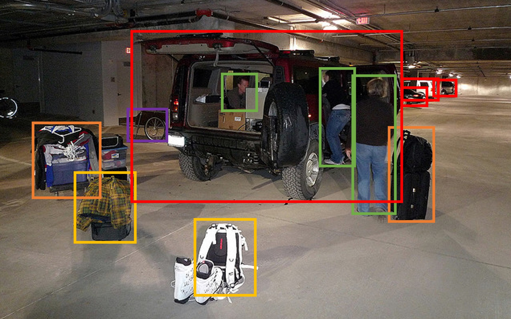
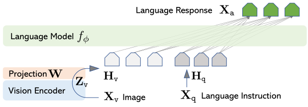
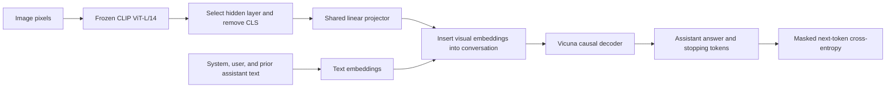
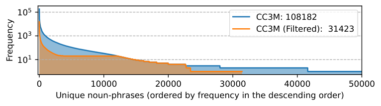
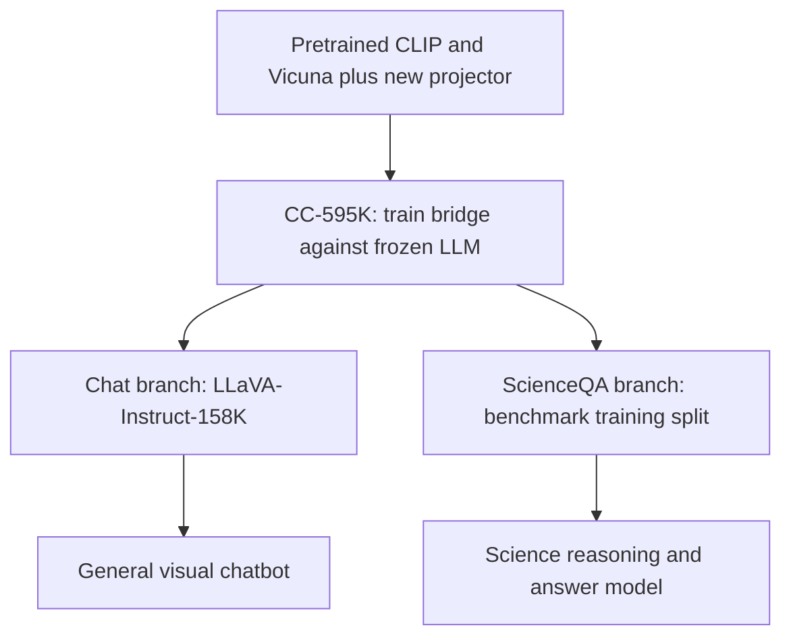
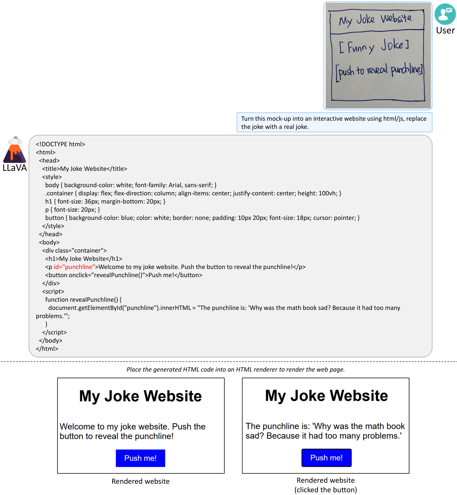

# Visual Instruction Tuning (LLaVA) - Liu et al., 2023

> **Authors:** Haotian Liu, Chunyuan Li, Qingyang Wu, Yong Jae Lee
>
> **arXiv:** [2304.08485v2][paper], 11 December 2023; first submitted
> 17 April 2023
>
> **Venue:** NeurIPS 2023, Oral
>
> **Affiliations:** University of Wisconsin-Madison, Microsoft Research,
> Columbia University
>
> **Scope:** The original LLaVA paper, including Appendices A-F.
> Implementation details are checked against original-era code at
> [`6e1d605258bd72c749724eb9a30aa3ae5aded361`][code], 30 April 2023,
> and the [original 13B delta checkpoint configuration][config].
> These references are distinguished from the later LLaVA-1.5 architecture
> and from subsequent changes on the repository's main branch.

## TL;DR

LLaVA turns a pretrained vision encoder and an instruction-following LLM
into a visual assistant using a simple projection layer and a two-stage
training recipe: first align image features to a frozen language model,
then tune the projector and language model on visual instructions while
keeping the vision encoder frozen.
Its central data contribution is to use **language-only GPT-4**, given
captions and object boxes rather than pixels, to synthesize **158K**
image-grounded instruction examples (Section 3).
The chatbot reaches **85.1 relative-score points** against a text-only
GPT-4 reference on LLaVA-Bench (COCO), while a **separately ScienceQA-tuned**
model reaches **90.92% accuracy**, or **92.53% with GPT-4 adjudication**
(Tables 4 and 7).
These are three different evaluation settings, not a single accuracy
score, a zero-shot ScienceQA result, or proof of parity with multimodal GPT-4.

## Problem & motivation

### Image recognition and instruction following are different capabilities

Text instruction tuning teaches an LLM to answer a user's request rather
than merely continue a document. Existing vision-language systems could
recognize images, retrieve captions, or perform individual supervised
tasks, but those abilities did not automatically provide an assistant
that could hold a conversation about an image.

For example, "What is unusual about this scene?" asks for a particular
interpretation, not a generic list of visible objects. A model that
always captions the image may possess useful perception while failing
the user's actual instruction.
The paper studies this distinction directly through open-ended visual
questions, descriptions, and reasoning.

### Multimodal instruction data is the expensive missing ingredient

Large caption corpora already pair images with text, but captions alone
provide little diversity in the kind of task requested.
Wrapping every caption in a request to describe its image is useful
for alignment, yet does not create multi-turn dialogue or detailed
reasoning supervision.

The paper's solution is to reuse existing human-created COCO annotations
and let a strong **text** model generate richer instructions and answers.
Captions encode objects, actions, and scene semantics; bounding boxes
encode object categories and spatial layout.
Together, they are a textual proxy that a language-only teacher can use.
This does not make GPT-4 a pixel-observing teacher: details absent from
the annotations remain unobserved.

Architecturally, LLaVA deliberately uses a small connector so the authors
can iterate quickly on data and training. Unlike a query bottleneck or
resampler, it keeps the image's patch-feature sequence and lets the
language decoder consume those features alongside text.
Its contribution is a practical combination of instruction-data synthesis
and staged multimodal tuning, not a new vision backbone.

## Key idea

### Align continuous visual features with the LLM's embedding space

Let $X_v$ be an image, $g$ the pretrained CLIP vision encoder, and
$Z_v=g(X_v)$ the selected grid features.
The paper writes the connector as

$$
H_v=WZ_v.
\tag{1}
$$

$W$ is the trainable projection and $H_v$ the resulting visual tokens
in the language model's embedding space.
This notation treats feature vectors as columns. With row-major,
batched features, the original implementation is an affine layer:

$$
Z_v\in\mathbb{R}^{B\times N\times d_v},\qquad
H_v=Z_vW^\top+b,\qquad
H_v\in\mathbb{R}^{B\times N\times d_\ell}.
$$

$B$ is batch size, $N$ the number of retained image patches,
$d_v$ the vision-feature width, $d_\ell$ the decoder embedding width,
$W\in\mathbb{R}^{d_\ell\times d_v}$, and
$b\in\mathbb{R}^{d_\ell}$ the bias used by the code's `nn.Linear`.
The same projection is applied to every patch; it changes feature width,
**not the number of patches**.

The LLM receives a sequence combining projected visual tokens, ordinary
text embeddings, and conversation-format tokens. It then predicts
assistant text autoregressively.
There is no discretization into a learned image vocabulary, separate
cross-attention adapter, or image-generating decoder in the original model.

### Learn alignment first, then learn how to respond

In the alignment stage, only the bridge is trained at the paper's
architectural level. This teaches a frozen LLM to interpret the
continuous image representation through caption prediction.
In the second stage, the bridge and LLM are tuned together so the model
can follow visual requests rather than remain a captioning system.

The second stage has **two task branches** in the experiments:
the general multimodal chatbot uses synthesized visual instructions,
whereas the ScienceQA model uses that benchmark's training examples
and reasoning annotations.
The ScienceQA score must not be attributed to an untuned chatbot
merely because both branches share the alignment initialization.

## How it works

### 1. Construct a text-only teacher's representation of each image

The generation workflow in Section 3 and Appendix F is:

1. Take a COCO image with its existing captions and object annotations.
2. Serialize the captions and labeled bounding boxes as text.
   The boxes provide category names and normalized spatial coordinates;
   the captions provide complementary descriptions of the scene.
3. Give GPT-4 a task-specific system instruction and a few manually
   prepared input/output examples.
4. Submit the new image's **textual annotations**, not its pixel array.
5. Store the generated question/answer or conversation together with
   the actual image for subsequent student training.

The paper's data-generation examples use five captions for one image.
The manually designed seeds are new annotations for this synthesis
workflow; this does not mean the underlying COCO captions and boxes
were annotation-free.

The conversation prompt requests diverse questions about objects,
counts, actions, locations, and relative positions. It asks the teacher
to restrict itself to confidently answerable content and to provide
well-organized explanations for complex questions.
These instructions discourage uncertainty, but are not a verification
algorithm that can guarantee every generated claim is correct.

In Appendix F, the message structure is:

```text
system: define the visual-assistant role, permitted questions, and answer style
user: symbolic context for a manually designed seed image
assistant: the corresponding seed conversation
... repeat for the supplied few-shot examples ...
user: symbolic context for the new image
assistant: generated instruction-following example
```

The three output styles are distinct:

| Style | Paper count | What supervision it adds |
|---|---|---|
| Conversation | 58K samples | Multi-turn image questions and answers, including counting, actions, and spatial relationships |
| Detailed description | 23K samples | A single request for a rich account of the scene and a long descriptive answer |
| Complex reasoning | 77K samples | A single question requiring image-grounded interpretation and a step-by-step explanation |
| Total | 158K samples | A mixture of visual instruction-following behaviors |

These are the rounded counts in Section 3.
The paper later describes the collection as covering approximately
**80K unique images** (Section 5.1), so 158K examples does not mean
158K distinct images or 158K individual dialogue turns.
Conversation examples can contain multiple turns.

The teacher never sees the image, while the student does.
Consequently, the synthesis transfers tasks, answer styles, and
annotation-grounded reasoning from GPT-4, but it cannot distill
visual facts that the symbolic input never revealed.
The authors report that GPT-4 produced better data than ChatGPT in
early comparisons, including spatial reasoning; they do not provide
a complete numerical teacher-quality ablation.



*Image panel from Tables 1 and 14. The figure helps a reader connect
the object boxes to the scene. The pixel image shown here was not
part of the text-only GPT-4 prompt; its captions and serialized boxes were.*

### 2. Encode the image as contextual patch features

The original model uses CLIP ViT-L/14.
For the standard [CLIP checkpoint][clip-config], the image side is 224,
the patch side 14, the hidden feature width 1024, and the vision
Transformer has 24 layers.
Thus the nominal square input gives

$$
N=(224/14)^2=16^2=256
$$

patch tokens, plus a class token inside CLIP.
The original LLaVA code selects a vision hidden state and removes
the class token using `[:, 1:]`.
It consumes the **1024-dimensional patch hidden states**, not CLIP's
768-dimensional pooled contrastive embedding.

The best ScienceQA configuration uses features **before the final
vision Transformer layer**, as stated in Section 5.2 and Table 8.
The original 13B delta configuration also specifies
`mm_vision_select_layer: -2`.
The code allows other selections, so the layer must be checked when
loading a particular checkpoint rather than inferred from the model
family's name.

For the original 13B decoder, the saved configuration has width 5120.
The tensor path is therefore

$$
B\times3\times224\times224
\rightarrow B\times257\times1024
\rightarrow B\times256\times1024
\rightarrow B\times256\times5120.
$$

The 7B architectural variant uses decoder width 4096.
These dimensionalities are not a 336-pixel, 576-token LLaVA-1.5
configuration.

CLIP features already contain information exchanged through vision
self-attention. Applying a projector independently to each patch
does not make the entire model a set of independent patch classifiers.
The later "bag of patches" observation is an empirical semantic
failure, not proof that CLIP lacks cross-patch interaction.

Image preprocessing must match the checkpoint and experiment.
The original-era data code includes square, padded, and
aspect-preserving handling options; a nominal 224-pixel shape is not
a claim of native arbitrary-resolution support.
Changing crops or resolution can change both visible details and
the number/order of patches.

### 3. Project without compressing the visual sequence

The connector is a single shared affine map, with no hidden activation.
For the original 13B dimensions, its parameter count, including bias, is

$$
1024\cdot5120+5120=5\,248\,000.
$$

That is a derived count from the checkpoint dimensions and the
implementation's linear layer, not a separately reported paper result.
The corresponding 7B-width map would have 4,198,400 parameters.

The projector does not pool patches or attend across them.
It simply maps each contextualized CLIP feature into the decoder width.
In contrast, [BLIP-2's Q-Former][blip2] and
[Flamingo's resampler/cross-attention design][flamingo] introduce
different mechanisms for bridging visual and language representations.

Keeping all 256 patch features is simple but consumes 256 decoder
positions per nominal image. With optional image-start/end markers,
the image block occupies 258 positions.
Text instructions, previous turns, formatting, and generated answers
must share the remaining context window.
The original 13B configuration records a 2048-token context length;
this is a property of that configuration, not a limit asserted for
every later model called LLaVA.



*Original Figure 1. The connector changes the representation of the
image features. The decoder uses visual and language embeddings to
produce text, rather than invoking a separate visual tool for each response.*



*Authored diagram. The CLIP encoder stays frozen in both training stages.
The projector and decoder have different trainability in the two stages.*

### 4. Serialize image-grounded conversations

For an image $X_v$, let $(X_q^t,X_a^t)$ be the question and answer
at dialogue turn $t$. The paper's Equation 2 places the image in
the first turn, with randomized image/question order:

$$
X_{\mathrm{instruct}}^t=
\begin{cases}
[X_q^1,X_v]\ \text{or}\ [X_v,X_q^1],&t=1,\\
X_q^t,&t>1.
\end{cases}
$$

The later turns retain the earlier conversation as context; they do not
need a new copy of the same image block in every user message.
The paper's Table 2 uses a Vicuna-v0-style system message, Human and
Assistant role markers, and `<STOP>` represented by `###`.
Schematically:

```text
system message <STOP>
Human: first question + image block <STOP>
Assistant: first answer <STOP>
Human: follow-up question <STOP>
Assistant: follow-up answer <STOP>
```

The original-era code expands an image placeholder into a contiguous
run of patch placeholders, optionally enclosed by image-start/end
tokens. It replaces those placeholder embeddings with the projected
patch features before calling the language decoder.
The patch token IDs locate the image span; they are not the visual
features themselves.

The source checks that the placeholder run has exactly as many
positions as the encoded image has patches, and that its positions
are contiguous. With boundary tokens enabled, the end marker must
occur at the expected offset.
A mismatched placeholder count, wrong feature selection, or incompatible
conversation template is not a harmless formatting variation.

At decoding time, standard causal KV caching can retain the image
prefix while generating a response. This avoids re-encoding pixels
for each new output token. It does not imply that every serving
implementation retains one cache forever across independent requests.

### 5. Train on assistant outputs, not on reconstructing the input image

Let $x_1,\ldots,x_S$ be the text/formatting sequence positions, and let
$\mathcal{A}$ contain the supervised assistant-output positions,
including the applicable stopping tokens.
The paper's autoregressive objective can be made explicit as

$$
p_\theta(X_a\mid H_v,X_{\mathrm{instruct}})
=\prod_{i\in\mathcal{A}}
p_\theta(x_i\mid x_{<i},H_v),
$$

$$
\mathcal{L}(\theta)
=-\frac{1}{|\mathcal{A}|}
\sum_{i\in\mathcal{A}}
\log p_\theta(x_i\mid x_{<i},H_v).
$$

$\theta$ denotes the currently trainable parameters.
All earlier tokens, including user instructions and previous assistant
answers, remain available as context even if their current positions
do not receive loss.
There is no auxiliary pixel-reconstruction or CLIP contrastive loss
in this recipe.

With a decoder implementation that returns a logit vector at each
input position, the usual next-token shift is:

```text
logits at positions [0, ..., S-2]
predict labels at positions [1, ..., S-1]
```

The original code uses `IGNORE_INDEX = -100` and ignores padded
target positions. **Loss masking is not attention masking**:
masking a user's label does not mean hiding the user's question
from the model.
The causal mask prevents access to future tokens; padding masks
prevent attention to padded sequence positions.

There is a source-specific detail behind the paper's simplified
"assistant answers only" description. The pinned early
`_mask_targets` implementation masks the header and human content,
but leaves two prefix positions in each human chunk unmasked.
Consequently, exact reproduction must include its template-token
conventions, not assume that every non-assistant formatting token
always has zero loss.
Do not transplant this hardcoded boundary rule to a different
tokenizer or conversation template without checking token alignment.

### 6. Freeze weights without accidentally removing the gradient path

In stage 1, freeze the pretrained encoder and decoder parameters
while learning the projector.
The frozen encoder's output can be computed without autograd.
However, the decoder must still propagate the loss gradient **to
its visual input embeddings**, so that the projector can learn.
Wrapping the entire frozen decoder forward pass in a no-gradient
context would sever that path.

In stage 2, keep the vision encoder frozen but update the projector
and Vicuna weights. This is the paper's meaning of end-to-end visual
instruction tuning; it does not mean updating CLIP.

The early implementation also has an optional special-token exception
to the paper-level stage-1 abstraction. If image-start/end tokens
are enabled, it initializes their embeddings from existing embedding
averages and permits learning those new input rows, while preserving
the old rows and freezing the output embedding weights.
Thus "projector only" describes the main architectural alignment,
but is not an assertion that no newly introduced token embedding can
change in that code path.

## Training / data

### Stage 1: noun-phrase-aware caption alignment

Section 4.2 and Appendix E filter CC3M to approximately **595K**
image-caption pairs. The procedure is:

1. Extract noun phrases from captions with spaCy.
2. Count each unique noun phrase's occurrences.
3. Ignore phrases occurring fewer than three times.
4. Process the remaining phrases starting from the least frequent.
5. Add captions containing each phrase to a candidate pool; for
   phrases occurring more than 100 times, randomly select 100
   associated captions instead of using them all.

This is a concept-coverage heuristic, not a random 595K subset.
Rare combinations are filtered and very frequent phrases are capped
in their individual selection steps.
Since captions can contain multiple phrases, a per-phrase selection
cap does not prove that no phrase can occur more than 100 times
in the final union of selected captions.
The paper does not specify every spaCy version, tie ordering,
random seed, or candidate-pool deduplication detail needed to recover
an identical list of image IDs.



*Original Figure 7. The legend reports 108,182 unique noun phrases
before filtering and 31,423 afterward. The heuristic retains useful
concept coverage with fewer examples; it does not preserve every
rare phrase or prove complete semantic coverage.*

Each selected pair becomes a single-turn request to briefly describe
the image, with the existing caption as the target answer.
Appendix E provides eleven paraphrases for brief description and
sixteen for detailed description. These introduce wording variation;
they are not eleven or sixteen different visual tasks.
The alignment stage does not require GPT-4 to generate a new target
caption for every CC3M image.

### Stage 2: chatbot and ScienceQA are separate branches

For the chatbot, train on the **58K + 23K + 77K** generated
instruction examples. The paper says examples are uniformly sampled.
It does not establish that the three unequal-sized styles are
balanced to one-third of the training probability each.

For ScienceQA, use its training split and arrange each example as
one conversation turn: the user provides the question, choices, and
available context; the assistant predicts annotated reasoning and
then an answer.
The best configuration uses penultimate CLIP features and twelve
training epochs (Section 5.2).
"Training from scratch" in the ScienceQA ablation means skipping
LLaVA's feature-alignment stage, **not** replacing CLIP and Vicuna
with randomly initialized networks.



*Authored training diagram. The experiment description does not require
first training the visual chatbot and then using its 158K-trained weights
as a prerequisite for the ScienceQA branch.*

### Reported optimization and compute

Sections 5 and Appendix C give:

| Setting | Caption alignment | Chat instruction tuning |
|---|---|---|
| Dataset | CC-595K | LLaVA-Instruct-158K |
| Epochs | 1 | 3 |
| Learning rate | $2\times10^{-3}$ | $2\times10^{-5}$ |
| Batch size | 128 | 32 |
| Main trainable components | Projector | Projector and Vicuna |
| Vision encoder | Frozen | Frozen |
| Hardware | 8 A100 GPUs | 8 A100 GPUs |
| Reported completion time | Within 4 hours | Within 10 hours |

The appendix specifies **Adam**, zero weight decay, cosine learning-rate
decay, and a 3% warmup ratio.
Fine-tuning uses FSDP and gradient checkpointing without offloading;
BF16 and TF32 are enabled.
These are the paper's original settings, not the later LLaVA-1.5
DeepSpeed or larger-batch recipe.

ScienceQA fine-tuning is separately reported as completing within
four hours on the same eight-A100 setup, with the twelve epochs
specified in Section 5.2.
The appendix's pretraining/chat table should not be read as claiming
that the ScienceQA run also lasted three epochs.
The paper does not supply every optimizer coefficient and implementation
version in one fully executable specification.

### ScienceQA data composition

Section 5.2 describes roughly 21K multiple-choice science questions:
three subjects, 26 topics, 127 categories, and 379 skills.
The split sizes are **12,726 training**, **4,241 validation**, and
**4,241 test** examples.
The contexts can be text, images, or absent; overall accuracy is
therefore not an image-only metric.

The best target format places reasoning before the selected answer.
The paper uses the benchmark's lectures and explanations as
supervised reasoning text; it is not a free-form answer-only VQA
training set or a second-stage contrastive objective.

## Results

### 1. Understand the GPT-4-based evaluation before interpreting scores

LLaVA-Bench evaluates instruction following with a text-only GPT-4 judge.
The candidate model answers from the **image and question**.
A separate GPT-4 reference answers from **ground-truth textual image
descriptions and the question**.
The judge receives the question, textual visual context, and both
responses, and assigns 1-10 quality scores based on helpfulness,
relevance, accuracy, and detail, with an explanation.

A relative score for a set of questions can be written as

$$
R=100\frac{\sum_j s_j^{\mathrm{candidate}}}
{\sum_j s_j^{\mathrm{reference}}},
$$

where $s_j$ is the judge's rating for response $j$.
This is a ratio of judged response quality, **not classification
accuracy or the percentage of questions answered correctly**.
An overall ratio need not equal the arithmetic mean of per-category
ratios, since reference-score totals can differ.

The paper describes the annotation-informed reference as an approximate
upper bound. It is not a mathematical ceiling or an independent
pixel-grounded oracle. A text-only judge can only check details represented
in its textual context, and GPT-4 is involved in data synthesis,
reference answering, and judging.
The result should consequently be interpreted as this evaluation
protocol's score, not as a direct benchmark against GPT-4's visual API.

### 2. LLaVA-Bench (COCO): instructional data ablations

Section 5.1 selects **30 COCO-Val-2014 images** and generates one
question per style for each image, giving **90 questions**.
The following reproduces **paper Table 4**.
Parenthesized changes are the paper's printed changes from the full-data
row, not independently corrected arithmetic.

| Training data | Conversation | Detailed description | Complex reasoning | All |
|---|---|---|---|---|
| Full data | 83.1 | 75.3 | 96.5 | 85.1 |
| Detail + Complex | 81.5 (-1.6) | 73.3 (-2.0) | 90.8 (-5.7) | 81.9 (-3.2) |
| Conv + 5% Detail + 10% Complex | 81.0 (-2.1) | 68.4 (-7.1) | 91.5 (-5.0) | 80.5 (-4.4) |
| Conversation | 76.5 (-6.6) | 59.8 (-16.2) | 84.9 (-12.4) | 73.8 (-11.3) |
| No Instruction Tuning | 22.0 (-61.1) | 24.0 (-51.3) | 18.5 (-78.0) | 21.5 (-63.6) |

Full visual instruction tuning is much better than stopping after
alignment: the reported overall difference is 63.6 score points.
Adding even small amounts of description and reasoning data helps
relative to conversation alone, and the full mixture performs best.
The lesson is not that the projection layer alone supplies conversational
skill; the data and decoder fine-tuning matter substantially.

**Some printed deltas are inconsistent with the displayed scores.**
For example, $59.8-75.3=-15.5$, not the printed $-16.2$,
and $80.5-85.1=-4.6$, not the printed $-4.4$.
The raw scores and printed parentheses are both retained for provenance.
Use differences recomputed from the raw scores when doing new arithmetic.

### 3. LLaVA-Bench (In-the-Wild): harder images and questions

The paper collects **24 images and 60 questions**, with detailed
manual descriptions, spanning photographs, memes, paintings, sketches,
and other domains (Section 5.1).
This is a small diagnostic benchmark, not a broad statistical estimate
over all possible visual tasks.

The following is **paper Table 5**, in relative-score points:

| Model / repeated evaluation | Conversation | Detailed description | Complex reasoning | All |
|---|---|---|---|---|
| OpenFlamingo | 19.3 +/- 0.5 | 19.0 +/- 0.5 | 19.1 +/- 0.7 | 19.1 +/- 0.4 |
| BLIP-2 | 54.6 +/- 1.4 | 29.1 +/- 1.2 | 32.9 +/- 0.7 | 38.1 +/- 1.0 |
| LLaVA | 57.3 +/- 1.9 | 52.5 +/- 6.3 | 81.7 +/- 1.8 | 67.3 +/- 2.0 |
| LLaVA, fixed responses / repeated judge | 58.8 +/- 0.6 | 49.2 +/- 0.8 | 81.4 +/- 0.3 | 66.7 +/- 0.3 |

The first three rows report mean and standard deviation over **three
inference runs**. The last row fixes one set of LLaVA responses and
queries GPT-4 three times, probing judge variability instead.
These are not standard deviations across three independent full
model-training runs.

LLaVA's overall 67.3 versus BLIP-2's 38.1 is a **29.2-point**
difference on this relative-score scale, not a 29% increase in
task accuracy.
The strong reasoning score and improved detailed descriptions support
the paper's argument that visual instructions change response behavior.
They do not demonstrate that every fine-grained visual fact is correct.

### 4. ScienceQA: task-specific tuning and GPT-4 adjudication

The next table reproduces **paper Table 7**, with accuracy in percent.
NAT, SOC, and LAN are natural, social, and language science;
TXT, IMG, and NO denote text, image, and no context;
G1-6 and G7-12 denote grade groups.

| Method | NAT | SOC | LAN | TXT | IMG | NO | G1-6 | G7-12 | Average |
|---|---|---|---|---|---|---|---|---|---|
| Human | 90.23 | 84.97 | 87.48 | 89.60 | 87.50 | 88.10 | 91.59 | 82.42 | 88.40 |
| GPT-3.5, paper label | 74.64 | 69.74 | 76.00 | 74.44 | 67.28 | 77.42 | 76.80 | 68.89 | 73.97 |
| GPT-3.5 with CoT | 75.44 | 70.87 | 78.09 | 74.68 | 67.43 | 79.93 | 78.23 | 69.68 | 75.17 |
| LLaMA-Adapter | 84.37 | 88.30 | 84.36 | 83.72 | 80.32 | 86.90 | 85.83 | 84.05 | 85.19 |
| MM-CoT Base | 87.52 | 77.17 | 85.82 | 87.88 | 82.90 | 86.83 | 84.65 | 85.37 | 84.91 |
| MM-CoT Large | 95.91 | 82.00 | 90.82 | 95.26 | 88.80 | 92.89 | 92.44 | 90.31 | 91.68 |
| Text-only GPT-4, authors' run | 84.06 | 73.45 | 87.36 | 81.87 | 70.75 | 90.73 | 84.69 | 79.10 | 82.69 |
| LLaVA | 90.36 | 95.95 | 88.00 | 89.49 | 88.00 | 90.66 | 90.93 | 90.90 | 90.92 |
| LLaVA + GPT-4, complement | 90.36 | 95.50 | 88.55 | 89.05 | 87.80 | 91.08 | 92.22 | 88.73 | 90.97 |
| LLaVA + GPT-4, judge | 91.56 | 96.74 | 91.09 | 90.62 | 88.99 | 93.52 | 92.73 | 92.16 | 92.53 |

The first six rows are cited baseline results; the last four are
the authors' experiments.
The text-only GPT-4 baseline uses two-shot in-context examples.
It is not GPT-4 with image input, and sometimes cannot answer because
the necessary visual context is unavailable.

The two combination schemes differ:

- **Complement:** use LLaVA's prediction when GPT-4 fails to provide
  an answer. This yields 90.97%, only 0.05 percentage points above
  LLaVA alone, and does not improve every category.
- **Judge:** when LLaVA and GPT-4 disagree, query GPT-4 again with the
  question and both outcomes, asking for a final answer.
  It can use the competing reasoning to correct some errors even
  without observing the pixels. This yields 92.53%, a 1.61-point gain
  over LLaVA and 0.85 points above MM-CoT Large's reported overall score.

The judge method adds an external model and additional inference.
It is not a standalone LLaVA checkpoint reaching 92.53%.
LLaVA alone is below MM-CoT Large overall, and its **image-context
accuracy is 88.00%**, not 90.92%.
The ensemble's image-context score is 88.99%.

Appendix B's rocking-chair example illustrates the adjudication
mechanism: LLaVA gives an implausible material explanation, while the
text model's common-sense reasoning helps select the correct option.
This illustrates complementary information; it does not make a
text-only judge a reliable substitute for perception in every case.

### 5. ScienceQA architecture and training ablations

The following is **paper Table 8**, in percent.
The parentheses compare with the best overall 90.92% setting;
they are not all comparisons against the other entry in the same column.

| Design choice | Before last vision layer | Last vision layer |
|---|---|---|
| Best variant | 90.92 | 89.96 (-0.96) |
| Predict answer first | n/a | 89.77 (-1.15) |
| Skip alignment pretraining | 85.81 (-5.11) | n/a |
| 7B model size | 89.84 (-1.08) | n/a |

Selecting penultimate features improves the best shown result by
0.96 percentage points.
Skipping alignment is a much larger degradation, 5.11 points.
The 7B model loses 1.08 points relative to the best 13B setting.
The missing cells mean this is not a complete factorial study of
every feature layer, answer order, pretraining choice, and model size.

The accompanying prose also discusses an 89.77% convergence result:
answer-first reaches it in twelve epochs, while reasoning-first
reaches it in six, with no benefit from extending that discussed
run to twenty-four epochs.
That paragraph does not fully disentangle its configuration from
the best 90.92% row. It should support the authors' qualitative
conclusion about convergence rather than be silently treated as
an exact reconciliation of every reported setting.
Reasoning-first is the best-model target format, but the data do not
establish that changing answer order alone accounts for the full
gap to the best penultimate-feature model.

### 6. Qualitative capabilities and their limits

Tables 3 and 9 compare instruction-following responses on unusual
scenes and a visual joke. The assistant often answers the requested
interpretation rather than merely reciting a caption.
Appendix B adds examples of recipe suggestions, movie/artwork knowledge,
and image-conditioned coding.
These are demonstrations, not measured success rates for all images
or all code-generation tasks.



*Original Figure 2, Appendix B. The paper explicitly says the rendered
interactive example required correcting a minor generated-code error.
It also notes mismatches with the intended layout/interaction.
The figure is evidence of useful cross-modal instruction following,
not of guaranteed executable code without human intervention.*

## Limitations & follow-ups

### Perception can remain weaker than plausible language

The in-the-wild examples expose fine-detail and knowledge failures.
Reading a restaurant name or yogurt brand can require resolution,
OCR, multilingual knowledge, and context not well preserved by the
original image pipeline.
In the fridge example, the model confuses the separate presence
of strawberries and yogurt with the presence of strawberry-flavored
yogurt (Section 5.1).
The authors call this a "bag of patches" failure.

This is why conversational fluency, reasoning-shaped explanations,
and correct visual grounding should be assessed separately.
Keeping all patch tokens does not guarantee correct relations among
objects, attributes, and regions.

### Data synthesis and evaluation share a strong text teacher

Captions and boxes can omit important facts, and generated explanations
can add unsupported assumptions. The model can inherit those behaviors
from its synthesized training targets.
GPT-4-based judging provides a practical open-ended metric, but its
robustness, hallucination sensitivity, and generality remain questions
the paper itself raises.
The small diagnostic benchmarks and few inference repetitions do
not replace a broad independent evaluation.

### Simplicity has a token and resolution cost

A per-patch linear projection avoids a complicated bridge but does
not reduce the decoder's visual sequence length.
Higher-resolution patch grids require more decoder positions and
attention/KV-cache work.
The original experiments center on single-image conversations;
they do not establish robust multi-image or long-video reasoning.
This is an experimental scope limitation, not a proof that the
implementation can never be extended.

### Safety and release scope

Appendix A discusses hallucination, inherited model biases, energy
cost, and evaluation limitations.
It describes input-text moderation and image-content filtering
for the released system. Those are deployment precautions, not
evidence that the model's weights are intrinsically safe or suitable
for high-stakes medical decisions.

The [project page][project] describes research-use restrictions and
dependencies on the underlying model/data licenses.
Publicly downloadable data or delta weights should not be mistaken
for unconditional commercial permission.

### What the successor changes

[LLaVA-1.5][llava15] keeps the staged training pattern and frozen
vision tower but studies better data, response-format prompts,
a two-layer GELU MLP bridge, and a higher-resolution CLIP configuration.
Those improvements belong to a separate paper and should not be
backported into the original LLaVA method description.

[BLIP-2][blip2], [InstructBLIP][instructblip], and
[Flamingo][flamingo] provide useful comparison points for learned-query
bridges, instruction-aware visual extraction, and cross-attention.
The local [ViT recap][vit] explains the patch-based encoder foundation.
Together, they help distinguish where a system gains capacity:
visual encoding, token selection/compression, cross-modal mapping,
instruction data, or decoder adaptation.

## Links

- **arXiv:** [abs][paper] / [HTML][html] / [PDF][pdf].
- **Code:** [Official repository at the inspected original-era commit][code];
  [model implementation][model-code] and [training/preprocessing][train-code].
- **Hugging Face:** [Original 13B delta release][delta] and
  [configuration][config]; [LLaVA-Instruct-150K dataset][dataset].
  The dataset name is rounded; the paper reports 158K generated samples.
  Delta weights require the compatible base model and original loading
  procedure; they are not a standalone full-weight release.
- **Vision configuration:** [CLIP ViT-L/14 configuration][clip-config].
- **Project page / venue information:** [LLaVA project, NeurIPS 2023 Oral][project].
- **Blog posts / talks:** Not used as primary numerical evidence here.
- **Papers-with-Code:** Not used as a source of benchmark values.
- **Related / successor papers:** [LLaVA-1.5][llava15], [BLIP-2][blip2],
  [InstructBLIP][instructblip], [Flamingo][flamingo], and [ViT][vit].

```bibtex
@inproceedings{liu2023llava,
  title     = {Visual Instruction Tuning},
  author    = {Liu, Haotian and Li, Chunyuan and Wu, Qingyang
               and Lee, Yong Jae},
  booktitle = {Advances in Neural Information Processing Systems},
  year      = {2023},
  eprint    = {2304.08485},
  archivePrefix = {arXiv}
}
```

[paper]: https://arxiv.org/abs/2304.08485v2
[html]: https://arxiv.org/html/2304.08485v2
[pdf]: https://arxiv.org/pdf/2304.08485v2
[code]: https://github.com/haotian-liu/LLaVA/tree/6e1d605258bd72c749724eb9a30aa3ae5aded361
[model-code]: https://github.com/haotian-liu/LLaVA/blob/6e1d605258bd72c749724eb9a30aa3ae5aded361/llava/model/llava.py
[train-code]: https://github.com/haotian-liu/LLaVA/blob/6e1d605258bd72c749724eb9a30aa3ae5aded361/llava/train/train.py
[config]: https://huggingface.co/liuhaotian/LLaVA-13b-delta-v0/blob/main/config.json
[clip-config]: https://huggingface.co/openai/clip-vit-large-patch14/blob/main/config.json
[delta]: https://huggingface.co/liuhaotian/LLaVA-13b-delta-v0
[dataset]: https://huggingface.co/datasets/liuhaotian/LLaVA-Instruct-150K
[project]: https://llava-vl.github.io/
[llava15]: multimodal_2023_llava-1.5.md
[blip2]: multimodal_2023_blip2-qformer.md
[instructblip]: multimodal_2023_instructblip.md
[flamingo]: multimodal_2022_flamingo-perceiver-resampler.md
[vit]: multimodal_2020_vit.md
