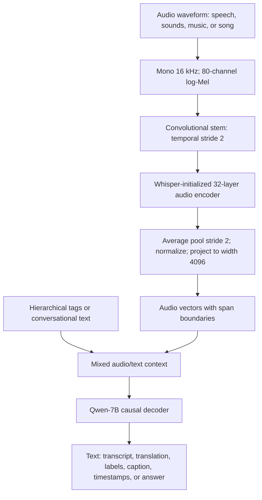
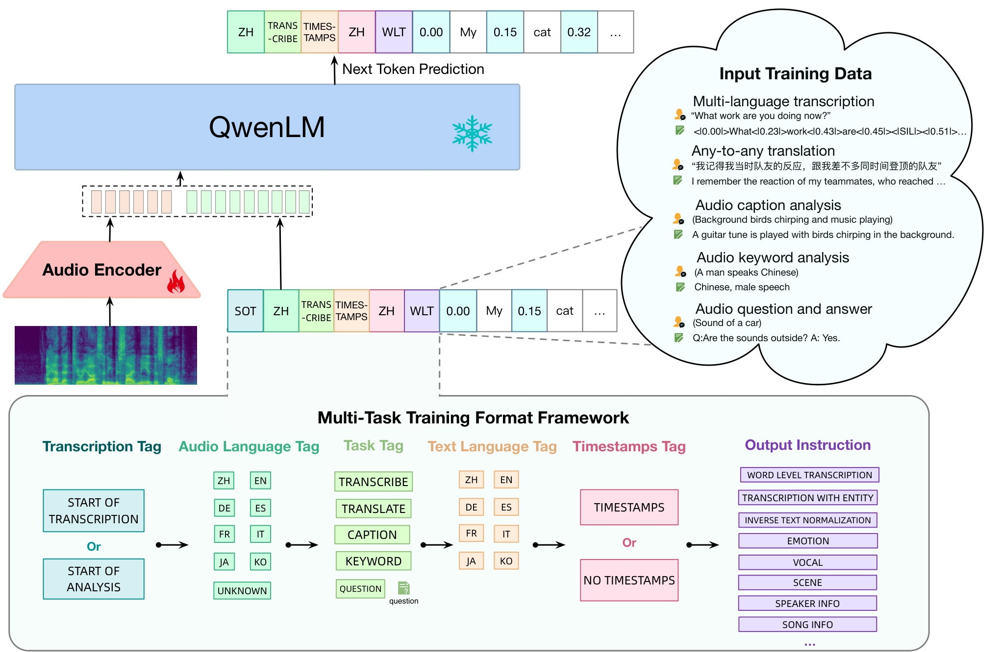
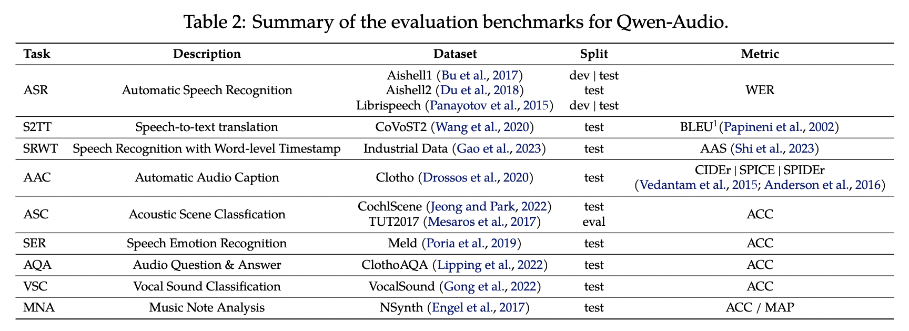
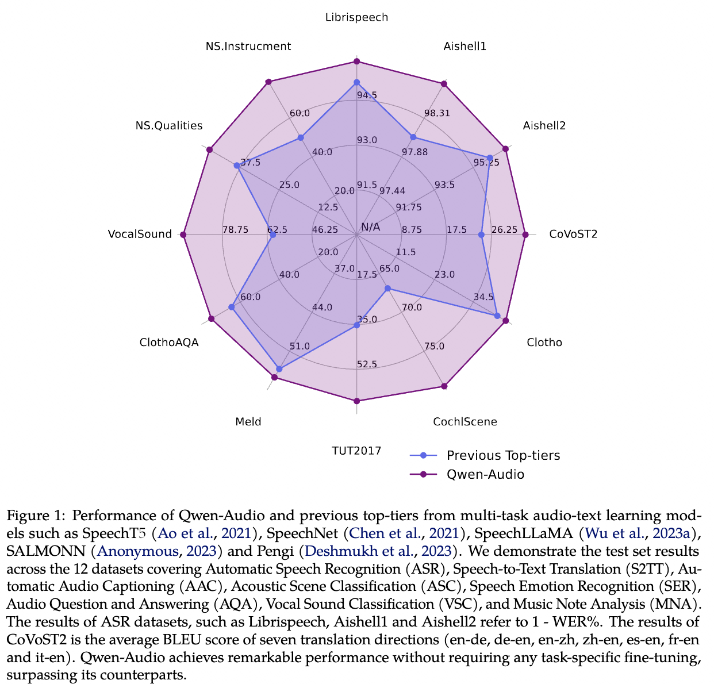
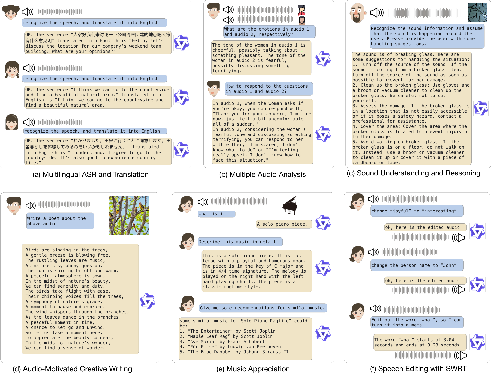

# Qwen-Audio: Universal Audio Understanding through a Unified Audio-Language Model - Xu et al., 2023

> **arXiv:** 2311.07919v2 (21 December 2023; first submitted 14 November 2023) · **Venue:** preprint · **Affiliation:** Alibaba Group

## TL;DR

Qwen-Audio connects a Whisper-large-v2-initialized audio encoder to Qwen-7B and trains it on **over 30 tasks** spanning speech, environmental sounds, music, and songs. Its distinguishing contribution is a **hierarchical task-tag format** that separates otherwise conflicting descriptions of the same recording while sharing conditioning tokens across related tasks. Multi-task pretraining trains the audio encoder with the LLM frozen; a second stage freezes the audio encoder and instruction-tunes the LLM to produce Qwen-Audio-Chat. Word-level timestamp supervision improves not only transcription but also sound and music question answering; the system accepts audio and text and **generates text**, not native speech waveforms.

## Problem & motivation

A recording contains many kinds of information simultaneously. A spoken sentence has words, a language, timing, speaker characteristics, and emotion; it may also contain background sounds. A music clip has instruments, timbre, notes, genre, and expressive qualities. An assistant that can only transcribe speech cannot answer every question a user might reasonably ask about that recording.

Earlier audio-language systems often focused on a subset of these tasks or delegated them to separate specialist tools. Qwen-Audio instead asks whether one audio encoder and one language decoder can learn a broad audio interface from heterogeneous supervision ([Introduction and §3.2](https://arxiv.org/html/2311.07919v2#S3.SS2)).

The challenge is not just collecting more examples. **The mapping from audio to text is one-to-many.** For the same clip, "a dog is barking," "outdoor scene," and a timestamped bark event list could all be correct labels. Even two transcription datasets may disagree about punctuation, text normalization, or whether timestamps are included. Without conditioning on the requested task and output convention, the model must infer which valid description the training example expects.

This creates a tension:

- **Fully pooling labels encourages interference.** The model receives incompatible target strings without enough information to choose between them. Merely adding more audio does not resolve that ambiguity.
- **Treating every dataset as an unrelated task loses sharing.** A unique dataset identifier can distinguish output formats, but does not explicitly express that two datasets both teach transcription or that several tasks depend on recognizing the same underlying event.
- **Speech-centered pretraining leaves other audio capabilities underdeveloped.** Whisper offers a strong starting representation, but recognizing words alone does not teach music analysis or environmental-sound reasoning. Those tasks need direct training signals.

Qwen-Audio's answer is a unified generative interface with **shared high-level tags and specific low-level output instructions**, plus fine-grained temporal supervision. Its claim of no task-specific fine-tuning means that the single multi-task checkpoint is evaluated directly; it does **not** mean all evaluated task families were absent from training.

## Key idea

**Make the intended interpretation and output format part of the autoregressive sequence.** The encoder supplies audio embeddings, while a structured sequence specifies whether to transcribe or analyze, which language is present, what task to perform, which language to answer in, whether to produce timestamps, and which output convention to follow.

The paper's next-token formulation is:

$$
p_{\theta}\!\left(x_t\mid x_{<t},
\operatorname{Encoder}_{\phi}(a)\right).
$$

Here $a$ is an audio sequence, $x_t$ the next textual or control token, $x_{<t}$ the preceding sequence, $\phi$ the audio-encoder parameters, and $\theta$ the LLM parameters (paper Equation 1). Which parameters are trainable changes between stages.

Writing the conditioning structure explicitly gives:

$$
c=(c_{\mathrm{mode}},c_{\mathrm{audio\mbox{-}lang}},
c_{\mathrm{task}},c_{\mathrm{text\mbox{-}lang}},
c_{\mathrm{time}},c_{\mathrm{format}}),
\qquad
p(y\mid a,c)=\prod_{t=1}^{T}
p(y_t\mid y_{<t},c,\operatorname{Encoder}_{\phi}(a)).
$$

$c$ is the structured task context, $y=(y_1,\ldots,y_T)$ the requested output, and $T$ its length. The six components denote the transcription/analysis mode, audio language, task, output language, timestamp policy, and final output instruction. This second equation is an explanatory factorization of the design, not an additional numbered equation from the paper.

The important idea is **factorization of task identity**, not just a larger list of task IDs. Shared tags let related tasks reuse learned behavior, while more specific instructions distinguish annotation conventions. Some tags, such as audio language, can themselves be prediction targets; the formulation does not imply that every tag must always be supplied as oracle information by a user.

## How it works

### 1. Architecture: one audio encoder and one language decoder

| Module | Initialization and scale | Function |
|---|---|---|
| Audio encoder | Whisper-large-v2; 32 Transformer layers; approximately 640M parameters in §3.1 | Converts a log-Mel spectrogram into temporally ordered continuous audio representations. It is adapted across speech, sounds, and music during pretraining. |
| Temporal reduction and projection | Additional stride-two pooling and a learned projection | Reduces the number of audio vectors entering the LLM and maps their width to the language embedding space. In the release, these operations are implemented inside the audio encoder. |
| Language decoder | Qwen-7B; 32 layers, hidden width 4096, approximately 7.7B parameters in §3.1 | Consumes audio vectors together with control tokens and text, then autoregressively generates labels, descriptions, timestamps, or conversational answers. |

The approximate module counts imply a system larger than its "7B" language-backbone label, but the paper does not provide a separate exact total that accounts for every added parameter. Whisper's **audio encoder** initializes the audio path; the model does not retain Whisper's original text decoder as a second recognition stage.

Unlike [Qwen-VL](multimodal_2023_qwen-vl.md), this architecture does not use a fixed set of 256 learned queries to resample each input. Its visual counterpart uses a position-aware cross-attention adapter; Qwen-Audio instead retains a **duration-dependent temporal sequence**, reduces it by pooling, and projects it into the LLM width.

### 2. Waveform to log-Mel input

The paper specifies mono-compatible audio preprocessing at **16 kHz**, **80 Mel channels**, a **25 ms analysis window**, and a **10 ms hop** (§3.1). The released [`audio.py`](https://huggingface.co/Qwen/Qwen-Audio/blob/main/audio.py) makes the corresponding constants explicit:

| Quantity | Released value | Interpretation |
|---|---|---|
| Sampling rate | 16,000 samples/s | Incoming audio is decoded, downmixed to mono, and resampled before feature extraction. |
| FFT/window size | 400 samples | This corresponds to 25 ms at the model's sampling rate. |
| Hop length | 160 samples | Consecutive spectrogram frames are spaced by 10 ms. |
| Mel filter count | 80 | Each frame is represented by 80 frequency-band values. |
| Per-input audio window | 30 seconds | The released tokenizer pads short clips and trims longer ones to this window; this is not automatic long-recording transcription. |

For a waveform $a$, the released feature extraction can be summarized as:

$$
P=\left|\operatorname{STFT}(a)\right|^2,\qquad
M=F_{\mathrm{mel}}P,
$$

$$
G=\log_{10}\!\left(\max(M,10^{-10})\right),\qquad
\widetilde{M}=
\frac{\max(G,\max(G)-8)+4}{4}.
$$

$P$ is the power spectrogram computed with a Hann window, $F_{\mathrm{mel}}$ the fixed 80-band Mel filterbank, $M$ the Mel power representation, $G$ its stabilized base-10 logarithm, and $\widetilde{M}$ the normalized log-Mel input. Maximum and clipping operations are elementwise except for the global maximum used to set the dynamic-range floor. These equations reconstruct the released preprocessing; the paper itself gives the window, hop, and Mel-channel choices rather than spelling out this normalization formula.

SpecAugment is applied during training (§3.1), with the **LibriSpeech Basic** policy named in Table 6. It augments spectrograms rather than creating a second audio modality.

### 3. Temporal encoder, pooling, and shapes

Let a batch of spectrograms be $\widetilde{M}\in\mathbb{R}^{B\times80\times F}$, where $B$ is batch size and $F$ is the valid frame count. The released [configuration](https://huggingface.co/Qwen/Qwen-Audio/blob/main/config.json) uses audio width $d_a=1280$, 20 attention heads, 32 layers, and a positional capacity of 1500 frames after convolution.

The computation is:

1. **Convolutional stem.** Apply a kernel-three, stride-one 1D convolution from 80 to 1280 channels, GELU, then a kernel-three, stride-two convolution and another GELU. Both convolutions use padding one. Only the second convolution halves the temporal rate.
2. **Positional encoding and Transformer.** Transpose to a time-major feature sequence, add sinusoidal positions, and apply the 32 audio Transformer blocks. Padding masks prevent shorter clips from attending to padded audio positions.
3. **Temporal pooling.** Apply average pooling with kernel and stride two along time.
4. **Normalize and project.** Apply the encoder's final LayerNorm and a learned linear map from 1280 to 4096 dimensions.
5. **Represent the audio span.** The released encoder adds learned beginning/end audio vectors around the valid projected sequence. Those vectors occupy reserved audio-span positions in the LLM input.

For the standard convolution and pooling settings, the valid lengths are:

$$
F'=\left\lceil\frac{F}{2}\right\rceil,\qquad
K=\left\lfloor\frac{F'}{2}\right\rfloor,
$$

$$
H=f_\phi(\widetilde{M})\in\mathbb{R}^{B\times F'\times1280},
\qquad
Z=\operatorname{LN}\!\left(\operatorname{AvgPool}_2(H)\right)W+b
\in\mathbb{R}^{B\times K\times4096}.
$$

$F'$ is the post-convolution length, $K$ the post-pooling length, $H$ the Transformer output, and $W\in\mathbb{R}^{1280\times4096}$ and $b$ the projection parameters. The pooling is temporal, not a query-based attention bottleneck.

A full 30-second clip produces approximately **3000 Mel frames, 1500 encoder frames, and 750 projected audio vectors**, plus two boundary vectors. These are derived from the released preprocessing and length formulas, not benchmark measurements. Shorter clips use their valid lengths even though feature extraction initially pads to the standard window.

The temporal rate is approximately **one LLM-facing audio vector per 40 ms** (§3.1). This is the representation spacing, not a promise of 40 ms timestamp accuracy: the model predicts timestamps from the representations and its actual error must be measured separately.

### 4. Data flow



This diagram reconstructs the shared forward path. During multi-task pretraining the audio encoder is trainable and Qwen is frozen; during instruction tuning those roles reverse.



*Paper Figure 3: the same model handles different audio tasks by changing the tag sequence and requested output format. The snowflake on Qwen applies to the pretraining stage, not to the subsequent chat-tuning stage.*

### 5. Hierarchical tags resolve output ambiguity

Section 3.2 describes six kinds of conditioning, in the following order. Figure 3 provides a schematic visualization; literal token spellings should be checked against the released tokenizer when reproducing inference.

| Field | Paper's meaning | Why it is needed |
|---|---|---|
| Transcription versus analysis mode | A start-of-transcription marker for speech transcription/translation; a start-of-analysis marker for other tasks | Establishes whether the output should preserve linguistic content or describe another property of the recording. This avoids treating all audio understanding as transcription. |
| Audio language | A language tag, or an unknown-language marker for non-speech input | Separates the language spoken in the recording from the language requested for the answer. Section 3.2 also describes training the model to predict unknown for non-speech. |
| Task | Transcribe, translate, caption, analysis, or question-answer; questions are appended for QA | Shares high-level behavior across datasets while making the desired target family explicit. The same recording can legitimately receive several different task labels. |
| Output-text language | A separate language marker for the generated text | Allows transcription and translation to be distinguished even when the audio is identical. It also supports descriptions in a language other than the spoken one. |
| Timestamp policy | With timestamps or without timestamps | Distinguishes plain text from temporally grounded output. A transcript with word boundaries is not the same target string as a plain transcript. |
| Final output instruction | Specifies details such as word-level transcription, normalization, entities, emotion, scene, or song information | Separates subtasks and annotation conventions that remain different after the broader tags are fixed. These instructions retain format specificity without isolating every dataset from all others. |

The eight audio languages shown in Figure 3 are **Chinese, English, German, Spanish, French, Italian, Japanese, and Korean**. An unknown tag is used when spoken language is not applicable. This training-language set should not be confused with the seven translation directions reported in Table 3.

**Paper notation versus executable tokens.** Section 3.2 writes `<|startoftranscripts|>` in the plural, whereas the released [`tokenization_qwen.py`](https://huggingface.co/Qwen/Qwen-Audio/blob/main/tokenization_qwen.py) registers the singular `<|startoftranscript|>`. The prose also uses conceptual analysis/question-answer categories, while the released tokenizer includes tokens such as `<|keyword|>` and specific output-instruction tags. A faithful explanation should preserve the paper's hierarchy without suggesting that every conceptual category name is a callable special token.

For example, a schematic English transcription prefix using registered token spellings is:

```text
<|startoftranscript|><|en|><|transcribe|><|en|><|notimestamps|>
```

The audio embeddings precede or accompany this decoder context, followed by the target transcript. Additional output-instruction tokens depend on the selected subtask; this schematic prefix is not a complete universal inference template.

### 6. Word-level timestamps as grounding supervision

The **SRWT** task asks the model to recognize words and predict their boundaries together. Section 3.2 describes a start-time token before each transcription unit and an end-time token after it; a schematic sequence is:

```text
<|timestamps|><|0.00|>hello<|0.32|><|0.32|>world<|0.71|>
```

The words and times here are illustrative. Real text tokenization may split a written word into multiple subword tokens, so reproducing word-level supervision requires the dataset's alignment/serialization convention, not an assumption that each word is one BPE token.

The released tokenizer reserves **3001 timestamp tokens from 0.00 to 30.00 seconds at 0.01-second intervals**. This 10 ms vocabulary spacing is distinct from the approximately 40 ms audio-embedding spacing and from measured alignment error. It does not imply that every prediction is accurate to 10 ms.

This supervision supports questions such as locating when a named person is mentioned. More broadly, it provides pressure to associate parts of the text with parts of the signal rather than only matching a global clip label. Section 4.5 tests whether that pressure transfers to other tasks by removing SRWT while retaining the underlying audio through the ASR data.

### 7. From tagged tasks to conversation

The base model exposes the capabilities learned through structured multi-task targets. Qwen-Audio-Chat is then trained to respond to ordinary user instructions and maintain a dialogue containing audio and text.

Section 3.3 labels recordings with `"Audio id:"` and uses ChatML role boundaries. A schematic two-audio interaction is:

```text
<|im_start|>user
Audio 1: <audio>first-recording.wav</audio>
Audio 2: <audio>second-recording.wav</audio>
How do the background sounds differ?<|im_end|>
<|im_start|>assistant
...
```

Paths identify inputs for preprocessing; the forward pass consumes their encoded audio, not just their names. Each recording contributes its own continuous vector sequence, so multi-audio context cost grows with total valid duration.

The released configuration specifies a 2048-position language context. A full 30-second audio span consumes approximately 752 positions before ordinary text and dialogue wrappers are counted. This makes multiple audio inputs possible, but does not provide unbounded audio history or continuous streaming support.

## Training / data

### Objective and staged optimization

The common training objective is next-token prediction conditioned on audio. One useful explicit loss is:

$$
\mathcal{L}(\theta,\phi)=
-\sum_{t\in\mathcal{S}}
\log p_\theta\!\left(x_t\mid x_{<t},
\operatorname{Encoder}_\phi(a)\right).
$$

$\mathcal{S}$ denotes the positions supervised in a training example, including the relevant textual/control targets, and all other symbols follow Equation 1. This loss notation makes conditioning distinct from targets; the report does not enumerate every per-template loss mask or fully specify the placement of every generated versus supplied tag.

| Stage | Trainable component | Frozen component | Result |
|---|---|---|---|
| Multi-task pretraining | Audio encoder, including the released encoder-side pooling/projection path | Qwen-7B LLM | Qwen-Audio: a shared model for the tagged audio tasks |
| Supervised instruction tuning | LLM | Pretrained audio encoder | Qwen-Audio-Chat: natural-language, multi-turn audio interaction |

*Source: §4.1; implementation placement of projection/pooling from the released audio encoder.*

Unlike Qwen-VL's recipe, the report does **not** insert an intermediate end-to-end phase where both large backbones train together. In pretraining, gradients still pass through the frozen decoder to the encoder's audio inputs; freezing decoder weights is not equivalent to cutting the computational graph at the audio embeddings.

### Multi-task corpus: what is actually included

Table 1 lists task-specific audio hours rather than a complete public dataset manifest. The larger speech and sound categories are:

| Audio family / task | Hours in Table 1 | Training role |
|---|---|---|
| Multilingual ASR | 30K | Teaches recovery of linguistic content from speech across languages. |
| Speech-to-text translation | 3.7K | Connects source-language speech to target-language text rather than merely repeating source words. |
| Dialect ASR | 2K | Provides speech-recognition supervision for dialectal variation. |
| English / Mandarin SRWT | 10K / 11K | Adds word-level temporal alignment to recognized speech. These task hours must not be assumed disjoint from ASR audio. |
| Dialect identification / language identification | 2K / 11.7K | Teaches properties of the speech signal through classification-like textual outputs. |
| Speaker-gender classification / speaker-age prediction | 4.8K / 4.8K | Adds dataset-defined speaker-attribute labels. These labels are not proof that identity or personal attributes can be reliably inferred from arbitrary voices. |
| Speaker verification | 1.2K | Adds supervision about whether speech segments match a speaker. |
| Automatic audio captioning | 8.4K | Teaches descriptions of environmental sound beyond speech content. |
| Sound-event classification | 5.4K | Maps non-speech events to category labels. |
| Music captioning | 25K | Supplies descriptive language for musical audio. |
| Music-genre recognition | 9.5K | Adds music-category supervision distinct from free-form description. |

*Source for every hour count: Table 1.*

The same table lists each of the following at **less than 1K hours**: overlapped speech recognition, emotion recognition, speaker diarization, speech entity recognition, keyword spotting, intent classification, slot filling, vocal-sound classification, acoustic-scene classification, timestamped sound-event detection, audio QA, singer identification, singer/music emotion recognition, instrument classification, note analysis, music recognition, and music QA. These are separate supervision types, not a single shared less-than-1K-hour pool.

The table's granularity and language/subtask expansion explain the abstract's "over 30 tasks" characterization. It would be misleading to sum the rows and call the result a deduplicated number of unique training hours: the paper explicitly states that SRWT and ASR share audio (§4.5), and other overlap is not exhaustively documented.

### Instruction data

Section 3.3 reports **20K instruction-tuning examples**. The authors manually create demonstrations for tasks using labels, questions, and answers, then use GPT-3.5 to expand questions/answers from those labels. Additional audio-dialogue data comes from manual annotation, model generation, and strategy concatenation.

Audio-centric examples are mixed with pure-text instructions so the model can converse both with and without recordings. The multi-audio labeling convention provides references to particular clips across turns. Label-derived synthesis offers scalable instruction data, but the report does not supply a complete breakdown or a controlled study of synthetic-answer errors.

### Hyperparameters and execution settings

| Hyperparameter | Multi-task pretraining | Supervised instruction tuning |
---|---|---|
| Audio initialization | Whisper-large-v2 | Stage-one audio encoder |
| LLM initialization | Qwen-7B | Qwen-7B; its weights were frozen during stage one |
| Peak learning rate | $5\times10^{-5}$ | $10^{-5}$ |
| Minimum learning rate | $10^{-5}$ | $10^{-6}$ |
| Audio-encoder layer-wise LR decay | 0.95 | Frozen |
| Training steps | 500K | 8K |
| Warmup steps | 2000 | 3K |
| Global batch size | 120 | 128 |
| Gradient accumulation | 1 | 8 |
| Model-parallel degree | None reported | 2 |

*Source: Appendix A, Table 6. The global batch is not an additional microbatch count to multiply by the accumulation factor.*

Both stages use AdamW with $\beta_1=0.9$, $\beta_2=0.98$, $\epsilon=10^{-6}$, cosine decay, weight decay 0.05, gradient clipping at 1.0, and bfloat16 precision. Table 6 reports optimizer sharding, no activation checkpointing, and no pipeline parallelism. It names the LibriSpeech Basic SpecAugment policy for both stages, even though the audio encoder is frozen during SFT.

The report does not give a complete GPU-hour budget, a deduplicated corpus manifest, exact mixture/sampling weights for all tasks, or every alignment-label construction detail. The model architecture and many optimization settings are available, but these omissions prevent exact end-to-end training replication from the paper alone.

## Results

### Evaluation scope and metrics

The main quantitative evaluation is of the **base Qwen-Audio** checkpoint, not a demonstration that Qwen-Audio-Chat preserves every base score. Section 4.2 describes evaluation over 12 datasets and exclusion of evaluation data from training. This should be read as held-out evaluation, not a claim that all training portions of those benchmark families were forbidden: the system is explicitly multi-task trained.



*Paper Table 2, downloaded from the official repository's evaluation asset: the suite spans speech, scene and vocal classification, captions, emotion, QA, and musical-note properties. WER, BLEU, caption metrics, accuracy, MAP, and alignment error have different scales and cannot be combined into one meaningful average.*



*Paper Figure 1, downloaded from the official repository: the radar summarizes breadth rather than a single shared metric. The authors transform ASR results to a higher-is-better representation and average seven translation directions for the CoVoST2 axis; axis scales differ. The tables below retain the original metrics and identify the comparison models.*

### Speech recognition

| Benchmark / split | Qwen-Audio | Baseline reported in Table 3 | Metric / source |
|---|---|---|---|
| LibriSpeech dev-clean / dev-other | 1.8 / 4.0 | SpeechT5: 2.1 / 5.5 | WER, lower is better; Table 3 |
| LibriSpeech test-clean / test-other | 2.0 / 4.2 | SALMONN: 2.1 / 4.9; SpeechT5: 2.4 / 5.8 | WER; Table 3 |
| AISHELL-1 dev / test | 1.2 / 1.3 | MMSpeech-large: 1.6 / 1.9 | Table 3's WER labeling |
| AISHELL-2 Mic / iOS / Android | 3.3 / 3.1 / 3.3 | MMSpeech-base: 4.5 / 3.9 / 4.0 | Table 3's WER labeling |
| AISHELL-2 iOS | 3.1 | Paraformer-large: 2.9 | WER as reported; Table 3 |

The English test results improve over the listed contemporary multi-task baselines. The last row is a useful counterexample to a blanket "best on every split" interpretation: the paper reports a better AISHELL-2 iOS number for Paraformer-large. Chinese recognition metrics are reproduced using the paper's WER label rather than silently relabeled to another error-rate convention.

### Speech-to-text translation

| CoVoST2 direction | Qwen-Audio | Comparator | Source |
|---|---|---|---|
| English to German | 25.1 | SALMONN: 18.6; BLSP: 14.1 | Table 3; BLEU, higher is better |
| German to English | 33.9 | SpeechLLaMA: 27.1 | Table 3; BLEU |
| English to Chinese | 41.5 | SALMONN: 33.1 | Table 3; BLEU |
| Chinese to English | 15.7 | SpeechLLaMA: 12.3 | Table 3; BLEU |
| Spanish to English | 39.7 | SpeechLLaMA: 27.9 | Table 3; BLEU |
| French to English | 38.5 | SpeechLLaMA: 25.2 | Table 3; BLEU |
| Italian to English | 36.0 | SpeechLLaMA: 25.9 | Table 3; BLEU |

Table 2 points to SacreBLEU for translation evaluation. These comparisons cover the seven reported directions, not every possible pair among the eight training languages, and not speech-to-speech translation.

### Environmental sounds, emotion, vocals, and music

| Task / dataset | Qwen-Audio | Comparator | Metric / source |
|---|---|---|---|
| Audio captioning, Clotho | 0.441 / 0.136 / 0.288 | Pengi: 0.416 / 0.126 / 0.271 | CIDEr / SPICE / SPIDEr; Table 3 |
| Scene classification, CochlScene | 0.795 | CochlScene baseline: 0.669 | Accuracy; Table 3 |
| Scene classification, TUT2017 | 0.649 | Pengi: 0.353 | Accuracy; Table 3 |
| Speech emotion, MELD | 0.557 | WavLM-large: 0.542 | Accuracy; Table 3 |
| Audio QA, ClothoAQA | 0.579 / 0.749 | Dataset baseline: 0.542 / 0.627; Pengi binary: 0.645 | Overall / binary accuracy; Table 3 |
| Vocal classification, VocalSound | 0.9289 | Pengi: 0.6035; CLAP: 0.4945 | Accuracy; Table 3 |
| NSynth qualities | 0.4742 | Pengi: 0.3860 | MAP; Table 3 |
| NSynth instrument | 0.7882 | Pengi: 0.5007 | Accuracy; Table 3 |

Accuracy and MAP are retained on the paper's fractional scale rather than mixed with percentage-form ASR numbers. The results demonstrate that Whisper initialization does not confine the adapted encoder to words: the final model also learns strong non-speech representations under direct task supervision.

However, a music-note or instrument result does not establish unrestricted long-form music understanding. NSynth's isolated-note properties and open-ended musical appreciation are different evaluation targets.

### Timestamp alignment and the SRWT ablation

For word-level alignment on industrial data, Table 3 reports **51.5 ms AAS** for Qwen-Audio, versus **65.3 ms** for Paraformer-large-TP and **60.3 ms** for a forced aligner. Lower is better. The table explicitly distinguishes the setups: the forced aligner receives ground-truth transcripts, whereas Qwen-Audio and Paraformer generate both the transcript and timing. It is not an identical-input comparison.

Section 4.5 removes the SRWT objective while keeping the other tasks, including ASR on the underlying audio, unchanged. This makes the ablation more informative than removing an entire collection of recordings.

| ASR split | Without SRWT | With SRWT: Qwen-Audio | Source |
|---|---|---|---|
| LibriSpeech dev-clean | 1.93 | 1.79 | Table 4; lower error is better |
| LibriSpeech dev-other | 4.18 | 4.00 | Table 4 |
| LibriSpeech test-clean | 2.22 | 2.04 | Table 4 |
| LibriSpeech test-other | 4.21 | 4.19 | Table 4 |
| AISHELL-1 dev | 1.54 | 1.22 | Table 4 |
| AISHELL-1 test | 1.71 | 1.29 | Table 4 |

Table 4 reports more precision than Table 3, so its values should not be replaced with the rounded headline results when analyzing this ablation.

| QA benchmark | Without SRWT | With SRWT: Qwen-Audio | Source |
|---|---|---|---|
| ClothoAQA test | 0.5648 | 0.5795 | Table 5; accuracy |
| ClothoAQA binary test | 0.7418 | 0.7491 | Table 5; accuracy |
| MusicAVQA audio questions | 0.7027 | 0.7211 | Table 5; accuracy |

The ablation supports the narrower conclusion that fine-grained timestamp supervision is useful in this training setup and transfers beyond speech recognition. It does not prove that all non-speech improvements are caused solely by explicit temporal grounding, nor that hierarchical tags alone account for the full model's advantage.

### Conversational examples, not a numerical chat leaderboard



*Paper Figure 2 (§4.4): selected examples illustrate interaction types, not a systematic chat success rate. The speech-editing panel should not be read as evidence that the audio-language model directly synthesizes the edited waveform.*

The paper's chat evaluation is qualitative. Examples include translating speech, comparing emotional tone across recordings, explaining environmental sounds, writing text inspired by audio, and discussing music. These show the intended interface, but there is no comprehensive numerical base-versus-chat comparison or large-scale measurement of conversational reliability.

The model's own output modality is text. Word-level grounding can supply locations to an editing workflow, and an external tool can manipulate or synthesize a waveform; that is different from adding a native acoustic decoder to Qwen-Audio.

## Limitations & follow-ups

- **Long recordings require additional handling.** The released tokenizer trims each input to a 30-second window and the LLM context is finite. Multi-audio support does not mean that arbitrary-length recordings are fully processed, and the report does not describe a production streaming/chunk-reconciliation algorithm.
- **Universal understanding is an aspiration, not exhaustive coverage.** The report covers many task types and diverse audio, but only eight training languages are identified in the format description and a limited set of benchmarks is evaluated. Noise, uncommon acoustic conditions, music domains, and language transfer outside that coverage require separate testing.
- **The complete training run is not reproducible from the report alone.** Task hours and optimizer settings are useful, but dataset provenance, deduplication, mixture weights, some timestamp-label construction details, and total compute are incomplete. The reported hours are not a verified unique-audio total.
- **A hierarchy is not a hard guarantee of consistency.** Tags distinguish output targets, but generated labels, timestamp sequences, and natural-language explanations can still be wrong or inconsistent. Neither a timestamp vocabulary nor a structured prompt enforces correct alignment by itself.
- **Temporal precision has several meanings.** Spectrogram hops, encoder/pooling spacing, timestamp-token spacing, and measured timing error are different quantities. A fine output vocabulary must not be advertised as equally fine observed localization accuracy.
- **Instruction-following evidence is primarily qualitative.** The report does not establish that Qwen-Audio-Chat retains every base recognition score, consistently obeys multi-audio references, or gives calibrated answers to uncertain acoustic questions.
- **Some labels require especially careful interpretation.** Emotion and speaker-attribute datasets encode particular annotation conventions. Aggregate accuracy does not establish reliable inference about a person's internal state or personal characteristics from arbitrary audio.
- **There is no native audio generation.** The model generates text about audio and can support tool-mediated workflows. It is not an any-to-any speech model, an audio codec generator, or evidence of direct waveform editing.

The predecessor most directly reused is [Whisper](https://arxiv.org/abs/2212.04356); [Qwen](backbone_2023_qwen.md) supplies the language decoder. [Qwen-VL](multimodal_2023_qwen-vl.md) is a useful sibling comparison for modality-specific encoding and staged adaptation, but its query adapter and three-stage recipe are not part of Qwen-Audio.

[Qwen2-Audio](multimodal_2024_qwen2-audio.md) is the direct audio-language successor. [Qwen2.5-Omni](multimodal_2025_qwen2.5-omni.md) subsequently addresses a broader multimodal input/output setting; those later capabilities should not be attributed retrospectively to this 2023 system.

## Links

- **arXiv:** [abstract](https://arxiv.org/abs/2311.07919v2) · [HTML](https://arxiv.org/html/2311.07919v2) · [PDF](https://arxiv.org/pdf/2311.07919v2)
- **Code:** [official Qwen-Audio repository](https://github.com/QwenLM/Qwen-Audio)
- **Hugging Face:** [Qwen-Audio](https://huggingface.co/Qwen/Qwen-Audio) · [Qwen-Audio-Chat](https://huggingface.co/Qwen/Qwen-Audio-Chat) · [demo](https://huggingface.co/spaces/Qwen/Qwen-Audio)
- **Project page:** [Qwen-Audio project and demonstrations](https://qwen-audio.github.io/Qwen-Audio/)
- **Implementation details:** [configuration](https://huggingface.co/Qwen/Qwen-Audio/blob/main/config.json) · [audio encoder and preprocessing](https://huggingface.co/Qwen/Qwen-Audio/blob/main/audio.py) · [audio spans and special tokens](https://huggingface.co/Qwen/Qwen-Audio/blob/main/tokenization_qwen.py). These live files supplement the version-pinned paper; their `main` revisions are not pinned here.
- **Figure sources:** [paper Figure 3](https://arxiv.org/html/2311.07919v2/framework.png) · [paper Figure 2](https://arxiv.org/html/2311.07919v2/demo.png) · [official Figure 1 asset](https://github.com/QwenLM/Qwen-Audio/blob/main/assets/radar_new.png) · [official Table 2 asset](https://github.com/QwenLM/Qwen-Audio/blob/main/assets/evaluation.png)
- **Blog posts:** [official repository news and release notes](https://github.com/QwenLM/Qwen-Audio#news-and-updates)
- **Talks / videos:** Not used as a source for this recap.
- **OpenReview / venue page:** Not used as a source for this recap.
- **Papers-with-Code:** [linked recognition benchmark entry](https://paperswithcode.com/sota/speech-recognition-on-aishell-1?p=qwen-audio-advancing-universal-audio); not used for the numerical tables above.
- **Related / successor papers:** [Qwen backbone](backbone_2023_qwen.md) · [Qwen-VL](multimodal_2023_qwen-vl.md) · [Whisper](https://arxiv.org/abs/2212.04356) · [Qwen2-Audio](multimodal_2024_qwen2-audio.md) · [Qwen2.5-Omni](multimodal_2025_qwen2.5-omni.md)
- **Context:** [Qwen family overview](../qwen/overview.md)
- **BibTeX:**

```bibtex
@article{xu2023qwenaudio,
  title = {{Qwen-Audio}: Advancing Universal Audio Understanding via
           Unified Large-Scale Audio-Language Models},
  author = {Xu, Jin and Zhou, Xiaohuan and Yang, Qian and Zhang, Shiliang
            and Yan, Zhijie and Zhou, Chang and Zhou, Jingren},
  journal = {arXiv preprint arXiv:2311.07919},
  year = {2023},
  url = {https://arxiv.org/abs/2311.07919v2}
}
```
