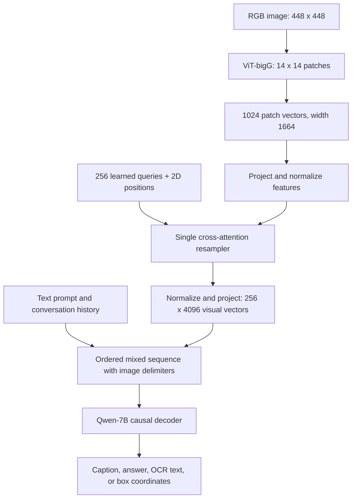
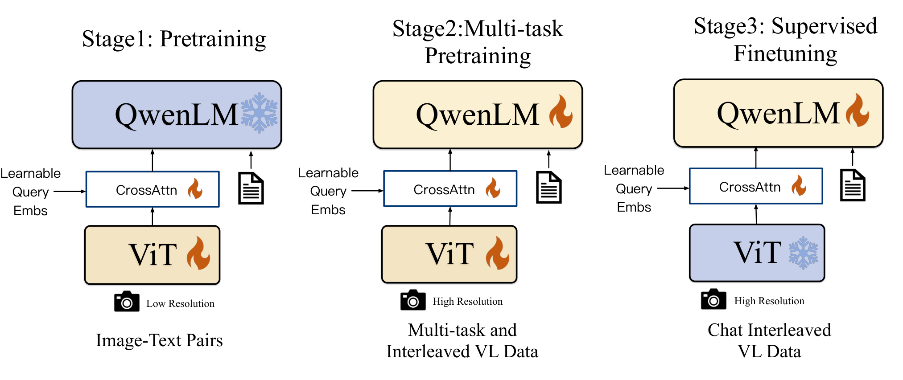
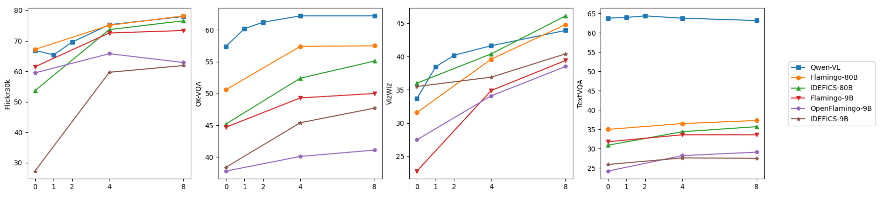
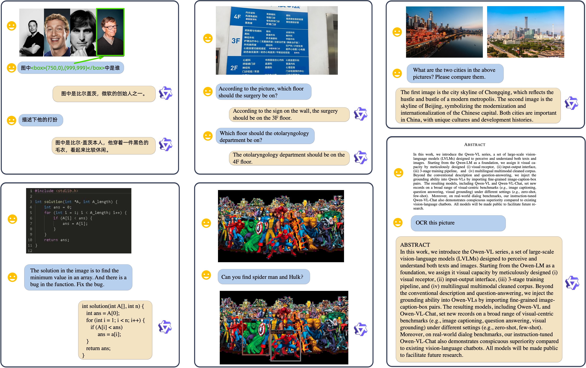

# Qwen-VL: Understanding, Localization, Text Reading, and Beyond - Bai et al., 2023

> **arXiv:** 2308.12966v3 (13 October 2023; first submitted 24 August 2023) · **Venue:** preprint (this arXiv version) · **Affiliation:** Alibaba Group

## TL;DR

Qwen-VL turns a Qwen-7B language model into a vision-language generalist by combining an OpenCLIP ViT-bigG image encoder with a **single, position-aware cross-attention adapter producing 256 visual tokens per image**. Its central contribution is the combination of that spatially informed interface with a large English/Chinese training corpus and a three-stage recipe: visual alignment with a frozen LLM, high-resolution end-to-end multi-task training, and instruction tuning with a frozen vision encoder. The resulting Qwen-VL handles captioning, visual question answering, OCR, and referring-expression grounding through text generation; Qwen-VL-Chat adds multi-turn, multi-image conversation. The released system is approximately **9.6B parameters overall**, not a 7B-parameter multimodal model (Table 1).

## Problem & motivation

Early open vision-language assistants often connected a pretrained image encoder to an LLM and concentrated on image descriptions or conversational instructions. This established a useful interface, but did not automatically produce reliable reading of small text, document understanding, or localization of the particular object mentioned in a question. A broad scene summary can be sufficient for "What is happening?", yet inadequate for "What does this sign say?" or "Which box contains the person on the right?"

Qwen-VL addresses three coupled bottlenecks ([Introduction and §2](https://arxiv.org/html/2308.12966v3#S2)):

- **Image detail versus decoder cost.** Increasing resolution improves the evidence available for OCR and small objects, but feeding every patch directly to an LLM consumes a large context budget. With 14-pixel patches, moving from a 224-by-224 image to 448-by-448 increases the patch sequence from 256 to 1,024 tokens. The adapter holds the decoder-side image representation at 256 tokens while allowing the vision encoder to inspect the denser grid.
- **Compression versus spatial information.** A generic pooled image summary can lose where evidence came from. Grounding needs a representation that retains enough positional structure to associate a noun phrase with coordinates. Qwen-VL adds two-dimensional positional information to both sides of the adapter's query-key interaction rather than relying only on semantic matching.
- **Alignment versus useful task supervision.** Web captions provide scale, but not sufficient supervision for boxes, document text, or dialogue. The recipe therefore separates broad visual alignment from high-resolution, task-specific learning and then conversational tuning. The freeze schedule changes deliberately: the image encoder is not kept frozen throughout.

The comparison with [BLIP-2](multimodal_2023_blip2-qformer.md) is instructive. BLIP-2 uses a multi-layer Q-Former and multiple representation-learning objectives to bridge frozen backbones. Qwen-VL instead uses a shallow resampler and text-generation supervision, then trains both backbones jointly during its second stage. Its results should therefore not be attributed to the adapter alone: data scale, resolution, grounding/OCR supervision, and end-to-end adaptation all change together.

## Key idea

**Make an image a compact, spatially informed sequence in the language model's embedding space, and make every supported output a text sequence.** The image encoder extracts dense features; learned visual queries gather them into a fixed-size representation; a causal decoder consumes those visual vectors together with text. A bounding box is generated as coordinate text, so grounding does not require a separate detection head.

The overall computation can be written as:

$$
X=f_{\mathrm{ViT}}(I), \qquad
Z=g_{\mathrm{adapter}}(X), \qquad
p_\theta(y\mid I,u)
=\prod_{t=1}^{T}p_\theta(y_t\mid Z,u,y_{<t}).
$$

Here $I$ is an input image, $X$ its patch-feature sequence, $Z$ the 256 visual embeddings, $u$ the textual instruction or conversational context, $y=(y_1,\ldots,y_T)$ the generated text, and $\theta$ the model parameters. For multiple images, the decoder context contains a separate $Z$ block for each image, interleaved with text in the requested order.

The position-aware attention at the heart of the adapter is:

$$
A=\operatorname{softmax}\left(
\frac{[(Q+P_Q)W_Q][(H+P_X)W_K]^\top}{\sqrt{d_h}}
\mathcal{M}
\right), \qquad
R=A(HW_V).
$$

$Q$ denotes learned query content, $H$ projected and normalized image features, $P_Q$ and $P_X$ their two-dimensional positional encodings, $W_Q,W_K,W_V$ the attention projections, $d_h$ one head's dimension, and $\mathcal{M}$ an optional attention mask. Softmax is over image positions. Position is added to queries and keys, while values carry the normalized visual content.

These equations are a mathematical reconstruction of the mechanism described in §2.1 and implemented in the released [`Resampler`](https://huggingface.co/Qwen/Qwen-VL/blob/main/visual.py), not numbered equations quoted from the paper. The next section specifies the normalizations, multi-head combination, and output projection needed to reproduce that implementation.

## How it works

### 1. Three modules, with different roles

The parameter counts below are the rounded values reported in Table 1; their rounded sum need not exactly equal the rounded total.

| Component | Initialization | Role | Reported parameters |
|---|---|---|---|
| Vision encoder | OpenCLIP ViT-bigG | Encodes a fixed-resolution image into patch features using global self-attention. It supplies the fine-grained visual evidence. | 1.9B |
| Position-aware VL adapter | Random initialization | Uses learned queries and one cross-attention layer to transform the patch grid into a fixed 256-token sequence suitable for the LLM. | 0.08B |
| Language model | Qwen-7B intermediate checkpoint | Autoregressively predicts captions, answers, coordinate strings, and conversational responses from the mixed visual/text context. | 7.7B |
| Complete system | The three components above | The same basic architecture underlies Qwen-VL and Qwen-VL-Chat; instruction tuning changes weights and behavior rather than adding a separate chat head. | 9.6B |

**An important initialization detail:** Appendix E.4 says the language backbone came from an *intermediate* Qwen-7B checkpoint because Qwen and Qwen-VL were developed concurrently. Comparisons with the final public Qwen-7B checkpoint are consequently not controlled measurements of visual-training-induced forgetting.

### 2. Image preprocessing and patch encoding

For an image batch $I\in\mathbb{R}^{B\times 3\times S\times S}$ and patch size $p=14$:

$$
N=(S/p)^2,\qquad
X=f_{\mathrm{ViT}}(I)\in\mathbb{R}^{B\times N\times d_v}.
$$

$B$ is the image batch size, $S$ the resized side length, $N$ the patch count, and $d_v$ the vision hidden width. The released [configuration](https://huggingface.co/Qwen/Qwen-VL/blob/main/config.json) uses $d_v=1664$, 48 vision blocks, and 16 vision-attention heads. Patchification is a convolution with kernel and stride 14; the sequence passed to the resampler consists of patch features rather than a single classification token.

During initial alignment, $S=224$ and $N=256$. During multi-task training, instruction tuning, and released-model inference, $S=448$ and $N=1024$ (Table 8). The released image transform converts images to RGB, resizes directly to a 448-by-448 square with bicubic interpolation, and applies channel-wise normalization with:

$$
\mu=(0.48145466,0.45782750,0.40821073),\qquad
\sigma=(0.26862954,0.26130258,0.27577711).
$$

$\mu$ and $\sigma$ are the RGB means and standard deviations applied to image values scaled to $[0,1]$. These preprocessing constants come from the released `VisionTransformer`, not from a separate experiment in the report.

The ViT adds learned absolute position embeddings to patch features and interpolates their grid when resolution changes. It uses **global attention**, not the native dynamic-resolution processing or window-attention recipe of later Qwen-VL generations. Direct square resizing can distort aspect ratios; it is not an aspect-preserving tiling pipeline.

### 3. Position-aware resampling, with explicit tensor shapes

The released adapter sets $K=256$ learned queries on a 16-by-16 positional grid. Its output width is $d_\ell=4096$, matching Qwen-7B's residual-stream width. For an image-feature tensor $X\in\mathbb{R}^{B\times N\times1664}$:

1. **Match the attention width.** Project each patch feature to 4096 dimensions with a bias-free linear layer, then apply LayerNorm:

   $$
   H=\operatorname{LN}_{kv}(XW_{kv}),\qquad
   W_{kv}\in\mathbb{R}^{1664\times4096}.
   $$

2. **Normalize learned query content.** Maintain a trainable matrix $Q_0\in\mathbb{R}^{256\times4096}$ and form $Q=\operatorname{LN}_q(Q_0)$. Repeat this query matrix over the batch. The released implementation initializes query content with truncated-normal standard deviation 0.02.

3. **Construct positional inputs.** A fixed, non-trainable two-dimensional sine/cosine encoding $P_Q\in\mathbb{R}^{256\times4096}$ locates the query grid. Bicubic interpolation of that grid gives $P_X\in\mathbb{R}^{N\times4096}$ for the patch grid. The key point is that the adapter itself is position-aware even after the ViT has already used positions.

4. **Cross-attend once.** Run multi-head attention with inputs `query = Q + P_Q`, `key = H + P_X`, and `value = H`. The adapter uses $4096/128=32$ heads of dimension 128; this is distinct from the vision encoder's 16 heads. Concatenate the per-head outputs and apply the attention output projection:

   $$
   U=\operatorname{Concat}(R_1,\ldots,R_{32})W_O
   \in\mathbb{R}^{B\times256\times4096}.
   $$

   $R_h$ is the output of head $h$ from the attention equation above, and $W_O$ combines the heads. Each head has its own query, key, and value projections.

5. **Finish the visual embedding transform.** The surrounding vision module applies a final LayerNorm and learned square projection:

   $$
   Z=\operatorname{LN}_{post}(U)W_{\mathrm{proj}},
   \qquad W_{\mathrm{proj}}\in\mathbb{R}^{4096\times4096}.
   $$

   The output is $Z\in\mathbb{R}^{B\times256\times4096}$. The released path does not add a BLIP-2-style stack of query self-attention blocks or auxiliary image-text matching/contrastive heads.

At 448 resolution the adapter reduces sequence length **4:1**, from 1,024 to 256; this is not a 4:1 compression of scalar count because the output vectors are wider. At 224 resolution it changes the representation without reducing token count. The queries are learned visual latents shared across images: they are **not conditioned on the user's question** before resampling.

### 4. Decoder input: continuous visual vectors inside a text sequence



This is a reconstruction of the data flow. Each additional image goes through the same visual path and contributes another 256-vector block.

The sequence includes image-start and image-end tokens, written as `` and `</img>` in the released interface. Inside those boundaries, image features become continuous embeddings in the LLM's input stream. An image filename or URL shown in a serialized prompt identifies the image for preprocessing; it is not a substitute for encoding its pixels.

For $m$ images and $n$ text tokens, the decoder-side context uses approximately

$$
L=n+256m+2m
$$

positions, excluding any additional dialogue wrappers or picture labels. $L$ is the total mixed-sequence length; the last term accounts for the two image delimiters per image. Resampling limits decoder cost, but the ViT still pays for all 1,024 patch positions per high-resolution image.

The released language configuration has 32 decoder layers, hidden width 4096, 32 attention heads, and untied input/output embeddings. Its `max_position_embeddings` field is 8192, while the paper's multi-task and SFT recipe uses sequences of length 2048 (Table 8). These are different facts: a configuration field is not evidence that the reported training used 8K sequences.

### 5. Grounding is structured text, not a detection head

Section 2.2 introduces delimiters for boxes and their associated referring text:

```text
<ref>the person on the right</ref><box>(650,120),(930,940)</box>
```

The numbers above are illustrative, not a paper result. The two coordinate pairs describe the top-left and bottom-right corners. The report specifies normalized coordinates in $[0,1000)$; coordinates are serialized using ordinary text tokenization, with special tokens only delimiting the structure. No dedicated vocabulary containing every possible box is required.

Conceptually, for a source image of width $W$ and height $H$, normalized coordinates are proportional to:

$$
\tilde{x}=1000\,x/W,\qquad
\tilde{y}=1000\,y/H.
$$

$x,y$ are pixel coordinates and $\tilde{x},\tilde{y}$ their normalized counterparts. This expresses the scale conversion, not an undocumented claim about the exact rounding or boundary-clamping procedure. Reproduction should follow the released preprocessing conventions at boundaries rather than infer those details from the interval notation.

The interface supports several directions of supervision:

- **Referring-expression grounding:** description in, box string out. The model must locate the region selected by the phrase.
- **Grounded captioning:** a region/box is supplied and the model describes it. This trains the reverse association between coordinates and appearance.
- **Captioning with grounding:** generated phrases are associated with one or more boxes, tying scene descriptions to specific regions.
- **OCR with grounding:** text spans are associated with quadrilateral locations. Appendix B.1 also uses `<quad>...</quad>` for four-corner OCR annotations, which should not be confused with an axis-aligned `<box>`.

All of these use autoregressive text supervision. They are not supplemented with a detector's box-regression or IoU loss in the described recipe.

### 6. Multi-image and conversational formatting

Appendix B.2 uses ChatML-style role boundaries and labels images with their order in the dialogue:

```text
<|im_start|>user
Picture 1: first-image.jpg</img>
Picture 2: second-image.jpg</img>
What changed between the two pictures?<|im_end|>
<|im_start|>assistant
...
```

The example is schematic. In the actual forward pass, the image spans are populated with the encoded visual vectors. Explicit picture labels make references to different images less ambiguous, and interleaved examples let the decoder learn how to relate separate visual blocks.

For multi-task training, Appendix B.1 distinguishes unsupervised prompt prefixes from supervised target suffixes. For SFT, Appendix B.2 supervises answers and designated special tokens, not user questions or role names. This masking matters: simply applying loss to every text token in a concatenated dialogue would not reproduce the stated objective.



*Paper Figure 3: the architecture is simple, but the trainable components change across stages. The high-resolution multi-task stage is full-model training; the final conversational stage is not.*

## Training / data

### One generative objective, different supervision masks

The report uses text-token cross-entropy rather than a separate contrastive alignment objective. A unified expression for the supervised positions is:

$$
\mathcal{L}(\theta)=
-\frac{1}{|\mathcal{S}|}
\sum_{t\in\mathcal{S}}
\log p_\theta(s_t\mid s_{<t},Z).
$$

$s$ is the serialized training sequence, $\mathcal{S}$ its set of supervised textual positions, $Z$ the visual embeddings, and $\theta$ the trainable parameters for the current stage. The normalization is written here to make the average-token loss explicit. Images provide conditioning rather than image-token prediction targets. Caption/answer strings, coordinate strings, and selected end markers become targets according to task-specific masks.

### Stage 1: large-scale image-to-language alignment

The LLM is frozen; **the ViT and adapter train**. Images use 224-by-224 resolution and the LLM sequence length is 512. This stage teaches the visual pathway to supply evidence in a form the already capable language model can use, without updating the language model to absorb the alignment problem.

The authors start with approximately **5B image-text pairs** and retain approximately **1.4B**, with **77.3% English** and **22.7% Chinese** text (§3.1, Table 2). The cleaned corpus includes LAION-en (280M), LAION-COCO (300M), DataComp (300M), Coyo (200M), CC12M (8M), CC3M (3M), SBU (0.8M), COCO Caption (0.6M), LAION-zh (105M), and Chinese in-house data (220M), all per Table 2. Totals are rounded in the paper.

Appendix A.1 describes filtering extreme aspect ratios, tiny images, low dataset-specific CLIP scores, unsuitable language/characters, emoji, and excessively short or long text, alongside HTML and irregular-pattern cleaning. Exact thresholds are not fully specified, so those steps are a recipe description rather than a fully reproducible public data manifest.

Training lasts **50,000 steps**, with global batch size **30,720**, corresponding to approximately **1.5B sample presentations** and **500B image-text tokens** (Appendix C). The difference between the rounded retained-corpus size and presentation count should not be interpreted as a new, exactly enumerated dataset.

### Stage 2: high-resolution, end-to-end multi-task pretraining

The authors increase resolution to 448-by-448 and train **the ViT, adapter, and LLM together**. They combine seven task groups, use sequence length 2048, and pack same-task examples into interleaved image/text sequences (§3.2).

| Task group | Reported samples | Sources and supervision |
|---|---|---|
| Captioning | 19.7M | Web and academic captions from the stage-one sources, except LAION-COCO, plus in-house data. These maintain general image-to-text coverage with fewer, higher-quality examples. |
| VQA | 3.6M | GQA, VGQA, VQAv2, DVQA, OCR-VQA, DocVQA, TextVQA, ChartQA, and AI2D. Questions and answer suffixes provide task-directed visual supervision. |
| Captioning with grounding | 3.5M | GRIT noun/phrase-grounded captions. The model learns to associate portions of generated descriptions with region coordinates. |
| Referring grounding | 8.7M | GRIT, Visual Genome, RefCOCO, RefCOCO+, and RefCOCOg. Referring text is mapped to a region. |
| Grounded captioning | 8.7M | The same region-description sources, used in the reverse direction. A specified region is mapped to descriptive language. |
| OCR | 24.8M | SynthDoG English/Chinese and Common Crawl PDF/HTML renderings. Text and layout annotations teach reading and localized transcription. |
| Pure-text autoregression | 7.8M | In-house text. This retains language-only training pressure while the LLM is unfrozen. |

*All sample counts and dataset groupings are from Table 3. They describe the task corpus, not seven independent per-step batch sizes.*

For synthetic OCR, Appendix A.4 uses natural-scene backgrounds from COCO train2017 and unlabeled2017, **41 English fonts** and **11 Chinese fonts**, and tracks text quadrilaterals. PDF pages are rendered and annotated using PyMuPDF; HTML pages are rendered with Puppeteer, with text/layout extraction and additional filtering. These sources provide explicit text-location supervision rather than hoping web captions alone teach document reading.

Appendix A.3 removes recursively nested grounding labels from GRIT captions with a greedy procedure. This is relevant because the model must emit a well-formed association between phrases and boxes; arbitrary nested spans can complicate that serialization.

### Stage 3: supervised instruction tuning

The authors construct **350K instruction-tuning examples** (§3.3) using model-generated conversations, manual annotation, and strategy-based concatenation. The mixture covers ordinary image dialogue, localization, multi-image understanding, and pure-text conversations.

Here the **vision encoder freezes**, while the adapter and LLM remain trainable. The intent is to preserve the learned visual representation while making the model follow conversational instructions and refer consistently to images and regions. This produces **Qwen-VL-Chat**; the model after stage two is **Qwen-VL**.

### Optimization and execution recipe

| Hyperparameter | Stage 1: alignment | Stage 2: multi-task | Stage 3: SFT |
|---|---|---|---|
| Trainable modules | ViT + adapter | ViT + adapter + LLM | Adapter + LLM |
| Image resolution | 224 x 224 | 448 x 448 | 448 x 448 |
| ViT / visual-output tokens | 256 / 256 | 1024 / 256 | 1024 / 256 |
| LLM sequence length | 512 | 2048 | 2048 |
| Peak learning rate | $2\times10^{-4}$ | $5\times10^{-5}$ | $10^{-5}$ |
| Minimum learning rate | $10^{-6}$ | $10^{-5}$ | $10^{-6}$ |
| Training steps | 50K | 19K | 8K |
| Warmup steps | 500 | 400 | 3K |
| Global batch size | 30,720 | 4096 | 128 |
| Gradient accumulation | 6 | 8 | 8 |
| ViT layer-wise LR decay | 0.95 | 0.95 | Frozen |

*Source: Table 8 and Appendix C. A global batch size already incorporates accumulation; multiplying it by the accumulation factor again would overcount samples.*

All stages use AdamW with $\beta_1=0.9$, $\beta_2=0.98$, $\epsilon=10^{-6}$, weight decay 0.05, cosine learning-rate decay, gradient clipping at 1.0, and bfloat16 numerical precision (Table 8). The table reports optimizer sharding, no activation checkpointing, no pipeline parallelism, and model-parallel degree 2 in stages two and three. It does not provide a complete end-to-end GPU-hour or hardware budget, so one should not infer such a budget from the batch sizes alone.

### What the architectural ablations actually establish

**Query count (Appendix E.2, Figure 7).** The authors vary the compressed length using a ViT-L/14 ablation at 224 resolution. Fewer queries reduce initial loss, but too many or too few can worsen convergence; they choose 256 partly to preserve evidence when moving to the 1,024-patch second stage. This is a training/convergence trade-off, not proof that 256 is universally optimal for every OCR or grounding workload.

**Global versus window attention (Appendix E.3, Figure 8, Table 10).** At 448 resolution, the reported training iteration times are approximately **10 seconds with global attention** and **9 seconds with window attention**, while window attention has higher loss. At 896 resolution, the corresponding times are approximately **60 seconds** and **25 seconds**. The authors retain global attention at 448: the higher-resolution window variant remains too expensive for their chosen recipe, despite approaching the lower-resolution model's loss. These timings are configuration-specific ablations, not portable inference-latency estimates.

## Results

### Reading the comparisons correctly

The paper primarily positions Qwen-VL against **generalist models of similar scale**, not as a winner over every larger specialist. Qwen-VL has been trained on several evaluated task families, so "generalist" does not mean "zero-shot on every benchmark." The zero-shot labels below are retained only where Table 4 explicitly marks them.

Captioning uses CIDEr; VQA-family datasets use their respective evaluation conventions, including DocVQA's ANLS. Scores from different benchmarks are not interchangeable percentages. Unless otherwise noted, the entries below are direct transcriptions of the paper's tables, without extra task-specific fine-tuning implied by this recap.

### Captioning and general VQA

| Benchmark | Qwen-VL | Qwen-VL-Chat | Comparator reported in the paper | Source / setting |
|---|---|---|---|---|
| NoCaps | 121.4 | 120.2 | InstructBLIP: 121.9 | Table 4; zero-shot, CIDEr |
| Flickr30K | 85.8 | 81.0 | InstructBLIP: 82.8; Flamingo-80B: 67.2 | Table 4; zero-shot, CIDEr |
| VQAv2 | 79.5 | 78.2 | Shikra-13B: 77.36; Flamingo-80B: 56.3 | Table 4; benchmark-specific training settings differ |
| OKVQA | 58.6 | 56.6 | Shikra-13B: 47.16; Flamingo-80B: 50.6 | Table 4 |
| GQA | 59.3 | 57.5 | InstructBLIP: 49.5 | Table 4 |
| ScienceQA-Img | 67.1 | 68.2 | InstructBLIP: 63.1 | Table 4; zero-shot |
| VizWiz | 35.2 | 38.9 | InstructBLIP: 33.4; Flamingo-80B: 31.6 | Table 4; zero-shot |

The base model has strong general visual performance, but chat tuning does not monotonically improve benchmark scores. For instance, Qwen-VL-Chat improves ScienceQA-Img and VizWiz while declining on several captioning and VQA datasets. NoCaps also provides a counterexample to an indiscriminate "best on every benchmark" reading: the reported InstructBLIP result is slightly higher.

### Text-oriented and document VQA

| Benchmark | Qwen-VL | Qwen-VL-Chat | Comparator reported in the paper | Source |
|---|---|---|---|---|
| TextVQA | 63.8 | 61.5 | InstructBLIP: 50.7; mPLUG-DocOwl: 52.6 | Table 5 |
| DocVQA | 65.1 | 62.6 | mPLUG-DocOwl: 62.2; Pix2Struct-Large: 76.6 | Table 5; ANLS |
| ChartQA | 65.7 | 66.3 | mPLUG-DocOwl: 57.4; Pix2Struct-Large: 58.6 | Table 5 |
| AI2D | 62.3 | 57.7 | Pix2Struct-Large: 42.1 | Table 5 |
| OCR-VQA | 75.7 | 70.5 | Pix2Struct-Large: 71.3 | Table 5 |

TextVQA and ChartQA demonstrate the value of learning to read and reason about visual text in a general-purpose model. DocVQA shows the boundary of the claim: Qwen-VL beats mPLUG-DocOwl in this comparison, but not Pix2Struct-Large. The mixture of higher resolution, OCR data, and multi-task supervision is consistent with the reported gains; these tables do not isolate a causal contribution from any single component.

### Referring-expression comprehension

The task asks for the region identified by a referring phrase. Table 6 reports the following accuracy values; each RefCOCO/RefCOCO+ triplet is **validation / test-A / test-B**, and each RefCOCOg pair is **validation / test**.

| Model | RefCOCO | RefCOCO+ | RefCOCOg | GRIT refexp |
|---|---|---|---|---|
| Shikra-13B | 87.83 / 91.11 / 81.81 | 82.89 / 87.79 / 74.41 | 82.64 / 83.16 | 69.03 |
| Qwen-VL | 89.36 / 92.26 / 85.34 | 83.12 / 88.25 / 77.21 | 85.58 / 85.48 | 78.22 |
| Qwen-VL-Chat | 88.55 / 92.27 / 84.51 | 82.82 / 88.59 / 76.79 | 85.96 / 86.32 | Not reported |
| ONE-PEACE, specialist | 92.58 / 94.18 / 89.26 | 88.77 / 92.21 / 83.23 | 89.22 / 89.27 | Not reported |

*Source for every entry: Table 6.*

Qwen-VL improves over the reported Shikra-13B scores across these splits, despite using the smaller language-backbone label. However, the specialist remains stronger, so the result is better understood as effective **grounding within a generalist autoregressive interface**, not the elimination of specialized grounding systems.

### Few-shot in-context learning



*Paper Figure 4 (§4.4): Qwen-VL is competitive with much larger models on several tasks while outperforming similarly sized baselines. The curves are not uniformly increasing: TextVQA is nearly flat, and some captioning settings fluctuate. Exact values should be read from the plot rather than invented from visual estimates.*

The authors use randomly sampled exemplars, not RICES retrieval (§4.4). This matters because selecting especially relevant demonstrations would introduce another source of improvement. The result demonstrates useful in-context conditioning on interleaved examples, but not a guarantee that adding more examples always helps or that the 2048-token budget can support arbitrarily many full image demonstrations.

### Instruction following and real-world dialogue

| Benchmark / metric | Qwen-VL-Chat | InstructBLIP | Source |
|---|---|---|---|
| TouchStone English score | 645.2 | 552.4 | Table 7; GPT-4-based scoring |
| TouchStone Chinese score | 401.2 | Not reported | Table 7; GPT-4-based scoring |
| SEED-Bench overall | 58.2 | 53.4 | Table 7 |
| SEED-Bench image | 65.4 | 58.8 | Table 7 |
| SEED-Bench video | 37.8 | 38.1 | Table 7 |
| MME perception | 1487.58 | 1212.82 | Table 7; aggregate benchmark score |
| MME cognition | 360.71 | 291.79 | Table 7; aggregate benchmark score |

These are different scoring systems, not directly comparable percentages. In particular, SEED-Bench's video subset is an explicit exception to a blanket win over InstructBLIP. The authors evaluate video by sampling **four frames** (§4.5); this is transfer through the multi-image interface, not a dedicated temporally trained video encoder. The base Qwen-VL scores **39.1** on that subset (Table 7), again showing that SFT is not uniformly beneficial.



*Paper Figure 2: examples illustrate the breadth of the serialized visual/text interface. They are demonstrations selected by the authors, not additional quantitative evidence or an estimate of reliability on arbitrary inputs.*

### Preservation of language-only capability

| Model | MMLU | CMMLU | C-Eval | Source |
|---|---|---|---|---|
| Qwen-7B intermediate initialization | 49.9 | Not reported | 48.5 | Table 11 |
| Qwen-VL | 50.7 | 49.5 | 51.1 | Table 11 |
| Qwen-7B final public release | 58.2 | 62.2 | 63.5 | Table 11 |

The relevant before/after comparison is **intermediate initialization versus Qwen-VL**, not the final public Qwen checkpoint versus Qwen-VL. On the two metrics reported for both the initialization and multimodal model, performance is retained or slightly improved. The data do not establish parity with final-release Qwen-7B, nor do they isolate how much retention comes from the pure-text mixture.

## Limitations & follow-ups

### Limitations of the described model and evidence

- **A fixed-resolution visual bottleneck remains.** The released image path resizes to 448-by-448 and then produces 256 question-independent visual tokens. This controls decoder cost but can discard small print or crowded-scene evidence, and the question cannot request a fresh extraction from the full patch sequence through the adapter. These are structural implications of the architecture, not separately quantified failure rates in the paper.
- **Spatially informed tokens are not hard spatial guarantees.** A query has a positional encoding, but its attention can mix many patches. Generated coordinate strings can still be inaccurate or malformed; a text-only output format is not equivalent to enforcing valid geometry.
- **The strongest claims are relative to generalists and contemporary baselines.** Larger specialists remain ahead on several tasks, and training mixtures differ across models. Broad multi-task training is not proof of transfer to every unseen dataset.
- **Reproducibility is incomplete.** Some corpus components and instruction data are in-house, filtering thresholds are not exhaustively specified, and no complete hardware/time budget is supplied. The released weights and inference code enable use and inspection, but not exact reconstruction of the entire training corpus from public artifacts.
- **Conversational alignment trades off some task scores.** SFT improves instruction-oriented behavior and some benchmarks while reducing others, including several OCR/VQA and captioning results. The base and chat checkpoints should be evaluated for the intended workload rather than treated as interchangeable.
- **Video support is limited in this report.** Sampling four frames demonstrates image-to-video transfer, not native temporal modeling or long-video understanding. Audio, richer video modeling, larger scale, higher resolution, and multimodal generation are listed as future directions in the conclusion.
- **Open-ended model behavior still requires evaluation.** The report's aggregate capability tables do not establish that outputs are hallucination-free, unbiased, or safe for consequential decisions. TouchStone additionally depends on model-based judgments rather than a purely objective exact-match metric.

### Position in the model lineage

The clearest predecessors are [ViT](multimodal_2020_vit.md) for patch-based visual encoding, [Flamingo](multimodal_2022_flamingo-perceiver-resampler.md) for learned-query visual resampling and interleaved contexts, [BLIP-2](multimodal_2023_blip2-qformer.md) for bridging vision encoders and LLMs, and [LLaVA](multimodal_2023_llava.md) / [InstructBLIP](multimodal_2023_instructblip.md) for visual instruction following. Qwen-VL combines a simple bridge with much larger multilingual training and explicit OCR/grounding supervision, rather than introducing every ingredient from scratch.

[Qwen2-VL](https://arxiv.org/abs/2409.12191) subsequently moves to dynamic-resolution visual processing and multimodal rotary position embeddings. [Qwen2.5-VL](https://arxiv.org/abs/2502.13923) further develops efficient high-resolution and temporal processing, while the local [Qwen3-VL recap](multimodal_2025_qwen3-vl.md) covers a later generation. These are successors, not capabilities or architectural details to read back into the 2023 model.

## Links

- **arXiv:** [abstract](https://arxiv.org/abs/2308.12966v3) · [HTML](https://arxiv.org/html/2308.12966v3) · [PDF](https://arxiv.org/pdf/2308.12966v3)
- **Code:** [official Qwen-VL repository](https://github.com/QwenLM/Qwen-VL)
- **Hugging Face:** [Qwen-VL](https://huggingface.co/Qwen/Qwen-VL) · [Qwen-VL-Chat](https://huggingface.co/Qwen/Qwen-VL-Chat)
- **Implementation details:** [released configuration](https://huggingface.co/Qwen/Qwen-VL/blob/main/config.json) · [vision encoder and resampler](https://huggingface.co/Qwen/Qwen-VL/blob/main/visual.py). These live `main` files supplement the version-pinned paper and are not themselves revision-pinned snapshots.
- **Project page:** [official repository and examples](https://github.com/QwenLM/Qwen-VL)
- **Blog posts:** [Qwen-VL release announcement](https://qwenlm.github.io/blog/qwen-vl/)
- **Talks / videos:** Not used as a source for this recap.
- **OpenReview / venue page:** Not used as a source for this recap; the header identifies the reviewed arXiv version.
- **Papers-with-Code:** Not used as a source for this recap.
- **Related / successor papers:** [Qwen backbone](backbone_2023_qwen.md) · [ViT](multimodal_2020_vit.md) · [Flamingo](multimodal_2022_flamingo-perceiver-resampler.md) · [BLIP-2](multimodal_2023_blip2-qformer.md) · [InstructBLIP](multimodal_2023_instructblip.md) · [Qwen2-VL](https://arxiv.org/abs/2409.12191) · [Qwen2.5-VL](https://arxiv.org/abs/2502.13923) · [Qwen3-VL](multimodal_2025_qwen3-vl.md)
- **Context:** [Qwen family overview](../qwen/overview.md)
- **BibTeX:** Minimal arXiv citation; the author field is abbreviated.

```bibtex
@article{bai2023qwenvl,
  title = {{Qwen-VL}: A Versatile Vision-Language Model for Understanding,
           Localization, Text Reading, and Beyond},
  author = {Bai, Jinze and Bai, Shuai and others},
  journal = {arXiv preprint arXiv:2308.12966},
  year = {2023},
  url = {https://arxiv.org/abs/2308.12966v3}
}
```
