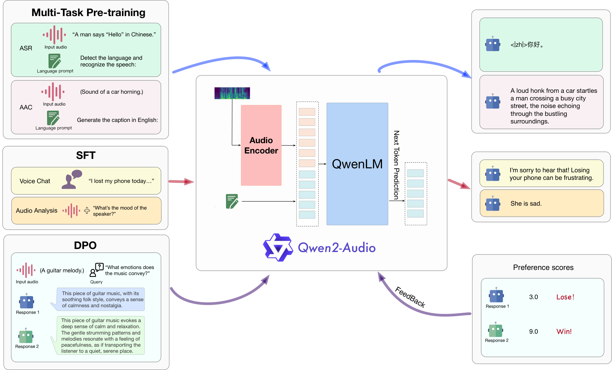
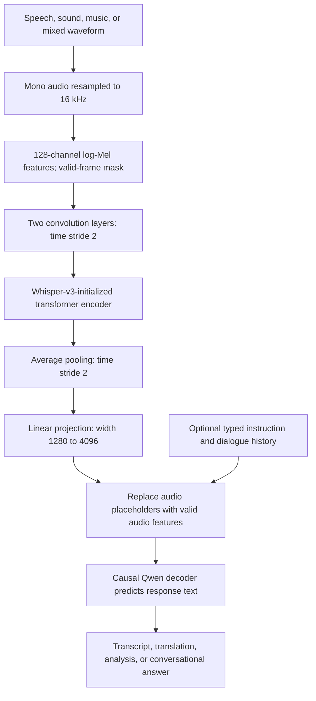
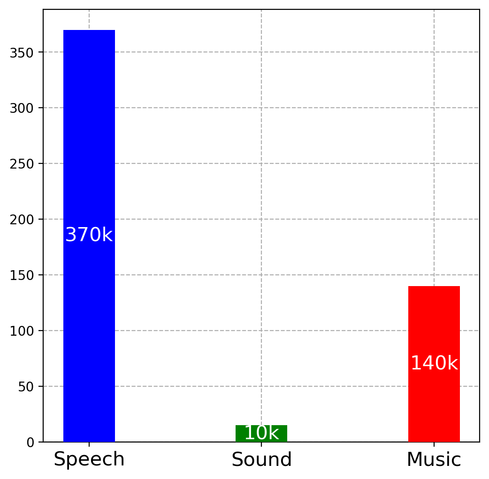
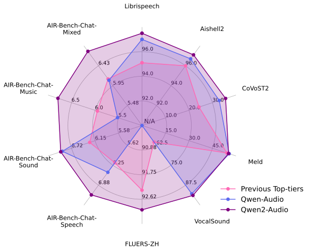

# Qwen2-Audio Technical Report - Chu et al., 2024

> **arXiv:** [2407.10759v1](https://arxiv.org/abs/2407.10759v1) (15 July 2024) · **Venue:** preprint · **Affiliation:** Qwen Team, Alibaba Group
>
> This recap follows the version-1 report. Details of tensor shapes, projection, padding, and configuration inheritance are additionally checked against the released checkpoint and Transformers v4.45.2. The paper's original-framework results and the repository's later Hugging Face conversion results are distinguished below.

## TL;DR

Qwen2-Audio is an audio-and-text-input, **text-output** model that combines a Whisper-large-v3-initialized encoder with a Qwen language decoder. Its main changes from Qwen-Audio are natural-language task prompts during pretraining, expanded audio data, jointly trained audio analysis and voice-chat interactions, and direct preference optimization (DPO). Users can give spoken instructions without first supplying a transcript or selecting a mode-specific system prompt, but “voice chat” does not imply speech synthesis, native full-duplex streaming, or unlimited audio duration.

## Problem & motivation

### Audio understanding is broader than transcription

An audio recording can contain words, speaker characteristics, emotion, music, environmental sounds, and overlapping sources. A conventional automatic speech recognition (ASR) system turns a waveform into words; a text-only model that receives just those words cannot necessarily recover information discarded by that transcription step.

The goal is therefore not simply to attach a transcriber to a chatbot. The model should directly condition on acoustic representations and perform tasks such as speech transcription, translation, sound description, vocal-event classification, and conversational response. It should also understand when a spoken utterance is an instruction rather than merely material to transcribe.

The predecessor, [Qwen-Audio](multimodal_2023_qwen-audio.md), already uses a shared audio encoder and language model for many audio tasks. Qwen2-Audio focuses on improving the bridge between that broad task coverage and natural user interaction.

### A task-tag interface is different from an instruction interface

Qwen-Audio's pretraining uses hierarchical task tags to identify what to do with an audio input. Such tags are explicit and compact, but the model's pretraining interface differs from the ordinary language requests it later sees during instruction following.

Qwen2-Audio replaces this task-conditioning hierarchy with natural-language prompts during pretraining. For example, the training diagram shows an instruction to detect the language and recognize speech, and another to generate an English audio caption. The intended benefit is to make the task interface more similar across pretraining and conversational use.

This is not the removal of every special token. The implementation still needs audio boundaries and placeholders, and the figure even illustrates a language indicator in one transcription output. The change concerns **how the desired task is specified**, not the abolition of structural serialization.

### A spoken request should not require a separate operating mode

The report distinguishes two useful interaction patterns:

| Pattern | What the user supplies | Desired behavior |
|---|---|---|
| Audio analysis | An audio recording and an instruction, which may itself be typed or spoken | Analyze the recording according to the request |
| Voice chat | A spoken conversational turn, without requiring a typed instruction | Understand the request and answer it, rather than automatically transcribing it |
| Mixed audio and instruction | Environmental sound, speech, or music together with a spoken command | Identify the relevant command and reason about the supplied audio |

These are behavioral descriptions of one jointly trained model, not three independent inference engines. In the introduction's example, keyboard sounds followed by a spoken question about the sound should elicit an explanation of the keyboard sound. No external ASR transcript is required as an intermediate input to the language model.

## Key idea

### Predict text directly from acoustic features and the conversational context

The paper's Equation (1) gives the next-token conditional probability:

$$
P_\theta\!\left(x_t\mid\mathbf{x}_{<t},
\operatorname{Encoder}_\phi(\mathbf a)\right).
$$

Here $\mathbf a$ is the input audio, $\mathbf x$ is the text sequence, $x_t$ is its next token, $\mathbf{x}_{<t}$ is the preceding text, $\phi$ denotes audio-encoder parameters, and $\theta$ denotes language-model parameters. Natural-language instructions and previous dialogue supply the textual context. The released implementation additionally makes the audio-to-decoder projection explicit.

A practical decomposition is

$$
H=\operatorname{AudioEncoder}_\phi
\big(\operatorname{LogMel}(\mathbf a)\big),
\qquad V=HW_p^\top+\mathbf b_p,
$$

$$
P_\theta(\mathbf y\mid\mathbf a,\mathbf c)
=\prod_{t=1}^{|\mathbf y|}
P_\theta(y_t\mid\mathbf y_{<t},\mathbf c,V).
$$

$H$ contains pooled audio features, $W_p$ and $\mathbf b_p$ project them into the decoder embedding space, $\mathbf c$ is the serialized instruction/dialogue context, and $\mathbf y$ is the generated text response. This decomposition reconstructs the implementation; it is not an additional numbered equation from the report.

The same conditional model can output a transcript when asked to transcribe, answer a spoken question, or describe a non-speech recording. It is not required to generate a transcript internally and then pass that transcript to a second language model.

### Change the interaction training, then optimize response preferences

The three stages are multitask pretraining with language prompts, supervised instruction fine-tuning (SFT), and DPO. Pretraining develops broad acoustic-language competence; SFT teaches the desired interpretation of conversational requests; DPO prefers better responses over worse ones for the same audio-containing context.

The contribution is consequently a coordinated training recipe rather than a new discrete audio tokenizer, a speech-generation decoder, or a new attention-positioning mechanism.

## How it works

### 1. Architecture and the identity of the language backbone



*Paper Figure 2: the audio encoder supplies continuous features alongside text to a language decoder. The left side illustrates the three training stages; the right illustrates text outputs and response preferences. The numerical preference scores are schematic examples, not benchmark results or a fully specified reward-model training procedure.*

The report describes an **8.2B-parameter** system with an audio encoder initialized from **Whisper-large-v3** and a foundational **Qwen-7B** language model. This is an important naming distinction: the paper does not say that it initializes from the released Qwen2-7B text checkpoint merely because the audio model is named Qwen2-Audio.

The [released Instruct configuration](https://huggingface.co/Qwen/Qwen2-Audio-7B-Instruct/blob/main/config.json) uses the Transformers `qwen2` text-model class. A software architecture identifier is not, by itself, evidence of a different initialization source. The configuration also differs from the standard released Qwen2-7B text model in its dimensions and settings.

The following values come from that checkpoint configuration, with omitted text fields resolved using the [version-pinned Qwen2 configuration defaults](https://github.com/huggingface/transformers/blob/v4.45.2/src/transformers/models/qwen2/configuration_qwen2.py):

| Component | Released Instruct configuration |
|---|---|
| Audio input features | 128 Mel channels |
| Audio encoder layers / width | 32 / 1280 |
| Audio attention heads / FFN width | 20 / 5120 |
| Audio activation | GELU |
| Maximum encoder positions before pooling | 1500 |
| Additional audio pooling | Average pool, kernel 2, stride 2 |
| Audio-to-text projector | Biased linear map from 1280 to 4096 |
| Decoder width / layers | 4096 / 32, inherited defaults |
| Decoder query / KV heads | 32 / 32, inherited defaults |
| Decoder MLP intermediate width | 11,008 |
| Decoder vocabulary size | 156,032 |
| Decoder maximum positions / rotary base | 8192 / 10,000 |

The 32 query and 32 KV heads describe ordinary multi-head attention, not the four-KV-head arrangement of the released Qwen2-7B text checkpoint. The decoder uses ordinary one-dimensional positions; this is not the M-RoPE architecture of [Qwen2-VL](multimodal_2024_qwen2-vl.md).

### 2. Waveform preprocessing

Section 2 specifies resampling audio to **16 kHz**, using **128-channel Mel spectrograms**, a **25 ms window**, and a **10 ms hop**. The [released feature-extractor configuration](https://huggingface.co/Qwen/Qwen2-Audio-7B-Instruct/blob/main/preprocessor_config.json) makes this concrete:

- `sampling_rate=16000`: a waveform second contains 16,000 samples.
- `n_fft=400`: a 400-sample analysis window spans 25 ms.
- `hop_length=160`: successive frames are spaced by 10 ms.
- `feature_size=128`: each spectral frame is mapped into 128 Mel channels.
- `chunk_length=30`, `n_samples=480000`, and `nb_max_frames=3000`: the standard frontend pads/truncates to a 30-second, 3000-frame feature window.

The pinned [Whisper feature extractor](https://github.com/huggingface/transformers/blob/v4.45.2/src/transformers/models/whisper/feature_extraction_whisper.py) uses a Hann-window power spectrum, Mel filtering, and base-10 logarithmic scaling. Its log features are floored relative to the example's maximum by eight log units and transformed by $(L+4)/4$, where $L$ is the floored log-Mel value. These are implementation details supplementing the report's shorter frontend description.

Waveforms must be mono and actually resampled to the required rate. Merely declaring that a 44.1 kHz waveform has a 16 kHz sampling rate changes its interpretation; it does not resample it. The feature attention mask records valid frames separately from padding.

Compared with the predecessor's Whisper-large-v2 frontend, the report moves to Whisper-large-v3 initialization and increases the Mel input from 80 to 128 channels. That is a concrete frontend change, independent of the later instruction-following recipe.

### 3. Encoder, pooling, and exact sequence lengths

Let $B_a$ be the number of audio clips processed together. The standard padded input tensor is

$$
M\in\mathbb R^{B_a\times128\times3000}.
$$

The [pinned audio implementation](https://github.com/huggingface/transformers/blob/v4.45.2/src/transformers/models/qwen2_audio/modeling_qwen2_audio.py) applies:

1. A kernel-3, padding-1 convolution, mapping 128 Mel channels to width 1280 without time downsampling, followed by GELU.
2. Another kernel-3, padding-1 convolution of width 1280 with stride 2, followed by GELU.
3. Positional embeddings and 32 bidirectional transformer encoder layers, with padding masked in attention.
4. An average-pooling layer with kernel and stride 2.
5. A final layer normalization.

The maximum tensor shapes are therefore

$$
(B_a,128,3000)
\longrightarrow(B_a,1280,3000)
\longrightarrow(B_a,1500,1280)
\longrightarrow(B_a,750,1280).
$$

The 1500-position embedding table belongs to the encoder sequence **before** pooling, not to the 750 vectors ultimately sent to the decoder.

For an actual valid Mel length $L_m$, the implementation computes

$$
L_c=\left\lfloor\frac{L_m-1}{2}\right\rfloor+1,
\qquad
L_a=\left\lfloor\frac{L_c-2}{2}\right\rfloor+1.
$$

$L_c$ is the convolutionally downsampled valid length, and $L_a$ is the valid pooled audio length. A full $L_m=3000$ gives $L_c=1500$ and $L_a=750$. Shorter clips can still be encoded in padded tensors, but their valid feature spans are derived from masks rather than pretending all 750 outputs are real audio.

The combined factor-of-four time reduction means successive final vectors are approximately **40 ms apart**, or about **25 vectors per second**. That is a representation stride, not a measured transcription-alignment error, not a guarantee of 40 ms response latency, and not the entire receptive field of a transformer feature. Encoder attention can contextualize a feature using the broader clip.

### 4. Project continuous audio features into the text sequence

The released multimodal projector is a single biased linear layer:

$$
v_i=W_ph_i+\mathbf b_p,\qquad
W_p\in\mathbb R^{4096\times1280},
\quad \mathbf b_p\in\mathbb R^{4096}.
$$

Here $h_i\in\mathbb R^{1280}$ is one valid pooled encoder vector and $v_i\in\mathbb R^{4096}$ is its decoder-width representation. This layer changes feature width, not sequence length. There is no fixed-query resampler or codebook quantization in this released path.

The conversational serialization uses `<|audio_bos|>`, `<|AUDIO|>`, and `<|audio_eos|>`. In the pinned implementation, a textual `<|AUDIO|>` placeholder is expanded **inside the model's merge routine** into the clip's valid projected feature sequence. Later processor versions may organize the expansion differently; the invariant is that the number of audio sequence slots matches the valid projected features.

For one audio clip, the physical decoder length becomes

$$
L_{\mathrm{merged}}
=L_{\mathrm{serialized}}-1+L_a,
$$

where $L_{\mathrm{serialized}}$ already includes the single placeholder and surrounding tokens. For $K$ clips, replace $-1+L_a$ by $-K+\sum_{k=1}^K L_{a,k}$, with $L_{a,k}$ the valid output length of clip $k$.

A full 30-second clip occupies 750 continuous audio slots, plus its two audio boundary tokens, and any textual numbering, role markers, and instruction tokens. The audio slots count against the decoder context and consume attention/cache resources even though they are not discrete text tokens.

Audio positions are ignored as prediction targets when labels are merged: the implementation uses the configured ignore index, `-100`, there. A model learns to predict the requested text, not to reconstruct the continuous input vectors as vocabulary symbols.

### 5. One decoder handles analysis and voice chat

The following is an original reconstruction of the data flow:



The audio transformer is bidirectional over the encoded clip, while the language decoder generates its response causally. The deployed model does not need a separate Whisper text decoder or an explicit transcription-to-chatbot handoff.

The [pinned chat template](https://github.com/huggingface/transformers/blob/v4.45.2/src/transformers/models/qwen2_audio/processing_qwen2_audio.py) wraps turns in ChatML and emits an audio span such as `Audio 1: <|audio_bos|><|AUDIO|><|audio_eos|>`. A voice-only user message still has this machine-generated textual structure. “No text input” means the user need not type an instruction, not that the implementation never serializes text tokens.

Likewise, “no system prompts to switch modes” does not mean there is no system message at all. The released default template can insert a generic helpful-assistant message. What is unnecessary is a special routing prompt selecting an analysis model versus a voice-chat model.

The report attributes the ability to distinguish spoken commands from audio content to joint training. It does not specify a separate command-segmentation network, a hard-coded mode classifier, or a general guarantee of resolving conflicting commands from overlapping speakers. Its mixed-input examples demonstrate behavior qualitatively.

### 6. Practical inference and duration boundaries

A faithful inference path is:

1. Load the conversational checkpoint for chat behavior, rather than assuming the base checkpoint has identical alignment.
2. Decode each waveform, convert it to mono, and resample it to 16 kHz.
3. Construct the chat history with audio entries and any text instructions in the desired order.
4. Apply the processor, preserving both the text attention mask and valid audio-frame mask.
5. Encode each clip, compute valid pooled lengths, project features, and merge them into the correct placeholder positions.
6. Generate the response autoregressively and decode the generated continuation as text.

The standard frontend is a **30-second clip encoder**; neither the paper nor this implementation establishes an unrestricted long-audio interface. The pinned feature extractor enables truncation by default, so a caller must not feed an arbitrarily long recording and assume its entire contents were analyzed. Longer recordings require an explicit segmentation/aggregation strategy or a suitable different model.

Multi-turn dialogue and multiple clips are supported by the serialization and feature-merging design, but all retained audio spans and text compete for context. The configured 8192 decoder positions are not equivalent to an 8192-second audio allowance.

The forward path encodes supplied audio when building the multimodal prefix, and cached text generation then continues from that prefix. This is different from continually accepting new microphone samples into a persistent streaming audio state. The report does not provide a full-duplex or latency evaluation, and no waveform synthesizer is part of this architecture.

## Training / data

### 1. Multitask pretraining with natural-language instructions

Pretraining uses paired audio and text while expressing the task through language prompts instead of the predecessor's hierarchical task-tag conditioning. Figure 2 illustrates speech recognition and automatic audio captioning; the evaluations also probe translation, emotion recognition, and vocal sound classification.



*Paper Figure 3: the pretraining mixture is heavily speech-oriented but also contains substantial music and a smaller general-sound component. The bar labels give hours, not token counts or numbers of examples.*

| Audio category | Reported duration | Source |
|---|---:|---|
| Speech | 370K hours | Figure 3 |
| Sound | 10K hours | Figure 3 |
| Music | 140K hours | Figure 3 |
| Sum of the three displayed categories | 520K hours | Derived from Figure 3 |

The arithmetic total is a sum of the published categories, not an independently documented count of deduplicated recordings, unique users, or training epochs. The report says the data volume was expanded, but does not provide a complete per-dataset mixture or a fully reproducible collection pipeline.

A negative log-likelihood form of Equation (1) is

$$
\mathcal L_{\mathrm{NLL}}
=-\frac{1}{|\mathcal S|}
\sum_{t\in\mathcal S}
\log P_{\theta,\phi,W_p}
(y_t\mid\mathbf y_{<t},\mathbf c,\mathbf a),
$$

where $\mathcal S$ is the set of supervised text positions, $\mathbf c$ is the prompt/context, and the subscripts explicitly include whichever decoder, encoder, and projection parameters are trainable. This is a reconstruction of the autoregressive objective, not a separate loss proposed by the paper.

### 2. Supervised fine-tuning for both interaction patterns

SFT uses curated, quality-controlled instruction data. The report emphasizes both the quality and complexity of these examples, rather than presenting an exact example count or a complete annotation schema.

Audio analysis and voice chat are jointly trained. This matters because an audio-only spoken question should be answered, whereas the same spoken content in a transcription task should be transcribed. The appropriate output depends on the conversational instruction and training distribution, not just on whether an audio object is present.

The report does not give a detailed per-token SFT masking specification. The inference implementation supports ignoring audio-feature targets, while a reproduction must separately define which prompt, role, and assistant-response text positions receive loss. In particular, it should not assume every serialized input token is a desired assistant target.

### 3. Direct preference optimization

Let $\mathcal D$ contain triples $(c,y_w,y_l)$: an input context $c$ including audio, a human-preferred response $y_w$, and a less-preferred response $y_l$. Renaming the report's input $\mathbf x$ to $c$ avoids confusing it with the text tokens in Equation (1).

The report's Equation (2) is

$$
\mathcal L_{\mathrm{DPO}}
=-\mathbb E_{(c,y_w,y_l)\sim\mathcal D}
\left[
\log\sigma\left(
\beta\log\frac{P_\theta(y_w\mid c)}{P_{\mathrm{ref}}(y_w\mid c)}
-\beta\log\frac{P_\theta(y_l\mid c)}{P_{\mathrm{ref}}(y_l\mid c)}
\right)
\right].
$$

$P_\theta$ is the trainable policy, $P_{\mathrm{ref}}$ is the reference initialized from the policy before preference optimization, $\sigma(z)=1/(1+e^{-z})$ is the sigmoid, and $\beta$ is the preference-objective hyperparameter. Response probabilities are sequence probabilities:

$$
\log P_\theta(y\mid c)
=\sum_{t=1}^{|y|}\log P_\theta(y_t\mid c,y_{<t}).
$$

DPO increases the preferred response's log-probability relative to the rejected response, measured against the reference policy. It can operate on response pairs directly, without requiring a separately fitted reward network and an online PPO rollout loop.

The authors describe improvements in factuality and adherence to desired behavior. However, the report does not supply a standalone before/after DPO ablation, its $\beta$ value, a preference-pair count, or a detailed breakdown of labeling criteria. Figure 2's example scores do not fill in those missing specifications.

### 4. What is and is not reproducible from the report

The three named stages here are **pretraining, SFT, and DPO**. They should not be confused with a three-stage encoder/decoder freeze schedule from another multimodal report.

The article does not state a complete stage-by-stage parameter-freezing policy for the encoder, projector, and decoder. It also omits exact optimizer settings, learning rates, global batch sizes, stage durations, compute accounting, and SFT/preference data sizes. These must remain unreported rather than being borrowed from Qwen-Audio or the Qwen2 text report.

The [official repository](https://github.com/QwenLM/Qwen2-Audio) releases a base and an Instruct checkpoint, plus inference examples. These make the inference architecture much easier to reproduce than the original full training run. The report's aggregate evaluation table is not a complete checkpoint-by-checkpoint ablation separating pretraining, SFT, and DPO contributions.

## Results

### 1. Evaluation coverage and interpretation

Table 1 and Section 3.1 cover ASR, speech-to-text translation (S2TT), speech emotion recognition (SER), vocal sound classification (VSC), and audio-centric conversational instruction following. The authors say evaluation data were excluded from training. That claim is compatible with supervised training on a dataset's training split; it does not mean every dataset is zero-shot.

The metrics measure different things:

- **WER, lower is better:** recognition errors relative to the reference transcription. The tables below retain the report's percentage-valued WER label, including its Chinese rows.
- **BLEU, higher is better:** speech-to-text translation quality, evaluated using SacreBLEU as linked in Table 1.
- **Accuracy, higher is better:** classification correctness. The paper prints these as fractions rather than percentages.
- **AIR-Bench chat scores, higher is better:** GPT-4 evaluations on a 0-to-10 scale, not human task-success rates.

Unless explicitly labeled otherwise, the following numbers are from **Table 2 of arXiv version 1**, evaluated without additional task-specific fine-tuning. They are historical reported results, not a current model leaderboard.



*Paper Figure 1: broad task coverage compared with Qwen-Audio and previous systems. Its ASR axes use a higher-is-better transformation of WER, CoVoST2 averages seven translation directions, and AIR-Bench uses judge scores. These heterogeneous axes should not be treated as a single calibrated accuracy measure; the raw metrics are tabulated below.*

### 2. Speech recognition

| Dataset / split or language | Qwen2-Audio WER | Comparison model | Comparison WER | Source |
|---|---:|---|---:|---|
| LibriSpeech dev-clean | 1.3 | Qwen-Audio | 1.8 | Table 2 |
| LibriSpeech dev-other | 3.4 | Qwen-Audio | 4.0 | Table 2 |
| LibriSpeech test-clean | 1.6 | Qwen-Audio | 2.0 | Table 2 |
| LibriSpeech test-other | 3.6 | Qwen-Audio | 4.2 | Table 2 |
| Common Voice 15 English | 8.6 | Whisper-large-v3 | 9.3 | Table 2 |
| Common Voice 15 Chinese | 6.9 | Whisper-large-v3 | 12.8 | Table 2 |
| Common Voice 15 Cantonese | 5.9 | Whisper-large-v3 | 10.9 | Table 2 |
| Common Voice 15 French | 9.6 | Whisper-large-v3 | 10.8 | Table 2 |
| Fleurs Chinese | 7.5 | Whisper-large-v3 | 7.7 | Table 2 |
| Aishell2 Mic | 3.0 | Qwen-Audio | 3.3 | Table 2 |
| Aishell2 iOS | 3.0 | Qwen-Audio | 3.1 | Table 2 |
| Aishell2 Android | 2.9 | Qwen-Audio | 3.3 | Table 2 |

The Common Voice comparison is **not matched zero-shot evaluation**: Qwen2-Audio is not zero-shot there, whereas Whisper's results are zero-shot. Both systems are zero-shot on Fleurs, per Section 3.2 and the Table 2 caption.

Qwen2-Audio improves over its predecessor on the listed recognition splits, but it does not beat every specialist result in the table. For example, Paraformer-large reports 2.9 WER on Aishell2 iOS versus Qwen2-Audio's 3.0 (Table 2).

### 3. Speech-to-text translation

| CoVoST2 direction | Qwen2-Audio BLEU | Qwen-Audio BLEU | Source |
|---|---:|---:|---|
| English to German | 29.9 | 25.1 | Table 2 |
| German to English | 35.2 | 33.9 | Table 2 |
| English to Chinese | 45.2 | 41.5 | Table 2 |
| Chinese to English | 24.4 | 15.7 | Table 2 |
| Spanish to English | 40.0 | 39.7 | Table 2 |
| French to English | 38.5 | 38.5 | Table 2 |
| Italian to English | 36.3 | 36.0 | Table 2 |

The largest predecessor gap among these rows is Chinese-to-English; Spanish- and Italian-to-English change much less, and French-to-English is tied. The report's broad prose about outperforming baselines in all directions should therefore not be read as a strict improvement over Qwen-Audio in every row.

### 4. Emotion and vocal sound classification

| Task / dataset | Qwen2-Audio accuracy | Qwen-Audio accuracy | Other baseline | Baseline accuracy | Source |
|---|---:|---:|---|---:|---|
| SER / MELD | 0.553 | 0.557 | WavLM-large | 0.542 | Table 2 |
| VSC / VocalSound | 0.9392 | 0.9289 | Pengi | 0.6035 | Table 2 |

VocalSound improves over Qwen-Audio, but MELD is slightly lower. This is a concrete counterexample to a blanket claim that the new model significantly improves every audio task. The authors also argue in Section 3.1 that some conventional spoken-language and emotion datasets poorly reflect practical user interactions, motivating their emphasis on AIR-Bench; that is their evaluation rationale, not proof that classification errors are irrelevant.

### 5. Audio-centric conversational instruction following

| Model | Speech | Sound | Music | Mixed audio | Source |
|---|---:|---:|---:|---:|---|
| SALMONN | 6.16 | 6.28 | 5.95 | 6.08 | Table 2 |
| BLSP | 6.17 | 5.55 | 5.08 | 5.33 | Table 2 |
| PandaGPT | 3.58 | 5.46 | 5.06 | 4.25 | Table 2 |
| Macaw-LLM | 0.97 | 1.01 | 0.91 | 1.01 | Table 2 |
| SpeechGPT | 1.57 | 0.95 | 0.95 | 4.13 | Table 2 |
| NExT-GPT | 3.86 | 4.76 | 4.18 | 4.13 | Table 2 |
| Qwen-Audio | 6.47 | 6.95 | 5.52 | 6.08 | Table 2 |
| Gemini-1.5-pro | 6.97 | 5.49 | 5.06 | 5.27 | Table 2 |
| Qwen2-Audio | 7.18 | 6.99 | 6.79 | 6.77 | Table 2 |

Qwen2-Audio leads the listed systems in all four categories. The improvement over Qwen-Audio is especially visible in music and mixed audio; the sound score changes only slightly. These are GPT-4-judged conversational scores, not WER, BLEU, or human preference win rates.

Two protocol details materially limit interpretation:

1. **Unequal Gemini sample coverage:** Section 3.2 says Gemini-1.5 refused some test inputs for safety reasons, reducing its evaluated sample count by about **one fifth**. The published averages therefore do not establish a fully matched-input head-to-head comparison.
2. **Judge dependence:** scores are generated by GPT-4, so they inherit the judge's preferences and possible sensitivity to answer style. The report does not provide confidence intervals or a human-audited breakdown of each category.

Table 1 associates AIR-Bench speech with datasets such as Fisher, SpokenWOZ, IEMOCAP, and Common Voice; sound with Clotho; music with MusicCaps; and mixed audio with combinations including Common Voice, AudioCaps, and MusicCaps. These are evaluation sources, not an exhaustive disclosure of the pretraining mixture.

### 6. Original-framework versus converted-checkpoint scores

The official repository explicitly warns that conversion from the original training framework to Hugging Face caused score fluctuations. Its evaluation section presents separate original-model and converted-model tables.

| Metric | Report / original framework | Converted Hugging Face model | Source |
|---|---:|---:|---|
| LibriSpeech test-clean WER | 1.6 | 1.7 | Paper Table 2; repository converted-model table |
| LibriSpeech test-other WER | 3.6 | 4.0 | Paper Table 2; repository converted-model table |
| Fleurs Chinese WER | 7.5 | 7.0 | Paper Table 2; repository converted-model table |

These converted values come from the [official README evaluation section](https://github.com/QwenLM/Qwen2-Audio#evaluation), not a different arXiv revision. A reproduction with the downloadable checkpoint should not silently assume it will reproduce every original-framework number exactly, nor should the two result sets be merged into a best-of-both table.

### 7. Qualitative demonstrations versus controlled evidence

Section 4 and Figures 4-10 illustrate conversational speech, speech analysis, sound analysis, music analysis, and mixed-audio behavior. They help explain what the interaction modes mean: the response can depend on a spoken request and on non-speech acoustic context simultaneously.

These examples do not quantify speaker-command disambiguation reliability, robustness to adversarial audio, sustained streaming behavior, or the incremental benefit of each training stage. The report has no controlled ablation isolating natural-language prompts, data expansion, the Whisper-v3 change, and DPO from one another. The aggregate gains are evidence for the whole trained system, not a measured causal contribution for every design choice.

## Limitations & follow-ups

### Audio input is not audio output

“Voice chat” describes how the user can provide a request. The model generates text and has no native speech synthesizer or audio-token output head in the described architecture. Adding external text-to-speech can produce a spoken application, but that is a larger system and has its own latency and quality characteristics.

Likewise, the use of online-interaction examples does not establish full-duplex conversation, barge-in handling, continuous acoustic memory, or streaming response latency. The standard encoder receives bounded clips and uses bidirectional attention within them.

### Duration, context, and resolution are real limits

The 30-second audio frontend and 8192-position decoder configuration constrain what can be supplied in one standard call. The nominal 40 ms feature spacing is not an alignment accuracy or a latency benchmark. Multiple audio turns also consume context; conversation history does not become a cost-free external acoustic memory.

Segmentation for longer recordings changes the task: context can be lost across chunk boundaries, and speaker continuity or global summaries may require explicit aggregation. Such a strategy is not fully specified or evaluated by this report.

### Broad improvements do not mean uniform dominance

The paper's own table contains a MELD regression, a tied translation direction, and specialist ASR results that remain better on individual splits. Common Voice and Gemini comparisons have the protocol differences discussed above. It is more accurate to say the system substantially improves broad instruction-following behavior than to claim that it wins every acoustic task under identical conditions.

The mixed-audio examples do not guarantee correct identification of the intended speaker or command in every recording. Music mood and speaker emotion are also interpretation-heavy tasks; fluent descriptions need not always be grounded in the recording. The report does not include a separate comprehensive hallucination, demographic robustness, or uncertainty-calibration evaluation.

### Training transparency and attribution remain incomplete

The article is a short technical report, not a complete reproduction recipe. Data-category hours and released weights are valuable, but missing dataset mixtures, freezing policies, training hyperparameters, preference-set details, and stage ablations limit causal analysis and exact retraining.

DPO is intended to improve response quality, not a guarantee of factual correctness or adherence to every desired behavior. Its incremental effect cannot be measured from the final aggregate table alone.

### Related models and later directions

The direct predecessor is [Qwen-Audio](multimodal_2023_qwen-audio.md), and the foundational text model is covered by the [Qwen recap](backbone_2023_qwen.md). [Qwen2](backbone_2024_qwen2.md) is useful family context but should not be substituted for the backbone initialization actually named in this paper.

[Qwen2.5-Omni](multimodal_2025_qwen2.5-omni.md) later addresses broader multimodal input and output, including speech generation. That is a follow-up direction, not a capability to attribute retroactively to Qwen2-Audio. The separate [Qwen2-VL](multimodal_2024_qwen2-vl.md) branch concerns images and video rather than this audio frontend.

## Links

- **arXiv:** [abs, version 1](https://arxiv.org/abs/2407.10759v1) · [HTML, version 1](https://arxiv.org/html/2407.10759v1) · [PDF, version 1](https://arxiv.org/pdf/2407.10759v1)
- **Code:** [official Qwen2-Audio repository](https://github.com/QwenLM/Qwen2-Audio) · [reported and converted evaluation results](https://github.com/QwenLM/Qwen2-Audio#evaluation)
- **Implementation sources:** [audio encoder, projector, and feature merging, Transformers v4.45.2](https://github.com/huggingface/transformers/blob/v4.45.2/src/transformers/models/qwen2_audio/modeling_qwen2_audio.py) · [audio configuration](https://github.com/huggingface/transformers/blob/v4.45.2/src/transformers/models/qwen2_audio/configuration_qwen2_audio.py) · [processor / chat template](https://github.com/huggingface/transformers/blob/v4.45.2/src/transformers/models/qwen2_audio/processing_qwen2_audio.py) · [Whisper feature extractor](https://github.com/huggingface/transformers/blob/v4.45.2/src/transformers/models/whisper/feature_extraction_whisper.py)
- **Hugging Face:** [base checkpoint](https://huggingface.co/Qwen/Qwen2-Audio-7B) · [Instruct checkpoint](https://huggingface.co/Qwen/Qwen2-Audio-7B-Instruct) · [Instruct model configuration](https://huggingface.co/Qwen/Qwen2-Audio-7B-Instruct/blob/main/config.json) · [feature-extractor configuration](https://huggingface.co/Qwen/Qwen2-Audio-7B-Instruct/blob/main/preprocessor_config.json) · [demo](https://huggingface.co/spaces/Qwen/Qwen2-Audio-Instruct-Demo)
- **Project page / blog:** [official Qwen2-Audio announcement](https://qwenlm.github.io/blog/qwen2-audio/)
- **Talks / videos:** no specific talk used as a source for this recap.
- **OpenReview / venue page:** not used; this recap follows the arXiv technical report.
- **Papers-with-Code:** not used; benchmark values are sourced from the paper and official repository.
- **Related / successor papers:** [Qwen-Audio](multimodal_2023_qwen-audio.md) · [Qwen](backbone_2023_qwen.md) · [Whisper](https://arxiv.org/abs/2212.04356) · [DPO](https://arxiv.org/abs/2305.18290) · [Qwen2](backbone_2024_qwen2.md) · [Qwen2-VL](multimodal_2024_qwen2-vl.md) · [Qwen2.5-Omni](multimodal_2025_qwen2.5-omni.md)
- **Local context:** [Qwen-family overview](../qwen/overview.md)
- **BibTeX:**

```bibtex
@article{chu2024qwen2audio,
  title={Qwen2-Audio Technical Report},
  author={Chu, Yunfei and Xu, Jin and Yang, Qian and Wei, Haojie and
          Wei, Xipin and Guo, Zhifang and Leng, Yichong and Lv, Yuanjun and
          He, Jinzheng and Lin, Junyang and Zhou, Chang and Zhou, Jingren},
  journal={arXiv preprint arXiv:2407.10759},
  year={2024}
}
```
