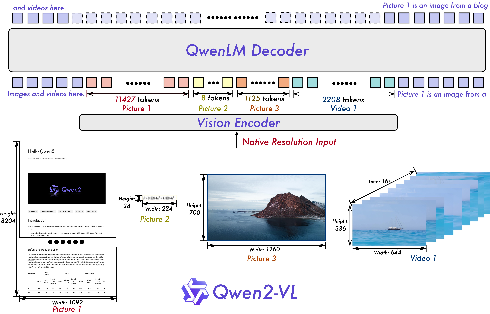
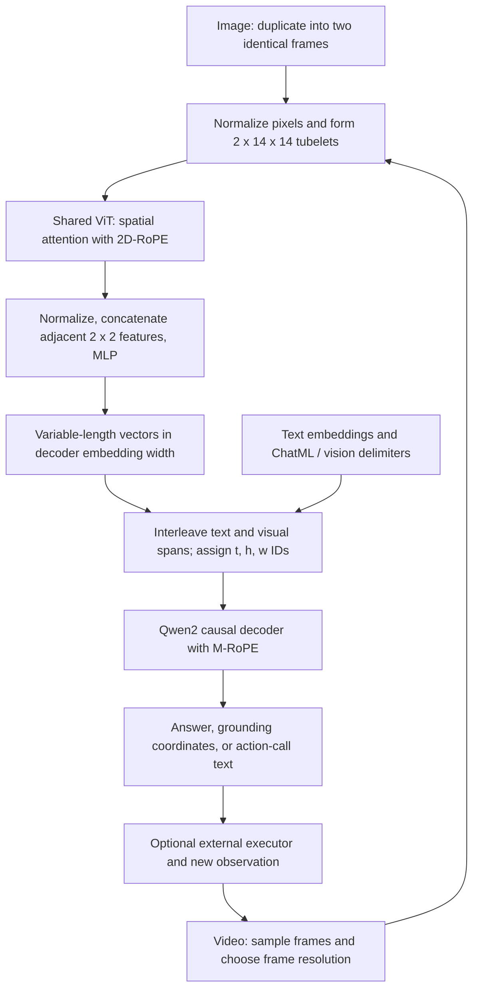
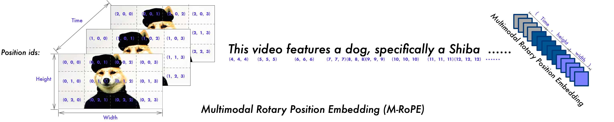
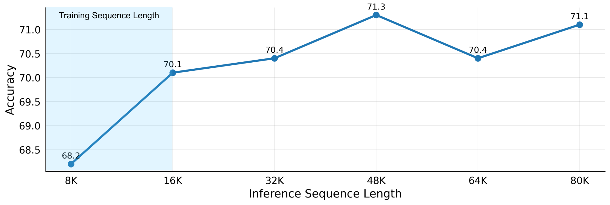
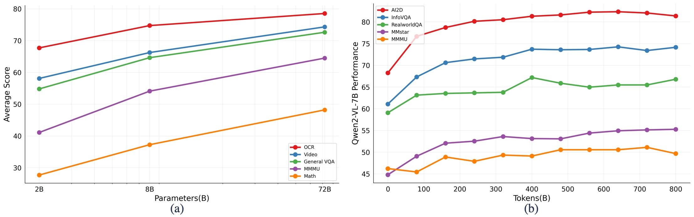

# Qwen2-VL: Perception at Any Resolution - Wang et al., 2024

> **arXiv:** [2409.12191v2](https://arxiv.org/abs/2409.12191v2) (3 October 2024; first submitted 18 September 2024) · **Venue:** preprint · **Affiliation:** Qwen Team, Alibaba Group
>
> **Full title:** *Qwen2-VL: Enhancing Vision-Language Model's Perception of the World at Any Resolution*. This recap follows the version-2 report. Low-level details not specified in the report are explicitly attributed to the released model configuration or the version-pinned Transformers implementation.

## TL;DR

Qwen2-VL combines a shared 675M-parameter vision transformer with Qwen2 language models, replacing fixed-length image representations with a variable number of visual tokens that approximately preserve image aspect ratio and resolution. Its vision encoder uses **2D rotary positions**, while the language model uses **M-RoPE**, assigning temporal, height, and width coordinates to visual tokens and ordinary sequential coordinates to text. A common two-frame tubelet encoder supports both images and videos; staged training on 1.4T combined text/visual tokens yields strong document reading, grounding, and video understanding, but the results do not establish universal superiority over proprietary models.

## Problem & motivation

### Fixed image budgets discard different kinds of information

The original [Qwen-VL](multimodal_2023_qwen-vl.md) ultimately processes images at a fixed 448-by-448 resolution and uses a learned-query adapter to produce 256 image vectors. That is convenient for batching and bounds the language model's image-context cost. It also gives a short mathematical formula, an ordinary photograph, and a densely printed page essentially the same representation budget.

The resulting bottlenecks differ. Downsampling a document can remove small characters before language reasoning begins; distorting a very wide or tall image can damage spatial relationships. Dividing an image into independent crops preserves local detail but adds processing and requires recovering relationships across crops. Qwen2-VL instead varies the size of the visual sequence, retaining a single spatial grid rather than relying on a fixed learned-query bottleneck. The report motivates this design in its introduction and describes it in Section 2.1.

“Any resolution” is a representation strategy, **not a promise of unlimited pixels**. An implementation still resizes images to a valid patch grid, enforces pixel or sequence budgets, and is constrained by memory. The important change is that different images need not be forced into the same square shape or the same token count.

### Flattening a video is not enough to describe its geometry

A decoder accepts a sequence, but an image has two spatial axes and a video adds time. With ordinary one-dimensional positional IDs, the apparent distance between two neighboring image patches depends on flattening order and image width. The first patch of a later frame can also be very far from the corresponding patch of an earlier frame, even when they occupy the same spatial location.

Qwen2-VL addresses this at two different levels. Spatial positions help the vision encoder contextualize patches, while multimodal positions help the decoder reason over the resulting image/video features together with text. These are separate mechanisms operating at different resolutions of the visual grid.

### Better visual representations must survive language-model scaling

The paper also asks whether increasing the language model and multimodal training data improves all capabilities similarly. It holds the vision-encoder scale approximately constant while varying the decoder. OCR is already strong in the smaller models, whereas difficult mathematical and knowledge-heavy tasks benefit more from larger decoders. The scaling experiments are empirical comparisons and training curves, not a fitted universal scaling law.

## Key idea

### Allocate tokens to the input instead of forcing the input into a token budget

Let a preprocessed visual input contain $F$ frames of height $H$ and width $W$. Use a temporal patch size $\tau=2$, spatial patch size $p=14$, and spatial merge factor $s=2$. Assuming $F$ is valid for the temporal grouping and $H,W$ are multiples of $ps=28$:

$$
T_g=\frac{F}{\tau},\qquad
H_g=\frac{H}{p},\qquad
W_g=\frac{W}{p},
$$

$$
N_{\mathrm{ViT}}=T_gH_gW_g,\qquad
N_{\mathrm{visual}}=T_g\frac{H_g}{s}\frac{W_g}{s}
=\frac{F}{2}\frac{H}{28}\frac{W}{28}.
$$

Here $T_g,H_g,W_g$ describe the tubelet grid before spatial merging; $N_{\mathrm{ViT}}$ counts vision-transformer tokens and $N_{\mathrm{visual}}$ counts continuous vectors inserted into the decoder. Boundary tokens are additional. An image is duplicated into two identical frames, so its $T_g$ is one. These equations reconstruct the token accounting in Section 2.1 and the released implementation; they are not numbered equations quoted from the paper.

Thus a 224-by-224 image produces a 16-by-16 patch grid, then an 8-by-8 merged grid: **64 visual vectors, or 66 tokens including the two visual delimiters**, exactly the example given in Section 2.1. Unlike the old 256-query adapter, this mapping can produce fewer or more than 256 vectors.

### Give decoder tokens coordinates appropriate to their modality

For a token at decoder position $n$, M-RoPE maintains a coordinate triple

$$
\mathbf p_n=(p_n^{(t)},p_n^{(h)},p_n^{(w)}).
$$

Text uses the same scalar on all axes. Images use a constant temporal coordinate and varying row/column coordinates. Videos vary all three. Different subsets of each query/key head's rotary channels use different axes, preserving a shared decoder while making the positional representation reflect visual geometry.

This does **not** compress the attention sequence or the KV cache. It changes the coordinates used to rotate queries and keys; every visual vector still occupies a real decoder sequence slot.

## How it works

### 1. Overall architecture and model sizes



*Paper Figure 2: differently sized images and a video enter one vision encoder and contribute differently sized feature spans to the decoder. The figure's long document and short formula illustrate why a fixed token count is an awkward fit. Its listed token counts illustrate those particular inputs, not universal per-image or per-video constants.*

The architecture has three main components:

1. **A shared vision transformer:** approximately 675M parameters, initialized from a DFN vision model and modified for dynamic resolution and temporal tubelets.
2. **A spatial patch merger:** a small MLP concatenates neighboring 2-by-2 vision features and projects them into the decoder embedding width.
3. **A Qwen2 causal language decoder:** consumes text embeddings and inserted visual features, then predicts text autoregressively. M-RoPE replaces ordinary one-axis rotary indexing in its attention.

| Released model name | Vision encoder | Language model | Source |
|---|---:|---:|---|
| Qwen2-VL-2B | 675M | 1.5B | Table 1 |
| Qwen2-VL-7B | 675M | 7.6B | Table 1 |
| Qwen2-VL-72B | 675M | 72B | Table 1 |

The abstract, conclusion, and scaling figure sometimes describe the middle model as **8B**, whereas the model name and body use **7B**. This recap uses the released names above. The Table 1 language-model and encoder counts are approximate component counts; do not reinterpret the product labels as exact totals.

The following diagram is an original reconstruction, not an additional paper figure:



### 2. Dynamic resizing and input preparation

For each image, choose a resized height and width divisible by 28, retaining its aspect ratio as closely as possible within minimum and maximum pixel budgets. The factor 28 combines the 14-pixel patch size and the subsequent 2-by-2 merge. The version-pinned [image processor](https://github.com/huggingface/transformers/blob/v4.45.2/src/transformers/models/qwen2_vl/image_processing_qwen2_vl.py) rounds dimensions to this grid and rescales when the rounded area falls outside the configured interval.

The [released 7B processor configuration](https://huggingface.co/Qwen/Qwen2-VL-7B-Instruct/blob/main/preprocessor_config.json) specifies `min_pixels=3136` and `max_pixels=12845056`. Dividing by $28^2$ gives nominal image budgets of 4 to 16,384 visual vectors. These are **that configuration's values**, not the settings of every experiment or every serving library. For example, the dynamic-resolution ablation in Section 3.3.1 instead uses a minimum of $100\times28^2$ pixels and a maximum of $16384\times28^2$ pixels.

The referenced processor rescales RGB values by $1/255$ and normalizes channels using mean $(0.48145466,0.4578275,0.40821073)$ and standard deviation $(0.26862954,0.26130258,0.27577711)$, as specified by the model's processor configuration. Its resize path uses bicubic interpolation. These are released preprocessing details, not additional training hyperparameters reported in the article.

Do not read “native resolution” as “pixels are never resized.” Small inputs can be enlarged and large ones reduced, and the 28-pixel grid introduces rounding. The pinned `smart_resize` implementation also rejects a dimension below its factor and an aspect ratio above 200; upstream utilities can have additional input handling. Such operational checks coexist with a model that supports variable valid grids.

### 3. Tubelet embedding: one path for images and video

The patch embedding is a 3D convolution whose kernel and stride are both $(2,14,14)$. With three RGB channels, each input tubelet contains $3\times2\times14\times14=1176$ scalar pixel values. The convolution maps each tubelet into a vision embedding.

For the released 7B model, the [configuration](https://huggingface.co/Qwen/Qwen2-VL-7B-Instruct/blob/main/config.json) specifies:

| Component | Released 7B configuration |
|---|---|
| ViT blocks / embedding width | 32 / 1280 |
| ViT attention heads / MLP ratio | 16 / 4 |
| Spatial / temporal patch sizes | 14-by-14 / 2 |
| Spatial merge factor | 2-by-2 |
| Decoder layers / hidden width | 28 / 3584 |
| Decoder query heads / KV heads | 28 / 4 |
| Decoder MLP intermediate width | 18,944 |
| Decoder rotary base | 1,000,000 |
| Configured maximum positions | 32,768 |
| M-RoPE frequency-pair sections | `[16, 24, 24]` |

The flattened tubelet tensor has shape

$$
X_{\mathrm{tube}}\in\mathbb R^{N_{\mathrm{ViT}}\times1176},
$$

and patch embedding produces

$$
Z_0\in\mathbb R^{N_{\mathrm{ViT}}\times1280}.
$$

For a still image, repeating the image twice makes the temporal convolution valid without a separate image encoder. For video, its two frames are distinct, so the convolution can encode short-range changes as well as appearance. Sampling/padding must produce valid temporal groups; arbitrary odd frame counts should not simply be fed into a reshape expecting pairs.

### 4. Spatial 2D-RoPE inside the vision encoder

The original fixed absolute positional embeddings of the DFN encoder are removed. Instead, the vision attention's rotary representation depends on each patch's row and column. Spatial position IDs are formed on the **unmerged** $H_g\times W_g$ grid and repeated over temporal groups.

This is not decoder M-RoPE: it has spatial axes, no separate long-range temporal axis, and operates before the 2-by-2 compression. The [pinned vision implementation](https://github.com/huggingface/transformers/blob/v4.45.2/src/transformers/models/qwen2_vl/modeling_qwen2_vl.py) builds row/column rotary features and processes packed spatial sequences using cumulative sequence boundaries.

Those boundaries are also important for understanding video computation. In that implementation, a spatial sequence contains the $H_gW_g$ tokens of **one temporal tubelet group**. It does not make every ViT token attend globally to every frame of a long video. The temporal convolution mixes each pair of source frames, and the decoder integrates information across the resulting sequence of groups.

Independent images can be packed without introducing attention between their ViT sequences. Packing reduces padding waste; it is not a license to mix unrelated images' attention. Nor is this the window-attention vision architecture of the later Qwen2.5-VL.

### 5. The spatial merger and insertion into the decoder

The processor orders patches so each adjacent 2-by-2 spatial group is contiguous. After the ViT, layer normalization is applied to each width-1280 feature, four neighboring features are concatenated, and a two-layer GELU MLP projects them to the decoder width.

For four features $z_1,\ldots,z_4\in\mathbb R^{1280}$:

$$
u=\operatorname{concat}\big(
\operatorname{LN}(z_1),\operatorname{LN}(z_2),
\operatorname{LN}(z_3),\operatorname{LN}(z_4)\big)
\in\mathbb R^{5120},
$$

$$
v=W_2\,\operatorname{GELU}(W_1u+b_1)+b_2
\in\mathbb R^{d_{\mathrm{LLM}}}.
$$

Here $W_1\in\mathbb R^{5120\times5120}$, $b_1\in\mathbb R^{5120}$, $W_2\in\mathbb R^{d_{\mathrm{LLM}}\times5120}$, and $b_2\in\mathbb R^{d_{\mathrm{LLM}}}$. For the 7B model, $d_{\mathrm{LLM}}=3584$. These equations describe the released `PatchMerger`; the report itself summarizes this as an MLP compression layer.

The output shape is $N_{\mathrm{visual}}\times d_{\mathrm{LLM}}$. No learned query set pools the image into a universal length. The merge is spatial, not an additional factor-of-two temporal reduction: the temporal grouping already occurred in the patch embedding.

At the processor/tokenizer interface, repeated image or video placeholder tokens reserve exactly enough sequence slots for these vectors. During the model forward pass, their token embeddings are replaced by the corresponding continuous visual features. The features are not discrete image-vocabulary predictions.

Visual spans are delimited by `<|vision_start|>` and `<|vision_end|>`. The released tokenizer distinguishes `<|image_pad|>` and `<|video_pad|>` placeholders; image filenames and video paths in paper examples are schematic input references, not strings from which the language model itself reads files.

### 6. M-RoPE inside the language decoder



*Paper Figure 3: video tokens have three-dimensional coordinates, while following text resumes a common scalar coordinate on all three axes. Corresponding spatial locations retain their height/width coordinates across time. Coordinate triples are rotary position IDs, not additional tokens appended to the input.*

Let $d_h$ be the query/key head width and $j\in\{0,\ldots,d_h/2-1\}$ index rotary frequency pairs. Define the usual decoder rotary frequencies

$$
\omega_j=\theta^{-2j/d_h},
$$

where $\theta$ is the rotary base. Let $a(j)\in\{t,h,w\}$ select the coordinate axis assigned to pair $j$. M-RoPE uses the angle

$$
\phi_{n,j}=\omega_j\,p_n^{(a(j))}
$$

for that token and pair. A conceptual two-component rotary pair transforms as

$$
\begin{bmatrix}
q'_{n,j,1}\\q'_{n,j,2}
\end{bmatrix}
=
\begin{bmatrix}
\cos\phi_{n,j}&-\sin\phi_{n,j}\\
\sin\phi_{n,j}&\cos\phi_{n,j}
\end{bmatrix}
\begin{bmatrix}
q_{n,j,1}\\q_{n,j,2}
\end{bmatrix},
$$

and keys receive the same construction. Here $q_{n,j,1},q_{n,j,2}$ are the two components paired by the implementation's RoPE layout; they need not be adjacent tensor channels. For a query at $m$ and key at $n$, each pair's dot-product contribution depends on the selected coordinate difference $p_n^{(a(j))}-p_m^{(a(j))}$. This is the ordinary RoPE relative-phase property applied along the relevant axis.

For the 7B decoder, $d_h=3584/28=128$, giving 64 frequency pairs. The configuration `[16,24,24]` allocates **16 pairs to time, 24 to height, and 24 to width**: equivalently 32, 48, and 48 scalar channels. It does not mean that only 64 of the 128 head channels are rotated. The pinned implementation repeats the section pattern over the two halves of its RoPE channel layout.

Coordinate assignment proceeds as follows:

1. **Text:** a text run starting at scalar position $b$ assigns token $i$ the triple $(b+i,b+i,b+i)$. Since all axes agree, the transformation reduces to ordinary 1D-RoPE.
2. **Image:** on the merged image grid, row $r$ and column $c$ receive $(b,b+r,b+c)$. The temporal axis is constant.
3. **Video:** temporal group $u$, merged row $r$, and merged column $c$ receive $(b+u,b+r,b+c)$.
4. **After a visual span:** the next text-like span starts at one greater than the largest coordinate already used, not necessarily one greater than the number of preceding sequence slots. Delimiters themselves consume ordinary text-like positions.

For example, ignoring surrounding delimiters, an 8-by-8 image grid starting at $b=10$ uses temporal coordinate 10 and spatial coordinates 10 through 17. The next text-like position is 18, although the image occupied 64 decoder slots. An image's rotary-coordinate extent therefore grows with the larger spatial dimension rather than with its total patch count.

The implementation returns three position-ID arrays of shape $(3,B,L)$ for batch size $B$ and sequence length $L$, together with an offset between rotary positions and physical sequence length. Cached generation must retain that offset when constructing positions for subsequent text tokens. Replacing M-RoPE with a plain sequence-index counter after the first forward pass would change the intended positional semantics.

This model's temporal IDs are **ordinal temporal-group indices**, not an explicit encoding of elapsed wall-clock seconds. Changing video sampling changes which real-world intervals those indices represent. Absolute-time alignment and other later temporal designs should not be attributed retroactively to Qwen2-VL.

### 7. Unified video processing and its resource trade-off

Section 2.1 reports sampling video at **two frames per second**, using the temporal depth-two convolution, and dynamically selecting frame resolution so a video contributes at most **16,384 visual tokens during training**. The paired frames become a single temporal group before spatial merging.

For even $F$ sampled frames and a common resized frame shape:

$$
N_{\mathrm{video}}
=\frac{F}{2}\frac{HW}{28^2}
\leq16384.
$$

The frame count and spatial resolution compete for the same budget. A longer video therefore cannot generally retain the same per-frame resolution as a short video under that cap. The claim of understanding videos longer than 20 minutes is not a claim of processing every frame at full camera resolution, nor a guarantee of recovering every brief event.

Video-MME experiments also explore inference beyond the training budget. That is evidence of extrapolation in a particular evaluation, not proof that every deployment accepts arbitrarily long contexts. The released 7B configuration's 32,768 maximum positions and the paper's 72B, up-to-80K inference experiment refer to different operational settings.

### 8. Dialogue, grounding, and agent outputs

Instruction conversations use ChatML, with `<|im_start|>` and `<|im_end|>` delimiting turns. A user message may interleave multiple image/video spans with ordinary text, and the assistant predicts a text response. The decoder can therefore compare images or answer a question about a video without a separate modality-specific answer head.

For grounding, Section 2.2.1 specifies bounding-box coordinates normalized into **$[0,1000)$**, serialized as `(x_top_left,y_top_left),(x_bottom_right,y_bottom_right)`. `<|box_start|>` / `<|box_end|>` delimit the coordinate text; `<|object_ref_start|>` / `<|object_ref_end|>` identify its referring description. This is normalized coordinate generation, not direct prediction of pixel coordinates in the original unresized file. Consumers must map coordinates back to the relevant image geometry.

Agent tasks are formatted as sequential decision-making: define an action vocabulary and parameter schema, provide an observation, generate reasoning/action-call text, execute it externally, and return a new observation. The report illustrates fields such as `*FUNCTION*`, `*ARGS*`, `*RESULT*`, and `*RETURN*`. The surrounding executor, available actions, and observation loop are essential parts of the system.

Qwen2-VL is consequently a **visual-input, text-output model**. A mobile-device demo does not mean it independently controls hardware without an executor. Video understanding is not native video generation, and this architecture does not include an audio encoder or waveform decoder.

## Training / data

### Initialization and three training stages

Section 2.2 initializes the decoder from [Qwen2](backbone_2024_qwen2.md), and initializes the vision encoder from a [DFN vision model](https://arxiv.org/abs/2309.17425), replacing its fixed positional embeddings with spatial rotary embeddings.

| Stage | Parameter policy stated in the report | Data and purpose | Reported budget |
|---|---|---|---|
| Initial multimodal pretraining | Train the ViT; keep the LLM frozen | Image-text relationships, OCR, and classification; align visual information with the existing language model | About 600B tokens, Section 2.2 |
| Expanded multimodal pretraining | Unfreeze all parameters | Broader image-text mixtures, interleaved content, VQA, multitask data, and pure text; develop multimodal abilities while retaining language proficiency | An additional 800B tokens, Section 2.2 |
| Instruction fine-tuning | Freeze the ViT and fine-tune the LLM | ChatML text and multimodal conversations, including document parsing, multi-image comparison, video dialogue, and agent interactions | No exact token/example count supplied in Section 2.2 |

The paper's freeze description is expressed in terms of “ViT” and “LLM”; it does not separately enumerate the patch merger's optimizer groups in each stage. The released implementation places the merger in the visual module. A reproduction should document its explicit merger policy rather than silently importing the older Qwen-VL adapter schedule as an independently reported Qwen2-VL fact.

The two pretraining stages total **1.4T tokens including both text tokens and image tokens**. This is not 1.4T supervised text targets, not a count of unique images, and not the total text-only pretraining budget previously used for the Qwen2 decoder. The report says that only text tokens receive supervision during multimodal pretraining.

### Data composition and supervision

The reported sources are cleaned web pages, open-source datasets, and synthetic data. The mixture includes image-text pairs, OCR, interleaved image-text articles, VQA, video dialogues, and image knowledge. The report gives **June 2023** as its data knowledge cutoff, without publishing a complete per-source mixture or a reproducible list of all collected examples.

A useful reconstruction of the autoregressive training objective is

$$
\mathcal L_{\mathrm{AR}}
=-\frac{1}{|\mathcal S|}
\sum_{i\in\mathcal S}
\log P_\Theta(y_i\mid y_{<i},V),
$$

where $\Theta$ contains the parameters trainable in the current stage, $V$ denotes visual inputs represented within the multimodal sequence, $y_i$ is a target text token, and $\mathcal S$ is the set of supervised target positions. Visual feature positions are excluded. During conversational fine-tuning, the report's ChatML example marks assistant responses as supervised rather than training indiscriminately on every user/system token.

This equation makes the supervision mask explicit; the article does not introduce a new numbered loss formula. It does not describe a separate contrastive objective for these stages, an image-token reconstruction objective, or an RL preference-training procedure for this report.

### Infrastructure and what is not disclosed

Section 2.3 reports Alibaba Cloud PAI-Lingjun training infrastructure; CPFS storage for text and checkpoints; OSS for visual data; memory-mapped text reads; and cached video decoding to address the decoding bottleneck.

Training uses combined data, tensor, and pipeline parallelism, ZeRO-1 optimizer-state sharding, sequence parallelism, and selective activation checkpointing. The ViT and LLM are tensor-sharded together, while the relatively small merger is not. For 72B, the first pipeline stage includes the vision stack and some decoder layers; the remaining decoder layers are distributed across later stages. Dynamic sequence lengths are communicated before the pipeline schedule. Standard 1F1B was faster than the interleaved variant in their setting.

The software stack is PyTorch 2.1.2 and CUDA 11.8, with FlashAttention in both the vision encoder and LLM, fused normalization/Adam operators, and communication/computation overlap. The authors report a convolution-related nondeterminism issue affecting shared weights under tensor parallelism and an offline shared-weight reduction workaround.

The report does **not** supply a complete optimizer configuration, exact per-stage learning-rate schedule, batch sizes, GPU-hour accounting, or exact instruction-data counts. These should remain unknown rather than be copied from Qwen2, Qwen-VL, or a third-party fine-tuning recipe. The architecture can be reconstructed much more precisely than the original full training run.

## Results

### 1. Image understanding and reasoning across model sizes

The following values are transcribed from **Table 2 of version 2**. They are the report's historical comparison, not a current model ranking or a fresh controlled rerun. OCRBench and MME use aggregate scores rather than percentages; the other rows retain the benchmark's reported score scale.

| Benchmark / split | 72B | 7B | 2B | GPT-4o | Source |
|---|---:|---:|---:|---:|---|
| MMMU val | 64.5 | 54.1 | 41.1 | 69.1 | Table 2 |
| DocVQA test | 96.5 | 94.5 | 90.1 | 92.8 | Table 2 |
| InfoVQA test | 84.5 | 76.5 | 65.5 | Not reported | Table 2 |
| AI2D | 88.1 | 83.0 | 74.7 | 84.6 (94.2) | Table 2 |
| ChartQA test | 88.3 | 83.0 | 73.5 | 85.7 | Table 2 |
| TextVQA val | 85.5 | 84.3 | 79.7 | Not reported | Table 2 |
| OCRBench | 877 | 866 | 809 | 736 | Table 2 |
| MTVQA | 30.9 | 25.6 | 18.1 | 27.8 | Table 2 |
| VCR English easy | 91.9 | 89.7 | 81.5 | 91.6 | Table 2 |
| VCR Chinese easy | 65.4 | 59.9 | 46.2 | 14.9 | Table 2 |
| RealWorldQA | 77.8 | 70.1 | 62.9 | 75.4 | Table 2 |
| MME sum | 2482.7 | 2326.8 | 1872.0 | 2328.7 | Table 2 |
| MMBench-EN test | 86.5 | 83.0 | 74.9 | 83.4 | Table 2 |
| MMBench-CN test | 86.6 | 80.5 | 73.5 | 82.1 | Table 2 |
| MMBench-V1.1 test | 85.9 | 80.7 | 72.2 | 82.2 | Table 2 |
| MMT-Bench test | 71.7 | 63.7 | 54.5 | 65.5 | Table 2 |
| MMStar | 68.3 | 60.7 | 48.0 | 63.9 | Table 2 |
| MMVet, GPT-4-Turbo judge | 74.0 | 62.0 | 49.5 | 69.1 | Table 2 |
| HallBench average | 58.1 | 50.6 | 41.7 | 55.0 | Table 2 |
| MathVista testmini | 70.5 | 58.2 | 43.0 | 63.8 | Table 2 |
| MathVision | 25.9 | 16.3 | 12.4 | 30.4 | Table 2 |
| MMMU-Pro | 46.2 | 43.5 | 37.6 | 51.9 | Table 2 |

AI2D's parenthesized GPT-4o value is reproduced as printed in Table 2 rather than collapsed into a single result; these alternatives should not be treated as one interchangeable evaluation setting. “VCR” here refers to [Visual Caption Restoration](https://arxiv.org/abs/2406.06462), not an assumed substitution of another identically abbreviated dataset.

The strongest pattern is document and text-heavy perception. Even the smaller models retain substantial OCR capability, and 72B is strong on DocVQA, InfoVQA, TextVQA, and OCRBench. But high perceptual scores do not remove reasoning bottlenecks: on MMMU, MathVision, and MMMU-Pro, Table 2 still places GPT-4o ahead of Qwen2-VL-72B. The model is also not the best entry in every chart-reading comparison: Table 2 reports Claude-3.5 Sonnet at 90.8 on ChartQA, above Qwen2-VL-72B's 88.3.

### 2. Multilingual OCR

Table 3 is an **internal** OCR evaluation, separate from the public multilingual MTVQA benchmark in Table 2.

| Language | Qwen2-VL-72B | GPT-4o | Source |
|---|---:|---:|---|
| Korean | 94.5 | 87.8 | Table 3 |
| Japanese | 93.4 | 88.3 | Table 3 |
| French | 94.1 | 89.7 | Table 3 |
| German | 91.5 | 88.3 | Table 3 |
| Italian | 89.8 | 74.1 | Table 3 |
| Russian | 97.2 | 96.8 | Table 3 |
| Vietnamese | 73.0 | 72.0 | Table 3 |
| Arabic | 70.7 | 75.9 | Table 3 |

The improvement is broad but not uniform: Arabic is a counterexample. Because the internal benchmark is not fully released with the training recipe, it should not be treated as a reproducible substitute for public cross-lingual evaluation.

### 3. Video understanding and length extrapolation

| Benchmark | 72B | 7B | 2B | GPT-4o | Source |
|---|---:|---:|---:|---:|---|
| MVBench | 73.6 | 67.0 | 63.2 | Not reported | Table 4 |
| PerceptionTest test | 68.0 | 62.3 | 53.9 | Not reported | Table 4 |
| EgoSchema test | 77.9 | 66.7 | 54.9 | 72.2 | Table 4 |
| Video-MME, without subtitles | 71.2 | 63.3 | 55.6 | 71.9 | Table 4 |
| Video-MME, with subtitles | 77.8 | 69.0 | 60.4 | 77.2 | Table 4 |

Subtitles are an extra text input, not evidence of a native audio pathway. The comparison is also not uniformly favorable to Qwen2-VL: Table 4 lists Gemini 1.5-Pro at 75.0 without and 81.3 with subtitles on Video-MME, above the corresponding Qwen2-VL-72B entries.



*Paper Figure 5: accuracy remains broadly stable as the inference budget exceeds the 16K training-video limit. The experiment is specifically on Video-MME medium-length videos; it is not the same quantity as the full Video-MME score in Table 4.*

| Maximum inference length | Accuracy | Source |
|---|---:|---|
| 8K | 68.2 | Figure 5 |
| 16K | 70.1 | Figure 5 |
| 32K | 70.4 | Figure 5 |
| 48K | 71.3 | Figure 5 |
| 64K | 70.4 | Figure 5 |
| 80K | 71.1 | Figure 5 |

This supports useful extrapolation under the tested budget changes. The curve is non-monotonic, and the figure does not provide a matched 1D-RoPE control at every length. Attribute the reported behavior to the tested system rather than treating it as a complete causal isolation of M-RoPE.

### 4. Grounding and agent benchmarks

For referring-expression comprehension, selected splits show both the gain over Qwen-VL and the differences across model sizes:

| Model | RefCOCO val | RefCOCO test-A | RefCOCO test-B | RefCOCO+ val | RefCOCOg test | Source |
|---|---:|---:|---:|---:|---:|---|
| Qwen-VL | 89.4 | 92.3 | 85.3 | 83.1 | 85.5 | Table 6 |
| Qwen2-VL-2B | 87.6 | 90.6 | 82.3 | 79.0 | 80.3 | Table 6 |
| Qwen2-VL-7B | 91.7 | 93.6 | 87.3 | 85.8 | 87.8 | Table 6 |
| Qwen2-VL-72B | 93.2 | 95.3 | 90.7 | 90.1 | 90.4 | Table 6 |

The 72B model is competitive with specialist grounding systems, not uniformly superior on every split. For example, UNINEXT-H's RefCOCO test-B is 91.5 versus 90.7 for Qwen2-VL-72B; CogVLM's RefCOCOg test is 90.8 versus 90.4 (Table 6). The 2B model also does not exceed the original Qwen-VL in the selected grounding splits.

Agent evaluations use different notions of correctness. **TM** means type match, **EM** exact match, **SR** success rate, and **GC** goal-condition success; type-correct actions need not have correct arguments or complete a task.

| Benchmark / metric | Qwen2-VL-72B | GPT-4o | Source |
|---|---:|---:|---|
| FnCall TM | 93.1 | 90.2 | Table 5 |
| FnCall EM | 53.2 | 50.0 | Table 5 |
| AITZ UI operations TM | 89.6 | 70.0 | Table 5 |
| AITZ UI operations EM | 72.1 | 35.3 | Table 5 |
| Number Line SR | 100.0 | 91.5 | Table 5 |
| BlackJack SR | 42.6 | 34.5 | Table 5 |
| Point24 SR | 4.5 | 3.0 | Table 5 |
| ALFRED SR | 67.8 | Not reported | Table 5 |
| ALFRED GC | 75.8 | Not reported | Table 5 |
| R2R SR | 51.7 | 43.7 | Table 5 |
| REVERIE SR | 31.0 | 31.6 | Table 5 |

ALFRED, R2R, and REVERIE are evaluated on valid-unseen splits. Navigation remains a notable limitation: Table 5 reports previous best success rates of 79.0 on R2R and 61.0 on REVERIE, far above Qwen2-VL-72B's 51.7 and 31.0. These systems and protocols are heterogeneous, so the table demonstrates a range of capabilities rather than one universal agent score.

### 5. Does dynamic resolution actually help?

Section 3.3.1 compares a fixed **number of image tokens**, retaining aspect ratio, against dynamic image-token allocation. “Fixed” here does not mean forcibly making every image the same square shape.

| Qwen2-VL-7B strategy | Average visual tokens | InfoVQA val | RealWorldQA | OCRBench | MMMU | Source |
|---|---:|---:|---:|---:|---:|---|
| Fixed 64 tokens | 64 | 28.85 | 56.47 | 572 | 53.33 | Table 7 |
| Fixed 576 tokens | 576 | 65.72 | 65.88 | 828 | 52.78 | Table 7 |
| Fixed 1600 tokens | 1600 | 74.99 | 69.54 | 824 | 52.89 | Table 7 |
| Fixed 3136 tokens | 3136 | 77.27 | 70.59 | 786 | 53.44 | Table 7 |
| Dynamic tokens | 1924 | 75.89 | 70.07 | 866 | 53.44 | Table 7 |

Dynamic allocation uses fewer tokens on average than the largest fixed budget while preserving much of its performance and improving OCRBench. It does **not** dominate every fixed setting: the 3136-token setting is better on InfoVQA and slightly better on RealWorldQA, while several smaller fixed budgets are cheaper than the dynamic average. The useful finding is a favorable multi-task trade-off, not that dynamic allocation always minimizes cost or maximizes each score.

Figure 4 and the accompanying discussion further show that raising the minimum pixel count can help perception, but excessive enlargement can severely hurt OCRBench. The authors attribute this to distribution shift for very small source images. MMMU is comparatively insensitive to such resizing, suggesting a reasoning rather than pixel-resolution bottleneck in that experiment.

### 6. What does the controlled M-RoPE ablation establish?

Table 8 compares **pretrained Qwen2-1.5B + ViT-L systems**, not the fully trained 7B or 72B release. Keeping that distinction avoids confusing ablation scores with the headline model scores.

| Benchmark | 1D-RoPE | M-RoPE | Source |
|---|---:|---:|---|
| MathVista | 39.2 | 43.4 | Table 8 |
| MMB | 58.6 | 60.6 | Table 8 |
| MMStar | 36.7 | 36.7 | Table 8 |
| RealWorldQA | 54.5 | 53.7 | Table 8 |
| DocVQA | 82.5 | 82.8 | Table 8 |
| ChartQA | 68.0 | 68.4 | Table 8 |
| InfoVQA | 50.8 | 50.3 | Table 8 |
| TextVQA | 71.3 | 71.8 | Table 8 |
| PerceptionTest | 46.6 | 47.4 | Table 8 |
| NextQA | 43.9 | 46.0 | Table 8 |
| STAR | 55.5 | 57.9 | Table 8 |

The three reported video benchmarks improve, as do several image benchmarks. MMStar is unchanged, while RealWorldQA and InfoVQA decline slightly. The evidence supports a useful positional inductive bias, especially for video, rather than an unconditional gain on every image task.

### 7. Model and data scaling



*Paper Figure 6: the left panel averages benchmark scores by capability across model sizes; the right follows Qwen2-VL-7B through its second pretraining stage. The middle size is labeled 8B in the figure, corresponding to the released 7B-named model discussed above.*

Section 3.3.3 groups benchmarks into college-level problem solving, mathematics, document/OCR understanding, general VQA, and video comprehension. Larger decoders improve the grouped scores, with substantial headroom remaining in mathematics and expert reasoning. Since the vision encoder remains approximately the same size across releases, this is not a joint sweep over independent encoder and decoder scales.

The data curve is also more nuanced than “every additional token always helps.” As second-stage training grows toward its reported 800B-token budget, diagram/document tasks such as AI2D and InfoVQA improve substantially, while other VQA and reasoning curves fluctuate or flatten. Aggregated capability scores combine different benchmarks and should not be read as the accuracy of a single standardized task.

## Limitations & follow-ups

### Resolution and temporal coverage remain budgeted

The model can represent variable valid grids, but it cannot retain unlimited visual detail at constant cost. More patches increase ViT computation, and more merged vectors increase decoder attention work and KV-cache size. Packing and spatial merging mitigate costs without eliminating them. Long-video processing additionally trades spatial detail against the number of temporal groups.

The reported two-frames-per-second sampling can miss short events or fast motion. Temporal tubelets combine only pairs locally in the visual frontend; broader integration is left to the decoder. The report's video demonstrations do not establish frame-accurate tracking, reliable event localization at every duration, or indefinite stateful streaming memory.

### Perception is stronger than uniformly reliable reasoning or action

The paper does not present a separate comprehensive limitations section, so the following cautions follow from its disclosed design and evaluations rather than being quoted author claims. Its own tables show remaining gaps in knowledge-heavy reasoning, some multilingual OCR settings, specialist grounding splits, and navigation. High action-type match can coexist with much lower exact-match or task-success scores.

Generated coordinates and action calls still require validation by downstream software. Open-ended screenshots and videos can contain ambiguity, and neither the architecture nor the reported benchmarks guarantee the absence of hallucinated descriptions. An executor's permissions and environment checks are outside the visual-language backbone itself.

### Training and comparisons are only partially reproducible

Weights, inference code, and architectural configurations are available, but the complete data mixture and training hyperparameters are not. Internal OCR results and historical proprietary-model comparisons are harder to reproduce than evaluations on released public benchmarks. Resolution budgets, prompts, subtitle availability, benchmark splits, and judge versions matter when comparing numbers.

M-RoPE's smaller coordinate values also do not guarantee unlimited effective context: sequence length still consumes memory, and extrapolation quality is empirical. The 80K experiment should not be turned into an unconditional configuration recommendation for every checkpoint or inference engine.

### Where the line goes next

[Qwen2.5-VL](https://arxiv.org/abs/2502.13923) later develops the vision frontend's efficiency and video temporal representation further, including window attention and stronger absolute-time modeling. The local [Qwen3-VL recap](multimodal_2025_qwen3-vl.md) covers later changes such as revised positional organization and deeper visual-language integration. Those are successor contributions, not hidden features of Qwen2-VL.

The closest local foundations are [Qwen-VL](multimodal_2023_qwen-vl.md), [Qwen2](backbone_2024_qwen2.md), [ViT](multimodal_2020_vit.md), and [RoPE](positional_2021_rope-roformer.md). For the separate audio branch, [Qwen-Audio](multimodal_2023_qwen-audio.md) and the [Qwen2-Audio report](multimodal_2024_qwen2-audio.md) should not be confused with this image/video architecture.

## Links

- **arXiv:** [abs, version 2](https://arxiv.org/abs/2409.12191v2) · [HTML, version 2](https://arxiv.org/html/2409.12191v2) · [PDF, version 2](https://arxiv.org/pdf/2409.12191v2)
- **Code:** [official Qwen-VL repository](https://github.com/QwenLM/Qwen2-VL) (the repository also covers later releases) · [Transformers implementation, v4.45.2](https://github.com/huggingface/transformers/blob/v4.45.2/src/transformers/models/qwen2_vl/modeling_qwen2_vl.py) · [image processor, v4.45.2](https://github.com/huggingface/transformers/blob/v4.45.2/src/transformers/models/qwen2_vl/image_processing_qwen2_vl.py)
- **Hugging Face:** [2B Instruct](https://huggingface.co/Qwen/Qwen2-VL-2B-Instruct) · [7B Instruct](https://huggingface.co/Qwen/Qwen2-VL-7B-Instruct) · [72B Instruct](https://huggingface.co/Qwen/Qwen2-VL-72B-Instruct) · [7B configuration](https://huggingface.co/Qwen/Qwen2-VL-7B-Instruct/blob/main/config.json) · [7B preprocessing configuration](https://huggingface.co/Qwen/Qwen2-VL-7B-Instruct/blob/main/preprocessor_config.json)
- **Project page / blog:** [official Qwen2-VL release announcement](https://qwenlm.github.io/blog/qwen2-vl/)
- **Talks / videos:** no specific talk used as a source for this recap.
- **OpenReview / venue page:** not used; this recap follows the arXiv technical report.
- **Papers-with-Code:** not used; reported values are sourced directly from the report.
- **Related / successor papers:** [Qwen-VL](multimodal_2023_qwen-vl.md) · [Qwen2](backbone_2024_qwen2.md) · [ViT](multimodal_2020_vit.md) · [RoPE](positional_2021_rope-roformer.md) · [Qwen2.5-VL](https://arxiv.org/abs/2502.13923) · [Qwen3-VL](multimodal_2025_qwen3-vl.md)
- **Local context:** [Qwen-family overview](../qwen/overview.md) · [multimodal concepts](../context/multimodal/multimodal.md)

```bibtex
@article{wang2024qwen2vl,
  title={Qwen2-VL: Enhancing Vision-Language Model's Perception of the World at Any Resolution},
  author={Wang, Peng and Bai, Shuai and Tan, Sinan and Wang, Shijie and
          Fan, Zhihao and Bai, Jinze and Chen, Keqin and Liu, Xuejing and
          Wang, Jialin and Ge, Wenbin and Fan, Yang and Dang, Kai and
          Du, Mengfei and Ren, Xuancheng and Men, Rui and Liu, Dayiheng and
          Zhou, Chang and Zhou, Jingren and Lin, Junyang},
  journal={arXiv preprint arXiv:2409.12191},
  year={2024}
}
```
