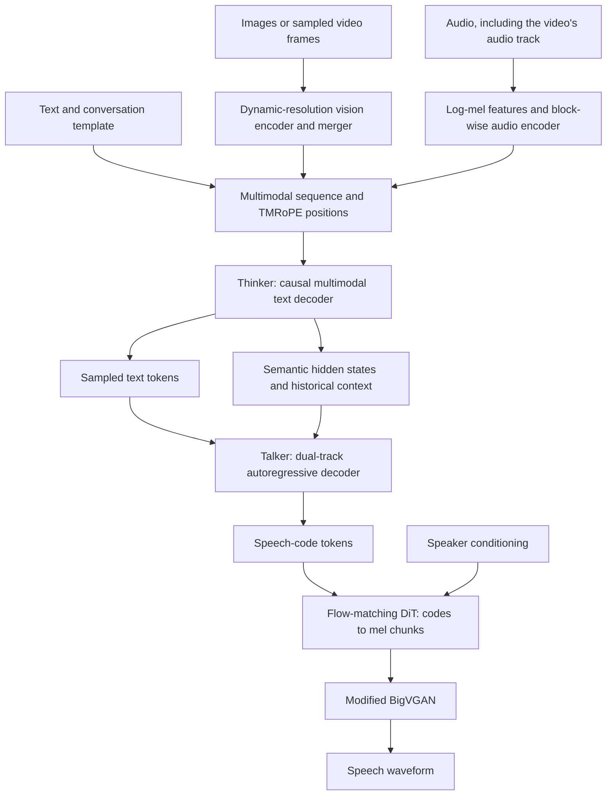
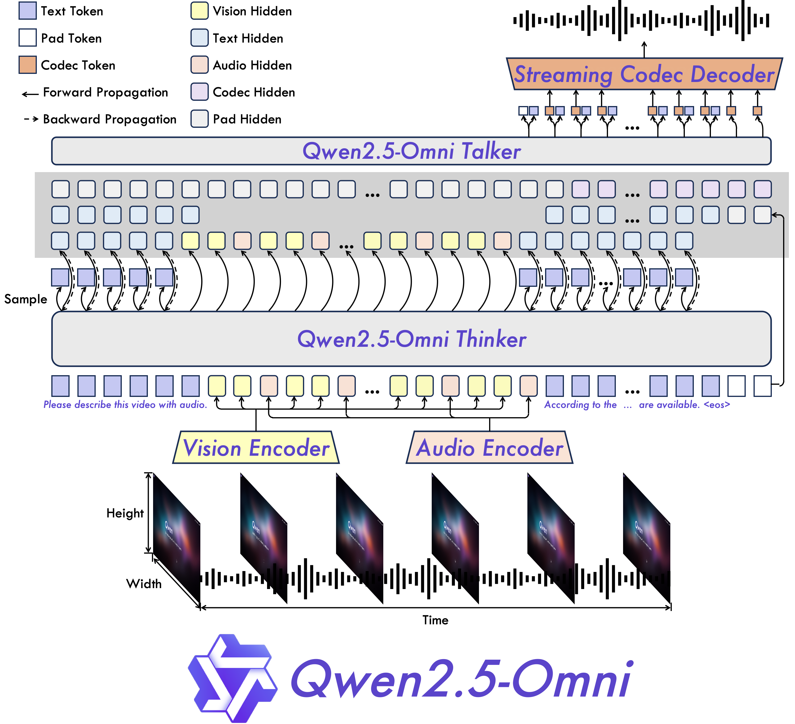
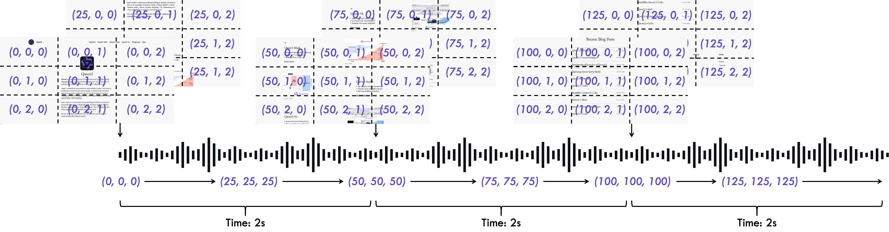
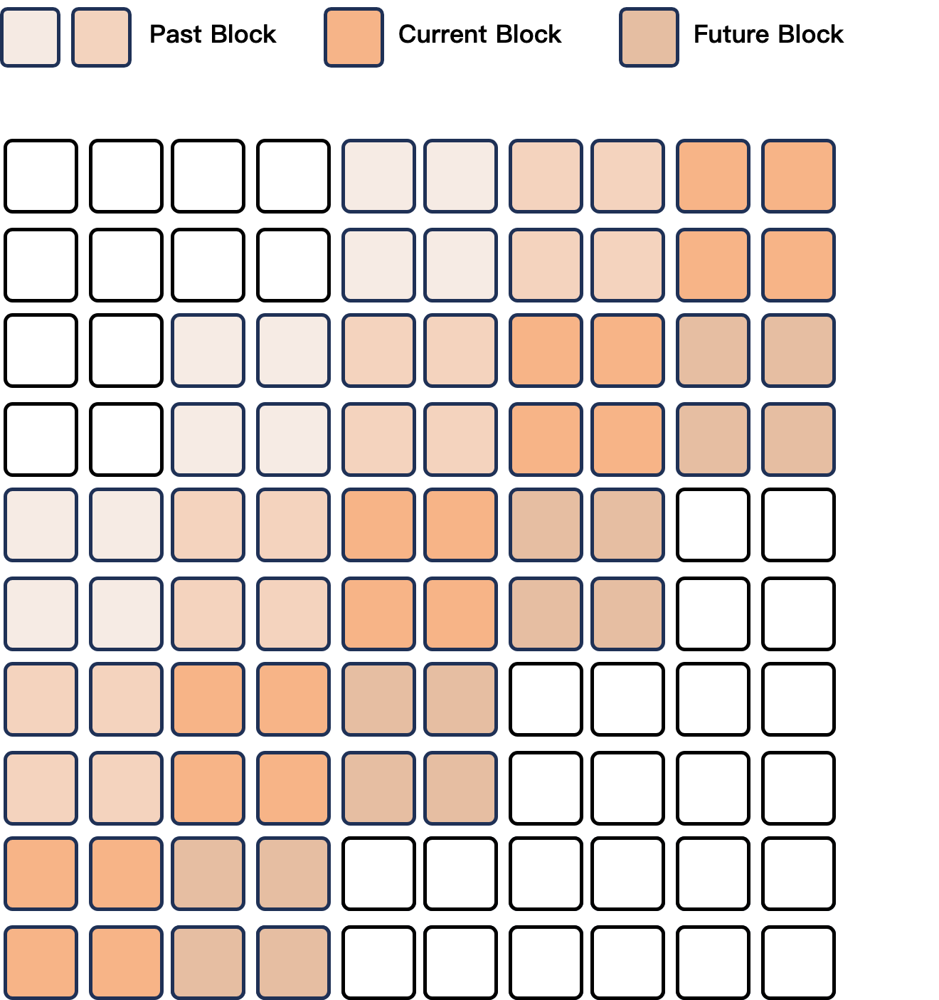

# Qwen2.5-Omni - Xu et al., 2025

> **arXiv:** [2503.20215v1](https://arxiv.org/abs/2503.20215v1) (26 March 2025) · **Venue:** preprint · **Affiliation:** Qwen Team, Alibaba Group
>
> **Scope:** the March 2025 technical report and its 7B experiments. Released configuration details and a pinned Transformers implementation are identified separately; later 3B, quantization, serving, and leaderboard updates are not results of this report.

## TL;DR

Qwen2.5-Omni accepts text, images, audio, and video with audio, and generates **text and speech** through a **Thinker-Talker** architecture. A multimodal Thinker produces text and semantic hidden states; a separate autoregressive Talker uses both those states and sampled text embeddings to generate speech codes, which a flow-matching DiT and BigVGAN turn into sound. Its main architectural contributions are time-aligned multimodal positional encoding and chunk-compatible perception/synthesis, not arbitrary image or video generation. Audio reasoning and joint audiovisual understanding improve substantially over the reported predecessors, while pure-text results trail Qwen2.5-7B and neither recognition nor synthesis wins every comparison.

## Problem & motivation

An assistant watching a video call needs more than an image model beside an ASR system. It must associate a sound with the relevant visual event, answer questions that depend on both streams, and start speaking without waiting for an entire conventional text-to-speech pipeline to finish. Separate ASR, language-model, and TTS stages also create an information bottleneck: a transcript does not preserve all the speaker emotion, environmental sounds, music, or visual context available in the original input.

Two technical mismatches motivate the design in [the report][Report]:

- **Different modalities do not arrive at the same rate.** Audio becomes a dense temporal sequence, whereas a video frame contributes a variable-size spatial grid. Ordinary token indices describe serialization order, not physical time. Frame number alone also fails when the video sampling rate changes.
- **Useful speech depends on both meaning and exact words.** High-level language-model states carry context and expressive intent, but semantically similar states do not uniquely specify pronunciation. Feeding only a completed answer string to an external TTS system loses the opportunity to share internal multimodal representations and overlap the stages.

The immediate predecessors address only part of this problem. [Qwen2-Audio](multimodal_2024_qwen2-audio.md) understands audio but produces text, while [Qwen2.5-VL](multimodal_2025_qwen2.5-vl.md) understands images and video without an audio-understanding or speech-generation branch. Omni combines these perception capabilities with a learned speech-output path. This is still a modular system internally; "end-to-end" does not mean that every modality uses one identical encoder or that the waveform is emitted directly by the language model.

## Key idea

**Let the reasoning/text path and speech-realization path share information without forcing them to be the same decoder.** Thinker handles multimodal understanding and text generation. Talker consumes a combination of Thinker representations, sampled text-token embeddings, historical context, and previous speech codes. The speech-code decoder then handles acoustic detail.

A useful explanatory factorization is:

$$
p(Y,C\mid X)
=p_{\mathrm{Thinker}}(Y\mid X)\,
 p_{\mathrm{Talker}}(C\mid X,H,Y),
\qquad
p_{\mathrm{Talker}}(C\mid X,H,Y)
=\prod_j p(c_j\mid c_{<j},X,H,Y).
$$

Here $X$ is the multimodal conversation, $Y=(y_1,\ldots,y_N)$ the generated text, $H$ the associated Thinker states, and $C=(c_1,\ldots,c_M)$ the speech-code sequence. This is a **reconstruction of the dependency structure**, not an equation printed in the paper. In a streaming schedule, each step must use only the conditioning made available so far; the expression is not permission to read future, ungenerated text.

There is no requirement that $M=N$, that a text token represent a spoken word, or that training provide word-level timestamps. The two tracks use special start/end/padding symbols and a monotonic conditioning schedule rather than externally supplied word-to-audio alignment. "Thinker" names the multimodal text decoder; it does not require an exposed chain-of-thought transcript.

The second key idea is **TMRoPE: Time-aligned Multimodal Rotary Position Embedding**. Its temporal coordinate advances at **25 position units per second**, matching the approximate **40 ms** spacing of input-audio representations. Video coordinates use elapsed time rather than merely counting frames. Audio and video representations are then interleaved in **2-second** bins, with visual representations before audio representations inside each bin (report, §§2.2-2.3).

## How it works

### 1. Overall data flow

*Original reconstruction. The text path can be used without speech generation. Talker generates codes; the separate DiT/BigVGAN stack reconstructs a waveform.*

*Report Figure 2. The two conditioning paths explain why this is not simply "generate the whole answer and send the string to a generic TTS model." The box labelled streaming codec decoder is downstream of Talker, not a synonym for Talker.*

### 2. Input representations

**Text.** The report describes a tokenizer with **151,643 regular tokens**. That is not the same quantity as the released Thinker's **152,064-row** embedding/output vocabulary, which also accommodates special/reserved entries and padding of the vocabulary dimension. Conversation formatting follows ChatML (report, §§2.2 and 4.1; [released configuration][Config]).

**Audio.** Resample to **16 kHz**, compute **128-bin log-mel features** with a **25 ms window** and **10 ms hop**, and encode them with a Whisper-large-v3-initialized audio tower adapted from the Qwen2-Audio line. At this sample rate, the window and hop correspond to **400** and **160 samples**, respectively. A stride-2 convolution followed by stride-2 pooling gives approximately one output representation per **40 ms**, or **25 representations/second** (report, §2.2; [pinned implementation][Model]).

For $L$ input mel frames, the implementation's length calculation is equivalent to:

$$
L_{\mathrm{conv}}=\left\lceil\frac{L}{2}\right\rceil,
\qquad
L_{\mathrm{audio}}=\left\lfloor\frac{L_{\mathrm{conv}}}{2}\right\rfloor.
$$

These equations describe convolution/pooling output lengths, not an exact conversion from an arbitrary waveform duration: feature-extractor boundary handling still matters. The encoder splits the mel sequence into blocks of up to **200 frames**; its `n_window=100` configuration corresponds to the post-convolution length of a full **2-second** block. Attention is block-wise rather than global across an entire recording. It is **not token-causal attention within each block**.

**Images and video.** The report reuses a roughly **675M-parameter** vision encoder from Qwen2.5-VL. The released configuration uses **14-pixel spatial patches**, **two-frame temporal patches**, and **2-by-2 spatial merging**. A still image is duplicated along the temporal dimension. For video, frames are sampled and resized dynamically, so the number of spatial tokens is not fixed (report, §2.2; [configuration][Config] and [processor][Processor]).

For a processed tensor with $F$ frames and valid height/width $H,W$, the visual-token accounting is:

$$
T_g=\left\lceil F/2\right\rceil,\qquad
N_{\mathrm{visual}}=T_g\frac{H}{28}\frac{W}{28}.
$$

Here $T_g$ counts temporal groups after padding/duplication; $H$ and $W$ refer to the resized grid, not the original file dimensions. The denominator $28=14\times2$ combines patch size and spatial merger size. An implementation should use the processor's actual `grid_thw` rather than recalculate token counts from unprocessed media.

Most vision layers use local spatial windows, with full-spatial-attention layers interspersed. Full spatial attention within a temporal group does not mean unrestricted attention across an entire long video. This distinction matters when interpreting the report's block-wise temporal perception.

### 3. Time-aligned positions and audiovisual serialization

RoPE rotates query/key components by position-dependent angles. In ordinary one-dimensional form, a two-dimensional coordinate pair at position $p$ and frequency $\omega_i$ is transformed by:

$$
R(p\omega_i)=
\begin{bmatrix}
\cos(p\omega_i)&-\sin(p\omega_i)\\
\sin(p\omega_i)&\cos(p\omega_i)
\end{bmatrix}.
$$

$R$ is a rotation matrix and $\omega_i$ is the frequency assigned to that pair of head dimensions. M-RoPE partitions these frequency channels among temporal, height, and width axes; TMRoPE changes how temporal positions are assigned so modalities can share a physical-time scale.

A simplified reconstruction of the position rules is:

$$
\begin{aligned}
P_{\mathrm{text}}(n)&=(b+n,b+n,b+n),\\
P_{\mathrm{audio}}(n)&=(b+n,b+n,b+n),\\
P_{\mathrm{image}}(r,c)&=(b,b+r,b+c),\\
P_{\mathrm{video}}(\tau,r,c)&=
\left(b+\lfloor25\tau\rfloor,\ b+r,\ b+c\right).
\end{aligned}
$$

$b$ is the span's position offset, $n$ a token/feature index, $r,c$ merged spatial-grid coordinates, and $\tau$ elapsed video time in seconds. Real token streams additionally contain modality delimiters and span transitions. The pinned implementation creates video temporal indices from `second_per_grid * 25` and converts nonnegative values to integer indices. For separate successive spans, new positions start beyond the preceding maximum coordinate, rather than blindly continuing the raw sequence index.

The important alignment is the **temporal coordinate**: audio's height/width coordinates also advance because audio uses the one-dimensional convention, whereas a video's height/width coordinates retain spatial meaning. TMRoPE does not make every coordinate of an audio feature equal to every coordinate of a contemporaneous visual token.

*Report Figure 3. Frame/grid positions advance with elapsed time, and the input is organized into 2-second audiovisual groups. The 25-unit temporal scale is specific to Omni here; it should not be replaced by the released Qwen2.5-VL configuration's 2-units-per-second scale.*

For audiovisual input, divide time into intervals $[2k,2(k+1))$, where $k$ is a nonnegative bin index. In each interval, serialize the corresponding **visual tokens first**, then the **audio tokens**. A complete interval contains approximately **50 audio features**, but its visual-token count depends on resolution and sampling. This is bin-wise alignment, **not a global sort of every token by exact sub-second timestamp**.

For example, at a chosen **2 fps** and processed **224-by-224** resolution, a 2-second clip contributes four sampled frames, two temporal groups, and $2(224/28)^2=128$ visual tokens. With 50 audio features, that is approximately **178 multimodal payload tokens**, before text and delimiters. Timestamp alignment does not reduce this payload or guarantee correct semantic association by itself.

**Operational trap:** the pinned processor defaults `use_audio_in_video` to `False`. To reason about the soundtrack, the caller must actually extract/provide the audio and consistently enable the corresponding processing/model options. A video filename, subtitles, or video tokens alone do not prove that audio was included.

### 4. Thinker-to-Talker conditioning

Thinker is a causal language decoder initialized from Qwen2.5 and conditioned on the assembled multimodal sequence. It emits text tokens and high-level hidden representations. Talker is another causal Transformer, with its own speech-code output head. Its two-track design provides exact text information as well as contextual semantic states (report, §2.3).

The additive structure in the pinned implementation can be summarized as:

$$
r_j=h_j+e_{\mathrm{text},j},\qquad
u_j=P\!\left(e_{\mathrm{codec},j}+r_j\right).
$$

$h_j$ is the available Thinker hidden-state contribution, $e_{\mathrm{text},j}$ the associated sampled-text embedding or track-control/padding contribution, $e_{\mathrm{codec},j}$ the previous-code/control embedding, and $P$ the learned Thinker-to-Talker projection. $u_j$ is the Talker input representation. This is an **implementation schematic**, not a paper equation or a claim that text and speech tokens have word-level time alignment; prefill and start/end/padding handling require their own sequence construction.

In the released 7B configuration, these conditioning embeddings have width **3,584**, while the Talker residual stream has width **896**. The projection bridges the dimensions. Talker can consume the historical multimodal context represented by Thinker rather than only a final response string.

The text track resolves pronunciation ambiguity that hidden semantics alone leave underspecified. The hidden-state path can supply context, emotional intent, and prosodic information that is not captured by isolated token identity. These are complementary inputs; replacing one with the other is not the reported architecture.

### 5. Speech codes to waveform

The report names its discrete representation **qwen-tts-tokenizer**. Talker autoregressively generates these speech codes, then a **flow-matching Diffusion Transformer (DiT)** produces mel features and a modified **BigVGAN** vocoder produces waveform samples (report, §§2.3-2.4).

A standard conditional flow-matching formulation helps explain the DiT's role:

$$
x_t=(1-t)\epsilon+t\,m,\qquad
\mathcal L_{\mathrm{FM}}=
\mathbb E\left[
\left\|v_\theta(x_t,t\mid C,s)-(m-\epsilon)\right\|_2^2
\right].
$$

Here $m$ is the target mel representation, $\epsilon$ a noise sample, $t\in[0,1]$ flow time, $C$ the speech codes, $s$ speaker conditioning, and $v_\theta$ a learned velocity field. Integrating a learned field transforms noise into a conditioned mel representation.

**This equation is explanatory background, not a fully specified training objective supplied by this report.** The report does not disclose the complete codec/DiT training recipe, path distribution, or all synthesis-training hyperparameters. The pinned inference implementation exposes a default **10** sampling steps; that is an implementation default, not a published training budget.

Input perception and output synthesis use different acoustic dimensions: **128 mel bins** enter the audio encoder, whereas the released synthesis stack uses **80 mel channels**. The DiT repeats a code embedding over **two mel frames**, and BigVGAN's upsampling factors are **[5, 3, 2, 2, 2, 2]**, whose product is **240** waveform samples per mel frame. The official usage example writes the output at **24 kHz**. Consequently these settings imply **100 mel frames/second** and approximately **50 speech codes/second**; this is a derivation from the released synthesis settings, **not** the 25-Hz input-audio feature rate ([configuration][Config], [implementation][Model], [official usage][Code]).

### 6. What makes synthesis stream-compatible

The report's DiT attention design uses an effective sliding window covering **two past blocks, the current block, and one future block**. The future block improves acoustic continuity but introduces lookahead. BigVGAN's fixed receptive field allows the waveform stage to be applied to chunks with the required neighboring context instead of waiting for an entire utterance (report, §2.4).

*Report Figure 4. The highlighted attention window is a latency/quality compromise, not strictly zero-lookahead causal waveform generation.*

The [pinned configuration defaults][ConfigurationCode] make this more concrete: mel blocks have length **24**, one-block lookahead is assigned to layer **10**, and one-block backward attention to layers **0 and 20** (zero-based). Other layers remain block-local. Context expansion is therefore distributed across selected layers; naively giving every layer the entire four-block mask would not reproduce the same attention connectivity. At the derived 100-Hz mel rate, a block corresponds to **240 ms**, but this conversion is **not a measured first-packet latency**.

Initial response time still includes input processing, Thinker prefill/first text, Talker code generation, synthesis lookahead, and waveform decoding. The report discusses these sources qualitatively but provides **no hardware-controlled initial-packet latency table or numerical end-to-end latency guarantee**.

There is also a distinction between an architecture and a particular API. In **Transformers v4.52.4**, the convenience `generate()` implementation first completes Thinker generation, then runs Talker generation, then invokes the waveform decoder and returns the text and waveform. That helper is not evidence of concurrent text/audio packet delivery. A live service needs an appropriate streaming scheduler and streaming interfaces; later serving implementations should not be treated as experiments reported in this March paper.

### 7. Released architecture details versus report claims

These are selected fields from the [released 7B configuration][Config], supplemented only where explicitly noted by [Transformers v4.52.4][ConfigurationCode]. They are not a parameter-count table printed in the report.

| Component | Layers | Hidden width | Attention heads | Other relevant dimensions |
|---|---:|---:|---|---|
| Thinker text decoder | 28 | 3,584 | 28 query / 4 KV | FFN 18,944; embedding vocabulary 152,064 |
| Audio encoder | 32 | 1,280 | 20 | FFN 5,120; projection output 3,584 |
| Vision encoder | 32 | 1,280 | 16 | FFN 3,420; merger output 3,584 |
| Talker | 24 | 896 | 12 query / 4 KV | Explicit head dimension 128; input embedding width 3,584; FFN 18,944 |
| Synthesis DiT | 22 | 1,024 | 16 | Head dimension 64; code embedding width 512; FFN multiplier 2; mel width 80 |

Thinker and Talker have a configured maximum context of **32,768** and RoPE base **1,000,000**, with M-RoPE sections **[16, 24, 24]**. For a 128-dimensional head, these sections specify frequency-pair allocation: their sum is 64, not a 64-dimensional complete head.

Talker's explicit query-head width means $12\times128=1536$ need not equal its 896-wide residual stream: learned attention projections map between these spaces. Do not derive its head dimension by dividing residual width by head count, or infer a small parameter count from residual width alone. Its configured output vocabulary is **8,448**, whereas the DiT has **8,193** code-embedding entries; neither number should be substituted for the text vocabulary or interpreted as a published complete codec specification.

The vision configuration uses window size **112** and full-spatial-attention layer indices **[7, 15, 23, 31]**. As with the acoustic settings, configuration observations complement the report rather than establish that every later release uses identical settings.

## Training / data

### 1. Initialization and three-stage pretraining

The language backbone starts from **Qwen2.5**, the vision encoder from **Qwen2.5-VL**, and the audio encoder from **Whisper-large-v3**. Audio task instructions use natural-language prompts instead of the earlier hierarchical audio-tag scheme (report, §3).

The curriculum is **alignment, joint training, then long-context extension**, not an image-only to video-only to audio-only curriculum:

1. **Align encoders with a frozen language model.** Train adapters first, then train the audio and vision encoders separately while retaining a fixed LLM. This makes modality representations usable in the language-model space without immediately changing the language backbone.
2. **Joint multimodal pretraining.** Unfreeze all parameters for the joint phase. Alongside pure-text data, the report adds **800B image/video-related tokens**, **300B audio-related tokens**, and **100B video-with-audio-related tokens**.
3. **Long-context extension.** Increase the maximum length from **8,192** in the preceding stages to **32,768**, adding long audio/video and other long-context examples.

The three named multimodal categories sum to **1.2T tokens**, but this is **not the complete total pretraining budget**: the report does not provide a comparable total for all pure-text data and all stages. It also does not publish a full optimizer, learning-rate schedule, batch-size, hardware, and per-dataset mixture recipe sufficient for an independent training reproduction.

An autoregressive next-token loss illustrates the supervised language/code prediction objectives:

$$
\mathcal L_{\mathrm{NTP}}
=-\sum_{j\in\mathcal S}\log p_\theta(z_j\mid z_{<j},X).
$$

$z_j$ is a target text or speech-code symbol, $X$ conditioning context, and $\mathcal S$ the supervised positions for the relevant training stage. This is a **generic reconstruction**; it is not a claim that the paper discloses one universal masking rule, joint loss weighting, or gradient treatment for every stage.

### 2. Thinker instruction tuning

Thinker undergoes supervised fine-tuning on ChatML-formatted conversations containing text-only, visual, audio, and mixed-modality examples (report, §4.1). This teaches task selection and conversational responses from the corresponding inputs. It should not be conflated with Talker's preference-optimization stage: the report does not describe the latter as a separate Thinker DPO recipe.

### 3. Talker post-training

The speech path has three further stages (report, §4.2):

1. **In-context speech continuation.** Train next-token prediction using context and spoken responses. The goal is a monotonic mapping from semantic conditioning to speech codes while learning prosody, emotion, accent, and speaker-related behavior without requiring word-level alignment annotations. The report discusses timbre disentanglement but does not give a complete independent recipe.
2. **Preference optimization for stable speech.** Rank generated candidates with rewards based on **word error rate** and **punctuation-pause errors**, then apply DPO. This targets content omissions/repetitions and inappropriate pauses rather than only making speech sound pleasant.
3. **Multi-speaker/speaker-specific instruction tuning.** Adapt the output to target voices and improve naturalness and controllability. The single-speaker experiments report four anonymous speakers; these labels are not a documented mapping to the named voices exposed by later public APIs.

The report's actual **Equation 1** is:

$$
\mathcal L_{\mathrm{DPO}}(\pi_\theta;\pi_{\mathrm{ref}})
=-\mathbb E_{(x,y_w,y_l)\sim\mathcal D}
\left[
\log\sigma\left(
\beta\log\frac{\pi_\theta(y_w\mid x)}{\pi_{\mathrm{ref}}(y_w\mid x)}
-
\beta\log\frac{\pi_\theta(y_l\mid x)}{\pi_{\mathrm{ref}}(y_l\mid x)}
\right)
\right].
$$

$x$ is conditioning input, $y_w$ the preferred speech sequence, $y_l$ the dispreferred sequence, $\mathcal D$ the preference dataset, $\pi_\theta$ the optimized policy, $\pi_{\mathrm{ref}}$ the reference policy, $\sigma$ the sigmoid, and $\beta$ the reference-relative preference scale. Sequence probabilities factor over autoregressive code tokens. The loss raises the preferred candidate's log-likelihood advantage over the rejected one relative to the reference. The report does **not** give a numerical $\beta$, all reward weights, or an exhaustive candidate-sampling recipe; it does not establish a GRPO/PPO training stage.

## Results

All numbers below are from **2503.20215v1**, not the subsequently updated repository leaderboard. Missing values remain `-`. Scores retain their reported units; do not average different benchmarks or compare an ASR error rate directly with a captioning or similarity score.

### 1. Pure-text capability

Source: **report Table 1**. Higher is better for these reported scores.

| Benchmark | Qwen2-7B | Qwen2.5-7B | Omni-7B |
|---|---:|---:|---:|
| MMLU-Pro | 44.1 | 56.3 | 47.0 |
| MMLU-redux | 67.3 | 75.4 | 71.0 |
| LiveBench 0831 | 29.2 | 35.9 | 29.6 |
| GPQA | 34.3 | 36.4 | 30.8 |
| MATH | 52.9 | 75.5 | 71.5 |
| GSM8K | 85.7 | 91.6 | 88.7 |
| HumanEval | 79.9 | 84.8 | 78.7 |
| MBPP | 67.2 | 79.2 | 73.2 |
| MultiPL-E | 59.1 | 70.4 | 65.8 |
| LiveCodeBench 2305-2409 | 23.9 | 28.7 | 24.6 |

Omni is below **Qwen2.5-7B on all ten displayed benchmarks**. For example, MMLU-Pro falls by **9.3 points** and HumanEval by **6.1 points**, derived from Table 1. Thus "maintains language capability" should be read as retaining useful competence, not numerical parity with its immediate text-only backbone. The prose mentions LiveBench 0803 whereas the table labels 0831; the table version is preserved here.

### 2. Speech recognition and translation

Source: **report Table 2**. The ASR values are reported error rates, lower being better; language-specific WER/CER protocols must not be treated as interchangeable. Translation scores are higher-is-better BLEU.

**LibriSpeech ASR**

| Model | dev-clean | dev-other | test-clean | test-other |
|---|---:|---:|---:|---:|
| Whisper-large-v3 | - | - | 1.8 | 3.6 |
| MinMo | - | - | 1.7 | 3.9 |
| Qwen-Audio | 1.8 | 4.0 | 2.0 | 4.2 |
| Qwen2-Audio | 1.3 | 3.4 | 1.6 | 3.6 |
| Omni-7B | 1.6 | 3.5 | 1.8 | 3.4 |

**Common Voice 15 ASR**

| Model | en | zh | yue | fr |
|---|---:|---:|---:|---:|
| Whisper-large-v3 | 9.3 | 12.8 | 10.9 | 10.8 |
| MinMo | 7.9 | 6.3 | 6.4 | 8.5 |
| Qwen2-Audio | 8.6 | 6.9 | 5.9 | 9.6 |
| Omni-7B | 7.6 | 5.2 | 7.3 | 7.5 |

**FLEURS ASR**

| Model | zh | en |
|---|---:|---:|
| Whisper-large-v3 | 7.7 | 4.1 |
| MinMo | 3.0 | 3.8 |
| Qwen2-Audio | 7.5 | - |
| Omni-7B | 3.0 | 4.1 |

**WenetSpeech ASR**

| Model | test-net | test-meeting |
|---|---:|---:|
| Seed-ASR-Chinese | 4.7 | 5.7 |
| MinMo | 6.8 | 7.4 |
| Omni-7B | 5.9 | 7.7 |

**VoxPopuli V1.0 English ASR**

| Model | Error rate |
|---|---:|
| Llama-3-8B | 6.2 |
| Llama-3-70B | 5.7 |
| Omni-7B | 5.8 |

**CoVoST2 speech-to-text translation**

| Model | en-de | de-en | en-zh | zh-en |
|---|---:|---:|---:|---:|
| Qwen-Audio | 25.1 | 33.9 | 41.5 | 15.7 |
| Qwen2-Audio | 29.9 | 35.2 | 45.2 | 24.4 |
| Omni-7B | 30.2 | 37.7 | 41.4 | 29.4 |

This is not a uniform ASR/translation improvement over Qwen2-Audio: Cantonese Common Voice and three LibriSpeech splits regress, as does English-to-Chinese translation. The WenetSpeech comparison also shows that a specialized recognizer remains stronger on both displayed splits.

### 3. Sound, music, audio reasoning, and spoken interaction

Source: **report Table 3**, unless stated otherwise.

| Task | Reference | Reference score | Omni-7B |
|---|---|---:|---:|
| MELD | Qwen2-Audio | 0.553 | 0.570 |
| VocalSound | Qwen2-Audio | 0.939 | 0.939 |
| GiantSteps Tempo | LLark-7B | 0.86 | 0.88 |

These are the table's reported scores; the report's expansion of SER as "Speech Entity Recognition" should not be used to redefine MELD, an emotion-recognition dataset. The VocalSound result is a tie, not a strict improvement.

For **MusicCaps**, Table 3 prints six scores without naming the six component metrics. Preserve their source order rather than assigning guessed BLEU/METEOR/CIDEr labels:

| Model | Slot 1 | Slot 2 | Slot 3 | Slot 4 | Slot 5 | Slot 6 |
|---|---:|---:|---:|---:|---:|---:|
| LP-MusicCaps | 0.291 | 0.149 | 0.089 | 0.061 | 0.129 | 0.130 |
| Omni-7B | 0.328 | 0.162 | 0.090 | 0.055 | 0.127 | 0.225 |

**MMAU audio reasoning**

| Model | Sound | Music | Speech | Reported average |
|---|---:|---:|---:|---:|
| Gemini-Pro-V1.5 | 56.75 | 49.40 | 58.55 | 54.90 |
| Qwen2-Audio | 54.95 | 50.98 | 42.04 | 49.20 |
| Omni-7B | 67.87 | 69.16 | 59.76 | 65.60 |

The average gain over Qwen2-Audio is **16.40 points**, derived from Table 3. Unlike recognition-only evaluations, these tasks probe reasoning about audio content.

**VoiceBench**, split across two tables for readability:

| Model | AlpacaEval | CommonEval | SD-QA | MMSU |
|---|---:|---:|---:|---:|
| MiniCPM-o | 4.42 | 4.15 | 50.72 | 54.78 |
| Baichuan-Omni-1.5 | 4.50 | 4.05 | 43.40 | 57.25 |
| Qwen2-Audio | 3.74 | 3.43 | 35.71 | 35.72 |
| Omni-7B | 4.49 | 3.93 | 55.71 | 61.32 |

| Model | OpenBookQA | IFEval | AdvBench | Reported average |
|---|---:|---:|---:|---:|
| MiniCPM-o | 78.02 | 49.25 | 97.69 | 71.69 |
| Baichuan-Omni-1.5 | 74.51 | 54.54 | 97.31 | 71.14 |
| Qwen2-Audio | 49.45 | 26.33 | 96.73 | 55.35 |
| Omni-7B | 81.10 | 52.87 | 99.42 | 74.12 |

VoiceBench includes mixed score scales, so its reported aggregate is not the unnormalized arithmetic mean of these columns. AdvBench follows the benchmark's response-evaluation protocol; its number should not be relabelled an attack-success rate. These evaluations concern responses to speech, not waveform naturalness.

### 4. In-house speech-instruction evaluation

Source: **report Table 4 and §5.2**. Approximately **90%** of the text instructions are represented in the self-curated speech-instruction subsets, marked with an asterisk. Inputs are spoken for the audio models, but evaluated answers are text.

| Subset | Qwen2-7B, text input | Qwen2-Audio, speech input | Omni-7B, speech input |
|---|---:|---:|---:|
| MMLU* | 69.3 | 33.2 | 65.6 |
| CEval* | 78.4 | 38.6 | 61.1 |
| IFEval* | 53.3 | 15.6 | 41.7 |
| GSM8K* | 82.3 | 18.4 | 85.4 |
| Math23K* | 92.3 | 23.0 | 87.1 |
| Math401* | 75.5 | 20.4 | 62.2 |

The improvement over Qwen2-Audio is large, especially for math. However, the text baseline is **Qwen2-7B**, not Qwen2.5-7B or Omni's own matched text-input run. The filtered subsets also differ from the complete text benchmarks in Table 1. This is not a controlled estimate of the loss incurred solely by replacing text with speech.

### 5. Image understanding

Source: **report Table 5**. Scores are higher-is-better within each benchmark; MME and MM-MT-Bench do not share the percentage scale of many other rows.

| Benchmark / split | Qwen2.5-VL-7B | Omni-7B |
|---|---:|---:|
| MMMU val | 58.6 | 59.2 |
| MMMU-Pro overall | 38.3 | 36.6 |
| MathVista testmini | 68.2 | 67.9 |
| MathVision full | 25.1 | 25.0 |
| MMBench V1.1 EN test | 82.6 | 81.8 |
| MMVet turbo | 67.1 | 66.8 |
| MMStar | 63.9 | 64.0 |
| MME sum | 2347 | 2340 |
| MuirBench | 59.6 | 59.2 |
| CRPE relation | 76.4 | 76.5 |
| RealWorldQA average | 68.5 | 70.3 |
| MME-RealWorld en | 57.4 | 61.6 |
| MM-MT-Bench | 6.3 | 6.0 |
| AI2D | 83.9 | 83.2 |
| TextVQA val | 84.9 | 84.4 |
| DocVQA test | 95.7 | 95.2 |
| ChartQA test average | 87.3 | 85.3 |
| OCRBench V2 en | 56.3 | 57.8 |

The result is broadly comparable vision capability, not a universal improvement over Qwen2.5-VL. Gains on RealWorldQA and OCRBench V2 coexist with declines on several document/chart and reasoning benchmarks.

### 6. Localization

Source: **report Table 6**. The source's `textA`/`textB` labels are rendered as the conventional **testA/testB** split names here.

| Benchmark / split | Grounding DINO | Qwen2.5-VL-7B | Omni-7B |
|---|---:|---:|---:|
| RefCOCO val | 90.6 | 90.0 | 90.5 |
| RefCOCO testA | 93.2 | 92.5 | 93.5 |
| RefCOCO testB | 88.2 | 85.4 | 86.6 |
| RefCOCO+ val | 88.2 | 84.2 | 85.4 |
| RefCOCO+ testA | 89.0 | 89.1 | 91.0 |
| RefCOCO+ testB | 75.9 | 76.9 | 79.3 |
| RefCOCOg val | 86.1 | 87.2 | 87.4 |
| RefCOCOg test | 87.0 | 87.2 | 87.9 |
| ODinW | 55.0 | 37.3 | 42.2 |
| PointGrounding | - | 67.3 | 66.5 |

All eight displayed RefCOCO-family splits improve over Qwen2.5-VL. However, ODinW remains below Grounding DINO, and PointGrounding declines relative to the VL predecessor.

### 7. Video understanding without an audio track

Source: **report Table 7**.

| Benchmark | Qwen2.5-VL-7B | Omni-7B |
|---|---:|---:|
| Video-MME without subtitles | 65.1 | 64.3 |
| Video-MME with subtitles | 71.6 | 72.4 |
| MVBench | 69.6 | 70.3 |
| EgoSchema test | 65.0 | 68.6 |

These comparisons concern video understanding **without audio**. "With subtitles" does not mean that the model processed the soundtrack. Joint audiovisual capability needs a separate evaluation.

### 8. Joint multimodal understanding

Source: **report Table 8**, OmniBench. All values below are percentages.

| Model | Speech | Sound event | Music | Reported average |
|---|---:|---:|---:|---:|
| Gemini-1.5-Pro | 42.67 | 42.26 | 46.23 | 42.91 |
| video-SALMONN, 13B | 34.11 | 31.70 | 56.60 | 35.64 |
| MiniCPM-o | - | - | - | 40.5 |
| Baichuan-Omni-1.5 | - | - | - | 42.9 |
| Omni-7B | 55.25 | 60.00 | 52.83 | 56.13 |

This is the most direct evidence for the integrated multimodal claim. Omni's reported average is **13.22 points** above Gemini-1.5-Pro, derived from Table 8, but video-SALMONN has a higher music-category score. Preserve the benchmark's reported aggregate rather than replacing it with an unweighted mean of the three category entries.

### 9. Zero-shot speech synthesis

Source: **report Table 9**, Seed-TTS evaluation. **WER is lower-is-better** and **speaker similarity is higher-is-better**. ICL and RL denote the report's pre-/post-preference-optimization variants; the described preference method is DPO.

| Model | WER test-zh | WER test-en | WER test-hard |
|---|---:|---:|---:|
| Seed-TTS ICL | 1.11 | 2.24 | 7.58 |
| Seed-TTS RL | 1.00 | 1.94 | 6.42 |
| MaskGCT | 2.27 | 2.62 | 10.27 |
| E2 TTS | 1.97 | 2.19 | - |
| F5-TTS | 1.56 | 1.83 | 8.67 |
| CosyVoice 2 | 1.45 | 2.57 | 6.83 |
| CosyVoice 2-S | 1.45 | 2.38 | 8.08 |
| Omni-7B ICL | 1.70 | 2.72 | 7.97 |
| Omni-7B RL | 1.42 | 2.33 | 6.54 |

| Model | Similarity test-zh | Similarity test-en | Similarity test-hard |
|---|---:|---:|---:|
| Seed-TTS ICL | 0.796 | 0.762 | 0.776 |
| Seed-TTS RL | 0.801 | 0.766 | 0.782 |
| MaskGCT | 0.774 | 0.714 | 0.748 |
| E2 TTS | 0.730 | 0.710 | - |
| F5-TTS | 0.741 | 0.647 | 0.713 |
| CosyVoice 2 | 0.748 | 0.652 | 0.724 |
| CosyVoice 2-S | 0.753 | 0.654 | 0.732 |
| Omni-7B ICL | 0.752 | 0.632 | 0.747 |
| Omni-7B RL | 0.754 | 0.641 | 0.752 |

Preference optimization improves all six displayed Omni measurements. Nevertheless, Seed-TTS RL has lower WER and higher similarity on all three splits, and F5-TTS has lower English WER. These results support competitive synthesis, not blanket dominance over specialized TTS.

### 10. Speaker-specific synthesis and naturalness

Source: **report Table 10**. WER uses Seed-TTS evaluation; NMOS uses the authors' naturalness evaluation dataset. They measure different properties.

| Model | WER test-zh | WER test-en | WER test-hard |
|---|---:|---:|---:|
| Human | 1.25 | 2.14 | - |
| Omni RL | 1.30 | 2.33 | 6.54 |
| Omni Speaker A | 1.29 | 1.86 | 6.59 |
| Omni Speaker B | 1.37 | 1.89 | 7.25 |
| Omni Speaker C | 1.30 | 2.13 | 6.43 |
| Omni Speaker D | 1.28 | 1.83 | 7.16 |

| Model | NMOS zh | NMOS en |
|---|---:|---:|
| Human | 4.51 | - |
| Omni Speaker A | 4.46 | 4.51 |
| Omni Speaker B | 4.51 | 4.62 |
| Omni Speaker C | 4.50 | 4.60 |
| Omni Speaker D | 4.48 | 4.58 |

**Internal source discrepancy:** Table 9 gives Omni RL Chinese WER as **1.42**, whereas Table 10's RL row gives **1.30**. The report does not explain this difference, so both values are preserved rather than silently harmonized.

Chinese naturalness scores are close to the displayed human score, but the report does not supply the rater design, uncertainty intervals, or an English human NMOS value needed for claims of statistical equivalence or superhuman English naturalness. Lower ASR-measured WER than a human recording is also not a general measure of speech quality.

## Limitations & follow-ups

1. **Output scope is narrower than "any-to-any."** The demonstrated outputs are text and speech. The conclusion identifies additional output modalities as future work; this is not an image generator, video generator, or general music-generation report.
2. **Multimodal breadth has a text-quality cost in the displayed comparison.** Every Table 1 result is below Qwen2.5-7B. The report does not provide an ablation isolating whether this comes from data mixture, training schedule, model interference, or another cause.
3. **Audio/video alignment is an architectural aid, not a solved reasoning guarantee.** TMRoPE aligns temporal coordinates and binning, but failures can still arise from sampling, resolution, recognition errors, or incorrect cross-modal association. More aligned streams also mean more input tokens.
4. **Streaming has nonzero buffering and implementation requirements.** Input blocks, speech-code generation, DiT lookahead, and vocoder context all matter. The report does not measure a universal first-packet latency, and the inspected convenience API is sequential rather than a complete live scheduler.
5. **Important reproduction details remain undisclosed.** The complete data provenance/mixture, optimizer and compute recipe, codec training, synthesis-loss particulars, reward weights, and preference hyperparameters are not provided. Released weights/configuration make inference much more reproducible than training from scratch.
6. **Benchmark protocols limit causal claims.** The speech-instruction subsets are curated and incomplete; their text baseline is a different model. Some captioning metrics are unnamed, source labels contain inconsistencies, and subjective speech results lack the uncertainty information needed for stronger statistical conclusions.
7. **There is no universal specialist-model replacement.** Cantonese recognition, some translations, point grounding, text benchmarks, and several TTS comparisons favor other models. Joint understanding is the clearest reason to choose the integrated system rather than assume every component is best-in-class.
8. **Paper, checkpoint, and service are different artifacts.** The report evaluates 7B; the official repository later adds 3B and other variants. Its public voice choices and serving behavior should not be confused with the report's anonymous speaker experiments or a general public voice-cloning interface.

For the preceding components, see [Qwen2.5](backbone_2024_qwen2.5.md), [Qwen2-Audio](multimodal_2024_qwen2-audio.md), and [Qwen2.5-VL](multimodal_2025_qwen2.5-vl.md). The [official repository][Code] is the appropriate place to distinguish later serving work and release changes from the frozen v1 results.

## Links

- **arXiv:** [abs](https://arxiv.org/abs/2503.20215v1) · [HTML][Report] · [PDF](https://arxiv.org/pdf/2503.20215v1)
- **Code / release history / usage:** [QwenLM/Qwen2.5-Omni][Code]
- **Hugging Face:** [Qwen2.5-Omni-7B](https://huggingface.co/Qwen/Qwen2.5-Omni-7B) · [released configuration][Config] · [Apache-2.0 license](https://huggingface.co/Qwen/Qwen2.5-Omni-7B/blob/main/LICENSE)
- **Pinned implementation supplement:** Transformers **v4.52.4** [model][Model] · [processor][Processor] · [configuration classes][ConfigurationCode]. These are implementation observations, not additional experimental results from the paper.
- **Project page / blog:** [Qwen2.5-Omni launch](https://qwenlm.github.io/blog/qwen2.5-omni/)
- **Evaluation context:** [VoiceBench source and protocol](https://github.com/MatthewCYM/VoiceBench) · [MELD dataset paper](https://aclanthology.org/P19-1050/)
- **Talks / videos:** demonstrations linked from the official repository; no separate research talk used here.
- **OpenReview / venue page:** no venue version used; this recap follows the arXiv preprint.
- **Papers-with-Code:** not used as a numerical source.
- **BibTeX:** [arXiv export](https://arxiv.org/bibtex/2503.20215)
- **Related papers:** [Qwen-Audio](multimodal_2023_qwen-audio.md) · [Qwen2-Audio](multimodal_2024_qwen2-audio.md) · [Qwen2-VL](multimodal_2024_qwen2-vl.md) · [Qwen2.5](backbone_2024_qwen2.5.md) · [Qwen2.5-VL](multimodal_2025_qwen2.5-vl.md)
- **Context guides:** [Qwen overview](../qwen/overview.md) · [attention](../qwen/attention/attention.md) · [positional methods](../qwen/positional/positional.md)

[Report]: https://arxiv.org/html/2503.20215v1 "Qwen2.5-Omni Technical Report, v1"
[Code]: https://github.com/QwenLM/Qwen2.5-Omni "Official Qwen2.5-Omni repository"
[Config]: https://huggingface.co/Qwen/Qwen2.5-Omni-7B/blob/main/config.json "Released 7B checkpoint configuration"
[Model]: https://github.com/huggingface/transformers/blob/v4.52.4/src/transformers/models/qwen2_5_omni/modeling_qwen2_5_omni.py "Transformers v4.52.4 model implementation"
[Processor]: https://github.com/huggingface/transformers/blob/v4.52.4/src/transformers/models/qwen2_5_omni/processing_qwen2_5_omni.py "Transformers v4.52.4 processor"
[ConfigurationCode]: https://github.com/huggingface/transformers/blob/v4.52.4/src/transformers/models/qwen2_5_omni/configuration_qwen2_5_omni.py "Transformers v4.52.4 configuration defaults"
