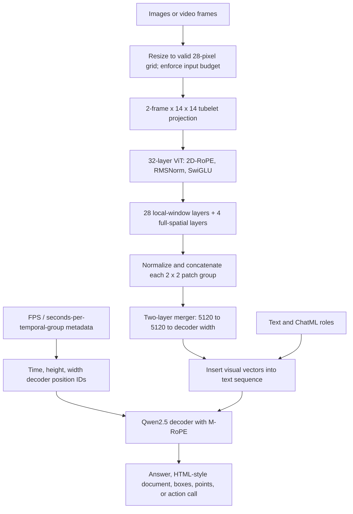
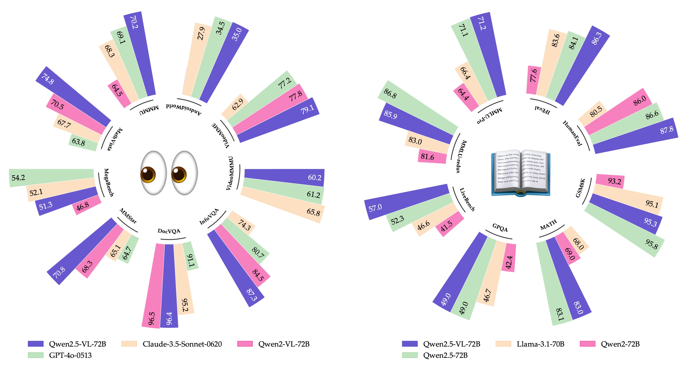

# Qwen2.5-VL: Efficient Dynamic Vision, Absolute-Time Video, and Structured Perception - Bai et al., 2025

> **arXiv:** [2502.13923v1](https://arxiv.org/abs/2502.13923v1) (19 February 2025) · **Venue:** preprint / technical report · **Affiliation:** Qwen Team, Alibaba Group
>
> This recap covers the report's 3B, 7B, and 72B models. Low-level details absent from the paper are attributed to released configurations or the version-pinned Transformers v4.51.3 implementation. Equations below unpack the mechanisms; the report itself does not present a numbered mathematical derivation of them.

## TL;DR

Qwen2.5-VL retains the dynamic-resolution vision-encoder/merger/causal-decoder design of Qwen2-VL, but rebuilds the vision encoder with **mostly windowed attention, RMSNorm, and SwiGLU**, and changes video M-RoPE from frame-count indexing to **time-aligned temporal coordinates**. Training expands to **4.1T combined training tokens**, with stronger absolute-coordinate grounding, HTML-style document parsing, variable-FPS video, and GUI interaction data, followed by **SFT and DPO**. The family improves document understanding, visual mathematics, localization, and several agent benchmarks while retaining strong text capabilities, but it does not dominate every benchmark. Hour-long video support remains a budgeted sampling problem, and strong screenshot grounding is not equivalent to reliable end-to-end computer use.

## Problem & motivation

### Dynamic resolution is useful, but expensive

[Qwen2-VL](multimodal_2024_qwen2-vl.md) already avoids a fixed image-token budget: larger or denser images can contribute more visual tokens. That preserves text, small objects, and layout better than forcing every input into one low-resolution square.

However, a vision transformer with global self-attention pays a quadratic attention cost in the number of patches. A tall document and an ordinary photograph can have radically different training costs, complicating batching and high-resolution inference. Qwen2.5-VL makes most vision-attention layers local while retaining periodic full-spatial attention for cross-window communication.

### Frame order does not encode elapsed time

In Qwen2-VL, temporal coordinates advance with the visual frame groups. Sampling the same clip at different rates can therefore change the apparent temporal scale: neighboring groups may be fractions of a second apart in one input and several seconds apart in another.

Qwen2.5-VL jointly trains with variable FPS and aligns the temporal component of decoder M-RoPE with elapsed video time. This helps separate **how much time passes** from **how many frames were sampled**, supporting temporal grounding and reasoning about event pace.

“Absolute time” here means a video's time coordinate rather than an arbitrary frame ordinal. It does not mean wall-clock UTC, continuous access to every original frame, or unlimited temporal precision.

### Recognition must become structured perception and action

An assistant needs more than a caption: it may need a point to click, bounding boxes for requested objects, a table extracted from a document, or a timestamped event interval. The paper treats these as related forms of structured prediction.

It expands training with absolute pixel-coordinate grounding, document content plus layout, temporally localized video descriptions, and function-call-style GUI actions. These representations make outputs useful to downstream software, but the application still has to validate coordinates, interpret formats, and execute any requested action.

## Key idea

### Preserve variable-length visual sequences; improve their cost and meaning

The architecture remains:

$$
\text{image/video}
\longrightarrow \text{dynamic-resolution ViT}
\longrightarrow \text{spatial merger}
\longrightarrow \text{Qwen2.5 causal decoder}
\longrightarrow \text{text or structured output}.
$$

Three modifications carry much of the architectural change:

1. **Efficient spatial perception:** 28 of 32 vision layers use local windows; four use full-spatial attention.
2. **Time-aware multimodal positions:** the decoder's temporal rotary coordinate represents elapsed video time rather than just the group number.
3. **Scale-aware output conventions:** boxes and points use image-coordinate values, and document parsing combines content and layout in one structured representation.


*Figure 1 illustrates different token counts for a tall document, a short formula, a photograph, and a video sampled at several rates. Its particular token counts are examples, not fixed allocations for all documents or videos.*

### Original architecture reconstruction



There is no separate detection or timestamp-regression head in this reconstruction. The decoder produces the requested structure autoregressively.

## How it works

### 1. Architecture and released configurations

The LLM initializes from Qwen2.5. The vision encoder is newly trained rather than simply carrying over the predecessor's vision weights: the report describes CLIP-style pretraining using DataComp and in-house data, then vision-language alignment and joint training.

Shared vision settings are **32 layers**, hidden width **1,280**, **16 attention heads**, spatial patch size **14**, temporal patch size **2**, spatial merge factor **2**, and window size **112 pixels**. The full-attention layers have zero-based indices **7, 15, 23, 31**, equivalent to layers 8, 16, 24, and 32.

The released Instruct configurations give:

| Size | Decoder layers | Decoder width | Decoder FFN | Query / KV heads | Tied embeddings | Embedding vocabulary | Vision FFN |
|---|---:|---:|---:|---|---|---:|---:|
| 3B | 36 | 2,048 | 11,008 | 16 / 2 | Yes | 151,936 | 3,420 |
| 7B | 28 | 3,584 | 18,944 | 28 / 4 | No | 152,064 | 3,420 |
| 72B | 80 | 8,192 | 29,568 | 64 / 8 | No | 152,064 | 3,456 |

All three configure decoder head width 128, RoPE base 1,000,000, and `max_position_embeddings=128000`. This configured limit is distinct from the **32,768-token final pretraining length**. The numeric `sliding_window` field does not establish active sliding-window decoder attention: these configurations set `use_sliding_window=false`.

**Paper/configuration differences:** Table 1 lists vision FFN width 3,456 for all sizes, a 3B decoder FFN width of 4,864, and vocabulary size 151,646. The released 3B/7B vision FFNs and 3B decoder FFN differ as shown above, and the embedding dimensions are larger. Use the released configuration to instantiate a checkpoint; do not attribute those corrections to the original table.

### 2. Preprocessing, tubelets, and exact token accounting

“Native dynamic resolution” does not mean arbitrary pixel dimensions are passed through unchanged. Section 2.1 states that height and width are resized to multiples of **28**, preserving aspect ratio approximately while meeting the patch-and-merge grid and configured pixel budget.

Let $H,W$ be the processed image/frame dimensions, $F$ the sampled frame count, $p=14$ the spatial patch size, $\tau=2$ the temporal patch size, and $s=2$ the spatial merge factor. If needed, repeat the final frame to complete the temporal group. A still image is repeated into a two-frame input.

Then

$$
T_g=\left\lceil\frac{F}{2}\right\rceil,\qquad
H_g=\frac{H}{14},\qquad W_g=\frac{W}{14},
$$

$$
N_{\mathrm{ViT}}=T_gH_gW_g,\qquad
N_{\mathrm{visual}}
=T_g\frac{H_g}{2}\frac{W_g}{2}
=T_g\frac{H}{28}\frac{W}{28}.
$$

$T_g,H_g,W_g$ are the temporal, height, and width dimensions of the tubelet grid. $N_{\mathrm{ViT}}$ is the number of vision-transformer vectors; $N_{\mathrm{visual}}$ is the number inserted into the language decoder after merging.

The pinned processor flattens each RGB tubelet into

$$
3\times2\times14\times14=1176
$$

values. A 3D patch projection maps these to 1,280-dimensional vision features. The flattened processor input has shape $N_{\mathrm{ViT}}\times1176$, while the encoded vision features have shape $N_{\mathrm{ViT}}\times1280$.

Examples reconstructed from this accounting:

| Processed input | Vision vectors | Merged decoder visual vectors |
|---|---:|---:|
| One 224-by-224 image | 256 | 64 |
| One 28-by-224 image | 32 | 8 |
| One 700-by-1260 image | 4,500 | 1,125 |
| One 8204-by-1092 image | 45,708 | 11,427 |

The last three match the still-image examples in Figure 1. A single image's visual span also has two boundary tokens; text, chat roles, and other delimiters add further sequence slots. Continuous image features are not free context.

For videos, frame count and per-frame resolution trade against a shared sequence budget. More temporal coverage can require lower FPS or lower spatial resolution rather than an unbounded token increase.

### 3. Window attention reduces most, not all, quadratic vision cost

A 112-by-112-pixel window covers **8-by-8 patches**, at most **64 vision tokens** per temporal slice. The implementation groups those into **4-by-4 merged-cell positions** for ordering. Partial edge windows contain fewer actual tokens.

The pinned code uses padding sentinels to build window indices, then removes them; this is bookkeeping rather than padding the image with additional learned visual tokens. It reorders features into windows, uses appropriate sequence boundaries for each attention layer, and restores spatial ordering after the merger.

Each vision block uses pre-normalization and residual connections:

$$
\begin{aligned}
U&=X+\operatorname{Attention}
(\operatorname{RMSNorm}(X);\mathcal W),\\
X'&=U+
\left[
\operatorname{SiLU}(VW_g)\odot(VW_u)
\right]W_d,\qquad
V=\operatorname{RMSNorm}(U).
\end{aligned}
$$

$X$ contains vision features, $\mathcal W$ specifies the window or full-spatial attention partition, $W_g,W_u,W_d$ are the SwiGLU gate/up/down matrices, and $\odot$ is elementwise multiplication. Vision queries and keys receive **2D spatial RoPE**.

For $N$ spatial patches per temporal slice and window capacity $w\leq64$, local attention-score construction is $O(Nw)$ instead of $O(N^2)$, ignoring width factors. Across the 32 vision layers, the attention-interaction count is approximately

$$
28\,O(Nw)+4\,O(N^2)
$$

per temporal slice. The four global layers still have quadratic spatial cost, and FFNs/projections add their own computation. The full system is therefore **not an entirely linear-time transformer**, nor does local vision attention remove quadratic decoder prefill costs.

In the pinned implementation, “full” vision attention is global **within each temporal tubelet's spatial grid**, not unrestricted attention over every frame of an entire video. Two-frame tubelets provide local temporal mixing; the language decoder performs broader video-sequence reasoning.

### 4. Merger: spatial concatenation, not a query resampler

Four neighboring vision vectors are normalized and concatenated:

$$
c_j=\operatorname{concat}
\left(\operatorname{RMSNorm}(x_{j,1}),\ldots,
\operatorname{RMSNorm}(x_{j,4})\right)\in\mathbb R^{5120}.
$$

The pinned merger computes

$$
v_j=W_2\operatorname{GELU}(W_1c_j+b_1)+b_2
\in\mathbb R^{d_{\mathrm{LLM}}},
$$

where the first map is $5120\rightarrow5120$ and the second is $5120\rightarrow d_{\mathrm{LLM}}$. $d_{\mathrm{LLM}}$ is 2,048, 3,584, or 8,192 depending on model size.

The merger uses **GELU** in the released implementation; the vision blocks use **SwiGLU**. These should not be conflated. The number of output vectors remains proportional to image area and sampled frame groups; there is no fixed 256-query bottleneck like the original [Qwen-VL](multimodal_2023_qwen-vl.md).

### 5. Two positional systems: spatial vision RoPE and decoder M-RoPE

The vision encoder's 2D-RoPE handles patch height and width. Separately, the decoder receives three-axis coordinates

$$
\mathbf p_n=(p_n^{(t)},p_n^{(h)},p_n^{(w)}).
$$

Text uses the same scalar on all three axes. Image visual tokens use a constant temporal coordinate with varying merged-grid rows and columns. Video tokens additionally vary time.

The released decoder configuration uses `mrope_section=[16,24,24]`. These are **64 rotary frequency-pair allocations**, corresponding to **32 temporal, 48 height, and 48 width scalar channels** in a 128-wide attention head. They are not 16/24/24 total scalar channels.

For frequency pair $j$ assigned to axis $a(j)$, a conceptual rotary transformation is

$$
\begin{pmatrix}
q'_{2j}\\q'_{2j+1}
\end{pmatrix}
=
\begin{pmatrix}
\cos\varphi_j&-\sin\varphi_j\\
\sin\varphi_j&\cos\varphi_j
\end{pmatrix}
\begin{pmatrix}
q_{2j}\\q_{2j+1}
\end{pmatrix},
\qquad
\varphi_j=p_n^{(a(j))}\omega_j.
$$

$q$ is a query-head vector and $\omega_j$ its rotary frequency. Keys use the corresponding rotation; the exact tensor layout follows the implementation. Assigning coordinates changes query/key geometry, not the number of cached tokens.

#### Temporal IDs based on elapsed time

For uniformly sampled video at FPS $f$, the pinned processor computes seconds per temporal group as

$$
\Delta t=\frac{\tau}{f}=\frac{2}{f}.
$$

With temporal resolution parameter $\kappa=2$ position units per second, group $i$ receives

$$
p_{i,r,c}^{(t)}
=b+\left\lfloor i\,\Delta t\,\kappa\right\rfloor,\qquad
p_{i,r,c}^{(h)}=b+r,\qquad
p_{i,r,c}^{(w)}=b+c.
$$

$r,c$ index the merged visual grid, and $b$ is the shared offset after preceding text. The cast to integer in the implementation produces the floor for nonnegative times. The paper motivates timestamp alignment; this formula describes the pinned processor's uniform-FPS metadata path, not every possible nonuniform sampler.

At 2 FPS, each two-frame group spans one second and advances the temporal coordinate by two units; at 1 FPS, it spans two seconds and advances by four units. The representation now conveys duration differences rather than assigning every group the same ordinal step.

Correct timing metadata matters. The processor supplies `second_per_grid_ts` from the effective FPS. Passing sampled frames without the corresponding rate can make the model interpret the wrong elapsed time. Integer IDs also quantize time; their existence is not a guarantee of arbitrary sub-second event precision.

After a visual span, text positions resume beyond the maximum used coordinate, not simply at the number of preceding sequence slots. The implementation tracks position deltas for generation accordingly.

### 6. Absolute coordinates and structured document output

Section 2.2.1 trains boxes and points using image-coordinate values instead of always normalizing them into a fixed coordinate range. This preserves pixel-scale information in the representation.

It does not reveal real-world size in meters. A consumer must also know **which image coordinate frame** the output refers to. For a plain resize from model frame $(W_m,H_m)$ to original frame $(W_o,H_o)$:

$$
x_o=x_m\frac{W_o}{W_m},\qquad
y_o=y_m\frac{H_o}{H_m}.
$$

Crops, padding, rotations, or other transforms require the corresponding inverse mapping, not just those ratios. A valid JSON response can still contain an incorrect box or click location.

Document omni-parsing combines content, layout boxes, reading order, and element types in an HTML-style representation. The paper includes paragraphs, styled tables, chart data, formulas, image captions/OCR, music notation, and chemical formulas. The following is an illustrative simplified output, not an exact schema definition:

```html
<html>
  <body>
    <p data-bbox="0 0 224 28">Quarterly totals</p>
    <table data-bbox="0 28 224 140">
      <tr><th>Quarter</th><th>Total</th></tr>
      <tr><td>Q1</td><td>42</td></tr>
    </table>
  </body>
</html>
```

This unifies tasks that otherwise require a layout detector, OCR model, table recognizer, and chart parser. It does not guarantee syntactically valid output or exact preservation of every document element.

## Training / data

### 1. Pretraining data construction

The report's data expansion is broader than image captions:

| Data component | Construction and purpose |
|---|---|
| Captions and visual knowledge | General image-text association and recognition of entities such as landmarks, people, flora, and fauna. These help establish the visual-language interface. |
| Interleaved image-text | Standard cleaning followed by internal-model scoring of text quality, relevance, complementary information, and balance of information density. Images should contribute information rather than merely decorate unrelated text. |
| Grounding | Public and proprietary box/point annotations, synthesized XML/JSON/custom formats, copy-paste augmentation, and outputs from systems such as Grounding DINO and SAM. Training expands beyond 10,000 object categories and includes absent-object queries and multiple instances. |
| Pointing and counting | PixMo material, detection/segmentation sources, and synthetic detail-pointing data. These teach precise locations that a whole-object box may not represent well. |
| Document omni-parsing | Synthetic layouts unify text, tables, charts, formulas, images, music, and chemistry in HTML-style targets with reading-order and bounding-box information. |
| OCR, charts, and tables | Synthetic, public, and in-house text images cover multiple scripts and natural scenes. The report describes 1M synthesized charts and 6M real-world table samples processed by an offline recognizer, then filtered for confidence, overlap, and cell density. |
| Video | Variable-FPS sampling broadens rate coverage. For videos longer than half an hour, a synthesis pipeline composes multi-frame captions into long-video descriptions. Temporal grounding uses seconds and hour-minute-second-frame output formats. |
| Agent interaction | Screenshots from mobile, web, and desktop environments receive captions and UI grounding annotations. Multi-step trajectories are converted into a shared function-call action space. |

*Source: Section 2.2.1. The table and chart counts describe data construction, not held-out accuracy or independently human-verified labels.*

For agent reasoning annotations, the authors provide the intended operation, highlight it in the screenshot, and give annotators the global query plus before/after screenshots. Human or model annotators explain the operation, then a model filters weak explanations. This is supervised construction of a useful rationale; it is not evidence that the policy independently discovered the action or that the rationale reveals its internal decision process.

### 2. Three pretraining stages and token accounting

| Stage | Tokens | Packed sequence length | Main additions | Trainable components stated by report |
|---|---:|---:|---|---|
| Visual pretraining | 1.5T | 8,192 | Captions, visual knowledge, OCR | Vision encoder; LLM frozen |
| Multimodal pretraining | 2.0T | 8,192 | Interleaved data, VQA, grounding, agent tasks, video, pure text | Joint model training |
| Long-context pretraining | 0.6T | 32,768 | Long video, long agent trajectories, long documents | Joint model training |

*Source: Table 2 and Section 2.2.2. The report does not separately specify the merger's optimizer status in every stage.*

The stage total is **4.1T tokens**, not 4.1T images, examples, or text-only tokens. The introductory comparison uses a 1.2T predecessor reference; the separately version-pinned [Qwen2-VL recap](multimodal_2024_qwen2-vl.md) describes that report's 1.4T two-stage accounting. Those source-specific budgets should not be silently treated as identical.

The new ViT first obtains an initialization through DataComp/in-house visual pretraining. The subsequent visual-language stages freeze the LLM initially and later train jointly. Dynamic packing balances **decoder sequence lengths** across devices because visual inputs differ greatly in token count; it does not make their raw vision costs identical.

A causal training objective can be represented as

$$
\mathcal L_{\mathrm{LM}}
=-\mathbb E_{s,x}\sum_i
\log p_{\theta,\phi,\psi}(s_i\mid s_{<i},V_{\phi,\psi}(x)),
$$

where $s$ is the supervised text sequence, $x$ the visual input, $V_{\phi,\psi}$ the vision encoder plus merger, and $\theta,\phi,\psi$ the decoder, vision, and merger parameters. This explains the model's autoregressive training; the report does not publish every data-type loss mask or mixture coefficient.

Learning rates, batch-size schedules, complete optimizer settings, exact CLIP-stage costs, and a controlled ablation isolating every architectural change are not given. The mechanism is described more fully than the complete training run.

### 3. Instruction data: equal examples are not equal token budgets

Section 2.3.1 describes approximately **2M SFT entries**, split **50% pure text / 50% multimodal** by entry count. Multimodal entries include image-text and video-text and consume many more tokens per entry, so this is not a 50/50 compute or token split.

The dataset is primarily Chinese and English with additional multilingual material. It includes single- and multi-turn dialogue, single- and multi-image examples, general VQA, captions, mathematics, coding, safety-related queries, documents/OCR, grounding, video, and agent interactions. Sources include open data, curated purchased material, and online queries.

SFT uses ChatML roles and structured visual-feature insertion. A response-supervised objective is

$$
\mathcal L_{\mathrm{SFT}}
=-\mathbb E_{(q,x,y)}\sum_t
\log p(y_t\mid q,x,y_{<t}),
$$

where $q$ is the instruction/context, $x$ any visual input, and $y$ the target response. This is an explanatory standard objective rather than an exact implementation listing.

### 4. Filtering and rejection sampling

The SFT filtering pipeline has two stages:

1. **Domain classification.** Qwen2-VL-Instag, derived from Qwen2-VL-72B, organizes QA pairs into **eight primary domains and 30 subcategories**. Coding, for example, separates debugging, generation, translation, and understanding.
2. **Domain-specific filtering.** Rules reject repetitive, incomplete, truncated, badly formatted, irrelevant, or unsuitable examples. Qwen2.5-VL-based reward models evaluate query challenge/relevance and answer correctness, completeness, clarity, helpfulness, and visual grounding.

For reasoning-intensive mathematics, code, and VQA, an intermediate model generates solutions to questions with ground truth. Rejection sampling retains matching answers, then rejects unwanted language switching, excessive length, repetition, and weak use of visual evidence.

The report explicitly notes that intermediate reasoning can ignore or misread the image. Its rule/model filters attempt to reduce that problem, but answer agreement and model-judged reasoning are not formal guarantees that every step is visually grounded.

### 5. SFT followed by DPO, with the vision encoder frozen

Both post-training phases freeze the ViT:

- **SFT** includes image-text, video, and pure text, combining general and specialist data with rejection-sampled reasoning.
- **DPO** uses **image-text and pure text only**, not video preference examples in the stated recipe. Each preference sample is processed once.

For conditioning input $c=(q,x)$, preferred response $y^+$, rejected response $y^-$, trainable policy $\pi_\theta$, and fixed reference $\pi_{\mathrm{ref}}$, standard DPO is

$$
\mathcal L_{\mathrm{DPO}}
=-\mathbb E_{(c,y^+,y^-)}
\log\sigma\left[
\beta\left(
\log\frac{\pi_\theta(y^+\mid c)}{\pi_{\mathrm{ref}}(y^+\mid c)}
-
\log\frac{\pi_\theta(y^-\mid c)}{\pi_{\mathrm{ref}}(y^-\mid c)}
\right)\right].
$$

$\sigma$ is the logistic sigmoid and $\beta$ controls the preference/reference trade-off. The equation explains the cited DPO method; this report does not state a numerical $\beta$, complete preference-pair count, or full optimizer recipe.

Its reference to parameter-efficient adaptation should not be expanded into an unsupported claim that it uses LoRA. It also does not describe the online GRPO stage used in the separate [Qwen2.5-Math report](math_2024_qwen2.5-math.md).

## Results

### Evaluation conventions

All numbers below are **reported results**, not measurements reproduced by running the models for this recap. API labels, task variants, missing values, and metric scales are retained.

Most scores are accuracy-like percentages, but MME is a sum, MM-MT-Bench and MMBench-Video use other scales, and OmniDocBench edit distance is **lower-is-better**. A slash may separate language/task scores; it does not denote a ratio or an average.

### 1. General visual perception and reasoning

| Benchmark | Qwen2-VL 72B | Qwen2.5-VL 72B | Qwen2.5-VL 7B | Qwen2.5-VL 3B | GPT-4o 0513 |
|---|---:|---:|---:|---:|---:|
| MMMU val | 64.5 | 70.2 | 58.6 | 53.1 | 69.1 |
| MMMU-Pro overall | 46.2 | 51.1 | 38.3 | 31.56 | 51.9 |
| MathVista mini | 70.5 | 74.8 | 68.2 | 62.3 | 63.8 |
| MATH-Vision full | 25.9 | 38.1 | 25.1 | 21.2 | 30.4 |
| MathVerse mini | - | 57.6 | 49.2 | 47.6 | 50.2 |
| MegaBench | 46.8 | 51.3 | 36.8 | 28.9 | 54.2 |
| MMBench-EN test | 86.9 | 88.6 | 83.5 | 79.1 | 83.4 |
| MMBench-CN test | 86.7 | 87.9 | 83.4 | 78.1 | 82.1 |
| MMBench-V1.1-EN test | 86.1 | 88.4 | 82.6 | 77.4 | 83.1 |
| MMStar | 68.3 | 70.8 | 63.9 | 55.9 | 64.7 |
| MME sum | 2483 | 2448 | 2347 | 2157 | 2328 |
| MuirBench | - | 70.7 | 59.6 | 47.7 | 68.0 |
| BLINK val | - | 64.4 | 56.4 | 47.6 | 68.0 |
| CRPE relation | - | 79.2 | 76.4 | 73.6 | 76.6 |
| HallBench avg. | 58.1 | 55.2 | 52.9 | 46.3 | 55.0 |
| MTVQA | 30.9 | 31.7 | 29.2 | 24.8 | 27.8 |
| RealWorldQA avg. | 77.8 | 75.7 | 68.5 | 65.4 | 75.4 |
| MME-RealWorld en | - | 63.2 | 57.4 | 53.1 | 45.2 |
| MMVet turbo | 74.0 | 76.2 | 67.1 | 61.8 | 69.1 |
| MM-MT-Bench | 6.59 | 7.6 | 6.3 | 5.7 | 7.72 |

*Source: Table 3. These are its named evaluation variants; for example, model-card MMMU-Pro val is not automatically the same as the report's overall result.*

The 72B model improves visual mathematics and several broad perception scores, but regresses relative to Qwen2-VL on MME, HallBench, and RealWorldQA in this table. It also trails GPT-4o on MMMU-Pro, MegaBench, BLINK, and MM-MT-Bench. “Matches leading models” is not universal superiority.



*The report's opening overview makes the breadth of the comparison visible. It mixes task-specific scales and is best read alongside the exact table variants, not as a single aggregate performance score.*

There is also an internal source discrepancy: the overview graphic labels Qwen2.5-72B's GSM8K result **94.8**, whereas Table 4 reports **95.8**. The text-only comparison below follows Table 4.

### 2. Document understanding, charts, and OCR

| Benchmark | Qwen2.5-VL 72B | Qwen2.5-VL 7B | Qwen2.5-VL 3B | GPT-4o | Claude-3.5 Sonnet |
|---|---:|---:|---:|---:|---:|
| CC-OCR | 79.8 | 77.8 | 74.5 | 66.9 | 62.5 |
| OmniDocBench edit en/zh, lower better | 0.226/0.324 | 0.308/0.398 | 0.409/0.543 | 0.265/0.435 | 0.330/0.381 |
| AI2D w. M. | 88.7 | 83.9 | 81.6 | 84.6 | 81.2 |
| TextVQA val | 83.5 | 84.9 | 79.3 | 77.4 | 76.5 |
| DocVQA test | 96.4 | 95.7 | 93.9 | 91.1 | 95.2 |
| InfoVQA test | 87.3 | 82.6 | 77.1 | 80.7 | 74.3 |
| ChartQA test avg. | 89.5 | 87.3 | 84.0 | 86.7 | 90.8 |
| CharXiv RQ/DQ | 49.7/87.4 | 42.5/73.9 | 31.3/58.6 | 47.1/84.5 | 60.2/84.3 |
| SEED-Bench-2-Plus | 73.0 | 70.4 | 67.6 | 72.0 | 71.7 |
| OCRBench | 885 | 864 | 797 | 736 | 788 |
| VCR En-Hard-EM | 79.8 | 80.5 | 37.5 | 73.2 | 41.7 |
| OCRBench v2 en/zh | 61.5/63.7 | 56.3/57.2 | 54.3/52.1 | 46.5/32.2 | 45.2/39.6 |

*Source: Table 5. Paired scores preserve the report's English/Chinese or reasoning/descriptive split rather than combining them.*

The document gains are substantial, including in smaller models. But 7B exceeds 72B on TextVQA and VCR here, and Claude exceeds 72B on ChartQA and CharXiv reasoning. For OmniDocBench Chinese edit distance, Table 5 also lists Gemini 1.5 Pro at **0.281**, better than Qwen's **0.324**; do not claim a clean sweep of multilingual parsing.

### 3. Spatial grounding and counting

| Benchmark | Qwen2.5-VL 72B | Qwen2.5-VL 7B | Qwen2.5-VL 3B | InternVL2.5 78B | Grounding DINO |
|---|---:|---:|---:|---:|---:|
| RefCOCO val | 92.7 | 90.0 | 89.1 | 93.7 | 90.6 |
| RefCOCO testA | 94.6 | 92.5 | 91.7 | 95.6 | 93.2 |
| RefCOCO testB | 89.7 | 85.4 | 84.0 | 92.5 | 88.2 |
| RefCOCO+ val | 88.9 | 84.2 | 82.4 | 90.4 | 88.2 |
| RefCOCO+ testA | 92.2 | 89.1 | 88.0 | 94.7 | 89.0 |
| RefCOCO+ testB | 83.7 | 76.9 | 74.1 | 86.9 | 75.9 |
| RefCOCOg val | 89.9 | 87.2 | 85.2 | 92.7 | 86.1 |
| RefCOCOg test | 90.3 | 87.2 | 85.7 | 92.2 | 87.0 |
| ODinW | 43.1 | 37.3 | 37.5 | 31.7 | 55.0 |
| PointGrounding | 67.5 | 67.3 | 58.3 | - | - |

*Source: Table 6. Section 3.3.3 identifies the open-vocabulary detection result as ODinW-13 mAP. It is not the same metric as referring-expression localization accuracy.*

InternVL2.5 is higher on all eight displayed RefCOCO-family splits, and the specialist Grounding DINO remains stronger on ODinW. The paper's point-grounding comparison also gives Molmo-72B **69.2**, above Qwen's **67.5** (Table 6). The new capability is broad unified box/point prediction, not leadership on every spatial benchmark.

| Counting benchmark | Qwen2.5-VL 72B | Molmo-72B | InternVL2.5 78B | GPT-4o | Claude-3.5 Sonnet | Gemini 1.5 Pro |
|---|---:|---:|---:|---:|---:|---:|
| CountBench | 93.6 | 91.2 | 72.1 | 87.9 | 89.7 | 85.5 |

*Source: Table 7. Section 3.3.3 specifies a **detect-then-count** prompt; this is not necessarily the result of asking only for an unsupported bare number.*

### 4. Video understanding and temporal grounding

| Benchmark | Qwen2.5-VL 72B | Qwen2.5-VL 7B | Qwen2.5-VL 3B | GPT-4o | Gemini 1.5 Pro |
|---|---:|---:|---:|---:|---:|
| Video-MME without subtitles | 73.3 | 65.1 | 61.5 | 71.9 | 75.0 |
| Video-MME with subtitles | 79.1 | 71.6 | 67.6 | 77.2 | 81.3 |
| Video-MMMU | 60.2 | 47.4 | - | 61.2 | 53.9 |
| MMVU val | 62.9 | 50.1 | - | 67.4 | 65.4 |
| MVBench | 70.4 | 69.6 | 67.0 | 64.6 | 60.5 |
| MMBench-Video | 2.02 | 1.79 | 1.63 | 1.63 | 1.30 |
| LongVideoBench val | 60.7 | 56.0 | 54.2 | 66.7 | 64.0 |
| LVBench | 47.3 | 45.3 | 43.3 | 30.8 | 33.1 |
| EgoSchema test | 76.2 | 65.0 | 64.8 | 72.2 | 71.2 |
| PerceptionTest test | 73.2 | 70.5 | 66.9 | - | - |
| MLVU M-Avg | 74.6 | 70.2 | 68.2 | 64.6 | - |
| TempCompass avg. | 74.8 | 71.7 | 64.4 | 73.8 | 67.1 |
| Charades-STA mIoU | 50.9 | 43.6 | 38.8 | 35.7 | - |

*Source: Table 8. mIoU measures temporal interval overlap, not a percentage of events localized within a universal one-second tolerance. Subtitle-assisted Video-MME is a separate condition.*

Section 3.3.4 caps evaluated videos at **768 sampled frames** and **24,576 video tokens**. These constraints matter as much as the ability to encode a long time coordinate.

As a derived budget illustration, 768 frames create 384 two-frame groups. At 64 visual vectors per group, these exactly consume 24,576 tokens. Higher spatial detail requires fewer groups under that budget. An hour of video therefore cannot be interpreted as every original frame processed at high resolution; temporal subsampling is essential.

The model is strong on LVBench and several temporal tasks, but trails GPT-4o and Gemini on LongVideoBench in this table. Second-level grounding capability is not a universal second-level accuracy guarantee on every hour-long clip.

### 5. GUI grounding, offline actions, and online agents

| Benchmark | Qwen2.5-VL 72B | Qwen2-VL 72B | Aguvis-72B | Claude | GPT-4o |
|---|---:|---:|---:|---:|---:|
| ScreenSpot | 87.1 | - | 89.2 | 83.0 | 18.1 |
| ScreenSpot Pro | 43.6 | 1.6 | 23.6 | 17.1 | - |
| Android Control High EM | 67.36 | 59.1 | 66.4 | 12.5 | 20.8 |
| Android Control Low EM | 93.7 | 59.2 | 84.4 | 19.4 | 19.4 |
| AndroidWorld SR | 35% | 6% (SoM) | 26.1% | 27.9% | 34.5% (SoM) |
| MobileMiniWob++ SR | 68% | 50% (SoM) | 66% | 61% (SoM) | 61% |
| OSWorld | 8.83 | 2.42 | 10.26 | 14.90 | 5.03 |

*Source: Table 9. EM is exact match, SR is success rate, and SoM means Set-of-Mark input augmentation. Qualifiers are preserved rather than treating all inputs as identical.*

The tasks cover three different levels:

- **ScreenSpot / ScreenSpot Pro:** locate the UI element corresponding to an instruction.
- **Android Control:** offline action prediction against recorded references.
- **AndroidWorld, MobileMiniWob++, OSWorld:** online interaction with an environment, where errors can accumulate over a task.

Qwen2.5-VL sharply improves high-resolution UI grounding and several mobile results, but is below Aguvis on ScreenSpot and below both Claude and Aguvis on OSWorld. **8.83 on OSWorld is not evidence of generally reliable desktop autonomy.** Some baselines receive auxiliary marks while Qwen2.5-VL does not, so these are harness-specific comparisons.

### 6. Retaining text-only capabilities

| Text benchmark | Qwen2.5 72B | Qwen2.5-VL 72B | Llama-3.1 405B |
|---|---:|---:|---:|
| MMLU-Pro | 71.1 | 71.2 | 73.3 |
| MMLU-redux | 86.8 | 85.9 | 86.2 |
| LiveBench-0831 | 52.3 | 57.0 | 53.2 |
| GPQA | 49.0 | 49.0 | 51.1 |
| MATH | 83.1 | 83.0 | 73.8 |
| GSM8K | 95.8 | 95.3 | 96.8 |
| HumanEval | 86.6 | 87.8 | 89.0 |
| MultiPL-E | 75.1 | 79.5 | 73.5 |
| IFEval | 84.1 | 86.3 | 86.0 |

*Source: Table 4, which compares 70B+ Instruct models. These values belong to that evaluation table, not the earlier report's Base-model results.*

The multimodal checkpoint largely preserves the general model's language capabilities and improves several listed coding/alignment scores. Retention is not exact equality: MMLU-redux, GSM8K, and MATH are slightly lower here.

## Limitations & follow-ups

- **Efficiency is selective.** Most vision attention becomes local, but four full-spatial layers and the decoder remain. The report does not provide a complete latency/memory ablation establishing linear end-to-end scaling.
- **Dynamic resolution still obeys budgets.** Grid rounding, resizing, token limits, and sampling can discard detail. A native-resolution design does not guarantee all original pixels or frames survive preprocessing.
- **Time IDs depend on metadata and quantization.** Incorrect effective FPS or seconds-per-group values distort temporal interpretation. Absolute-time encoding alone does not prove accurate timestamp output for every event.
- **Coordinate outputs need an explicit frame of reference.** Pixel coordinates and JSON formatting do not guarantee correct object identity, localization, or safe action execution. Resize/crop inversion belongs in the application.
- **Reasoning supervision is imperfect.** Ground-truth answer agreement, generated rationales, and reward-model filters can all retain visually unsupported reasoning. The report acknowledges modality-alignment difficulties.
- **The complete recipe is not reproducible from prose alone.** Dataset thresholds, all mixture ratios, optimizer schedules, DPO settings, full compute costs, and a complete benchmark-decontamination audit are not supplied.
- **Checkpoint details differ from the architecture table.** The 3B decoder FFN, smaller models' vision FFNs, and embedding dimensions should be taken from the released configurations when implementing the actual models.
- **Benchmarks have different scopes and scales.** Referring-expression localization is not open-vocabulary detection; OCR edit distance is not VQA accuracy; UI pointing is not online task completion. Pairing subtitles, marks, or different API snapshots can change results.
- **Capabilities are not monotonic in size or uniformly improved.** The paper contains predecessor regressions and smaller-model wins, documented above. Its flagship also trails specialists and proprietary systems on several tasks.
- **Licenses vary by size.** The released 3B card identifies the Qwen Research license, 7B Apache 2.0, and 72B the Qwen license. “Open release” should not be read as identical permissions for every checkpoint.

[Qwen2-VL](multimodal_2024_qwen2-vl.md) provides the immediate architectural predecessor; [Qwen2.5](backbone_2024_qwen2.5.md) provides the language backbone. [Qwen2.5-Omni](multimodal_2025_qwen2.5-omni.md) later adds a distinct multimodal speech-oriented system, not an audio capability hidden in this image/video model. The [Qwen3-VL recap](multimodal_2025_qwen3-vl.md) covers later positional and integration changes; those should not be attributed retroactively to Qwen2.5-VL.

## Links

- **arXiv:** [abs](https://arxiv.org/abs/2502.13923v1) · [html](https://arxiv.org/html/2502.13923v1) · [pdf](https://arxiv.org/pdf/2502.13923v1).
- **Code / project repository:** [Qwen2.5-VL](https://github.com/QwenLM/Qwen2.5-VL). Repository contents can evolve beyond the three-size report.
- **Hugging Face:** [3B Instruct](https://huggingface.co/Qwen/Qwen2.5-VL-3B-Instruct) · [7B Instruct](https://huggingface.co/Qwen/Qwen2.5-VL-7B-Instruct) · [72B Instruct](https://huggingface.co/Qwen/Qwen2.5-VL-72B-Instruct).
- **Configuration sources:** [3B](https://huggingface.co/Qwen/Qwen2.5-VL-3B-Instruct/blob/main/config.json) · [7B](https://huggingface.co/Qwen/Qwen2.5-VL-7B-Instruct/blob/main/config.json) · [72B](https://huggingface.co/Qwen/Qwen2.5-VL-72B-Instruct/blob/main/config.json).
- **Pinned implementation:** [Transformers v4.51.3 model, window ordering, merger, and M-RoPE](https://github.com/huggingface/transformers/blob/v4.51.3/src/transformers/models/qwen2_5_vl/modeling_qwen2_5_vl.py) · [processor and FPS metadata](https://github.com/huggingface/transformers/blob/v4.51.3/src/transformers/models/qwen2_5_vl/processing_qwen2_5_vl.py) · [shared image/tubelet preprocessing](https://github.com/huggingface/transformers/blob/v4.51.3/src/transformers/models/qwen2_vl/image_processing_qwen2_vl.py).
- **Project page / blog:** [Qwen2.5-VL release](https://qwenlm.github.io/blog/qwen2.5-vl/).
- **Talks / videos:** no specific presentation is identified in the report.
- **OpenReview / venue page:** not specified; this recap uses the arXiv technical report.
- **Papers-with-Code:** not used as a primary source.
- **Method references:** [RoPE local recap](positional_2021_rope-roformer.md) · [DPO](https://arxiv.org/abs/2305.18290).
- **Related local recaps:** [Qwen-VL](multimodal_2023_qwen-vl.md) · [Qwen2-VL](multimodal_2024_qwen2-vl.md) · [Qwen2.5](backbone_2024_qwen2.5.md) · [Qwen2.5-Math](math_2024_qwen2.5-math.md) · [Qwen3-VL](multimodal_2025_qwen3-vl.md).
- **Family hub:** [Qwen overview](../qwen/overview.md).
- **BibTeX:** the report's author list is abbreviated below; `others` denotes omitted coauthors.

```bibtex
@article{bai2025qwen25vl,
  title         = {Qwen2.5-VL Technical Report},
  author        = {Bai, Shuai and Chen, Keqin and Liu, Xuejing and Wang, Jialin
                   and Ge, Wenbin and Song, Sibo and Dang, Kai and Wang, Peng
                   and others},
  year          = {2025},
  eprint        = {2502.13923},
  archivePrefix = {arXiv},
  primaryClass  = {cs.CV},
  url           = {https://arxiv.org/abs/2502.13923v1}
}
```
