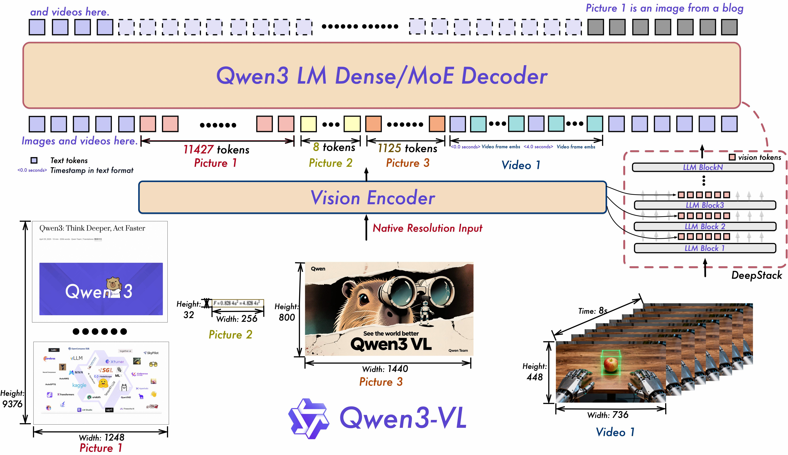
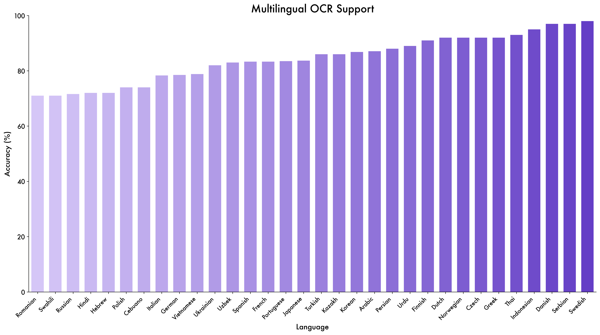
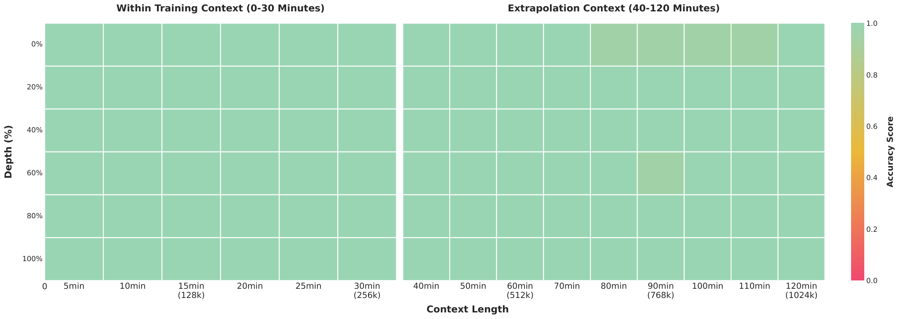

# Qwen3-VL - Bai et al., 2025

> **arXiv:** [2511.21631v2](https://arxiv.org/abs/2511.21631v2), 27 November 2025
> (v1: 26 November 2025) · **Venue:** preprint · **Affiliation:** Qwen Team, Alibaba
> **Title:** *Qwen3-VL Technical Report* · **Authors:** Shuai Bai, Yuxuan Cai, Ruizhe Chen, et al.
> **Model releases:** September-October 2025 · **Release license:** Apache-2.0

## TL;DR

Qwen3-VL combines a dynamically sized SigLIP-2-derived vision encoder with dense
or MoE [Qwen3](backbone_2025_qwen3.md) decoders, introducing **interleaved MRoPE**,
**three-level DeepStack fusion**, and **textual video timestamps**.
Four-stage pretraining reaches a native **262144-token** context; separate
Instruct and Thinking post-training paths add instruction following, distillation,
and reinforcement learning (Sections 2-4, Table 1).
The flagship Thinking model scores **74.6 on MathVision** versus **73.3 for
Gemini 2.5 Pro Thinking**, but trails GPT-5-high on MMMU and is not universally
better than its own Instruct counterpart (PDF Table 2).

## Problem & motivation

Vision-language models increasingly need to read dense documents, reason over
multiple images, locate objects, follow video timelines, operate graphical
interfaces, and generate code from visual specifications. These are not solved
by scaling language reasoning alone: small visual details can disappear during
encoding, temporal positions can become hard to extrapolate, and multimodal
training can impair the text capabilities of a strong language backbone.

The report targets three specific architectural bottlenecks:

- **Unbalanced multimodal rotary frequencies.** Earlier MRoPE assigns temporal,
  height, and width coordinates to contiguous frequency bands. The resulting
  imbalance is problematic for long video sequences.
- **A single late visual representation.** Passing only the final ViT features
  through one merger discards intermediate information that can help fine-grained
  perception and document reading.
- **Physical time encoded as large positional IDs.** Qwen2.5-VL's time-scaled
  temporal positions can become sparse and very large over long videos, while
  training across many frame rates increases data-construction complexity.

Qwen3-VL also revisits the data and optimization recipe rather than treating
these architectural changes as sufficient. It mixes text-only and multimodal
training, describes square-root loss reweighting, extends context progressively,
and trains specialized reasoning and tool-use behaviors. Its language benchmark
results need to be read as a trade-off, not proof that adding vision never
reduces text performance.

## Key idea

**Keep the decoder's token sequence, but improve what visual features enter it,
where they enter, and how positions and time are represented.**
The final vision features still supply the initial visual-token embeddings.
Three intermediate feature sets are additionally projected and added to visual
positions after the first three decoder layers. No extra sequence positions
are needed for these DeepStack residuals.

The following equations reconstruct that computation from Section 2 and the
released implementation; they are explanatory notation, not numbered equations
printed in the report:

$$
Z_{\mathrm{main}}=M_{\mathrm{main}}(V^{(\mathrm{final})}),\qquad
Z^{(k)}=M_k(V^{(s_k)}),\quad k\in\{1,2,3\},
$$
$$
U^{(k)}=D_k(H^{(k-1)}),\qquad
H^{(k)}=U^{(k)}+S Z^{(k)}\quad (k=1,2,3).
$$

$V^{(s_k)}$ denotes vision features at selected encoder layer $s_k$;
$M_{\mathrm{main}}$ and $M_k$ are distinct spatial-merging projection modules;
$Z_{\mathrm{main}}$ initializes visual positions in the input $H^{(0)}$;
$D_k$ is decoder layer $k$; and $U^{(k)}$ is its output before the extra residual.
If there are $N_v$ visual positions, decoder width $d$, and total sequence length
$L$, then $Z^{(k)}\in\mathbb{R}^{N_v\times d}$ and
$S\in\{0,1\}^{L\times N_v}$ scatters those features only to their corresponding
visual positions. Later decoder layers run without further DeepStack injection.

For position encoding, each rotary frequency uses one of three coordinate
streams, but the streams are interleaved across frequencies instead of assigned
to contiguous bands. Physical video time is supplied separately as ordinary
timestamp text. Consequently, the model can retain spatial position information
without making the temporal rotary index a direct multiple of elapsed seconds.

## How it works

### Family, vision encoders, and released geometry

The report enumerates **four dense sizes** and **two MoE sizes**, each with
separate Instruct and Thinking checkpoints. `A3B` and `A22B` denote approximately
active parameters per token, not the total weights that must be stored.
Section 2 calls the encoder a dynamically adapted SigLIP-2: SO-400M by default
and Large/300M for the two smallest decoder sizes.

The table below combines Section 2 with the six released **Instruct**
configuration files. DeepStack indices are **zero-based vision-block indices**,
not decoder injection indices.

| Model size | Decoder type | Decoder width | Vision width | Vision blocks | DeepStack vision indices |
|---|---|---:|---:|---:|---|
| 2B | Dense | 2048 | 1024 | 24 | 5, 11, 17 |
| 4B | Dense | 2560 | 1024 | 24 | 5, 11, 17 |
| 8B | Dense | 4096 | 1152 | 27 | 8, 16, 24 |
| 32B | Dense | 5120 | 1152 | 27 | 8, 16, 24 |
| 30B-A3B | MoE | 2048 | 1152 | 27 | 8, 16, 24 |
| 235B-A22B | MoE | 4096 | 1152 | 27 | 8, 16, 24 |

*Configuration sources: the `config.json` files in the
[2B](https://huggingface.co/Qwen/Qwen3-VL-2B-Instruct/blob/main/config.json),
[4B](https://huggingface.co/Qwen/Qwen3-VL-4B-Instruct/blob/main/config.json),
[8B](https://huggingface.co/Qwen/Qwen3-VL-8B-Instruct/blob/main/config.json),
[32B](https://huggingface.co/Qwen/Qwen3-VL-32B-Instruct/blob/main/config.json),
[30B-A3B](https://huggingface.co/Qwen/Qwen3-VL-30B-A3B-Instruct/blob/main/config.json),
and [235B-A22B](https://huggingface.co/Qwen/Qwen3-VL-235B-A22B-Instruct/blob/main/config.json)
releases. These supplement, rather than replace, the pinned report.*



*Figure 1. Different image sizes produce different visual-token counts; video
visual groups are interleaved with timestamp text. The inset shows intermediate
vision features added to early decoder states. DeepStack enriches existing
visual positions instead of appending three more copies of the visual sequence.*

### Dynamic resolution, temporal patching, and the merger

The vision encoder is initialized from SigLIP-2 and continuously trained for
dynamic resolutions. It combines **2D rotary positions** with **interpolated
absolute position embeddings**. Dynamic resolution does not mean that every
source pixel is always preserved: the processor still resizes and rounds inputs
to satisfy patch divisibility and the chosen pixel/token budget.

The released configurations use spatial patches of **16 pixels**, temporal
patch size **2**, and spatial merge size **2**. A still image is represented
with the temporal extent required by that patch embedding; videos are grouped
into temporal patches. A two-layer MLP merges each spatial **2-by-2** feature
group and projects it to the decoder's width.

For an illustrative constant-resolution input, let $G_t,G_h,G_w$ be the temporal,
height, and width grid sizes **after patch embedding and before spatial merging**.
The visual sequence length is:

$$
N_v=G_t\left(\frac{G_h}{2}\right)
          \left(\frac{G_w}{2}\right).
$$

For a compatible still image of processed size $H\times W$,
$G_t=1$, $G_h=H/16$, and $G_w=W/16$. Thus
$N_v=HW/1024$: a processed **1024-by-1024** image yields **1024 visual tokens**
(calculated from the released patch/merge geometry). Before projection, each
merged group contains four vision-width feature vectors. Multi-image and video
inputs add their visual groups to the same interleaved decoder context.

The initial embedding merger and the three DeepStack mergers are separate.
For each selected intermediate feature map, spatial grouping preserves the
same visual-token order as the main path, making position-wise residual
addition well-defined. In the release-era
[Transformers implementation](https://github.com/huggingface/transformers/blob/v4.57.1/src/transformers/models/qwen3_vl/modeling_qwen3_vl.py),
the extra features are added **after** each of decoder blocks 0, 1, and 2,
and only where the visual-position mask is true.

### Interleaved MRoPE, made explicit

For a rotary pair with coordinates $(u_j,v_j)$, the usual background RoPE
operation is:

$$
\begin{bmatrix}u'_j\\v'_j\end{bmatrix}
=
\begin{bmatrix}
\cos\phi_j&-\sin\phi_j\\
\sin\phi_j&\cos\phi_j
\end{bmatrix}
\begin{bmatrix}u_j\\v_j\end{bmatrix},
\qquad
\phi_j=p_{\kappa(j)}\,b^{-2j/d_r}.
$$

$j$ indexes rotary frequency pairs, $d_r$ is rotary dimension, $b$ the rotary
base, $p_t,p_h,p_w$ the temporal/height/width position streams, and
$\kappa(j)$ selects which stream supplies the position for frequency $j$.
The new mechanism changes this stream allocation, not the trigonometric
rotation itself.

The released setting `mrope_section: [24, 20, 20]` allocates **64 frequency
pairs**, with interleaving enabled. The implementation starts from temporal
frequencies, substitutes height at indices `1, 4, ..., 58`, and width at
`2, 5, ..., 59`. Equivalently:

$$
\kappa(j)=
\begin{cases}
h,&j<60\ \text{and}\ j\bmod3=1,\\
w,&j<60\ \text{and}\ j\bmod3=2,\\
t,&\text{otherwise},
\end{cases}
\qquad 0\leq j<64.
$$

This leaves **24 temporal, 20 height, and 20 width** pairs, including the final
four temporal pairs. Calling this literally identical frequency coverage for
every axis would be too strong; it is an interleaved, substantially more
balanced allocation than three contiguous blocks.

For text, all three position streams coincide, reducing to ordinary 1D RoPE.
For an image grid, temporal position is constant while height and width vary.
For video, do not transplant Qwen2.5-VL's absolute-time/FPS position formula:
the Qwen3-VL implementation splits video temporal groups into timestamp-delimited
visual blocks. Within each such block the local temporal index is zero;
the block's shared offset still advances with the interleaved sequence.
Actual elapsed time comes from the timestamp text.

### Textual video time and long context

Section 2.3 prefixes each video temporal patch with a timestamp, training both
seconds and hours:minutes:seconds representations. Conceptually:

```text
timestamp text -> visual group -> timestamp text -> visual group -> query
```

These are ordinary language tokens, not a second RoPE frequency system. This
adds some context overhead but avoids forcing physical time into large sparse
temporal position IDs. The processor's sampling metadata and timestamps must
remain consistent; changing FPS while leaving stale timestamps changes the
meaning of the input.

All six checked Instruct configurations specify **262144** positions with
default RoPE and interleaved MRoPE. The official release separately documents
[YaRN-based extension](https://github.com/QwenLM/Qwen3-VL#processing-long-texts)
to about **1M tokens**, including `factor: 3.0`,
`original_max_position_embeddings: 262144`, and retained MRoPE settings.
Its suggested smaller scaling factor reflects slower multimodal position-ID
growth; the factor is not simply the ratio of serialized sequence lengths.
This is **extrapolation**, not a claim that the model was pretrained at 1M.

### Original data-flow reconstruction

```mermaid
flowchart LR
    I["Images or sampled video groups"] --> P["Budgeted dynamic-resolution processing<br/>16-pixel patches"]
    P --> V["SigLIP-2-derived ViT<br/>2D RoPE + absolute-position interpolation"]
    V --> FINAL["Final-layer 2x2 merger"]
    V --> AUX["Three intermediate feature maps<br/>three independent mergers"]
    TXT["Text, timestamp strings, visual markers"] --> SEQ["Interleaved input embeddings"]
    FINAL --> SEQ
    SEQ --> L1["Decoder block 1"]
    L1 --> A1["Add visual residual 1"]
    A1 --> L2["Decoder block 2"]
    L2 --> A2["Add visual residual 2"]
    A2 --> L3["Decoder block 3"]
    L3 --> A3["Add visual residual 3"]
    AUX --> A1
    AUX --> A2
    AUX --> A3
    A3 --> REST["Remaining dense or MoE blocks<br/>interleaved MRoPE throughout"]
    REST --> OUT["Autoregressive text, structured coordinates,<br/>code, or tool calls"]
```



*Original reconstruction. Each arrow from the auxiliary path supplies the
corresponding level, not all three levels at every addition. Outputs are
language/structured tokens; Qwen3-VL is not an image-generation or speech-output
model.*

### Grounding formats and practical inference

Section 3.2.4 changes 2D points and boxes to a **[0,1000] normalized coordinate
system**, unlike Qwen2.5-VL's pixel-coordinate convention. Converting a predicted
point $(x_n,y_n)$ back to an image of width $W$ and height $H$ uses the explanatory
mapping $x=x_nW/1000$, $y=y_nH/1000$, with consistent handling of any preprocessing
resize. Relational spatial descriptions and normalized coordinates are related
capabilities, but are not the same representation.

For 3D grounding, supervision uses structured **9-DoF boxes** and semantic labels
in a unified virtual-camera coordinate system. This is separate from normalized
2D screen coordinates; it must not be interpreted by the 2D conversion above.
GUI actions likewise require an environment-specific executor, not just
well-formed predicted coordinates.

The [official inference examples](https://github.com/QwenLM/Qwen3-VL#quickstart)
use a multimodal processor and chat template to keep visual markers, patch grids,
timestamps, and input IDs aligned. Choose the appropriate dense or MoE model
class and the desired **Instruct or Thinking checkpoint**; these editions should
not be treated as the original hybrid Qwen3 model's single-checkpoint
`enable_thinking` switch. Let the processor prepare the multimodal tensors,
generate, and remove input-token prefixes before decoding the new answer.
Pixel budgets, frame sampling, and output length are deployment choices that
also affect quality and memory.

## Training / data

### Four pretraining stages

Before full VLM training, the SigLIP-2-based encoder is adapted for dynamic
resolution. The report then gives the following stage schedule.
**Source: Section 3.1, Table 1.**

| Stage | Objective | Trainable components | Token budget | Sequence length |
|---|---|---|---:|---:|
| S0 | Vision-language alignment | Mergers; vision and LLM frozen | 67B | 8192 |
| S1 | Multimodal pretraining | All | Approximately 1T | 8192 |
| S2 | Long-context pretraining | All | Approximately 1T | 32768 |
| S3 | Ultra-long-context adaptation | All | 100B | 262144 |

S0 uses captions, visual knowledge, and OCR to align the interfaces before
updating the foundation models. S1 mixes text-only and vision-language data,
including grounding, VQA, STEM, and a small video component. S2 increases
text-only long-context training and adds much more video and agent data.
S3 emphasizes very long documents and videos. These are reported stage budgets,
not a per-checkpoint GPU-hour accounting for the whole family.

A standard autoregressive training loss, included here as background notation,
is:

$$
\mathcal{L}_i=-\sum_{t\in\mathcal{Y}_i}
\log p_\theta(y_{it}\mid x_i,y_{i,<t}).
$$

$x_i$ is the text/multimodal conditioning input, $y_{it}$ a target token,
$\mathcal{Y}_i$ the supervised target positions, and $\theta$ the trainable
parameters. The report says it changes from per-sample loss to a
**square-root-normalized per-token loss** to balance modalities, but does not
give the complete reduction formula, token-count definition, or mixture weights.
An invented precise square-root formula should not be presented as the
published recipe.

### Data construction: what each component teaches

- **Captions and interleaved documents, Section 3.2.1.** A specialized
  Qwen2.5-VL-32B recaptioner enriches web image-text pairs using the associated
  raw text. Deduplication is applied to recaptioned text; visual-embedding
  clustering identifies sparse concepts for targeted augmentation. Web and
  book documents retain text-image alignment and page order, with book sequences
  assembled up to 256K tokens and filtered for meaningful visual content.
- **Visual knowledge, Section 3.2.2.** Entity-centered data covers common and
  long-tail objects, places, organisms, and fictional concepts. Importance-based
  sampling balances useful prominent entities with broader coverage, while
  enriched captions add attributes, context, and relations rather than only
  class names.
- **OCR and documents, Section 3.2.3.** The recipe includes **30M** internally
  collected OCR examples, approximately **30M** synthetic multilingual OCR
  examples, and over **1M** real multilingual images. PDF sources include
  **3M** Common Crawl PDFs across **10** document types and **4M** internal
  documents. Layout predictions and Qwen2.5-VL-72B recognition are reassembled
  into structured parsing supervision.
- **Document representations, Section 3.2.3.** QwenVL-HTML carries element-level
  boxes; QwenVL-Markdown localizes images and tables, with tables represented
  in LaTeX. Long-document training combines multi-page parsing sequences with
  questions requiring evidence from charts, figures, tables, and body text.
  Correct reading order and cross-page alignment are part of the task.
- **Grounding, counting, and space, Sections 3.2.4-3.2.5.** Public detection and
  referring-expression data are extended with Qwen2.5-VL/Grounding DINO
  annotations and quality filtering. Pointing draws on PixMo, detection, and
  segmentation data; counting includes direct, box-based, and point-based
  formulations. Spatial data adds relations, affordances, and action-conditioned
  questions. Monocular 3D grounding uses filtered multi-source annotations
  unified into the virtual-camera frame.
- **Code, Section 3.2.6.** Text-only code reuses Qwen3/Qwen3-Coder corpora.
  Multimodal coding includes screenshot-to-HTML/CSS, image-to-SVG, visual
  programming, diagram/flowchart transcription, and questions whose code
  context includes images. These tasks supervise executable or editable
  representations rather than merely describing a screenshot.
- **Video, Section 3.2.7.** Short-to-long caption synthesis builds coherent
  timestamped narratives. Spatio-temporal annotations track objects, people,
  actions, and events. Source balancing and length-adaptive FPS/frame limits
  control the trade-off between duration coverage and visual detail.
- **STEM, Section 3.2.8.** Programmatically rendered diagrams supply **1M**
  point-grounding examples, **2M** perception VQA pairs, and **6M** rich diagram
  captions. The corpus also contains over **60M** educational exercises and
  over **12M** image-conditioned long-CoT examples, with verification and
  rejection sampling. These are described component pools, not necessarily
  disjoint counts that can be summed into unique training examples.
- **Agents, Section 3.2.9.** GUI supervision spans perception tasks and
  multi-step desktop, mobile, and web trajectories. A separate multimodal
  function-calling synthesizer generates tool definitions, calls, and simulated
  responses; these synthetic functions need not be implemented executors.
  Search trajectories include real online image/text search for unfamiliar
  entities. Do not equate simulated tool-response quality with online task success.

### SFT, thinking cold start, and text-only distillation

Sections 4.1-4.2 describe approximately **1.2M** SFT examples: about **one-third
text-only** and **two-thirds image/video-text**, including multilingual,
multi-turn, multi-image, and interleaved tool interactions. Training runs one
epoch at **32K**, then a second epoch with **256K** contexts mixed with 32K
examples. Query filtering removes unverifiable or unsubstantive requests;
rule/model response filtering addresses correctness, visual grounding,
completeness, repetitions, formatting, and language mixing.

Thinking cold-start data is a separate description, with an approximately
**1:1 vision-language/text-only ratio**. It emphasizes difficult STEM and agent
tasks. A visual-necessity filter removes visual math questions solvable by a
text-only Qwen3-30B non-thinking model without the image. Correctness and
reasoning-quality filters then reject faulty or unhelpful trajectories.
Do not silently apply the general SFT dataset's two-thirds multimodal ratio
to this separate cold-start pool.

Section 4.3 transfers strong-model capabilities to lightweight students in
two phases: **off-policy response distillation** from teacher outputs, then
**on-policy logit distillation** on student-generated trajectories using KL
alignment. Section 4.1 explicitly describes this stage as **text-only data
fine-tuning the LLM backbone**, despite benefits transferring to visual
reasoning. The report does not disclose all teacher assignments, KL direction,
temperature, or loss-mixing coefficients.

### Reasoning RL and general RL

Section 4.4.1 constructs approximately **30K** verifiable RL queries spanning
text and multimodal math, code, logic, grounding, and puzzles. Initial filtering
samples **16** flagship-model responses per multimodal query and removes
queries with no correct responses. Per-model preparation again samples **16**
responses and filters easy queries with pass rate **greater than 90%**.
Task mixtures are determined experimentally, but their complete ratios are
not published.

Rewards are implemented per task using rules or code execution. Required
formats are encouraged by task prompts rather than a separate explicit
format reward in this reasoning stage; language mismatch receives a penalty.
The policy optimizer is **SAPO**, described as a smooth adaptive policy-gradient
method. The report does not supply enough optimizer detail to replace SAPO
with an assumed GRPO/PPO formula and call it the exact published objective.

General RL, Section 4.4.2, covers VQA, captions, OCR, document parsing, grounding,
and clock reading. It combines rule-based rewards with Qwen2.5-VL-72B-Instruct
or Qwen3 judges, emphasizing instruction constraints, subjective response
quality, factuality, and difficult counterexamples to learned priors.
A targeted prompt pool increases the frequency of penalties for rare but
undesirable behaviors such as repetitions or language mixing. This stage's
format-related rewards should not be conflated with the reasoning stage's
absence of an explicit format reward.

### Training the visual tool-use loop

Section 4.5 describes another teacher pipeline, distinct from text-only
strong-to-weak distillation:

1. Use approximately **10K** grounding-centered cold-start interactions to train
   a Qwen2.5-VL-32B visual agent with SFT and multi-turn tool-integrated RL.
2. Use that agent to produce approximately **120K** more diverse multi-turn
   interactions for Qwen3-VL cold-start SFT and tool-integrated RL.
3. Combine final-answer correctness judged by Qwen3-32B, feedback/reasoning
   quality judged by Qwen2.5-VL-72B, and a tool-call-count reward based on an
   offline expert-estimated target.

The last reward addresses an observed failure: optimizing the first two
signals alone encouraged a degenerate single-tool-call policy. The mechanism
encourages task-dependent tool use, not a universal rule that more tool calls
are better. The public cookbooks supply image zoom/search examples, but an
application must still provide the actual tools.

### Infrastructure and remaining reproducibility gaps

Section 4.6 reports PAI-Lingjun infrastructure with Megatron-LM-based tensor,
pipeline, context, expert, and ZeRO-1 data parallelism, scaling to systems of
up to **10000 GPUs**. This is infrastructure scale, not a published training
GPU count or GPU-hour budget for every checkpoint. vLLM and SGLang are used
for deployment/evaluation.

The report gives unusually useful stage and data descriptions, but not a full
optimizer/learning-rate/batch-size schedule, exact square-root weighting,
complete mixture manifest, distillation configuration, or all RL hyperparameters.
The inference release is not a complete reproduction of the training system.

## Results

### Source numbering, metrics, and comparison conditions

**All table numbers below refer to the v2 PDF.** The experimental HTML omits
the three large visual tables and renumbers later tables: PDF Tables **5-12**
appear as HTML Tables **2-9**. The visual results are present as extractable
numeric tables in the PDF, not merely image-only claims.

For visual Tables 2-3, `*` preserves the report's marker for a result borrowed
from an external technical report; `+` marks **tool use**. Do not treat all
columns as controlled reruns with equal inference budgets. Except where noted,
higher scores are better; the OmniDocBench values shown are **errors, lower
is better**, and OCRBench is a raw benchmark score rather than a percentage.

### Flagship visual reasoning and general understanding

**Source: PDF Table 2.** `T` means Thinking and `I` means Instruct. The baseline
columns are Gemini 2.5 Pro **Thinking** and GPT-5 **high**, not their lower-budget
editions.

| Benchmark | Qwen3-VL-235B T | Qwen3-VL-235B I | Gemini 2.5 Pro T | GPT-5 high |
|---|---:|---:|---:|---:|
| MMMU | 80.6 | 78.7 | 81.7* | 84.2* |
| MMMU-Pro | 69.3 | 68.1 | 68.8* | 78.4* |
| MathVista-mini | 85.8 | 84.9 | 82.7* | 81.3 |
| MathVision | 74.6 | 66.5 | 73.3* | 70.9 |
| MathVerse-mini | 85.0 | 72.5 | 82.9 | 84.1 |
| We-Math | 74.8 | 67.5 | 80.6 | 73.8 |
| MMStar | 78.7 | 78.4 | 77.5* | 76.4 |
| RealWorldQA | 81.3 | 79.2 | 78.0* | 82.8 |
| HallusionBench | 66.7 | 63.2 | 63.7* | 65.7 |
| MIA-Bench | 92.7 | 91.3 | 92.3 | 92.4 |
| BLINK | 67.1 | 70.7 | 70.6* | 71.0 |
| MuirBench | 80.1 | 73.0 | 77.2 | 77.5 |

Thinking helps visual math strongly, but GPT-5-high remains ahead on MMMU,
and Gemini remains stronger on We-Math. Even within Qwen3-VL, Instruct beats
Thinking on BLINK. These results do not support universal dominance by one
model or a universal benefit from longer reasoning (Table 2).

### OCR, document parsing, and long documents

**Source: PDF Table 2.**

| Benchmark | Qwen3-VL-235B T | Qwen3-VL-235B I | Gemini 2.5 Pro T | GPT-5 high |
|---|---:|---:|---:|---:|
| DocVQA test | 96.5 | 97.1 | 92.6 | 91.5 |
| InfoVQA test | 89.5 | 89.2 | 84.2 | 79.0 |
| OCRBench | 875 | 920 | 866 | 810 |
| OCRBench-v2 English | 66.8 | 67.1 | 54.3 | 53.0 |
| OCRBench-v2 Chinese | 63.5 | 61.8 | 48.5 | 43.2 |
| CC-OCR | 81.5 | 82.2 | 77.2 | 68.3 |
| OmniDocBench English, lower | 0.155 | 0.143 | 0.347 | 0.356 |
| OmniDocBench Chinese, lower | 0.207 | 0.207 | 0.238 | 0.472 |
| CharXiv reasoning | 66.1 | 62.1 | 67.9 | 81.1* |
| MMLongBench-Doc | 56.2 | 57.0 | 55.6 | 51.5 |

The Instruct model is often stronger on OCR/parsing and long-document tasks;
Thinking is better on Chinese OCR-v2 and chart reasoning. Strong OCR does not
automatically imply leadership on difficult chart reasoning: both listed
closed-model thinking baselines exceed Qwen3-VL on CharXiv reasoning (Table 2).



*Figure 2 and Section 5.4. An in-house test covers **39 languages**; accuracy
exceeds **70% in 32**. This is not a claim that OCR supports only 32 languages,
and the threshold is the authors' practical-usability criterion rather than
a universal deployment guarantee.*

### Grounding and embodied/spatial understanding

**Source: PDF Table 2.** For 3D evaluation, Section 5.5 fixes detection confidence
at **1.0** and reports **mAP at IoU 0.15**. ODinW-13 also uses confidence 1.0
and supplies all dataset categories in the prompt; these conditions matter
when comparing with specialist detectors.

| Benchmark | Qwen3-VL-235B T | Qwen3-VL-235B I | Gemini 2.5 Pro T |
|---|---:|---:|---:|
| RefCOCO average | 92.1 | 91.9 | 74.6* |
| CountBench | 93.7 | 93.0 | 91.0* |
| ODinW-13 | 43.2 | 48.6 | 33.7* |
| ARKitScenes | 53.7 | 56.9 | - |
| Hypersim | 11.0 | 13.0 | - |
| SUN RGB-D | 34.9 | 39.4 | 29.7 |
| ERQA | 52.5 | 51.3 | 55.3 |
| VSI-Bench | 60.0 | 62.7 | - |
| EmbSpatialBench | 84.3 | 83.1 | 79.1 |
| RefSpatialBench | 69.9 | 65.5 | 36.5 |
| RoboSpatialHome | 73.9 | 69.4 | 47.5 |

Instruct is better on the listed 3D datasets and open-vocabulary detection;
Thinking is stronger on several relational/spatial tasks. The low Hypersim
scores also caution against equating benchmark improvements with solved
monocular 3D understanding (Table 2).

### Video: good results, unequal frame budgets

**Source: PDF Table 2.**

| Benchmark | Qwen3-VL-235B T | Qwen3-VL-235B I | Gemini 2.5 Pro T | GPT-5 high |
|---|---:|---:|---:|---:|
| MVBench | 75.2 | 76.5 | 69.9 | 75.3 |
| Video-MME, no subtitles | 79.0 | 79.2 | 85.1 | 84.7 |
| MLVU M-Avg | 83.8 | 84.3 | 85.6 | 86.2 |
| LVBench | 63.6 | 67.7 | 73.0 | - |
| Charades-STA mIoU | 63.5 | 64.8 | - | - |
| VideoMMMU | 80.0 | 74.7 | 83.6* | 84.6* |
| MMVU | 71.1 | 68.1 | 74.9 | 73.0 |

Section 5.9 caps Qwen inputs at **2048 frames** and **224K video tokens**.
Per-frame limits are **768 tokens** for VideoMMMU/MMVU and **640** otherwise;
these individual maxima are still subject to the total budget. Charades-STA
uses **4 FPS**; other video benchmarks use **2 FPS**. VideoMMMU uses a
model-based judge.

The compared proprietary APIs permit different input budgets in these
experiments: **512 frames** for Gemini, **256** for GPT-5, and **100** for Claude.
The authors explicitly acknowledge that full fairness cannot be guaranteed.
Qwen3-VL is competitive, but the highest-budget closed baselines are ahead
on several central video tasks; comparisons against Gemini's budget-128 or
GPT-5-minimal settings should not be restated as wins over their strongest
settings.

### Tools, visual coding, and GUI agents

**Source: PDF Table 2.** The `+` markers are material: the Instruct fine-detail
results below use tools.

| Benchmark | Qwen3-VL-235B T | Qwen3-VL-235B I |
|---|---:|---:|
| V* | 85.9 | 93.7+ |
| HRBench-4K | 84.3 | 85.4+ |
| HRBench-8K | 76.6 | 82.4+ |
| Design2Code | 93.4 | 92.0 |
| ChartMimic | 78.4 | 80.5 |
| UniSVG | 65.8 | 69.8 |
| ScreenSpot Pro | 61.8 | 62.0 |
| OSWorldG | 68.3 | 66.7 |
| AndroidWorld | 62.0 | 63.7 |
| OSWorld | 38.1 | 31.6 |
| WindowsAA | 32.1 | 28.9 |

The tool-assisted results show the value of high-resolution inspection, but
the displayed Thinking-versus-Instruct-plus-tools columns are **not** a
same-checkpoint tool ablation. GUI grounding accuracy is also distinct from
online environment success: a model can locate a button well and still fail
the multi-step task.

### Medium and small models: scale and edition both matter

**Source: PDF Table 3.**

| Benchmark | 30B-A3B T | 30B-A3B I | 32B T | 32B I |
|---|---:|---:|---:|---:|
| MMMU | 76.0 | 74.2 | 78.1 | 76.0 |
| MathVista-mini | 81.9 | 80.1 | 85.9 | 83.8 |
| RealWorldQA | 77.4 | 73.7 | 78.4 | 79.0 |
| InfoVQA test | 85.6 | 81.8 | 89.2 | 87.0 |
| MuirBench | 77.6 | 62.9 | 80.3 | 72.8 |
| AndroidWorld | 55.0 | 54.3 | 63.7 | 57.3 |
| OSWorld | 30.6 | 30.3 | 41.0 | 32.6 |

The 32B Thinking model is particularly strong in online GUI tasks and reaches
a MuirBench score slightly above the flagship Thinking model's result in
Table 2. MoE active-parameter efficiency does not mean that 30B-A3B matches
32B dense everywhere.

**Source: PDF Table 4.**

| Benchmark | 2B T | 2B I | 4B T | 4B I | 8B T | 8B I |
|---|---:|---:|---:|---:|---:|---:|
| MMMU | 61.4 | 53.4 | 70.8 | 67.4 | 74.1 | 69.6 |
| MathVista-mini | 73.6 | 61.3 | 79.5 | 73.7 | 81.4 | 77.2 |
| MathVision | 45.9 | 31.6 | 60.0 | 51.6 | 62.7 | 53.9 |
| DynaMath | 66.7 | 54.2 | 74.4 | 65.3 | 73.2 | 67.7 |
| VisuLogic | 25.4 | 11.5 | 30.2 | 19.0 | 27.5 | 22.5 |
| OCRBench | 792 | 858 | 808 | 881 | 819 | 896 |
| VideoMMMU | 54.1 | 41.9 | 69.4 | 56.2 | 72.8 | 65.3 |
| ScreenSpot Pro | 32.2 | 48.5 | 49.2 | 59.5 | 46.6 | 54.6 |

Thinking generally strengthens math, but Instruct remains stronger on OCRBench
and GUI grounding here. The 4B Thinking model exceeds 8B on DynaMath and
VisuLogic, and 4B Instruct exceeds 8B on ScreenSpot Pro (Table 4).

### Text capability: preservation is not zero regression

**Source: PDF Tables 5-6.** Text-only baselines are the **July 2507** flagship
Instruct/Thinking models, not the original May report checkpoints.

| Benchmark | VL-235B I | Text-235B I-2507 | VL-235B T | Text-235B T-2507 |
|---|---:|---:|---:|---:|
| MMLU-Pro | 81.8 | 83.0 | 83.8 | 84.4 |
| GPQA | 74.3 | 77.5 | 77.1 | 81.1 |
| AIME-25 | 74.7 | 70.3 | 89.7 | 92.3 |
| HMMT-25 | 57.4 | 55.4 | 77.4 | 83.9 |
| LiveCodeBench v6 | 54.3 | 51.8 | 70.1 | 74.1 |
| IFEval | 87.8 | 88.7 | 88.2 | 87.8 |
| Arena-Hard v2 | 77.4 | 79.2 | 74.8 | 79.7 |
| BFCL-v3 | 67.7 | 70.9 | 71.8 | 71.9 |
| PolyMATH | 45.1 | 50.2 | 57.8 | 60.1 |

Instruct improves math/code reasoning but loses some knowledge, instruction,
and multilingual scores relative to the July text model. The Thinking flagship
also regresses on several text benchmarks. "Strong text capability" is supported;
"surpasses the text-only counterpart on most language benchmarks" is not a
reliable blanket summary of these tables.

**Source: PDF Tables 7-8.** `Text` without a date means the original comparison
model; the last column separately shows the later July 30B-A3B baseline.

| Benchmark | Edition | VL-32B | Text-32B | VL-30B-A3B | Text-30B-A3B | Text-30B-A3B-2507 |
|---|---|---:|---:|---:|---:|---:|
| GPQA | Instruct | 68.9 | 54.6 | 70.4 | 54.8 | 70.4 |
| AIME-25 | Instruct | 66.2 | 20.2 | 69.3 | 21.6 | 61.3 |
| LiveCodeBench v6 | Instruct | 43.8 | 29.1 | 42.6 | 29.0 | 43.2 |
| GPQA | Thinking | 73.1 | 68.4 | 74.4 | 65.8 | 73.4 |
| AIME-25 | Thinking | 83.7 | 72.9 | 83.1 | 70.9 | 85.0 |
| LiveCodeBench v6 | Thinking | 65.6 | 60.6 | 64.2 | 57.4 | 66.0 |

The choice of baseline revision changes the story: strong improvements over
original text checkpoints can shrink or reverse against their July successors.
Different post-training pipelines also prevent attributing the entire gain
causally to visual training.

**Source: PDF Tables 9-10.** The final two columns are reference text models
for the 8B and July 4B sizes, respectively, not matched baselines for every
VL column.

| Benchmark | Edition | VL-2B | VL-4B | VL-8B | Text-8B | Text-4B-2507 |
|---|---|---:|---:|---:|---:|---:|
| GPQA | Instruct | 42.0 | 55.9 | 61.9 | 39.3 | 62.0 |
| AIME-25 | Instruct | 22.2 | 46.6 | 45.9 | 20.9 | 47.4 |
| LiveCodeBench v6 | Instruct | 20.3 | 37.9 | 39.3 | 25.5 | 35.1 |
| IFEval | Instruct | 68.2 | 82.3 | 83.7 | 83.0 | 83.4 |
| GPQA | Thinking | 49.5 | 64.1 | 69.9 | 62.0 | 65.8 |
| AIME-25 | Thinking | 39.0 | 74.5 | 80.3 | 67.3 | 81.3 |
| LiveCodeBench v6 | Thinking | 29.3 | 51.3 | 58.6 | 51.0 | 55.2 |
| IFEval | Thinking | 75.1 | 82.6 | 83.2 | 85.0 | 87.4 |

Section 5.11 gives different **text-centric evaluation** sampling settings;
these are not a universal configuration for all visual experiments:

| Evaluated edition | Temperature | Top-p | Top-k | Presence penalty |
|---|---:|---:|---:|---|
| Instruct 235B/32B/30B-A3B | 0.7 | 0.8 | 20 | 1.5 |
| Instruct 2B/4B/8B | 1.0 | 1.0 | 40 | 2.0 |
| Thinking MoE | 0.6 | 0.95 | 20 | Not specified |
| Thinking dense | 1.0 | 0.95 | 20 | 1.5 |

The text evaluation output cap is **32768 tokens**, extended to **81920** for
Thinking on AIME-25, HMMT-25, and LiveCodeBench v6. Those longer reasoning
budgets must not be mistaken for an input-context extension.

### Ablations: adapted ViT and DeepStack

**Source: PDF Table 11.** Both vision encoders are also compared with the
same **1.7B Qwen3** language model in the downstream VLM stage. `Omni` is
the table's own label; it is not the Qwen-Omni model family.

| Metric | SigLIP-2 | Qwen3-ViT |
|---|---:|---:|
| CLIP ImageNet-1K | 84.2 | 84.6 |
| CLIP ImageNet-V2 | 78.6 | 78.8 |
| CLIP ImageNet-A | 87.0 | 87.1 |
| CLIP ImageNet-R | 96.1 | 95.7 |
| CLIP ImageNet-S | 76.2 | 74.5 |
| CLIP ObjectNet | 79.9 | 81.0 |
| CLIP Omni | 36.9 | 45.5 |
| VLM OCRB | 77.2 | 78.7 |
| VLM AI2D | 74.1 | 76.2 |
| VLM RealWorldQA | 58.7 | 66.1 |
| VLM InfoVQA | 65.3 | 67.0 |
| VLM Omni | 50.1 | 53.0 |

The adapted encoder improves the displayed VLM results, but not every CLIP
classification benchmark. That is a more precise conclusion than universally
better visual representations (Table 11).

**Source: PDF Table 12.** This uses an **internal 15B-A2B** decoder with **200B
pretraining tokens**, evaluated directly on validation sets with **no post-training**;
it is not a controlled ablation of the released flagship.

| Metric | Baseline | DeepStack |
|---|---:|---:|
| Average | 74.7 | 76.0 |
| AI2D | 81.8 | 83.2 |
| OCRB | 81.0 | 83.6 |
| TextVQA | 80.6 | 80.5 |
| InfoVQA | 71.9 | 74.2 |
| ChartQA | 81.5 | 83.3 |
| DocVQA | 89.5 | 91.1 |
| MMMU | 52.9 | 54.1 |
| MMStar | 55.5 | 57.7 |
| RealWorldQA | 67.7 | 68.1 |
| MMBench-EN | 81.0 | 81.2 |
| MMBench-CN | 78.1 | 78.5 |

The reported average rises **1.3 points**; OCRB rises **2.6**, InfoVQA **2.3**,
and DocVQA **1.6**, while TextVQA falls **0.1** (calculated from Table 12).
The evidence supports better average feature fusion, not improvement on every
individual task.

### Long-video needle retrieval is not general long-video reasoning



*Figure 3 and Section 5.12.3. Qwen3-VL-235B-A22B-Instruct finds an inserted
salient frame and answers a question about it. At **1 FPS**, frame resolution
is dynamically adjusted to maintain the visual token budget.*

The report gives **100%** accuracy up to **30 minutes / 256K tokens** and
**99.5%** after YaRN extension to approximately **two hours / 1M tokens**.
These are task-specific results under an adaptive resolution budget, not
guarantees of retaining every detail in arbitrary two-hour footage. They also
use a different sampling protocol from the general video benchmarks above.

### Explicit source discrepancies

- **Medium-model VQA:** Section 5.1 prose gives **79.4** for 32B Thinking
  RealWorldQA, but PDF Table 3 gives **78.4**, consistent with the following
  statement that 32B Instruct's **79.0** is higher. The table value is used here.
  The prose's second MMBench score is also **89.5**, versus Table 3's **89.4**.
- **High-resolution tools:** Section 5.6 prose gives **85.3 / 82.3** on
  HRBench-4K/8K, whereas PDF Table 2 gives **85.4+ / 82.4+**. The recap preserves
  the table values and their tool-use markers.
- **"Best" depends on the comparison set.** Section 5.7's flagship MuirBench
  claim concerns its top-tier comparison; PDF Table 3 contains a slightly
  higher **80.3** for 32B Thinking than the flagship's **80.1** in Table 2.
  Likewise, native context and YaRN extrapolation results must remain separate.

## Limitations & follow-ups

- **Training disclosure is incomplete.** Stage budgets and data construction are
  informative, but missing reduction, optimizer, sampler, distillation, and RL
  details prevent exact reconstruction. Intermediate-feature fusion is
  implementable from released code; the entire training recipe is not.
- **Text preservation and scaling are nonuniform.** Several flagship text
  scores decline relative to July backbones, and Thinking is not uniformly
  preferable for perception, parsing, or GUI grounding. Evaluate the target
  application and baseline revision rather than choosing by model size alone.
- **Cross-model budgets differ.** External-report numbers, proprietary API
  restrictions, unequal frame counts, reasoning lengths, and tool access limit
  causal conclusions from leaderboard comparisons. No single table gives a
  complete quality/latency/memory frontier.
- **Long context still trades detail for duration.** The needle study is useful
  retrieval evidence but does not establish dense event understanding at 1M
  tokens. Resolution/FPS adaptation may omit information before the model sees
  it; positional extrapolation cannot recover missing frames or pixels.
- **OCR coverage is not uniform reliability.** The 39-language experiment is
  in-house, and only 32 languages clear the authors' threshold. It does not
  establish equal robustness across scripts, domains, document layouts, or
  degraded-image conditions.
- **Grounding and agents need external validation.** Normalized 2D positions,
  virtual-camera 3D boxes, tool calls, and online GUI actions have different
  output contracts. Neither good structured syntax nor high grounding accuracy
  demonstrates reliable execution of a long action sequence.
- **Judges and synthetic labels introduce dependencies.** Recaptioners, reasoning
  teachers, pseudo-labelers, and reward models shape both supervision and
  evaluation. The report does not provide a complete contamination, uncertainty,
  or judge-bias analysis for all benchmark families.
- **Architectural next questions.** The DeepStack ablation uses an internal
  model and does not isolate every joint change to position encoding, timestamps,
  data, and optimization. Further controlled studies should separate these
  factors and measure compute-matched benefits. The predecessor recaps,
  [Qwen2-VL](multimodal_2024_qwen2-vl.md) and
  [Qwen2.5-VL](multimodal_2025_qwen2.5-vl.md), explain the mechanisms being replaced.

## Links

- **arXiv:** [abs, v2](https://arxiv.org/abs/2511.21631v2) ·
  [HTML, v2](https://arxiv.org/html/2511.21631v2) ·
  [PDF, v2](https://arxiv.org/pdf/2511.21631v2).
- **Code / project:** [QwenLM/Qwen3-VL](https://github.com/QwenLM/Qwen3-VL).
- **Reference implementation:** [Transformers v4.57.1, Qwen3-VL](https://github.com/huggingface/transformers/blob/v4.57.1/src/transformers/models/qwen3_vl/modeling_qwen3_vl.py).
- **Hugging Face:** [model collection](https://huggingface.co/collections/Qwen/qwen3-vl-68d2a7c1b8a8afce4ebd2dbe).
- **Blog:** [official launch](https://qwen.ai/blog?id=99f0335c4ad9ff6153e517418d48535ab6d8afef&from=research.latest-advancements-list).
- **Talks / videos:** no specific accompanying talk used.
- **OpenReview / venue page:** preprint; no separate venue page used.
- **Papers-with-Code:** no separate record used.
- **Related recaps:** [Qwen3](backbone_2025_qwen3.md) ·
  [Qwen2-VL](multimodal_2024_qwen2-vl.md) ·
  [Qwen2.5-VL](multimodal_2025_qwen2.5-vl.md) ·
  [Qwen3 Embedding](backbone_2025_qwen3-embedding.md) ·
  [ViT](multimodal_2020_vit.md) · [RoPE](positional_2021_rope-roformer.md) ·
  [YaRN](positional_2023_yarn-context-extension.md).
- **Collection navigation:** [multimodal guide](../context/multimodal/multimodal.md) ·
  [Qwen overview](../qwen/overview.md).
- **BibTeX:**

```bibtex
@misc{bai2025qwen3vl,
  title={Qwen3-VL Technical Report},
  author={Bai, Shuai and Cai, Yuxuan and Chen, Ruizhe and others},
  year={2025},
  eprint={2511.21631},
  archivePrefix={arXiv},
  primaryClass={cs.CV},
  url={https://arxiv.org/abs/2511.21631v2}
}
```
