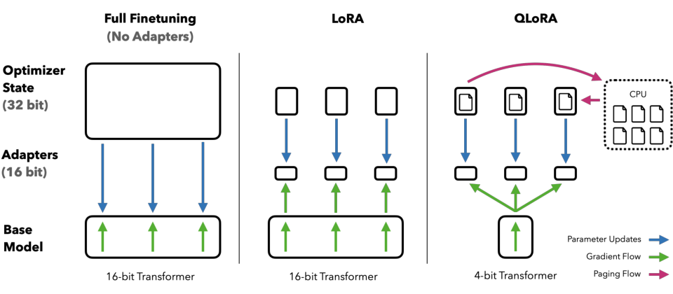
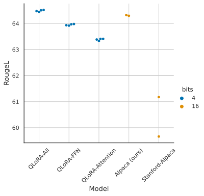
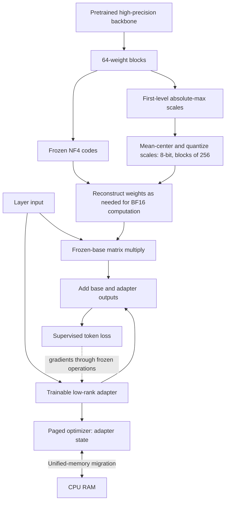
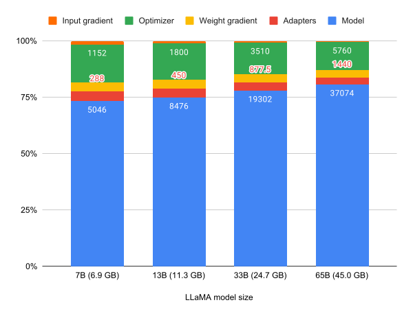
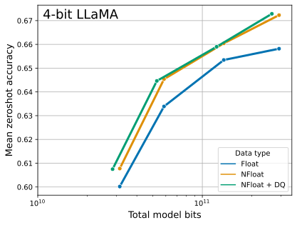

# QLoRA: Efficient Finetuning of Quantized LLMs - Dettmers et al., 2023

> **Authors:** Tim Dettmers, Artidoro Pagnoni, Ari Holtzman, Luke Zettlemoyer
>
> **arXiv:** [2305.14314v1](https://arxiv.org/abs/2305.14314v1), 23 May 2023; latest arXiv version listed
>
> **Venue:** NeurIPS 2023; [proceedings](https://papers.nips.cc/paper_files/paper/2023/hash/1feb87871436031bdc0f2beaa62a049b-Abstract-Conference.html)
>
> **Affiliation:** University of Washington

## TL;DR

QLoRA stores a frozen pretrained backbone in **4-bit NormalFloat**, dequantizes weights for higher-precision computation, and trains only low-rank adapters through that backbone. Double quantization compresses the weight scales, while paged optimizers let optimizer state move between GPU and CPU memory during memory-pressure spikes; together with gradient checkpointing, this enables **65B-parameter fine-tuning on a single 48 GB GPU** (Sections 1 and 3). The paper also introduces Guanaco instruction-tuned models and studies how dataset choice and evaluation protocol affect their apparent quality.

The widely quoted **99.3% of ChatGPT** is a **GPT-4-assigned score ratio on 80 Vicuna prompts**, not accuracy, a 99.3% win probability, or proof of general equivalence (Table 6). Section 8 explicitly states that full 16-bit fine-tuning equivalence was **not established at 33B and 65B**, despite broad evidence from smaller-model and adapter comparisons.

## Problem & motivation

### Frozen adapters do not remove the backbone's memory cost

[LoRA](peft_2021_lora.md) avoids updating the full pretrained weight matrix. It saves task-specific weight gradients and optimizer state, but a conventional LoRA job still loads a large backbone in higher precision and differentiates through its operations to reach adapters in earlier layers.

Section 1 estimates that conventional 16-bit full fine-tuning of LLaMA-65B needs **more than 780 GB** of GPU memory. QLoRA targets a different decomposition: compress the immutable backbone aggressively, retain trainable adapters at useful precision, and manage the memory peaks that still arise from activations and optimization.

The goal is not integer-only training. It is to distinguish **storage precision** from **computation precision** and exploit the fact that the base weights never receive an update.

### Tiny adapter counts are not the only useful optimization target

Section 2 illustrates that activation-related memory can dominate adapter weights. In a particular LLaMA-7B/FLAN-v2 configuration with adapters corresponding to roughly **0.2%** of original weights, adapter parameters occupy **26 MB**, uncheckpointed LoRA input gradients **567 MB**, and the quantized base **5,048 MB**. Checkpointing reduces the reported average input-gradient allocation to **18 MB per sequence**.

These are component estimates from that configuration, not a universal complete memory budget. At that point, reducing adapter parameter count further may buy little compared with quantizing the backbone or checkpointing activations. It can be better to place adapters broadly enough to recover task quality.



*Original Figure 1. QLoRA compresses the frozen base model, not the adapter update path. Optimizer-state paging is a separate mechanism from 4-bit weight storage.*

## Key idea

### A quantized frozen matrix plus a trainable low-rank correction

Use the paper's row-vector convention. Let

$$
X\in\mathbb R^{b\times h},\quad
W\in\mathbb R^{h\times o},\quad
L_1\in\mathbb R^{h\times r},\quad
L_2\in\mathbb R^{r\times o}.
$$

$b$ counts input vectors, $h$ is input width, $o$ output width, and $r$ the adapter rank. A LoRA layer computes

$$
Y=XW+sXL_1L_2,
$$

where $s$ is adapter scaling (Equation 3). QLoRA replaces $W$ with the dequantized reconstruction of a compact, immutable representation:

$$
\widehat W
=\operatorname{doubleDequant}(C_1,C_2,W_{\mathrm{NF4}}),
\qquad
Y=X\widehat W+sXL_1L_2.
$$

$W_{\mathrm{NF4}}$ contains four-bit code indices; $C_2$ contains quantized first-level scales; $C_1$ contains second-level scale information. Computation generally uses **BF16**, while the base weights remain stored in NF4 and the trainable adapters use higher precision (Equations 5-6).

The paper omits $s$ from its compact Equation 5. The ordinary LoRA implementation uses $s=\alpha/r$; its Guanaco settings are $r=64,\alpha=16$, hence $s=0.25$. This scaling convention is not an extra quantization scale.

### Correct gradient flow without updating four-bit weights

Let $G=\partial\mathcal L/\partial Y$. Ignoring adapter dropout for clarity,

$$
\frac{\partial\mathcal L}{\partial L_2}
=s(XL_1)^\top G,\qquad
\frac{\partial\mathcal L}{\partial L_1}
=sX^\top GL_2^\top,
$$

$$
\frac{\partial\mathcal L}{\partial X}
=G\widehat W^\top+sGL_2^\top L_1^\top.
$$

Only $L_1,L_2$ are optimized. The input gradient through $\widehat W$ is still needed to train adapters upstream, so detaching the full layer or running the backbone without the necessary autograd path would be incorrect.

No straight-through estimator is required to update $W_{\mathrm{NF4}}$: those codes and their quantization statistics are frozen. This differs from quantization-aware training that updates underlying full-precision weights through a quantizer.

**Notation clarification:** Section 3 describes this dependency using $\partial X/\partial W$, but the relevant backpropagation quantity is the **loss gradient with respect to layer input**, as expanded above. Likewise, dequantization reconstructs an approximation $\widehat W$, not an exact recovery of the original floating-point matrix after lossy rounding.

## How it works

### 1. Blockwise quantization limits outlier damage

A single large tensor-wide maximum can make most low-bit levels useless for ordinary weights. Split flattened weights into blocks and scale each block independently.

For block $j$, let $a_j=\max_i|w_{ji}|$. Using the **absolute-maximum** rather than its reciprocal as the scale notation, define

$$
z_{ji}=\frac{w_{ji}}{a_j},\qquad
k_{ji}=\arg\min_{\ell\in\{0,\ldots,15\}}
|z_{ji}-q_\ell|,\qquad
\widehat w_{ji}=a_jq_{k_{ji}}.
$$

$z_{ji}$ is the normalized weight, $q_\ell$ a codebook level, and $k_{ji}$ a four-bit stored index. Ties and all-zero blocks require defined implementation behavior; an all-zero block must reconstruct zero rather than divide by zero. The paper does not spell out those kernel edge cases.

QLoRA uses **64 weights per first-level block**. Small blocks improve reconstruction but require more scales, which motivates quantizing the scales too.

### 2. NF4 allocates levels to the assumed weight distribution

Uniform INT4 spends levels at equal distances. Ordinary FP4 spends them according to its exponent/mantissa structure. **NormalFloat4** instead uses a nonuniform codebook motivated by quantiles of a zero-centered normal distribution, with more useful resolution in common regions.

Equation 4 schematically forms quantile-based levels using the inverse normal CDF $Q=\Phi^{-1}$:

$$
\widetilde q_i
=\frac12\left[
Q\left(\frac{i}{2^k+1}\right)
+Q\left(\frac{i+1}{2^k+1}\right)
\right],
$$

where $k$ is bit width. Normalize the levels to $[-1,1]$ and construct asymmetric negative/positive sets so that **zero is represented exactly**. The indexing and endpoint construction should not be inferred naively from this schematic equation: $\Phi^{-1}(0)$ is infinite.

For an actual NF4 implementation, Appendix E supplies the authoritative **16 reconstruction values**, in ascending order:

```text
[-1.0, -0.6961928009986877, -0.5250730514526367,
 -0.39491748809814453, -0.28444138169288635, -0.18477343022823334,
 -0.09105003625154495, 0.0, 0.07958029955625534, 0.16093020141124725,
 0.24611230194568634, 0.33791524171829224, 0.44070982933044434,
 0.5626170039176941, 0.7229568362236023, 1.0]
```

These values define a lookup table, not a four-bit floating-point exponent/mantissa encoding. There are **seven negative levels, exact zero, and eight positive levels**.

The paper calls this information-theoretically optimal for normally distributed weights. Read that claim within its distributional/quantile motivation: it is not a guarantee of minimum task loss or minimum mean-squared error for every layer, and blockwise absolute-maximum normalization alters the distribution being quantized. Appendix F's LLaMA-7B Shapiro-Wilk analysis reports **7.5%** of tested neurons rejected as normal at a **5%** significance threshold, also acknowledging exceptions and large-sample-test concerns.

### 3. Double quantization compresses the scales

Without double quantization, a 32-bit scale per 64 weights adds

$$
\frac{32}{64}=0.5
\quad\text{bits per original weight}.
$$

Treat the first-level scales themselves as a second tensor. Subtract their mean to center the positive scale distribution, quantize the centered scales to **8 bits**, and use second-level blocks of **256 first-level scales**.

An explanatory reconstruction is

$$
\widehat a_j=\mu+d_g\,v_{u_j},\qquad
\widehat w_{ji}=\widehat a_j\,q_{k_{ji}},
$$

where $\mu$ is the removed mean, $d_g$ the second-level scale for the group containing $j$, $u_j$ its eight-bit code, and $v$ the second-level reconstruction map. The paper describes this second quantizer as eight-bit floats; use the released backend's quantization-state format for exact compatible serialization rather than assuming a generic hardware FP8 byte layout.

The resulting asymptotic scale overhead is

$$
\frac{8}{64}+\frac{32}{64\cdot256}
=0.126953125
\quad\text{bits per weight},
$$

instead of 0.5. The saving is **0.373046875 bits per weight**, approximately **3.03 GB** for 65 billion weights in decimal units, consistent with the paper's approximately 3 GB claim (Section 3). Mean offsets, boundary blocks, and metadata add small costs omitted by this asymptotic calculation.

Thus the idealized quantized tensor costs about **4.127 bits per weight**, not exactly four. That still excludes adapters, their gradients/optimizer state, unquantized modules, activations, workspaces, and allocator overhead.

### 4. Use BF16 for matrix operations

Dequantize the relevant quantized weights to computation precision when needed, then perform ordinary floating-point forward/backward operations. Quantization reduces persistent backbone storage; it does not mean every multiplication or gradient is four-bit.

Nor does it require materializing and retaining a second **complete** 65B BF16 model beside the quantized one. The backend performs dequantization as needed for its operations; temporary-buffer and kernel behavior determine actual peaks.

The [official training implementation](https://github.com/artidoro/qlora/blob/main/qlora.py) handles mixed precision explicitly, including FP32 normalization modules. Its linear-module selection excludes `lm_head`. Therefore "four-bit model" and "all-linear adapters" should not be read as quantizing every tensor, including normalization and embeddings, or adapting every named linear module without exclusions.

### 5. Attach adapters broadly

The key ablation is **adapter coverage**. Adding adapters only to the common attention query/value projections is insufficient in the paper's LLaMA-7B/Alpaca experiment. Applying them throughout transformer-block linear layers, including feed-forward projections, recovers a stronger baseline (Section 4).



*Original Figure 2. Quantization is not the only variable: the authors also retune the full-fine-tuning baseline and expand adapter coverage. The dots are runs with different random seeds; this is not evidence that every arbitrary four-bit adapter recipe matches full fine-tuning.*

Appendix A searches ranks **8, 16, 32, 64, 128, 256**, dropout **0, 0.05, 0.1**, and several attention/FFN placement combinations. It finds rank relatively unimportant **when adapters cover all relevant layers in this setup**. That is not a theorem that rank never matters.

Use ordinary LoRA initialization: random $L_1$, zero $L_2$, so the adapter initially contributes zero rather than perturbing the quantized base immediately. LoRA dropout acts on the adapter input path during training; the displayed derivative equations omit dropout to make the fixed-backbone gradient dependency explicit.

### 6. Checkpoint activations and page optimizer state

Gradient checkpointing recomputes selected activations during backward rather than retaining all of them. Memory can still spike on a minibatch containing long sequences.

Paged optimizers allocate optimizer state using **NVIDIA unified memory** so pages can migrate between GPU and CPU RAM under pressure, then return when needed for an optimizer update. They do not quantize activations, remove all optimizer state, or guarantee that any sequence length will fit. Host memory, interconnect bandwidth, and the rest of the workload still constrain the job.

Section 4 does not provide a systematic paging-overhead benchmark. It reports no training-speed difference in one 65B/48 GB, batch-16 analysis and explicitly leaves slowdown characterization to future work. This should not be generalized into "paging is always free."

### 7. Train with an ordinary supervised objective

For a batch of $N$ examples with input tokens $x^{(n)}$, target tokens $y^{(n)}$, adapter parameters $\phi=\{L_1,L_2\}$, and frozen quantized backbone state $\mathcal Q$, a token-averaged supervised objective is

$$
\mathcal L(\phi)
=-\frac{
\sum_{n=1}^{N}\sum_{t=1}^{T_n}m_{nt}\log
p_{\mathcal Q,\phi}(y_t^{(n)}\mid x^{(n)},y_{<t}^{(n)})
}{
\sum_{n=1}^{N}\sum_{t=1}^{T_n}m_{nt}
}.
$$

$T_n$ is the target length and $m_{nt}\in\{0,1\}$ masks unsupervised/padding positions; the denominator must be positive. Causal labels are shifted so each supervised token is predicted from preceding tokens, and the released collator marks excluded labels with an ignore index. QLoRA is a memory-efficient adaptation method, not a new preference objective. Guanaco uses supervised cross-entropy, **not RLHF**, even when the source data contain preference judgments.

For ordinary instruction/response datasets, the paper trains on responses only. For OASST1 and HH-RLHF, it selects preferred conversation branches and trains on the full selected conversation, including user instructions (Section 5.1). Reproducing the loss mask is therefore dataset-dependent.



*Authored reconstruction. The quantized base codes are not optimized, and the paging path concerns optimizer state rather than a blanket offload of all model computation.*

### 8. Save and deploy

The released Guanaco artifacts are adapters that require the matching original LLaMA backbone. Keeping the quantized base plus adapters preserves the training decomposition.

A merged high-precision deployment can use $\widehat W+sL_1L_2$, but that has a different storage footprint. Requantizing the merged result introduces another quantization step; it should not be assumed numerically identical to evaluating a quantized base plus separate higher-precision adapters. The paper's contribution is not a guarantee of zero-overhead merging into an arbitrary four-bit inference format.

## Training / data

### Model families and experiment scopes

The paper studies encoder-only **RoBERTa-large**, encoder-decoder **T5**, and decoder-only **LLaMA**. Quantization-only experiments also include OPT, BLOOM, and Pythia. These experiments answer different questions:

- **Smaller-model full-fine-tuning comparisons:** GLUE and Super-NaturalInstructions, with newly run and previously reported baselines.
- **Larger LLaMA precision comparisons:** BF16 adapters versus four-bit adapters after Alpaca/FLAN-v2 tuning, not a complete 65B full-model fine-tuning study.
- **Chatbot experiments:** LLaMA 7B/13B/33B/65B adapted on eight instruction datasets, then evaluated on MMLU and generated-answer judgments.

In total, the authors report more than **1,000 fine-tuned models** (Section 1). This is an experimental sweep across settings, not the number of models required for a single adaptation job.

Appendix A.2 uses T5 ranks **16** for Small/Base/Large and **64** for XL/XXL, $\alpha=64$, and no LoRA dropout. These are not Guanaco's $r=64,\alpha=16$ settings.

### Instruction datasets

| Dataset | Reported collection / used subset | Training interpretation |
|---|---|---|
| OASST1 | 161,443 messages, 66,497 conversations, 35 languages; top-branch selection yields **9,209 examples** | Crowd-sourced ranked conversations; train full selected conversation |
| HH-RLHF | 160,800 examples | Keep preferred replies from helpfulness/harmlessness comparisons; supervised training, not reward optimization |
| FLAN v2 | 1,836 tasks, over 15M examples in the collection; unavailable tasks excluded | Aggregated instruction tasks; the paper also discusses a 450K subsample and smaller controlled subsets |
| Self-Instruct | 82,612 examples | Model-generated instruction data |
| Alpaca | 51,942 examples | Distilled instruction/response examples |
| Unnatural Instructions | 240,670 examples | Model-generated and paraphrased instruction data |
| Longform | 23,700 examples | Human documents with generated instructions and additional structured/task examples |
| Chip2 | 210,289 examples | Hybrid OIG/LAION instruction collection |

*Source: Section 5.1 and Appendix B.1; the 450K FLAN-v2 comparison is also discussed in Section 1. Collection size is not necessarily the exact number of distinct examples consumed by every step-limited training run.*

For OASST1, select the highest-ranked response at each conversation level. The paper's data-quality result is about **suitability for the target evaluation**, not an assertion that the largest dataset is intrinsically low-quality. FLAN-v2 models do better on MMLU; OASST1 models do better on chatbot judgments.

### Guanaco recipe

Appendix B.2 reports NF4 storage, double quantization, BF16 computation, adapters on transformer linear layers, rank **64**, $\alpha=16$, Adam $\beta_2=0.999$, and gradient norm clipping at **0.3**. LoRA dropout is **0.1** for 7B/13B and **0.05** for 33B/65B; examples are grouped by length, which can create an oscillating loss curve.

The paper specifies a **constant learning-rate schedule** and validates/tunes using the **MMLU five-shot development set**. The official 7B/65B reproduction scripts additionally specify **3% warmup**, **zero weight decay**, gradient checkpointing, and per-device batch **1** with **16 accumulation steps** for Guanaco. The code defaults to **paged AdamW with 32-bit optimizer state**. Those repository details supplement, rather than replace, the paper's reported recipe.

The code links here track the repository's moving `main` branch, not an immutable paper-era software environment. Reproduction should pin compatible Transformers, PEFT, bitsandbytes, and PyTorch revisions; do not assume a later library's generic defaults reproduce the historical run.

| Size | Dataset setting | Effective batch | Learning rate | Steps | Source length | Target length |
|---|---|---:|---|---:|---:|---:|
| 7B | All/default | 16 | 2e-4 | 10000 | 384 | 128 |
| 7B | OASST1 | 16 | 2e-4 | 1875 | - | 512 |
| 7B | HH-RLHF | 16 | 2e-4 | 10000 | - | 768 |
| 7B | Longform | 16 | 2e-4 | 4000 | 512 | 1024 |
| 13B | All/default | 16 | 2e-4 | 10000 | 384 | 128 |
| 13B | OASST1 | 16 | 2e-4 | 1875 | - | 512 |
| 13B | HH-RLHF | 16 | 2e-4 | 10000 | - | 768 |
| 13B | Longform | 16 | 2e-4 | 4000 | 512 | 1024 |
| 33B | All/default | 32 | 1e-4 | 5000 | 384 | 128 |
| 33B | OASST1 | 16 | 1e-4 | 1875 | - | 512 |
| 33B | HH-RLHF | 32 | 1e-4 | 5000 | - | 768 |
| 33B | Longform | 32 | 1e-4 | 2343 | 512 | 1024 |
| 65B | All/default | 64 | 1e-4 | 2500 | 384 | 128 |
| 65B | OASST1 | 16 | 1e-4 | 1875 | - | 512 |
| 65B | HH-RLHF | 64 | 1e-4 | 2500 | - | 768 |
| 65B | Longform | 32 | 1e-4 | 2343 | 512 | 1024 |

*Source: Appendix Table 9. "All/default" means the row's dataset default, overridden by specific dataset rows; it does not mean one model jointly trained on all eight datasets. "-" is the source table's unspecified/not-separate source field.*

All Guanaco OASST1 rows use **1,875 optimizer steps** and effective batch **16**, or **30,000 example presentations** by multiplication. This is not a claim of 30,000 distinct OASST1 examples. The scripts' separate source-length flag of 16 should not be substituted for an independently supervised 16-token instruction field in the already formatted conversation.

### Memory and wall-clock claims

Section 1 reports 33B fine-tuning on a **24 GB consumer GPU in less than 12 hours**, and the largest Guanaco on a **48 GB professional GPU in about 24 hours**. These refer to the reported short instruction-tuning setup, not arbitrary pretraining, sequence lengths, datasets, or tasks.



*Original Appendix Figure 6. Its input-gradient estimate assumes batch 1, sequence length 512, and checkpointing; it excludes attention-related input-gradient contributions. The figure is not a universal peak-memory guarantee.*

The tabled **41/21/10/5 GB** Guanaco footprints in chatbot comparisons are model-footprint figures, not complete training peaks. Table 1 lists 7B as **6 GB**, whereas Tables 6/13 give **5 GB**; the paper does not fully reconcile that reporting difference.

## Results

### Quantization fidelity

| Data type | Mean Pile Common Crawl perplexity |
|---|---:|
| INT4 | 34.34 |
| FP4 E2M1 | 31.07 |
| FP4 E3M0 | 29.48 |
| NF4 + double quantization | 27.41 |

*Source: Table 2, averaged over the stated OPT/BLOOM/LLaMA/Pythia model set from 125M to 13B. Lower is better. These are quantization-only measurements, not instruction-tuned chatbot scores.*



*Original Figure 3. Zero-shot accuracy averages Winogrande, HellaSwag, PIQA, ARC-Easy, and ARC-Challenge for LLaMA models. NF4 improves the accuracy/memory trade-off; double quantization chiefly improves the scale-storage budget.*

### Full tuning versus adapter tuning at smaller scales

| Method | RoBERTa-large GLUE accuracy | T5-80M SNI ROUGE-L | T5-250M | T5-780M | T5-3B | T5-11B |
|---|---:|---:|---:|---:|---:|---:|
| BF16 full-tuning reference | 88.6 | 40.1 | 42.1 | 48.0 | 54.3 | 62.0 |
| BF16 full-tuning replication | 88.6 | 40.0 | 42.2 | 47.3 | 54.9 | - |
| LoRA BF16 | 88.8 | 40.5 | 42.6 | 47.1 | 55.4 | 60.7 |
| QLoRA INT8 | 88.8 | 40.4 | 42.9 | 45.4 | 56.5 | 60.7 |
| QLoRA FP4 | 88.6 | 40.3 | 42.4 | 47.5 | 55.6 | 60.9 |
| QLoRA NF4 + DQ | - | 40.4 | 42.7 | 47.7 | 55.3 | 60.9 |

*Source: Table 3. SNI denotes Super-NaturalInstructions. "-" means unreported; the NF4 row does not report a RoBERTa score. The full-tuning references and replications are separate rows.*

The results support low-bit adapter quality close to high-precision adapters and several full-tuning baselines. They are not literal equality in every cell: T5-11B NF4 scores **60.9**, versus the full-tuning reference's **62.0**, while BF16 LoRA is **60.7**. Model size, baseline source, and metric should remain visible when summarizing "no degradation."

### LLaMA precision comparison

| Adapter/base precision | 7B Alpaca | 7B FLAN v2 | 13B Alpaca | 13B FLAN v2 | 33B Alpaca | 33B FLAN v2 | 65B Alpaca | 65B FLAN v2 | Mean |
|---|---:|---:|---:|---:|---:|---:|---:|---:|---:|
| BF16 | 38.4 | 45.6 | 47.2 | 50.6 | 57.7 | 60.5 | 61.8 | 62.5 | 53.0 |
| FP4 | 37.2 | 44.0 | 47.3 | 50.0 | 55.9 | 58.5 | 61.3 | 63.3 | 52.2 |
| NF4 + DQ | 39.0 | 44.5 | 47.5 | 50.7 | 57.3 | 59.2 | 61.8 | 63.9 | 53.1 |

*Source: Table 4, five-shot MMLU test accuracy. All rows use adapters; the BF16 row is not a 65B full-model fine-tuning result. The "Mean" column is the paper's reported aggregate.*

NF4's aggregate **53.1** is close to BF16's **53.0**, versus FP4's **52.2**. Individual cells vary in both directions. The claim that adapters can recover task performance after quantization is empirical; it does not mean the original weights are reconstructed exactly or that all quantization error vanishes.

### Dataset suitability: MMLU is not chatbot preference

| Fine-tuning dataset | 7B | 13B | 33B | 65B |
|---|---:|---:|---:|---:|
| LLaMA, no tuning | 35.1 | 46.9 | 57.8 | 63.4 |
| Self-Instruct | 36.4 | 33.3 | 53.0 | 56.7 |
| Longform | 32.1 | 43.2 | 56.6 | 59.7 |
| Chip2 | 34.5 | 41.6 | 53.6 | 59.8 |
| HH-RLHF | 34.9 | 44.6 | 55.8 | 60.1 |
| Unnatural Instructions | 41.9 | 48.1 | 57.3 | 61.3 |
| Guanaco / OASST1 | 36.6 | 46.4 | 57.0 | 62.2 |
| Alpaca | 38.8 | 47.8 | 57.3 | 62.5 |
| FLAN v2 | 44.5 | 51.4 | 59.2 | 63.9 |

*Source: Table 5, five-shot MMLU test accuracy across 57 tasks. These separately reported dataset-study runs need not numerically match every cell of the precision ablation in Table 4.*

FLAN-v2 is best on this knowledge benchmark, but poor on the chatbot benchmark below. Guanaco-65B's **62.2** is even slightly below the untuned LLaMA-65B **63.4**. A large chatbot-preference gain is therefore not synonymous with a gain in classroom-style factual multiple-choice performance.

### How the chatbot evaluations work

Section 5.2 generates responses with **top-$p=0.9$**, temperature **0.7**. It evaluates:

- **Vicuna:** 80 fixed prompts.
- **OA:** 953 user queries from OASST1 validation, with prior conversation context where available.

GPT-4 first assigns scores out of ten to a system answer and a ChatGPT answer. The authors report a relative score and evaluate both presentation orders because earlier answers receive a systematic advantage. Separately, GPT-4 or people select **win / loss / tie** in pairwise matches.

The score ratio can exceed 100%. It is distinct from pairwise preference rates, task accuracy, and the proportion of prompts on which the model is correct.

### Relative Vicuna scores

| Model / training data | Size | Bits | Footprint | ChatGPT first | System first | Reported mean | 95% CI |
|---|---|---|---|---:|---:|---:|---:|
| GPT-4 | - | - | - | 119.4 | 110.1 | 114.5 | 2.6 |
| Bard | - | - | - | 93.2 | 96.4 | 94.8 | 4.1 |
| Guanaco | 65B | 4-bit | 41 GB | 96.7 | 101.9 | 99.3 | 4.4 |
| Alpaca | 65B | 4-bit | 41 GB | 63.0 | 77.9 | 70.7 | 4.3 |
| FLAN v2 | 65B | 4-bit | 41 GB | 37.0 | 59.6 | 48.4 | 4.6 |
| Guanaco | 33B | 4-bit | 21 GB | 96.5 | 99.2 | 97.8 | 4.4 |
| Open Assistant | 33B | 16-bit | 66 GB | 91.2 | 98.7 | 94.9 | 4.5 |
| Alpaca | 33B | 4-bit | 21 GB | 67.2 | 79.7 | 73.6 | 4.2 |
| FLAN v2 | 33B | 4-bit | 21 GB | 26.3 | 49.7 | 38.0 | 3.9 |
| Vicuna | 13B | 16-bit | 26 GB | 91.2 | 98.7 | 94.9 | 4.5 |
| Guanaco | 13B | 4-bit | 10 GB | 87.3 | 93.4 | 90.4 | 5.2 |
| Alpaca | 13B | 4-bit | 10 GB | 63.8 | 76.7 | 69.4 | 4.2 |
| HH-RLHF | 13B | 4-bit | 10 GB | 55.5 | 69.1 | 62.5 | 4.7 |
| Unnatural Instructions | 13B | 4-bit | 10 GB | 50.6 | 69.8 | 60.5 | 4.2 |
| Chip2 | 13B | 4-bit | 10 GB | 49.2 | 69.3 | 59.5 | 4.7 |
| Longform | 13B | 4-bit | 10 GB | 44.9 | 62.0 | 53.6 | 5.2 |
| Self-Instruct | 13B | 4-bit | 10 GB | 38.0 | 60.5 | 49.1 | 4.6 |
| FLAN v2 | 13B | 4-bit | 10 GB | 32.4 | 61.2 | 47.0 | 3.6 |
| Guanaco | 7B | 4-bit | 5 GB | 84.1 | 89.8 | 87.0 | 5.4 |
| Alpaca | 7B | 4-bit | 5 GB | 57.3 | 71.2 | 64.4 | 5.0 |
| FLAN v2 | 7B | 4-bit | 5 GB | 33.3 | 56.1 | 44.8 | 4.0 |

*Source: Table 6. Scores are percentages of ChatGPT's judged score; CI entries are reported half-widths in percentage points. "ChatGPT first" and "System first" correspond to the source's two ordering columns.*

Order effects are large for several systems. Guanaco-65B's **99.3 +/- 4.4** should not be read as a statistically settled universal tie with ChatGPT. Reported means are also not always exactly the arithmetic mean of the printed order columns: for example, HH-RLHF-13B prints **55.5** and **69.1**, averaging to **62.3**, but lists **62.5**. The source does not reconcile all such differences; this table preserves its reported numbers.

### Pairwise comparisons and Elo

For ratings $R_A,R_B$, the conventional Elo expected score is

$$
E_A=\frac{1}{1+10^{(R_B-R_A)/400}},
\qquad
R_A'\!=R_A+K(S_A-E_A),
$$

where $S_A$ is 1 for a win, 0.5 for a tie, and 0 for a loss. The paper starts models at **1,000**, uses **$K=32$**, and repeats tournament processing with **10,000 random seeds/orderings** (Section 5.2). The expectation includes half-credit for ties; it is not necessarily the strict probability of an outright win.

Human evaluations use **two annotators** for relative-to-ChatGPT comparisons and **three** for pairwise comparisons. Reordering matches measures algorithmic ordering variation, not every source of uncertainty in prompt selection, human judgments, or judge-model behavior.

| Model | Human Vicuna Elo | Rank | GPT-4 Vicuna Elo | Rank | GPT-4 OA Elo | Rank | Median rank |
|---|---:|---:|---:|---:|---:|---:|---:|
| GPT-4 | 1176 | 1 | 1348 | 1 | 1294 | 1 | 1 |
| Guanaco-65B | 1023 | 2 | 1022 | 2 | 1008 | 3 | 2 |
| Guanaco-33B | 1009 | 4 | 992 | 3 | 1002 | 4 | 4 |
| ChatGPT-3.5 Turbo | 916 | 7 | 966 | 5 | 1015 | 2 | 5 |
| Vicuna-13B | 984 | 5 | 974 | 4 | 936 | 5 | 5 |
| Guanaco-13B | 975 | 6 | 913 | 6 | 885 | 6 | 6 |
| Guanaco-7B | 1010 | 3 | 879 | 8 | 860 | 7 | 7 |
| Bard | 909 | 8 | 902 | 7 | - | - | 8 |

*Source: Table 7. These are separate tournaments; absolute Elo values should not be compared across columns as though the opponent populations and judges were identical.*

Table 1 separately reports GPT-4-judged Vicuna ratings with **+/-1** confidence intervals for GPT-4 **1348**, Guanaco-65B **1022**, Guanaco-33B **992**, Vicuna **974**, ChatGPT **966**, Guanaco-13B **916**, Bard **902**, and Guanaco-7B **879**. Its Guanaco-13B **916** differs from Table 7's **913**; the discrepancy is retained rather than silently harmonized.

Appendix Table 12 gives normalized pairwise net preferences, $d_{AB}=(n_{A>B}-n_{B>A})/n_{\mathrm{all}}$, including ties in the denominator:

| Row model versus column | G65 | G33 | Vicuna | ChatGPT | Bard | G13 | G7 |
|---|---:|---:|---:|---:|---:|---:|---:|
| Guanaco-65B | - | 0.21 | 0.19 | 0.16 | 0.72 | 0.59 | 0.86 |
| Guanaco-33B | -0.21 | - | 0.17 | 0.10 | 0.51 | 0.41 | 0.68 |
| Vicuna | -0.19 | -0.17 | - | 0.10 | 0.50 | 0.20 | 0.57 |
| ChatGPT-3.5 Turbo | -0.16 | -0.10 | -0.10 | - | 0.35 | 0.19 | 0.40 |
| Bard | -0.72 | -0.51 | -0.50 | -0.35 | - | 0.12 | 0.03 |
| Guanaco-13B | -0.59 | -0.41 | -0.20 | -0.19 | -0.12 | - | 0.20 |
| Guanaco-7B | -0.86 | -0.68 | -0.57 | -0.40 | -0.03 | -0.20 | - |

*Source: Appendix Table 12. Positive favors the row model; these decimals are net preference differences, not direct win probabilities. The induced order, repeated in Table 13, is G65 > G33 > Vicuna > ChatGPT > Bard > G13 > G7.*

The GPT-4/human system rankings have **Kendall $\tau=0.43$** and **Spearman $r=0.55$**, while example-level agreement is weaker at **Fleiss $\kappa=0.25$**; human annotator agreement itself is **$\kappa=0.42$** (Sections 5.3 and 6.2). Guanaco-7B's human rank **3** versus GPT-4 rank **8** is a concrete warning against treating model judging as interchangeable with people.

### Loss-mask and data-size ablations

| Loss positions | Unnatural Instructions | Chip2 | Alpaca | FLAN v2 | Mean |
|---|---:|---:|---:|---:|---:|
| Instruction and response | 36.2 | 33.7 | 38.1 | 42.0 | 37.5 |
| Response only | 38.0 | 34.5 | 39.0 | 42.9 | 38.6 |

*Source: Appendix Table 10, LLaMA-7B with a 52K-example restriction, five-shot MMLU test accuracy. The source reports the two means as printed. The benefit is not separately established for Vicuna/OA or every conversation-format dataset.*

| Examples | Chip2: 1 epoch | 2 | 3 | Unnatural: 1 | 2 | 3 | FLAN v2: 1 | 2 | 3 | Reported mean |
|---|---:|---:|---:|---:|---:|---:|---:|---:|---:|---:|
| 50000 | 34.50 | 35.30 | 34.70 | 38.10 | 42.20 | 38.10 | 43.00 | 43.50 | 44.10 | 39.28 |
| 100000 | 33.70 | 33.90 | 34.00 | 40.10 | 41.20 | 37.00 | 43.90 | 43.70 | 44.90 | 39.16 |
| 150000 | 34.40 | 34.80 | 35.10 | 39.70 | 41.10 | 41.50 | 44.60 | 45.50 | 43.50 | 40.02 |
| Reported mean | 34.20 | 34.67 | 34.60 | 39.30 | 41.50 | 38.87 | 43.83 | 44.23 | 44.17 | - |

*Source: Appendix Table 11, five-shot MMLU test accuracy. Values need not increase monotonically with examples or epochs.*

Appendix B.4 characterizes size/epoch gains as small relative to dataset differences, but its **0.0-0.5** summary is not a bound on every individual table cell: Unnatural Instructions at 50K changes **38.10 to 42.20** between one and two epochs. The sound takeaway is that dataset effects are large in these experiments, not that extra data or training can never move MMLU by more than half a point.

### Bias and qualitative evaluation

| CrowS category | LLaMA-65B | GPT-3 | OPT-175B | Guanaco-65B |
|---|---:|---:|---:|---:|
| Gender | 70.6 | 62.6 | 65.7 | 47.5 |
| Religion | 79.0 | 73.3 | 68.6 | 38.7 |
| Race/color | 57.0 | 64.7 | 68.6 | 45.3 |
| Sexual orientation | 81.0 | 76.2 | 78.6 | 59.1 |
| Age | 70.1 | 64.4 | 67.8 | 36.3 |
| Nationality | 64.2 | 61.6 | 62.9 | 32.4 |
| Disability | 66.7 | 76.7 | 76.7 | 33.9 |
| Physical appearance | 77.8 | 74.6 | 76.2 | 43.1 |
| Socioeconomic status | 71.5 | 73.8 | 76.2 | 55.3 |
| Reported average | 66.6 | 67.2 | 69.5 | 43.5 |

*Source: Table 8; the paper interprets lower scores as lower likelihood of biased sequences. The reported aggregate is preserved, not recomputed as an unweighted mean of the displayed categories.*

This limited likelihood-based bias check does not establish safety, appropriate refusal, fairness across all settings, or absence of inherited base-model biases. In particular, a low stereotype-preference statistic is not a general measure of unbiased conversational behavior.

Section 6 deliberately searches for both successes and failures rather than showing only favorable examples. It identifies confident factual mistakes, mathematical/reasoning failures, and mistaken inferences about what participants in a story know. Such "lemon-picked" examples expose failure modes but do not estimate their population frequency.

## Limitations & follow-ups

### What the headline memory result does not prove

The paper demonstrates the feasibility of a particular **fine-tuning** workload, not training a 65B backbone from scratch or fitting every possible context/batch size into 48 GB. Low-bit weights leave substantial memory for adapters, activations, gradient checkpointing, optimizer state, and temporary allocations; long sequences can still exceed capacity.

Section 8 explicitly does **not** establish full 16-bit fine-tuning equivalence at **33B/65B** because of baseline cost. Larger-model evidence is strongest for quantized versus BF16 **adapter** tuning. Numerical closeness on selected tasks also does not imply identical models or outputs.

### Quantization assumptions and engineering boundaries

NF4 assumes approximately normal weight distributions and uses a fixed codebook. Different layers, outliers, and block-normalized distributions may violate its idealized motivation. Double quantization adds another approximation and metadata format; neither technique is universally lossless.

The original paper does not test three-bit bases or every alternative adapter method. Its suggestion that more aggressive quantization might work after adaptation is a research direction, not a reported three-bit equivalence result. Later quantization and quantization-aware adapter initialization techniques should be judged on their own evidence.

Paged optimization requires CPU memory and migration support, and its overhead is workload-dependent. The historical repository lists slow four-bit inference and some FP16 instability as known issues; those are software-version-specific reports, not permanent properties of every later backend. Its MIT code license also does not override the original LLaMA model license or the various dataset terms.

### Evaluation is a substantial part of the contribution

Guanaco's ChatGPT comparisons are **historical 2023 model comparisons** on small or distribution-specific benchmarks. Vicuna favors different systems from OA; neither can certify broad assistant equivalence. GPT-4 order bias, model self-preference, annotator disagreement, score-scale ambiguity, and wide confidence intervals all matter.

Fuzzy prompt matching between OASST1 training data and Vicuna found no overlaps after manual inspection (Section 6.2). This is narrower than proving the absence of all contamination, paraphrases, or pretraining overlap. Likewise, multilingual training may partly explain evaluation differences, but the paper does not isolate a causal multilingual benefit.

Datasets encode different goals and licenses. Full-conversation SFT on preferred examples is not RLHF, and a model can improve human-style response preferences while losing MMLU accuracy. The paper does not provide a comprehensive modern responsible-AI assessment.

### Related directions

[LoRA](peft_2021_lora.md) supplies the frozen-base/low-rank-update mechanism. [Prompt Tuning](softtoken_2021_prompt-tuning.md), [Prefix-Tuning](softtoken_2021_prefix-tuning.md), and [Adapters](peft_2019_bottleneck-adapters.md) offer different parameter-efficient interfaces; QLoRA's quantization/storage choices are distinct from those adaptation parameterizations.

Subsequent work such as [LoftQ](https://arxiv.org/abs/2310.08659) studies quantization-aware low-rank initialization, while [DoRA](peft_2024_dora.md) and [LoRA+](peft_2024_lora-plus.md) change the adapter parameterization or optimization. Those are follow-ups, not mechanisms evaluated by the original QLoRA paper.

## Links

- **arXiv:** [abs, v1](https://arxiv.org/abs/2305.14314v1) | [HTML, v1](https://arxiv.org/html/2305.14314v1) | [PDF, v1](https://arxiv.org/pdf/2305.14314v1)
- **Code:** [artidoro/qlora](https://github.com/artidoro/qlora) | [bitsandbytes](https://github.com/bitsandbytes-foundation/bitsandbytes) | [official training implementation](https://github.com/artidoro/qlora/blob/main/qlora.py)
- **Reproduction scripts:** [Guanaco-7B](https://github.com/artidoro/qlora/blob/main/scripts/finetune_guanaco_7b.sh) | [Guanaco-65B](https://github.com/artidoro/qlora/blob/main/scripts/finetune_guanaco_65b.sh)
- **Hugging Face:** [author model/adapters](https://huggingface.co/timdettmers) | [OpenAssistant Guanaco dataset](https://huggingface.co/datasets/timdettmers/openassistant-guanaco)
- **Project page:** [official repository](https://github.com/artidoro/qlora)
- **Blog:** [Hugging Face four-bit transformers and QLoRA](https://huggingface.co/blog/4bit-transformers-bitsandbytes)
- **Talks / videos / venue:** [NeurIPS 2023 presentation](https://neurips.cc/virtual/2023/poster/71815) | [proceedings](https://papers.nips.cc/paper_files/paper/2023/hash/1feb87871436031bdc0f2beaa62a049b-Abstract-Conference.html)
- **Evaluation artifacts:** [protocol and released judgments](https://github.com/artidoro/qlora/blob/main/eval/EVAL_README.md)
- **Papers-with-Code:** No separate record verified; primary paper and official repositories above are sufficient.
- **Related / successor papers:** [LoRA](peft_2021_lora.md) | [Prompt Tuning](softtoken_2021_prompt-tuning.md) | [Prefix-Tuning](softtoken_2021_prefix-tuning.md) | [Adapters](peft_2019_bottleneck-adapters.md) | [LoftQ](https://arxiv.org/abs/2310.08659) | [DoRA](peft_2024_dora.md) | [LoRA+](peft_2024_lora-plus.md)
- **BibTeX:**

```bibtex
@inproceedings{dettmers2023qlora,
  title = {QLoRA: Efficient Finetuning of Quantized LLMs},
  author = {Dettmers, Tim and Pagnoni, Artidoro and
            Holtzman, Ari and Zettlemoyer, Luke},
  booktitle = {Advances in Neural Information Processing Systems},
  volume = {36},
  year = {2023},
  url = {https://arxiv.org/abs/2305.14314v1}
}
```
