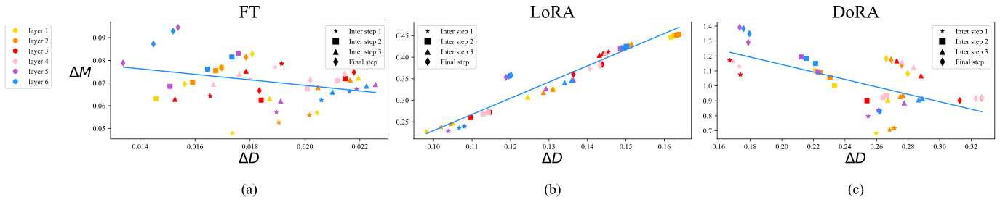
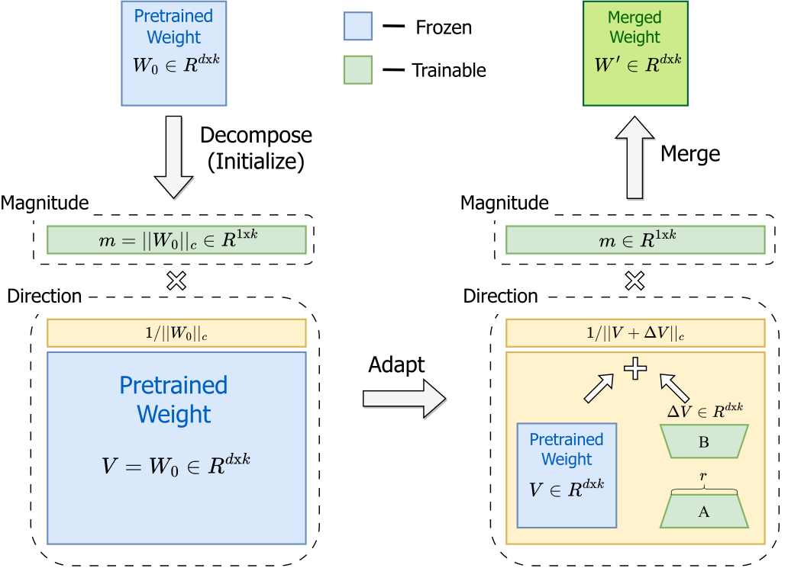
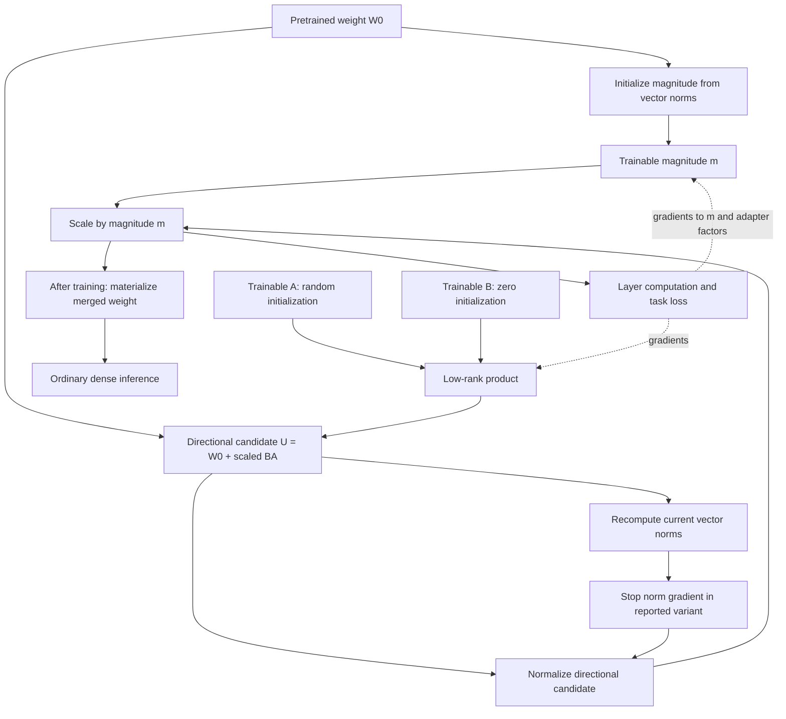
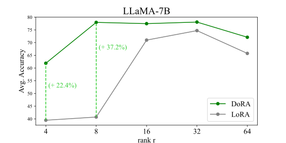
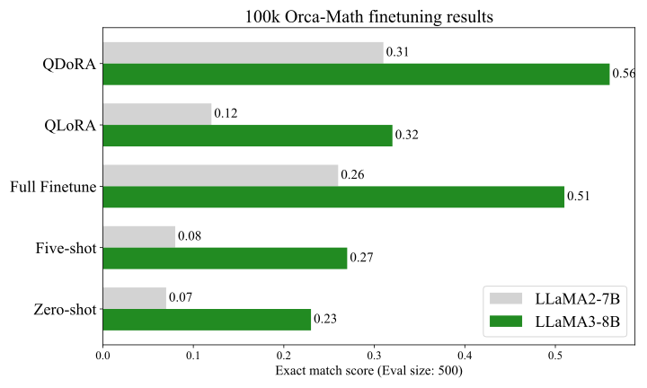

# DoRA: Weight-Decomposed Low-Rank Adaptation - Liu et al., 2024

> **Authors:** Shih-Yang Liu, Chien-Yi Wang, Hongxu Yin, Pavlo Molchanov, Yu-Chiang Frank Wang, Kwang-Ting Cheng, Min-Hung Chen
>
> **arXiv:** [2402.09353v6](https://arxiv.org/abs/2402.09353v6), revised 9 July 2024; first posted 14 February 2024
>
> **Venue:** ICML 2024, oral; PMLR 235, pages 32100-32121
>
> **Affiliations:** NVIDIA and Hong Kong University of Science and Technology (HKUST)

## TL;DR

DoRA separates each pretrained weight vector into a trainable **magnitude** and a **direction**, then uses a low-rank adapter to update the direction. This adds only a magnitude vector to ordinary LoRA's trainable factors, but changes the effective update and its optimization; the final normalized/scaled weight can still be merged for ordinary inference. The paper reports average commonsense accuracy improvements from **74.7 to 78.4** for LLaMA-7B and **80.8 to 85.2** for LLaMA3-8B, plus improvements on multimodal and instruction-tuning tasks (Table 1).

An essential implementation detail is that the reported experiments **detach the current direction norm during backpropagation** to save memory (Section 4.3). This retains the normalized forward computation but changes its gradient relative to the fully differentiable derivation in Section 4.2.

## Problem & motivation

### A low-rank update must ordinarily learn two kinds of change at once

[LoRA](peft_2021_lora.md) freezes a pretrained matrix $W_0$ and learns an additive update $BA$ with low rank. The usual explanation for a quality gap relative to full fine-tuning is that the adapter has fewer trainable parameters and a restricted update rank.

DoRA asks a more specific optimization question: does ordinary LoRA couple changes in **vector length** and **vector orientation** in an unhelpful way? Increasing rank is not the only possible response if a different parameterization can control these properties separately.

The method draws on [Weight Normalization](https://arxiv.org/abs/1602.07868), but uses pretrained weights to initialize both components rather than learning the entire directional matrix from scratch. It is an adaptation parameterization, not a new transformer architecture or a new training loss.

### The diagnostic measures changes relative to the original model

Following the paper's column-vector notation, let $W\in\mathbb R^{d\times k}$, and write

$$
W=\frac{V}{\|V\|_c}\operatorname{diag}(m),
\qquad
m_j=\|W_{:,j}\|_2.
$$

$V$ is a directional matrix, $m\in\mathbb R^k$ a magnitude vector, and $\|V\|_c$ the vector of its column norms. Division is columnwise; $\operatorname{diag}(m)$ makes the paper's broadcast multiplication explicit.

For adapted weights $W^{(t)}$ at training step $t$, the analysis computes

$$
\Delta M^{(t)}
=\frac1k\sum_{j=1}^{k}
\left|\|W^{(t)}_{:,j}\|_2-\|W_{0,:,j}\|_2\right|,
$$

$$
\Delta D^{(t)}
=\frac1k\sum_{j=1}^{k}
\left(1-\frac{
\langle W^{(t)}_{:,j},W_{0,:,j}\rangle
}{
\|W^{(t)}_{:,j}\|_2\|W_{0,:,j}\|_2
}\right).
$$

These are Equations 3-4 expressed directly in terms of actual weight vectors. $\Delta M$ is an absolute length difference, not a percentage; $\Delta D$ is one minus cosine similarity, not an angle in degrees.

The case study uses **VL-BART**, query/value matrices across layers, and four checkpoints, including the final one. Its LoRA scatter has a comparatively positive magnitude/direction trend, whereas full tuning and DoRA have more negative trends (Section 3.2 and Appendix A.1).



*Original Figure 2. Each marker represents a layer/checkpoint measurement, not an independent downstream benchmark. The panels use different axis ranges: similar slope signs do not imply equal absolute update sizes. The pattern motivates DoRA; a scatter correlation is not a proof that every full-fine-tuning update has negative correlation or that this correlation alone causes higher accuracy.*

## Key idea

### Give vector length its own trainable parameter

The paper starts with

$$
V_0=W_0,\qquad m_{0,j}=\|W_{0,:,j}\|_2,
$$

and freezes $W_0$. With $B\in\mathbb R^{d\times r}$, $A\in\mathbb R^{r\times k}$, and adapter scale $\gamma$, define

$$
U=W_0+\gamma BA,\qquad
c_j=\|U_{:,j}\|_2,\qquad
W'_{:,j}=m_j\frac{U_{:,j}}{c_j}.
$$

$r\ll\min(d,k)$ is the adapter rank. The paper's Equation 5 suppresses the explicit scale; the released implementation uses the ordinary LoRA convention **$\gamma=\alpha/r$**. Only $m,A,B$ are trained.

Do **not** normalize $BA$ alone. The normalization is applied to the **sum of pretrained weight and directional update**, $W_0+\gamma BA$. Also, $V_0$ is initialized as the original weight, not merely its unit-normalized version.

At initialization, the low-rank product is zero and $m_0=c_0$, so $W'=W_0$. Both the paper and implementation use ordinary LoRA-style factor initialization: Kaiming-uniform $A$ and zero $B$ in their respective factor/storage conventions (Sections 3.1 and 4.1).

### The effective weight change need not itself have low rank

With $S=\operatorname{diag}(m_j/c_j)$,

$$
W'=(W_0+\gamma BA)S,
\qquad
W'-W_0=W_0(S-I)+\gamma BAS.
$$

Although $BA$ has rank at most $r$, the vector-wise rescaling term $W_0(S-I)$ need not have rank at most $r$. DoRA therefore does not merely learn a larger ordinary LoRA update with the same rank bound. It still has a restricted, parameter-efficient family of updates; the formula does not imply the freedom to learn an arbitrary full matrix.

For one matrix, the paper's parameterization requires

$$
N_{\mathrm{LoRA}}=r(d+k),\qquad
N_{\mathrm{DoRA}}=r(d+k)+k.
$$

That extra $k$ is the magnitude vector. In Table 1, for example, LLaMA-7B changes from **0.83%** trainable parameters with LoRA to **0.84%** with DoRA: approximately **0.01 percentage points of total model parameters**, not a universal exact count or a 0.01% relative increase.



*Original Figure 1. The pretrained directional matrix stays frozen; its low-rank correction and the separate magnitude vector are trainable. Normalization couples the directional candidate to the final weight, and merging produces an ordinary dense weight.*

## How it works

### 1. Choose one tensor layout and normalize the correct axis

The mathematical presentation uses **columns**. PyTorch `Linear` stores a weight as $W_0\in\mathbb R^{o\times h}$, with one **row per output channel**; the released implementation normalizes across the input dimension, `dim=1`.

In that implementation convention, use

$$
A_{\mathrm{pt}}\in\mathbb R^{r\times h},
\qquad B_{\mathrm{pt}}\in\mathbb R^{o\times r},
\qquad m_{\mathrm{pt}}\in\mathbb R^o,
$$

$$
U_{\mathrm{pt}}=W_{0,\mathrm{pt}}+\gamma B_{\mathrm{pt}}A_{\mathrm{pt}},
\qquad
W'_{\mathrm{pt},j,:}
=\frac{m_{\mathrm{pt},j}}{\|U_{\mathrm{pt},j,:}\|_2}
U_{\mathrm{pt},j,:}.
$$

For input $X\in\mathbb R^{b\times h}$ and bias $b_0\in\mathbb R^o$, the output is $Y=X(W'_{\mathrm{pt}})^\top+b_0$. Here the batch/input-vector count is $b$, distinct from bias $b_0$.

Column-normalized mathematical weights and row-normalized stored weights correspond under a transposed layout; factor dimensions and names must be handled consistently too. Blindly using `dim=0` on a PyTorch weight would instead rescale input features and implement a different operation.

### 2. Preserve the pretrained function at initialization

Initialize the magnitude to the original per-output weight norm, initialize the adapter product to zero, and freeze the original weight and other parameters not selected for training. In the released layer, $A_{\mathrm{pt}}$ is Kaiming-uniform and $B_{\mathrm{pt}}$ is zero.

Normalization requires nonzero vector norms. For a fresh implementation, define a deliberate zero-vector/precision policy rather than silently dividing by zero; the paper does not specify a universal epsilon or handling rule for degenerate pretrained vectors.

The learned $m$ is an unconstrained parameter in the released implementation, not an exponential or softplus. It is initialized nonnegative but is not mathematically guaranteed to stay positive. Strictly, the reconstructed vector has norm **$|m_j|$**; the usual magnitude/direction interpretation presumes the positive-magnitude regime.

### 3. Distinguish the exact derivative from the reported training variant

Consider one vector $u$, its norm $c=\|u\|_2$, unit direction $\widehat u=u/c$, reconstructed weight $w'=m\widehat u$, and incoming gradient $g=\nabla_{w'}\mathcal L$.

If the norm is differentiated, Equations 6-7 become the dimensionally explicit per-vector formulas

$$
\nabla_u\mathcal L
=\frac{m}{c}(I-\widehat u\widehat u^\top)g,
\qquad
\frac{\partial\mathcal L}{\partial m}
=\widehat u^\top g.
$$

These derivatives describe the normalized weight map without activation dropout. The projector removes the radial component of the directional gradient:

$$
\widehat u^\top\nabla_u\mathcal L=0.
$$

This explains the weight-normalization interpretation. Magnitude responds to the component along the current vector; direction responds to the component orthogonal to it.

The discussion in Equations 8-10 rewrites the magnitude gradient as

$$
\frac{\partial\mathcal L}{\partial m}
=\|g\|_2\cos(g,u).
$$

For comparable gradient norms near initialization, a more radially aligned gradient gives a larger absolute magnitude update, whereas a more tangential gradient changes orientation more. This is a geometric motivation under the paper's stated comparison assumptions, not a global convergence theorem or a guarantee about AdamW trajectories.

**The practical variant changes the backward pass.** Section 4.3 recomputes $c$ from the current $U$ on every forward pass, but treats it as a stopped-gradient value:

$$
C=\operatorname{stopgrad}(\|u\|_2),
\qquad
w'=m\frac{u}{C},
$$

$$
\nabla_u\mathcal L=\frac{m}{C}g,
\qquad
\frac{\partial\mathcal L}{\partial m}=\frac{u^\top g}{C}.
$$

The magnitude derivative is unchanged for the current forward values; the directional derivative **no longer contains the tangent-space projector**. Detaching is neither freezing the norm at initialization nor detaching the whole normalized vector.

The authors use this memory-saving modification in subsequent experiments. Therefore it would be incorrect to describe their reported practical runs as executing the exact projected gradient from Equation 6.

For the paper's factor convention, if $G_U=\nabla_U\mathcal L$, the adapter gradients are

$$
\nabla_B\mathcal L=\gamma G_UA^\top,\qquad
\nabla_A\mathcal L=\gamma B^\top G_U.
$$

The frozen backbone receives no parameter update, but gradients still propagate through its operations to inputs and adapters in earlier layers.

### 4. The released dropout path matters for faithful reproduction

At evaluation with dropout disabled, one can compute a base matrix product, a low-rank correction, then apply per-output scaling. The original implementation also defines a specific training-time dropout path, rather than simply dropping the input to the entire effective weight.

Using PyTorch-layout notation, let

$$
z_0=XW_0^\top,\quad
\widetilde X=D(X),\quad
z_{0,D}=\widetilde XW_0^\top,\quad
z_{\Delta,D}=\gamma(\widetilde XA_{\mathrm{pt}}^\top)B_{\mathrm{pt}}^\top,
$$

where $D$ is the adapter dropout operation. If $\rho_j=m_j/C_j$, the released forward is

$$
Y=z_0+(\rho-1)\odot z_{0,D}
+\rho\odot z_{\Delta,D}+b_0.
$$

The scale vectors broadcast over batch/sequence positions. With dropout off, this reduces to $Y=\rho\odot(z_0+z_\Delta)+b_0$, exactly the merged-weight expression. At initialization, $\rho=1$ and the low-rank correction is zero, so the pretrained output is preserved even if the dropout mask is active.

The norm is formed from the updated **weight**, not from dropped activations. Bias is added separately, not multiplied by $\rho$. These details are verified against the [official layer implementation](https://github.com/NVlabs/DoRA/blob/main/commonsense_reasoning/peft/src/peft/tuners/dora.py); a later library version may organize the computation differently.

### 5. Separate magnitude-only from magnitude-plus-direction targets

Standard commonsense experiments adapt query, key, value, up, and down projections. The granularity experiment instead applies low-rank direction updates only to **Q/K/V**, while training magnitudes in **Q/K/V/O/gate/up/down**.

For a magnitude-only module,

$$
W'_{:,j}=\frac{m_j}{\|W_{0,:,j}\|_2}W_{0,:,j}.
$$

Its orientation remains unchanged in the positive-magnitude regime, and it needs no low-rank factors. This is a distinct experiment from merely halving the rank everywhere.

### 6. Merge the final normalized weight, not only the low-rank product

Before ordinary dense inference, compute

$$
W_{\mathrm{merged}}
=\operatorname{normalize}(W_0+\gamma BA)
\operatorname{diag}(m)
$$

in the paper's column convention, with the corresponding row scaling for PyTorch. Replace the adapted layer with that weight and retain the original bias.

Adding $\gamma BA$ to $W_0$ and discarding $m$ is **not** a DoRA merge. Neither is scaling the original weight while forgetting the updated direction norm.

The no-extra-inference-overhead claim concerns this **merged deployment**: there is no separate low-rank branch or vector normalization during each request. It does not imply identical training cost, zero merge cost, or zero overhead when serving an unmerged collection of adapters. Quantized deployment may require dequantization/requantization and has additional numerical considerations.



*Authored reconstruction. The forward norm tracks the current directional candidate even though its derivative is stopped; $W_0$ remains frozen.*

### 7. Replace the directional adapter when appropriate: DVoRA

Section 5.4 replaces LoRA's trainable matrices with [VeRA](https://arxiv.org/abs/2310.11454), retaining the separate magnitude component. VeRA shares frozen random projection matrices across compatible layers and trains lightweight layer-specific scaling vectors.

Schematically, in the paper's shape convention,

$$
\Delta V
=\operatorname{diag}(b_{\mathrm v})B_{\mathrm{rand}}
\operatorname{diag}(a_{\mathrm v})A_{\mathrm{rand}},
$$

where $B_{\mathrm{rand}}\in\mathbb R^{d\times r}$ and $A_{\mathrm{rand}}\in\mathbb R^{r\times k}$ are frozen, $b_{\mathrm v}\in\mathbb R^d$ and $a_{\mathrm v}\in\mathbb R^r$ are trainable, and adapter scaling can be absorbed into the factors. Substitute this $\Delta V$ for $\gamma BA$ inside the same normalized weight expression.

The resulting **DVoRA** trains the VeRA scaling vectors plus DoRA's magnitude vector. It does not train a fresh full $A,B$ pair in every layer; that is why its reported trainable fraction remains far smaller than DoRA's.

## Training / data

### Objective and precision are task/framework dependent

DoRA changes parameterization, not the underlying objective. For generative instruction and multimodal tasks, a token-averaged supervised objective can be written

$$
\mathcal L(\phi)
=-\frac{
\sum_{n,t}a_{nt}\log p_\phi(y^{(n)}_t\mid x^{(n)},y^{(n)}_{<t})
}{
\sum_{n,t}a_{nt}
},
\qquad
\phi=\{m,A,B\},
$$

where $n$ indexes examples, $t$ target tokens, and $a_{nt}$ masks padding or otherwise unsupervised positions; the denominator must be positive. DVoRA substitutes its trainable vectors for $A,B$. The backbone is frozen, and no new reinforcement-learning reward is introduced.

The exact data formatting, loss masks, and evaluation procedures come from each experiment's framework. In particular, the checked-in commonsense trainer defaults to **training on instruction/input tokens as well as output tokens**; setting `train_on_inputs=False` masks the prefix. Do not silently import QLoRA's response-only default into this experiment.

The original commonsense implementation loads FP16 weights and uses FP16 training; low-bit loading is optional. Ordinary DoRA is **not inherently a four-bit method**. The separate QDoRA experiment combines this parameterization with a quantized frozen base.

### Commonsense reasoning

Section 5.1 merges the training splits of **BoolQ, PIQA, SIQA, HellaSwag, WinoGrande, ARC-Easy, ARC-Challenge, and OpenBookQA**, then evaluates on each task's own test split. The official reproduction guide uses the **commonsense_170k** mixture from LLM-Adapters.

| Model | Rank | Alpha | Learning rate |
|---|---:|---:|---|
| LLaMA-7B | 16 | 32 | 2e-4 |
| LLaMA-7B | 32 | 64 | 1e-4 |
| LLaMA-13B | 16 | 32 | 3e-4 |
| LLaMA-13B | 32 | 64 | 2e-4 |
| LLaMA2-7B | 16 | 32 | 2e-4 |
| LLaMA2-7B | 32 | 64 | 2e-4 |
| LLaMA3-8B | 16 | 32 | 1e-4 |
| LLaMA3-8B | 32 | 64 | 1e-4 |

*Source: Appendix Table 8. Shared settings: AdamW, linear schedule, dropout **0.05**, batch **16**, warmup **100 steps**, **3 epochs**, targets **Q/K/V/up/down**. Alpha/rank gives $\gamma=2$ for these rows.*

The checked-in [7B launcher](https://github.com/NVlabs/DoRA/blob/main/commonsense_reasoning/llama_7B_Dora.sh) additionally specifies sequence cutoff **256**, validation size **120**, checkpointing, and evaluation/save intervals of **80 steps**. It hardcodes **2e-4**, so supplying rank 32 to that generic launcher does **not** automatically select Table 8's rank-32 learning rate **1e-4**. The paper's settings and a later repository launcher must be distinguished.

For LLaMA-7B/13B, Table 1 takes baseline results from the earlier LLM-Adapters work; LLaMA2/3 LoRA baselines are run using that work's recipe. The authors preserve rank/placement and adjust learning rate for DoRA. These are not uniformly identical-learning-rate, repeated-seed controlled comparisons.

### VL-BART image/video-text multitask training

The backbone combines **CLIP-ResNet101** with **BART-Base**. The image tasks are VQAv2, GQA, NLVR2, and COCO captioning; the video tasks are TVQA, How2QA, TVC, and YC2C from VALUE (Section 5.2).

| Setting | Rank | Alpha | Dropout | Optimizer | Learning rate | Schedule | Batch | Warmup ratio | Epochs | Targets |
|---|---:|---:|---:|---|---|---|---:|---:|---:|---|
| Image-text | 128 | 128 | 0.0 | AdamW | 1e-3 | Linear | 300 | 0.1 | 20 | Q/K |
| Video-text | 128 | 128 | 0.0 | AdamW | 3e-4 | Linear | 40 | 0.1 | 7 | Q/K |

*Source: Appendix Table 9. The analysis section discusses query/value weights, while this recipe table lists **Q/K**; these source descriptions should not be silently collapsed into one universal adapter-placement rule.*

The setup follows VL-Adapter's multitask framework. LoRA and full-tuning baselines in Tables 2-3 are quoted from that work, not all rerun by the DoRA authors.

### LLaVA-1.5 visual instruction tuning

[LLaVA-1.5](multimodal_2023_llava-1.5.md) combines Vicuna-1.5-7B, CLIP ViT-L/336px, and a pretrained vision-language projector. Section 5.3 follows its filtering and prompt formats over VQA, OCR, region-level questions, visual conversations, and language conversations. The official reproduction guide points to the **665K** visual-instruction mixture and pretrained projector weights.

Appendix Table 10 gives the same recipe for LoRA and DoRA: **rank 128**, **alpha 256**, dropout **0.05**, AdamW, learning rate **2e-4**, cosine decay, batch **16**, warmup ratio **0.03**, and **1 epoch**, targeting **Q/K/V/O/up/down/gate**.

### Alpaca instruction tuning and DVoRA

Section 5.4 uses a **10K subset of cleaned Alpaca**, with **1K/4K/7K/10K** subsets in the data-volume ablation. Evaluation is **MT-Bench**, with **80 multi-turn questions** and GPT-4 scoring answers out of ten.

| Setting | Rank | Learning rate | Dropout | Optimizer | Schedule | Batch | Accumulation | Warmup ratio | Epochs | Targets |
|---|---:|---|---:|---|---|---:|---:|---:|---:|---|
| DoRA, both LLaMA-7B and LLaMA2-7B | 64 | 4e-4 | 0.0 | AdamW | Cosine | 4 | 4 | 0.1 | 1 | Q/K/V/O/up/down/gate |
| DVoRA, both models | 1024 | 4e-3 | 0.0 | AdamW | Cosine | 4 | 4 | 0.1 | 1 | Q/K/V/O/up/down/gate |

*Source: Appendix Table 11. The large DVoRA rank refers to frozen random projections, not 1,024 trainable full-rank-factor dimensions per layer. Table 11 does not specify alpha; no value is inferred here.*

The paper compares DoRA with LoRA and DVoRA with VeRA within their respective settings. DoRA and DVoRA themselves use different learning rates and different trainable parameterizations.

### QDoRA and SDXL extensions

Section 6.1 incorporates **Answer.AI's QDoRA/FSDP** results: frozen four-bit weights, trainable DoRA components, and fully sharded data parallelism for distributing training. The Orca-Math comparison uses **100K examples** and **500 held-out evaluation samples**, with exact-match scoring.

The [Answer.AI experiment description](https://www.answer.ai/posts/2024-04-26-fsdp-qdora-llama3.html) reports a general recipe of **1 epoch**, BF16, batch **32**, AdamW, learning rate **1e-5**, constant schedule, weight decay **0.1**, context **2048**, rank **64**, and Q/K/V/up/down/gate targets. These are external extension settings, not Table 8's commonsense recipe; the later repository's distributed launch arguments also differ.

For image generation, Section 6.2 and Appendix A.9 apply DreamBooth-style fine-tuning to **SDXL** on **3D Icon** and **Lego** datasets, using matched generation seeds and the same stated hyperparameters for LoRA/DoRA. The paper provides qualitative images but not a complete numerical recipe or aggregate quality benchmark for those examples.

## Results

### Commonsense reasoning: retain model, rank, and baseline provenance

All task cells below are reported accuracy percentages. **DoRA-half** denotes the paper's dagger variant with half the usual rank, not the magnitude-only granularity experiment.

| Model | Method | Trainable % | BoolQ | PIQA | SIQA | HellaSwag | WinoGrande | ARC-e | ARC-c | OBQA | Average |
|---|---|---:|---:|---:|---:|---:|---:|---:|---:|---:|---:|
| ChatGPT | Zero-shot CoT | - | 73.1 | 85.4 | 68.5 | 78.5 | 66.1 | 89.8 | 79.9 | 74.8 | 77.0 |
| LLaMA-7B | Prefix | 0.11 | 64.3 | 76.8 | 73.9 | 42.1 | 72.1 | 72.9 | 54.0 | 60.6 | 64.6 |
| LLaMA-7B | Series | 0.99 | 63.0 | 79.2 | 76.3 | 67.9 | 75.7 | 74.5 | 57.1 | 72.4 | 70.8 |
| LLaMA-7B | Parallel | 3.54 | 67.9 | 76.4 | 78.8 | 69.8 | 78.9 | 73.7 | 57.3 | 75.2 | 72.2 |
| LLaMA-7B | LoRA | 0.83 | 68.9 | 80.7 | 77.4 | 78.1 | 78.8 | 77.8 | 61.3 | 74.8 | 74.7 |
| LLaMA-7B | DoRA-half | 0.43 | 70.0 | 82.6 | 79.7 | 83.2 | 80.6 | 80.6 | 65.4 | 77.6 | 77.5 |
| LLaMA-7B | DoRA | 0.84 | 69.7 | 83.4 | 78.6 | 87.2 | 81.0 | 81.9 | 66.2 | 79.2 | 78.4 |
| LLaMA-13B | Prefix | 0.03 | 65.3 | 75.4 | 72.1 | 55.2 | 68.6 | 79.5 | 62.9 | 68.0 | 68.4 |
| LLaMA-13B | Series | 0.80 | 71.8 | 83 | 79.2 | 88.1 | 82.4 | 82.5 | 67.3 | 81.8 | 79.5 |
| LLaMA-13B | Parallel | 2.89 | 72.5 | 84.9 | 79.8 | 92.1 | 84.7 | 84.2 | 71.2 | 82.4 | 81.4 |
| LLaMA-13B | LoRA | 0.67 | 72.1 | 83.5 | 80.5 | 90.5 | 83.7 | 82.8 | 68.3 | 82.4 | 80.5 |
| LLaMA-13B | DoRA-half | 0.35 | 72.5 | 85.3 | 79.9 | 90.1 | 82.9 | 82.7 | 69.7 | 83.6 | 80.8 |
| LLaMA-13B | DoRA | 0.68 | 72.4 | 84.9 | 81.5 | 92.4 | 84.2 | 84.2 | 69.6 | 82.8 | 81.5 |
| LLaMA2-7B | LoRA | 0.83 | 69.8 | 79.9 | 79.5 | 83.6 | 82.6 | 79.8 | 64.7 | 81.0 | 77.6 |
| LLaMA2-7B | DoRA-half | 0.43 | 72.0 | 83.1 | 79.9 | 89.1 | 83.0 | 84.5 | 71.0 | 81.2 | 80.5 |
| LLaMA2-7B | DoRA | 0.84 | 71.8 | 83.7 | 76.0 | 89.1 | 82.6 | 83.7 | 68.2 | 82.4 | 79.7 |
| LLaMA3-8B | LoRA | 0.70 | 70.8 | 85.2 | 79.9 | 91.7 | 84.3 | 84.2 | 71.2 | 79.0 | 80.8 |
| LLaMA3-8B | DoRA-half | 0.35 | 74.5 | 88.8 | 80.3 | 95.5 | 84.7 | 90.1 | 79.1 | 87.2 | 85.0 |
| LLaMA3-8B | DoRA | 0.71 | 74.6 | 89.3 | 79.9 | 95.5 | 85.6 | 90.5 | 80.4 | 85.8 | 85.2 |

*Source: Table 1. The ChatGPT row uses historical GPT-3.5 Turbo zero-shot chain-of-thought, not a matched fine-tuned model or a current ChatGPT system.*

Same-rank DoRA gains over LoRA are **3.7 / 1.0 / 2.1 / 4.4 percentage points** for LLaMA-7B, LLaMA-13B, LLaMA2-7B, and LLaMA3-8B, respectively, from the printed averages. Half-rank DoRA gains are **2.8 / 0.3 / 2.9 / 4.2**. Section 5.1's prose says a one-point half-rank gain for 13B, but its table gives **80.8 versus 80.5**, or **0.3**.

Average improvement does not mean every task improves. For example, LLaMA2-7B DoRA's SIQA **76.0** is below LoRA's **79.5**, and its half-rank variant has a higher overall average than its full-rank variant.

### VL-BART: mixed task metrics, not all accuracy

| Method | Trainable % | VQAv2 | GQA | NLVR2 | COCO captioning | Reported average |
|---|---:|---:|---:|---:|---:|---:|
| FT | 100 | 66.9 | 56.7 | 73.7 | 112.0 | 77.3 |
| LoRA | 5.93 | 65.2 | 53.6 | 71.9 | 115.3 | 76.5 |
| DoRA | 5.96 | 65.8 | 54.7 | 73.1 | 115.9 | 77.4 |

*Source: Table 2. The paper's header misspells NLVR2 as "NVLR2"; the standard task name is used here. Captioning is a caption-quality score, not 115.9% accuracy.*

| Method | Trainable % | TVQA | How2QA | TVC | YC2C | Reported average |
|---|---:|---:|---:|---:|---:|---:|
| FT | 100 | 76.3 | 73.9 | 45.7 | 154 | 87.5 |
| LoRA | 5.17 | 75.5 | 72.9 | 44.6 | 140.9 | 83.5 |
| DoRA | 5.19 | 76.3 | 74.1 | 45.8 | 145.4 | 85.4 |

*Source: Table 3. Video captioning scores are mixed with question-answering scores in the reported mean; do not interpret this aggregate as one universal percentage accuracy.*

DoRA improves the reported image/video aggregates by **0.9 / 1.9** points over LoRA. It approximately matches FT on image tasks, but the video aggregate remains below FT's **87.5**. "More FT-like" is not equivalent to consistently beating full tuning.

### LLaVA-1.5: modest aggregate improvement with task trade-offs

| Method | Trainable % | VQAv2 | GQA | VizWiz | ScienceQA | TextVQA | POPE | MMBench | Average |
|---|---:|---:|---:|---:|---:|---:|---:|---:|---:|
| FT | 100 | 78.5 | 61.9 | 50.0 | 66.8 | 58.2 | 85.9 | 64.3 | 66.5 |
| LoRA | 4.61 | 79.1 | 62.9 | 47.8 | 68.4 | 58.2 | 86.4 | 66.1 | 66.9 |
| DoRA | 4.63 | 78.6 | 62.9 | 52.2 | 69.9 | 57 | 87.2 | 66.1 | 67.6 |

*Source: Appendix Table 12; Table 4 reports the same aggregate columns. Standard benchmark names expand the paper's abbreviations.*

The mean improves by **0.7** over LoRA and **1.1** over FT (Section 5.3). VizWiz and ScienceQA improve, while VQAv2 and TextVQA decline relative to LoRA. The paper suggests that FT might overfit in this setting; it does not demonstrate that overfitting is the established cause.

### Alpaca instruction tuning and VeRA compatibility

| Model | Method | Trainable % | MT-Bench score |
|---|---|---:|---:|
| LLaMA-7B | LoRA | 2.31 | 5.1 |
| LLaMA-7B | DoRA | 2.33 | 5.5 |
| LLaMA-7B | VeRA | 0.02 | 4.3 |
| LLaMA-7B | DVoRA | 0.04 | 5.0 |
| LLaMA2-7B | LoRA | 2.31 | 5.7 |
| LLaMA2-7B | DoRA | 2.33 | 6.0 |
| LLaMA2-7B | VeRA | 0.02 | 5.5 |
| LLaMA2-7B | DVoRA | 0.04 | 6.0 |

*Source: Table 5, GPT-4-judged mean score out of ten on MT-Bench after 10K-example instruction tuning.*

DVoRA improves over VeRA by **0.7 / 0.5** points and roughly approaches or matches the much larger trainable DoRA/LoRA configurations. It is not exactly equal to LoRA on LLaMA-7B: **5.0 versus 5.1**, despite the prose's loose "same level" characterization.

In the LLaMA2-7B data-volume study, Section 5.4 reports DoRA-over-LoRA and DVoRA-over-VeRA margins of **0.30 / 0.33** at **7K** examples and **0.29 / 0.22** at **1K** examples (Figure 4). Figures 4/9 show the corresponding trends; they do not prove data-volume independence outside the tested subsets.

### Rank robustness

| Method | Rank | Trainable % | BoolQ | PIQA | SIQA | HellaSwag | WinoGrande | ARC-e | ARC-c | OBQA | Average |
|---|---:|---:|---:|---:|---:|---:|---:|---:|---:|---:|---:|
| LoRA | 4 | 0.10 | 2.3 | 46.1 | 18.3 | 19.7 | 55.2 | 65.4 | 51.9 | 57 | 39.5 |
| LoRA | 8 | 0.21 | 31.3 | 57.0 | 44.0 | 11.8 | 43.3 | 45.7 | 39.2 | 53.8 | 40.7 |
| LoRA | 16 | 0.42 | 69.9 | 77.8 | 75.1 | 72.1 | 55.8 | 77.1 | 62.2 | 78.0 | 70.9 |
| LoRA | 32 | 0.83 | 68.9 | 80.7 | 77.4 | 78.1 | 78.8 | 77.8 | 61.3 | 74.8 | 74.7 |
| LoRA | 64 | 1.64 | 66.7 | 79.1 | 75.7 | 17.6 | 78.8 | 73.3 | 59.6 | 75.2 | 65.8 |
| DoRA | 4 | 0.11 | 51.3 | 42.2 | 77.8 | 25.4 | 78.8 | 78.7 | 62.5 | 78.6 | 61.9 |
| DoRA | 8 | 0.22 | 69.9 | 81.8 | 79.7 | 85.2 | 80.1 | 81.5 | 65.7 | 79.8 | 77.9 |
| DoRA | 16 | 0.43 | 70.0 | 82.6 | 79.7 | 83.2 | 80.6 | 80.6 | 65.4 | 77.6 | 77.5 |
| DoRA | 32 | 0.84 | 69.7 | 83.4 | 78.6 | 87.2 | 81.0 | 81.9 | 66.2 | 79.2 | 78.4 |
| DoRA | 64 | 1.65 | 69.9 | 81.4 | 79.1 | 40.7 | 80.0 | 80.9 | 65.5 | 79.4 | 72.1 |

*Source: Appendix Table 15, LLaMA-7B commonsense reasoning. Values are preserved even where individual tasks show severe degradation.*



*Original Figure 5. DoRA beats the reported LoRA recipe across the tested ranks, but neither curve is monotonic. Rank 64 is worse than rank 32 for both methods; rank alone does not determine quality. The plot's annotated differences, such as +37.2 at rank 8, are percentage-point gaps rather than relative percentage improvements.*

The paper's prose gives more precise small-rank means, including **77.96** for DoRA rank 8, while Table 15 prints **77.9**. The official repository later lists LoRA rank-32 average **76.3** rather than the paper's **74.7**. The recap preserves the pinned paper's table instead of mixing these baselines.

### Magnitude-only expansion and memory-saving backward

| Model | Method | Trainable % | Magnitude targets | Direction targets | Average |
|---|---|---:|---|---|---:|
| LLaMA-7B | LoRA | 0.83 | - | - | 74.7 |
| LLaMA-7B | DoRA | 0.84 | QKVUD | QKVUD | 78.1 |
| LLaMA-7B | DoRA, selective direction | 0.39 | QKVOGUD | QKV | 77.5 |
| LLaMA-13B | LoRA | 0.67 | - | - | 80.5 |
| LLaMA-13B | DoRA | 0.68 | QKVUD | QKVUD | 81.5 |
| LLaMA-13B | DoRA, selective direction | 0.31 | QKVOGUD | QKV | 81.3 |

*Source: Table 6. Q/K/V/O are attention projections; G/U/D are gate/up/down. The 7B DoRA value **78.1** differs from Table 1's **78.4**; these are retained as separately reported experiment results.*

Broad magnitude-only tuning plus QKV directions exceeds LoRA with less than half its trainable parameter fraction in these runs. This does not mean FFN directions never matter, or that magnitude-only tuning alone reaches the same result.

| Model | Norm backward | Accumulation steps | Reported batch | GPU memory GB | Trainable % | Average |
|---|---|---:|---:|---:|---:|---:|
| LLaMA-7B | Differentiated | 4 | 16 | 37.3 | 0.84 | 78.3 |
| LLaMA-7B | Detached | 4 | 16 | 28.2 | 0.84 | 78.1 |
| VL-BART | Differentiated | - | 300 | 23.4 | 5.96 | 77.3 |
| VL-BART | Detached | - | 300 | 20.5 | 5.96 | 77.4 |

*Source: Appendix Table 7. Shared cells are expanded into both rows. These memory savings compare two **DoRA implementations**, not DoRA against LoRA.*

The reductions computed from printed memory values are approximately **24.4%** and **12.4%**. The paper calls the accuracy difference negligible; the actual reported changes are **-0.2** and **+0.1** points. A different backward pass is an empirical engineering trade-off, not an algebraically identical optimization.

### QDoRA: a quantized extension with a distinct evaluation

| Method | LLaMA2-7B exact match | LLaMA3-8B exact match |
|---|---:|---:|
| QDoRA | 0.31 | 0.56 |
| QLoRA | 0.12 | 0.32 |
| Full fine-tuning | 0.26 | 0.51 |
| Five-shot | 0.08 | 0.27 |
| Zero-shot | 0.07 | 0.23 |

*Source: displayed labels in Figure 6, 100K-example Orca-Math setting with 500 evaluation samples. These are fractions, not percentages: 0.56 means 56% exact match.*



*Original Figure 6. These Answer.AI extension results use a specialized math task and are separate from the commonsense and MT-Bench experiments.*

The printed bars imply improvements over QLoRA of **0.19 / 0.24**, or **19 / 24 percentage points**; Section 6.1's prose instead says **0.19 / 0.23**. Without unrounded underlying values, the discrepancy should not be silently resolved. QDoRA exceeds the displayed FT scores by **0.05** on both models, but this preliminary experiment does not establish general superiority over well-tuned full fine-tuning.

### Qualitative extensions are not quantitative guarantees

Section 5.1's additional layer plots show smaller weight deviations from the pretrained LLaMA2-7B model under DoRA in that case study. Appendix A.6 provides selected DVoRA/VeRA answers with GPT-4 judgments, and Appendix A.9 shows SDXL personalization examples.

These support interpretability and illustration, but do not estimate a general factuality rate, a comprehensive safety profile, or statistically reliable image-generation superiority. MT-Bench's model judge can prefer presentation/detail without independently verifying every factual assertion.

## Limitations & follow-ups

### The geometric argument and the practical gradient must stay separate

The exact normalized gradient has a tangent-space projector; the memory-efficient variant used for the results does not. Both recompute the same normalized forward weight. It is useful to understand the derivation, but not to claim that all its gradient-conditioning properties automatically carry over unchanged after detaching the norm.

The observed magnitude/direction correlations come from specific layers, checkpoints, models, and tasks. They motivate a hypothesis about adaptation, not a universal characterization of full tuning or an expressivity/convergence proof.

### No extra inference latency is conditional on deployment

Merging supports the same dense architecture as the original layer. Unmerged adapters, multiple-adapter serving, on-the-fly normalization, and quantized backends can have different costs. Training still needs norm computation and additional temporary state, and the magnitude vector needs optimizer state.

The paper does not provide a systematic throughput/latency benchmark covering all these deployment cases. Table 7's memory figures should not be extrapolated to arbitrary hardware, context lengths, or batches.

### Results are recipe- and benchmark-dependent

The paper contains historical baselines, adjusted learning rates, some quoted results, aggregate metrics that mix task scales, and limited uncertainty reporting. Its strong small-rank results show that the tested DoRA configurations work better than the reported LoRA configurations, not that every low-rank LoRA model is intrinsically unable to solve those tasks.

DoRA does not improve every benchmark cell, and its own accuracy can decline at larger rank. The QDoRA comparison is a small, specialized exact-match evaluation from an external collaboration. The SDXL section is qualitative and lacks a complete quantitative evaluation.

The code links track a moving repository; baseline scores and launch defaults have changed since the pinned paper. Reproducibility requires pinning backbone, tokenizer, dataset split, module placement, rank/alpha, normalization axis, loss mask, norm-detachment setting, dropout path, precision, and library versions.

### What transfers to other work

[LoRA](peft_2021_lora.md) supplies the low-rank update, [QLoRA](peft_2023_qlora.md) compresses the frozen backbone, and [VeRA](https://arxiv.org/abs/2310.11454) compresses the adapter parameterization. These attack different resource/optimization dimensions, which explains the DoRA + VeRA and quantized DoRA combinations.

[LoRA+](peft_2024_lora-plus.md) instead changes the relative learning rates of the two low-rank factors. It is a neighboring optimization direction, not part of the DoRA mechanism evaluated here. The paper itself identifies adaptation beyond language/vision, particularly audio, as future work.

## Links

- **arXiv:** [abs, v6](https://arxiv.org/abs/2402.09353v6) | [HTML, v6](https://arxiv.org/html/2402.09353v6) | [PDF, v6](https://arxiv.org/pdf/2402.09353v6)
- **Code:** [NVlabs/DoRA](https://github.com/NVlabs/DoRA) | [official layer](https://github.com/NVlabs/DoRA/blob/main/commonsense_reasoning/peft/src/peft/tuners/dora.py) | [commonsense reproduction guide](https://github.com/NVlabs/DoRA/blob/main/commonsense_reasoning/README.md)
- **Hugging Face:** [released DoRA weights](https://huggingface.co/sliuau/DoRA-weights) | [PEFT DoRA documentation](https://huggingface.co/docs/peft/en/developer_guides/lora#weight-decomposed-low-rank-adaptation-dora)
- **Project page:** [DoRA project](https://nbasyl.github.io/DoRA-project-page/)
- **Blog posts:** [NVIDIA's DoRA explanation](https://developer.nvidia.com/blog/introducing-dora-a-high-performing-alternative-to-lora-for-fine-tuning/) | [Answer.AI QDoRA/FSDP experiments](https://www.answer.ai/posts/2024-04-26-fsdp-qdora-llama3.html)
- **Talks / videos:** See the [project page](https://nbasyl.github.io/DoRA-project-page/) for author presentation material.
- **OpenReview / venue page:** [ICML/PMLR proceedings and supplementary material](https://proceedings.mlr.press/v235/liu24bn.html)
- **Papers-with-Code:** No separate record verified; primary paper and official repositories above are sufficient.
- **QDoRA:** [official reproduction instructions](https://github.com/NVlabs/DoRA/tree/main/QDoRA) | [Answer.AI FSDP implementation](https://github.com/AnswerDotAI/fsdp_qlora)
- **Related papers:** [LoRA](peft_2021_lora.md) | [QLoRA](peft_2023_qlora.md) | [LLaVA-1.5](multimodal_2023_llava-1.5.md) | [Weight Normalization](https://arxiv.org/abs/1602.07868) | [VeRA](https://arxiv.org/abs/2310.11454) | [LoRA+](peft_2024_lora-plus.md)
- **BibTeX:**

```bibtex
@inproceedings{liu2024dora,
  title = {{DoRA}: Weight-Decomposed Low-Rank Adaptation},
  author = {Liu, Shih-Yang and Wang, Chien-Yi and Yin, Hongxu and
            Molchanov, Pavlo and Wang, Yu-Chiang Frank and
            Cheng, Kwang-Ting and Chen, Min-Hung},
  booktitle = {Proceedings of the 41st International Conference on Machine Learning},
  series = {Proceedings of Machine Learning Research},
  volume = {235},
  pages = {32100--32121},
  year = {2024},
  url = {https://proceedings.mlr.press/v235/liu24bn.html}
}
```
