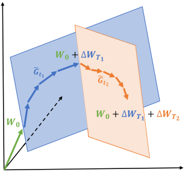
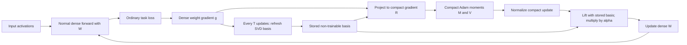
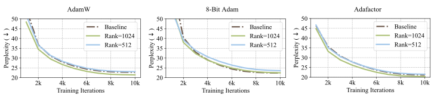
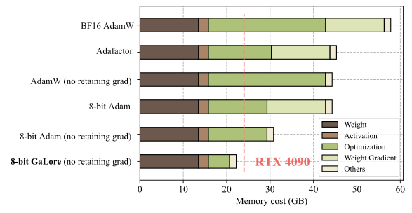
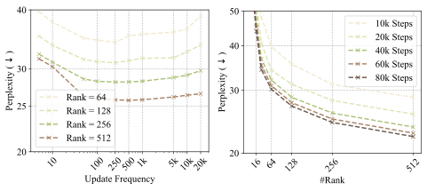

# GaLore: Memory-Efficient LLM Training by Gradient Low-Rank Projection - Zhao et al., 2024

> **arXiv:** [2403.03507v2](https://arxiv.org/abs/2403.03507v2) (2 June 2024; first posted 6 March 2024) | **Venue:** ICML 2024 oral, PMLR 235:61121-61143 | **Authors:** Jiawei Zhao, Zhenyu Zhang, Beidi Chen, Zhangyang Wang, Anima Anandkumar, Yuandong Tian | **Affiliations:** California Institute of Technology, University of Texas at Austin, Meta AI, Carnegie Mellon University.

## TL;DR

GaLore trains ordinary dense weight matrices but stores Adam's gradient statistics in a smaller, periodically refreshed gradient subspace. Unlike [LoRA](peft_2021_lora.md), it does not freeze the base and learn a persistent rank-constrained adapter: each compact optimizer update is lifted back into the dense weight, and changing the subspace lets cumulative updates exceed the chosen projection rank. In the main 7B pretraining experiment, 8-bit GaLore reaches C4 perplexity **14.65**, versus **14.61** for 8-bit Adam, after **19.7B tokens**; that run used **64 A100 GPUs**, not one RTX 4090 (Table 3, Section 5.3). The separate roughly **22GB** memory demonstration combines projection, 8-bit optimizer states, and updates during backward; it establishes small-batch 24GB feasibility, not a complete 19.7B-token consumer-GPU run or free throughput gains.

## Problem & motivation

### Dense optimizer statistics are expensive

For a trainable matrix $W\in\mathbb R^{m\times n}$, Adam normally maintains a first moment $M$ and a second moment $V$, each with $mn$ entries. The weight and two moments already require $3mn$ scalar slots; materialized gradients add another $mn$, and activations and temporary buffers add more.

The paper's introductory BF16 estimate for a Llama-7B-sized model is about **58GB**: **14GB** of weights, **42GB** of gradients and optimizer states, and **2GB** of activations for its stated length-$2048$, single-batch calculation (Section 1, footnote 1). This is an illustrative accounting under those precision assumptions, not a universal bound for every mixed-precision implementation. FP32 moments or master weights would change it.

Reducing optimizer state is especially attractive because its size scales with trainable parameters even when the data batch is small. Activation checkpointing and offloading address other parts of the memory budget, but can trade memory for computation, bandwidth, or implementation complexity.

### Why not just constrain the weight update?

LoRA writes

$$
W=W_0+BA,\qquad
B\in\mathbb R^{m\times r},\quad
A\in\mathbb R^{r\times n},
$$

where $W_0$ is frozen and $r\ll\min(m,n)$. It saves trainable parameters and optimizer state, but the final adapter correction has rank at most $r$. The nonlinear factor optimization also differs from directly optimizing $W$.

That trade-off is useful for adaptation but need not suit pretraining from scratch. A good dense weight matrix, or its total displacement from initialization, need not have low rank. In the paper's comparisons, low-rank factorization and LoRA-style pretraining can lose considerable quality. ReLoRA periodically merges adapters to escape a single low-rank correction, but its original recipe also involves optimizer/rate resets and a full-rank warm start.

GaLore separates two assumptions:

- **The weight or total learned correction is low-rank.** This is a strong restriction on the model's reachable parameters.
- **A useful portion of the current gradient is low-rank.** This can hold locally in training without forcing the final weight or cumulative update to be low-rank.

The proposed method uses the second assumption to compress optimizer statistics. It does not claim every arbitrary loss has low-rank gradients, and the paper's theoretical motivation is conditional.

## Key idea

### Project, optimize, lift

Throughout the operational description below, $g_t=\nabla_W\mathcal L_t(W_t)$ denotes the **positive loss gradient**, and updates subtract an optimizer direction. The paper instead often uses $G_t=-\nabla_W\varphi_t$ and adds its direction; these are equivalent sign conventions when used consistently.

Choose orthonormal-column bases

$$
P_t\in\mathbb R^{m\times r},\qquad
Q_t\in\mathbb R^{n\times r},
$$

and form a compact gradient

$$
R_t=P_t^\top g_tQ_t\in\mathbb R^{r\times r}.
$$

If $\rho_t$ is a stateful optimizer transformation, such as moment normalization in Adam, GaLore applies

$$
W_{t+1}
=W_t-\eta_t\alpha\,P_t\rho_t(R_t)Q_t^\top.
$$

Here $\eta_t$ is the learning rate and $\alpha$ the scale on the lifted update. Optimizer moments are stored with the shape of $R_t$, rather than the shape of $W$. Projection matrices are not trainable adapter parameters: they are recomputed from gradients.

The practical main algorithm uses **one-sided projection**, not the smallest two-sided core. It keeps only a left or right basis, reducing basis storage and changing the compact moment shape. Both forms are explained below.

### Changing subspaces is essential



*Original Figure 2. Updates first lie in one low-rank subspace and later in another. The model retains the dense weight reached so far; it does not discard earlier updates when the projector changes.*

For refresh windows $\mathcal I_1,\ldots,\mathcal I_K$, write

$$
W_T=W_0+\sum_{k=1}^{K}\Delta W^{(k)},\qquad
\Delta W^{(k)}
=-\sum_{t\in\mathcal I_k}\eta_t\alpha\,\mathcal B_k\!\left(\rho_t(R_t)\right),
$$

where $\mathcal B_k$ lifts a compact matrix using that window's basis. Each window's correction has rank at most $r$, but their sum can have rank as large as $\min(m,n,Kr)$. For example, two different rank-one updates can sum to a rank-two matrix.

This is the meaning of full-parameter learning here: the dense matrix remains trainable and the cumulative displacement is not constrained to one fixed rank-$r$ correction. It does **not** mean each step equals an unprojected dense Adam step, or that the method is guaranteed to find the full-training optimum.

## How it works

### 1. The forward and backward graphs remain dense

For a linear layer with input $x\in\mathbb R^n$ and output $h=Wx\in\mathbb R^m$, the ordinary forward computation is unchanged. If $d=\partial\mathcal L/\partial h$, one example contributes

$$
g=\frac{\partial\mathcal L}{\partial W}=dx^\top,\qquad
\frac{\partial\mathcal L}{\partial x}=W^\top d.
$$

A batch gradient averages such outer products. GaLore operates on that resulting matrix, **after backward has computed it**. It does not replace the dense forward weight with $P$ or $Q$, add a bottleneck to the model, or differentiate through an SVD to train the projector.

A usual GaLore implementation still materializes a dense gradient for a parameter before projecting it. Compressing optimizer state alone does not remove all full-gradient storage or SVD workspace.



*Authored diagram. Only the optimizer path is compressed. The forward model and final checkpoint retain ordinary dense weights.*

### 2. Obtain the bases from an SVD

On an initial update and then every $T$ parameter updates, decompose the current gradient:

$$
g_t=U_t\Sigma_tV_t^\top.
$$

Take the leading singular vectors:

$$
P_t=U_t[:,1:r],\qquad Q_t=V_t[:,1:r].
$$

The notation denotes the first $r$ columns; zero-based code slices use `:r`. Singular vectors are ordered by decreasing singular value. Between refreshes, retain the previous basis.

For the two-sided identity transformation, the lifted projected gradient is

$$
P_tP_t^\top g_tQ_tQ_t^\top,
$$

which reconstructs the rank-$r$ truncated SVD when the bases come from that same gradient. Its discarded squared Frobenius norm is $\sum_{j>r}\sigma_j^2$, where $\sigma_j$ are singular values. With an older basis, that best-rank-approximation property need not hold for the new gradient.

The paper uses SVD as a practical way to identify useful gradient directions; it does not compute full Jacobian curvature matrices for the theoretical eigen-subspace prescription.

The released projector calls `torch.linalg.svd(..., full_matrices=False)` after promoting non-FP32 input to FP32. This is still an SVD that constructs the reduced full set of singular vectors before slicing to rank $r$, not a randomized rank-$r$ solver. Retained bases are converted back to the gradient's original dtype/device. BF16 storage gives approximately, not perfectly, orthonormal bases.

Consequently, SVD refreshes can have a transient memory and runtime cost beyond the persistent low-rank state. Rank reduction does not imply the refresh computation itself has only rank-$r$ cost.

### 3. The practical one-sided projection and its shapes

Store the weight as $W\in\mathbb R^{m\times n}$, with output dimension $m$ and input dimension $n$. The paper's practical rule is:

| Case | Stored basis | Compact gradient | Compact moment shapes | Lifted direction before scaling |
|---|---|---|---|---|
| $m\leq n$: left projection | $P\in\mathbb R^{m\times r}$ | $R=P^\top g\in\mathbb R^{r\times n}$ | $M,V\in\mathbb R^{r\times n}$ | $PN\in\mathbb R^{m\times n}$ |
| $m>n$: right projection | $Q\in\mathbb R^{n\times r}$ | $R=gQ\in\mathbb R^{m\times r}$ | $M,V\in\mathbb R^{m\times r}$ | $NQ^\top\in\mathbb R^{m\times n}$ |
| Two-sided alternative | Both bases | $R=P^\top gQ\in\mathbb R^{r\times r}$ | $M,V\in\mathbb R^{r\times r}$ | $PNQ^\top\in\mathbb R^{m\times n}$ |

$N$ is the moment-normalized compact direction, defined next. The one-sided rule keeps the **smaller basis**, but its moment matrices are larger than those of the two-sided core. Avoid interpreting the paper's basis-storage argument as a proof that one-sided projection minimizes every possible total-state count.

The released `proj_type='std'` implements right projection when $m\geq n$ and left projection otherwise. Thus **square matrices use the right basis in this code**, while Algorithm 2's $m\leq n$ description uses the left basis. Memory counts are identical at the tie; Adam trajectories need not be.

In code, the stored right basis is $Q^\top=V_t^\top[:r,:]$, with shape $r\times n$, rather than $Q$ itself. Projection uses multiplication by its transpose; lifting multiplies by the stored matrix. This convention should not be confused with reversing the mathematics.

### 4. Adam moments live in compact coordinates

For a parameter's $k$-th optimizer update, with $k$ starting at $1$ and zero initial moments, ordinary bias-corrected Adam in the compact space is

$$
\begin{aligned}
M_k&=\beta_1M_{k-1}+(1-\beta_1)R_k,\\
V_k&=\beta_2V_{k-1}+(1-\beta_2)R_k^{\odot2},\\
\widehat M_k&=\frac{M_k}{1-\beta_1^k},\qquad
\widehat V_k=\frac{V_k}{1-\beta_2^k},\\
N_k&=\frac{\widehat M_k}{\sqrt{\widehat V_k}+\epsilon}.
\end{aligned}
$$

$\beta_1,\beta_2$ are moment decay factors, $\epsilon$ the denominator stabilizer, and all squares, square roots, and divisions are elementwise. Store the **uncorrected running moments**; bias correction produces temporary normalized values rather than overwriting the history carried to the next update.

For left projection, the dense step is

$$
W_{k+1}=W_k-\eta_k\alpha PN_k.
$$

Use $N_kQ^\top$ for right projection, or $PN_kQ^\top$ for two-sided projection. The scale $\alpha$ is applied once to the lifted update. Unlike standard LoRA scaling, it is **not divided by $r$**.

The released non-8-bit optimizer uses the legacy Hugging Face AdamW arrangement

$$
N_k^{\mathrm{code}}=\frac{M_k}{\sqrt{V_k}+\epsilon},
\qquad
c_k=\frac{\sqrt{1-\beta_2^k}}{1-\beta_1^k},
\qquad
W'=W_k-\eta_kc_k\alpha\,\mathcal B(N_k^{\mathrm{code}}).
$$

This moves bias correction into the scalar step size. It matches the usual bias-corrected form when $\epsilon=0$; at nonzero $\epsilon$, its effective stabilizer convention differs. The helper defaults to $\epsilon=10^{-6}$, whereas the paper's main experimental description gives $10^{-8}$. Report which convention and explicit value are used for exact reproduction.

If that implementation's decoupled weight-decay coefficient $\omega$ is nonzero, it then applies

$$
W_{k+1}=(1-\eta_k\omega)W'.
$$

This decay acts on the dense weight, not on the compact surrogate, and is not multiplied by $\alpha$. Applying decay after the update is also slightly different from decaying the old weight before an Adam step.

**Algorithm 2 implementation cautions.** Its printed initialization lists moments with shape $n\times r$ even though $P^\top g$ has shape $r\times n$. It also initializes the step at zero before displaying bias correction, and reuses $M,V$ names for corrected moments. A working implementation uses the shapes above, a positive bias-correction index, and preserved raw running moments; the released code does so.

### 5. Refreshing a basis does not refresh the dense model

A refresh recomputes the projector from the new gradient. It leaves the dense $W$ at its current value. There is no adapter merge/reset operation, and no required initial phase of dense-state Adam.

The reference AdamW code also **retains existing compact moments without transporting or resetting them** when the projector changes. Their shapes stay constant, but their coordinates now refer to a different basis. For example, a first moment expressed along an old left basis would need a transformation involving $P_{\mathrm{new}}^\top P_{\mathrm{old}}$ to represent the same physical direction in the new basis. The released algorithm does not perform that transformation.

Second moments are even harder to transport exactly: elementwise variances are not a complete covariance matrix. Singular-vector sign changes or rotations can therefore alter how old statistics are interpreted. The paper explicitly notes that overly frequent refreshes can impair optimizer-state fidelity.

Resetting or rotating moments would be a different algorithmic choice. Do not silently add either and still call it an exact reproduction of the reference behavior.

### 6. GaLore is not coordinate-invariant Adam

The paper says that it avoids the optimization change introduced by factorizing the weight into trainable adapters. Read that statement as **not introducing the $BA$ parameterization**, not as a general equality to dense optimizer trajectories.

With the identity optimizer transformation, $\rho(R)=R$, complete one-sided bases at $r=\min(m,n)$ reconstruct the full gradient. With $\alpha=1$, that case reproduces the corresponding dense gradient-descent direction.

Adam's elementwise normalization is not invariant to arbitrary orthogonal changes of coordinates:

$$
P\,\rho(P^\top g)\neq\rho(g)
$$

in general, even when $P$ is square and orthogonal. Projection before normalization is different from normalizing in the original coordinates and then projecting. Low rank, stale projectors, and retained moments after basis changes introduce further differences.

Thus "full-parameter learning" does not mean "the same dense Adam algorithm with its state losslessly compressed."

### 7. Persistent memory accounting

For $m\leq n$, the one-sided method stores:

- Dense weight: $mn$ scalars.
- Left basis: $mr$ scalars.
- Two compact Adam moments: $2rn$ scalars.

Ignoring gradients, activations, temporary SVD buffers, and small metadata, the total is

$$
C_{\mathrm{GaLore}}=mn+mr+2nr.
$$

Ordinary dense Adam has $C_{\mathrm{dense}}=3mn$. LoRA keeps the frozen base, both trainable factors, and two moments for each factor:

$$
C_{\mathrm{LoRA}}
=mn+r(m+n)+2r(m+n)
=mn+3mr+3nr.
$$

These are the scalar-count assumptions behind Table 1. Its GaLore "optimizer states" entry includes the projector as well as the moments; the projector itself is not an Adam first or second moment.

For a square matrix of width $d$, one-sided GaLore's weight-plus-state count is $d^2+3dr$, versus $3d^2$ for dense Adam. The projector-plus-moment fraction relative to dense moments is

$$
\frac{3dr}{2d^2}=\frac{3r}{2d}.
$$

This simple matrix-level ratio is not the paper's whole-model memory measurement: embeddings, output heads, and other unprojected parameters can retain ordinary optimizer states.

Two-sided persistent storage would be $mn+r(m+n)+2r^2$. It trades two stored bases for smaller moment matrices; whether it uses less total memory depends on dimensions and rank, while optimization quality is another consideration.

To obtain bytes, multiply each component by its own dtype size. "8-bit GaLore" refers primarily to quantized optimizer states; it does **not** mean all dense model weights are 8-bit, or that every small state tensor and quantization metadata occupies exactly one byte per entry.

### 8. Combining with 8-bit state and updates during backward

Projection, state quantization, and gradient-lifetime reduction save different memory components:

1. **GaLore projection** reduces the number of optimizer-statistic entries.
2. **8-bit Adam** reduces the storage precision of supported optimizer statistics, with quantization metadata and implementation-dependent exceptions.
3. **Per-layer/per-parameter updates during backward** shorten the lifetime of full gradients, so gradients for every parameter need not be retained until a final global optimizer step.

The reference 8-bit implementation temporarily presents the compact gradient through a compact surrogate to the bitsandbytes optimizer, obtains a compact update, and lifts it into the saved dense parameter. It suppresses weight decay on the surrogate and applies decay to the restored dense weight. Its temporary clones and synchronization calls are implementation overhead, not part of the ideal persistent scalar count.

The released trainer uses PyTorch's `register_post_accumulate_grad_hook`, creates an optimizer per parameter, and steps and clears that parameter inside the hook. Nonprojected parameters also receive ordinary 8-bit optimizer updates in this path.

This is not a general drop-in replacement for arbitrary training loops:

- A hook that steps on every backward call does **not** implement delayed gradient accumulation across multiple microbatches. The released hook is immediate; simply increasing an accumulation counter does not make it mathematically equivalent to a single accumulated update.
- Global gradient-norm clipping cannot be reproduced by clipping after earlier parameter gradients have already been consumed and cleared. Unscaling with AMP also needs an explicitly compatible update policy.
- Distributed gradient synchronization and parameter reuse require care. The README describes this hook-based path as single-GPU without DDP, separately from the distributed ordinary-optimizer training path.
- Projector refresh and scheduler counters must use the intended update units. The inspected trainer has a documented workaround that doubles hook-path scheduler lengths, warmup, and projector gaps; do not assume its CLI gap maps identically to the conventional path.

The hook optimization does not eliminate backward computation, activations, or every transient full-gradient allocation. It targets the **simultaneous retention** of parameter gradients.

### 9. Why gradients can become approximately low-rank

The theoretical motivation first studies a structured family of negative gradients:

$$
D_t=-g_t
=\frac1N\sum_{i=1}^{N}(A_i-B_iW_tC_i).
$$

Here $N$ is the batch size, $A_i\in\mathbb R^{m\times n}$, and $B_i\in\mathbb R^{m\times m}$ and $C_i\in\mathbb R^{n\times n}$ are positive-semidefinite matrices. These symbols are theoretical gradient components, **not LoRA factors**.

For example, with fixed input feature $f_i$, target $y_i$, downstream linear map $J_i$, and squared loss $\frac12\lVert y_i-J_iWf_i\rVert^2$,

$$
D_i
=J_i^\top(y_i-J_iWf_i)f_i^\top
=\underbrace{J_i^\top y_if_i^\top}_{A_i}
-\underbrace{J_i^\top J_i}_{B_i}W
\underbrace{f_if_i^\top}_{C_i}.
$$

Theorem 3.2 motivates such forms using "reversible" networks, where a local input-dependent linear map describes both forward propagation and its transposed backward action. Here *reversible* is not a claim that the network is invertible or uses activation-reconstruction checkpointing.

Its small-logit softmax argument is a local approximation, not a description of all language-model training regimes. For $K$ classes, centered logits $\widehat f=Hf$ with $H=I-\mathbf1\mathbf1^\top/K$, and label vector $y$ with $\mathbf1^\top y=1$, the leading negative output derivative is

$$
-\nabla_f\mathcal L
\approx Hy-\frac1K Hf.
$$

Composing with the downstream Jacobian gives an analogous $A-BWC$ form. A hidden-layer derivative requires $J^\top Hy$, not $JHy$; the latter appears in the paper's printed softmax expression but is dimensionally inconsistent with its stated Jacobian convention.

Under the additional assumption that $A_i,B_i,C_i$ remain fixed over a window, gradient descent with $W_{t+1}=W_t+\eta D_t$ gives

$$
D_{t+1}
=D_t-\frac{\eta}{N}\sum_iB_iD_tC_i.
$$

Let $d_t=\operatorname{vec}(D_t)$ stack columns and

$$
S=\frac1N\sum_iC_i\otimes B_i.
$$

Then $d_{t+1}=(I-\eta S)d_t$. Different eigendirections of the PSD matrix $S$ decay at different rates. After fast-decaying components shrink, a small set of slow components can dominate the gradient.

The relevant size measure is **stable rank**:

$$
\operatorname{sr}(D)
=\frac{\lVert D\rVert_F^2}{\lVert D\rVert_2^2},
$$

defined for nonzero $D$. The denominator is the squared largest singular value. Small stable rank means singular energy is concentrated; it does not mean every remaining singular value is exactly zero.

Restart notation at a window's beginning and let $D_\parallel$ be the reshaped projection onto the smallest-eigenvalue eigenspace of $S$, $D_\perp$ the remainder, and $\lambda_1<\lambda_2$ the two smallest distinct eigenvalues. Lemma 3.3 reports a bound of the form

$$
\operatorname{sr}(D_s)
\leq \operatorname{sr}(D_\parallel)
+\left(\frac{1-\eta\lambda_2}{1-\eta\lambda_1}\right)^{2s}
\frac{\lVert D_\perp\rVert_F^2}{\lVert D_\parallel\rVert_2^2}.
$$

$s$ counts steps since that restart. The interpretation requires a nonzero slow component, a suitable small step size so the spectral decay argument applies, and the structured eigenspace assumptions used in the proof. The paper explicitly notes the zero-slow-component exception; this is not a theorem that arbitrary gradients always become low-rank.

If a batch's input features span only $N'$ dimensions, its outer-product gradient already has rank at most $N'$. The additional corollaries argue that suitably structured slow eigenspaces can further concentrate gradient energy, including a rank-one limiting direction when the slow eigenvector has a decomposable Kronecker form.

Transformers are not covered wholesale by that reversible-network proof. Appendix B.3 gives a separate JoMA-based argument for an idealized FFN projection, using frozen orthonormal embeddings, linear activations, stationary backpropagated signals, and a strong dominant-row condition. It argues that exponential differences in row growth make the gradient even more concentrated than the weight. These assumptions are not a description of a normally trained SwiGLU transformer with a realistic vocabulary.

### 10. What the fixed-projector convergence result says

Theorem 3.8 lets $A_i,B_i,C_i$ vary Lipschitz-continuously with $W$, assumes bounded weights $\lVert W_t\rVert\leq D_{\max}$, and analyzes **fixed orthonormal projectors with the identity optimizer transformation**, not Adam with periodic refreshes.

Define

$$
\widehat B_{i,t}=P^\top B_i(W_t)P,\qquad
\widehat C_{i,t}=Q^\top C_i(W_t)Q,
$$

$$
\kappa_t=\frac1N\sum_i
\lambda_{\min}(\widehat B_{i,t})
\lambda_{\min}(\widehat C_{i,t}).
$$

Here $\lambda_{\min}$ is the minimum eigenvalue. If projected curvature dominates the changes in the gradient components, the theorem states a contraction for $R_t=P^\top D_tQ$:

$$
\lVert R_t\rVert_F
\leq
\left[1-\eta\left(\kappa_{t-1}-L_A-L_BL_CD_{\max}^2\right)\right]
\lVert R_{t-1}\rVert_F,
$$

where $L_A,L_B,L_C$ are the stated Lipschitz constants. A useful contraction also needs a stable step-size regime, not an arbitrarily large $\eta$.

There is a source discrepancy: Appendix B.4's final bound has **$2L_BL_CD_{\max}^2$**, whereas the main theorem has the single-factor term above. Its proof also uses norm bounds beyond a bare Lipschitz label. This recap treats it as the paper's reported conditional argument, not an independently established general Adam convergence guarantee.

Most importantly, $R_t\to0$ only means progress within the selected subspace. It need not imply $D_t\to0$ in the full space. A fixed projector can ignore a nonzero gradient outside its span. The paper itself uses this limitation to motivate refreshing the subspace.

### 11. Practical reproduction checklist

1. Train the intended dense model and leave intended parameters trainable; do not accidentally freeze its base as in a LoRA configuration.
2. Select eligible matrix weights by module identity and shape. Require $1\leq r\leq\min(m,n)$ and a positive integer refresh gap $T$.
3. Route other parameters to the intended ordinary optimizer groups. Check that every trainable tensor is assigned once, including embeddings, heads, biases, and normalization weights.
4. Create and retain each parameter's projector and compact moments. Initialize the basis on its first available gradient and refresh it on the intended parameter-update counter.
5. Project **before** updating moments. Lift the normalized compact direction and scale it once by $\alpha$.
6. Keep the dense weight and running moments across refreshes to match the reference method. Preserve the intended bias-correction, decay, clipping, and schedule conventions.
7. Add 8-bit states and backward hooks only as separate, explicitly validated optimizations. Match accumulation and distributed semantics rather than assuming all combinations work.
8. Save dense weights plus optimizer/projector state, counters, and schedules for an exact continuation; the final inference model is simply the dense checkpoint.

The released C4 trainer selects `nn.Linear` weights whose module paths contain `attn` or `mlp`; embeddings and other parameters remain in regular optimizer groups. The GLUE runner similarly selects matrix modules, with RoBERTa's all-module option covering `query`, `value`, `key`, `intermediate.dense`, and `output.dense`. Its `--lora_r` argument supplies the **projection rank** when GaLore is enabled; that flag name does not mean the algorithm has inserted LoRA adapters.

Code descriptions refer to the inspected [repository snapshot](https://github.com/jiaweizzhao/GaLore/tree/2cc66f88cce189e505affbb91042a8e77f5bf4e9), not a claim that every later library shares its implementation choices.

## Training / data

### Pretraining objective and data pipeline

The study trains Llama-based decoder models from scratch on C4, a cleaned Common Crawl corpus, without data repetition in its intended pretraining setting. The architecture uses RMSNorm and SwiGLU (Section 5).

The ordinary causal language-model objective is

$$
\mathcal L_{\mathrm{LM}}
=-\frac{1}{\sum_{i,t}a_{i,t}}
\sum_{i,t}a_{i,t}\log p_\theta(x_{i,t}\mid x_{i,<t}),
$$

where $a_{i,t}$ marks supervised, nonpadding next-token positions and $\theta$ denotes the dense model parameters. Perplexity is $\exp(\mathcal L_{\mathrm{eval}})$ under the chosen evaluation reduction. GaLore does not add a new task loss.

The released trainer streams English C4, shuffles with seed $42$, uses the **T5-base tokenizer**, pads/truncates samples to the configured length, and masks padding labels with `-100`. It constructs a Llama architecture from configuration, not from pretrained Llama weights. Therefore, "Llama architecture on C4" does not mean the tokenizer or starting checkpoint of an official pretrained Llama model.

Its validation routine targets roughly ten million tokens of streamed validation data. Exact batching, padding, tokenizer, loss aggregation, and validation selection matter when reproducing perplexity; it is not enough to match the projection rank.

### Main small-to-1B recipe

Per Section 5.1 and Appendix C.1:

| Hyperparameter | Paper setting |
|---|---|
| Models | Approximately 60M, 130M, 350M, and 1B parameters |
| Main GaLore ranks | $128$, $256$, $256$, $512$, respectively; Table 2 |
| Projected modules | Attention and FFN matrix weights |
| Optimizer | Adam-style training; $\beta_1=0.9$, $\beta_2=0.999$, $\epsilon=10^{-8}$ in Section 5.1 |
| Precision | BF16 in the reported comparisons |
| Nominal GaLore learning rate | $0.01$ |
| GaLore scale | $\alpha=0.25$; projected update scale is therefore equivalent to rate $0.0025$ before optimizer-convention effects |
| Refresh gap | $T=200$ |
| Learning-rate search for methods | $\{0.01,0.005,0.001,0.0005,0.0001\}$, selected by validation perplexity |
| Sequence length | $256$ |
| Global batch budget | Approximately 131K tokens |
| Schedule | First $10\%$ of updates warm up; cosine decay to $10\%$ of initial rate |

The scale changes only projected updates; unprojected parameters need not have an effective rate of $0.0025$. The released helper's stabilizer/defaults should also be distinguished from the paper's stated settings.

Table 5 supplies the following architecture and training entries:

| Model | Hidden width | Intermediate width | Attention heads | Layers | Updates | Token amount |
|---|---:|---:|---:|---:|---:|---:|
| 60M | 512 | 1376 | 8 | 8 | 10K | 1.3B |
| 130M | 768 | 2048 | 12 | 12 | 20K | 2.6B |
| 350M | 1024 | 2736 | 16 | 24 | 60K | 7.8B |
| 1B | 2048 | 5461 | 24 | 32 | 100K | 13.1B |
| 7B | 4096 | 11008 | 32 | 32 | 150K | 19.7B |

*Entries are transcribed from Table 5, not silently reconciled with other sources.* Table 2 instead reports training-token totals of $1.1$B, $2.2$B, and $6.4$B for its first three models, and labels the 60M rank/width ratio as $128/256$ rather than using Table 5's width $512$. The inspected 60M configuration agrees with width $512$; the inspected 1B configuration lists $32$ heads and $24$ layers, reversing Table 5's two entries. Exact experiment reconstruction therefore needs its configuration and token-counting convention; these tables alone are not completely consistent.

### Baseline definitions matter

- **Full-rank:** dense model and dense Adam statistics.
- **Low-rank:** directly factor the weight as $W=BA$, not an additive adapter to a dense initialization.
- **LoRA:** freeze the full-rank random initialization $W_0$ and train its adapter during pretraining. The comparison sets LoRA $\alpha=32$ and dropout $0.05$.
- **ReLoRA:** periodically merge and restart adapters and adjust optimization. The reported comparison **omits full-rank warmup** for matching memory/training conditions.

Ranks and projected/adapted attention and FFN module sets are matched within each model-size comparison, while learning rates are tuned separately. Poor performance of the no-warm-start ReLoRA row should not be treated as a reproduction of every recommended ReLoRA recipe.

### 7B recipe versus consumer-memory demonstration

The main 7B result uses a width-$4096$, 32-layer model, projection rank $1024$, and 8-bit GaLore. It runs for $150$K updates and $19.7$B tokens on **eight nodes with 64 A100 GPUs**, with one trial and no hyperparameter tuning for the two compared optimizers (Section 5.3).

The released 7B benchmark launcher has nominal rate $0.005$, scale $0.25$, refresh gap $500$, global sample batch $512$, per-device sample batch $8$, $150$K updates, $15$K warmup updates, zero weight decay, clipping value $1.0$, and BF16. However, that script selects `galore_adamw`, **not the 8-bit optimizer named in Table 3**. It is an implementation example, not proof that running the script unchanged reproduces the published 8-bit row.

For the **separate memory-capacity experiment**, Section 5.5 reports about **22.0G** for 7B with 8-bit GaLore and backward-time updates, without checkpointing, offloading, or optimizer-state partitioning. The figure measurements use a token batch budget of $256$; the text says that small per-GPU budgets up to about $500$ tokens fit. With activation checkpointing, it reports budgets up to $4096$ tokens. These are token budgets, not automatically $256$ or $4096$ full-length sequences.

The README's consumer-GPU example uses activation checkpointing and reports a larger sample batch. That is a different memory configuration from the paper's no-checkpointing headline.

### Fine-tuning recipes

RoBERTa-base is fine-tuned on eight GLUE tasks for **30 epochs**, with batch **16**, except CoLA batch **32**, and maximum length **512** (Appendix D.1, Table 7). The table uses GaLore scale **4** at rank **4** and scale **2** at rank **8**:

| Task | Learning rate at rank 4 | Learning rate at rank 8 | Batch size |
|---|---:|---:|---:|
| MNLI | 1E-05 | 1E-05 | 16 |
| SST2 | 1E-05 | 2E-05 | 16 |
| MRPC | 3E-05 | 2E-05 | 16 |
| CoLA | 3E-05 | 1E-05 | 32 |
| QNLI | 1E-05 | 1E-05 | 16 |
| QQP | 1E-05 | 2E-05 | 16 |
| RTE | 1E-05 | 2E-05 | 16 |
| STS-B | 1E-05 | 3E-05 | 16 |

*Per Table 7.* The scale is directly on the lifted update, not divided by rank. The paper tunes rate and scale for GaLore and uses the cited LoRA settings for its LoRA comparisons. Table 7 does not provide a complete task-by-task refresh/schedule/seed specification. The inspected GLUE runner defaults to refresh gap $50$, whereas the README example explicitly uses $500$; neither should silently be declared the paper-wide optimum.

For classification tasks, the ordinary cross-entropy loss is $-\frac1N\sum_i\log p_\theta(y_i\mid x_i)$. STS-B uses a regression objective rather than forcing its similarity labels into classes. CoLA and STS-B benchmark scores are not simply classification accuracies, so the reported average mixes different task metrics.

The released runner evaluates `validation_matched` for MNLI and ordinary `validation` for the other tasks. Do not interpret every reported GLUE value as an untouched hidden-label test-server result.

Appendix D also evaluates:

- **SQuAD:** BERT-base with projection/adapter rank $16$; Exact Match and F1.
- **OpenAssistant Conversations:** Gemma-2B, Phi-2, and Llama-7B, rank $128$; testing perplexity.
- **Belle-1M:** the same three models and rank $128$; testing perplexity.

These appendix descriptions do not specify every prompt format, supervised-token mask, split construction, or tuning budget. GaLore changes their optimizer-state representation, not their underlying supervised objective.

## Results

### 1. Pretraining: substantially better than a fixed low-rank weight constraint

Table 2 reports validation perplexity, lower being better. Parenthesized memory is an **estimate of weights plus optimizer states under BF16**, not measured peak training memory.

| Method | 60M: perplexity (estimated memory) | 130M | 350M | 1B |
|---|---|---|---|---|
| Full-Rank | 34.06 (0.36G) | 25.08 (0.76G) | 18.80 (2.06G) | 15.56 (7.80G) |
| GaLore | 34.88 (0.24G) | 25.36 (0.52G) | 18.95 (1.22G) | 15.64 (4.38G) |
| Low-Rank | 78.18 (0.26G) | 45.51 (0.54G) | 37.41 (1.08G) | 142.53 (3.57G) |
| LoRA | 34.99 (0.36G) | 33.92 (0.80G) | 25.58 (1.76G) | 19.21 (6.17G) |
| ReLoRA | 37.04 (0.36G) | 29.37 (0.80G) | 29.08 (1.76G) | 18.33 (6.17G) |

*All cells: Table 2. Main ranks are $128$, $256$, $256$, $512$ by model size. ReLoRA here has no full-rank warmup.*

GaLore's perplexity gaps from full-rank training are $0.82$, $0.28$, $0.15$, and $0.08$, respectively, computed from the displayed table. It is close, but these main GaLore rows are not uniformly better than the baseline.

At 1B, the table's estimated weight-plus-state memory decreases from $7.80$G to $4.38$G, a **43.8%** reduction. Compared with the $6.17$G LoRA estimate, the reduction is **29.0%**. These derived percentages do not include retained gradients or activation storage.

Table 6 separates the estimates for that model:

| Method, 1B | Weight storage | Optimizer/projector storage |
|---|---:|---:|
| Full-Rank | 2.60G | 5.20G |
| GaLore | 2.60G | 1.78G |
| Low-Rank | 1.19G | 2.38G |
| LoRA | 3.79G | 2.38G |
| ReLoRA | 3.79G | 2.38G |

*Per Table 6(a)-(b). GaLore's storage entry counts the projector as described in its accounting.* The dense weights themselves do not shrink. LoRA stores extra factors; direct low-rank factorization stores fewer weight parameters but loses much more quality in Table 2. Rounded component estimates need not sum exactly to every displayed total.

### 2. Different optimizers retain similar convergence behavior



*Original Figure 3. Each panel is a separate optimizer comparison over 10K steps, using ranks $512$ and $1024$ at hidden width $2048$. Rates are tuned for the settings. These curves should not be confused with Table 2's longer 1B training run.*

Section 5.2 uses Adafactor with first-order statistics rather than dropping momentum entirely. It reports additional state-memory reductions up to **62.5%** at rank $512$ on top of the underlying memory-efficient optimizer. This is a component-level claim in that experiment, not the 7B total-memory percentage.

The rank-$1024$ curves can outperform the corresponding full-rank baseline after rate tuning. They demonstrate that a useful projected optimizer need not monotonically lose quality, but do not establish a universal improvement or lossless state compression.

### 3. 7B pretraining at 19.7B tokens

| Method | Estimated weight/state memory | Perplexity at 40K | 80K | 120K | 150K |
|---|---:|---:|---:|---:|---:|
| 8-bit GaLore | 18G | 17.94 | 15.39 | 14.95 | 14.65 |
| 8-bit Adam | 26G | 18.09 | 15.47 | 14.83 | 14.61 |
| Tokens processed | - | 5.2B | 10.5B | 15.7B | 19.7B |

*Per Table 3, rank $1024$ for GaLore. Section 5.3: one trial per method, 64 A100 GPUs.*

The final perplexity difference is **+0.04** for GaLore. It is ahead at the first two displayed checkpoints and behind at the last two. The table supports similar performance with smaller estimated state storage, not a claim that it strictly dominates Adam or that statistical equivalence has been established from repeated seeds.

The **18G** table estimate excludes the additional parts of peak training memory. The separately reported **22.0G** footprint includes more of the training stack; these numbers are not contradictory measurements of the same accounting boundary.

### 4. GLUE fine-tuning: small, task-dependent differences

| Method | Memory | CoLA | STS-B | MRPC | RTE | SST2 | MNLI | QNLI | QQP | Avg |
|---|---:|---:|---:|---:|---:|---:|---:|---:|---:|---:|
| Full Fine-Tuning | 747M | 62.24 | 90.92 | 91.30 | 79.42 | 94.57 | 87.18 | 92.33 | 92.28 | 86.28 |
| GaLore (rank=4) | 253M | 60.35 | 90.73 | 92.25 | 79.42 | 94.04 | 87.00 | 92.24 | 91.06 | 85.89 |
| LoRA (rank=4) | 257M | 61.38 | 90.57 | 91.07 | 78.70 | 92.89 | 86.82 | 92.18 | 91.29 | 85.61 |
| GaLore (rank=8) | 257M | 60.06 | 90.82 | 92.01 | 79.78 | 94.38 | 87.17 | 92.20 | 91.11 | 85.94 |
| LoRA (rank=8) | 264M | 61.83 | 90.80 | 91.90 | 79.06 | 93.46 | 86.94 | 92.25 | 91.22 | 85.93 |

*All cells: Table 4. "Memory" preserves the table's units and accounting; it is not an activation-inclusive peak-memory measurement. The average is the arithmetic mean of the eight displayed task scores.*

At rank $4$, the average advantage over LoRA is **0.28 score points**; at rank $8$, it is **0.01**. Full fine-tuning still has the best displayed average, while GaLore is better on some individual tasks. For example, rank-$4$ GaLore is ahead of rank-$4$ LoRA on MRPC but behind on CoLA and QQP.

The advantage here is not that LoRA can never work well, or that every GaLore rank improves every metric. It is that dense-parameter learning with compressed statistics can be competitive at similar or slightly lower state/storage budgets.

### 5. Additional adaptation benchmarks

| BERT-base on SQuAD, rank 16 | Exact Match | F1 |
|---|---:|---:|
| Baseline | 80.83 | 88.41 |
| GaLore | 80.52 | 88.29 |
| LoRA | 77.99 | 86.11 |

*Per Table 8.* GaLore improves over LoRA by **2.53** Exact Match points and **2.18** F1 points, but remains slightly below the baseline. Those are benchmark-score differences, not perplexity differences.

| OpenAssistant, rank 128 | Gemma-2B perplexity | Phi-2 | Llama-7B |
|---|---:|---:|---:|
| Baseline | 4.53 | 3.81 | 2.98 |
| GaLore | 4.51 | 3.83 | 2.95 |
| LoRA | 4.56 | 4.24 | 2.94 |

*Per Table 9; lower is better.* GaLore is not best in every column: the baseline is slightly better for Phi-2, and LoRA is slightly better for Llama-7B.

| Belle-1M, rank 128 | Gemma-2B perplexity | Phi-2 | Llama-7B |
|---|---:|---:|---:|
| Baseline | 5.44 | 2.66 | 2.27 |
| GaLore | 5.35 | 2.62 | 2.28 |
| LoRA | 5.37 | 2.75 | 2.30 |

*Per Table 10; lower is better.* GaLore is best for the first two models but slightly below the baseline for Llama-7B. Perplexity proximity is not a comprehensive evaluation of instruction-following quality or safety.

### 6. What makes 24GB training fit



*Original Figure 1. The dense weight bar remains. The final configuration combines reduced optimizer state with not retaining all parameter gradients. The dashed line is a 24GB consumer-GPU budget; this is not a training-speed plot.*

The abstract reports optimizer-memory reductions up to **65.5%** for GaLore and **82.5%** for its 8-bit version relative to the stated BF16 baseline. Section 5.5 separately attributes its compared 8-bit configuration's savings to:

- **9.6G (65.5%)** less optimizer-state storage than 8-bit Adam, from gradient projection.
- **13.5G** less retained gradient storage, from updates during backward.
- **37.92G (63.3%)** less total memory than the BF16 Adam baseline.
- **24.5G (52.3%)** less total memory than the compared 8-bit Adam baseline.

*These quantities are reported in Section 5.5, not recomputed from pixel positions in the illustrative breakdown.* Different percentages use different reference configurations and components. In particular, all of the total-memory benefit is not attributable to projection alone.

The paper occasionally refers to the memory breakdown as Figure 2 in prose, while in pinned v2 the breakdown is Figure 1 and Figure 2 is the changing-subspace diagram. The embedded figures follow the actual captions.

### 7. Measured throughput is not free

Table 11 measures the 1B model with token batch size $256$:

| Update timing | Method | Memory cost | Tokens/second | Samples/second |
|---|---|---:|---:|---:|
| Ordinary end-of-backward | AdamW | 13.60 | 1256.98 | 6.33 |
| Ordinary end-of-backward | Adafactor | 13.15 | 581.02 | 2.92 |
| Ordinary end-of-backward | Adam8bit | 9.54 | 1569.89 | 7.90 |
| Ordinary end-of-backward | 8-bit GaLore | 7.95 | 1109.38 | 5.59 |
| During backward | AdamW | 9.63 | 1354.37 | 6.81 |
| During backward | Adafactor | 10.32 | 613.90 | 3.09 |
| During backward | Adam8bit | 6.93 | 1205.31 | 6.07 |
| During backward | 8-bit GaLore | 5.63 | 1019.63 | 5.13 |

*All cells: Table 11; memory is in the table's GB/G convention, not a generic per-parameter estimate. Update timing expands its "Layer Wise" flag.*

Using matched timing rows, backward-update GaLore has **15.4% lower tokens/second** than backward-update Adam8bit, while the retained-gradient GaLore configuration has **29.3% lower tokens/second** than retained-gradient Adam8bit. These are derived throughput reductions, not equal percentages of elapsed-time overhead.

Section 5.5 calls the implementation overhead **17%**. That summary is not exactly the matched-row calculation above, so it should not be presented as a universal measured rate. Removing backward-time updates increases GaLore throughput from $1019.63$ to $1109.38$ tokens/second, or **8.8%**, while increasing its memory from $5.63$ to $7.95$.

Section 4.1's claim that amortized SVD overhead can be below **10%** concerns the projection-refresh component, not every overhead of the complete 8-bit and hook implementation.

### 8. Rank and refresh rate trade memory for work



*Original Figure 5. The left horizontal axis is the update gap between projector refreshes: larger means less frequent refresh. The right compares rank under several training lengths; it does not hold computation fixed when contrasting different curves.*

The experiments show that refreshing every few updates can be harmful or expensive, while keeping one subspace for too long can leave optimization focused on stale directions. Section 4.1 describes gaps between **50 and 1000** updates as a fairly insensitive useful region in its experiments, not a universal setting.

Section 6 reports that **rank 128 for 80K steps** attains lower loss than **rank 512 for 20K steps** in the ablation. It demonstrates a memory-versus-training-budget trade-off, not that rank $128$ dominates rank $512$ at equal compute. A smaller rank may need more optimization steps to obtain similar quality.

## Limitations & follow-ups

### Memory savings do not imply equivalent optimization

GaLore can discard useful gradient directions, and the basis can become stale between refreshes. Its optimizer is coordinate-dependent, and retaining compact moments when the basis changes can distort their interpretation. These issues are part of the method's trade-off, not mere plotting details.

The method keeps dense trainable weights, so it retains their memory floor and generally produces a dense fine-tuned checkpoint rather than a small portable adapter. It can be less attractive when adapter sharing, inexpensive checkpoint storage, or easy task switching is the main goal.

SVD workspaces, unprojected embeddings/heads, gradients, activations, and dtype conventions all affect actual peak memory. 8-bit moment storage does not make the entire training stack 8-bit. Backward hooks impose additional accumulation, clipping, synchronization, and resume requirements.

### Theory is conditional and locally scoped

Low stable rank is not a universal property of arbitrary gradients. The structured-gradient argument assumes relatively stationary components and particular spectral behavior. A zero slow-mode projection makes its displayed stable-rank ratio undefined. The transformer appendix is an idealized special case, not a proof for all actual attention and nonlinear FFN layers.

The fixed-projector theorem concerns the projected gradient and an identity optimizer transformation, not the changing-basis Adam algorithm used in the main experiments. Vanishing projected gradients do not certify a full-space stationary point. The discrepancy between the theorem's and appendix's contraction constants also prevents treating their printed thresholds as an unqualified implementation guarantee.

### Evidence and reproduction boundaries

The 7B quality experiment is a single trial per method and uses distributed A100 training. The 24GB result is a separate small-token-budget memory demonstration; the paper does not show the full 19.7B-token result being completed on one consumer GPU. Small-batch capacity, total training time, long-context capacity, and communication-efficient distributed training are different questions.

The main low-rank baselines are not every possible tuned adapter or ReLoRA recipe, and the ReLoRA comparison omits dense warmup. GaLore's favorable memory/perplexity trade-off should not be generalized to every adaptation task. Appendix instruction-tuning perplexities are not human preference or reasoning benchmarks.

The pinned sources have practical inconsistencies: Algorithm 2's moment shapes/indexing, the softmax Jacobian transpose, the contraction constant, Table 2 versus Table 5's width/token entries, some configuration counts, and the benchmark launcher's optimizer selection. This recap identifies which source controls each claim rather than inventing reconciled results.

### Neighboring and subsequent work

[LoRA](peft_2021_lora.md), [QLoRA](peft_2023_qlora.md), [DoRA](peft_2024_dora.md), and [LoRA+](peft_2024_lora-plus.md) reduce storage or change adapter parameterization/optimization along different axes. GaLore instead applies projected optimization to dense trainable weights. Possible combinations require evaluation; this paper does not establish that every combination preserves its results.

[ReLoRA](https://arxiv.org/abs/2307.05695) is important context for accumulated low-rank pretraining updates. [8-bit optimizers](https://arxiv.org/abs/2110.02861) and [Adafactor](https://arxiv.org/abs/1804.04235) are optimizer-state techniques, not synonyms for GaLore. [LOMO](https://arxiv.org/abs/2306.09782) and the [PyTorch optimizer-in-backward tutorial](https://pytorch.org/tutorials/intermediate/optimizer_step_in_backward_tutorial.html) explain the separate gradient-lifetime direction.

The authors identify lower-memory projection representations, applying the method to vision/diffusion models, and elastic data-parallel training on low-bandwidth consumer hardware as open directions. The official repository later points to [Q-GaLore: Quantized GaLore with INT4 Projection and Layer-Adaptive Low-Rank Gradients](https://arxiv.org/abs/2407.08296), with [its code](https://github.com/VITA-Group/Q-GaLore). That is subsequent work, not a mechanism or result of the original GaLore paper.

## Links

- **arXiv:** [abs, pinned v2](https://arxiv.org/abs/2403.03507v2) | [HTML, pinned v2](https://arxiv.org/html/2403.03507v2) | [PDF, pinned v2](https://arxiv.org/pdf/2403.03507v2).
- **Code:** [official GaLore repository](https://github.com/jiaweizzhao/GaLore) | [inspected snapshot](https://github.com/jiaweizzhao/GaLore/tree/2cc66f88cce189e505affbb91042a8e77f5bf4e9).
- **Implementation sources:** [projector and orientation rules](https://github.com/jiaweizzhao/GaLore/blob/2cc66f88cce189e505affbb91042a8e77f5bf4e9/galore_torch/galore_projector.py) | [non-8-bit AdamW](https://github.com/jiaweizzhao/GaLore/blob/2cc66f88cce189e505affbb91042a8e77f5bf4e9/galore_torch/adamw.py) | [8-bit adapter to bitsandbytes](https://github.com/jiaweizzhao/GaLore/blob/2cc66f88cce189e505affbb91042a8e77f5bf4e9/galore_torch/adamw8bit.py) | [C4 trainer and backward hooks](https://github.com/jiaweizzhao/GaLore/blob/2cc66f88cce189e505affbb91042a8e77f5bf4e9/torchrun_main.py).
- **Hugging Face / data:** [English C4](https://huggingface.co/datasets/allenai/c4) | [T5-base tokenizer used by the released pretraining runner](https://huggingface.co/google-t5/t5-base).
- **Project page:** the official repository above.
- **Blog posts:** no separate author blog used as a primary source.
- **Talks / videos:** no separately verified recording used for this recap.
- **OpenReview / venue page:** [ICML 2024 / PMLR proceedings](https://proceedings.mlr.press/v235/zhao24s.html).
- **Papers-with-Code:** not used as a primary source.
- **Related / successor papers:** [LoRA](peft_2021_lora.md) | [QLoRA](peft_2023_qlora.md) | [DoRA](peft_2024_dora.md) | [LoRA+](peft_2024_lora-plus.md) | [ReLoRA](https://arxiv.org/abs/2307.05695) | [Q-GaLore](https://arxiv.org/abs/2407.08296).
- **BibTeX:**

```bibtex
@InProceedings{pmlr-v235-zhao24s,
  title = {{G}a{L}ore: Memory-Efficient {LLM} Training by Gradient Low-Rank Projection},
  author = {Zhao, Jiawei and Zhang, Zhenyu and Chen, Beidi and Wang, Zhangyang
            and Anandkumar, Anima and Tian, Yuandong},
  booktitle = {Proceedings of the 41st International Conference on Machine Learning},
  pages = {61121--61143},
  year = {2024},
  volume = {235},
  series = {Proceedings of Machine Learning Research},
  publisher = {PMLR},
  url = {https://proceedings.mlr.press/v235/zhao24s.html}
}
```
