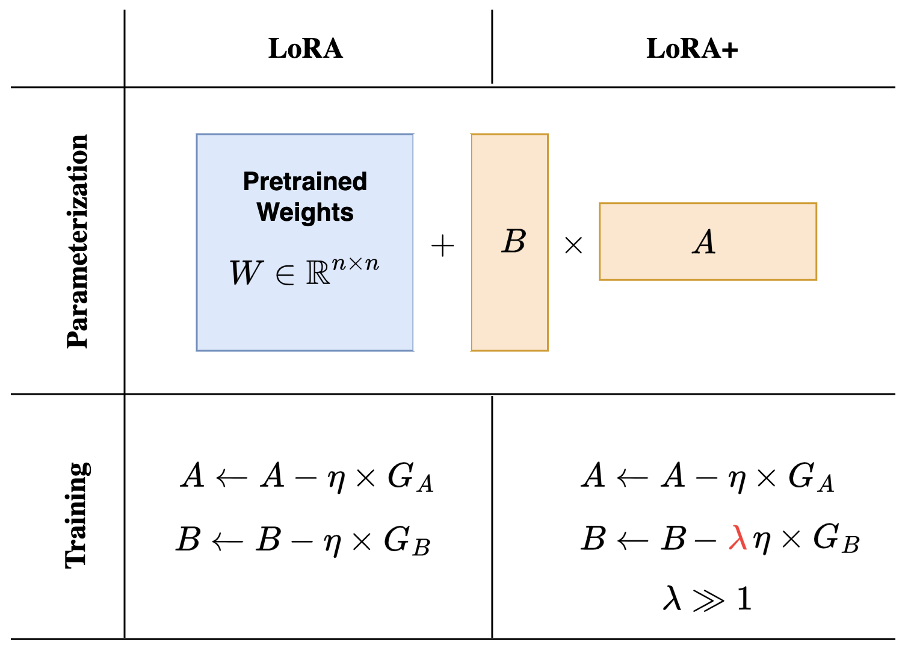
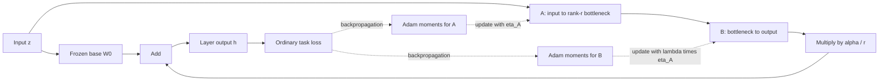
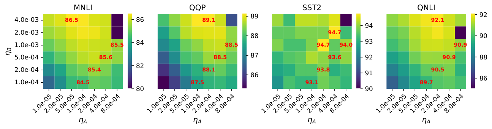
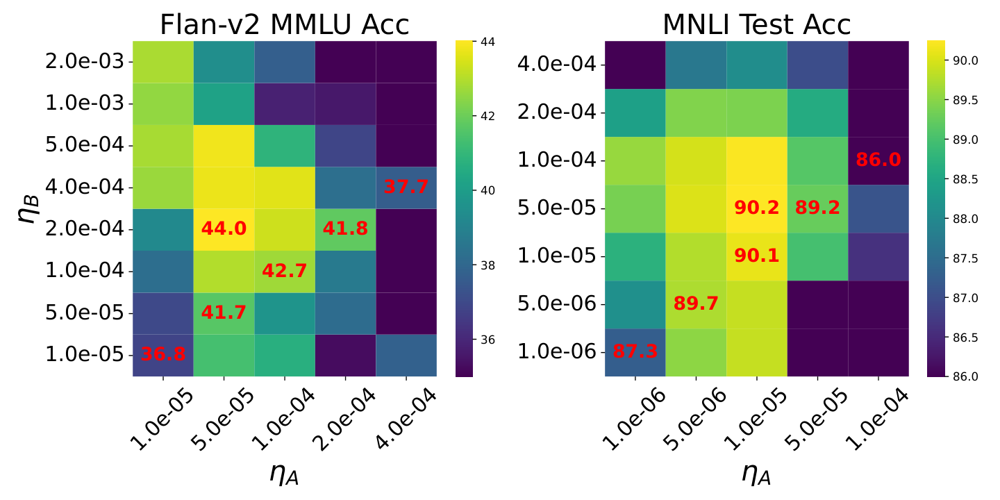
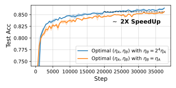

# LoRA+: Efficient Low Rank Adaptation of Large Models - Hayou et al., 2024

> **arXiv:** [2402.12354v2](https://arxiv.org/abs/2402.12354v2) (4 July 2024; first posted 19 February 2024) | **Venue:** ICML 2024, PMLR 235:17783-17806 | **Authors:** Soufiane Hayou, Nikhil Ghosh, Bin Yu | **Affiliation:** Simons Institute and Department of Statistics, University of California, Berkeley. Hayou and Ghosh contributed equally.

## TL;DR

LoRA+ keeps ordinary [LoRA](peft_2021_lora.md)'s frozen base weights and low-rank adapter, but gives its two trainable factors different optimizer learning rates: $\eta_B=\lambda\eta_A$, usually with $\lambda>1$. Width-scaling arguments explain why a shared rate can prevent both factors from making non-vanishing, stable contributions to feature learning; under the paper's assumptions, $\eta_A=\Theta(n^{-1})$ and $\eta_B=\Theta(1)$ avoid this problem. Experiments show task-dependent accuracy gains and, in a RoBERTa/MNLI convergence plot, roughly twice as fast progress to a selected accuracy, without changing per-step arithmetic, adapter size, or merged inference. The asymptotic argument does **not** prescribe a universal finite-model ratio: initialization, architecture, task, and the base learning rate all matter.

## Problem & motivation

### A small adapter still has an optimization problem

For a pretrained matrix $W_0$, LoRA trains a low-rank correction rather than all of $W_0$:

$$
W=W_0+sBA,\qquad s=\frac{\alpha}{r}.
$$

Here $W_0\in\mathbb R^{n_{\mathrm{out}}\times n_{\mathrm{in}}}$ is frozen, $A\in\mathbb R^{r\times n_{\mathrm{in}}}$ projects into a rank-$r$ bottleneck, $B\in\mathbb R^{n_{\mathrm{out}}\times r}$ projects back out, and $\alpha$ sets the adapter scale. The number of adapter parameters is $r(n_{\mathrm{in}}+n_{\mathrm{out}})$ instead of $n_{\mathrm{in}}n_{\mathrm{out}}$ dense weights. LoRA+ does not reduce this count further.

The original training convention generally assigns both factors the same Adam learning rate. But $A$ and $B$ do different jobs and have different shapes. When the input width grows, an update to $A$ can add coherently over many input coordinates; a coordinate of $B$ does not acquire the same width multiplier. Equal optimizer rates therefore need not produce balanced changes to the adapter's features.

The paper asks a narrower question than whether LoRA has enough expressive capacity: **does the optimizer actually let both factors use that capacity at large width?** A low-rank parameterization can be expressive enough while its learning-rate choice makes one factor ineffective or makes an internal feature unstable.

### What "efficient" means here

The theoretical term *efficient learning* does not mean GPU utilization, tokens per second, or provably optimal generalization. It means that the two first-order contributions to an adapter feature update both remain order one as width tends to infinity, while the relevant features remain bounded. Merely changing the output by a nonzero amount is weaker: one factor might do essentially all the work.

This distinction explains both the contribution and its limits. LoRA+ changes optimization of an existing adapter; it is not a new compression format like [QLoRA](peft_2023_qlora.md), and it does not introduce the magnitude/direction parameterization of [DoRA](peft_2024_dora.md). A larger asymptotic feature update is also not a guarantee of better held-out accuracy on every finite task.

## Key idea

### Keep the forward pass; change the parameter groups

Write the optimizer's processed gradients as $G_{A,t}$ and $G_{B,t}$. For Adam these are moment-normalized gradients, not simply the raw derivatives. Ignoring decoupled weight decay for the moment, LoRA+ makes the updates

$$
A_{t+1}=A_t-\eta_{A,t}G_{A,t},\qquad
B_{t+1}=B_t-\eta_{B,t}G_{B,t},
\qquad
\eta_{B,t}=\lambda\eta_{A,t}.
$$

The step index is $t$; $\lambda$ is a fixed learning-rate ratio within a run. Setting $\lambda=1$ recovers equal-rate LoRA. The paper motivates using a larger rate for the **output-side factor $B$**, not arbitrarily assigning the larger rate to whichever tensor a library happens to name first.



*Original Figure 1. Both methods use the same $W_0+sBA$. LoRA+ changes the multiplier on the processed $B$ update. The diagram's $\lambda\gg1$ summarizes the proposed optimization regime, not a proof that every task needs a very large ratio.*

### Width scaling is a direction, not a numerical hyperparameter

For an approximately square hidden layer of width $n$, with fixed adapter rank as $n\to\infty$, the proposed efficient scaling is

$$
\eta_A=\Theta(n^{-1}),\qquad
\eta_B=\Theta(1),\qquad
\frac{\eta_B}{\eta_A}=\Theta(n).
$$

The notation concerns dependence on width: $\Theta(n^{-1})$ means inverse-width order up to nonzero constants, not a literal rate of $1/n$. Those constants depend on the task, model, initialization, and optimizer dynamics. The theorem therefore does not imply $\lambda=n$ for a real transformer, nor does it derive a universal value of $16$.

In practice the paper fixes a candidate $\lambda$, tunes $\eta_A$, and compares the resulting run with a separately tuned equal-rate baseline. A common multiplicative schedule can change both rates over training while keeping their ratio fixed.

## How it works

### 1. Forward pass, gradients, and inference

For an input column vector $z\in\mathbb R^{n_{\mathrm{in}}}$, define the bottleneck activation $u=Az\in\mathbb R^r$ and the unscaled adapter output $v=Bu\in\mathbb R^{n_{\mathrm{out}}}$. The layer computes

$$
h=W_0z+sv.
$$

An unchanged bias can be added in the usual way. If the LoRA implementation uses dropout on the adapter input, replace $z$ by the dropped-out input on that branch during training; the learning-rate change itself neither adds nor removes dropout.

Let $g=\partial\mathcal L/\partial h$ be the derivative of the task loss with respect to the layer output. Without dropout, the raw factor gradients are

$$
\nabla_B\mathcal L=s\,g\,u^\top,\qquad
\nabla_A\mathcal L=s\,B^\top g\,z^\top.
$$

These are exactly ordinary LoRA's derivatives. Although $W_0$ receives no parameter update, its branch still propagates gradients to earlier trainable components when necessary:

$$
\frac{\partial\mathcal L}{\partial z}
=W_0^\top g+sA^\top B^\top g.
$$

For a batch, the outer products are summed or averaged according to the loss reduction. LoRA+ does not change that reduction.



*Authored data-flow diagram. The forward graph is unchanged; the asymmetry lives in the optimizer. Separate moment buffers already exist for the two tensors in ordinary Adam.*

At inference, dropout is disabled and the adapter can be merged:

$$
W_{\mathrm{merged}}=W_0+sBA.
$$

The learning rates do not appear in the merged operator. There is no new inference-time network, no additional trainable magnitude vector, and no new matrix beyond the existing factors.

### 2. Initialization and the first-step exception

The paper considers two zero-product initializations, stated here for input width $n$ and fixed rank:

| Initialization | Input-side factor $A$ | Output-side factor $B$ | Initially nonzero raw factor gradient |
|---|---|---|---|
| Init[1] | Random, entry variance $\Theta(n^{-1})$ | Zero | $\nabla_B\mathcal L$, provided the example is nondegenerate |
| Init[2] | Zero | Random, entry variance $\Theta(1)$ | $\nabla_A\mathcal L$, provided the example is nondegenerate |

Both preserve the pretrained function because $BA=0$. Finite-variance random distributions can replace Gaussian initialization in the scaling intuition. Initializing **both** factors to zero prevents adapter learning: both factor gradients vanish.

The first update is special. Under Init[1], $A$ has no gradient initially because $B=0$; under Init[2], $B$ has no gradient initially because $Az=0$. Both factors cannot make nonzero first-order contributions on that first update. The paper's efficiency definition is appropriately interpreted **after this startup step**, as in its $t>1$ formulation, despite some stronger-looking step indices in proposition/proof wording.

LoRA+ does not require changing initialization. However, the paper's initialization studies show that the best finite learning-rate ratio can change substantially when initialization changes. Reversing the zero factor also does not automatically mean reversing the proposed $A/B$ learning-rate asymmetry.

### 3. Exact scalar toy dynamics

Section 3 first isolates the issue in a rank-one model with a scalar output:

$$
f(x)=(W_0+ba^\top)x,\qquad
x,a\in\mathbb R^n,\quad b\in\mathbb R.
$$

The fixed contribution $W_0x$ can be absorbed into the target for a single example, leaving $f=bu$, where $u=a^\top x$. For target $y$, define residual $U=f-y$ and squared loss

$$
\mathcal L=\frac12(f-y)^2.
$$

The gradient-descent updates, evaluated at the same old parameters, are

$$
\Delta a=-\eta_a bUx,\qquad
\Delta b=-\eta_b uU,\qquad
\Delta u=-\eta_a bU\lVert x\rVert^2.
$$

Expanding the product after both updates gives the **exact** change

$$
\begin{aligned}
\Delta f
&=(b+\Delta b)(u+\Delta u)-bu\\
&=\underbrace{-\eta_a b^2U\lVert x\rVert^2}_{\delta^1}
 +\underbrace{-\eta_b u^2U}_{\delta^2}
 +\underbrace{\eta_a\eta_bbuU^2\lVert x\rVert^2}_{\delta^3}.
\end{aligned}
$$

The first term is the contribution from moving $a$ while holding the old $b$ fixed; the second moves $b$ against the old $a$; the third is their interaction. Sequentially updating one factor and recomputing the other's gradient would be a different algorithm and would not obey this same simultaneous-update derivation.

Assume coordinates of $x$ are order one, so $\lVert x\rVert^2=\Theta(n)$, and consider nondegenerate fixed training steps with an order-one residual. The $a$ contribution contains an explicit width factor; the $b$ contribution does not.

For a common rate $\eta=\Theta(n^c)$, write a quantity's width exponent as $\gamma[\cdot]$, so that, for example, $|b|$ is of order $n^{\gamma[b]}$. Requiring both first-order contributions and the output to remain order one gives

$$
\begin{cases}
c+2\gamma[b]+1=0,\\
c+2\gamma[u]=0,\\
\gamma[b]+\gamma[u]=0.
\end{cases}
$$

These equations force $c=-1/2$. But that necessary value conflicts with the actual startup dynamics:

- With Init[1], $b_0=0$ and $u_0$ has order-one random scale. At fixed later steps, the equal-rate dynamics give $b=\Theta(n^{-1/2})$, $u=\Theta(1)$, and hence $f=\Theta(n^{-1/2})$, rather than the required order-one output.
- With Init[2], $b_0$ is order one and $u_0=0$. The initial $a$ update makes $u$ scale as $n^{1/2}$ under this common rate, violating the desired stable scaling instead.

This is the content of Proposition 1 in the toy setting. It does not say that finite-width equal-rate LoRA cannot reduce a loss at all.

If $\eta_a=\Theta(n^{c_a})$ and $\eta_b=\Theta(n^{c_b})$ are allowed to differ, the corresponding order equations require $c_a+c_b=-1$. That sum rule alone is not sufficient. Proposition 2 establishes the useful choice

$$
\eta_a=\Theta(n^{-1}),\qquad
\eta_b=\Theta(1).
$$

After startup, $b$ and $u$ can both be order one, making all three displayed contributions order one. As with other scaling arguments, this concerns nondegenerate dynamics, not a point where the residual is exactly zero and all gradients vanish.

### 4. General neural-network features

Section 4 extends the reasoning to a hidden layer whose input and output widths are both of order $n$. Keep rank $r$ and scale $s=\alpha/r$ fixed as width grows. For that layer, define

$$
Z_A=Az,\qquad
Z_B=BAz,\qquad
h=W_0z+sZ_B.
$$

Here $Z_A\in\mathbb R^r$ is the bottleneck feature and $Z_B\in\mathbb R^n$ is the unscaled adapter feature. To isolate one layer's effect, the analysis freezes the rest of the network and holds its incoming feature $z$ fixed while examining the local update.

For simultaneous parameter changes,

$$
\begin{aligned}
\Delta Z_B
&=(B+\Delta B)(A+\Delta A)z-BAz\\
&=\underbrace{B\Delta A z}_{\delta^1}
 +\underbrace{\Delta BAz}_{\delta^2}
 +\underbrace{\Delta B\Delta Az}_{\delta^3}.
\end{aligned}
$$

The definitions are:

1. **Stability:** coordinates of $z$, $Z_A$, and $Z_B$ remain $O(1)$ with width. Requiring a stable bottleneck prevents explaining a bounded output by compensating, individually divergent factors.
2. **Stable feature learning:** $\Delta Z_B=\Theta(1)$ while the stability conditions hold.
3. **Efficient learning:** both first-order terms $\delta^1$ and $\delta^2$ are $\Theta(1)$ after startup, along with stability. A large total update due to only one factor is not enough.

The factor roles become especially clear from

$$
Z_B=\sum_{i=1}^{r}(Az)_iB_{:i}.
$$

Updating $A$ changes the coefficients of the current columns of $B$; updating $B$ changes those basis directions. The efficiency criterion asks both mechanisms to remain active. It is not a statement that these terms are orthogonal or that they contribute equally to the final prediction.

### 5. What the Adam argument assumes

The neural-network result is **not just the scalar gradient-descent proof with matrices substituted in**. It uses Adam-type processed gradients with order-one coordinates and an alignment assumption. With

$$
\Delta A=-\eta_A G_A,\qquad
\Delta B=-\eta_B G_B,
$$

Appendix A.5 assumes

$$
G_Az=\Theta(n)
$$

coordinatewise in the bottleneck. This expresses coherent accumulation over input coordinates. Independent, uncorrelated summands would generally have a different scale, so the assumption is substantive.

To motivate it, the paper considers an idealized Adam direction with $\beta_1=\beta_2=0$ and negligible $\epsilon$, equivalent to applying the sign function to each raw gradient coordinate. Since the raw $A$ gradient is an outer product $qz^\top$, where $q=sB^\top g$,

$$
G_A=\operatorname{sign}(q)\operatorname{sign}(z)^\top,
$$

and therefore

$$
G_Az
=\operatorname{sign}(q)\sum_{j=1}^{n}|z_j|
=\Theta(n)
$$

for order-one, nondegenerate inputs. This calculation explains the assumed alignment; it does not prove that arbitrary Adam momentum histories, batches, and transformer layers always satisfy it.

Theorem 1 states that, under the initialization and processed-gradient assumptions, equal rates cannot achieve the stated efficiency, while $\eta_A=\Theta(n^{-1})$ and $\eta_B=\Theta(1)$ can. The useful scaling chain is

$$
\Delta Z_A=-\eta_A G_Az=\Theta(1),\qquad
\Delta B=-\eta_B G_B=\Theta(1),
$$

which permits both first-order contributions and the product interaction to remain order one after startup.

The authors explicitly describe the general analysis as being at a "physics level of rigor"; Appendix A.5 calls its proof non-rigorous but intuitive. It assumes stable pretrained features, motivates those through maximal-update parameterization, treats fixed rank and fixed training steps as width grows, and largely analyzes a single input. Extending to general batches requires additional assumptions. It is not a convergence-rate theorem, a finite-width generalization bound, or a proof that every jointly trained multi-layer adapter satisfies the idealization.

Appendix B connects feature movement to the first-order loss change. For output derivative $g$ and actual layer change $\Delta h=s\Delta Z_B$,

$$
\Delta\mathcal L\approx \langle g,\Delta h\rangle
=s\langle g,\Delta Z_B\rangle.
$$

When $s=1$, or when the derivative is defined with respect to $Z_B$ itself, the scale is absorbed as in the appendix. Useful alignment can make non-vanishing feature updates help loss reduction, but update magnitude alone does not determine the sign of the change or held-out accuracy.

### 6. Reimplementing the optimizer change correctly

A minimal adapter-only implementation needs no new forward operation:

1. Insert ordinary LoRA adapters into the selected modules and freeze the intended base parameters.
2. Choose the rank, $\alpha$, dropout, and zero-product initialization exactly as for the baseline being compared.
3. Collect the **actual input-side $A$ tensors** into one group and the **actual output-side $B$ tensors** into another. Check that every intended trainable tensor is assigned once and no frozen tensor is included.
4. Construct one Adam/AdamW optimizer with base rate $\eta_A$ for the first group and $\lambda\eta_A$ for the second. Keep moment buffers separate per tensor, as normal.
5. Apply the same multiplicative schedule to both groups, unless intentionally studying a changing ratio.
6. Compute the normal loss, backpropagate, apply any existing clipping, and step the optimizer once. Clipping is a separate choice; do not silently substitute groupwise clipping for a baseline's global clipping.
7. Evaluate and select hyperparameters on a held-out validation set. Compare against a separately tuned $\lambda=1$ run with the same model, initialization, rank, modules, and training budget.
8. Save the normal adapter tensors or merge them into the base model for inference.

For clarity, AdamW with decoupled decay coefficient $\omega_P$ for factor $P\in\{A,B\}$ is

$$
\begin{aligned}
M_{P,t}&=\beta_1M_{P,t-1}+(1-\beta_1)\nabla_P\mathcal L_t,\\
V_{P,t}&=\beta_2V_{P,t-1}+(1-\beta_2)(\nabla_P\mathcal L_t)^2,\\
\widehat M_{P,t}&=M_{P,t}/(1-\beta_1^t),\qquad
\widehat V_{P,t}=V_{P,t}/(1-\beta_2^t),\\
P_{t+1}&=(1-\eta_{P,t}\omega_P)P_t
-\eta_{P,t}\frac{\widehat M_{P,t}}{\sqrt{\widehat V_{P,t}}+\epsilon}.
\end{aligned}
$$

All squares, square roots, and divisions are elementwise; $M$ and $V$ are the first and second moments, $\beta_1,\beta_2$ their decay factors, and $\epsilon$ the denominator stabilizer. The displayed indexing starts at the first optimizer update with zero initial moments.

This exposes several easily missed details:

- **A learning-rate multiplier is not a gradient multiplier in Adam.** Multiplying all of a tensor's gradients by a positive constant also scales its first and second moments; normalization can cancel that change. Assigning $\lambda$ to the optimizer rate scales the processed update instead.
- **Do not multiply the forward $B$ by $\lambda$.** That changes the model function and adapter scale rather than implementing LoRA+.
- **Do not update $B$ $\lambda$ times per $A$ step.** The method uses one simultaneous optimizer step with different group rates.
- **A shared scheduler must preserve group ratios.** For common multiplier $q_t$, use $\eta_{A,t}=q_t\eta_{A,0}$ and $\eta_{B,t}=q_t\lambda\eta_{A,0}$. A scheduler that overwrites all groups with the same absolute rate erases the method.
- **Weight decay is rate-dependent.** Equal nonzero AdamW decay coefficients produce different effective shrinkage for the two rates. Preserve and report the intended decay policy; the minimal update diagram omits it.
- **Classification heads and embeddings need an explicit policy.** They are not automatically input-side or output-side LoRA factors just because their tensors have similar dimensions.

### 7. What the released helper actually does

The official [`lora_plus.py` implementation](https://github.com/nikhilgsh/loraplus/blob/a0c44bfec0eff97b9574469366bc6b0ccc28838d/lora_plus.py) wraps an optimizer class with parameter groups. Its required `loraplus_lr_ratio` is $\eta_B/\eta_A$; the supplied optimizer `lr` is $\eta_A$. Its optional `loraplus_lr_embedding` defaults to $10^{-6}$.

Its grouping policy is broader than the two-factor mathematical definition:

| Released helper group | Parameters routed there | Rate and decay policy |
|---|---|---|
| Embedding | Trainable parameters whose resolved parent is a LoRA embedding module | Explicit embedding rate; configured decay |
| B, with decay | Remaining parameters whose name includes `lora_B`, or which are one-dimensional, and which pass the helper's decay filter | $\lambda\eta_A$; configured decay |
| B, without decay | The same B/one-dimensional category when excluded from decay, including relevant biases and normalization parameters | $\lambda\eta_A$; zero decay |
| A/fallback | All remaining trainable parameters | $\eta_A$; configured decay |

Frozen parameters are skipped, the selected groups are logged, and the helper defaults the configured decay to zero if it was not supplied. Because of the one-dimensional and fallback rules, extra trainable heads can have their matrix weights and biases assigned different rates. This is an implementation policy, not a new theoretical claim about all heads.

The released GLUE runner saves/trains `classifier` and `score` modules as appropriate, and additionally freezes RoBERTa's classifier dense layer. Its `LoraConfig` uses a custom `use_original_init` argument from the repository's PEFT fork. The historical requirements pin PyTorch 2.1.2 and Transformers 4.37.2 and install that fork's `loraplus` branch; those flags should not be assumed to work unchanged with arbitrary upstream PEFT releases.

The [RoBERTa example launcher](https://github.com/nikhilgsh/loraplus/blob/a0c44bfec0eff97b9574469366bc6b0ccc28838d/glue/scripts/run_roberta_lora.sh) uses $\eta_A=5\times10^{-5}$ and $\lambda=80$, illustrating that $16$ is not the only intended setting. Conversely, the released Llama example contains a three-step debug limit and a small evaluation subset; it is not, unchanged, the full one-epoch experiment described in the paper. These code facts refer to snapshot `a0c44bfec0eff97b9574469366bc6b0ccc28838d`, not an assertion that every current library copies the same behavior.

## Training / data

### Objectives and evaluation tasks

LoRA+ leaves the downstream objective unchanged. For GLUE classification, a standard cross-entropy objective is

$$
\mathcal L_{\mathrm{cls}}
=-\frac1N\sum_{i=1}^{N}\log p_\theta(y_i\mid x_i),
$$

where $x_i$ is a sentence or sentence pair, $y_i$ its class label, $N$ the number of examples in the reduction, and $\theta$ the trainable adapters plus any explicitly trainable head. MNLI tests natural-language inference, QQP duplicate-question detection, SST2 sentiment classification, and QNLI question/sentence entailment.

For instruction tuning, the corresponding ordinary autoregressive objective predicts supervised target tokens:

$$
\mathcal L_{\mathrm{LM}}
=-\frac{1}{\sum_{i,t}m_{i,t}}
\sum_{i,t}m_{i,t}\log p_\theta(y_{i,t}\mid x_i,y_{i,<t}),
$$

where $m_{i,t}\in\{0,1\}$ marks positions included in the loss. This equation describes the usual target-token objective, **not an extra LoRA+ loss**. The paper does not fully specify every packing, prompt-construction, or masking detail for the FLAN subset; reproducing those requires the exact data pipeline, not merely the optimizer ratio.

The Llama instruction-tuned model is evaluated by average **5-shot MMLU accuracy**, not by FLAN training accuracy (Appendix C.1.4).

### Main language-model recipes

The following settings come from Sections 5.1-5.2 and Appendix C.1. All listed batch sizes are the paper's train batch sizes, not an assertion about a particular launcher's microbatch/accumulation decomposition.

| Setting | RoBERTa-base / GPT-2 on GLUE | Llama-7B on MNLI | Llama-7B on FLAN-v2 |
|---|---|---|---|
| Training data | MNLI, QQP, SST2, QNLI, separately | MNLI | Random 100,000-example FLAN-v2 subset |
| Adapter rank / scale | $r=8$, $\alpha=8$ in main sweeps | $r=8$, $\alpha=16$ | $r=64$, $\alpha=16$ |
| Target modules | RoBERTa: `query`, `value`; GPT-2: `c_attn`, `c_proj`, `c_fc` | `q_proj`, `k_proj`, `v_proj`, `o_proj`, `up_proj`, `down_proj`, `gate_proj` | Same seven projection types; not embeddings |
| LoRA dropout | Not specified in the appendix's GLUE recipe | $0.1$ | $0.1$ |
| AdamW moments / stabilizer | $\beta_1=0.9$, $\beta_2=0.99$, $\epsilon=10^{-8}$ | $\beta_1=0.9$, $\beta_2=0.999$, $\epsilon=10^{-6}$ | Same as Llama/MNLI |
| Schedule | Linear decay, no warmup | Constant | Constant |
| Sequence lengths | $128$ | $128$ | Source $1536$, target $512$ |
| Train batch size | $32$ | $32$ | $16$ |
| Epochs | $3$; SST2 uses $10$ | $1$, best checkpoint | $1$; evaluation recorded every $500$ steps per Section 5.2 |
| Precision | FP16 in main sweeps; full-precision appendices | FP16 | BF16 |
| Seeds | $3$ | $2$ on the diagonal and near the test optimum; $1$ otherwise, per appendix | Same selective repetition policy, per appendix |
| Hardware listed | NVIDIA V100 and A10 | NVIDIA V100 | NVIDIA A10 |

No aggregate GPU-hours, complete sweep cost, or wall-clock throughput study is supplied by this recipe. The paper's abstract claim of equal computational cost refers to the same basic per-step computation, not a statement that two-dimensional hyperparameter search is free.

The RoBERTa figure caption reports three-seed averages and approximately $0.1$ percentage-point fluctuations. The main Llama text/caption summarizes results as two-seed averages, whereas Appendix C.1 qualifies that only diagonal and near-optimal settings use two seeds. Do not treat every Llama grid cell as having the same repeated-run uncertainty.

The main Llama/FLAN setting explicitly uses Init[2] in Appendix C.8; Init[1] is studied separately. Section 5.3 likewise distinguishes the ratio guidance for the two initializations. A baseline comparison should retain that distinction rather than silently interpreting all sweeps as conventional random-$A$, zero-$B$ LoRA.

### Learning-rate grids and a source inconsistency

The **axes of the main GLUE figures** show

$$
\eta_A\in
\{10^{-5},2\times10^{-5},5\times10^{-5},10^{-4},
2\times10^{-4},4\times10^{-4},8\times10^{-4}\},
$$

$$
\eta_B\in
\{10^{-4},2\times10^{-4},5\times10^{-4},10^{-3},
2\times10^{-3},4\times10^{-3}\}.
$$

These ranges are associated with the opposite variable names in the printed Appendix C.1.2 grid. This recap uses the **visible figure axes** when identifying plotted results; it does not silently rewrite the appendix as though the sources agreed. The RoBERTa launcher setting above is also consistent with the figures' interpretation of small $\eta_A$ and larger $\eta_B$.

For Llama, Appendix C.1.3-C.1.4 lists both rates drawn from

$$
\{10^{-6},5\times10^{-6},10^{-5},2.5\times10^{-5},
5\times10^{-5},10^{-4}\},\qquad \eta_B\geq\eta_A.
$$

But the two actual Figure 5 panels have different, broader displayed grids: the FLAN panel includes $\eta_A$ up to $4\times10^{-4}$ and $\eta_B$ up to $2\times10^{-3}$, while the MNLI panel includes $\eta_B$ up to $4\times10^{-4}$. The printed list alone therefore does not reconstruct all plotted trials. Read the panel axes when reproducing a specific cell.

The released GLUE evaluation runner uses `validation_matched` for MNLI and `validation` for the other standard GLUE tasks. Accordingly, the paper's "test accuracy" terminology should not automatically be read as an untouched, hidden-label GLUE test-server score. The parameter sweeps and best-checkpoint choices use the reported evaluation metric; a new experiment should reserve independent validation and final-test roles.

### Synthetic nonlinear experiment

Beyond the scalar proof, Section 3 and Appendix C.1.1 train the nonlinear network

$$
f(x)=W_{\mathrm{out}}\phi\!\left(BA\phi(W_{\mathrm{in}}x)\right),
$$

where $\phi$ is ReLU, $W_{\mathrm{in}}\in\mathbb R^{n\times d}$, $W_{\mathrm{out}}\in\mathbb R^{1\times n}$, $A\in\mathbb R^{r\times n}$, and $B\in\mathbb R^{n\times r}$. Only $A,B$ are trained. The settings are $d=5$, $n=100$, $r=4$, with $1000$ training and $100$ test samples:

$$
X\sim\mathcal N(0,I_d),\qquad
Y=\sin\!\left(\frac1d\sum_{j=1}^{d}X_j\right).
$$

Gradient descent is used. Entry variances are $1$ for $W_{\mathrm{in}}$ and $B$, and $1/n$ for $W_{\mathrm{out}}$ and $A$. Thus this nonlinear experiment initializes **both** adapter factors randomly; unlike the zero-product pretrained-layer setup, it is not an identity-preserving adapter initialization.

Figure 2 examines early and later training, marks settings within $1\%$ of the best loss, and contrasts asymmetric and equal-rate convergence. Its prose favors $\eta_B\gg\eta_A$, but its caption prints an allegedly optimal ordered pair $(\eta_A^*,\eta_B^*)=(2.78,1.29\times10^{-4})$, which has the opposite ordering. That is a source-label inconsistency, not evidence that the paper proved the reverse practical rule. The pair is not used as a trustworthy recommended recipe here.

## Results

### RoBERTa: a better region than the near-equal-rate diagonal



*Original Figure 3. Horizontal axis: $\eta_A$; vertical axis: $\eta_B$. Bright regions often lie well above the equal-rate line. Red annotations show the global optimum and selected near-equal-rate settings. Color scales differ between tasks and are clipped at low scores, so compare annotated accuracies rather than visual brightness across panels.*

The following table transcribes the red annotations of Figure 3. The comparator follows the caption's **near-equal** band $\eta_B/\eta_A\in[1,1.25]$, rather than pretending every baseline point has exactly $\lambda=1$. Accuracy is in percent; gains are percentage points computed from the displayed, rounded values.

| RoBERTa task | Best annotated unrestricted-rate accuracy | Best annotated near-equal-rate accuracy | Gain | Example unrestricted optimum from the axes |
|---|---:|---:|---:|---|
| MNLI | 86.5 | 85.6 | +0.9 | $\eta_A=5\times10^{-5}$, $\eta_B=4\times10^{-3}$, ratio $80$; per Figure 3 |
| QQP | 89.1 | 88.5 | +0.6 | $\eta_A=10^{-4}$, $\eta_B=4\times10^{-3}$, ratio $40$; per Figure 3 |
| SST2 | 94.7 | 94.0 | +0.7 | Annotated optima include $\eta_A=10^{-4}$, $\eta_B=10^{-3}$, ratio $10$; per Figure 3 |
| QNLI | 92.1 | 90.9 | +1.2 | $\eta_A=10^{-4}$, $\eta_B=4\times10^{-3}$, ratio $40$; per Figure 3 |

These are optimized settings within a sweep, not the scores of one universal fixed-ratio configuration. In particular, the ratio-$80$ MNLI optimum is not the same experiment as the ratio-$16$ convergence comparison below.

The authors interpret tasks requiring more adaptation as benefiting more. Treat this as an empirical explanation, not a calibrated task-difficulty law: the four rounded gains above are not monotonically ordered by that verbal categorization. The abstract's "1%-2%" performance summary is also not a uniform gain on every benchmark; several main-panel differences are below one percentage point.

Absolute results should not be compared directly with the original LoRA paper as though the training budgets matched. Here RoBERTa uses length $128$ and three epochs on MNLI, versus the length-$512$, 30-epoch original-LoRA setting cited in Section 5.1.

### GPT-2: similar asymmetry, modest finite gains

| GPT-2 task | Best annotated unrestricted-rate accuracy | Best annotated near-equal-rate accuracy | Gain | Source |
|---|---:|---:|---:|---|
| MNLI | 82.0 | 81.3 | +0.7 pp | Figure 4; FP16, three epochs, $r=\alpha=8$ |
| QQP | 88.4 | 87.9 | +0.5 pp | Figure 4; same setup |

For MNLI the marked unrestricted optimum is at $\eta_A=10^{-4}$, $\eta_B=2\times10^{-3}$; for QQP it is at $\eta_A=10^{-4}$, $\eta_B=4\times10^{-3}$, per Figure 4. These examples reinforce that the preferred ratio is not determined by rank or width alone. Appendix C includes the other GLUE tasks, training metrics, and full-precision variants rather than restricting evidence to these two main-text panels.

### Llama: instruction tuning benefits, an easier task nearly does not



*Original Figure 5. These panels have different axis grids. The instruction-tuning panel has its best marked MMLU score off the diagonal, whereas an equal-rate MNLI setting is already nearly optimal. This negative-control-like contrast limits any claim that a large ratio is always necessary.*

| Llama-7B experiment | Unequal-rate annotated result | Best marked equal-rate result | Difference | Source / interpretation |
|---|---:|---:|---:|---|
| One epoch on FLAN-v2 100K; 5-shot MMLU | 44.0% at $\eta_A=5\times10^{-5}$, $\eta_B=2\times10^{-4}$ | 42.7% at $\eta_A=\eta_B=10^{-4}$ | +1.3 pp | Figure 5 left; rank $64$, $\alpha=16$, Init[2] per Appendix C.8 |
| One epoch on MNLI | 90.2% at the marked $\eta_A=10^{-5}$, $\eta_B=5\times10^{-5}$ point | 90.1% at $\eta_A=\eta_B=10^{-5}$ | +0.1 pp | Figure 5 right; rank $8$, $\alpha=16$; equal rates are nearly optimal |

The MMLU improvement is an absolute **1.3 percentage points**, not a 1.3% relative increase and not a FLAN training-accuracy result. The MNLI comparison is small enough that the paper does not support a strong universal advantage there.

Appendix C.8 adds an important loss/accuracy distinction. Under Init[2], the authors did not find an unequal-rate setting that was best for FLAN training loss, even though unequal rates improved MMLU evaluation. They suggest overfitting or grid resolution as possible explanations. Under Init[1], the best MMLU accuracy is reported as **0.6 percentage points higher** than with Init[2], with an optimal ratio **twice as large** (Figure 18 caption). This is a separate initialization comparison, not another additive improvement over every baseline in Figure 5.

### What the approximately twofold speedup measures



*Original Figure 7. Blue fixes $\lambda=16$ and orange fixes $\lambda=1$, with the base rate tuned separately in each case. The horizontal axis is training step, not wall-clock seconds.*

The dashed comparison line is near accuracy $0.856$. Visually, the ratio-$16$ curve reaches that level around **20,000 steps**, while the equal-rate curve reaches it near **37,000-38,000 steps** (approximate readings of Figure 7, not raw-log measurements). That is the basis of the plot's roughly $2\times$ speedup annotation.

This means **fewer optimizer steps to a particular quality target in this experiment**. It does not mean a single LoRA+ optimizer step runs twice as fast, that inference throughput doubles, or that every target accuracy exhibits the same ratio. The benefit varies with the chosen threshold and curves' noise; hyperparameter search cost is not included in that curve.

### How to interpret the ratio recommendation

Section 5.3 gives practical, explicitly non-universal guidance:

| Setting discussed in Section 5.3 | Reported useful ratio scale | How to use the observation |
|---|---|---|
| RoBERTa with Init[2] | About $2^4=16$ | A convenient fixed-ratio setting demonstrated in Figure 7, not the optimum of every two-dimensional sweep |
| RoBERTa with Init[1] | About $2^2$-$2^3$, or $4$-$8$ | Initialization can reduce the preferred ratio; tune the base rate jointly |
| Llama experiments | About $2^1$-$2^2$, or $2$-$4$ | The main MMLU optimum has ratio $4$; this is not a blanket rule for all Llama tasks |

Figure 6 summarizes ratios among four selected configurations per model/task. Its caption says selection is by final test loss, whereas the adjacent prose says test accuracy. That inconsistency prevents treating the displayed distribution as an unambiguous statistic of one selection procedure. Both versions still illustrate substantial model/task variability.

Appendix C also varies precision, adapter rank, initialization, and whether train/test accuracy or loss is plotted. Figures 14-16 include rank-$4$ and rank-$16$ settings; Figures 10-11 use full precision; Figure 17 compares initializations on a longer, ten-epoch MNLI run. These are robustness and sensitivity studies, not evidence that all variants share one exact best $\lambda$.

## Limitations & follow-ups

### Scope of the theoretical claim

The general result depends on processed-gradient/input alignment, stable incoming features, a fixed-rank width limit, and simplified local training dynamics. Its intuitive proof does not establish a general theorem for finite transformers with all adapter layers trained simultaneously. The zero-gradient startup exception must also be retained; both factors do not move on the very first update under a zero-product initialization.

Width asymptotics identify different *orders* for the factor rates but leave unknown constants. There is no guaranteed finite-width optimal ratio, no guaranteed accuracy gain, and no theorem that $\lambda=16$ is special. Stable, non-vanishing feature motion is not equivalent to either monotonic loss reduction or optimal generalization.

### Scope of the experiments

The main evidence covers RoBERTa-base, GPT-2, and Llama-7B, four GLUE tasks, and a 100K-example FLAN-v2 subset with MMLU evaluation. It does not directly establish the same speedup for every model scale, multilingual adaptation, multimodal training, long-context training, or quantized adapter stack.

The study tunes over evaluation outcomes and chooses favorable checkpoints/configurations. A new deployment should use a separate validation procedure and untouched final evaluation. Seed counts are modest and not uniform across Llama sweep cells; small differences such as the MNLI example deserve corresponding caution.

The paper does not provide a complete wall-clock accounting of all sweeps or demonstrate a per-step throughput advantage. Searching two rates can be costly; fixing a small set of ratios is a practical compromise, not a theorem eliminating tuning.

### Source and reproduction cautions

Several inconsistencies should remain visible rather than being silently normalized:

- Appendix C.1.2 associates the two GLUE learning-rate lists with variable names opposite to the main figures' axes.
- The printed Llama grids do not cover every setting visible in Figure 5.
- The nonlinear toy caption's ordered optimum conflicts with its prose's rate ordering.
- Figure 6's caption and prose disagree on whether its top configurations are selected by loss or accuracy.
- The main Llama two-seed summary is qualified by the appendix's selective repetition policy.

These issues affect exact reproduction and interpretation, not the mechanically simple definition $\eta_B=\lambda\eta_A$. The recap reports which source controls a particular number instead of inventing corrected raw results.

### Relationship to neighboring methods

[LoRA](peft_2021_lora.md) supplies the parameterization that LoRA+ optimizes. [QLoRA](peft_2023_qlora.md) changes frozen-base storage and training memory, while [DoRA](peft_2024_dora.md) changes how magnitude and direction are parameterized. Those are different axes of adaptation; possible combinations require actual experiments and must not be presented as combinations validated by this paper.

[GaLore](peft_2024_galore.md) is a neighboring memory-efficient optimization direction using low-rank gradient projection rather than simply changing the rates of two persistent LoRA factors. It is not another name for LoRA+. The [maintained PEFT LoRA guide](https://huggingface.co/docs/peft/developer_guides/lora) is useful for current tooling, but current APIs and defaults should be kept separate from the historical repository snapshot described here.

The paper's central open problem is a better finite-model account of the constants: why a given architecture, task, and initialization prefers a particular ratio, and how to select that ratio with less expensive search.

## Links

- **arXiv:** [abs, pinned v2](https://arxiv.org/abs/2402.12354v2) | [HTML, pinned v2](https://arxiv.org/html/2402.12354v2) | [PDF, pinned v2](https://arxiv.org/pdf/2402.12354v2).
- **Code:** [official repository](https://github.com/nikhil-ghosh-berkeley/loraplus), redirected to [nikhilgsh/loraplus](https://github.com/nikhilgsh/loraplus) | [examined snapshot](https://github.com/nikhilgsh/loraplus/tree/a0c44bfec0eff97b9574469366bc6b0ccc28838d).
- **Implementation sources:** [optimizer helper](https://github.com/nikhilgsh/loraplus/blob/a0c44bfec0eff97b9574469366bc6b0ccc28838d/lora_plus.py) | [GLUE runner and evaluation split handling](https://github.com/nikhilgsh/loraplus/blob/a0c44bfec0eff97b9574469366bc6b0ccc28838d/glue/src/run_glue.py) | [historical requirements](https://github.com/nikhilgsh/loraplus/blob/a0c44bfec0eff97b9574469366bc6b0ccc28838d/requirements.txt).
- **Hugging Face:** [current PEFT LoRA developer guide](https://huggingface.co/docs/peft/developer_guides/lora); this is documentation, not a paper-specific model release.
- **Project page:** the official repository above.
- **Blog posts:** no separate author blog used for this recap.
- **Talks / videos:** no separately verified recording used for this recap.
- **OpenReview / venue page:** [ICML 2024 / PMLR proceedings](https://proceedings.mlr.press/v235/hayou24a.html).
- **Papers-with-Code:** not used as a primary source.
- **Related / successor papers:** [LoRA](peft_2021_lora.md) | [QLoRA](peft_2023_qlora.md) | [DoRA](peft_2024_dora.md) | [GaLore](peft_2024_galore.md) | [Tensor Programs IV: feature-learning scaling background](https://arxiv.org/abs/2011.14522).
- **BibTeX:**

```bibtex
@InProceedings{pmlr-v235-hayou24a,
  title = {{L}o{RA}+: Efficient Low Rank Adaptation of Large Models},
  author = {Hayou, Soufiane and Ghosh, Nikhil and Yu, Bin},
  booktitle = {Proceedings of the 41st International Conference on Machine Learning},
  pages = {17783--17806},
  year = {2024},
  volume = {235},
  series = {Proceedings of Machine Learning Research},
  publisher = {PMLR},
  url = {https://proceedings.mlr.press/v235/hayou24a.html}
}
```
