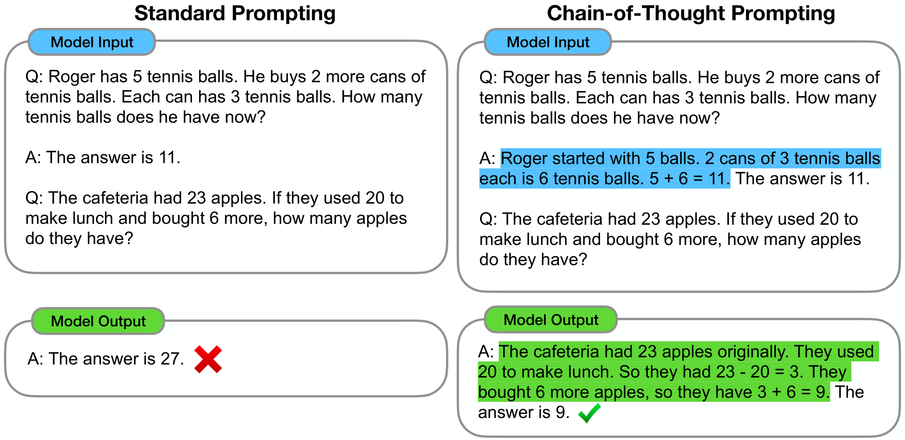
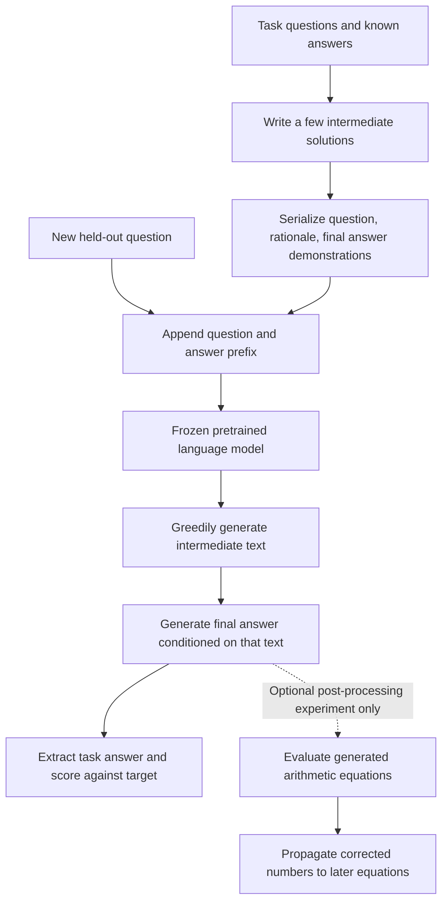
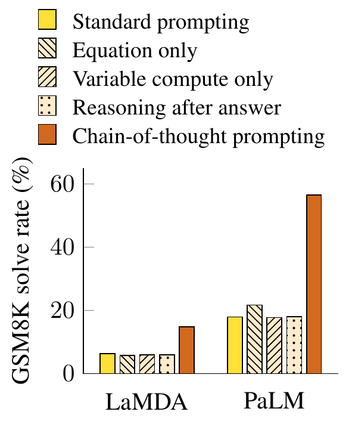
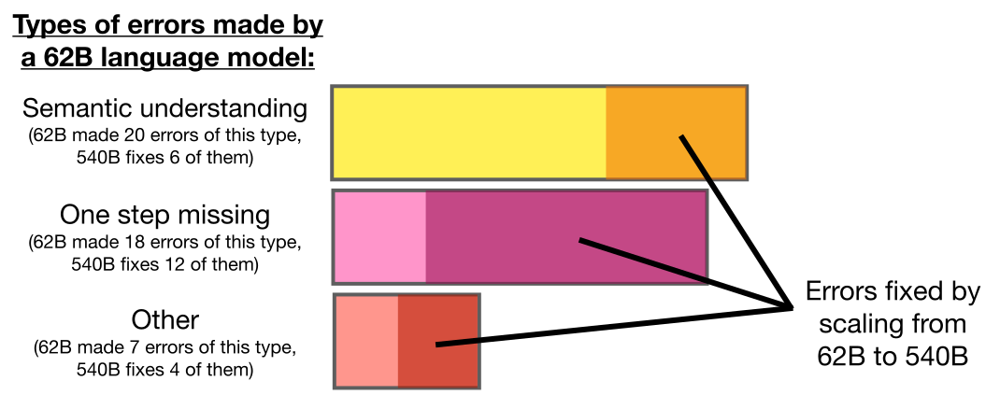

# Chain-of-Thought Prompting Elicits Reasoning in Large Language Models - Wei et al., 2022

> **arXiv:** [2201.11903v6](https://arxiv.org/abs/2201.11903v6), 10 January 2023; originally submitted 28 January 2022.
> **Venue:** Advances in Neural Information Processing Systems 35, NeurIPS 2022.
> **Authors:** Jason Wei, Xuezhi Wang, Dale Schuurmans, Maarten Bosma, Brian Ichter, Fei Xia, Ed H. Chi, Quoc V. Le, Denny Zhou.
> **Affiliation:** Google Research, Brain Team.
> **Scope:** The latest arXiv revision, including its expanded five-model-family experiments and appendices. This is the original **few-shot** chain-of-thought method, not zero-shot "think step by step," self-consistency, reasoning-model training, or tool-augmented search.

## TL;DR

Chain-of-thought prompting adds worked intermediate reasoning to a few examples in a language model's input, so that the model generates a similar sequence of intermediate steps **before** its answer to a new question. No model weights are updated: changing the demonstrations changes how an already pretrained model uses its next-token predictions.

The effect is large on some difficult, multistep tasks: PaLM 540B improves from 17.9% to 56.9% on GSM8K, while Codex improves from 19.7% to 63.1%, without an external calculator (Table 1). The benefits depend strongly on model and task, and generated explanations are not guaranteed to be correct or faithful accounts of internal computation.

## Problem & motivation

### A correct answer may require several dependent transformations

A word problem can require identifying the right quantities, interpreting their relationships, calculating intermediate values, and combining those values into a final answer. A conventional few-shot prompt demonstrates only question-to-answer mappings. It asks a language model to compress all of those transformations into the next short answer, without demonstrating an intermediate procedure.

Increasing model size does not necessarily solve this prompting problem. For example, standard prompting on GSM8K reaches only 17.9% for PaLM 540B, whereas adding intermediate reasoning demonstrations raises it to 56.9% with the same model (Table 2). The paper argues that a flat standard-prompting scaling curve can underestimate capabilities that a different inference format elicits.

### Why not train a model on worked solutions?

Prior work used annotated rationales, scratchpads, mathematical expressions, or verifier models to train systems for multistep reasoning. Such approaches can be effective, but require additional training data, optimization, or a separately trained scoring component.

This paper asks a narrower question: can a small number of worked examples elicit useful multistep behavior from an **off-the-shelf** language model? Its contribution is a simple, broadly applicable inference interface and an empirical demonstration across arithmetic, commonsense, and symbolic reasoning. It does not claim to invent every earlier use of intermediate computation or natural-language explanations.

### Why language, rather than only an equation?

An intermediate equation helps once the problem has been translated correctly into quantities and operations. The difficult part can instead be the translation itself: deciding what a percentage applies to, whether an amount is per group or total, or which intermediate result must be added rather than substituted.

A natural-language chain can spell out those relationships before doing arithmetic. The equation-only ablation supports this distinction on GSM8K, although equations alone are useful on several simpler datasets (Section 3.3; Appendix A.4). The claim is not that natural language is the only possible scratchpad.

## Key idea

### Demonstrate a procedure, not just its endpoint

Standard few-shot prompting supplies pairs $(x_i,a_i)$, where $x_i$ is a question and $a_i$ its answer. Chain-of-thought prompting supplies triples $(x_i,r_i,a_i)$, where $r_i$ is a human-written sequence of intermediate steps. The new question is appended without its solution, and the model continues in the demonstrated format.

The following notation is an **explanatory formalization**, not a new numbered objective introduced by the paper:

$$
P_{\mathrm{std}}(x)
=\operatorname{concat}\big((x_1,a_1),\ldots,(x_k,a_k),x\big),
$$

$$
P_{\mathrm{CoT}}(x)
=\operatorname{concat}\big((x_1,r_1,a_1),\ldots,(x_k,r_k,a_k),x\big).
$$

Here $P$ is the serialized input prompt, $k$ the number of demonstrations, $x$ the held-out question, and $\operatorname{concat}$ includes the question/answer markers and separators. The model parameters $\theta$ remain fixed.

For generated rationale tokens $r=(r_1,\ldots,r_m)$ and answer tokens $a=(a_1,\ldots,a_n)$, the ordinary autoregressive factorization is:

$$
p_\theta(r,a\mid P)
=
\prod_{t=1}^{m}p_\theta(r_t\mid P,r_{<t})
\prod_{u=1}^{n}p_\theta(a_u\mid P,r,a_{<u}).
$$

The subscripts on generated tokens are token positions, distinct from demonstration indices above. The crucial change is that the final answer is now conditioned on **generated intermediate text** as well as the original question and demonstrations.

### More opportunities for useful computation, but also more opportunities for error

The model can represent partial results in its context, refer back to them, and break a complicated problem into smaller next-token prediction problems. Harder questions can receive longer continuations rather than requiring every answer to have the same short output length.

This is not a new neural module, an explicit symbolic working memory, or a guarantee of valid deduction. A mistaken intermediate quantity becomes part of the context for later tokens, and a plausible explanation can accompany a wrong answer.



*Original Figure 1. The right-hand prompt demonstrates a reasoning sequence before the answer, and the test continuation follows that structure. The intervention is in the input examples; there is no fine-tuning or architectural change.*

## How it works

### 1. Construct task-appropriate demonstrations

Write a few question/solution examples. For the standard-prompting baseline, retain the questions and final answers but omit the intermediate explanations. For the CoT condition, put the intermediate explanation between the question and its final answer.

The following miniature example is **authored for this recap**, not copied from the paper's prompt appendix:

```text
Standard demonstration
Q: A shelf has 4 boxes with 3 pencils each. Another 2 pencils are added.
   How many pencils are there?
A: The answer is 14.

Chain-of-thought demonstration
Q: A shelf has 4 boxes with 3 pencils each. Another 2 pencils are added.
   How many pencils are there?
A: The boxes contain 4 * 3 = 12 pencils. Adding 2 gives 12 + 2 = 14.
   The answer is 14.

Held-out question, appended after the demonstrations
Q: A shelf has 5 boxes with 3 pencils each. Another 4 pencils are added.
   How many pencils are there?
A:
```

In the CoT condition, an appropriate continuation would first calculate 15 and then 19. These are illustrative arithmetic checks, **not outputs measured from a model**. The actual experiments use the full task-specific prompts, not this single demonstration.

### 2. Use the actual prompt counts, not a universal "eight-shot" rule

The paper's eight-shot description primarily concerns arithmetic. Its printed prompts use different numbers for different tasks:

| Task | Demonstrations in the printed prompt | Source and construction |
|---|---:|---|
| GSM8K, SVAMP, ASDiv, MAWPS | 8 | One manually composed set shared across all four benchmarks; Section 3.1, Table 20. |
| AQuA | 4 | Multiple-choice training examples and solutions; Table 21. |
| Last-letter concatenation | 4 | Synthetic two-word names; Table 22. |
| Coin flip | 8 | Synthetic examples with two possible actions; Table 23. |
| CommonsenseQA / CSQA | 7 | Training questions with manually written rationales; Table 24. |
| StrategyQA | 6 | Training questions with manually written rationales; Table 25. |
| Date Understanding | 6 | Printed prompt in Table 26. |
| Sports Understanding | 8 | Printed prompt in Table 27. |
| SayCan | 6 | Training examples from Ahn et al. with added reasoning; Section 4, Table 28. |

Section 4 says the first **ten** examples of each BIG-bench Date/Sports dataset were selected for demonstrations and excluded from evaluation, whereas the printed prompts contain six Date and eight Sports questions. These are not ten-shot prompts. The revision does not fully explain the difference between the described selection pool and the examples actually printed; reproductions should preserve both the explicit prompt contents and the stated evaluation exclusion, rather than assuming that all ten were in context.

### 3. Append the test question and generate once

The principal experiments use **greedy decoding**. In explanatory notation, each next token is:

$$
\hat z_t
=\arg\max_v p_\theta\big(v\mid P,\hat z_{<t}\big),
$$

where $z$ is the combined rationale-and-answer continuation and $v$ ranges over the model's vocabulary. This is a sequence of local token choices, not a global search for the most probable complete reasoning path.

The main method does not sample a collection of solutions, use majority voting, call a verifier, or search a tree. Those are different methods or follow-ups.



### 4. Extract and evaluate the final answer

The output contains both a rationale and an answer; benchmark accuracy is about the answer, not the presence of convincing prose. Different tasks require different output conventions: a number for arithmetic, an answer option for AQuA/CSQA, a Boolean judgment for Sports or StrategyQA, a date, a string, or an action sequence.

A faithful implementation should use the paper's question/answer formatting and its published prompts, explicitly handle malformed or missing final answers, and document answer normalization. The paper does not supply a complete per-model generation-limit, stop-sequence, and answer-parser specification in its methodological description. It would be misleading to invent one and label it the original implementation. Appendix A.1 specifically notes small models that repeat themselves or never reach a parseable answer.

### 5. Arithmetic tasks and the optional external calculator

The main CoT results are generated text alone. Appendix B separately evaluates an **external calculator** applied after generation. It evaluates equations in the generated chain, then propagates corrected values into subsequent equations using string matching.

This can repair execution mistakes when the operation was chosen correctly. It cannot reliably fix choosing the wrong quantity or omitting a necessary step. It is also not an interactive agent: the model is not repeatedly called with tool feedback to revise its plan.

Historically, the implementation description uses Python `eval`. A new implementation should parse a restricted arithmetic grammar instead of executing arbitrary generated text. String-based propagation is itself a limitation; the paper does not specify a general expression parser, dependency graph, or semantic verifier. Calculator and non-calculator results must remain separate.

### 6. Commonsense tasks: intermediate facts and plans

On CSQA, the rationale connects the question to background knowledge before selecting an option. On StrategyQA, it can decompose a question into intermediate facts. Date Understanding tracks temporal relations, and Sports Understanding checks whether an athlete/action combination is plausible.

SayCan maps an instruction into a sequence from a discrete robot-action vocabulary. A rationale can identify prerequisites before listing the steps. The results here concern the **planning benchmark**, not proof that the CoT prompt alone provides safe perception, grounding, collision avoidance, or successful physical execution.

These are demonstrations of a common text interface across tasks. There is no separate learned arithmetic module or commonsense module in the prompting method.

### 7. Symbolic tasks: distinguish matching a template from generalizing its length

**Last-letter concatenation.** Given a name containing several words, take each word's final letter and concatenate them in order. With words $w_1,\ldots,w_\ell$:

$$
f(w_1,\ldots,w_\ell)
=\operatorname{last}(w_1)\Vert\cdots\Vert\operatorname{last}(w_\ell).
$$

Here $\ell$ is the number of words, $\operatorname{last}$ extracts a final character, and $\Vert$ is string concatenation. For an authored example, "Maya Reed" gives `ad`; "Maya Reed Cole" gives `ade`. These examples illustrate the target rule, not model results.

Demonstrations and in-distribution evaluation use two-word names. Out-of-distribution evaluations use three and four words. The names come from common first and last names drawn from the top 1,000 census names; longer names concatenate additional first/last names (Section 5).

**Coin flip.** A coin starts in a stated orientation. Each named person's action either flips it or explicitly does **not** flip it. A useful mathematical description is:

$$
s_{\mathrm{final}}
=s_{\mathrm{initial}}\oplus b_1\oplus\cdots\oplus b_\ell,
$$

where states are encoded as bits, $b_i=1$ for an actual flip and $b_i=0$ for a non-flip, and $\oplus$ is XOR. Equivalently, only the parity of the number of actual flips matters.

The demonstrated/in-distribution examples have two potential actions; the OOD examples have three or four. A correct chain must retain the orientation for a non-flip rather than toggling once per mentioned person. The experiment tests extension of the demonstrated procedure, not merely memorization of a final-answer template.

### 8. Ablate what occurs before the answer

The arithmetic study separates several explanations for the gains:

1. **Equation only:** provide an intermediate equation, without its natural-language decomposition. This can help simple arithmetic, but does not solve all semantic translation difficulties.
2. **Variable compute only:** replace the rationale with dots, with a count matched to the number of **characters in the equation**. This offers extra generated positions without a meaningful intermediate solution. It is not a claim that every possible latent-computation technique is equivalent to dots.
3. **Reasoning after answer:** give the answer before the explanation. That explanation cannot condition an answer that has already been generated.



*Original Figure 5, cropped from the v6 PDF. Meaningful intermediate steps before the answer outperform equation-only, dot-padding, and answer-first conditions for LaMDA 137B and PaLM 540B on GSM8K. Table 6 below preserves the complete tabulated LaMDA arithmetic ablations.*

### 9. Vary annotators, examples, and order

The authors compare independently written rationales from annotators B and C, deliberately concise explanations, and three alternative sets of eight GSM8K examples with existing crowdworker solutions. The latter examples are restricted to at most 60 tokens and at most two solution steps to fit the context and make the comparison fair (Section 3.4).

Each alternative arithmetic exemplar set is also transferred to the other arithmetic datasets, rather than selecting a bespoke best prompt per dataset. This probes whether the method depends on one exact wording or one dataset's demonstrations.

The standard deviations in the robustness tables concern **five shuffled demonstration orders**. They do not measure variation over independent pretraining runs, test-set resamples, or every possible prompt author. Appendix D.3 additionally varies demonstration count and finds gains persist across the plotted counts; it does not establish a universal optimal number.

## Training / data

### There is no CoT training run

The experiments perform prompting-based inference only. There is no CoT fine-tuning objective, optimizer, learning rate, gradient update, training schedule, or newly trained verifier. The demonstrations are input context, not minibatches used to update weights.

The pretrained models do, of course, embody substantial earlier training. Their data, objectives, architectures, and training compute differ, so comparing model families is not a controlled experiment in parameter count alone.

### Model identities and experimental replication

| Family | Evaluated sizes / identifiers | Important qualification |
|---|---|---|
| LaMDA | About 420M, 2B, 8B, 68B, 137B | Section 3.1 says 422M for the smallest model; tables round its label to 420M. |
| GPT / "GPT-3" in the tables | `text-ada-001`, `text-babbage-001`, `text-curie-001`, `text-davinci-002` | The authors say these **presumably** correspond to InstructGPT models of 350M, 1.3B, 6.7B, and 175B parameters. Those sizes are their inferred labels, not independently established API metadata. |
| PaLM | 8B, 62B, 540B | These are the original PaLM models, not PaLM 2 or later products. |
| UL2 | 20B | Useful evidence that a relatively large model need not obtain large arithmetic gains. |
| Codex | `code-davinci-002` | Its parameter count is not supplied in these result tables. |

All principal conditions use greedy decoding. LaMDA results average five random exemplar orders; the other families normally use one order to reduce cost (Section 3.1). Table 7 is an explicit exception: its SayCan robustness experiments use PaLM 540B with repeated orders, while its other columns use LaMDA 137B.

The latest revision includes all five families. Version history in Appendix E records LaMDA in v1, PaLM added in v2, GPT results and more experiments in v3, and UL2/Codex added in v5. Some surviving prose still refers to three families; the expanded tables are the basis for this recap.

### Arithmetic evaluation inventory

The following are **evaluation counts**, not newly collected training data (Table 12):

| Benchmark / subset | Evaluation questions | What it probes |
|---|---:|---|
| GSM8K | 1,319 | Grade-school problems that commonly require several dependent reasoning steps. |
| SVAMP | 1,000 | Word problems with varied structures and sensitivity to wording/quantity relationships. |
| ASDiv | 2,096 | A diverse arithmetic word-problem collection. |
| AQuA | 254 | Algebraic, multiple-choice word problems. |
| MAWPS SingleOp | 562 | Single-operation problems. |
| MAWPS SingleEq | 508 | Problems represented by a single equation. |
| MAWPS AddSub | 395 | Addition/subtraction word problems. |
| MAWPS MultiArith | 600 | Multistep arithmetic. |

Table 3 reports the MAWPS subsets separately. The overall MAWPS percentages in Tables 1/2 are consistent with an unweighted mean of the four reported subset accuracies, up to rounding; do not silently substitute a question-count-weighted pooled score.

### Commonsense and synthetic data

CSQA uses commonsense multiple-choice questions. StrategyQA is evaluated in the question-only, open-domain setting; Appendix E.3 points to the BIG-bench version rather than an evidence-supplied setting. Date and Sports are BIG-bench tasks without separate training sets, with the first-ten-example exclusion described above. SayCan has 120 evaluation instructions in this study (Table 7 discussion).

The two symbolic tasks are constructed synthetically, with separate in-distribution and longer-input evaluations. A recreation should keep those distributions distinct and report the generation rules and sample counts it uses. The main description does not provide a complete synthetic-data generator or a full accounting of all evaluation seeds; those details should not be invented.

Appendix E.3 links dataset sources and licenses: for example, GSM8K and SVAMP are MIT-licensed, the BIG-bench tasks use Apache 2.0, MultiArith is listed as CC BY 4.0, and SayCan as CC BY 4.0. Other datasets have their own linked licensing information; there is no single blanket license for the combined collection.

### Context and compute

Appendix D.3 mentions a **1,024-token input constraint** motivating the main eight-example setup. This is not a claim that every evaluated architecture has the same maximum context length, or a complete specification of every API's output budget.

For inference, Appendix E.2 reports LaMDA 137B on TPU v3 in an $8\times8$ configuration, **64 chips / 128 cores**, and PaLM 540B on TPU v4 in a $4\times4\times12$ configuration, **192 chips / 384 cores**. GPT experiments use the public API. The paper does not provide a complete total GPU/TPU-hour, monetary-cost, latency, or energy accounting for all experiments.

Exact prompt text is printed in Appendices G/H. Appendix E.1 also reports a supplementary ZIP containing LaMDA 137B inputs, targets, and predictions. The verified NeurIPS landing page links a supplemental **PDF**; that PDF should not be mislabeled as the prediction ZIP or as executable code. Prompt disclosure improves reproducibility but does not make all historical model checkpoints and serving details available.

## Results

### Reading the tables

All values below are **accuracy / solve rate in percent** as reported in the cited source tables; larger is better. In paired cells, the order is always **standard / CoT**, without a calculator. These are historical experiments, not present-day state-of-the-art claims.

The tables retain small-model failures, regressions, and model-dependent effects, rather than showing only the best examples. Rows labeled GPT use the paper's inferred size labels discussed above.

### Largest models and the separate calculator condition

Complete Table 1 values, excluding its redundant parenthesized gains:

| Model / condition | GSM8K | SVAMP | ASDiv | AQuA | MAWPS |
|---|---:|---:|---:|---:|---:|
| Prior best cited in the paper | 55 | 57.4 | 75.3 | 37.9 | 88.4 |
| UL2 20B, standard | 4.1 | 10.1 | 16.0 | 20.5 | 16.6 |
| UL2 20B, CoT | 4.4 | 12.5 | 16.9 | 23.6 | 19.1 |
| UL2 20B, CoT + calculator | 6.9 | 28.3 | 34.3 | 23.6 | 42.7 |
| LaMDA 137B, standard | 6.5 | 29.5 | 40.1 | 25.5 | 43.2 |
| LaMDA 137B, CoT | 14.3 | 37.5 | 46.6 | 20.6 | 57.9 |
| LaMDA 137B, CoT + calculator | 17.8 | 42.1 | 53.4 | 20.6 | 69.3 |
| GPT 175B, standard | 15.6 | 65.7 | 70.3 | 24.8 | 72.7 |
| GPT 175B, CoT | 46.9 | 68.9 | 71.3 | 35.8 | 87.1 |
| GPT 175B, CoT + calculator | 49.6 | 70.3 | 71.1 | 35.8 | 87.5 |
| Codex, standard | 19.7 | 69.9 | 74.0 | 29.5 | 78.7 |
| Codex, CoT | 63.1 | 76.4 | 80.4 | 45.3 | 92.6 |
| Codex, CoT + calculator | 65.4 | 77.0 | 80.0 | 45.3 | 93.3 |
| PaLM 540B, standard | 17.9 | 69.4 | 72.1 | 25.2 | 79.2 |
| PaLM 540B, CoT | 56.9 | 79.0 | 73.9 | 35.8 | 93.3 |
| PaLM 540B, CoT + calculator | 58.6 | 79.8 | 72.6 | 35.8 | 93.5 |

The prior-best row is a collection of different, often fine-tuned systems: Cobbe et al. for GSM8K, Pi et al. for SVAMP and MAWPS, Lan et al. for ASDiv, and Piekos et al. for AQuA (Table 1 footnotes). It is not a common same-compute baseline. PaLM's CoT GSM8K score exceeds the cited 55% prior best, but Codex has a higher score than PaLM in this expanded revision.

Calculator gains are strongly task- and model-dependent. They are substantial for some weaker arithmetic systems, small for already strong ones, and can even lower ASDiv performance. They should not be interpreted as a universally correct execution layer.

### Arithmetic scaling across all evaluated sizes

Complete paired values from **Table 2**:

| Model | GSM8K | SVAMP | ASDiv | AQuA | MAWPS |
|---|---:|---:|---:|---:|---:|
| UL2 20B | 4.1 / 4.4 | 10.1 / 12.5 | 16.0 / 16.9 | 20.5 / 23.6 | 16.6 / 19.1 |
| LaMDA 420M | 2.6 / 0.4 | 2.5 / 1.6 | 3.2 / 0.8 | 23.5 / 8.3 | 3.2 / 0.9 |
| LaMDA 2B | 3.6 / 1.9 | 3.3 / 2.4 | 4.1 / 3.8 | 22.9 / 17.7 | 3.9 / 3.1 |
| LaMDA 8B | 3.2 / 1.6 | 4.3 / 3.4 | 5.9 / 5.0 | 22.8 / 18.6 | 5.3 / 4.8 |
| LaMDA 68B | 5.7 / 8.2 | 13.6 / 18.8 | 21.8 / 23.1 | 22.3 / 20.2 | 21.6 / 30.6 |
| LaMDA 137B | 6.5 / 14.3 | 29.5 / 37.5 | 40.1 / 46.6 | 25.5 / 20.6 | 43.2 / 57.9 |
| GPT 350M | 2.2 / 0.5 | 1.4 / 0.8 | 2.1 / 0.8 | 18.1 / 8.7 | 2.4 / 1.1 |
| GPT 1.3B | 2.4 / 0.5 | 1.5 / 1.7 | 2.6 / 1.4 | 12.6 / 4.3 | 3.1 / 1.7 |
| GPT 6.7B | 4.0 / 2.4 | 6.1 / 3.1 | 8.6 / 3.6 | 15.4 / 13.4 | 8.8 / 3.5 |
| GPT 175B | 15.6 / 46.9 | 65.7 / 68.9 | 70.3 / 71.3 | 24.8 / 35.8 | 72.7 / 87.1 |
| Codex | 19.7 / 63.1 | 69.9 / 76.4 | 74.0 / 80.4 | 29.5 / 45.3 | 78.7 / 92.6 |
| PaLM 8B | 4.9 / 4.1 | 15.1 / 16.8 | 23.7 / 25.2 | 19.3 / 21.7 | 26.2 / 30.5 |
| PaLM 62B | 9.6 / 29.9 | 48.2 / 46.7 | 58.7 / 61.9 | 25.6 / 22.4 | 61.8 / 80.3 |
| PaLM 540B | 17.9 / 56.9 | 69.4 / 79.0 | 72.1 / 73.9 | 25.2 / 35.8 | 79.2 / 93.3 |

Small models often become worse when asked to produce a chain. Large gains are not a universal consequence of exceeding a parameter threshold: PaLM 62B already improves strongly on GSM8K, UL2 20B improves little on these arithmetic tasks, and LaMDA 137B regresses on AQuA. Model family and task structure matter.



*Original Figure 4, with all three original SVG panels stacked for local viewing; axes and data are unchanged. The rows show GSM8K, SVAMP, and MAWPS, with standard versus CoT prompting across model sizes. The dashed lines are the paper's historical prior-best comparisons. Tables 1/2 additionally contain UL2 and Codex, which are not plotted here.*

### MAWPS: task complexity matters

Complete paired values from **Table 3**:

| Model | SingleOp | SingleEq | AddSub | MultiArith |
|---|---:|---:|---:|---:|
| UL2 20B | 24.9 / 27.2 | 18.0 / 20.2 | 18.5 / 18.2 | 5.0 / 10.7 |
| LaMDA 420M | 2.8 / 1.0 | 2.4 / 0.4 | 1.9 / 0.7 | 5.8 / 1.5 |
| LaMDA 2B | 4.6 / 4.1 | 2.4 / 3.3 | 2.7 / 3.2 | 5.8 / 1.8 |
| LaMDA 8B | 8.0 / 7.0 | 4.5 / 4.4 | 3.4 / 5.2 | 5.2 / 2.4 |
| LaMDA 68B | 36.5 / 40.8 | 23.9 / 26.0 | 17.3 / 23.2 | 8.7 / 32.4 |
| LaMDA 137B | 73.2 / 76.2 | 48.8 / 58.7 | 43.0 / 51.9 | 7.6 / 44.9 |
| GPT 350M | 3.2 / 1.8 | 2.0 / 0.2 | 2.0 / 1.5 | 2.3 / 0.8 |
| GPT 1.3B | 5.3 / 3.0 | 2.4 / 1.6 | 2.3 / 1.5 | 2.2 / 0.5 |
| GPT 6.7B | 13.5 / 3.9 | 8.7 / 4.9 | 8.6 / 2.5 | 4.5 / 2.8 |
| GPT 175B | 90.9 / 88.8 | 82.7 / 86.6 | 83.3 / 81.3 | 33.8 / 91.7 |
| Codex | 93.1 / 91.8 | 86.8 / 93.1 | 90.9 / 89.1 | 44.0 / 96.2 |
| PaLM 8B | 41.8 / 46.6 | 29.5 / 28.2 | 29.4 / 31.4 | 4.2 / 15.8 |
| PaLM 62B | 87.9 / 85.6 | 77.2 / 83.5 | 74.7 / 78.2 | 7.3 / 73.7 |
| PaLM 540B | 94.1 / 94.1 | 86.5 / 92.3 | 93.9 / 91.9 | 42.2 / 94.7 |

The striking changes are in MultiArith, rather than a uniform improvement on every arithmetic question. Already-simple tasks offer less headroom and sometimes regress. This supports the paper's emphasis on difficult, multistep tasks rather than using a long explanation for every request.

### Commonsense and action planning

Complete paired values from **Table 4**:

| Model | CSQA | StrategyQA | Date | Sports | SayCan |
|---|---:|---:|---:|---:|---:|
| UL2 20B | 34.2 / 51.4 | 59.0 / 53.3 | 13.5 / 14.0 | 57.9 / 65.3 | 20.0 / 41.7 |
| LaMDA 420M | 20.1 / 19.2 | 46.4 / 24.9 | 1.9 / 1.6 | 50.0 / 49.7 | 7.5 / 7.5 |
| LaMDA 2B | 20.2 / 19.6 | 52.6 / 45.2 | 8.0 / 6.8 | 49.3 / 57.5 | 8.3 / 8.3 |
| LaMDA 8B | 19.0 / 20.3 | 54.1 / 46.8 | 9.5 / 5.4 | 50.0 / 52.1 | 28.3 / 33.3 |
| LaMDA 68B | 37.0 / 44.1 | 59.6 / 62.2 | 15.5 / 18.6 | 55.2 / 77.5 | 35.0 / 42.5 |
| LaMDA 137B | 53.6 / 57.9 | 62.4 / 65.4 | 21.5 / 26.8 | 59.5 / 85.8 | 43.3 / 46.6 |
| GPT 350M | 14.7 / 15.2 | 20.6 / 0.9 | 4.3 / 0.9 | 33.8 / 41.6 | 12.5 / 0.8 |
| GPT 1.3B | 12.0 / 19.2 | 45.8 / 35.7 | 4.0 / 1.4 | 0.0 / 26.9 | 20.8 / 9.2 |
| GPT 6.7B | 19.0 / 24.0 | 53.6 / 50.0 | 8.9 / 4.9 | 0.0 / 4.4 | 17.5 / 35.0 |
| GPT 175B | 79.5 / 73.5 | 65.9 / 65.4 | 43.8 / 52.1 | 69.6 / 82.4 | 81.7 / 87.5 |
| Codex | 82.3 / 77.9 | 67.1 / 73.2 | 49.0 / 64.8 | 71.7 / 98.5 | 85.8 / 88.3 |
| PaLM 8B | 19.8 / 24.9 | 55.6 / 53.5 | 12.9 / 13.1 | 55.1 / 75.2 | 34.2 / 40.0 |
| PaLM 62B | 65.4 / 68.1 | 58.4 / 63.4 | 29.8 / 44.7 | 72.1 / 93.6 | 65.8 / 70.0 |
| PaLM 540B | 78.1 / 79.9 | 68.6 / 77.8 | 49.0 / 65.3 | 80.5 / 95.4 | 80.8 / 91.7 |

PaLM 540B improves on all five columns, but the effect is not consistent across other families: GPT 175B and Codex both regress on CSQA. UL2's much larger CSQA gain than its arithmetic gains is another warning against treating CoT as one uniform model capability.

Section 4 separately reports **75.6% versus a 69.4% prior best** on StrategyQA, whereas Table 4 reports **77.8%** for PaLM 540B CoT. The revision does not establish a clear split or protocol explanation for those different numbers. This recap preserves the table and identifies the prose claim separately; it does not invent a dev/test reconciliation.

### Symbolic reasoning and length generalization

Complete **Table 5**, split into two tables for readability. Each cell remains standard / CoT.

**Last-letter concatenation:**

| Model | 2 words, in-distribution | 3 words, OOD | 4 words, OOD |
|---|---:|---:|---:|
| UL2 20B | 0.6 / 18.8 | 0.0 / 0.2 | 0.0 / 0.0 |
| LaMDA 420M | 0.3 / 1.6 | 0.0 / 0.0 | 0.0 / 0.0 |
| LaMDA 2B | 2.3 / 6.0 | 0.0 / 0.0 | 0.0 / 0.0 |
| LaMDA 8B | 1.5 / 11.5 | 0.0 / 0.0 | 0.0 / 0.0 |
| LaMDA 68B | 4.4 / 52.0 | 0.0 / 0.8 | 0.0 / 2.5 |
| LaMDA 137B | 5.8 / 77.5 | 0.0 / 34.4 | 0.0 / 13.5 |
| PaLM 8B | 2.6 / 18.8 | 0.0 / 0.0 | 0.0 / 0.2 |
| PaLM 62B | 6.8 / 85.0 | 0.0 / 59.6 | 0.0 / 13.4 |
| PaLM 540B | 7.6 / 99.4 | 0.2 / 94.8 | 0.0 / 63.0 |

**Coin flip:**

| Model | 2 actions, in-distribution | 3 actions, OOD | 4 actions, OOD |
|---|---:|---:|---:|
| UL2 20B | 70.4 / 67.1 | 51.6 / 52.2 | 48.7 / 50.4 |
| LaMDA 420M | 52.9 / 49.6 | 50.0 / 50.5 | 49.5 / 49.1 |
| LaMDA 2B | 54.9 / 55.3 | 47.4 / 48.7 | 49.8 / 50.2 |
| LaMDA 8B | 52.9 / 55.5 | 48.2 / 49.6 | 51.2 / 50.6 |
| LaMDA 68B | 56.2 / 83.2 | 50.4 / 69.1 | 50.9 / 59.6 |
| LaMDA 137B | 49.0 / 99.6 | 50.7 / 91.0 | 49.1 / 74.5 |
| PaLM 8B | 60.0 / 74.4 | 47.3 / 57.1 | 50.9 / 51.8 |
| PaLM 62B | 91.4 / 96.8 | 43.9 / 91.0 | 38.3 / 72.4 |
| PaLM 540B | 98.1 / 100.0 | 49.3 / 98.6 | 54.8 / 90.2 |

Standard prompting can already solve the in-distribution coin task for PaLM 540B while failing near chance at longer lengths. CoT improves longer-length execution substantially, but four-word concatenation still falls well below its two-word performance. This is evidence of improved length generalization, **not** proof of an exact algorithm that works for arbitrary lengths.

### Arithmetic ablations and prompt robustness

Complete numeric rows from **Table 6**, LaMDA 137B. Each entry is mean $\pm$ standard deviation over **five demonstration-order seeds**, in percentage points:

| Condition | GSM8K | SVAMP | ASDiv | MAWPS |
|---|---:|---:|---:|---:|
| Standard | $6.5 \pm 0.4$ | $29.5 \pm 0.6$ | $40.1 \pm 0.6$ | $43.2 \pm 0.9$ |
| CoT | $14.3 \pm 0.4$ | $36.7 \pm 0.4$ | $46.6 \pm 0.7$ | $57.9 \pm 1.5$ |
| Equation only | $5.4 \pm 0.2$ | $35.1 \pm 0.4$ | $45.9 \pm 0.6$ | $50.1 \pm 1.0$ |
| Variable compute / dots | $6.4 \pm 0.3$ | $28.0 \pm 0.6$ | $39.4 \pm 0.4$ | $41.3 \pm 1.1$ |
| Reasoning after answer | $6.1 \pm 0.4$ | $30.7 \pm 0.9$ | $38.6 \pm 0.6$ | $43.6 \pm 1.0$ |
| Annotator B | $15.5 \pm 0.6$ | $35.2 \pm 0.4$ | $46.5 \pm 0.4$ | $58.2 \pm 1.0$ |
| Annotator C | $17.6 \pm 1.0$ | $37.5 \pm 2.0$ | $48.7 \pm 0.7$ | $60.1 \pm 2.0$ |
| Concise rationales | $11.1 \pm 0.3$ | $38.7 \pm 0.8$ | $48.0 \pm 0.3$ | $59.6 \pm 0.7$ |
| GSM8K exemplars, alpha | $12.6 \pm 0.6$ | $32.8 \pm 1.1$ | $44.1 \pm 0.9$ | $53.9 \pm 1.1$ |
| GSM8K exemplars, beta | $12.7 \pm 0.5$ | $34.8 \pm 1.1$ | $46.9 \pm 0.6$ | $60.9 \pm 0.8$ |
| GSM8K exemplars, gamma | $12.6 \pm 0.7$ | $35.6 \pm 0.5$ | $44.4 \pm 2.6$ | $54.2 \pm 4.7$ |

The dot and answer-first conditions do not reproduce the CoT gain. Different rationales and different examples retain a benefit on these arithmetic datasets, but change its magnitude. Conciseness is not uniformly better or worse.

**Source discrepancy:** Table 6's base LaMDA SVAMP CoT mean is **36.7**, whereas Tables 1/2 report **37.5**. Both values are preserved in their respective contexts, not merged into a supposed single measurement.

### Commonsense/symbolic ablations and annotator robustness

Complete **Table 7**. Date, Sports, concatenation, and coin use **LaMDA 137B**; SayCan uses **PaLM 540B**. Symbolic results are the in-distribution tasks. Entries again show mean $\pm$ standard deviation over five order seeds:

| Condition | Date | Sports | SayCan | Concatenation | Coin |
|---|---:|---:|---:|---:|---:|
| Standard | $21.5 \pm 0.6$ | $59.5 \pm 3.0$ | $80.8 \pm 1.8$ | $5.8 \pm 0.6$ | $49.0 \pm 2.1$ |
| CoT | $26.8 \pm 2.1$ | $85.8 \pm 1.8$ | $91.7 \pm 1.4$ | $77.5 \pm 3.8$ | $99.6 \pm 0.3$ |
| Variable compute / dots | $21.3 \pm 0.7$ | $61.6 \pm 2.2$ | $74.2 \pm 2.3$ | $7.2 \pm 1.6$ | $50.7 \pm 0.7$ |
| Reasoning after answer | $20.9 \pm 1.0$ | $63.0 \pm 2.0$ | $83.3 \pm 0.6$ | $0.0 \pm 0.0$ | $50.2 \pm 0.5$ |
| Annotator B | $27.4 \pm 1.7$ | $75.4 \pm 2.7$ | $88.3 \pm 1.4$ | $76.0 \pm 1.9$ | $77.5 \pm 7.9$ |
| Annotator C | $25.5 \pm 2.5$ | $81.1 \pm 3.6$ | $85.0 \pm 1.8$ | $68.1 \pm 2.2$ | $71.4 \pm 11.1$ |

The coin task makes prompt sensitivity especially visible: all annotators improve over the baseline, but the magnitude and order sensitivity vary considerably. "Robust across annotators" means the gain survives these tested alternatives, not that wording and order no longer matter.

### What the error analysis actually establishes

**Incorrect answers.** Appendix D.2 manually analyzes 50 incorrect LaMDA 137B GSM8K outputs. Its repair-oriented categories are:

| Category | Share of the 50 errors | Interpretation |
|---|---:|---|
| Calculator error only | 8% | The intended reasoning works after fixing arithmetic execution. |
| Symbol-mapping error | 16% | Equations/numeric symbols need correction while the natural-language plan can remain. |
| One step missing | 22% | Adding one necessary reasoning step repairs the chain. |
| Substantial edits needed | 54% | The chain has more serious semantic or coherence problems. |

The first three categories together account for 46%, but this does not mean a generic calculator fixes 46%. Another 34% contain arithmetic errors **alongside** other mistakes; that is an overlapping observation, not an additional disjoint category. Among the 27 substantially wrong chains, eight also have incoherent reasoning (Appendix D.2).

**Correct answers.** The revision's counts are not fully consistent: Section 3.2 describes two cases of incorrect reasoning among 50 correct-answer samples; Appendix D.1 says one and discusses five other minor imperfections; Table 9's caption describes seven imperfect chains and 43 human-like ones. These should not be collapsed into a precise faithfulness percentage. The stable qualitative conclusion is that a correct final answer does not guarantee a completely correct intermediate explanation.

Appendix D.2 also gives a calculator-assisted GSM8K score of **17.3%** in its prose, while Table 1 gives **17.8%** for that LaMDA condition. The result table above follows Table 1, without silently changing the prose's historical number.

**Scaling-related errors.** Appendix A.1 inspects 45 problems missed by PaLM 62B: 20 semantic-understanding errors, 18 missing-step errors, and seven other errors, including repetition, hallucination, or symbol mapping. Scaling to PaLM 540B repairs examples across categories, rather than only improving elementary calculation.



*Original Figure 9. The analysis starts from 45 selected PaLM 62B failures, not an independent population-wide estimate of every error category. The paper uses it to suggest several capabilities improve with scale; it is not a causal isolation of parameter count.*

Finally, Table 1 prints a PaLM MAWPS CoT gain of **+14.2**, while its displayed rounded cells are **79.2** and **93.3**, whose difference is **14.1 percentage points**. This recap retains the reported accuracies rather than substituting an unexplained parenthesized delta.

## Limitations & follow-ups

### Observable reasoning text is not a verified internal trace

The chain is text generated by a language model, not privileged access to the computations that caused an answer. The method makes intermediate assertions visible and sometimes easier to inspect, but does not establish their causal faithfulness. The paper explicitly leaves open what it means to say the network is "reasoning."

Correct-looking explanations can contain arithmetic, semantic, factual, or logical errors. Incorrect reasoning can also produce a correct answer by chance, especially in small answer spaces. Benchmark answer accuracy and rationale validity must therefore be evaluated separately.

### More tokens and larger models have costs

A chain lengthens the input demonstrations and the output, consuming context and sequential decoding work. The original paper finds its strongest gains mainly in large models, making deployment expensive. It supplies no general latency/quality optimum or evidence that generating longer text is always better.

The frequently quoted "around 100B parameters" emergence claim describes the experiments' broad pattern, not a physical threshold or a guarantee across architectures, tokenizers, training mixtures, and tasks. The tables themselves contain earlier gains and large-model regressions.

### Limited controls and incomplete historical reproducibility

Many non-LaMDA results use only one prompt order, error audits are small and manually categorized, and model families differ in far more than parameter count. Prompt robustness is tested over particular annotators and exemplar sets, not every possible formulation. The version also contains the numerical and prompt-selection discrepancies called out above.

Closed model checkpoints, inferred API size labels, missing low-level serving/parser details, and the absence of a full original standalone implementation restrict exact reproduction. The study also does not establish that the models had no prior exposure to benchmark-like material; in-context generalization is not a proof of uncontaminated pretraining.

### What changed in subsequent methods

- **[Self-consistency](reasoning_2022_self-consistency.md):** generates multiple reasoning paths and aggregates their final answers, replacing the original single greedy continuation. It changes the decoding and compute budget, not the basic need for a task-conditioned solution format.
- **[Zero-shot chain of thought](https://arxiv.org/abs/2205.11916):** elicits intermediate reasoning with an instruction such as "Let's think step by step" rather than supplying worked demonstrations. It should not be treated as the exact prompt tested in this paper.
- **[Least-to-most prompting](https://arxiv.org/abs/2205.10625):** explicitly decomposes a problem and solves subproblems sequentially, targeting compositional generalization beyond a single demonstration-matching chain.
- **[STaR](https://arxiv.org/abs/2203.14465):** bootstraps rationales and fine-tunes a model on selected generated solutions. This moves from frozen-model prompting into a training procedure, which the original CoT experiments deliberately avoid.

These are related directions, not components silently included in the results above. The core result remains that a small change in **what the prompt demonstrates** can substantially change what a pretrained model successfully does at inference.

## Links

- **arXiv:** [abstract, v6](https://arxiv.org/abs/2201.11903v6) / [HTML, v6](https://arxiv.org/html/2201.11903v6) / [PDF, v6](https://arxiv.org/pdf/2201.11903v6).
- **Code / prompts:** No original-author standalone implementation identified. Exact prompts are in [Appendix G](https://arxiv.org/html/2201.11903v6#A7) and alternate annotator prompts in [Appendix H](https://arxiv.org/html/2201.11903v6#A8); see also the [official NeurIPS supplemental PDF](https://proceedings.neurips.cc/paper_files/paper/2022/file/9d5609613524ecf4f15af0f7b31abca4-Supplemental-Conference.pdf). Third-party prompt collections are not original implementation code.
- **Hugging Face:** No paper-specific model or dataset release identified; this is a prompting method applied to existing models.
- **Project page / blog / talks:** No separate original project page, implementation blog, or official talk verified for this recap.
- **OpenReview / venue:** [NeurIPS 2022 proceedings entry](https://proceedings.neurips.cc/paper_files/paper/2022/hash/9d5609613524ecf4f15af0f7b31abca4-Abstract-Conference.html) / [proceedings PDF](https://proceedings.neurips.cc/paper_files/paper/2022/file/9d5609613524ecf4f15af0f7b31abca4-Paper-Conference.pdf).
- **Papers with Code:** No separate record verified; primary paper and venue sources are used above.
- **Related / successor papers:** [Self-consistency](reasoning_2022_self-consistency.md), [zero-shot CoT](https://arxiv.org/abs/2205.11916), [least-to-most prompting](https://arxiv.org/abs/2205.10625), [STaR](https://arxiv.org/abs/2203.14465).
- **BibTeX:**

```bibtex
@inproceedings{wei2022chainofthought,
  title={Chain-of-Thought Prompting Elicits Reasoning in Large Language Models},
  author={Wei, Jason and Wang, Xuezhi and Schuurmans, Dale and Bosma, Maarten
          and Ichter, Brian and Xia, Fei and Chi, Ed H. and Le, Quoc V.
          and Zhou, Denny},
  booktitle={Advances in Neural Information Processing Systems},
  volume={35},
  pages={24824--24837},
  year={2022},
  url={https://proceedings.neurips.cc/paper_files/paper/2022/hash/9d5609613524ecf4f15af0f7b31abca4-Abstract-Conference.html}
}
```
