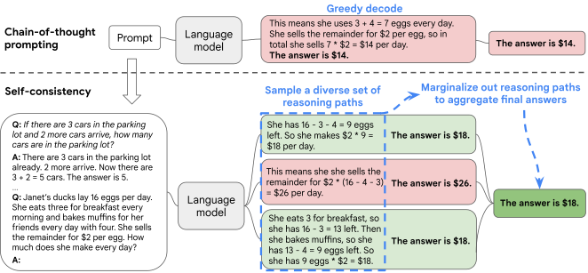
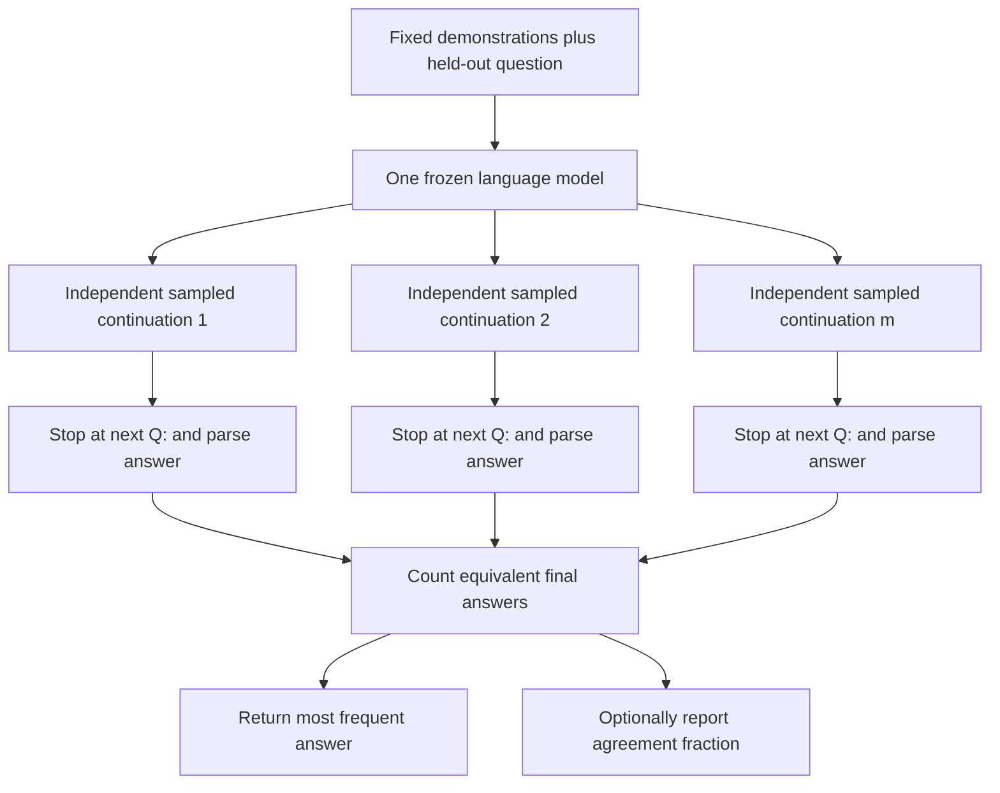
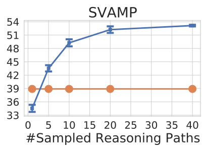
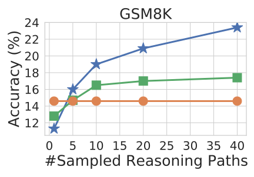
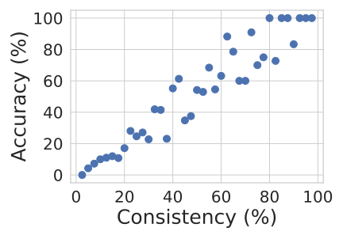

# Self-Consistency Improves Chain of Thought Reasoning in Language Models - Wang et al., 2022

> **arXiv:** [2203.11171v4](https://arxiv.org/abs/2203.11171v4), 7 March 2023; originally submitted 21 March 2022.
> **Venue:** ICLR 2023.
> **Authors:** Xuezhi Wang, Jason Wei, Dale Schuurmans, Quoc Le, Ed H. Chi, Sharan Narang, Aakanksha Chowdhery, Denny Zhou.
> **Affiliation:** Google Research, Brain Team.
> **Scope:** The v4 camera-ready paper, including aggregation ablations, all numerical result tables, and appendix implementation details. The filename uses the original preprint year. This is inference-time sampling and answer aggregation, not model fine-tuning, a trained verifier, or an iterative self-correction dialogue.

## TL;DR

Self-consistency replaces the single greedy continuation in [chain-of-thought prompting](reasoning_2022_chain-of-thought.md) with multiple sampled solutions, extracts their final answers, and returns the answer with the most votes. Different reasoning paths can reinforce the same answer even when no individual path has the highest sequence likelihood.

With 40 samples per question, the paper reports GSM8K accuracy rising from 56.5% to 74.4% for PaLM 540B and from 60.1% to 78.0% for `code-davinci-002` (Table 2). The method requires no additional training, but it does require additional inference, a meaningful answer-equivalence rule, and enough diversity that the samples do not simply repeat a shared error.

## Problem & motivation

### One greedy solution can discard useful alternatives

Few-shot CoT demonstrates a question, intermediate steps, and a final answer. With greedy decoding, the model chooses the highest-probability next token at each step and follows just one resulting continuation. An early mistaken interpretation or arithmetic step can contaminate the remainder.

Greedy decoding does **not** solve a global search for the most probable complete sequence. Even the most probable complete sequence would not necessarily imply the most probable **answer**, because many distinct sequences can lead to the same answer.

The paper exploits that distinction. A correct answer may be reached by several decompositions, equations, or orders of calculation. Wrong answers may be more fragmented across different mistakes. Sampling exposes those alternatives; voting combines their support.

### Why not choose the most likely sampled solution?

Sample-and-rank generates alternatives, scores their sequence probabilities, and selects one. That still rewards an individual string rather than the aggregate support for an answer. Fluent, high-probability text need not be correct, and raw sequence probability can favor shorter outputs.

A trained verifier is another approach, but it needs an auxiliary model and usually additional supervision. Self-consistency instead uses one frozen model and an answer-counting rule. Its use of "unsupervised" means **no new verifier training or extra answer annotations for aggregation**; the main experiments still use manually written few-shot demonstrations.

### The central hypothesis has an important failure condition

Agreement helps when correct answers collect more support than any one incorrect answer. It can fail when the model consistently misreads the question, shares a false fact across samples, or strongly favors a wrong answer option.

Multiple samples are not independent experts trained on different evidence. They are repeated stochastic draws from the same model, prompt, and underlying biases. The experiments establish useful empirical gains, not a theorem that consensus implies truth.

## Key idea

### Marginalize reasoning paths; retain the answer

Let $x$ be the question, $c$ the few-shot CoT prompt, $r$ a generated reasoning sequence, and $a$ its parsed answer. An ideal answer-level decision would sum over possible reasoning paths:

$$
a^*=\arg\max_{a\in\mathcal A}
\sum_r p_\theta(r,a\mid c,x).
$$

Here $\theta$ is the fixed model and $\mathcal A$ the task's answer space. This equation is an explanatory description of answer marginalization, not a tractable enumeration performed by the implementation.

The actual method samples $m$ complete continuations, yielding pairs $(r_i,a_i)$, and uses the paper's vote rule:

$$
N(a)=\sum_{i=1}^{m}\mathbf 1[a_i=a],
\qquad
\hat a=\arg\max_{a\in\mathcal A}N(a).
$$

$N(a)$ is the number of sampled answers equal to $a$; $\mathbf 1[\cdot]$ is an indicator. The paper calls this "majority vote," but the formula is a **plurality** rule: an answer need not receive more than half of all votes.

The reasoning strings themselves need not agree. They are used to produce answers and then marginalized away for the final decision. Counting duplicate draws is intentional; deduplicating repeated strings or retaining one vote per distinct reasoning path would change the estimator.

### What distribution does the vote estimate?

For independently sampled continuations from a decoder distribution $q$, the empirical answer frequency is:

$$
\hat q_m(a\mid c,x)=\frac{N(a)}{m}.
$$

The samples in this paper use temperature and sometimes top-$k$ truncation, so $q$ is generally **not** the unmodified model distribution $p_\theta$. More samples estimate the answer frequencies of the chosen decoder more reliably; they do not turn the vote into an exact marginalization of the original model's untempered probabilities.

This distinction also explains why multiplying every sampled vote by its model probability is a different heuristic, not something needed to make plain Monte Carlo counting valid. The paper tests probability weighting separately.



*Original Figure 1. A single greedy chain gives the wrong answer in the example, while distinct sampled chains converge on the correct one. The aggregation uses answer equality, not a learned judgment of which explanation sounds best.*

## How it works

### 1. Prepare a CoT prompt and a new question

Use the same frozen model and prompt for the greedy baseline and sampled condition. Demonstrations establish the output structure: intermediate reasoning followed by a recognizable final-answer marker. Append the held-out question and its answer prefix.

Section 3.1 broadly describes eight arithmetic examples and four to seven commonsense examples. Appendix A.3 makes the important **AQuA exception** explicit: its multiple-choice prompt contains four examples, not the eight free-response arithmetic examples. It also supplies newly written ARC prompts and the extra NLP-task prompts.

| Printed prompt | Examples | Location / qualification |
|---|---:|---|
| Free-response arithmetic | 8 | Table 17, reused from Wei et al.; not eight examples separately selected for every arithmetic dataset. |
| AQuA / AQUA-RAT | 4 | Table 14; includes answer options. |
| ARC easy / challenge | 4 | Table 15; intermediate science reasoning before an option. |
| HotpotQA, closed-book | 4 | Table 16; no retrieved evidence passages in this setting. |
| ANLI | 6 | Table 18; premise/hypothesis examples. |
| e-SNLI | 6 | Table 19; rationales are original crowd-sourced dataset annotations. |
| RTE | 4 | Table 20; premise/hypothesis examples. |
| BoolQ, closed-book | 4 | Table 21; Boolean answer format. |

Other inherited commonsense and symbolic prompts follow Wei et al.; see the [CoT recap](reasoning_2022_chain-of-thought.md) and original sources. Do not equate the eight-shot shorthand with the exact contents of every printed prompt.

### 2. Sample complete solutions independently

The principal experiments draw **40 outputs per question** and repeat the evaluation over **10 runs**. Each output is a fresh continuation of the original prompt, not a revision conditioned on earlier samples.

The model-specific defaults are:

| Model / API family | Temperature $T$ | Top-$k$ |
|---|---:|---:|
| UL2 20B | 0.5 | 40 |
| LaMDA 137B | 0.5 | 40 |
| PaLM 540B | 0.7 | 40 |
| `code-davinci-001` / `code-davinci-002` | 0.7 | No top-$k$ truncation reported |

These are Section 3.1 settings; nucleus sampling is an ablation, not an additional default filter silently applied to every run.

For intuition, if $z_v$ is the next-token logit for token $v$ and $S_k$ contains the top-$k$ logits, temperature-plus-top-$k$ sampling can be written:

$$
q_T(v\mid h)=
\frac{\mathbf 1[v\in S_k]\exp(z_v/T)}
{\sum_{u\in S_k}\exp(z_u/T)}.
$$

$h$ is the prompt plus current generated prefix; without truncation, $S_k$ is replaced by the full vocabulary. This is explanatory notation for standard sampling, not an additional trained component.

Higher temperature can expose alternative paths, but too much randomness can undermine coherent reasoning. Repeated greedy decoding of an unchanged prompt would normally return the same output, providing no useful sample diversity.

### 3. Respect generation boundaries

Appendix A.2 reports **128 maximum generated tokens** for the GPT API experiments, with neither frequency nor presence penalties. For all models, outputs are taken only until the start of the next `Q:` before parsing.

The paper does not give an equally complete output-budget specification for every non-API model. Do not silently generalize the API limit into a documented universal maximum.

The next-question boundary matters: otherwise a continuation can invent another few-shot example and contaminate answer extraction. Token limits can also truncate a rationale before its answer marker.

### 4. Extract a task-specific final answer

Section 2's footnote describes the parser:

- **Arithmetic:** take the first numerical part after the generated phrase `The answer is `.
- **Commonsense:** take the full answer string after that marker.

Do not take the first number anywhere in the rationale, vote on the entire explanation, or automatically treat all similar-sounding answers as equivalent. Multiple-choice options, dates, numeric answers, and arbitrary strings require appropriate task-specific equivalence rules.

The paper does not fully specify tie-breaking, malformed-output handling, every punctuation/case normalization, or every numeric format. A reimplementation should explicitly document those choices and count parse failures rather than silently presenting a default answer as a successful prediction. Dropping failed samples also changes the denominator of an agreement score and must be disclosed.

### 5. Count answer occurrences and return the most frequent

The core algorithm needs no token probabilities:

```text
Input: frozen model, fixed CoT prompt, question, decoder settings, sample count m
1. Draw m independent continuations of the same prompt and question.
2. Cut each continuation at the next-question boundary.
3. Extract each task answer using the declared answer parser.
4. Count every parsed answer occurrence, retaining duplicate draws.
5. Return the answer with the largest count.
6. Report parsing failures and apply a declared policy for ties.
```

Steps 1-5 express the paper's method. Step 6 makes underspecified reproduction cases explicit; it is not a claim that the original paper used a particular fallback.



### 6. An authored example: plurality, not best-looking prose

Suppose a new problem asks for the contents of five boxes holding three items each, plus four loose items. The correct result is $5\times3+4=19$. The following is an **illustrative fixture**, not a reported model run:

```text
Sample final answers: 19, 15, 19, 23, 19, 23, 15
Counts:               19 -> 3; 15 -> 2; 23 -> 2
Returned answer:      19
Agreement:            3 / 7
```

The winning answer has less than half the votes, but still wins the rule in Section 2. Two very different explanations ending in 19 each contribute one vote. One especially fluent explanation ending in 23 does not get extra weight.

There is no oracle consulting the known result during voting. If a wrong answer were most frequent, the same method would return it.

### 7. Probability-weighted alternatives

The paper compares unweighted voting with answer-level weighted sums and weighted averages. Let $t_{i,1},\ldots,t_{i,K_i}$ be all tokens in sampled rationale-and-answer output $i$, and let $K_i$ be its length.

Raw sequence weight is:

$$
w_i^{\mathrm{raw}}
=\exp\left(
\sum_{j=1}^{K_i}
\log p_\theta(t_{i,j}\mid c,x,t_{i,<j})
\right).
$$

The paper's Equation 1 uses the **length-normalized** weight:

$$
w_i^{\mathrm{len}}
=\exp\left(
\frac{1}{K_i}
\sum_{j=1}^{K_i}
\log p_\theta(t_{i,j}\mid c,x,t_{i,<j})
\right).
$$

This is a geometric mean of token probabilities, not a normalized distribution over all possible complete sequences. It reduces the exponential penalty raw probability assigns to longer outputs.

Given either weight definition, the tested answer scores are:

$$
S_{\mathrm{sum}}(a)=\sum_{i:a_i=a}w_i,
\qquad
S_{\mathrm{avg}}(a)=\frac{S_{\mathrm{sum}}(a)}{N(a)}
\quad\text{for }N(a)>0.
$$

Weighted **sums** retain support from repeated agreement. Weighted **averages** divide that multiplicity away: one high-weight occurrence can beat many moderately weighted occurrences. These are different aggregation rules, not interchangeable names for voting.

Table 1 finds unweighted voting and length-normalized weighted sums perform similarly. The authors report that normalized output probabilities are close across sampled chains; they do not reliably identify the correct chain by themselves. Accordingly, the simpler vote is the main method.

### 8. Separate self-consistency from related procedures

**Sample-and-rank:** generate the same number of continuations, rank by sequence log probability, and take the top one's answer. This does not accumulate answer-level frequency.

**Beam search:** retain high-scoring partial sequences. The outputs can have less diversity than stochastic sampling. The paper tests both the top beam and voting over beam-generated outputs; neither matches sampled self-consistency in its UL2 study.

**Prompt ensembles:** change demonstration order or select a different demonstration set, greedily decode each, then vote. Self-consistency instead gets diversity from stochastic continuations of one prompt, although the two techniques can be combined.

**Model ensembles:** vote across different models. Self-consistency needs only one; adding weaker models can reduce the quality of a stronger model's vote.

**Pass@k / oracle best-of-k:** score success if any sample is correct. Self-consistency does not know which samples are correct and must return its actual voted answer, so its reported accuracy is not an oracle upper bound.

## Training / data

### Frozen-model inference, not a new optimization objective

No model is trained or fine-tuned for self-consistency in this paper. There is no new loss, learning rate, optimizer, training schedule, or trained answer-selection head. The inputs include human-written rationales, but the voting procedure needs no new labels.

The paper evaluates UL2, LaMDA, PaLM, and two API engines from the Codex series under its "GPT-3" label. UL2 20B is an **encoder-decoder** trained with a mixture-of-denoisers objective; LaMDA 137B and PaLM 540B are dense decoder-only models. Do not describe every model here as a decoder-only architecture.

The authors label the GPT family as 175B while identifying `code-davinci-001` and `code-davinci-002`. These are historical API identifiers and the paper's size attribution, not proof of independently verified checkpoint sizes or present-day access. In particular, results should not be substituted with `text-davinci-002` or a modern model sharing a product family name.

### Evaluation sets

- **Arithmetic:** AddSub, MultiArith, ASDiv, AQuA/AQUA-RAT, SVAMP, and GSM8K. Each tests a different mix of language interpretation and arithmetic; AQuA has multiple-choice outputs, while most others use free-response numbers.
- **Commonsense/science:** CommonsenseQA, StrategyQA, ARC easy, and ARC challenge. Section 3.1 uses test splits where labels are available, **CommonsenseQA dev**, and the **question-only BIG-bench StrategyQA** set.
- **Symbolic:** last-letter concatenation and coin-state tracking. Tables 3's tasks use **four** words/actions at evaluation while demonstrations use **two**; these are longer-input OOD tests, not the easier same-length setting.
- **Additional NLP:** ANLI rounds 1/2/3, e-SNLI, RTE, BoolQ, and HotpotQA. BoolQ and HotpotQA are studied in the closed-book setting; HotpotQA reports both exact match and F1.

The symbolic output rules are inherited from Wei et al. Last-letter concatenation takes the final character of each word in order. Coin tracking toggles state only on an actual flip; a stated non-flip leaves it unchanged. The study does not claim that voting replaces those underlying abilities: for example, UL2 still scores zero on four-word concatenation (Table 3).

### Runs, uncertainty, and inference resources

Main self-consistency results average **10 runs**, with **40 independently sampled outputs per question per run**. Thus, for $n$ questions, a straightforward full repeated evaluation involves $10\times40\times n$ sampled continuations; deployment for one vote need not repeat the ten-run experiment.

The source reports standard deviations no greater than 0.5 for the main arithmetic results and omits them from Table 2. Other tables and sample-count plots print standard deviations. These are not confidence intervals and do not capture variation across model training runs or every possible prompt.

Appendix A.2 reports:

| Model | Inference resources |
|---|---|
| UL2 20B | TPU v3, $2\times2$: 4 chips / 8 cores. |
| LaMDA 137B | TPU v3, $8\times8$: 64 chips / 128 cores. |
| PaLM 540B | TPU v4, $4\times4\times12$: 192 chips / 384 cores. |
| GPT / Codex engines | Public API at the time of the study. |

Most task jobs over about 1,000 examples take 1-4 hours for UL2/LaMDA and 2-12 hours for PaLM; some tasks take longer but no more than two days each (Appendix A.2). These are historical job-time observations on the reported systems, not portable latency predictions or a complete total-compute accounting.

Sampling 40 paths increases generation work roughly in proportion to the total tokens generated, but not necessarily wall-clock time by exactly 40: batching, shared-prefix processing, output lengths, and hardware utilization matter. The paper suggests trying five or ten paths as a practical starting point because many plotted gains saturate early (Section 5).

## Results

### Reading the results

Unless specified otherwise, values are **percent accuracy**, higher is better. CoT means **greedy CoT**, not answer-only standard prompting. SC means self-consistency with **40 sampled paths**. Historical prior-best rows combine different systems and training regimes; they are not equal-compute baselines or current state-of-the-art claims.

The following tables reproduce the numeric experiments from source Tables 1-3 and 5-11. Qualitative Tables 4/12/13 provide selected repaired examples; they are not population-level error-rate measurements.

### Arithmetic reasoning: all models and datasets

Complete **Table 2** accuracy cells, with the printed parenthesized gains omitted:

| Model / method | AddSub | MultiArith | ASDiv | AQuA | SVAMP | GSM8K |
|---|---:|---:|---:|---:|---:|---:|
| Prior best in source | 94.9 | 60.5 | 75.3 | 37.9 | 57.4 | 35 / 55 |
| UL2 20B, CoT | 18.2 | 10.7 | 16.9 | 23.6 | 12.6 | 4.1 |
| UL2 20B, SC | 24.8 | 15.0 | 21.5 | 26.9 | 19.4 | 7.3 |
| LaMDA 137B, CoT | 52.9 | 51.8 | 49.0 | 17.7 | 38.9 | 17.1 |
| LaMDA 137B, SC | 63.5 | 75.7 | 58.2 | 26.8 | 53.3 | 27.7 |
| PaLM 540B, CoT | 91.9 | 94.7 | 74.0 | 35.8 | 79.0 | 56.5 |
| PaLM 540B, SC | 93.7 | 99.3 | 81.9 | 48.3 | 86.6 | 74.4 |
| code-davinci-001, CoT | 57.2 | 59.5 | 52.7 | 18.9 | 39.8 | 14.6 |
| code-davinci-001, SC | 67.8 | 82.7 | 61.9 | 25.6 | 54.5 | 23.4 |
| code-davinci-002, CoT | 89.4 | 96.2 | 80.1 | 39.8 | 75.8 | 60.1 |
| code-davinci-002, SC | 91.6 | 100.0 | 87.8 | 52.0 | 86.8 | 78.0 |

The GSM8K prior-best entries are GPT-3 fine-tuned on 7.5k examples (35%) and fine-tuning plus an additional 175B verifier (55%), per Table 2's footnotes. Other prior-best sources are Roy and Roth for AddSub/MultiArith, Lan et al. for ASDiv, Amini et al. for AQuA, and Pi et al. for SVAMP.

The headline +17.9-point GSM8K gains occur for **both** PaLM and `code-davinci-002`. The abstract's +11.0 SVAMP and +12.2 AQuA refer to `code-davinci-002`; they are not PaLM deltas. PaLM's displayed AQuA cells imply +12.5 points.

A source arithmetic inconsistency is worth retaining: `code-davinci-002` ASDiv is printed as **80.1 to 87.8**, but its parenthesized gain is **+7.6**. The displayed values differ by **7.7**; no unsupported reconciliation is imposed here.

### Commonsense, science, and OOD symbolic tasks

Complete **Table 3**:

| Model / method | CSQA | StrategyQA | ARC-e | ARC-c | Letter, 4 words | Coin, 4 actions |
|---|---:|---:|---:|---:|---:|---:|
| Prior best in source | 91.2 | 73.9 | 86.4 | 75.0 | N/A | N/A |
| UL2 20B, CoT | 51.4 | 53.3 | 61.6 | 42.9 | 0.0 | 50.4 |
| UL2 20B, SC | 55.7 | 54.9 | 69.8 | 49.5 | 0.0 | 50.5 |
| LaMDA 137B, CoT | 57.9 | 65.4 | 75.3 | 55.1 | 8.2 | 72.4 |
| LaMDA 137B, SC | 63.1 | 67.8 | 79.3 | 59.8 | 8.2 | 73.5 |
| PaLM 540B, CoT | 79.0 | 75.3 | 95.3 | 85.2 | 65.8 | 88.2 |
| PaLM 540B, SC | 80.7 | 81.6 | 96.4 | 88.7 | 70.8 | 91.2 |
| code-davinci-001, CoT | 46.6 | 56.7 | 63.1 | 43.1 | 7.8 | 71.4 |
| code-davinci-001, SC | 54.9 | 61.7 | 72.1 | 53.7 | 10.0 | 75.9 |
| code-davinci-002, CoT | 79.0 | 73.4 | 94.0 | 83.6 | 70.4 | 99.0 |
| code-davinci-002, SC | 81.5 | 79.8 | 96.0 | 87.5 | 73.4 | 99.5 |

The historical baselines are DeBERTaV3-large + KEAR for CSQA, the cited PaLM work for StrategyQA, and UnifiedQA-FT for ARC (Table 3 caption). SC does not surpass the 91.2% CSQA prior best. The abstract's +6.4 StrategyQA and +3.9 ARC-challenge are `code-davinci-002` improvements, while PaLM has different gains.

Improvements on the symbolic tasks are not universal: UL2 and LaMDA do not improve their four-word concatenation accuracy at all. Voting cannot rescue a task if the model almost never produces a correct answer or if a wrong answer consistently dominates.

### More sampled paths, not just more randomness



*The original SVAMP panel from Figure 2, not the entire four-panel figure. Blue is self-consistency; orange is greedy CoT. The horizontal axis varies the sampled paths over 1, 5, 10, 20, and 40, with mean and standard deviation over ten runs. One randomly sampled path is not the same decoder as one greedy path.*

The general trend in the plotted tasks is improved accuracy as additional paths are aggregated, with diminishing returns. This does not prove that more samples improve every individual question or every possible distribution. The relevant comparison is the accuracy of the final voted answer, not whether an ever-larger sample set eventually contains a correct answer.

### Which aggregation rule matters?

Complete **Table 1**, PaLM 540B. Printed uncertainty values are retained as mean $\pm$ standard deviation, including values rounded to zero:

| Aggregation | GSM8K | MultiArith | AQuA | SVAMP | CSQA | ARC-c |
|---|---:|---:|---:|---:|---:|---:|
| Greedy | 56.5 | 94.7 | 35.8 | 79.0 | 79.0 | 85.2 |
| Weighted average, raw | $56.3 \pm 0.0$ | $90.5 \pm 0.0$ | $35.8 \pm 0.0$ | $73.0 \pm 0.0$ | $74.8 \pm 0.0$ | $82.3 \pm 0.0$ |
| Weighted average, length-normalized | $22.1 \pm 0.0$ | $59.7 \pm 0.0$ | $15.7 \pm 0.0$ | $40.5 \pm 0.0$ | $52.1 \pm 0.0$ | $51.7 \pm 0.0$ |
| Weighted sum, raw | $59.9 \pm 0.0$ | $92.2 \pm 0.0$ | $38.2 \pm 0.0$ | $76.2 \pm 0.0$ | $76.2 \pm 0.0$ | $83.5 \pm 0.0$ |
| Weighted sum, length-normalized | $74.1 \pm 0.0$ | $99.3 \pm 0.0$ | $48.0 \pm 0.0$ | $86.8 \pm 0.0$ | $80.7 \pm 0.0$ | $88.7 \pm 0.0$ |
| Unweighted vote | $74.4 \pm 0.1$ | $99.3 \pm 0.0$ | $48.3 \pm 0.5$ | $86.6 \pm 0.1$ | $80.7 \pm 0.1$ | $88.7 \pm 0.1$ |

Length-normalized weighted sums track simple voting closely. Weighted averages can perform far worse: dividing away answer frequency defeats an essential source of evidence. A printed zero standard deviation does not establish certainty or perfect reproducibility outside the tested runs.

### When greedy CoT is worse than answer-only prompting

Complete **Table 5**, PaLM 540B; HotpotQA entries are exact match / F1 rather than two separate prompting conditions:

| Method | ANLI R1 / R2 / R3 | e-SNLI | RTE | BoolQ | HotpotQA EM / F1 |
|---|---:|---:|---:|---:|---:|
| Standard, no rationale | 69.1 / 55.8 / 55.8 | 85.8 | 84.8 | 71.3 | 27.1 / 36.8 |
| Greedy CoT | 68.8 / 58.9 / 60.6 | 81.0 | 79.1 | 74.2 | 28.9 / 39.8 |
| Self-consistency | 78.5 / 64.5 / 63.4 | 88.4 | 86.3 | 78.4 | 33.8 / 44.6 |

Adding a rationale alone hurts ANLI R1, e-SNLI, and RTE in these experiments. Aggregation more than recovers those losses. This is evidence for changing the decoding/selection procedure, not a general guarantee that explanations always help.

### Against sample-and-rank and beam search



*Original GSM8K panel from Figure 3, on `code-davinci-001`: blue stars are self-consistency, green squares are sample-and-rank, and orange circles are greedy CoT. Both sampling methods use the same number of samples; selecting one high-likelihood sequence gives smaller gains than accumulating answer votes. Other Figure 3 panels cover MultiArith and ARC-challenge.*

Complete **Table 6**, UL2 20B. Columns are beam counts for beam methods and sample counts for stochastic SC:

| Task / method | 1 | 5 | 10 | 20 | 40 |
|---|---:|---:|---:|---:|---:|
| AQuA, top beam | 23.6 | 19.3 | 16.1 | 15.0 | 10.2 |
| AQuA, vote over beams | 23.6 | $19.8 \pm 0.3$ | $21.2 \pm 0.7$ | $24.6 \pm 0.4$ | $24.2 \pm 0.5$ |
| AQuA, vote over samples | $19.7 \pm 2.5$ | $24.9 \pm 2.6$ | $25.3 \pm 1.8$ | $26.7 \pm 1.0$ | $26.9 \pm 0.5$ |
| MultiArith, top beam | 10.7 | 12.0 | 11.3 | 11.0 | 10.5 |
| MultiArith, vote over beams | 10.7 | $11.8 \pm 0.0$ | $11.4 \pm 0.1$ | $12.3 \pm 0.1$ | $10.8 \pm 0.1$ |
| MultiArith, vote over samples | $9.5 \pm 1.2$ | $11.3 \pm 1.2$ | $12.3 \pm 0.8$ | $13.7 \pm 0.9$ | $14.7 \pm 0.3$ |

Beam voting is not equivalent to independent sampling, and increasing beam width need not improve reasoning accuracy. Matching the number of candidate paths also does not prove exact equality of token-level compute or wall-clock time.

Table 6's UL2 40-sample MultiArith result is **14.7**, whereas Table 2 gives **15.0**. Both are retained in their respective tables; the revision does not fully explain the difference.

### Prompt ensembles versus sampled continuations

Complete **Table 7**, LaMDA 137B:

| Method | GSM8K | MultiArith | SVAMP | ARC-e | ARC-c |
|---|---:|---:|---:|---:|---:|
| Greedy CoT | 17.1 | 51.8 | 38.9 | 75.3 | 55.1 |
| Ensemble, 3 prompt sets | $18.6 \pm 0.5$ | $57.1 \pm 0.7$ | $42.1 \pm 0.6$ | $76.6 \pm 0.1$ | $57.0 \pm 0.2$ |
| Ensemble, 40 prompt permutations | $19.2 \pm 0.1$ | $60.9 \pm 0.2$ | $42.7 \pm 0.1$ | $76.9 \pm 0.1$ | $57.0 \pm 0.1$ |
| SC, 40 sampled paths | $27.7 \pm 0.2$ | $75.7 \pm 0.3$ | $53.3 \pm 0.2$ | $79.3 \pm 0.3$ | $59.8 \pm 0.2$ |

The prompt-ensemble conditions vote over **greedy** outputs. They change input examples or order; SC changes the continuation distribution. The three-set condition also uses fewer outputs than the 40-path condition, so the 40-permutation comparison is important when reasoning about candidate budgets.

### Imperfect prompts, equations, and zero-shot CoT

Complete **Table 8**, GSM8K:

| Model / condition | Accuracy |
|---|---:|
| LaMDA 137B, correct CoT prompt, greedy | 17.1 |
| LaMDA 137B, imperfect CoT prompt, greedy | 14.9 |
| LaMDA 137B, imperfect CoT prompt + SC | 23.4 |
| LaMDA 137B, equation prompt, greedy | 5.0 |
| LaMDA 137B, equation prompt + SC | 6.5 |
| PaLM 540B, zero-shot CoT, greedy | 43.0 |
| PaLM 540B, zero-shot CoT + SC | 69.2 |

For the imperfect-prompt experiment, numbers **inside demonstration reasoning** are replaced with random numbers, while the final answers are retained (Section 3.5 footnote). This is a specific synthetic corruption, not evidence that arbitrary adversarial or contradictory prompts are harmless.

Equation-only chains still benefit, but much less than natural-language chains here. The authors suggest their shorter form affords less path diversity; this is an interpretation, not a controlled proof that length alone causes the effect. Zero-shot CoT also benefits, demonstrating that sampling/voting can be separated from the few-shot prompt-construction choice.

### Appendix prompt and model ensemble studies

Complete **Table 9**, PaLM 540B GSM8K, with parenthesized deltas omitted:

| Method | Prompt set 1 | Prompt set 2 | Prompt set 3 |
|---|---:|---:|---:|
| Greedy CoT | 56.5 | 54.6 | 54.0 |
| Self-consistency | 74.4 | 72.1 | 70.4 |

Gains persist across all three manually written prompt sets, but absolute performance still depends on the prompt.

Complete **Table 10**, GSM8K:

| System | Accuracy |
|---|---:|
| PaLM 540B alone, greedy / SC | 56.5 / 74.4 |
| LaMDA 137B + PaLM 540B, ensemble | $36.9 \pm 0.5$ |
| PaLM 540B + code-davinci-001, ensemble | $36.6 \pm 0.4$ |
| LaMDA 137B + code-davinci-001, ensemble | $16.0 \pm 0.8$ |
| All three models, ensemble | $33.3 \pm 0.7$ |

The model ensembles vote over greedy model answers. Weak-model votes can dilute a stronger system, and the two-model cases necessarily require a tie policy on disagreements. The appendix reports averages over ten runs but does not fully document that tie policy; do not infer a general superiority over every possible heterogeneous ensemble.

Complete **Table 11**, PaLM 540B GSM8K, 40 outputs per method:

| Method | Accuracy |
|---|---:|
| Different prompt sets | 58.9 |
| Prompt permutations | 59.6 |
| Self-consistency | 74.4 |
| SC + different prompt sets | 75.4 |
| SC + prompt permutations | 73.8 |

SC is compatible with prompt ensembles, but combining them is not uniformly better: varying prompt sets helps slightly in this study, while prompt-order variation lowers the result. More sources of variation are not automatically beneficial.

### Agreement as an uncertainty signal

An intuitive consistency statistic is the fraction of samples supporting the winner:

$$
C(x)=\frac{\max_a N(a)}{m}.
$$

Here $C(x)$ measures observed answer agreement for question $x$. It is not the probability that the answer is correct, and any treatment of invalid samples must be stated when using it.



*Original Figure 5. The paper observes that consistency correlates with accuracy on GSM8K. Section 3.5's prose points to "Figure 8" for this claim, but the agreement plot itself is captioned Figure 5; Figure 8 contains additional sample-count experiments.*

The result motivates using disagreement as a warning signal. It does not establish a calibrated confidence interval, an abstention threshold that transfers to every task, or immunity to confidently shared mistakes.

### Relation to the original CoT numbers

These are the **self-consistency paper's own baselines**. For example, PaLM GSM8K greedy CoT is 56.5% here, versus 56.9% in the latest original CoT recap; LaMDA arithmetic baselines also differ. Reusing the earlier paper's baseline cells would change the claimed gains and obscure differences in evaluations or implementations. No unreported reconciliation is assumed.

## Limitations & follow-ups

### Agreement can reinforce a common misconception

All samples share a model and prompt. If an incorrect answer is the most probable outcome of that decoder, increasing sample count can make the system more consistently wrong. Vote margins are useful observations, not proof that the underlying reasoning is correct.

The method does not check intermediate deductions, factual claims, executable calculations, or external evidence. The authors specifically acknowledge inaccurate population figures in a sampled StrategyQA explanation even though the final answer is correct (Section 5). A consensus answer is therefore not a certification of the rationales supporting it.

### There must be a workable answer-equivalence relation

The original method assumes an identifiable answer space. Numeric answers, option labels, and short Boolean responses make voting straightforward; unrestricted prose, creative writing, and semantically equivalent long answers do not.

The paper suggests extending consistency to open text with an appropriate agreement metric, but does not implement a general semantic-consensus solution. Such an extension adds its own error sources and is not the same algorithm as exact answer counting.

### Inference cost and sampling diversity remain real constraints

Many sampled continuations cost more than one greedy continuation. Larger batches can improve latency utilization but do not eliminate token-generation work, memory demand, or API cost. The original paper evaluates fixed budgets, not a complete adaptive stopping strategy.

Too little diversity yields repeated errors; too much randomness can generate incoherent or unparseable text. Top-$k$, temperature, prompt content, and output limits affect the answer distribution being estimated. Robustness across the tested settings is not independence from those choices.

### Historical reproducibility is partial

UL2 checkpoints and prompt appendices make parts of the study accessible, but LaMDA and PaLM were not publicly released for these experiments. Historical Codex endpoint availability is not a current reproducibility guarantee. The paper leaves some tie, parser, and non-API generation-limit details unspecified.

The ten-run variability quantifies sampling variation in those experiments, not uncertainty over model training, contamination, prompt choice, or deployment shift. Results here were source-checked, not reproduced by running the original models.

### What to study next

- **[Original chain-of-thought prompting](reasoning_2022_chain-of-thought.md):** establishes the intermediate-solution prompt format that SC uses. Its main decoder is greedy; SC's contribution is sampling and answer aggregation.
- **[Zero-shot CoT](https://arxiv.org/abs/2205.11916):** changes how intermediate reasoning is elicited, rather than how multiple outputs are selected. Table 8 shows the two techniques can be combined.
- **[Training verifiers](https://arxiv.org/abs/2110.14168):** learns to score candidate solutions using supervision. Unlike self-consistency, it can distinguish candidates using a separate learned correctness signal, but requires additional training and does not make sequence likelihood equivalent to correctness.
- **[STaR](https://arxiv.org/abs/2203.14465):** uses generated rationales in a bootstrapped training loop. It connects to the SC paper's proposed future direction of converting better sampled solutions into better single-pass models, but is not part of this paper's inference-only experiments.
- **[Tree of Thoughts](https://arxiv.org/abs/2305.10601):** explores and evaluates branching intermediate states. This differs from SC's independent full continuations followed by one answer-level vote.

The central lesson is not that an explanation validates itself. It is that, for tasks with comparable final answers, **aggregating answer-level support across varied continuations** can be more effective than committing to one greedy or high-likelihood string.

## Links

- **arXiv:** [abstract, v4](https://arxiv.org/abs/2203.11171v4) / [HTML, v4](https://arxiv.org/html/2203.11171v4) / [PDF, v4](https://arxiv.org/pdf/2203.11171v4).
- **Code:** No standalone original-author implementation identified in the paper. [Appendix A.3](https://arxiv.org/html/2203.11171v4#A1.SS3) supplies prompts; [UL2 model resources](https://github.com/google-research/google-research/tree/master/ul2) are a model release, not a complete SC experiment repository.
- **Hugging Face:** No paper-specific model or dataset release verified for this recap.
- **Project page / blog / talks:** No separate official project page, implementation blog, or talk verified.
- **OpenReview / venue:** [ICLR 2023 record](https://openreview.net/forum?id=1PL1NIMMrw). Venue/version metadata is verified from arXiv and the camera-ready PDF; the OpenReview page required browser verification during research.
- **Papers with Code:** No separate record verified; this recap uses the primary paper.
- **Related / successor papers:** [CoT recap](reasoning_2022_chain-of-thought.md), [zero-shot CoT](https://arxiv.org/abs/2205.11916), [verifier training](https://arxiv.org/abs/2110.14168), [STaR](https://arxiv.org/abs/2203.14465), [Tree of Thoughts](https://arxiv.org/abs/2305.10601).
- **BibTeX:**

```bibtex
@inproceedings{wang2023selfconsistency,
  title={Self-Consistency Improves Chain of Thought Reasoning in Language Models},
  author={Wang, Xuezhi and Wei, Jason and Schuurmans, Dale and Le, Quoc
          and Chi, Ed H. and Narang, Sharan and Chowdhery, Aakanksha
          and Zhou, Denny},
  booktitle={The Eleventh International Conference on Learning Representations},
  year={2023},
  url={https://openreview.net/forum?id=1PL1NIMMrw}
}
```
