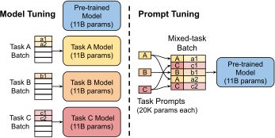
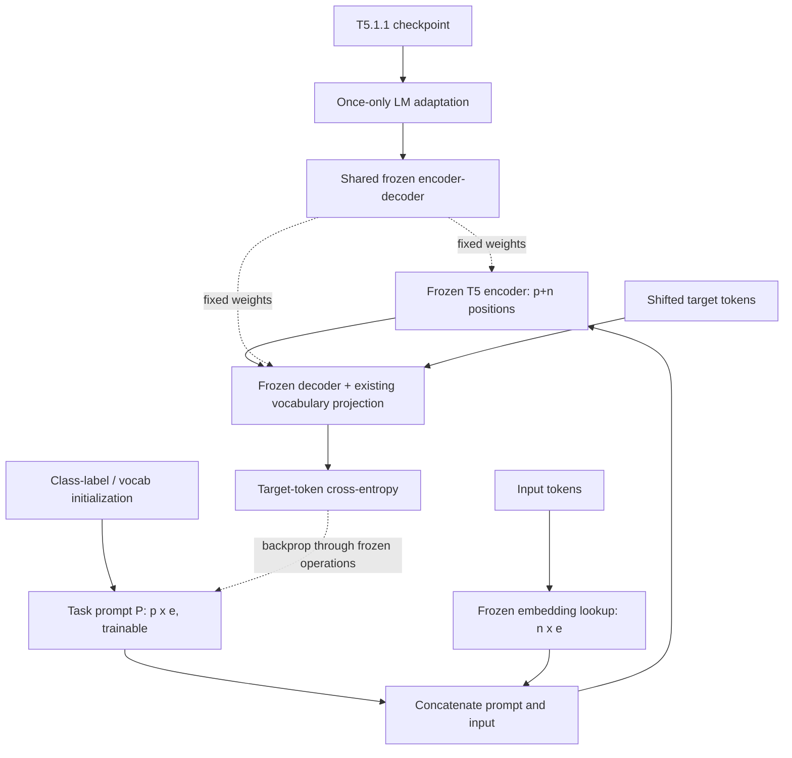
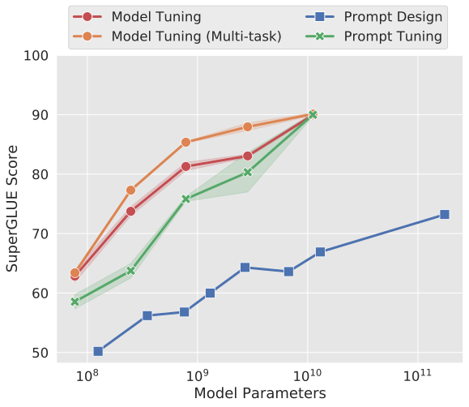
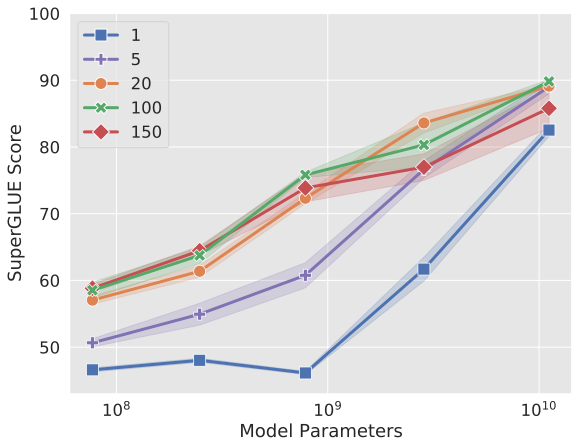
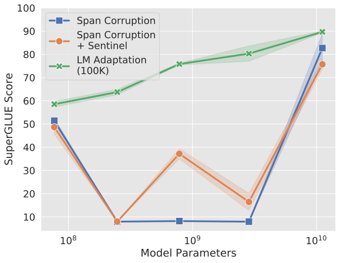

# The Power of Scale for Parameter-Efficient Prompt Tuning - Lester, Al-Rfou & Constant, 2021

> **Authors:** Brian Lester, Rami Al-Rfou, Noah Constant
>
> **arXiv:** [2104.08691v2](https://arxiv.org/abs/2104.08691v2), 2 September 2021; first submitted 18 April 2021
>
> **Venue:** EMNLP 2021, pages 3045-3059; [ACL Anthology](https://aclanthology.org/2021.emnlp-main.243/)
>
> **Affiliation:** Google Research

## TL;DR

Prompt tuning freezes a pretrained language model and learns only a task-specific matrix of continuous embeddings prepended to its input. On T5.1.1, the gap to full fine-tuning shrinks with model size until prompt tuning matches even the stronger multitask baseline at the 11B-parameter XXL scale (Figure 1, Section 3.1). The same frozen model can serve different prompts in one batch, transfer more robustly across several domain shifts, and support ensembles that store multiple small prompts rather than multiple complete models.

The main experiments use a **100-token prompt**, not the five-token illustration in Figure 2. They also generally use a **once-only, 100K-step language-model adaptation of the backbone before it is frozen**; that shared preparation is different from the subsequent prompt-only downstream training.

## Problem & motivation

### A separate model for every task is expensive

Full fine-tuning adapts every model parameter to a downstream task. If there are $K$ tasks and a backbone with $M$ parameters, independently fine-tuned deployments store approximately $KM$ task-specific parameters. That becomes costly for large models, even if each individual task is small.

Discrete prompting instead leaves the model unchanged and encodes the task in ordinary text: an instruction, demonstrations, or both. This allows backbone sharing, but selecting text prompts is brittle, examples consume context, and few-shot performance may lag behind supervised fine-tuning. Section 1 quotes a historical comparison of GPT-3 175B few-shot SuperGLUE **71.8** against fine-tuned original T5-XXL **89.3**, a **17.5-point gap**. These are contextual baseline numbers, **not an exact prompt-tuning result from this paper's T5.1.1 experiments**.

The key question is whether a small learned input can use the full labeled training set to steer a frozen model well enough to recover fine-tuning quality.

### A simpler continuous adaptation mechanism

[Prefix-Tuning](softtoken_2021_prefix-tuning.md) learns prefix activations at multiple transformer layers. [Bottleneck adapters](peft_2019_bottleneck-adapters.md) insert trainable functions into the network. Prompt tuning takes a more restricted approach: **only extra input embeddings are trainable**.

There is no task-specific classifier, decoder prefix, per-layer key/value prefix, or stabilizing prompt-reparameterization MLP in this method. Whether such a shallow intervention has enough capacity is an empirical question. The paper's central finding is that the answer depends strongly on the capacity of the **frozen backbone**, not just the number of prompt parameters.



*Original Figure 2. Full fine-tuning uses separate parameter sets and inference batches; prompt tuning shares a frozen model and attaches each example's task prompt. The illustrated 20,480-parameter XXL prompt assumes five tokens; it is not the default 100-token experiment.*

## Key idea

### Learn the prompt directly in embedding space

Let $X=(x_1,\ldots,x_n)$ be an input token sequence, $Y=(y_1,\ldots,y_m)$ its target text, and $\theta$ the pretrained encoder-decoder parameters. Ordinary text prompting selects discrete prompt tokens $P$, giving

$$
\Pr_\theta(Y\mid[P;X]).
$$

Their embeddings must be rows of the fixed vocabulary embedding table. Soft prompt tuning removes that vocabulary restriction. With embedding width $e$, define

$$
X_e=\operatorname{Embed}_\theta(X)\in\mathbb R^{n\times e},
\qquad
P_e\in\mathbb R^{p\times e},
\qquad
Z=[P_e;X_e]\in\mathbb R^{(p+n)\times e},
$$

where $p$ is prompt length and semicolon denotes concatenation along the sequence dimension. $P_e$ is a free parameter matrix, not a string or a set of token IDs.

The conditional likelihood factorizes in the usual autoregressive way:

$$
\Pr_{\theta;P_e}(Y\mid X)
=\prod_{t=1}^{m}
\Pr_\theta(y_t\mid y_{<t},Z).
$$

For a labeled dataset $\mathcal D$, train by minimizing target-token cross-entropy:

$$
\mathcal L(P_e)
=-\mathbb E_{(X,Y)\sim\mathcal D}
\left[
\sum_{t=1}^{m}
\log\Pr_\theta(y_t\mid y_{<t},[P_e;X_e])
\right],
\qquad \theta\text{ fixed}.
$$

These equations expand the likelihood formulation in Section 2 into its ordinary teacher-forced training objective. The exact framework-level token/batch normalization is delegated to the T5 implementation; no separate prompt-specific auxiliary loss is proposed.

### Frozen weights do not mean a detached model

Only $P_e$ is updated, but its gradient passes **through the frozen encoder and decoder**:

$$
\nabla_{P_e}\mathcal L
=\left(\frac{\partial Z}{\partial P_e}\right)^\top
\nabla_Z\mathcal L.
$$

Freezing means excluding $\theta$ from optimizer updates and task-specific learned state. Running the whole backbone under a no-gradient/inference-only context would disconnect this derivative and prevent learning the prompt. The embedding table is frozen too: initialization may copy vocabulary rows, but updates must affect the separate prompt matrix rather than those original rows.

### Parameter efficiency

The task-specific parameter count is exactly

$$
N_{\mathrm{prompt}}=pe.
$$

For one shared $M$-parameter backbone and $K$ tasks, storage is approximately $M+Kpe$, versus $KM$ for separate fully tuned models. That does not make computation independent of model size: the complete backbone still runs for every example.

At XXL, $e=4096$. A five-token illustration has **20,480** trainable parameters; the default 100-token prompt has **409,600**, about **0.00368%** of total parameters (Figure 2 and Appendix Table 4). The default therefore reduces task-specific parameter count by more than **20,000 times**, as Section 3.1 states, while the much smaller five-token illustration exceeds five orders of magnitude. Those are different operating points, not contradictory claims.

## How it works

### 1. Prepare one backbone that can generate ordinary target text

The experiments use **T5.1.1**, from Small through XXL, rather than silently mixing original T5 and T5.1.1 checkpoints. Section 3 identifies three relevant T5.1.1 changes: no supervised data in pretraining, adjusted model/feed-forward dimensions, and GeGLU activations.

T5's span-corruption objective reconstructs removed spans separated by sentinel tokens. Its decoder has learned that targets begin with sentinels, not necessarily ordinary class labels or answers. This is not an inability to generate natural language; it is a mismatch between the pretraining format and the desired frozen-model use.

Section 2.2 tests three approaches:

1. **Span corruption:** freeze the original T5.1.1 model and attempt downstream prompt tuning directly.
2. **Span corruption + sentinel:** keep the same model but prepend a sentinel to downstream targets, trying to match its learned output format.
3. **LM adaptation:** continue self-supervised training with a natural text prefix as encoder input and its continuation as decoder target; then freeze the resulting model.

LM adaptation changes backbone weights, but happens **once per backbone**, not separately for each downstream task. The default uses **100K adaptation steps**, approximately **10% of the original T5 pretraining step count** (Section 3.2). This preserves the later shared-backbone deployment advantage while adding a real up-front training cost.

### 2. Convert a task into text-to-text examples

Classification targets are textual labels, not indices in a newly added classification head. The existing decoder vocabulary and output mechanism generate the label sequence. A task with a multi-token label trains on that whole output string.

The authors follow T5's task preprocessing while omitting the input prefix that explicitly names the SuperGLUE dataset. Each task instead has its own learned prompt, trained independently. There is **no multitask data mixing in the prompt-tuning experiments**.

Some tasks are genuinely generative in the T5 formulation. ReCoRD predicts the missing entity, and WSC generates a referent rather than answering a binary referent-correctness question. WSC therefore trains only on examples with a correct supplied referent; its effective training set is smaller than the original binary dataset.

### 3. Initialize the prompt

Section 3.2 compares:

| Initialization | Exact construction | Why it might help |
|---|---|---|
| Random uniform | Independently sample prompt values from $[-0.5,0.5]$ | Requires no task vocabulary, but initially may not resemble embeddings the frozen model knows how to use. |
| Sampled vocabulary | Copy embeddings drawn from the 5,000 most common SentencePiece tokens | Starts from word-like representations while keeping all later prompt vectors continuous. |
| Class labels, default | Initialize one prompt vector per class from its label embedding; average embeddings for a multi-token label | Places valid outputs into the conditioning input and may make the output space easier to identify. |

If labels do not fill all prompt positions, initialize the remaining positions with sampled vocabulary embeddings. For ReCoRD, use the task-related words **commonsense, reasoning, reading, comprehension**; for WSC, use **commonsense, pronoun, resolution** (Section 3.2, footnote 7). The label-based recipe is therefore not literally applicable to every free-form answer task.

Initialization is not a permanent constraint: after training, vectors need not remain on vocabulary rows, even if their nearest neighbors remain related to the initial labels.

### 4. Prepend and train

For a batch of size $B$, broadcast the task's prompt from $[p,e]$ to $[B,p,e]$, concatenate it with embedded inputs $[B,n,e]$, and run the frozen encoder on $[B,p+n,e]$. Teacher-force the decoder with shifted target tokens and compute its ordinary text loss.

The prompt belongs to the **task**, not to each example independently; all examples from that task update the same $P_e$. The bidirectional encoder contextualizes the prompt representations jointly with each input. Although the initial vectors are fixed across examples, their deeper activations are not fixed per-layer parameters as in a static prefix.

Implementation must extend masks to include the new positions:

- The encoder attention mask must treat the prompt as valid context while still masking padded input positions.
- Decoder cross-attention must see all valid $p+n$ encoder positions.
- Target padding must not contribute to the supervised loss.

The [official implementation notes](https://github.com/google-research/prompt-tuning/blob/main/implementation.md) explicitly describe prompt-aware encoder and cross-attention masks, prompt-only optimizer selection, and partial checkpoint loading/saving. Their additional decoder-only/prefix-LM support is library functionality, not a different architecture used for the paper's main T5 results.



*Authored reconstruction. The only task-updated tensor is the prompt; LM adaptation is shared preparation performed before that tensor is trained.*

### 5. Serve several tasks using the same model

Attach the appropriate prompt to each example and batch examples from multiple tasks through the same frozen weights. Each task still needs its own prompt lookup and output interpretation, but not a separate complete model.

Prompt positions incur real attention and sequence costs. For a bidirectional encoder, the attention matrix grows from $n^2$ to $(n+p)^2$ entries per head, an increase of $2np+p^2$. Decoder cross-attention also sees $p$ extra encoder positions. These are analytical operation-shape consequences, not latency measurements from the paper.

The serving benefit is primarily sharing parameters and improving batching opportunities. It does **not** make a batch of $B$ tasks cost the same FLOPs as one example, and it does not eliminate backward activation costs during training.

### 6. Ensemble prompts rather than complete models

Train **five independently initialized prompts per task** on one frozen XXL backbone. At inference, duplicate the input five times, apply a different prompt to each copy, and combine predictions with **simple majority voting** (Section 6).

This replaces five full model copies with five prompt matrices plus one backbone. Batching may improve throughput, but still evaluates five prompted examples. The paper does not define a detailed tie-breaking rule for free-form outputs; even an odd number of voters can tie for the largest count when there are more than two possible answers. That detail must be resolved when reproducing the ensemble exactly.

## Training / data

### Default downstream recipe

| Setting | Reported value |
|---|---|
| Backbone family | T5.1.1 Small, Base, Large, XL, XXL |
| Shared preparation | LM objective adaptation for 100K steps |
| Downstream trainable variables | Prompt embeddings only |
| Prompt length | 100 |
| Initialization | Class labels; sampled common vocabulary for remaining positions |
| Loss | Standard T5 target cross-entropy |
| Training duration | 30,000 steps, selecting a checkpoint by development performance |
| Learning rate | Constant 0.3 |
| Batch size | 32 examples |
| Optimizer | Adafactor |
| Weight decay | $10^{-5}$ |
| $\beta_2$ decay setting | 0.8 |
| Parameter scaling | Off |
| Stack | JAX and Flax |
| Repetitions | Three runs per main baseline/ablation configuration |

*Source: Section 3 and Appendix A.2. The Adafactor decay setting is reported as such, not reinterpreted as a conventional fixed Adam $\beta_2=0.8$. Development selection uses the dataset's default metric, or the average where multiple metrics are reported.*

The high **0.3** learning rate belongs to small prompt tensors and this optimizer configuration; copying the full-model fine-tuning rate would not reproduce the experiment. Backbone dropout behavior, exact sequence-length limits, and every low-level optimizer option are not enumerated in the paper. Use the released configurations/checkpoints for details, while noting that the repository has evolved since publication.

### Baseline construction

Both fine-tuning baselines update the T5.1.1 backbone using learning rate **0.001** and Adafactor with pretraining optimizer states restored (Section 3.1):

- **Single-task model tuning:** tune a separate full model per task. A batch-size sweep selects **$2^{16}$ tokens per batch**.
- **Multitask model tuning:** jointly tune on a task mixture, identify tasks with text prefixes, use **$2^{20}$ tokens per batch**, and include **DPR** data known to improve WSC.

The stronger multitask baseline therefore has a different training mixture from independently trained prompts. Also, the original T5 SuperGLUE submission mixed supervision into pretraining before task fine-tuning; the paper does not reproduce that original pipeline because T5.1.1 pretraining is self-supervised.

GPT-3 few-shot results are imported from Brown et al., not a controlled same-backbone comparison or a comparison with equal amounts of labeled training data. Prompt tuning can use full task datasets; in-context few-shot prompting cannot fit those datasets into its prompt.

### Dataset sizes and preprocessing

| Dataset | Training | Validation | Testing |
|---|---:|---:|---:|
| BoolQ | 9,427 | 3,270 | 3,245 |
| CB | 250 | 56 | 250 |
| COPA | 400 | 100 | 500 |
| MultiRC | 27,243 | 4,848 | 9,693 |
| ReCoRD | 100,730 | 10,000 | 10,000 |
| RTE | 2,490 | 277 | 3,000 |
| WiC | 5,428 | 638 | 1,400 |
| WSC | 259 | 104 | 146 |
| MRPC | 3,668 | 408 | 1,725 |
| QQP | 363,849 | 40,430 | 390,965 |
| SQuAD | 87,599 | 10,570 | - |
| TextbookQA | - | 1,504 | - |
| RACE | - | 1,503 | - |
| BioASQ | - | 1,501 | - |
| RE | - | 674 | - |
| DuoRC | - | 2,948 | - |
| DROP | - | 1,503 | - |

*Source: Appendix Table 7. These describe available splits used by the setup, not a claim that main SuperGLUE scores are test-set submissions. WSC has 259 usable referent-generation training examples rather than the original 554.*

All datasets are English. The paper uses TensorFlow Datasets **GLUE 1.0.0**, **SuperGLUE 1.0.2**, and **SQuAD v1.1:3.0.0**, plus MRQA's out-of-domain development splits (A.3). No new dataset is collected.

SuperGLUE covers question answering, entailment, commonsense alternatives, reading comprehension, word meaning, and coreference. Class imbalance matters: BoolQ training is **62.3% True**, CB only **6.4% neutral**, and QQP only **36.9% duplicate** (Appendix Tables 8, 9, 16). High accuracy alone is not interchangeable with balanced classification performance, which is why the benchmark uses task-specific metrics and multi-metric averages.

WSC's **100% positive training-label distribution** in Table 13 is a consequence of converting it to referent generation, not evidence that the paper trained a binary classifier that only predicts True. One source typo should also be noted: Table 14 gives RTE training proportions **51.2 / 49.8**, which sum to **101.0%**; do not silently treat that pair as a valid normalized distribution.

### Prompt sizes and source arithmetic

| T5.1.1 size | Frozen backbone parameters | Embedding width | Five-token prompt | Default 100-token prompt | Default trainable fraction |
|---|---:|---:|---:|---:|---:|
| Small | 76,961,152 | 512 | 2,560 | 51,200 | 0.06648% |
| Base | 247,577,856 | 768 | 3,840 | 76,800 | 0.03101% |
| Large | 783,150,080 | 1,024 | 5,120 | 102,400 | 0.01307% |
| XL | 2,849,757,184 | 2,048 | 10,240 | 204,800 | 0.00719% |
| XXL | 11,135,332,352 | 4,096 | 20,480 | 409,600 | 0.00368% |

*Source: Appendix Table 4, with arithmetic made explicit. Backbone counts are derived by subtracting each one-token prompt from the corresponding total. Prompt counts use $pe$ and fractions use $100pe/(M+pe)$, rounded to five decimal places. This also rounds XL to 0.00719% rather than the source's truncated 0.00718%. The Large default fraction above is a corrected calculation, not the erroneous percentage printed in the source.*

There are several apparent errors in Table 4, present in both v2 HTML and PDF:

- **Small, length 20:** the source prints **10,420** prompt parameters and **76,971,572** total. The formula gives **10,240** and **76,971,392**, respectively.
- **Large, length 100:** the source prints **0.01907%** trainable. Its own parameter counts imply approximately **0.01307%**.
- **XXL, length 50:** the source prints **11,137,380,352** total. Its fixed backbone plus **204,800** prompt parameters gives **11,135,537,152**.

These local table errors do not change the main efficiency conclusion. In particular, "under 0.01%" applies to the default XL/XXL regimes, not every smaller model and every prompt length.

### Search budget and measured runtime

Appendix A.2 reports **77 hyperparameter trials**: **40 prompt-tuning** and **37 single-task model-tuning** trials. Main baselines/ablations total **195 runs**, with **18** further domain-shift runs and **24** extra runs to build ensembles. These counts do not constitute a measured end-to-end dollar or energy budget.

| Hyperparameter | Search space in Appendix Table 6 |
|---|---|
| Learning rate | 0.001 to 0.5 |
| Parameter scaling | True, False |
| Batch size | 32, 64, **126**, 256, 512 |
| Steps | 10,000; 20,000; 30,000 |
| Warmup | Off; 2,000; 3,000 |
| Decay factor | Off; 0.1; 0.5 |
| Steps per decay | Off; 4,000; 6,000; 8,000 |

The unusual **126** is what the published table says; it should not be silently rewritten as 128. Hyperparameters were selected manually using aggregate SuperGLUE development performance, so the development set supports both model selection and reported results.

Small/Base prompt training uses **four TPU v2 chips**; larger sizes use **16 TPU v3 chips** (A.1). The following is the complete BoolQ convergence-runtime table. A two-field time is minutes:seconds; a three-field time is hours:minutes:seconds, as implied by the table's mixed notation.

| Prompt length | T5 size | Mean time | Standard deviation |
|---|---|---:|---:|
| 1 | Large | 3:17 | 02:10 |
| 1 | XL | 3:37 | 02:11 |
| 1 | XXL | 21:23 | 01:54 |
| 20 | XL | 49:08 | 18:53 |
| 20 | XXL | 53:03 | 16:25 |
| 50 | Small | 09:05 | 05:07 |
| 50 | Base | 55:01 | 27:48 |
| 50 | Large | 1:14:16 | 13:12 |
| 50 | XL | 2:30:10 | 25:40 |
| 50 | XXL | 3:13:13 | 23:08 |
| 100 | Small | 16:25 | 01:15 |
| 100 | Base | 29:57 | 00:18 |
| 100 | Large | 1:23:36 | 10:21 |
| 100 | XL | 3:35:00 | 54:42 |
| 100 | XXL | 3:51:15 | 45:53 |

*Source: Appendix Table 5. Convergence means reaching performance within 1% of the configuration's mean; it is not necessarily the selected 30K-step checkpoint or equal final accuracy across prompt lengths. Some preempted configurations are omitted. Different model sizes use different hardware, so these rows are not a controlled same-hardware scaling comparison.*

## Results

### Scaling closes the adaptation gap



*Original Figure 1. Means and standard deviations over three runs for tuning methods; GPT-3 points are imported few-shot results. The horizontal axis is model parameter count, not prompt length.*

Section 3.1 makes the following source-supported comparisons:

| Comparison | Reported finding | Evidence |
|---|---|---|
| Prompt-tuned Small versus GPT-3 XL | Comparable quality despite GPT-3 having over 16 times more parameters | Section 3.1 / Figure 1 |
| Prompt-tuned Large versus GPT-3 175B | Prompt tuning performs better despite the GPT-3 model being over 220 times larger | Section 3.1 / Figure 1 |
| XXL prompt tuning versus single-task model tuning | Gap closes at approximately 11B scale | Section 3.1 / Figure 1 |
| XXL prompt tuning versus stronger multitask model tuning | Comparable quality with over 20,000 times fewer task-specific parameters | Section 3.1 / Figure 1 |

The main scaling curves are graphical, not accompanied by a complete exact numerical table. They show XXL scores around 90; this recap does not invent precise coordinates for each point. Table 3 below provides exact values for a separate five-prompt ensemble experiment. Neither the old T5 **89.3** context number nor the ensemble's **90.5** single-prompt average should be mislabeled as the exact Figure 1 mean.

The result is not that small prompts always equal full fine-tuning. At Small/Base/Large sizes the quality gap is substantial. Nor does it show that more prompt parameters substitute for a more capable backbone: the number of trainable prompt scalars remains tiny while backbone capability increases.

### Ablations



*Original Figure 3(a). Larger prompts help, particularly beyond a single token, but model scale changes how much conditioning is necessary.*

The prompt-length sweep uses **1, 5, 20, 100, 150 tokens** (Section 3.2). Most smaller backbones require more than one token for good quality; XXL remains strong even with one. Gains beyond about **20 tokens** are marginal, while going beyond **100** can be mildly harmful for larger models. This is a quality/parameter trade-off, not an instruction to use the same length for every task or model.

Initialization has a similar scaling interaction. Class-label initialization is best at smaller sizes, sampled vocabulary improves on random uniform initialization, and those differences largely disappear at XXL (Figure 3(b)). This does not imply random initialization is universally safe for other architectures or training recipes.



*Original Figure 3(c). A frozen backbone's pretraining interface can matter as much as prompt parameter count. Adding a sentinel to downstream targets does not solve the span-corruption mismatch.*

LM adaptation performs reliably across all sizes; original span corruption does not. Section 3.2 reports that some intermediate-sized models fail to generate legal labels, often copying input spans or outputting an empty string, producing **0% on many tasks** with low variance across runs. Only **two of the five** span-corruption model sizes work well. XXL is comparatively robust even under this non-optimal setup.

Figure 3(d) shows gains from longer adaptation up to **100K steps**, with smaller models more sensitive and XXL relatively forgiving of shorter adaptation. The strongest conclusion is robustness **within these tested settings**, not proof that every pretrained large model is intrinsically prompt-tunable.

### Domain transfer: train in one distribution, evaluate in another

| Dataset | Domain | Full model tuning F1 | Prompt tuning F1 | Prompt minus model |
|---|---|---:|---:|---:|
| SQuAD | Wikipedia | $94.9\pm0.2$ | $94.8\pm0.1$ | -0.1 |
| TextbookQA | Books | $54.3\pm3.7$ | $66.8\pm2.9$ | +12.5 |
| BioASQ | Biomedical | $77.9\pm0.4$ | $79.1\pm0.3$ | +1.2 |
| RACE | Exams | $59.8\pm0.6$ | $60.7\pm0.5$ | +0.9 |
| RE | Wikipedia | $88.4\pm0.1$ | $88.8\pm0.2$ | +0.4 |
| DuoRC | Movies | $68.9\pm0.7$ | $67.7\pm1.1$ | -1.2 |
| DROP | Wikipedia | $68.9\pm1.7$ | $67.1\pm1.9$ | -1.8 |

*Source: Table 1, mean and standard deviation over three runs. Train only on SQuAD and select checkpoints by SQuAD validation F1; MRQA out-of-domain development examples provide no target-domain training supervision. Deltas are F1 points, not relative percentages.*

Prompt tuning wins on **four of the six** out-of-domain datasets, most dramatically TextbookQA. It loses on DuoRC and DROP, so frozen parameters do not guarantee superior transfer. The suggested explanation is reduced overfitting to source-domain lexical cues, not a demonstrated universal domain-invariance property.

| Training source | Evaluation target | Adaptation | Accuracy | F1 |
|---|---|---|---:|---:|
| QQP | MRPC | Model tuning | $73.1\pm0.9$ | $81.2\pm2.1$ |
| QQP | MRPC | Prompt tuning | $76.3\pm0.1$ | $84.3\pm0.3$ |
| MRPC | QQP | Model tuning | $74.9\pm1.3$ | $70.9\pm1.2$ |
| MRPC | QQP | Prompt tuning | $75.4\pm0.8$ | $69.7\pm0.3$ |

*Source: Table 2, mean and standard deviation. Checkpoints are selected using source-domain validation, not target-domain validation.*

QQP-to-MRPC improves **3.2 accuracy points** and **3.1 F1 points**. The reverse transfer improves accuracy by **0.5**, but lowers F1 by **1.2**. Differences between question duplication and news-sentence paraphrases make this a useful robustness test, not a symmetric task pair where all metrics must agree.

### Prompt ensembling

| Dataset | Metric | Five-prompt average | Best prompt | Majority-vote ensemble |
|---|---|---:|---:|---:|
| BoolQ | Accuracy | 91.1 | 91.3 | 91.7 |
| CB | Accuracy / F1 | 99.3 / 99.0 | 100.00 / 100.00 | 100.0 / 100.0 |
| COPA | Accuracy | 98.8 | 100.0 | 100.0 |
| MultiRC | EM / F1a | 65.7 / 88.7 | 66.3 / 89.0 | 67.1 / 89.4 |
| ReCoRD | EM / F1 | 92.7 / 93.4 | 92.9 / 93.5 | 93.2 / 93.9 |
| RTE | Accuracy | 92.6 | 93.5 | 93.5 |
| WiC | Accuracy | 76.2 | 76.6 | 77.4 |
| WSC | Accuracy | 95.8 | 96.2 | 96.2 |
| SuperGLUE development | Aggregate | 90.5 | 91.0 | 91.3 |

*Source: Table 3, T5-XXL, default prompt recipe. The aggregate ensemble gains **0.8 points** over the prompt average and **0.3** over the best individual result. It matches or exceeds the reported best task-level result, but these development-set findings do not establish that ensembling always helps.*

For clarity, a "best" task column need not mean one universal prompt chosen for all eight tasks: prompts are trained independently per task. SuperGLUE averages task scores, first averaging multiple reported metrics within each applicable task.

### What do the soft tokens mean?

Section 7 inspects vocabulary nearest neighbors using cosine distance. Learned vectors tend to have semantically coherent neighbors, and class labels used for initialization often remain nearby. Some longer prompts contain repeated nearest-neighbor clusters, suggesting redundant capacity or difficulty assigning distinct roles to positions.

This is evidence that trained vectors occupy word-like regions, not that translating every vector to its nearest token gives an equivalent discrete prompt. The complete sequence is generally not interpretable as a natural-language instruction. The paper's association between science-related neighbors in BoolQ prompts and roughly **20%** nature/science questions is suggestive analysis, not a causal explanation.

## Limitations & follow-ups

### What the paper does and does not establish

- **Scale and backbone choice matter.** The strongest conclusions concern LM-adapted T5.1.1 on English language-understanding tasks, with weaker shallow-prompt results at smaller scale. The experiments do not establish universality across decoder-only architectures, multilingual tasks, token-level labeling, or long-form generation.
- **Parameter efficiency is not free training.** Backbone optimizer state need not be task-specific, but gradients still propagate through backbone operations to reach the prompt. The shared LM-adaptation phase costs 100K steps, and the complete pretrained model must be stored and executed.
- **Serving overhead remains.** Prompt tokens increase encoder and cross-attention lengths. Ensembling repeats the example under several prompts; batching shares weights but does not reduce five examples to one example's arithmetic.
- **Development data have multiple roles.** Hyperparameters and checkpoints are selected using development metrics, and main scores are reported there. Small validation splits such as CB's 56 examples constrain the interpretation of near-perfect results and small differences.
- **Transfer gains are empirical, not guaranteed.** Prompt tuning loses on two QA transfer datasets and one direction's paraphrase F1. Frozen generalist weights can help but cannot erase source-domain bias in the prompt.
- **Prompts are checkpoint-dependent.** A learned matrix must match the backbone, tokenizer, embedding width, preprocessing, and mask convention. It is not automatically portable to a different checkpoint or a readable replacement instruction.
- **Interpretability is limited.** Nearest-neighbor words do not expose a faithful algorithm or prove that a discrete prompt will behave equivalently.

### Relation to neighboring methods

[Prefix-Tuning](softtoken_2021_prefix-tuning.md) provides deeper per-layer conditioning and is the most direct predecessor/concurrent comparison. Prompt tuning is structurally simpler, but that restriction is precisely why larger backbones can matter. [P-Tuning v2](softtoken_2021_p-tuning-v2.md) later revisits deep prompts to improve performance across model sizes and tasks, including settings where shallow input-only prompts are weak; those later results should not be attributed to this paper.

[LoRA](peft_2021_lora.md) adapts low-rank weight updates instead of consuming prompt positions and can merge updates into weights for single-adapter deployment. The trade-off differs from maintaining a single unchanged backbone with per-example soft prompts. [Gisting](softtoken_2023_gisting.md) and [ICAE](softtoken_2023_icae.md) are related continuous-context compression ideas, but their learned representations and supervision should not be conflated with a fixed task-specific prompt matrix.

### Reproduction resources versus the historical experiment

The [official repository](https://github.com/google-research/prompt-tuning) provides T5X-native LM-adapted checkpoints, prompt initialization code, released NumPy prompt arrays, and implementation details. It now builds on T5X, Flaxformer, Flax, and JAX; that evolving software stack should not be assumed identical to every 2021 experimental configuration.

Its documentation also warns that reproducing exact released-prompt scores can require matching evaluation batch size, TPU topology, and model-parallel partitioning. The implementation notes describe exporting prompt tensors separately while also retaining full T5X checkpoints for recovery. Thus the conceptual small-artifact storage benefit does not imply that every historical training job wrote only tiny checkpoints.

For the reported experiment, essential replication controls are the exact T5.1.1 LM-adapted checkpoint, task formatting, prompt initialization and length, optimizer settings, prompt-aware masks, three-run reporting, development selection, and transfer direction. The paper does not provide a complete new training dataset or a new pretraining method from scratch.

## Links

- **arXiv:** [abs, v2](https://arxiv.org/abs/2104.08691v2) | [HTML, v2](https://arxiv.org/html/2104.08691v2) | [PDF, v2](https://arxiv.org/pdf/2104.08691v2)
- **Code:** [google-research/prompt-tuning](https://github.com/google-research/prompt-tuning) | [implementation details](https://github.com/google-research/prompt-tuning/blob/main/implementation.md)
- **Checkpoints / prompts:** [official release instructions](https://github.com/google-research/prompt-tuning#released-model-checkpoints) | [released prompts](https://github.com/google-research/prompt-tuning#released-prompts) | [LM-adapted T5.1.1 checkpoints](https://github.com/google-research/text-to-text-transfer-transformer/blob/main/released_checkpoints.md#lm-adapted-t511lm100k)
- **Hugging Face:** No separate official Hugging Face release verified here; use the original checkpoint links above.
- **Project page / blog:** [official repository](https://github.com/google-research/prompt-tuning); no separate blog is needed for the method.
- **Talks / videos:** [EMNLP video](https://aclanthology.org/2021.emnlp-main.243.mp4) | [author presentation page](https://blester125.com/presentations/prompt-tuning-emnlp-2021.html)
- **Venue / DOI:** [ACL Anthology](https://aclanthology.org/2021.emnlp-main.243/) | [10.18653/v1/2021.emnlp-main.243](https://doi.org/10.18653/v1/2021.emnlp-main.243)
- **Papers-with-Code:** No separate record verified; primary paper and code are linked above.
- **Related recaps:** [Prefix-Tuning](softtoken_2021_prefix-tuning.md) | [Adapters](peft_2019_bottleneck-adapters.md) | [P-Tuning v2](softtoken_2021_p-tuning-v2.md) | [LoRA](peft_2021_lora.md) | [Gisting](softtoken_2023_gisting.md) | [ICAE](softtoken_2023_icae.md)
- **Local context:** [mixed-decoder continuous-token discussion](../mixed_decoder/mixed_decoder.md#66-soft-prompt-and-prefix-conditioning)
- **BibTeX:**

```bibtex
@inproceedings{lester-etal-2021-power,
  title = {The Power of Scale for Parameter-Efficient Prompt Tuning},
  author = {Lester, Brian and Al-Rfou, Rami and Constant, Noah},
  booktitle = {Proceedings of the 2021 Conference on Empirical
               Methods in Natural Language Processing},
  year = {2021},
  month = nov,
  publisher = {Association for Computational Linguistics},
  pages = {3045--3059},
  doi = {10.18653/v1/2021.emnlp-main.243},
  url = {https://aclanthology.org/2021.emnlp-main.243/}
}
```
