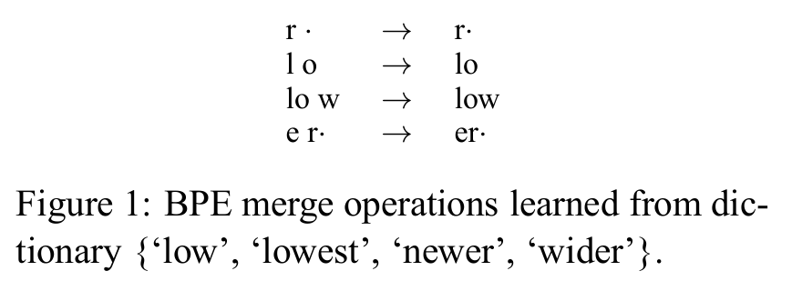
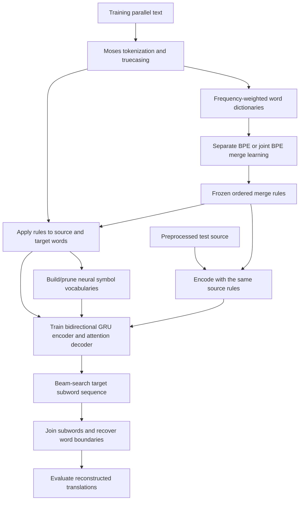
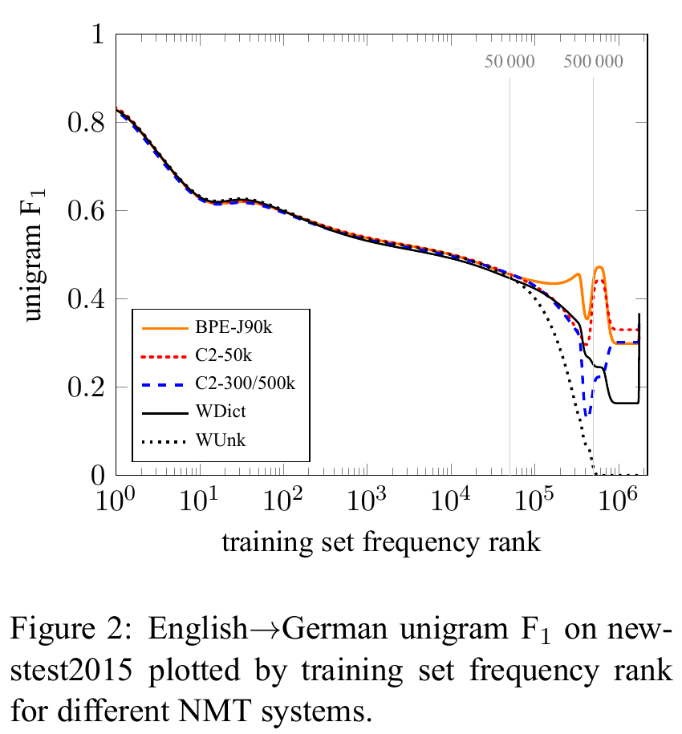
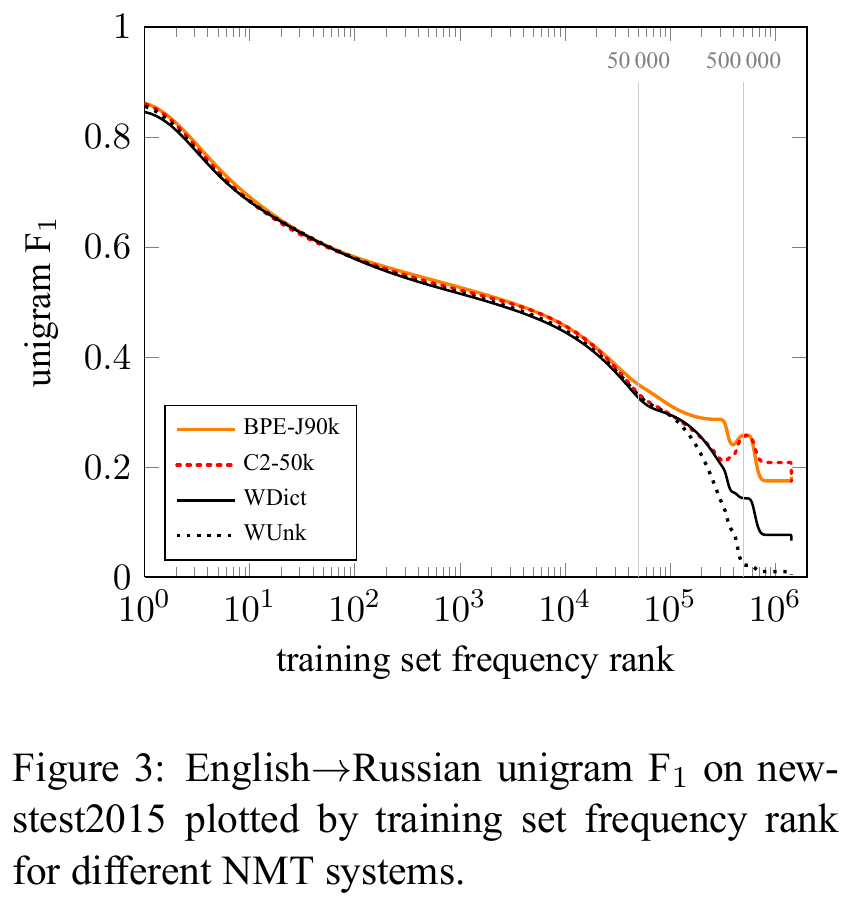

# BPE for open-vocabulary translation - Sennrich et al., 2015

> **arXiv:** [1508.07909v5](https://arxiv.org/abs/1508.07909v5), 10 June 2016
> (first submission: 31 August 2015); **Venue:** ACL 2016, long papers, pp. 1715-1725
> **Affiliation:** School of Informatics, University of Edinburgh
> **Title:** *Neural Machine Translation of Rare Words with Subword Units*
> **Authors:** Rico Sennrich, Barry Haddow, Alexandra Birch
> **Version note:** the filename uses the first arXiv year; the published citation uses 2016.

## TL;DR

The paper replaces fixed whole-word translation vocabularies with a fixed inventory
of reusable, variable-length **subword units**, allowing a neural model to translate
and generate words never seen as whole words during training.
It adapts byte pair encoding by repeatedly merging frequent adjacent **characters
or character sequences**, not raw bytes, and learns either separate or joint
source/target segmentations.
On WMT 2015, the best subword ensembles improve over dictionary back-off by
**1.1 BLEU for English-German** and **1.3 BLEU for English-Russian**; the German
BLEU winner is character bigrams, while joint BPE leads the neural systems on
chrF3 and several rare-word measures (Tables 2-3).
The central contribution is practical open-vocabulary neural translation, not a
claim that BPE finds linguistic morphemes, handles every unseen character, or
dominates every metric.

## Problem & motivation

### Translation has an open vocabulary; a neural output layer does not

Early neural machine translation commonly restricted its vocabulary to roughly
**30000-50000 words** (Section 1). A word outside the model's vocabulary is usually
represented by a single unknown symbol, losing its spelling and internal structure.
Increasing the vocabulary reduces this problem but enlarges embeddings and the
output classifier, and it still cannot enumerate every possible name, compound,
inflection, or technical term.

Dictionary back-off partially repairs a word-level model: identify the unknown
source word, consult a bilingual lexicon, or copy it into the output.
However, there need not be a one-to-one correspondence between source and target
words. An English phrase can become one German compound, and an unseen English
name may require Russian transliteration rather than copying.
The desired behavior is to learn these transformations **inside the translation
network**, not only after an unknown-word placeholder has already been generated.

The paper distinguishes two concepts that remain important throughout its results:

- **UNK:** a word or symbol outside the model's usable vocabulary.
- **OOV:** a whole word absent from the training text.

An OOV word can still be representable by known subword units.
Conversely, an observed training word can be outside a pruned whole-word vocabulary.
These categories must not be conflated when interpreting rare-word performance.

### Why smaller units can carry transferable knowledge

Section 3 identifies three useful forms of partial transparency.
Names can often be copied or transliterated character by character or in short
chunks. Cognates and loanwords can share regular spelling transformations.
Morphologically complex words can combine familiar pieces even when the complete
word has never appeared before.

The authors inspect **100 rare German training tokens**, outside the top **50000**
types, and identify the following potentially transparent categories (Section 3):

| Category | Tokens in the inspected sample |
|---|---:|
| Compounds | 56 |
| Names | 21 |
| Loanwords with a common origin | 6 |
| Transparent affixation | 5 |
| Numbers | 1 |
| Computer-language identifiers | 1 |

These listed categories account for **90 of the 100** inspected tokens.
This is a small qualitative motivation sample, not a corpus-wide estimate that
90% of all rare words are transparently translatable.
Moreover, a useful subword representation need not coincide exactly with a
morphological analysis: the network may learn from an oversplit or linguistically
imperfect segmentation.

### Neither whole words nor individual characters are an obvious optimum

Whole words provide short sequences but sparse observations for rare types.
Characters provide a small vocabulary but much longer sequences, more recurrent
steps, and potentially awkward alignment units.
The method seeks a middle ground: frequent words or character combinations become
compact units, while rare words remain decomposable.

This changes where the model can attend. Rather than first compressing an entire
compound into one fixed-length word vector, the encoder exposes several annotation
positions. The decoder can attend to different pieces while translating the word
or compound (Sections 2 and 3.1).

## Key idea

### Learn reusable symbol combinations from frequency, not a dictionary of words

Let $\mathcal{D}$ be the training word-type dictionary and $f(w)$ the frequency
of word $w$. Initially represent a word by its characters followed by a dedicated
end-of-word marker:

$$
S_0(w)=[c_1,\ldots,c_{|w|},\mathrm{EOW}].
$$

Here $c_i$ is character $i$ and $S_t(w)$ is the current symbol sequence after
$t$ merge operations. The paper's prose and Figure 1 use a dot for the word-final
marker; Algorithm 1 writes it as `</w>`.
This marker distinguishes word endings and makes it possible to recover the
preprocessed word boundaries after translation. It is not a sentence-end token.

Count every adjacent pair using word **token frequencies**, not merely the number
of word types containing it:

$$
C_t(a,b)=
\sum_{w\in\mathcal{D}} f(w)
\sum_{i=1}^{|S_t(w)|-1}
\mathbf{1}\!\left[S_t(w)_i=a
\;\land\;S_t(w)_{i+1}=b\right].
$$

Choose a highest-frequency pair and replace its occurrences:

$$
(a_t,b_t)\in\operatorname*{arg\,max}_{a,b} C_t(a,b),
\qquad
S_{t+1}(w)=\operatorname{merge}_{a_t,b_t}(S_t(w)).
$$

$a$ and $b$ are current symbols, which can already contain several characters.
$\mathbf{1}$ is the indicator function, and `merge` replaces adjacent
non-overlapping occurrences by the concatenated symbol $ab$.
These equations reconstruct Section 3.2 and Algorithm 1; BPE does not optimize
a neural translation loss during this vocabulary-learning phase.

Starting with the character inventory and word-boundary marker, every merge
introduces a composite symbol. The paper characterizes the constructed symbol
inventory as the initial inventory plus the number of merges:

$$
|V_{\mathrm{constructed}}|=|V_0|+M.
$$

$V_0$ is the initial symbol inventory and $M$ the merge-operation budget in this
description. This is distinct from the symbols that remain observable in the
fully segmented training text and from the **pruned neural vocabulary**.
Those latter inventories need not have the same size.

### A fixed token inventory can represent an unbounded set of words

The neural model still predicts from a finite set of symbols at each step.
But sequences of those symbols can spell previously unseen words, just as
sequences of characters can spell a new name.
Frequent substrings share observations across many words, reducing the sparsity of
whole-word representations.

This is an **open-vocabulary representation subject to base-symbol coverage**.
It is not proof that the model will translate every representable word correctly,
and it does not imply coverage of characters absent from training.

## How it works

### 1. Prepare a frequency-weighted word dictionary

The original pipeline first tokenizes and truecases text with Moses.
BPE operates **within those pre-tokenized words** and never counts pairs crossing
a word boundary.
Therefore, the learner can process a dictionary of unique word types weighted by
their frequencies rather than repeatedly scanning every token in every sentence.

The important data structures are:

- A mapping from each word's current symbol sequence to its token frequency.
- A count of adjacent symbol pairs over that weighted mapping.
- An ordered list of learned merge operations.
- A symbol-to-ID vocabulary for the translation network after segmentation.

The operation list and the network vocabulary serve different purposes.
The former defines the tokenizer's segmentation priorities; the latter defines
which resulting symbols have embeddings and output-classifier entries.
Keeping only an unordered list of substring spellings does not fully specify the
BPE encoder.

### 2. Learn merges greedily

A direct implementation of the paper's procedure is:

```text
Input: word frequencies and a merge budget M
Initialize each word as characters followed by EOW
Initialize the ordered merge list as empty

Repeat up to M times:
    Count all adjacent pairs, weighting each word by its frequency
    Stop if no adjacent pair remains
    Select a most frequent pair using a recorded tie-breaking policy
    Append that pair to the merge list
    Replace non-overlapping occurrences within every word, left to right

Return the ordered merge list and resulting segmented dictionary
```

The stop condition makes this pseudocode usable on small toy corpora; Algorithm 1
assumes its requested iterations have a pair to merge.
A production implementation can index pair occurrences and update only affected
counts. The paper explicitly describes incremental updates as its efficiency
improvement over the minimal full-recount implementation.

Tie handling matters for reproducibility. Algorithm 1 uses `max` over pair counts
but does not specify a portable tie-breaking convention. Equal-frequency choices
can yield different merge lists without changing the basic method.
Also, pair counting includes overlapping adjacent occurrences, whereas replacement
is non-overlapping. For example, `a a a a` has three adjacent `(a,a)` occurrences
but one replacement pass yields `aa aa`, not three independent replacements.
BPE is a greedy frequency heuristic, not a globally optimal compression algorithm.

### 3. Keep the paper's two toy examples separate

Algorithm 1 uses this weighted dictionary:

| Training word | Frequency |
|---|---:|
| `low` | 5 |
| `lower` | 2 |
| `newest` | 6 |
| `widest` | 3 |

Initially, `(e,s)`, `(s,t)`, and `(t,EOW)` each have weighted count **9**, while
`(l,o)` and `(o,w)` each have count **7**.
These are calculated from Algorithm 1's supplied frequencies.
They demonstrate both frequency weighting and why one should not claim a unique
first merge without a tie policy.

Figure 1 uses a **different** dictionary:
`low`, `lowest`, `newer`, and `wider`.
It illustrates the operations that form `r<EOW>`, `lo`, `low`, and `er<EOW>`.
For that example, the previously unseen word `lower` becomes:

```text
Characters:          l o w e r <EOW>
After r + EOW:       l o w e r<EOW>
After l + o:         lo w e r<EOW>
After lo + w:        low e r<EOW>
After e + r<EOW>:    low er<EOW>
```

Thus `lower` is unseen as a whole word in **Figure 1's** dictionary, but can be
represented by familiar units. It is not unseen in Algorithm 1's dictionary.



*Figure 1, extracted from PDF page 4 of the versioned report. Its dot denotes
word-final status, and the four operations support the `lower` example above.
This method diagram is independent of Algorithm 1's frequency-weighted example.*

### 4. Apply the learned ordering without relearning on test text

At inference time, split a word into base characters and its word-final marker,
then apply the learned merge priorities to create known larger symbols.
Do not recount frequencies on the development or test set: that would change the
tokenizer from the one used to train the neural model.

The merge ordering matters; BPE encoding is not arbitrary substring matching,
and it should not be replaced by an unordered longest-substring vocabulary lookup.
Finally map the symbols to neural token IDs.
After decoding, concatenate the pieces within a word and restore word boundaries
from the marker convention.
This restores the **preprocessed tokenization**, not necessarily the exact
capitalization and whitespace of the original raw input before Moses truecasing.

### 5. Separate BPE versus joint BPE

**Separate BPE** learns one merge list from the source language and another from
the target language. Each inventory is closely matched to the language in which
it is used, with more compact language-specific text/vocabulary representations.
However, the same name can receive different source and target segmentations,
making copying or transliteration harder to learn.

**Joint BPE** learns on the concatenation of both sides of the training corpus.
This increases segmentation consistency for shared strings, especially names.
It does not require word alignments to learn the merges and does not automatically
tie the source and target neural embedding matrices.
It also creates a coverage complication: a unit can exist only on one language's
side, so being in the joint merge inventory does not guarantee a trained embedding
for that unit on both sides.

For English-Russian, the authors first transliterate the Russian vocabulary into
Latin characters using **ISO-9**, learn a joint encoding, and transliterate the
merge operations back into Cyrillic to segment Russian text.
Because the Russian corpus also contains Latin-script words, they apply the Latin
operations too (Section 3.2, footnote 5).
This is a tokenizer-learning device; it is not a rule-based transliteration module
that replaces the neural model's learned translation.

### 6. Handle symbol coverage explicitly

Section 3.2, footnote 3 identifies two ways a symbol can be unknown:
an unseen base character, or a composite whose training occurrences were all
absorbed into larger units.
For the second case, the authors suggest recursively reversing merges until
the remaining pieces are known; they report not observing that particular issue
at test time.

Joint BPE additionally can emit units seen only in the other language.
Section 4.1, footnote 10 says these occur in **0.05% of test tokens** in its
discussed setting, and Table 1 reports **32 unknown German development tokens**
for joint BPE.
The neural vocabulary also excludes infrequent/noisy units.
Accordingly, the paper's open-vocabulary claim should not be read as an
unconditional zero-UNK guarantee for every deployed vocabulary.

The [official implementation's later best-practice recipe][code] supports
language-specific vocabulary filtering and recursive splitting, and its current
README also documents byte-level and dropout extensions.
Those are useful follow-ups, not proof that every modern option was used in the
2015/2016 experiment. In particular, this paper's base units are **characters**:
the word "byte" in BPE's inherited name does not make it a byte tokenizer.

### 7. Connect the symbols to the actual recurrent translation model

The experiment uses the attention-based encoder-decoder architecture summarized
in Section 2, following [Bahdanau et al.][bahdanau].
It is a **bidirectional GRU encoder and recurrent decoder**, not a Transformer.
The contribution is the representation supplied to that model, rather than a new
attention architecture.

For source length $T_s$ and embedding width $d_e$, source embeddings have shape
$T_s\times d_e$. If each encoder direction has hidden width $d_h$, concatenated
annotations have shape $T_s\times 2d_h$:

$$
h_j=[\overrightarrow{h}_j;\overleftarrow{h}_j],
\qquad
c_i=\sum_{j=1}^{T_s}\alpha_{ij}h_j.
$$

$h_j$ is the annotation at source subword position $j$, $c_i$ is the decoder's
context at target step $i$, and $\alpha_{ij}$ is a normalized alignment weight.
The paper describes a jointly trained single-layer feedforward alignment model.
A standard additive-attention reconstruction is:

$$
e_{ij}=v_a^\top\tanh(W_a s_{i-1}+U_a h_j),
\qquad
\alpha_{ij}=\frac{\exp(e_{ij})}
{\sum_{k=1}^{T_s}\exp(e_{ik})}.
$$

Here $s_{i-1}\in\mathbb{R}^{d_s}$ is the prior decoder state,
$W_a\in\mathbb{R}^{d_a\times d_s}$,
$U_a\in\mathbb{R}^{d_a\times 2d_h}$, and
$v_a\in\mathbb{R}^{d_a}$.
$d_s$ is decoder width and $d_a$ alignment-network width.
These equations explain the cited architecture rather than supplying newly
reported matrix dimensions for every layer of the experiment.

The decoder predicts the next target **subword** using its recurrent state,
previous target symbol, and context. It can produce several subwords for one word,
or align pieces of a source compound to a target phrase.
The reported embedding-layer size is **620** and hidden-layer size **1000**
(Section 4); the segmentation itself is discrete preprocessing, not jointly
differentiated through these recurrent layers.



*Original data-flow reconstruction. The merge learner sees training text, while
the translation model learns from paired segmented sentences.
Joint merge learning does not itself perform neural translation or establish
shared neural parameters.*

### 8. Understand the vocabulary/sequence-length trade-off

Embedding storage scales with vocabulary size times embedding width.
The recurrent network must process every subword position, and attention considers
source positions at each target step.
Therefore, reducing vocabulary size can lower lexical sparsity and classifier
costs while increasing sequence-processing and alignment work.

More merges generally produce larger units and shorter sequences; fewer merges
produce a smaller, more reusable inventory and longer sequences.
The optimal point depends on language, corpus size, and translation task.
Unlike the character-bigram baseline's manually protected frequent-word shortlist,
BPE can learn complete frequent words through merges without a separate
segmentation shortlist.
This does not imply that the experimental neural implementation has no
computational shortlist; those settings are distinguished below.

## Training / data

### Parallel data and preprocessing

Section 4 uses the WMT 2015 shared-task data:

| Direction | Training sentence pairs | Approximate tokens stated in the paper |
|---|---:|---:|
| English-German | 4.2 million | 100 million |
| English-Russian | 2.6 million | 50 million |

Both directions use Moses tokenization/truecasing, **newstest2013** for development,
and **newstest2014/newstest2015** for evaluation.
The detailed numerical result tables in this recap concern **newstest2015**, as
do Tables 2-3 of the report; no missing 2014 results are reconstructed.
BPE is learned from training-side word frequencies. Joint BPE pools both training
sides but does not use a test translation as an inference-time segmentation aid.

### Two separate optimization problems

The tokenizer uses frequency-weighted greedy merges, not stochastic gradient
descent. The neural model is subsequently trained on the resulting symbol
sequences.
A standard teacher-forced maximum-likelihood formulation of that second phase is:

$$
\mathcal{L}_{\mathrm{NMT}}(\theta)=
-\sum_{(x,y)\in\mathcal{P}}\sum_{i=1}^{|y|}
\log p_\theta(y_i\mid y_{<i},x).
$$

$\mathcal{P}$ is the parallel training corpus after segmentation, $x$ the source
subword sequence, $y$ the target sequence, and $\theta$ the recurrent translation
model's parameters. This is an explanatory formulation of the usual NMT objective,
not a new loss claimed by the BPE paper.
The merge list is fixed during this neural training.

### Reported neural training recipe

| Setting | Reported value or procedure |
|---|---|
| Implementation | Groundhog attention-based NMT. |
| Embedding-layer size | 620. |
| Hidden-layer size | 1000. |
| Optimizer | Adadelta. |
| Minibatch | 80 sentence pairs; reshuffle between epochs. |
| Initial training duration | Approximately seven days per run. |
| Saved checkpoints | Every 12 hours; retain the final four. |
| Continued training | Each retained checkpoint is trained for another 12 hours with embeddings fixed. |
| Independent initial runs | Two per configuration, with gradient-clipping cutoffs 5.0 and 1.0. |
| Single-system selection | Best of eight resulting models on newstest2013. |
| Ensemble | All eight resulting models. |
| Dropout | Not used; Section 4.2 contrasts this with a stronger external system using dropout. |
| In-memory neural shortlist | $\tau=30000$, following the cited large-vocabulary method. |
| Beam search | Beam size 12; probabilities normalized by sentence length. |
| Candidate filtering | Fast-align bilingual dictionary, $K=30000$ and $K'=10$. |

The eight ensemble members arise from **two initial runs times four continued
checkpoints**, not eight fully independent initializations.
Single-system scores are development-selected, not averages over seeds.
The paper reports development variation of up to **one BLEU** across models,
which limits the interpretation of small differences.

The dictionary is an **unknown-word back-off mechanism** for WDict, but it is also
used for candidate-softmax filtering across the experiments.
Thus "subword systems operate without a back-off dictionary" does not mean no
dictionary is involved anywhere in their decoding implementation.
Similarly, the $\tau=30000$ computational shortlist is not C2-50k's segmentation
rule that leaves its top **50000 word types** unsplit.

The source does not specify a complete hardware/accelerator budget, exact parameter
count, all Adadelta settings, or a fully frozen reproducibility manifest.
Seven days is the reported training duration, not a hardware-independent cost.

### Merge counts and neural vocabularies

Section 4.1 reports **59500 merge operations** for separate BPE and **89500**
for joint BPE. It excludes infrequent/noisy symbols from the neural vocabulary.
The model labels are therefore not interchangeable with either the merge count
or the observed German-only type count in Table 1.

The following neural vocabulary sizes are from **Tables 2-3**, not inferred from
those labels:

| Model | German experiment: source | German experiment: target | Russian experiment: source | Russian experiment: target |
|---|---:|---:|---:|---:|
| WUnk | 300000 | 500000 | 300000 | 500000 |
| WDict | 300000 | 500000 | 300000 | 500000 |
| C2-50k | 60000 | 60000 | 60000 | 60000 |
| BPE-60k | 60000 | 60000 | 60000 | 60000 |
| BPE-J90k | 90000 | 90000 | 90000 | 100000 |

In particular, **BPE-J90k has a 100000-symbol target vocabulary in the Russian
experiment**. Calling every inventory "90K because of the model name" would
misreport the source.

## Results

### 1. Corpus statistics: much smaller vocabularies without character-length sequences

All values below reproduce **Table 1**, which measures the German training corpus
and unknown tokens in **newstest2013**. Token totals are rounded millions.
They are not neural-network parameter counts.

| Segmentation | Training tokens, millions | Observed types | Development UNK tokens |
|---|---:|---:|---:|
| None | 100 | 1750000 | 1079 |
| Characters | 550 | 3000 | 0 |
| Character bigrams | 306 | 20000 | 34 |
| Character trigrams | 214 | 120000 | 59 |
| Frequency-based compound splitting | 102 | 1100000 | 643 |
| Morfessor | 109 | 544000 | 237 |
| Hyphenation | 186 | 404000 | 230 |
| BPE | 112 | 63000 | 0 |
| Joint BPE | 111 | 82000 | 32 |
| Character bigrams, 50000-word shortlist | 129 | 69000 | 34 |

Separate BPE increases the token count from about 100M to 112M, roughly **12%**,
while reducing observed types from 1.75M to about 63K, approximately **28-fold**.
Characters instead produce about **5.5 times** the original token count.
These are arithmetic interpretations of the rounded corpus counts, not measured
training-time or memory speedups.

Morfessor, compound splitting, and hyphenation reduce sparsity to some extent but
leave many unknowns. Fixed character bigrams/trigrams also can encounter unseen
combinations even when their component characters exist.
The joint-BPE development unknowns illustrate why "open vocabulary" and "zero
unknown symbols after pruning" are different claims.

### 2. Evaluation protocol and definitions

The paper evaluates reconstructed translations with:

- **BLEU**, using `mteval-v13a.pl`, rather than a modern unstated SacreBLEU
  configuration.
- **chrF3**, a character n-gram $F_3$ score that places more weight on recall than
  the corresponding $F_1$ score.
- **Unigram $F_1$**, the harmonic mean of clipped unigram precision and recall,
  reported for all words, rare words, and OOVs.

For matched clipped unigram count $m$, candidate count $N_c$, and reference count
$N_r$, the familiar reconstruction is:

$$
P=\frac{m}{N_c},\qquad R=\frac{m}{N_r},
\qquad F_1=\frac{2PR}{P+R}.
$$

Use zero for the F1 score when there are no matches and the harmonic-mean
denominator vanishes; the source's WUnk OOV scores are zero.

For character n-gram precision $P_{\mathrm{chr}}$ and recall $R_{\mathrm{chr}}$,
the $F_\beta$ combination underlying chrF3 uses $\beta=3$:

$$
F_3=
\frac{(1+3^2)P_{\mathrm{chr}}R_{\mathrm{chr}}}
{3^2P_{\mathrm{chr}}+R_{\mathrm{chr}}}.
$$

These equations explain the metrics named in Section 4.
The character n-gram extraction and aggregation must follow the original metric
implementation to reproduce the reported scores; this formula alone is not its
complete configuration.

Rare-word tables use the paper's **top-50000 training-type cutoff**; OOV words
are absent from training text. Preserve the authors' reported subsets and
denominators rather than pooling them as independent measurements.
The unigram $F_1$ columns are **ensemble results**, even when the same row also
contains single-model BLEU and chrF3.

### 3. English-German: all reported translation scores

Every value below is from **Table 2, newstest2015**.
`ens-8` means the eight-model ensemble described above.
The syntax-based SMT comparator is external to the neural configurations;
its missing ensemble cells are left as reported.

| System | BLEU single | BLEU ens-8 | chrF3 single | chrF3 ens-8 | F1 all | F1 rare | F1 OOV |
|---|---:|---:|---:|---:|---:|---:|---:|
| Syntax-based SMT | 24.4 | - | 55.3 | - | 59.1 | 46.0 | 37.7 |
| WUnk | 20.6 | 22.8 | 47.2 | 48.9 | 56.7 | 20.4 | 0.0 |
| WDict | 22.0 | 24.2 | 50.5 | 52.4 | 58.1 | 36.8 | 36.8 |
| C2-50k | 22.8 | 25.3 | 51.9 | 53.5 | 58.4 | 40.5 | 30.9 |
| BPE-60k | 21.5 | 24.5 | 52.0 | 53.9 | 58.4 | 40.9 | 29.3 |
| BPE-J90k | 22.8 | 24.7 | 51.7 | 54.1 | 58.5 | 41.8 | 33.6 |

Table 2 lists unigram evaluation counts of **44085 all words**, **2900 rare words**,
and **1168 OOVs**. F1 values are percentages.

The strongest neural BLEU ensemble is **C2-50k at 25.3**, an improvement of
**1.1 BLEU** over WDict's 24.2.
Separate BPE improves by **0.3**, and joint BPE by **0.5**, on this metric.
The headline German gain must therefore not be attributed to BPE alone.

Joint BPE does achieve the strongest neural chrF3 ensemble score, **54.1**, and
rare-word F1, **41.8**, versus WDict's **36.8**.
However, WDict's OOV F1 is **36.8**, exceeding all three compact subword systems:
many German OOVs are names for which source copying works well.
The syntax-based SMT comparator also remains better on chrF3 and the three
unigram F1 columns, despite the best neural ensemble's higher BLEU.
These are metric-dependent gains, not universal superiority.

### 4. English-Russian: all reported translation scores

Every value below is from **Table 3, newstest2015**.

| System | BLEU single | BLEU ens-8 | chrF3 single | chrF3 ens-8 | F1 all | F1 rare | F1 OOV |
|---|---:|---:|---:|---:|---:|---:|---:|
| Phrase-based SMT | 24.3 | - | 53.8 | - | 56.0 | 31.3 | 16.5 |
| WUnk | 18.8 | 22.4 | 46.5 | 49.9 | 54.2 | 25.2 | 0.0 |
| WDict | 19.1 | 22.8 | 47.5 | 51.0 | 54.8 | 26.5 | 6.6 |
| C2-50k | 20.9 | 24.1 | 49.0 | 51.6 | 55.2 | 27.8 | 17.4 |
| BPE-60k | 20.5 | 23.6 | 49.8 | 52.7 | 55.3 | 29.7 | 15.6 |
| BPE-J90k | 20.4 | 24.1 | 49.7 | 53.0 | 55.8 | 29.7 | 18.3 |

Table 3 lists **55654 all words**, **5442 rare words**, and **851 OOVs**.

Joint BPE and C2-50k tie at **24.1 ensemble BLEU**, **1.3** above WDict.
Joint BPE leads the neural ensembles on chrF3 (**53.0**), overall F1 (**55.8**),
and OOV F1 (**18.3**); its rare-word F1 of **29.7** ties separate BPE.
Its chrF3 gain over WDict is **2.0 points**.
The external phrase-based system still has higher BLEU (**24.3**) and chrF3
(**53.8**), so the paper narrows that gap rather than closing it on every measure.

The OOV result differs sharply from German: simply copying Latin-script names
does not usually produce valid Russian transliterations.
Subword systems can learn these spelling transformations and improve over WDict's
**6.6 OOV F1**.

### 5. Frequency-rank curves explain more than an aggregate score

Section 5.1 sorts target words by training frequency, bins words sharing a
frequency, and applies **Bezier smoothing** to the curves.
Thus the curves are not raw per-word measurements, and visual coordinates should
not be promoted into exact tabulated scores.



*Original Figure 2, PDF page 8. The large-vocabulary character-bigram model is
labelled C2-300/500k in the plot and abbreviated C2-3/500k in the prose.
Its improvement after the 500000-rank boundary exposes the difference between
sparse whole-word entries and shared subword representations.*

For frequent words, the systems have similar unigram accuracy.
Between ranks **50000 and 500000**, keeping rare words as whole-word units degrades
accuracy; switching to shared subwords stabilizes it.
In the German training corpus these ranks correspond to frequencies of about
**60** and **2**, respectively (Section 5.1).
The improvement is therefore not merely an unknown-word repair: even words
represented by a valid whole-word vocabulary entry can be too sparse to learn well.

The German WDict curve recovers for OOV names through copying.
Compact subword models may generate more new words, but higher generation recall
does not guarantee correct spelling or translation.



*Original Figure 3, PDF page 8; this figure is specifically noted as new in arXiv
v5. With different source and target scripts, WDict's OOV copying is much weaker,
making the subword advantage more visible.*

### 6. OOV precision and recall reveal the trade-off

All figures below come from **Section 5.1**, rather than estimates read off the
plots. They are percentages.

| Direction | System | OOV precision | OOV recall |
|---|---|---:|---:|
| English-German | WDict | 60.6 | 26.5 |
| English-German | C2-50k | 29.1 | 33.0 |
| English-German | BPE-60k | 32.4 | 26.6 |
| English-German | BPE-J90k | 38.6 | 29.8 |
| English-Russian | WDict | 9.2 | 5.2 |
| English-Russian | BPE-J90k | 21.9 | 15.6 |

German dictionary copying is conservative and precise, while the compact subword
models can produce more forms at the cost of mistakes.
Joint segmentation improves both precision and recall over separate BPE in that
comparison, but still does not exceed the dictionary's German OOV F1.
In Russian, joint BPE improves both measures over the much weaker copying strategy.

### 7. Manual examples show both composition and failure

**Compound translation, Table 4.** The source phrase *health research institutes*
has the reference `Gesundheitsforschungsinstitute`.
WDict outputs `Forschungsinstitute`, dropping the health component.
BPE-J90k outputs `Gesundheits|forsch|ungsin|stitute`; separate BPE produces
`Gesundheits|forsch|ungsinstitu|ten`.
The vertical bars indicate subword boundaries, not spaces in the final translation.
Both demonstrate learned composition without requiring a linguistically perfect
segmentation of the compound.

**An opaque failure, Table 4.** *Asinine situation* should become `dumme Situation`.
The subword systems instead produce spelling-driven forms such as
`As|in|in-|Situation`, and WDict copies the English phrase.
Knowing how to represent a word's characters does not teach its non-compositional
meaning or make the correct translation appear in training.

**Name alignment, Table 5.** For `Mirzayeva`, separate BPE segments the source as
`Mirz|ayeva`, while its Russian output segments as `Мир|за|ева`.
Joint BPE uses `Mir|za|yeva` on the source, a more compatible division.
Both examples translate correctly, so segmentation inconsistency is a risk factor,
not an automatic failure.

**Spurious transliteration, Table 5.** For `rakfisk`, the reference is
`ракфиска` (`rakfiska`). Separate BPE outputs `пра|ф|иск` (`pra|f|isk`),
inserting a Russian `п` and losing a `к`.
Joint BPE produces `рак|ф|иска` (`rak|f|iska`).
The authors trace the error to inconsistent training segmentations that teach
an incorrect partial mapping. This is the concrete motivation for joint
segmentation, rather than simply enlarging the vocabulary.

## Limitations & follow-ups

### What this paper does not solve

- **Base-character and neural-vocabulary coverage remain conditional.**
  Unknown characters, language-specific joint units, and pruning can still produce
  unknown symbols. The representation's capacity to spell new words must be
  distinguished from the exact vocabulary exposed to a deployed model.
- **BPE is not morphological analysis.** It merges high-frequency pairs, including
  pieces that cross morpheme boundaries. The experiments show robustness to some
  oversplitting, not that every segmentation is independently translatable.
- **Representation does not supply missing semantics.** The `asinine` example
  shows plausible-looking but incorrect translation. New-word generation can
  improve recall while reducing precision.
- **Joint segmentation is useful but imperfect.** Cross-language consistency
  helps copying/transliteration, while script differences require an additional
  transliteration-based learning procedure here. Shared rules do not guarantee
  symmetric training coverage or tied neural embeddings.
- **Vocabulary size is not optimized automatically.** Section 6 describes its
  choices as somewhat arbitrary and motivated by comparison with prior work.
  Better task- and language-dependent vocabulary selection is left for follow-up.
- **Evidence is limited to the reported translation setting.** The paper studies
  two directions with a recurrent attention model, substantial parallel data,
  selected checkpoints, and eight-model ensembles. Its BLEU gains are not a
  controlled universal result for later Transformer language models.
- **Tokenization assumes preprocessed word boundaries.** The original method
  depends on Moses tokenization/truecasing and intra-word merging. It is not a
  raw-text whitespace-preserving or universal byte-fallback tokenizer.
- **Reproducibility requires more than a merge count.** Record normalization,
  marker conventions, tie handling, language pooling/transliteration, pruning,
  the frozen operation list, neural settings, and metric scripts.
  Later `subword-nmt` conventions and extensions are not automatically equivalent
  to the paper's Algorithm 1.

### Which sources to read next

[SentencePiece][sentencepiece] addresses a different interface problem: training
and using subword models directly on raw sentences rather than requiring the
original word-pretokenization stage.
[Subword Regularization][unigram] uses a probabilistic unigram segmentation model
and samples alternatives to improve robustness.
[BPE-Dropout][bpe-dropout] retains BPE but randomly skips merges during training,
then returns to ordinary BPE at inference.

The next article in the tokenization sequence,
[Neural Machine Translation with Byte-Level Subwords][byte-subwords], changes the
**base alphabet to bytes**, addressing character-inventory coverage and compactness.
That change should be studied separately from this paper's character-merging
adaptation of Gage's compression method.
For later architecture context, the local
[Transformer review](attention_2017_transformer.md) explains a model that can consume
subword sequences but is not the architecture used in these experiments.

## Links

- **arXiv:** [abstract](https://arxiv.org/abs/1508.07909v5) /
  [HTML](https://arxiv.org/html/1508.07909v5) /
  [PDF](https://arxiv.org/pdf/1508.07909v5).
- **Venue:** [ACL Anthology P16-1162][acl] /
  [published PDF](https://aclanthology.org/P16-1162.pdf) /
  [DOI](https://doi.org/10.18653/v1/P16-1162).
- **Code / project:** [official subword-nmt repository][code].
  Its current README distinguishes the original character BPE from subsequent
  byte-level, vocabulary-filtering, and dropout options.
- **Historical experiment implementation:** [LV_groundhog](https://github.com/sebastien-j/LV_groundhog),
  as named in Section 4, footnote 7.
- **Hugging Face:** no dedicated pretrained checkpoint used as a source for this recap.
- **Blog posts / talks / videos / OpenReview:** no separate source used.
- **Papers with Code:** not used; primary paper, implementation, and venue sources
  provide the provenance.
- **Essential figures:** Figures 1-3 extracted locally from the versioned PDF,
  pages 4 and 8; no smoothed plot coordinates are treated as exact measurements.
- **Related architecture:** [Bahdanau attention-based NMT][bahdanau] /
  [local Transformer recap](attention_2017_transformer.md).
- **Related / successor papers:** [SentencePiece][sentencepiece] /
  [Subword Regularization][unigram] / [BPE-Dropout][bpe-dropout] /
  [byte-level subwords][byte-subwords].

**Published-paper BibTeX** (2016 is the venue year):

```bibtex
@inproceedings{sennrich-etal-2016-neural,
  title = {Neural Machine Translation of Rare Words with Subword Units},
  author = {Sennrich, Rico and Haddow, Barry and Birch, Alexandra},
  booktitle = {Proceedings of the 54th Annual Meeting of the Association
               for Computational Linguistics (Volume 1: Long Papers)},
  month = aug,
  year = {2016},
  address = {Berlin, Germany},
  publisher = {Association for Computational Linguistics},
  url = {https://aclanthology.org/P16-1162/},
  doi = {10.18653/v1/P16-1162},
  pages = {1715--1725}
}
```

[acl]: https://aclanthology.org/P16-1162/
[code]: https://github.com/rsennrich/subword-nmt
[bahdanau]: https://arxiv.org/abs/1409.0473
[sentencepiece]: https://arxiv.org/abs/1808.06226
[unigram]: https://arxiv.org/abs/1804.10959
[bpe-dropout]: https://arxiv.org/abs/1910.13267
[byte-subwords]: https://arxiv.org/abs/1909.03341
