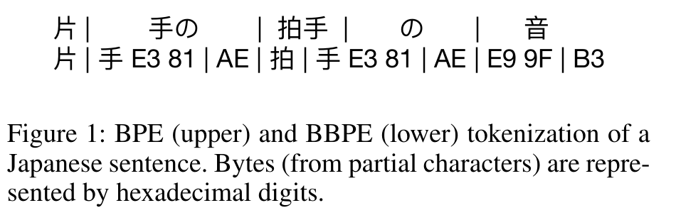
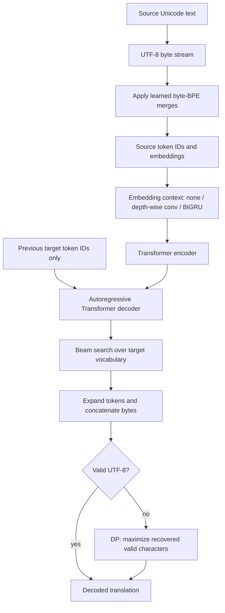
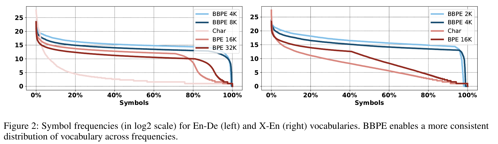
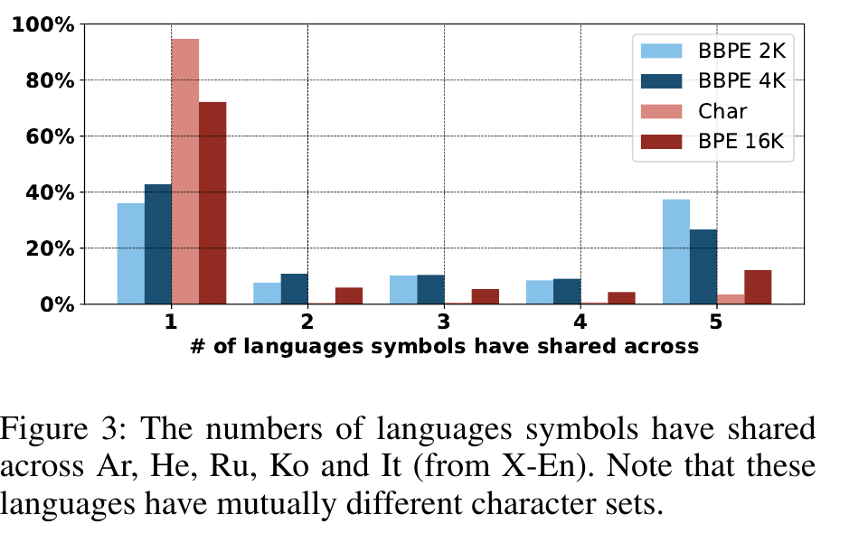
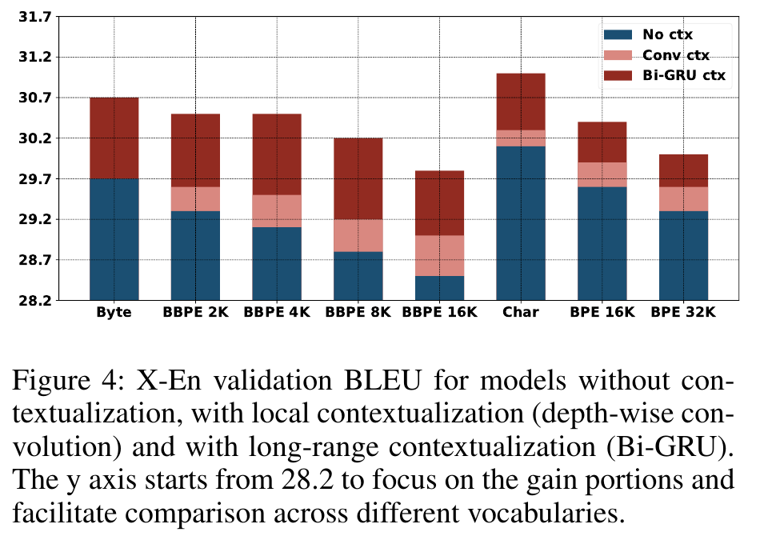

# Byte-level subwords for translation - Wang et al., 2019

> **Paper:** Neural Machine Translation with Byte-Level Subwords
>
> **Authors:** Changhan Wang, Kyunghyun Cho, Jiatao Gu
>
> **arXiv:** [1909.03341v2][paper] (5 December 2019; first submitted 7 September 2019)
>
> **Venue:** AAAI 2020, 34(05), pp. 9154-9160
>
> **Affiliations:** Facebook AI Research; Cho also New York University and CIFAR Global Scholar
>
> **Scope:** The version-2 paper. Later byte-based language models are related work, not results of this study.

## TL;DR

The paper learns BPE merges over **UTF-8 bytes rather than Unicode characters**,
allowing a small, language-independent base alphabet to represent rare characters
and previously unseen scripts without adding vocabulary entries. Its byte-level
subwords, abbreviated **BBPE**, trade the long sequences of pure bytes for a few
thousand learned byte n-grams, and contextualize their embeddings with a
convolution or bidirectional GRU. Translation quality is competitive with larger
character-based BPE vocabularies, but not uniformly better: pure byte and character
models achieve the highest aggregate multilingual BLEU, while BBPE offers shorter
sequences; transfer to an unseen script still requires adaptation.

## Problem & motivation

### A character vocabulary is not a universal alphabet

[Original translation BPE][original-bpe] starts with characters and learns common
adjacent combinations. It can represent unfamiliar words assembled from known
characters, but that is different from representing an unfamiliar **character**.
Large or noisy character inventories consume vocabulary slots before useful
multi-character units can be learned. This is especially relevant to Japanese,
multilingual corpora, and rare characters introduced by noise.

Increasing the character-based vocabulary can improve coverage but also increases
embedding and output-classification costs. Sharing vocabulary entries across
languages with different writing systems is limited: even related translation
patterns need not share any characters.

### Bytes solve coverage but create a sequence-length problem

UTF-8 encodes one Unicode scalar value in one to four bytes. A fixed alphabet of
256 byte values therefore suffices to represent valid Unicode text, irrespective
of which scripts appeared during tokenizer training. It does **not** make the
resulting translation model understand an unseen language.

Pure bytes can expand a character sequence by as much as fourfold before any
merging. Longer source sequences enlarge attention computations; longer target
sequences require more autoregressive prediction steps. The paper's central
question is whether learned byte n-grams can preserve byte coverage while
recovering useful sequence compression.

**UTF-8 precision note.** The paper says that 248 of the 256 byte values occur in
UTF-8. Under modern strict UTF-8, [RFC 3629, Sections 3-4][utf8] excludes `C0`,
`C1`, and `F5` through `FF`: the union of byte values that can occur is actually
243. Keeping all 256 base byte symbols remains a straightforward complete
alphabet; neither count makes every arbitrary byte sequence valid UTF-8.
Here, "character" in byte-decoding equations means a Unicode scalar value, not
necessarily a user-perceived grapheme cluster.

## Key idea

### Change the primitive symbols, not the translation task

Let a text string be $s$, its UTF-8 bytes be $b_{1:m}$, and the learned byte
vocabulary be $V$. Each vocabulary item $v$ expands to a nonempty byte string
$e(v)$. Tokenization produces $z_{1:L}$ such that

$$
b_{1:m}=\operatorname{UTF8}(s)
       =e(z_1)\Vert e(z_2)\Vert\cdots\Vert e(z_L),
\qquad z_i\in V.
$$

Here $\Vert$ is byte concatenation, $m$ is the byte length, and $L$ is the
tokenized sequence length. This equation describes lossless representation;
normalization or other preprocessing must be accounted for separately.

Unlike character BPE, a BBPE token need not end at a character boundary. It can
contain a fraction of one multibyte character, several complete characters, or
a mixture of complete and partial characters. The same byte pattern can occur
inside distinct characters and across writing systems, giving the model more
opportunities to reuse vocabulary parameters.



*Original Figure 1, extracted from the versioned PDF. Vertical bars mark token
boundaries; hexadecimal strings display partial-character bytes. The lower
segmentation can cut through a UTF-8 character, whereas the upper one cannot.
An individual lower-row token must not be decoded independently as text.*

### Context is particularly important for partial characters

A partial-character token has less intrinsic linguistic meaning than a whole
character. The authors therefore contextualize token embeddings before the
Transformer:

$$
X_{\mathrm{ctx}}=
\operatorname{DepthWiseConv}(X_{\mathrm{emb}})
\quad\text{or}\quad
X_{\mathrm{ctx}}=\operatorname{BiGRU}(X_{\mathrm{emb}}).
$$

These are the paper's two embedding-contextualization equations.
$X_{\mathrm{emb}}$ is the sequence of token embeddings and $X_{\mathrm{ctx}}$
is its contextualized representation. The convolution supplies a local window;
the bidirectional GRU can use a longer span to identify character boundaries
and disambiguate byte fragments. Neither mechanism changes the bytes represented
by the tokens.

The contribution is therefore a **representation/architecture combination**,
not merely swapping a tokenizer file. Comparisons must distinguish the alphabet,
vocabulary size, embedding contextualizer, and Transformer size.

## How it works

### 1. Learn byte-level merges

The paper says that source and target training sentences are combined to learn
joint (B)BPE vocabularies using [SentencePiece][sentencepiece]. At the algorithmic
level, BBPE applies the familiar BPE operation to byte symbols:

1. Encode training text as UTF-8 and initialize sequences with byte symbols.
2. Count adjacent symbol pairs over the training corpus, weighting repeated
   sequences by their occurrences.
3. Select a most frequent pair $(a,b)$ and introduce the symbol $a\Vert b$.
4. Replace its non-overlapping occurrences in the current sequences.
5. Update counts and repeat until the desired vocabulary size is reached.
6. Preserve the learned merge ordering for tokenizing new text. At inference,
   apply the learned rules rather than estimating new pair frequencies from
   the input sentence.

For clarity, the standard BPE pair statistic can be written as

$$
C(a,b)=\sum_{u} n(u)
       \sum_{i=1}^{|u|-1}
       \mathbf{1}[u_i=a\land u_{i+1}=b],
\qquad
(a^\*,b^\*)\in\arg\max_{a,b} C(a,b).
$$

$u$ is a currently segmented training sequence, $n(u)$ is its corpus count,
and $\mathbf{1}$ is the indicator function. This is an explanatory expansion
of ordinary BPE, not an additional equation proposed by this paper. Pair
counting can include overlapping occurrences, while one replacement pass
cannot replace overlapping occurrences simultaneously.

Retaining the required base-byte symbols gives an escape route for arbitrary
valid Unicode input. A frequent character may become one token, while an
unseen character can fall back to several bytes. Vocabulary-size labels such
as `2K` describe the vocabulary, not a separately specified number of merges:
special symbols and the initial alphabet also occupy entries.

**Recipe boundary.** The article does not provide a complete executable
SentencePiece command, byte-to-symbol mapping, normalization configuration,
or all pretokenization/merge constraints. Its Figure 5 displays original spaces
as underscores and uses spaces to separate tokens; that display convention
alone does not specify the training implementation. Reproducing the published
scores requires resolving these details, not substituting a contemporary
SentencePiece `byte_fallback` setting and assuming equivalence.

The authors discuss GPT-2's byte BPE as close prior work but distinguish its
hard-coded merge rules. This paper is not a specification of GPT-2's exact
tokenizer, nor of every tokenizer distributed through tiktoken.

### 2. Embed and contextualize

For a batch of source token IDs $Z\in\mathbb{N}^{B\times L}$ and an embedding
matrix $E\in\mathbb{R}^{|V|\times d}$, lookup gives
$X_{\mathrm{emb}}=E[Z]\in\mathbb{R}^{B\times L\times d}$.
$B$ is batch size, $L$ is the padded source length, and $d$ is embedding width.

The paper compares no contextualization, a **one-layer depth-wise convolution**,
and a **one-layer bidirectional GRU**. The convolution has kernel width 5 and
padding 2 on each side, preserving sequence length. A depth-wise convolution
applies a separate temporal filter to each channel rather than an unrestricted
cross-channel convolution. A BiGRU computes forward and backward recurrent
states along the sequence, so token representations can use both neighboring
fragments and more distant context.

The article does not specify all GRU hidden dimensions, how its directional
states are combined, or any required output projection. A reproduction must
choose compatible dimensions for the Transformer input; those choices should
not be presented as reported hyperparameters.

**Causality boundary.** The source describes contextualizing embeddings
"before feeding them into the model," but does not fully specify the
encoder/decoder wiring. Its explanation emphasizes attention over multiple
source tokens. The safe data-flow reconstruction below places bidirectional
context on the fully available **source** sequence. It must not be interpreted
as an unmasked BiGRU over the full teacher-forced target: that would expose
future target tokens and invalidate autoregressive likelihoods. Exact published
module placement remains an implementation detail not resolved by the article.

In the experimental notation, `+` means BiGRU contextualization:
`Byte+`, `Char+`, `BBPE 2K+`, and `BPE 16K+` all receive it. A BPE row without
`+` is therefore not the closest architecture-matched baseline to BBPE with `+`.

### 3. Translate with a Transformer

The encoder consumes the source representation; the decoder predicts target
tokens autoregressively with encoder-decoder attention. The paper does not
introduce a new attention equation or a new translation objective. See the
[Transformer recap][transformer] for the underlying architecture.



*Authored reconstruction. The source branch illustrates a causally valid
placement of contextualization, not an additional claim about undocumented
module wiring. Vocabulary learning is joint over training source/target text;
test-time encoding uses the frozen vocabulary.*

### 4. Concatenate bytes before decoding text

After generation, expand each predicted token to bytes and concatenate them.
Only then decode the full byte stream as UTF-8. Decoding partial-byte tokens
individually can reject a perfectly valid final string or insert spurious
replacement characters.

For example, the scalar U+3042 has UTF-8 bytes `E3 81 82`. A hypothetical
segmentation `[E3 81] [82]` is lossless after concatenation, even though neither
token is independently valid UTF-8. This is an illustrative byte example, not
a reported tokenization from the experiments.

Vocabulary completeness is an **input representation** guarantee. The decoder
can still emit tokens whose concatenated bytes are malformed, because beam
search is not reported as constrained by a UTF-8 automaton.

### 5. Recover valid characters from malformed output

The authors saw redundant repeated bytes in partially trained models. They
observed no invalid final outputs in the reported experiments, including the
165K-example multilingual test set, but nevertheless describe a recovery
algorithm (per *Decoding with Byte-Level Subwords*).

Given bytes $b_{1:N}$, define $f(k)$ as the maximum number of valid Unicode
characters recoverable from the prefix $b_{1:k}$. The paper's Equation 1,
with explicit boundary conditions, is

$$
f(0)=0,\qquad
f(k)=\max_{1\le t\le\min(4,k)}
\left[f(k-t)+g(k-t+1,k)\right].
$$

Here $N$ is output byte length, $k$ is a prefix endpoint, $t$ is a candidate
block length, and

$$
g(i,j)=
\begin{cases}
1,& b_{i:j}\text{ encodes exactly one valid Unicode scalar value},\\
0,& \text{otherwise}.
\end{cases}
$$

Store the selected predecessor length at every $k$, then backtrack from $N$.
Keep blocks with $g=1$ and discard blocks with $g=0$; reverse the collected
characters to recover their original order. Allowing an invalid one-byte block
ensures that any bad byte can be skipped. The procedure does not join
noncontiguous surviving bytes to manufacture a character.

```text
f[0] = 0
for k = 1 .. N:
    f[k] = -infinity
    for t = 1 .. min(4, k):
        valid = strict_single_utf8_character(bytes[k-t : k])
        candidate = f[k-t] + (1 if valid else 0)
        if candidate > f[k]:
            f[k] = candidate
            previous[k] = (k-t, valid)
backtrack previous from N; retain only valid blocks; reverse retained characters
```

The pseudocode uses zero-based, end-exclusive byte slices; the equation uses
one-based inclusive bounds. At most four constant-sized checks occur per byte,
so time is $O(N)$ and backpointer storage is $O(N)$. A strict validator rejects
overlong encodings, isolated continuation bytes, UTF-16 surrogate values,
truncation, and scalars above U+10FFFF.

**Uniqueness qualification.** UTF-8 makes the parsing of a valid character
unambiguous: its continuation bytes cannot start independent valid characters.
The paper extends this to a claim of unique selections in Equation 1. The
recurrence alone does not ensure unique backpointers for invalid regions:
`FF FF` can be discarded as two one-byte blocks or one two-byte block with
the same score. A deterministic tie rule is therefore needed for an
implementation, even when tied paths yield the same recovered text.

This objective maximizes the **count** of recovered characters. It does not
infer missing intended characters, repair translation semantics, or guarantee
that a malformed model output is acceptable.

### 6. Why sharing and sequence lengths change



*Original Figure 2. Log-base-2 symbol frequencies for En-De and X-En show that
BBPE uses a larger fraction of its vocabulary frequently, rather than devoting
many slots to very rare whole characters. The plot describes corpus usage;
it does not establish a causal guarantee of improved BLEU.*



*Original Figure 3. Byte subwords are shared more extensively across Arabic,
Hebrew, Russian, Korean, and Italian than character-based units. Shared UTF-8
fragments are representational overlap, not proof of shared linguistic meaning.*

The following is the complete partial-character analysis from **Table 3**.
The source calls these ratios of BBPE tokens with partial characters; it does
not supply a more detailed counting protocol, so they should not be silently
reinterpreted as a separately measured fraction of running-text characters.

| Corpus | BBPE 2K | BBPE 4K | BBPE 8K | BBPE 16K | BBPE 32K |
|---|---:|---:|---:|---:|---:|
| En-De | 4.3% | 4.9% | 5.5% | 6.1% | 6.5% |
| Ja-En | 46.0% | 47.6% | 49.4% | 51.2% | 34.8% |
| X-En | 36.8% | 39.1% | 41.3% | 43.6% | 23.0% |

These ratios need not increase monotonically with vocabulary size. A larger
vocabulary can introduce partial-character combinations, but later merges can
also complete characters; the Japanese and multilingual ratios fall at 32K.

For completeness, **Table 4** is reorganized below into source/target pairs.
Every row is an average training-sentence length in tokens, not a latency
measurement; unreported representation/size combinations are omitted.

| Corpus | Representation | Source tokens | Target tokens |
|---|---|---:|---:|
| En-De | Byte 256 | 143 | 160 |
| En-De | BBPE 1K | 57 | 64 |
| En-De | BBPE 2K | 48 | 55 |
| En-De | BBPE 3K | 43 | 50 |
| En-De | BBPE 4K | 41 | 48 |
| En-De | BBPE 8K | 36 | 42 |
| En-De | BBPE 16K | 33 | 38 |
| En-De | BBPE 32K | 30 | 35 |
| En-De | Char 3K | 143 | 157 |
| En-De | BPE 8K | 40 | 43 |
| En-De | BPE 16K | 33 | 36 |
| En-De | BPE 32K | 31 | 32 |
| Ja-En | Byte 256 | 55 | 53 |
| Ja-En | BBPE 1K | 28 | 23 |
| Ja-En | BBPE 2K | 26 | 20 |
| Ja-En | BBPE 4K | 24 | 17 |
| Ja-En | BBPE 8K | 23 | 15 |
| Ja-En | BBPE 16K | 21 | 15 |
| Ja-En | BBPE 32K | 21 | 13 |
| Ja-En | Char 8K | 19 | 52 |
| Ja-En | BPE 16K | 12 | 15 |
| Ja-En | BPE 32K | 10 | 14 |
| X-En | Byte 256 | 126 | 103 |
| X-En | BBPE 1K | 77 | 49 |
| X-En | BBPE 2K | 70 | 43 |
| X-En | BBPE 4K | 65 | 37 |
| X-En | BBPE 8K | 62 | 33 |
| X-En | BBPE 11K | 60 | 32 |
| X-En | BBPE 16K | 59 | 30 |
| X-En | BBPE 32K | 57 | 27 |
| X-En | Char 11K | 89 | 103 |
| X-En | BPE 16K | 40 | 35 |
| X-En | BPE 32K | 32 | 30 |

BBPE greatly shortens pure-byte sequences and often shortens character
sequences, but **not universally**: Japanese source BBPE 4K averages 24 tokens
versus 19 for characters. All listed Japanese source BBPE lengths exceed
the character length, despite the paper's broader prose about shorter
BBPE-than-character sequences.

Larger byte vocabularies can also create a source/target length imbalance.
For X-En, BBPE 4K yields 65 source versus 37 target tokens, while the
character representation yields 89 versus 103 (per Table 4). The authors
suggest that attending over multiple source tokens for one target token
can make alignment harder, especially when source and target character
inventories differ greatly.

## Training / data

### Datasets

The following sizes reproduce **Table 1**. Counts are rounded as in the source;
`K` and `M` denote thousands and millions of sentence pairs/examples.

| Corpus | Train | Development | Test |
|---|---:|---:|---:|
| En-De | 4.5M | 3K | 3K |
| Ja-En | 3.5M | 4K | 12K |
| Si-En | 405K | 3K | 3K |
| X-En | 5.1M | 22K | 165K |

- **En-De:** WMT 2014 English-German; `newstest13` is used for validation and
  `newstest14` for testing, following the original Transformer setting.
- **Ja-En:** A mixture of KFTT, TED, and JESC, following Michel and Neubig.
  Their domains differ, so the paper reports both individual-corpus and
  combined-test BLEU.
- **Si-En:** The historical FLoRes Sinhala-English data of Guzman et al.
  This should not be confused with the later FLORES-200 benchmark.
- **X-En:** TED parallel text covering 59 languages, used as 58 source
  languages into English. Its 22K validation subset is sampled from a
  full development set of 135K examples.

The joint vocabulary is learned from training source and target sentences.
For transfer, the BBPE 4K vocabulary learned on X-En is reused for Sinhala
without expanding it, making the non-overlapping-script experiment meaningful.

### Transformer configurations

**Table 2** reports the following model configurations:

| Model | Layers $N$ | $d_{\mathrm{model}}$ | $d_{\mathrm{ff}}$ | Heads | Dropout | Parameters |
|---|---:|---:|---:|---:|---:|---:|
| T_flores | 5 | 512 | 2048 | 2 | 0.4 | 38M |
| T_base | 6 | 512 | 2048 | 8 | 0.1 | 44M |
| T_big | 6 | 1024 | 4096 | 16 | 0.3 | 180M |

$N$ follows the original Transformer's encoder/decoder depth notation;
$d_{\mathrm{model}}$ is hidden width and $d_{\mathrm{ff}}$ is feed-forward
inner width. These are configuration-level counts from Table 2, **not**
the final parameter count of every tokenizer/contextualizer combination.
Tables 5 and 7 give the corresponding experiment-specific counts.

The models are trained with [Fairseq][fairseq] using the original Transformer
learning-rate schedule. The attention and ReLU dropout rates are 0.1 except
on Si-En, where they are 0.2. T_base on X-En uses residual dropout 0.2,
overriding the Table 2 default. Convolutional contextualizers use kernel 5
and padding 2 on both sides (per *Models and Learning*).

### Objective and generation

The standard autoregressive translation objective, written explicitly for
reimplementation, is

$$
\mathcal{L}(\theta)=
-\sum_{(x,y)\in\mathcal{D}}
 \sum_{t=1}^{|y|}
 \log p_\theta(y_t\mid y_{<t},x).
$$

$\mathcal{D}$ is the parallel training corpus after tokenization,
$x$ is the source sequence, $y$ is the target sequence including its required
termination convention, and $\theta$ contains model parameters. The paper
does not propose this equation as a new loss; it is the ordinary conditional
language-model formulation of its NMT setting.

Generation uses beam width **4 for En-De and 5 for the other tasks**.
The best checkpoint is selected by validation loss. Evaluation is
**case-sensitive tokenized BLEU computed with sacreBLEU**, as stated in
*Inference and Evaluation*. A full SacreBLEU signature is not supplied;
these values should not be treated as automatically comparable to a modern
default detokenized SacreBLEU run.

The article does not provide a complete optimizer configuration, batch size,
warmup/update budget, hardware allocation, training-time comparison, or random
seed protocol. It also does not fully specify the contextualizer wiring noted
above. Familiar Fairseq defaults are not evidence that any particular
unreported value was used.

## Results

### Contextualization ablation



*Original Figure 4, X-En with T_base. The blue portion is the no-context
baseline; the lighter and darker additions visualize the convolution and
BiGRU improvements. The vertical axis starts at 28.2, not zero. These are
validation results, not the test scores in Table 7.*

All representation types benefit from contextualization. The gains are
larger for byte, character, and BBPE representations; the paper reports
**over 4% relative validation-BLEU improvement** from BiGRU for its BBPE
cases (per *Importance of Contextualization*). This is not a claim of four
absolute BLEU points. The figure does not print all numerical bar values,
so this recap does not manufacture an exact ablation table by estimating
pixel heights.

### English-German: compact vocabulary, competitive large model

All rows below reproduce **Table 5**, including parameter counts. `External`
marks the original Transformer result cited by the authors, not another
controlled run of their implementation.

| Model | Representation | Test BLEU | Parameters |
|---|---|---:|---:|
| T_base | Byte+ | 26.59 | 45M |
| T_base | BBPE 2K+ | 26.98 | 47M |
| T_base | BBPE 4K+ | 27.08 | 47M |
| T_base | Char+ | 26.73 | 47M |
| T_base | BPE 32K | 27.31 | 61M |
| T_base | BPE 32K+ | 27.41 | 62M |
| T_base | BPE 37K, external | 27.3 | 65M |
| T_big | Byte+ | 26.94 | 181M |
| T_big | BBPE 2K+ | 28.78 | 183M |
| T_big | BBPE 4K+ | 28.27 | 185M |
| T_big | Char+ | 27.24 | 185M |
| T_big | BPE 32K | 28.36 | 210M |
| T_big | BPE 32K+ | 28.77 | 215M |
| T_big | BPE 37K, external | 28.4 | 213M |

For T_base, both BBPE variants trail BPE. With T_big, BBPE 2K+ essentially
matches BPE 32K+ at 28.78 versus 28.77 and exceeds the uncontextualized
BPE 32K result of 28.36 (per Table 5). A 0.01-point difference is not
evidence of a robust quality advantage.

The vocabulary is 16 times smaller in the 2K-versus-32K comparison, but
the **whole model is not**: 183M versus 215M parameters is approximately
14.9% fewer parameters, calculated from Table 5. Transformer blocks remain
the dominant parameter component.

### Japanese-English: gains depend on model size and domain

These are all BLEU rows from **Table 6**. The external Michel/Neubig row
has no reported combined score.

| Model | Representation | KFTT | TED | JESC | All |
|---|---|---:|---:|---:|---:|
| External | Michel/Neubig | 20.77 | 13.25 | 18.00 | n/a |
| T_base | Byte+ | 23.12 | 15.14 | 15.69 | 16.27 |
| T_base | BBPE 4K+ | 24.15 | 15.59 | 16.10 | 16.80 |
| T_base | Char+ | 23.67 | 15.26 | 15.68 | 16.43 |
| T_base | BPE 16K+ | 23.63 | 16.15 | 16.18 | 17.19 |
| T_big | Byte+ | 23.68 | 16.08 | 16.29 | 17.46 |
| T_big | BBPE 4K+ | 23.88 | 19.0 | 17.93 | 19.58 |
| T_big | Char+ | 23.71 | 16.69 | 17.01 | 18.33 |
| T_big | BPE 16K+ | 24.08 | 18.34 | 17.89 | 19.14 |

The corresponding corpus composition in **Table 6** is:

| Split | KFTT | TED | JESC | All |
|---|---:|---:|---:|---:|
| Train | 440K | 223K | 2.8M | 3.5M |
| Test | 1.2K | 8.5K | 2K | 11.7K |

The combined 11.7K test count is rounded to 12K in Table 1. Combined BLEU
is a corpus-level calculation, not an arithmetic average of the three
domain BLEU scores.

BBPE 4K+ improves T_big aggregate BLEU by **0.44** over BPE 16K+,
but loses **0.39** for T_base, and its T_big KFTT score is **0.20**
lower (differences calculated from Table 6). Character richness makes the
representation attractive, not universally superior.

### Many-to-English: BBPE beats BPE, but bytes and characters lead

**Table 7** uses T_base. Eight source languages are displayed individually;
`All` is the aggregate over all 58 source languages, not merely those eight.
The complete model results follow.

| Representation | Ar | De | He | It | Az | Be | Gl | Sk | All | Parameters |
|---|---:|---:|---:|---:|---:|---:|---:|---:|---:|---:|
| Byte+ | 31.13 | 35.98 | 36.77 | 38.36 | 14.64 | 25.12 | 35.12 | 33.08 | 30.38 | 45M |
| Char+ | 31.52 | 36.73 | 36.85 | 38.62 | 15.40 | 24.90 | 35.44 | 33.31 | 30.75 | 51M |
| BBPE 2K+ | 30.79 | 35.53 | 36.27 | 37.82 | 13.64 | 24.70 | 34.17 | 32.83 | 29.91 | 46M |
| BBPE 4K+ | 30.64 | 34.93 | 36.07 | 37.62 | 13.76 | 24.84 | 33.90 | 32.12 | 29.74 | 47M |
| BPE 16K | 29.70 | 34.35 | 34.47 | 37.02 | 13.28 | 24.61 | 33.55 | 31.72 | 29.00 | 53M |
| BPE 16K+ | 30.20 | 34.97 | 35.55 | 37.49 | 12.65 | 23.66 | 33.95 | 32.16 | 29.62 | 54M |
| BPE 32K | 29.02 | 34.08 | 34.18 | 36.63 | 12.56 | 22.48 | 32.33 | 31.26 | 28.81 | 61M |
| BPE 32K+ | 29.87 | 34.64 | 35.26 | 37.43 | 12.35 | 22.05 | 33.62 | 31.61 | 29.43 | 62M |

For interpreting the displayed languages, **Table 7** gives:

| Split | Ar | De | He | It | Az | Be | Gl | Sk | All |
|---|---:|---:|---:|---:|---:|---:|---:|---:|---:|
| Train | 213K | 167K | 211K | 203K | 5.9K | 4.5K | 10K | 61K | 5.1M |
| Test | 6K | 4.5K | 5.5K | 5.6K | 0.9K | 0.7K | 1K | 2.4K | 165K |

Ar/De/He/It are Arabic/German/Hebrew/Italian; Az/Be/Gl/Sk are
Azerbaijani/Belarusian/Galician/Slovak. The paper labels the latter group
as its bottom-four selection; the table alone does not establish a
complete ranking of all language training sets.

The cited external comparison rows from **Table 7** are preserved separately
because they cover different displayed subsets:

| External system | Ar | De | He | It | Az | Be | Gl | Sk | All |
|---|---:|---:|---:|---:|---:|---:|---:|---:|---:|
| Aharoni et al., 2019 | 25.93 | 28.87 | 30.19 | 32.42 | n/a | n/a | n/a | n/a | n/a |
| Neubig and Hu, 2018 | n/a | n/a | n/a | n/a | 11.7 | 18.3 | 29.1 | 28.3 | n/a |

The closest contextualized BPE comparison is **BBPE 2K+ 29.91 versus
BPE 16K+ 29.62**, a 0.29-point advantage (per Table 7). Comparing against
BPE 16K without contextualization gives a larger 0.91-point advantage,
but mixes representation and architecture changes.

The vocabulary is eight times smaller in that 2K/16K comparison; the full
model shrinks from 54M to 46M parameters, approximately **14.8%**, not
eightfold. Conversely, **Char+ reaches 30.75 and Byte+ reaches 30.38**,
both above BBPE's best aggregate result. BBPE is thus a quality/length/
vocabulary compromise rather than the best-quality representation in
this table.

The authors argue that the large 165K-example test set makes small BLEU
differences potentially meaningful. No confidence intervals, repeated-seed
summary, or formal significance test is reported here; the table does not
by itself prove statistical significance.

### Transfer to Sinhala: coverage enables adaptation, not zero-shot translation

The Sinhala experiment reuses the X-En BBPE 4K vocabulary and a multilingual
pretrained model. The paper identifies **77 Sinhala script characters absent
from the X-En character inventory** (per *Transfer Learning on Unseen Characters*).
Those characters remain encodable because the byte alphabet is shared.

All **Table 8** scores use T_flores:

| Initialization / adaptation | Representation | Si-En BLEU |
|---|---|---:|
| Si-En from scratch, external Guzman et al. | BPE 5K | 7.2 |
| Si-En from scratch | BBPE 4K+ | 7.1 |
| X-En pretrained, no adaptation | BBPE 4K+ | 0.3 |
| X-En pretrained, adapt encoder | BBPE 4K+ | 8.3 |
| X-En pretrained, adapt encoder + decoder | BBPE 4K+ | 8.1 |
| X-En pretrained, adapt embeddings + encoder | BBPE 4K+ | 9.0 |
| X-En pretrained, adapt all | BBPE 4K+ | 8.6 |

The best adapted result is **9.0**, which is 1.8 above the external
7.2 baseline and 1.9 above the authors' 7.1 BBPE-from-scratch baseline
(differences calculated from Table 8). The paper's prose describes
0.9-1.8-point gains relative to its comparison baseline; the table permits
the more specific distinctions above.

Unadapted BLEU is only **0.3**. Universal input coverage is therefore not
zero-shot competence. Updating embeddings and encoder works better here
than updating all parameters, 9.0 versus 8.6; more trainable parameters
do not guarantee better transfer. The table names embedding/encoder/
decoder adaptation groups but does not define every contextualizer
parameter's membership, so an exact freezing recipe cannot be recovered
from those labels alone.

## Limitations & follow-ups

### What the evidence does and does not establish

1. **Coverage is conditional on the preprocessing pipeline.** A complete
   base-byte alphabet represents valid Unicode input without character
   vocabulary expansion. Text normalization, filtering, omitted base
   symbols, and special-token handling can still change practical behavior.
   The article does not publish a complete preprocessing specification.

2. **Smaller vocabulary does not mean shorter sequences than every alternative.**
   BBPE compresses pure bytes strongly, but character BPE can produce shorter
   sequences, and Japanese source BBPE is longer than characters in Table 4.
   Transformer attention costs and autoregressive decoding costs must be
   evaluated together with embedding/output-layer savings.

3. **Compact vocabulary is not proportional model compression.** The reported
   eightfold and sixteenfold vocabulary comparisons translate into much
   smaller percentage reductions in whole-model parameters. The paper does
   not provide a comprehensive measured throughput or memory benchmark that
   would justify equating vocabulary reduction with end-to-end speedup.

4. **Contextualization is part of the treatment.** It benefits BPE too, not
   only byte fragments. Architecture-matched comparisons are essential, and
   missing BiGRU dimensions/module placement limit exact reproduction.
   Bidirectional target preprocessing must not introduce future-token leakage.

5. **Output validity is empirical, not enforced.** No invalid final strings were
   observed, but unconstrained generation can produce them. The recovery
   algorithm discards invalid blocks to maximize recovered characters; it
   cannot restore the intended sentence or ensure translation correctness.

6. **Cross-script sharing is not semantic alignment by itself.** Byte overlap
   can arise from encoding structure. Sinhala transfer succeeds after
   supervised adaptation, while the unadapted model performs poorly.

7. **Evaluation is narrow by current standards.** These are 2019-era NMT
   experiments with tokenized BLEU and incomplete reporting of seeds,
   uncertainty, preprocessing, and training budgets. They support the stated
   translation trade-offs, not claims about all modern LLM tokenizers,
   downstream tasks, or languages.

### Place in the evolution

[Sennrich et al.'s character BPE][original-bpe] handles rare words by sharing
known character-based units; this paper moves the primitive alphabet below
characters and studies the resulting translation and transfer behavior.
[SentencePiece][sentencepiece-paper] supplies a tokenizer-training framework,
but using SentencePiece is not itself synonymous with this BBPE configuration.

[GPT-2][gpt2] is a contemporary example of byte BPE for language modeling,
with its own pretokenization and merging conventions. Later
[ByT5][byt5] revisits direct byte-level text processing without a learned
subword vocabulary, making the sequence-length/robustness trade-off a central
model-design choice rather than a fixed tokenizer assumption. These connections
are follow-up context, not experiments performed in Wang et al.

The lasting idea is to separate **what can be represented**, **how efficiently
it is segmented**, and **what the neural model has learned**. A byte alphabet
solves the first problem; merging, contextualization, and training address
the other two.

## Links

- **arXiv:** [abstract][paper] · [versioned HTML][html] · [versioned PDF][pdf].
- **Code:** No dedicated experiment repository is identified in the paper.
  The reported toolkits are [Fairseq][fairseq] and [SentencePiece][sentencepiece];
  these links are not a claim that current defaults reproduce the study.
- **Hugging Face:** No paper-specific model or dataset release identified.
- **Project page:** No separate project page identified.
- **Blog posts:** No official paper-specific article identified.
- **Talks / videos:** No verified author presentation linked here.
- **OpenReview / venue page:** [AAAI article][venue] · [DOI][doi].
  Publication volume, issue, pages, and DOI were checked against the
  [Crossref record][crossref].
- **Papers-with-Code:** No verified paper-specific entry linked here.
- **Encoding standard:** [RFC 3629: UTF-8][utf8], especially Sections 3-4
  for valid-byte and scalar-value restrictions.
- **Figure provenance:** Four original figures extracted from pages 1 and 3
  of the pinned arXiv v2 PDF. The Mermaid data-flow diagram is authored for
  this recap.
- **Related papers:** [original character BPE][original-bpe] ·
  [Transformer][transformer] · [SentencePiece][sentencepiece-paper] ·
  [GPT-2][gpt2] · [ByT5][byt5].

```bibtex
@inproceedings{wang2020bytelevelsubwords,
  title     = {Neural Machine Translation with Byte-Level Subwords},
  author    = {Wang, Changhan and Cho, Kyunghyun and Gu, Jiatao},
  booktitle = {Proceedings of the AAAI Conference on Artificial Intelligence},
  year      = {2020},
  volume    = {34},
  number    = {05},
  pages     = {9154--9160},
  doi       = {10.1609/aaai.v34i05.6451},
  eprint    = {1909.03341},
  archivePrefix = {arXiv},
  url       = {https://arxiv.org/abs/1909.03341v2}
}
```

[paper]: https://arxiv.org/abs/1909.03341v2
[html]: https://arxiv.org/html/1909.03341v2
[pdf]: https://arxiv.org/pdf/1909.03341v2
[venue]: https://ojs.aaai.org/index.php/AAAI/article/view/6451
[doi]: https://doi.org/10.1609/aaai.v34i05.6451
[crossref]: https://api.crossref.org/works/10.1609/aaai.v34i05.6451
[utf8]: https://www.rfc-editor.org/rfc/rfc3629
[fairseq]: https://github.com/facebookresearch/fairseq
[sentencepiece]: https://github.com/google/sentencepiece
[sentencepiece-paper]: https://arxiv.org/abs/1808.06226
[original-bpe]: tokenization_2015_bpe-subword-units.md
[transformer]: attention_2017_transformer.md
[gpt2]: https://cdn.openai.com/better-language-models/language_models_are_unsupervised_multitask_learners.pdf
[byt5]: https://arxiv.org/abs/2105.13626
