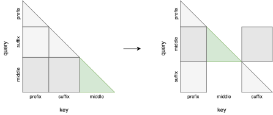
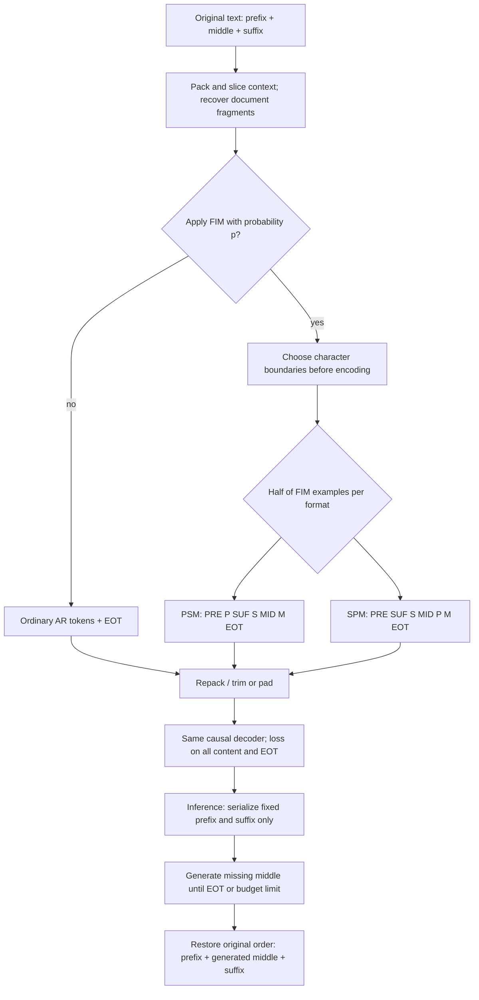
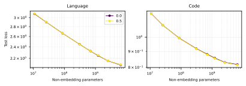
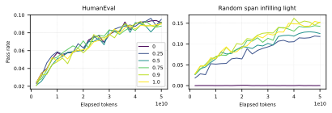
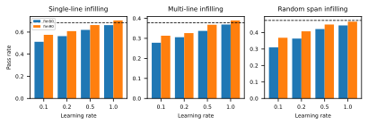

# Fill-in-the-middle pretraining - Bavarian et al., 2022

> **Paper:** Efficient Training of Language Models to Fill in the Middle
>
> **Authors:** Mohammad Bavarian, Heewoo Jun, Nikolas Tezak, John Schulman,
> Christine McLeavey, Jerry Tworek, Mark Chen; Bavarian and Jun contributed equally
>
> **arXiv:** [2207.14255v1][paper], 28 July 2022; the only version listed at review time
>
> **Venue / affiliation:** arXiv preprint / OpenAI
>
> **Scope:** The paper and appendices, with the released benchmark inspected at
> commit [`88062ff9859c875d04db115b698ed4b0f0395170`][bench], 29 July 2022.
> Historical API availability is not a claim that the same endpoint is available today.

## TL;DR

A causal decoder can learn to fill a missing span by moving that span to the
end of its training sequence, placing the surrounding prefix and suffix before
it, and applying ordinary next-token prediction to the reordered text.
Across the paper's matched pretraining experiments, this adds infilling
capability without a detectable loss of the tested left-to-right capabilities;
it does not require a new attention architecture or a separate infilling model.
Strong results depend on details: character-level cuts, context-level
augmentation, joint prefix-suffix-middle and suffix-prefix-middle formats,
and substantial FIM rates. The result is not unlimited free computation:
100% FIM degrades ordinary language-model loss, and adding FIM only after
pretraining is expensive in the studied continuation-training recipe.

## Problem & motivation

### Completing after a cursor is not the same as repairing a gap

A conventional autoregressive language model predicts a continuation using
the preceding text. In an editor, the user often needs something different:
replace a deleted expression, complete an import, or write a paragraph that
connects an existing beginning to an existing ending. The missing text must
be compatible with **both** sides, including exact syntax and the point at
which generation should stop.

Prompting a model to describe an edit is not equivalent to making its
conditional distribution naturally support that edit. If ordinary training
always places the suffix after the middle, a causal decoder cannot use the
suffix when predicting the middle.

### The question is whether an extra capability displaces the original one

Earlier work already studied infilling, span corruption, and moving masked
content to the end of a sequence. This paper's central contribution is not
claiming the first infilling transformation. It systematically tests whether
**joint pretraining** can acquire that capability at a matched training
budget without sacrificing ordinary language modeling, and identifies
practical settings that preserve the trade-off.

The authors call this **FIM-for-free**. Their main comparison trains eight
model sizes, from **50M to 6.9B total parameters**, with and without **50%**
FIM augmentation, on both natural language and code, for **100B tokens per
model** (Sections 1.1 and 4; Appendix A). They examine sampling benchmarks
as well as loss, because a small loss difference can conceal a large
difference in usable infilling performance.

### This is a training/data-format paper, not a new tokenizer

FIM consumes a tokenizer and adds a serialization using special sentinels.
It does not replace [BPE][bpe], introduce a new byte alphabet, or assign
universal numeric IDs to its sentinels. The distinction matters because the
location of a cut **relative to tokenizer subwords** is a central ablation:
splitting text before tokenization teaches cases that cutting only at
existing token boundaries cannot represent.

## Key idea

### Move the target span after the information it should condition on

Write an original document as

$$
x=P\Vert M\Vert S,
$$

where $P$ is the prefix, $M$ the missing middle, $S$ the suffix, and
$\Vert$ denotes concatenation. Let $\operatorname{Enc}$ be the tokenizer;
`PRE`, `SUF`, and `MID` are distinct sentinel tokens, and `EOT` is the
document/end-of-infill token.

The paper's **PSM** format is

$$
T_{\mathrm{PSM}}(x)=
[\mathrm{PRE}]
\Vert\operatorname{Enc}(P)
\Vert[\mathrm{SUF}]
\Vert\operatorname{Enc}(S)
\Vert[\mathrm{MID}]
\Vert\operatorname{Enc}(M)
\Vert[\mathrm{EOT}].
$$

The generated middle now comes after the suffix in the model's sequence,
so ordinary causal attention can condition on both $P$ and $S$.
No token in the model's serialized future needs to be exposed.

Suppressing sentinel notation, the useful factorization is

$$
p_\theta(P,S,M)
=p_\theta(P)\,p_\theta(S\mid P)\,p_\theta(M\mid P,S),
$$

rather than the canonical order

$$
p_\theta(P,M,S)
=p_\theta(P)\,p_\theta(M\mid P)\,p_\theta(S\mid P,M).
$$

$\theta$ denotes model parameters. These factorizations explain the
mechanism; they do not assert that a finite trained model assigns equal
probability to the two serializations.

### Keep the learning signal on all content

Training predicts the prefix, suffix, and middle, not only the middle.
The paper says preliminary experiments found this important for retaining
left-to-right capability. Sentinel losses may be masked or retained
without changing its reported conclusion, but **the EOT loss must remain**:
it teaches when the model has joined the fixed suffix.

The causal model is still doing ordinary next-token prediction over
every retained target position. There is no separate bidirectional encoder,
insertion head, or middle-only objective in the main method.

## How it works

### 1. Sample a text span before tokenization

With probability $p$, called the **FIM rate**, select two random split
positions in a document and form its prefix, middle, and suffix. The main
method chooses positions in **character space**, not among BPE token
boundaries. On the uniform continuous-length interpretation, each region
has one-third of the document length in expectation; exact finite-string
discretization is not fully specified.

Empty prefixes are possible and explicitly matter to the paper's explanation
of transfer between formats. A reproduction should specify endpoint
conventions and the meaning of "character" consistently. The method is
not a license to cut arbitrary UTF-8 bytes and decode invalid fragments.

For PSM, encode each section separately, then add sentinels and reorder.
This is not generally equivalent to encoding the whole original string
and slicing its token sequence:

$$
\operatorname{Enc}(P\Vert M\Vert S)
\ne
\operatorname{Enc}(P)\Vert\operatorname{Enc}(M)\Vert\operatorname{Enc}(S).
$$

Tokenization can merge across the intended cut in the former operation.
Separate encoding produces the subword fragments that the character-level
augmentation is intended to teach.

### 2. Use the paper's actual SPM format, not a naive swap

SPM presents suffix, prefix, and middle in that order. However, the
sentinel placement used in this paper is unusual:

$$
T_{\mathrm{SPM}}(x)=
[\mathrm{PRE}]\Vert[\mathrm{SUF}]
\Vert\operatorname{Enc}(S)
\Vert[\mathrm{MID}]
\Vert\operatorname{Enc}(P)
\Vert\operatorname{Enc}(M)
\Vert[\mathrm{EOT}].
$$

There is **no sentinel between the prefix and middle**. The formula in
Appendix D uses separate $\operatorname{Enc}(P)$ and
$\operatorname{Enc}(M)$ terms; it should not silently be rewritten as a
claim that the two strings were jointly tokenized.

The more obvious alternative would be

```text
SUF + Enc(suffix) + PRE + Enc(prefix) + MID + Enc(middle) + EOT
```

but that is **SPM variant 1**, not the variant used in the main experiments.
The paper uses **variant 2**, shown in the equation above. When PSM happens
to have an empty prefix, its serialization resembles variant-2 SPM.
This overlap motivates transfer between the two formats. The authors
also note that variant 1 can be stronger at handling subtokens at the
end of a prefix, so variant 2 is not claimed to dominate every application.

An illustrative formatter, with caller-supplied tokenizer and sentinel IDs,
is:

```python
def format_fim(prefix, middle, suffix, encode, pre, suf, mid, eot, mode):
    p = encode(prefix)
    m = encode(middle)
    s = encode(suffix)
    if mode == "PSM":
        return [pre, *p, suf, *s, mid, *m, eot]
    if mode == "SPM":
        return [pre, suf, *s, mid, *p, *m, eot]
    raise ValueError(f"Unknown FIM mode: {mode}")
```

This reconstructs the serialization, not the complete packing/training
pipeline. The sentinels are atomic tokenizer IDs, not literal words to
be passed through ordinary BPE. A tokenizer configuration such as those
discussed in the [tiktoken review][tiktoken] must agree with the model's
trained vocabulary; adding markers alone does not teach infilling.

### 3. Mix ordinary documents with both transformed formats

The default main runs use $p=0.5$. Conditional on transforming a document,
PSM and SPM each receive half the probability. Thus the overall mixture
is

$$
\Pr(Z=\mathrm{AR})=1-p,\qquad
\Pr(Z=\mathrm{PSM})=\Pr(Z=\mathrm{SPM})=\frac p2.
$$

$Z$ is the formatting choice and AR denotes the unchanged left-to-right
format. At $p=0.5$, that means 50% AR, 25% PSM, and 25% SPM choices;
it does **not** mean all documents are split between PSM and SPM.
At $p=0.9$, the corresponding probabilities are 10%, 45%, and 45%.

These are augmentation probabilities for documents or document fragments,
not an exact fraction of all processed tokens: lengths, sentinels,
retokenization, packing, and trimming affect the token mixture.

An explicit form of the standard training objective is

$$
\mathcal L(\theta)=
\mathbb E_{x\sim\mathcal D,\;Z}
\left[
-\sum_{t=1}^{|T_Z(x)|}
w_t\log p_\theta\bigl(T_Z(x)_t\mid T_Z(x)_{<t}\bigr)
\right].
$$

$\mathcal D$ is the training-document distribution, $T_Z$ is the selected
serialization, $t$ indexes its tokens, and $w_t$ is the target-loss weight.
Content in all three regions has weight one; sentinel weights depend on
the masking choice, while EOT retains weight one. Standard causal
input/target shifting and the packed preceding context are implicit.
This equation makes the paper's procedure explicit; it is not an
additional loss proposed by the authors.

### 4. Prefer context-level augmentation when packing long documents

**Document-level FIM** transforms the full document before documents are
packed and cut into model-length contexts. A long reordered example can
then be divided so that its prefix, suffix, and middle no longer appear
in the same context. The nominal FIM probability can substantially exceed
the fraction of useful, complete infilling examples.

**Context-level FIM** instead:

1. Packs ordinary tokenized documents with EOT boundaries.
2. Slices the stream into model-length contexts.
3. Splits each context on EOT, recovering its document fragments.
4. Decodes fragments back to text when character-level augmentation is used.
5. Applies the AR/PSM/SPM choice separately to the recovered fragments.
6. Re-encodes and rejoins them with EOT.
7. Trims or pads back to the required context length.

Appendix C warns that a tokenized context can start or end inside a
multibyte UTF-8 character. Blind replacement decoding can insert spurious
characters into training. The authors recommend detecting and removing
such edge fragments before text-space augmentation.

The transformed context can become longer **or shorter**, because separate
encoding changes BPE boundaries as well as adding sentinels. The paper
does not fully specify padding masks or every trimming convention.
Context-level transformation reduces fragmentation; a final trim is
not a mathematical guarantee that every transformed span survives intact.

The discussion defines **effective FIM rate** as the fraction of examples
in FIM format with all three regions present in the same context.
Its relation to nominal $p$ depends on document lengths and packing.
This helps explain why context-level augmentation is better even when
ordinary AR losses look almost identical.

### 5. Keep the ordinary causal Transformer

For a batch of $B$ contexts of length $L$, token IDs have shape
$B\times L$, hidden states $B\times L\times d$, and vocabulary logits
$B\times L\times |V|$. Here $d$ is model width and $|V|$ the model
vocabulary size. Training uses the ordinary causal mask in **serialized
order**; inference predicts one next token at a time.



*The original method diagram. On the left, prefix-suffix-middle is an
ordinary causal sequence. On the right, the same allowed attention is
displayed in prefix-middle-suffix order: the middle can use suffix
information, but the suffix cannot use the missing middle. The mask is
not changed into unrestricted bidirectional attention.*

The experimental models use relative attention rather than GPT-3's learned
position embeddings, but that is a shared architecture choice for the
comparisons, not a new FIM-specific head. FIM's conditioning mechanism is
the data ordering itself.



*Authored reconstruction of the preferred context-level pipeline. $p$
is a transformation probability, and P/M/S denote separately encoded
regions. No ground-truth middle is supplied in the inference prompt.*

### 6. Prompt with both fixed sides and stop at EOT

PSM inference uses

```text
PRE + Enc(prefix) + SUF + Enc(suffix) + MID
```

and the paper's SPM inference uses

```text
PRE + SUF + Enc(suffix) + MID + Enc(prefix)
```

The model generates the middle, terminating with EOT. Strip the generated
terminator and reconstruct the user-visible text as prefix, generated
middle, suffix. The paper's sampling evaluations additionally prepend
EOT to the prompt, which gives a slight improvement (Section 3, footnote 3).
This detail is separate from the terminal EOT target.

SPM has a cache advantage when a user keeps typing into an evolving prefix:
the fixed suffix was already processed before the prefix, so its
key/value states can be retained if its content and serialized placement
are unchanged. In PSM, changing the prefix changes the preceding context
and positions of the suffix. Conversely, editing the suffix in SPM can
invalidate the cached prefix states. The advantage depends on edit patterns,
not an unconditional property of every editor workload.

### 7. A terminal token is necessary but does not guarantee a good join

Failure to emit EOT within the allowed generation budget often correlates
with a poor join. A model can keep writing, duplicate the suffix, or get
stuck repeating text. Trimming to a final line or paragraph, sometimes
useful for ordinary completion, does not reliably repair a missing
connection to a fixed suffix.

Appendix H proposes **EOT-aware best-of-$n$**: generate $n$ candidates,
prefer those that terminate with EOT, and rerank eligible candidates
using likelihood or other heuristics. It also suggests explicit prompt
structure, such as numbered examples, to help constrain the intended
infill length. Neither mitigation guarantees correctness or removes
the extra sampling cost.

## Training / data

### Model suite and parameter accounting

The complete architecture table is reproduced from **Appendix A, Table 3**.
Batch sizes are token counts, as reported. $n_{\mathrm{ne}}$ excludes
embedding and unembedding parameters; the input and output embedding
weights are **not tied**. Scaling plots use $n_{\mathrm{ne}}$, not total
parameters.

| Model | Total parameters | Non-embedding parameters | Layers | Width | Heads | Head width | Batch tokens | Learning rate |
|---|---:|---:|---:|---:|---:|---:|---:|---:|
| XXS | 50M | 11M | 6 | 384 | 6 | 64 | 0.5M | 1.6e-3 |
| XS | 77M | 26M | 8 | 512 | 8 | 64 | 0.5M | 1.4e-3 |
| Small | 164M | 87M | 12 | 768 | 12 | 64 | 0.5M | 6.0e-4 |
| Medium | 411M | 308M | 24 | 1024 | 16 | 64 | 0.5M | 3.0e-4 |
| Large | 844M | 689M | 24 | 1536 | 16 | 96 | 0.5M | 2.5e-4 |
| XL | 1.4B | 1.2B | 24 | 2048 | 16 | 128 | 1M | 4.0e-4 |
| 2.8B | 2.8B | 2.6B | 32 | 2560 | 32 | 80 | 1M | 3.2e-4 |
| 6.9B | 6.9B | 6.5B | 32 | 4096 | 32 | 128 | 2M | 2.4e-4 |

All models have **2,048-token contexts**. Architecture, optimization
hyperparameters, and encoding are described as similar to Codex and
GPT-3; the main changes are relative attention and doubled learning
rates for the three largest models compared with their GPT-3 counterparts.
The rates above already report the paper's actual choices; they must
not be doubled again.

The study does not supply a complete executable training configuration,
all optimizer/schedule constants, a tokenizer artifact, or a hardware/
wall-clock accounting table. Similarity to GPT-3 is not grounds to
invent every omitted setting.

### Corpora and training horizons

- **Code:** the Codex **159 GB Python corpus**, scraped in **May 2020**,
  but these models train from random initialization rather than following
  Codex's initialization path. The authors expect no contamination from
  HumanEval's later public release; this chronology is not a proof of
  the absence of every possible data overlap.
- **Natural language:** the same dataset as GPT-3, with corpus details
  delegated to that paper. The FIM paper does not disclose a new
  independently reproducible raw-text release.
- **Main scans:** eight sizes, two FIM settings (0% and 50%), and two
  domains, giving **16 code models plus 16 language models**, each
  trained for **100B tokens** (Section 1.1).
- **Rate ablations:** rates **0, 0.25, 0.5, 0.75, 0.9, and 1.0**,
  including the Large-model learning curves, use **50B-token** runs
  (Section 4.2; Appendix B). Not every ablation uses the main horizon.
- **Continuation training:** a pretrained **XL / 1.4B** AR model is
  continued for **25B or 50B** additional tokens, with FIM rates
  **0.5 or 0.9**, and learning-rate multipliers
  **0.1, 0.2, 0.5, or 1.0** relative to pretraining.
  The resulting **16** combinations are compared with FIM pretraining
  from scratch (Section 5).

The fixed main token budget leaves the largest models undertrained
relative to what longer training might achieve, a limitation acknowledged
in Appendix A. "Free" concerns matched pretraining budgets and retained
measured AR capability; it does not eliminate tokenization/packing costs,
sentinel overhead, or inference sampling costs.

### Evaluation: distinguish ordinary completion from infilling

All test losses are cross-entropy in **nats per token**, not perplexity
values. Perplexity is the exponential of average token loss. FIM test
sets transform the underlying AR test examples at **100%** FIM rate;
this makes their formatting different from a mixture used in training.

The paper evaluates:

1. **AR loss:** canonical left-to-right text order.
2. **Full FIM loss:** all regions of the transformed sequence.
3. **Middle-only loss:** only middle tokens, comparing prediction with
   the suffix available against prediction without it.
4. **Sampling-based functional correctness:** generate missing code,
   place it between the supplied prefix and suffix, and run tests.

Natural-language AR evaluations include HellaSwag, LAMBADA, StoryCloze,
PIQA, Winograd, and WinoGrande accuracy, plus DROP and QuAC F1.
All except DROP and QuAC use few-shot prompting. Ordinary code capability
is measured with HumanEval.

The infilling suite is derived from the **164 HumanEval problems**:

| Benchmark | Infilling tasks | Construction |
|---|---:|---|
| Single-line | 1,033 | Remove nonempty lines from canonical solutions, following InCoder's evaluation. |
| Multi-line | 5,815 | Remove spans of nonempty lines, also following InCoder. |
| Random span | 1,640 | Ten character-level random-span tasks per original HumanEval problem. |
| Random span light | 164 | One random-span task per original problem, for in-training tracking. |

Counts are from Section 2.2 and Appendix E and match the pinned released
data files. These are **derived tasks**, not thousands of independent
new programming problems; tasks share underlying functions and tests.

All sampling evaluations use nucleus parameter **0.95**. Temperatures
and sample counts vary and must not be mixed:

| Evaluation location | Temperature | Samples per task |
|---|---:|---:|
| Ordinary HumanEval, Figure 3 | 0.8 | 400 |
| In-training curves, Figure 5 | 0.8 | 25 |
| Mode comparison, Figure 6 | 0.2 | 100 for line benchmarks; 200 for random span |
| Joint/pure-mode comparison, Table 1 | 0.2 | 100 |
| Context/document comparison, Figure 7 | 0.2 | 200 |
| Scaling ablations, Figure 13 | 0.8 for HumanEval; 0.2 for infilling | 500 for HumanEval; 200 for infilling |
| Continuation comparison, Figure 9 | 0.2 | 100 |
| Authors' models and code-davinci-002, Table 4 | 0.2 | 100 |

SPM is the default reported infilling inference mode unless a comparison
explicitly uses PSM. InCoder's Table 4 entries are taken from its paper,
not rerun under this sampling setup.

### What a pass rate measures

The released harness constructs the candidate program as fixed prefix,
generated middle, fixed suffix, followed by the unit tests. It checks
functional behavior rather than requiring exact recovery of the original
middle string.

For $n$ generated samples of one task, $c$ of which pass, its estimator is

$$
\widehat{\operatorname{pass@}k}
=1-\frac{\binom{n-c}{k}}{\binom nk},
\qquad k\le n.
$$

$k$ is the number of candidate attempts whose success is considered.
The harness averages over tasks and only reports a requested $k$ when
all tasks have enough samples. For $k=1$, this is $c/n$ per task.
The paper's infilling tables report pass rates; sampling many candidates
to estimate a pass rate is not the same as reporting pass@100.
The estimator is verified in the [released evaluation code][bench-evaluation].

### Released artifact boundaries

The [official repository][bench] releases the benchmark data and evaluation
harness, not the complete model-training pipeline or the trained model
weights. The paper discusses a historically hosted infilling API and
code-davinci-002 as a stronger system informed by this research; it does
not disclose an equivalent reproducible training recipe for that system.

The pinned repository also needs care before practical use:

- Its README explicitly warns that evaluation executes **untrusted generated
  code** and requires a robust external sandbox. The execution line is
  deliberately commented out. Time limits and the helper's reliability
  guard are not an adequate isolation boundary.
- Its `data.py` maps random-span benchmark names to
  `HumanEval-RandomSpan.jsonl.gz` and `HumanEval-RandomSpanLight.jsonl.gz`,
  while the released files are named
  `HumanEval-RandomSpanInfilling.jsonl.gz` and
  `HumanEval-RandomSpanInfillingLight.jsonl.gz`.
  The names need reconciling in a separately managed reproduction;
  downloading the repository is not a turnkey evaluation guarantee.

These are source observations at the pinned commit, not changes made to
the benchmark here. Data-count and transformation checks do not require
executing any generated programs.

## Results

### Main result: additional infilling without a measured AR penalty



*Original Figure 1, natural language and code. The horizontal axis is
non-embedding parameters, and all main models receive 100B tokens.
The 0% and 50% FIM loss curves largely coincide. These plotted losses
should not be turned into invented exact tabulated scores.*

Figure 3 provides complementary evidence from the eight natural-language
benchmarks and ordinary HumanEval pass@1/pass@10: performance matches
within the reported error. Figure 2 also shows that FIM-trained models
have lower FIM test loss than AR-only models, so the unchanged AR
loss is not simply evidence that the extra task was ignored.

The claim is bounded by these sizes, corpora, budgets, and evaluations.
It is not a theorem that every skill, dataset, architecture, or downstream
task can be added without interference.

### Rate: more FIM helps sampling even when losses barely change



*Original Figure 5, Large models trained for 50B tokens. HumanEval
curves remain similar while random-span-light performance improves
with higher FIM rates. The evaluations use temperature 0.8 and
25 samples per task, not the final-model settings in Table 4.*

Figures 4-5 and Appendix B show:

- Rates up to **90%** do not noticeably degrade AR test loss in the
  tested settings.
- **100%** FIM produces a clear ordinary AR-loss penalty, even though
  HumanEval sampling in this scan remains similar.
- Infilling sampling improves as the FIM rate rises, with no noticeable
  further gain beyond **90%** in the Appendix B scaling comparison.
- Corresponding FIM-loss differences can be small, so choosing the rate
  from loss alone can miss useful gains.

The main suite used 50% because it was trained before the more complete
rate ablations. The authors subsequently trained another 6.9B model
with 90% FIM. Their recommendation is **50-90%**, not "use 100%
because half of the document is still autoregressive."

### Joint training transfers between formats, but not symmetrically

These are all entries of **Table 1**. The models are the paper's Large
configuration; values are fractional pass rates, not percentages.
`Joint` allocates half of its total FIM rate to each format.

| Training format | FIM rate | Single-line PSM | Single-line SPM | Multi-line PSM | Multi-line SPM | Random PSM | Random SPM |
|---|---:|---:|---:|---:|---:|---:|---:|
| Joint | 0.5 | 0.550 | 0.595 | 0.265 | 0.293 | 0.367 | 0.379 |
| Joint | 0.9 | 0.616 | 0.622 | 0.290 | 0.305 | 0.397 | 0.420 |
| PSM only | 0.9 | 0.583 | 0.625 | 0.273 | 0.305 | 0.362 | 0.274 |
| SPM only | 0.9 | 0.023 | 0.586 | 0.008 | 0.301 | 0.007 | 0.386 |

Joint 50% training reaches SPM results broadly comparable with SPM-only
90% training, while retaining both prompt formats. Joint 90% is
especially strong on random spans.

Transfer is not symmetric: PSM-only training can perform well in SPM
mode on line-based tests, but SPM-only training performs very poorly
in PSM mode. The Appendix D empty-prefix explanation concerns this
format overlap. It does not imply that PSM-only models are always
stronger when evaluated in SPM: random-span performance falls from
0.362 in PSM to 0.274 in SPM for that row.

### Context-level formatting improves useful infilling more than loss suggests

Figure 7 finds consistently better pass rates for context-level than
document-level FIM across model scales. Figure 8 shows almost unchanged
AR loss, while the FIM-loss advantage is only about
**0.001 nats per token** (Section 4.4).

This is another example where teacher-forced loss is a poor proxy for
the size of a functional sampling improvement. The paper does not
publish all Figure 7 point coordinates as a numerical table, so this
recap does not infer exact pass rates from the graph.

### Character-level cuts are essential for general random gaps

The complete **Table 2** compares Medium models using PSM for this
ablation:

| Training split unit | Single-line | Multi-line | Random span |
|---|---:|---:|---:|
| Line | 0.586 | 0.269 | 0.015 |
| BPE token | 0.548 | 0.242 | 0.102 |
| Character | 0.557 | 0.250 | 0.321 |

Line-based training is strongest on its matched line-based tests, but
nearly fails on random-span infilling. Character-level training improves
random-span pass rate by **30.6 percentage points** over line-based
training and **21.9 points** over token-level training, while losing
only **2.9 points** to line-based training on single-line infilling
(differences calculated from Table 2).

The reason is structural: line/token-only cuts never teach many gaps
that begin or end inside an existing BPE token. Character cuts directly
cover those editor-like cases, rather than relying on a token-boundary
test to approximate them.

### Continued training can learn FIM, but matching pretraining is costly



*Original Figure 9b only, not the full two-row figure. The bars compare
50% and 90% FIM continuation rates; horizontal positions are learning-rate
multipliers relative to pretraining. Dashed baselines are an XL model
trained with 50% FIM from scratch for 100B tokens.*

Across the **16** settings in Section 5, only the combination of
**50B additional tokens**, **90% FIM**, and a **1.0** learning-rate
multiplier closes the gap to the 100B-token FIM-pretrained baseline.
That continuation model has processed **150B total tokens**, compared
with the baseline's **100B**. This is a 50% increase in token horizon
at the same model size, not a measured wall-clock ratio.

The baseline here uses **50%** FIM from scratch, not the stronger
90%-FIM final model from Table 4. The experiment concerns **XL / 1.4B**,
not the 6.9B top-model comparison.

Appendix F shows ordinary HumanEval initially degrading during
continuation, especially at higher learning rates, then recovering
toward pretrained levels. Nontrivial infilling can emerge much earlier;
the costly result is about **matching the from-scratch FIM baseline**,
not the impossibility of learning any infilling with a small update.

The authors propose ossified document-wide attention patterns as one
possible explanation, but do not establish that mechanism experimentally.
Different later adaptation recipes are not ruled out.

### Strongest models and external comparison

All values below reproduce **Appendix G, Table 4**. FIM50 and FIM90 are
the 6.9B-total / 6.5B-non-embedding models trained for 100B tokens.
The FIM models and code-davinci-002 are evaluated in SPM mode.

| Model | Single-line | Multi-line | Random span |
|---|---:|---:|---:|
| FIM50 | 0.730 | 0.406 | 0.521 |
| FIM90 | 0.751 | 0.441 | 0.551 |
| InCoder, 6.7B | 0.690 | 0.386 | n/a |
| code-davinci-002 | 0.916 | 0.699 | 0.742 |

FIM90 improves over FIM50 by **2.1, 3.5, and 3.0 percentage points**
on these three benchmarks. Against InCoder's self-reported entries,
the differences are **6.1** points for single-line and **5.5** for
multi-line, but the paper explicitly cautions that the evaluation
implementations can differ. The missing InCoder random-span result
must not be treated as zero.

code-davinci-002 is substantially stronger here, but the comparison
does not isolate a training-format effect: the paper does not provide
a matched parameter/data/compute specification for that hosted system.

### Why better middle prediction can coexist with higher full FIM loss

Figure 11 uses **the same FIM-trained model family**, evaluated under
two orders. Full FIM-sequence loss is higher than ordinary AR loss,
but middle-only FIM loss is lower because the model can see the suffix.

There is no contradiction: in PSM the suffix is predicted without
the middle that would precede it in canonical order, and every region
contributes to the full loss. The figure's "AR" and "FIM" labels are
evaluation formats in this comparison, not two different training
families. Lower conditional middle loss also does not by itself
guarantee that a sampled middle will stop at the right boundary.

## Limitations & follow-ups

### What "FIM-for-free" does not establish

1. **The measured non-interference is not universal.** The paper itself
   leaves open benchmarks where FIM could hurt. Its evidence covers a
   finite model suite, two domain corpora, particular budgets, and a
   specific collection of ordinary tasks.

2. **The recipe is not "all FIM all the time."** The 100% setting hurts
   AR loss. Retaining ordinary examples and losses on all content is
   part of the positive result, and nominal rates differ from effective
   complete-example rates.

3. **Loss alone is insufficient.** FIM-rate and packing changes can
   strongly alter generated-code correctness with small loss changes.
   A reproduction needs functional sampling benchmarks and explicit
   temperatures/sample counts, not only a validation-perplexity curve.

4. **HumanEval-derived tasks have limited independence and coverage.**
   Thousands of gaps still share 164 underlying problems. Passing
   finite unit tests is useful evidence of functionality, not a proof
   of correctness, safety, or realistic repository-wide editing skill.

5. **Natural-language infilling is less decisively evaluated.** The paper
   reports natural-language AR preservation and qualitative infills,
   but its main functional infilling benchmarks are Python programs.
   The authors observe stronger infilling quality in code than prose.

6. **Single-slot infilling is the studied setting.** Multiple independent
   holes, syntax-aware span selection, explicit length/style control,
   and alternative architectures remain future directions. A single
   gap's success is not a demonstrated multi-file editing system.

7. **Stopping and joining remain hard.** EOT can be missed during
   sampling, unrelated suffixes can induce long meandering completions,
   and suffix copying can lead to repetition. Best-of-$n$ and structured
   prompts are mitigations with additional costs, not guarantees.

8. **Implementation details affect reproducibility.** Exact SPM markers,
   separate section tokenization, UTF-8 fragment handling, context
   packing, masks, and trimming matter. The released artifact is a
   benchmark, not a full training configuration or downloadable weight
   release; its harness also has the pinned-source caveats above.

9. **Finetuning inefficiency is recipe-specific evidence.** The result
   is compelling for the investigated 1.4B continuation grid, but
   does not establish a lower bound for every adaptation algorithm.
   The proposed attention-ossification explanation is a hypothesis.

### Defaults supported by the study

The paper's practical recommendation is to keep **character-level random
spans** in the distribution, use **joint PSM/SPM** training, prefer
**context-level** transformation when feasible, and choose a FIM rate
between **50% and 90%**. Document-level transformation remains a simpler
option when its weaker effective rate is acceptable. Applications with
mid-token prefix endings may prefer PSM inference or reconsider SPM
variant 1 rather than blindly copying the default variant.

### Relation to neighboring work

[T5][t5], [BART][bart], and [SpanBERT][spanbert] study related span
corruption or representation-learning objectives, but their architectures,
masking schemes, and typical span lengths differ. This paper emphasizes
retaining an ordinary causal decoder and testing whether the extra
generative capability displaces ordinary language-model performance.

[InCoder][incoder] is both a closely related code-infilling model and the
source of the line-based evaluation tasks. The random-character-span
benchmark is important precisely because line-based success alone can
overstate an editor's robustness.

The [tiktoken review][tiktoken] explains software-level sentinel policy
and non-compositional token boundaries. The [byte-subword recap][byte-bpe]
explains why individual tokens may contain partial UTF-8 characters.
Those are preprocessing concerns that must be handled correctly before
this paper's training transformation can be reproduced.

## Links

- **arXiv:** [abstract][paper] · [versioned HTML][html] · [versioned PDF][pdf].
- **Code / benchmarks:** [official benchmark repository][bench-home] ·
  [pinned snapshot][bench] · [README][bench-readme].
  This is benchmark code, not the complete training implementation.
- **Hugging Face:** No official paper-specific downloadable model weights
  identified in the paper or benchmark release.
- **Project page / API:** The paper describes a historical OpenAI infilling
  API and code-davinci-002; no claim of present-day endpoint availability
  or a separate reproducible model release is made here.
- **Blog posts:** No additional official article is needed as evidence
  for the versioned paper's method or tables.
- **Talks / videos:** No verified author talk linked here.
- **OpenReview / venue page:** No separate venue record identified;
  this recap cites the arXiv preprint.
- **Papers-with-Code:** No verified entry used as a source.
- **Benchmark implementation:** [data mapping][bench-data] ·
  [pass-rate estimator][bench-evaluation] ·
  [execution harness and its warning][bench-execution].
- **Figures:** Four original SVGs from the versioned arXiv HTML:
  Figure 1, Figure 5, Figure 9b, and Figure 10. The pipeline diagram
  is authored for this recap.
- **Related:** [BPE][bpe] · [byte-level subwords][byte-bpe] ·
  [tiktoken][tiktoken] · [Transformer][transformer] · [T5][t5] ·
  [BART][bart] · [SpanBERT][spanbert] · [InCoder][incoder].

```bibtex
@misc{bavarian2022efficientfim,
  title         = {Efficient Training of Language Models to Fill in the Middle},
  author        = {Bavarian, Mohammad and Jun, Heewoo and Tezak, Nikolas
                   and Schulman, John and McLeavey, Christine
                   and Tworek, Jerry and Chen, Mark},
  year          = {2022},
  eprint        = {2207.14255},
  archivePrefix = {arXiv},
  primaryClass  = {cs.CL},
  url           = {https://arxiv.org/abs/2207.14255v1}
}
```

[paper]: https://arxiv.org/abs/2207.14255v1
[html]: https://arxiv.org/html/2207.14255v1
[pdf]: https://arxiv.org/pdf/2207.14255v1
[bench-home]: https://github.com/openai/human-eval-infilling
[bench]: https://github.com/openai/human-eval-infilling/tree/88062ff9859c875d04db115b698ed4b0f0395170
[bench-readme]: https://github.com/openai/human-eval-infilling/blob/88062ff9859c875d04db115b698ed4b0f0395170/README.md
[bench-data]: https://github.com/openai/human-eval-infilling/blob/88062ff9859c875d04db115b698ed4b0f0395170/human_eval_infilling/data.py
[bench-evaluation]: https://github.com/openai/human-eval-infilling/blob/88062ff9859c875d04db115b698ed4b0f0395170/human_eval_infilling/evaluation.py
[bench-execution]: https://github.com/openai/human-eval-infilling/blob/88062ff9859c875d04db115b698ed4b0f0395170/human_eval_infilling/execution.py
[bpe]: tokenization_2015_bpe-subword-units.md
[byte-bpe]: tokenization_2019_byte-level-subwords.md
[tiktoken]: tokenization_2022_tiktoken.md
[transformer]: attention_2017_transformer.md
[t5]: backbone_2019_t5-prefix-lm.md
[bart]: bert-generation_2019_bart.md
[spanbert]: bert-span_2019_spanbert.md
[incoder]: https://arxiv.org/abs/2204.05999
