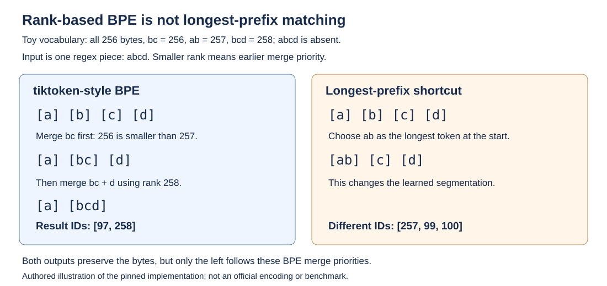
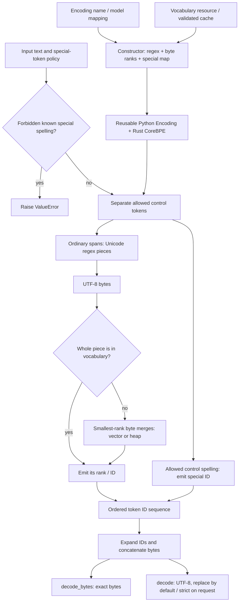
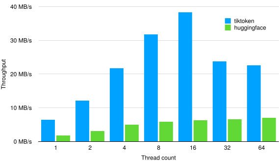

# tiktoken - OpenAI, 2022-present

> **Type:** tokenizer-library and source review; not a research paper or model report
>
> **Authors / organization:** Shantanu Jain is named in package metadata; OpenAI maintains the project
>
> **arXiv / venue:** no dedicated tiktoken paper identified; official source, documentation, and vocabulary resources
>
> **Project origin:** repository created 1 December 2022; code license MIT
>
> **Snapshot:** release **0.14.0**, commit [`4e71bbe0c078468e00fefbf94b39849389f346e5`][snapshot], 17 August 2026
>
> **Benchmark boundary:** the README's performance comparison uses **tiktoken 0.2.0**, not the implementation reviewed here.

## TL;DR

tiktoken is a Python-facing, Rust-backed implementation of byte-level BPE that
turns text into the exact integer IDs expected by particular model vocabularies.
Its behavior depends jointly on a Unicode pretokenization regex, ranked byte
strings, and a separately configured special-token map: a vocabulary file alone
is not the complete tokenizer. The implementation is optimized for fast
encoding and parallel batches, but byte-level reversibility does not imply
lossless decoding of arbitrary token lists, automatic chat-message accounting,
or safe interpretation of control-token strings from untrusted text.

## Problem & motivation

### A model needs its tokenizer, not merely a tokenizer with similar compression

A language model consumes token IDs whose meanings are fixed by its learned
embedding and output matrices. Two tokenizers can preserve the same text and
produce equally short sequences while assigning different IDs or different
boundaries. Substituting one for the other changes the model's inputs, not
just preprocessing speed.

[Character BPE][original-bpe] introduced useful subword sharing for rare words.
[Byte-level subwords][byte-bpe] move the primitive alphabet to UTF-8 bytes,
avoiding dependence on a fixed list of Unicode characters. tiktoken packages
that general idea into model-specific encoding definitions and an optimized
runtime; it is not the implementation recipe of the 2019 translation paper.

The [README][readme] describes reversible, arbitrary-text BPE and a rough
average of about **four bytes per token**. That is a descriptive heuristic,
not a guarantee of four characters per token, a language-independent conversion
factor, or a complete token-budget estimator.

### Boundaries and control symbols are part of the contract

The regex creates pieces within which byte merges are permitted. Spaces,
contractions, digits, punctuation, and newlines are handled differently across
encoding families. A different regex with the same ranked vocabulary can
therefore produce a different token sequence.

Special tokens are not ordinary byte-BPE units. They are configured strings
that can map directly to control IDs, such as end-of-text or fill-in-the-middle
markers. By default, `Encoding.encode` rejects known special-token spellings
in its input rather than interpreting them as controls or silently treating
them as ordinary text. This is explicit policy in the [Python API][core],
not a property of the BPE merge algorithm.

### Distinguish the project, implementation, and benchmark dates

The filename's **2022** denotes repository origin. This review pins the
**2026** implementation because model mappings, available encodings, error
handling, and performance paths have evolved. The README preserves a benchmark
of **0.2.0** against older Hugging Face packages; it must not be presented as a
new measurement of 0.14.0.

The [package metadata][metadata] names the version and author, the
[repository record][repository-record] establishes creation time and license,
and the [changelog][changelog] documents versioned changes. None of these
constitutes a neural-model training report.

## Key idea

### An encoding is a three-part specification

The essential constructor inputs are:

$$
\mathcal{E}=(P,R,S).
$$

$P$ is the Unicode regex pattern used for ordinary-text segmentation;
$R:V_{\mathrm{merge}}\rightarrow\mathbb{N}$ maps nonempty byte strings to
integer ranks/IDs; and $S:V_{\mathrm{special}}\rightarrow\mathbb{N}$ maps
special-token spellings to their IDs. The encoding name identifies this
configuration, while `explicit_n_vocab` optionally checks vocabulary counts
and the maximum ID.

For ordinary valid Unicode text $x$, let
$P(x)=(p_1,\ldots,p_K)$ be the ordered regex matches. The encoding is

$$
\operatorname{encode}_{\mathcal E}(x)
=
\operatorname{BPE}_{R}(\operatorname{UTF8}(p_1))
\Vert\cdots\Vert
\operatorname{BPE}_{R}(\operatorname{UTF8}(p_K)).
$$

Here $K$ is the number of pieces and $\Vert$ concatenates token sequences.
Merges cannot cross these regex-piece boundaries. A custom regex must cover
the intended text: arbitrary patterns that leave unmatched text are not
automatically repaired into complete coverage.

### Smaller rank means earlier merging

Inside one piece, begin with individual bytes. For current adjacent byte
strings $a_i,a_{i+1}$, define

$$
\rho_i=
\begin{cases}
R(a_i\Vert a_{i+1}),&a_i\Vert a_{i+1}\in V_{\mathrm{merge}},\\
\infty,&\text{otherwise}.
\end{cases}
$$

Select the smallest $\rho_i$, choosing the leftmost position on a tie,
merge that pair, and repeat until no finite candidate remains. Final byte
strings are emitted through the same $R$ map as token IDs. This is a formal
description of the [educational encoder][educational] and the
[Rust merge routines][rust], not a separate equation published in a paper.

The crucial invariant is that IDs in `mergeable_ranks` also encode merge
priority. The implementation looks up the **concatenated bytes**, not an
independently stored pair-of-token-IDs rule. Arbitrarily reassigning IDs or
imposing extra pair-specific merge restrictions can break this representation
of BPE history.

### Reversibility is primarily a byte-level statement

For ordinary text represented by a complete byte vocabulary,

$$
\operatorname{decode\_bytes}
  \bigl(\operatorname{encode\_ordinary}(x)\bigr)
=\operatorname{UTF8}(x).
$$

The byte expansions of successive tokens are concatenated before UTF-8
decoding. Individual tokens may end inside a multibyte character. Arbitrary
token sequences, malformed Python surrogate input, and special-token aliases
require qualifications discussed below.

## How it works

### 1. Resolve a model or an explicit encoding

`get_encoding(name)` looks up an encoding constructor. `encoding_for_model`
first resolves a model name to an encoding name, using exact entries and then
known prefixes in [model.py][model]. Prefix matching avoids updates for every
dated model variant, but can also match a nonexistent model name. It is
**not** an API request confirming that a model exists or that an endpoint
supports it.

Representative mappings in the pinned source are:

| Model identifier / family | Encoding | Meaning of this mapping |
|---|---|---|
| `gpt2`, `gpt-2` | `gpt2` | Compatibility with the original GPT-2 vocabulary and pretokenization. |
| `text-davinci-003` | `p50k_base` | A historical text/code-family mapping retained for compatibility. |
| `gpt-4`, `gpt-3.5-turbo`, `text-embedding-3-small` | `cl100k_base` | Shared tokenizer family; sharing a tokenizer does not make these models otherwise equivalent. |
| `gpt-4o`, `gpt-4.1`, `gpt-5`, `o1`, `o3`, `o4-mini` | `o200k_base` | Current entries and prefixes in this snapshot, not a timeless promise about future model releases. |
| `gpt-oss-...` | `o200k_harmony` | A prefix mapping to the Harmony-oriented special-token configuration. |

Unknown encoding names raise `ValueError`; unknown model names without a
matching prefix raise `KeyError`. For reproducible work, explicitly record
the resolved encoding and package version instead of relying only on a
mutable model alias.

### 2. Load ranks and construct the native runtime

[openai_public.py][public] provides seven built-in constructors:
`gpt2`, `r50k_base`, `p50k_base`, `p50k_edit`, `cl100k_base`,
`o200k_base`, and `o200k_harmony`. Plugins can add others.

The `.tiktoken` resource format has one mergeable token per nonempty line:

```text
BASE64_OF_TOKEN_BYTES DECIMAL_RANK
```

Base64 represents raw bytes, not a requirement that each entry be a valid
Unicode string. The rank is both merge priority and output token ID.
[load_tiktoken_bpe][load] parses these lines into `dict[bytes, int]`;
special tokens and the regex are supplied separately.

For GPT-2, the loader converts the historical byte-to-printable-symbol
representation from `vocab.bpe` and `encoder.json` back to byte strings.
It initializes the single-byte units, adds ordered merges, removes special
entries from the mergeable map, and checks that the reconstructed ranks
match the JSON encoder. A GPT-2 display symbol is therefore not itself a
new linguistic character or a separate byte encoding standard.

`Encoding` builds `CoreBPE`, which stores ordinary and special encoder/decoder
maps, regex instances, and lexicographically sorted mergeable byte strings.
The reverse ordinary map is checked for duplicate token indices. These
structures are reused across calls; no vocabulary learning happens in
ordinary `encode`.

### 3. Enforce special-token policy before ordinary segmentation

The public API exposes two controls:

- `allowed_special` selects spellings that may become direct control IDs.
- `disallowed_special` selects spellings whose occurrence should raise
  `ValueError` before the native encoder runs.

The defaults are `allowed_special=set()` and `disallowed_special="all"`.
The string `"all"` for the latter expands to the encoding's known specials
**minus those allowed**. An explicit disallowed collection is instead checked
as supplied; explicitly forbidding a spelling can still raise even if it was
also placed in `allowed_special`.

| Call policy | Known special spelling in text | Effect |
|---|---|---|
| Default `encode(text)` | Present | Raises `ValueError`; it is not silently escaped. |
| `allowed_special={marker}` | That marker | Emits its configured special ID; other known specials remain forbidden by default. |
| `allowed_special="all"` | Any configured special | Allows direct special IDs for all recognized spellings. |
| `disallowed_special=()` with no allowed specials | Present | Treats the spelling as ordinary text and applies regex plus BPE. |
| `encode_ordinary(text)` | Present | Ignores special-token interpretation and encodes ordinary text; equivalent in intent to disabling all disallowed checks. |

For allowed specials, the native encoder scans for the next recognized
allowed spelling, encodes the preceding ordinary segment, appends the special
ID, and continues. Disallowed checks use escaped literal spellings in a
separate regex. Sources: [core.py][core] and [CoreBPE.encode][rust].

`encode_single_token` is a vocabulary lookup, not this policy-controlled
pipeline: it recognizes special tokens as well as ordinary tokens and raises
`KeyError` if the supplied bytes/string do not name one token. It should not
be used as a substitute for validating untrusted control-token text.

Allowing control IDs does not itself implement fill-in-the-middle,
conversation roles, tool execution, or any neural behavior. The model and
its message-serialization protocol must give those IDs their meaning.

### 4. Pretokenize in Unicode space, then encode pieces as UTF-8

The model-specific regex runs on Unicode text. Only after obtaining a piece
does the native encoder operate on its UTF-8 bytes. No automatic NFC/NFKC
normalization is part of this ordinary path; visually similar strings can
have different bytes and different tokenization.

The three main pattern families in [openai_public.py][public] differ as follows:

| Pattern family | Important behavior |
|---|---|
| GPT-2 / `r50k` / `p50k` | Separates contractions, Unicode letter runs, number runs, non-letter/non-number punctuation runs, and whitespace. Letter/number/punctuation alternatives can include a leading ASCII space. End-of-string and lookahead whitespace cases affect boundaries. |
| `cl100k` | Uses case-insensitive contraction alternatives, letter runs with an optional leading non-letter/non-number/non-newline character, number groups of one to three digits, and revised punctuation/newline/whitespace alternatives. Long numeric strings are not merged across the resulting three-digit groups. |
| `o200k` | Uses two letter/case/mark alternatives incorporating Unicode uppercase, lowercase, modifier, other-letter, and combining-mark categories; contractions can attach to the letter match. It also uses one-to-three-digit groups and revised punctuation, slash, newline, and whitespace alternatives. Harmony reuses this pattern. |

The pinned source is the authority for the **complete literal patterns**,
including alternative order, possessive quantifiers, lookaheads, and newline
handling. A prose approximation or a regex-engine substitution is not a
bit-for-bit compatibility specification. Python's standard `re` does not
support these Unicode-property expressions as used here; the educational
implementation uses Python `regex`, while the native path uses Rust
`fancy-regex`.

Spaces are retained through the matched pieces; they are not discarded as
word delimiters. `"world"` and `" world"` can be different vocabulary entries.
Likewise, one must not tokenize words independently and assume their
concatenated IDs equal tokenization of the original string.

### 5. Use a whole-piece lookup or ranked byte merges

For each ordinary piece:

1. Convert it to UTF-8 bytes.
2. If the entire byte string already has a rank, emit that single ID directly.
3. Otherwise, initialize the piece as individual bytes.
4. Select and merge the currently adjacent combination with the smallest
   available rank, with leftmost tie-breaking.
5. Update affected neighboring candidates and repeat.
6. Map remaining byte strings to their token IDs.

The whole-piece shortcut avoids repeating common work, using the vocabulary
itself as a cache of useful merged strings. It relies on the rank/vocabulary
invariants; it is not permission to feed an arbitrarily inconsistent merge
table into the runtime.



*Authored mechanism illustration, not an official encoding. With all byte
IDs initialized to their byte values and additional ranks `bc=256`,
`ab=257`, `bcd=258`, input `abcd` first merges `bc`, then `bcd`,
producing `[97, 258]`. Longest-prefix matching produces a different
segmentation even though it preserves the same bytes. This example follows
the educational algorithm; it is not a model benchmark.*

In the pinned [Rust implementation][rust], `byte_pair_encode` branches by
**piece byte length**, after the whole-piece lookup:

| Case | Implementation path |
|---|---|
| One byte | Direct lookup of the byte's rank. |
| More than one but fewer than 100 bytes | A compact vector of boundaries/candidate ranks; find the next minimum, remove the merged boundary, and update neighbors. |
| At least 100 bytes | A binary heap of candidate merges with linked boundary state; invalidate stale candidates and insert updated neighbors. |

For $n$ initial byte parts and $m$ merges, the short-piece implementation's
scans/removals have $O(mn)$ structural work. The heap reduces candidate
maintenance to approximately $O(n+m\log n)$ structural operations, but byte
hashing, regex work, allocation, and stale heap entries remain relevant.
This is not an end-to-end latency formula.

The threshold is **100 bytes**, not 100 characters or output tokens.
The helper `byte_pair_split` still uses the vector path; the branch is
specifically in `byte_pair_encode`. The [0.13.0 changelog][changelog] records
the unusual-input performance fix, so older descriptions of a vector-only
encoder do not completely describe 0.14.0.

### 6. Decode bytes before interpreting text

Each token ID is looked up in the ordinary decoder map and then the special
decoder map. Unknown IDs raise `KeyError`. Byte expansions are concatenated
in order; they are not normalized or individually required to be valid UTF-8.

For example, the pinned [encoding tests][encoding-tests] give
`cl100k_base.encode("👍")` as `[9468, 239, 235]`. A single Unicode scalar
can therefore span several tokens. Calling text decoding separately on each
token can introduce replacement characters even when decoding the complete
sequence recovers valid text.

The public decoding surfaces have distinct contracts:

| Method | Output / contract |
|---|---|
| `decode_bytes(ids)` | Exact concatenated `bytes`, without requiring valid UTF-8. |
| `decode(ids)` | A `str`; defaults to UTF-8 `errors="replace"`, so arbitrary malformed token output can be lossy. |
| `decode(ids, errors="strict")` | A `str` only if the concatenated bytes are valid UTF-8; otherwise raises `UnicodeDecodeError`. |
| `decode_single_token_bytes(id)` | The byte expansion of one ordinary or special token; missing IDs raise `KeyError`. |
| `decode_tokens_bytes(ids)` | A list of per-token byte expansions, suitable for inspecting boundaries. |
| `decode_with_offsets(ids)` | Strictly decoded text plus character-start offsets for tokens; currently rejects invalid UTF-8. |

These are [core.py][core] contracts. The 2019 byte-subword paper's
maximum-character recovery algorithm is **not** tiktoken's default decoder:
tiktoken delegates text error handling to UTF-8 decoding, defaulting to
replacement rather than that dynamic program.

### 7. Offsets refer to characters, not byte positions

`decode_with_offsets` counts non-continuation bytes to track Unicode
character starts. If a token begins with a UTF-8 continuation byte, its
offset points to the character that contains those bytes, not to a new
character. Several tokens can consequently have the same offset.

Its outputs are Python-string character indices, not UTF-8 byte offsets,
JavaScript UTF-16 indices, or grapheme-cluster indices. The
[offset tests][offset-tests] include Chinese and Tamil examples with
repeated offsets. A consumer cannot simply slice one character per token
or assume offsets are strictly increasing.

### 8. Parallel batches and NumPy avoid different kinds of overhead

`encode_batch` and `encode_ordinary_batch` return a `list[list[int]]`.
They use a Python `ThreadPoolExecutor`, defaulting to **eight threads**,
and preserve input order through the executor's ordered map. The native
binding detaches from Python while doing encoding work, allowing those
calls to run concurrently; batches are not one concatenated text and
do not acquire cross-document merges.

`decode_batch` and `decode_bytes_batch` use the same general threading
approach. The Rust encoder keeps 128 cloned regex slots, selected through
a thread-derived index, to reduce regex scratch-space contention. This
slot count is **not** a promise of 128 useful workers, an exposed thread
limit, or guaranteed lock-free scaling.

`encode_to_numpy` returns a one-dimensional **`numpy.uint32`** array of
token IDs. The Rust result buffer is exposed to NumPy rather than first
constructing a Python integer list; the buffer is read-only and retained
through the array's ownership chain. "Avoids a Python-list copy" does not
mean no token-vector allocation or GPU encoding. NumPy is imported lazily
by this method. Sources: [core.py][core] and [the native binding][binding].

**Unicode API distinction:** `encode` and `encode_ordinary` catch
`UnicodeEncodeError` for malformed Python surrogate input, repair paired
surrogates through UTF-16 conversion, and replace lone surrogates.
The pinned `encode_to_numpy` and `encode_with_unstable` methods do not
contain that same fallback. Their special-token policy is similar, but
one should not assume identical malformed-string behavior across all APIs.

### 9. Incremental tokenization must account for an unstable suffix

Appending text can change the tokenization of the existing final regex
piece. Whitespace lookaheads can even alter boundaries near that suffix.
Therefore

$$
\operatorname{encode}(a\Vert b)
\ne
\operatorname{encode}(a)\Vert\operatorname{encode}(b)
$$

in general, where $a,b$ are text fragments and $\Vert$ denotes the
appropriate text/token concatenation.

`encode_with_unstable` returns `(stable_tokens, completions)`. The
stable sequence represents only a prefix of the supplied text; each
completion candidate covers the remaining input bytes and may extend
beyond them. The source describes these invariants:

$$
\operatorname{UTF8}(x)
\text{ starts with }\operatorname{decode\_bytes}(T_{\mathrm{stable}}),
$$

$$
\operatorname{decode\_bytes}(T_{\mathrm{stable}}\Vert c)
\text{ starts with }\operatorname{UTF8}(x)
\quad\text{for completion candidate }c.
$$

The native implementation removes the final unstable piece, searches
lexicographically sorted token bytes for possible continuations, and
retokenizes candidates that straddle the suffix. It includes extra
whitespace handling because regex boundaries can change.

The method is explicitly described as **unstable API** and contains
implementation caveats. Candidates are not model-generated predictions,
their order is not a probability ranking, and this is not a general
guarantee that every possible extension is exhaustively represented.
Sources: [core.py][core] and [the unstable native routine][rust].

### 10. Register extensions and preserve the model-side meaning

A custom `Encoding` can be passed directly to callers. For lookup through
`get_encoding`, [registry.py][registry] discovers namespace modules under
`tiktoken_ext`; each must expose `ENCODING_CONSTRUCTORS`, mapping encoding
names to no-argument constructors returning `Encoding` arguments.

The namespace-package layout must omit `tiktoken_ext/__init__.py`.
The README recommends a normal installation rather than an editable one.
Missing constructor maps and duplicate names raise explicit errors.
Constructed encodings are cached in memory, and a reentrant lock coordinates
discovery/construction. Importing a plugin executes that installed Python
module: this is an extension mechanism, not an isolated data-only loader.

If special-token definitions change, use a distinct encoding name.
Adding an ID to a tokenizer does **not** add a trained embedding, update
a model's output layer, or give the new token semantic capabilities.
Compatibility requires the model and tokenizer specifications to agree.

Registered encodings are pickled by name as an optimization; custom
unregistered encodings serialize their constructor data. Reopening a
registered encoding therefore depends on the receiving environment's
registration and vocabulary resources. Pickling by name is not a
self-contained snapshot of external tokenizer data. Sources:
[core.py][core] and [pickle tests][pickle-tests].



*Authored data-flow diagram. Tokenizer resource acquisition occurs during
construction; ordinary encoding with an already constructed object does
not require a model API call or a neural forward pass.*

## Training / data

### Published vocabularies, not a published production training recipe

The library ships definitions pointing to public vocabulary resources.
It does **not** publish the complete training corpus, sampling ratios,
data-cleaning pipeline, or reproducible training recipe for every built-in
encoding. No neural-model optimizer, training loss, GPU budget, or translation
dataset is part of this software release.

The following counts combine the pinned [constructors][public],
[Encoding's ID-span definition][core], and the published rank files.
`Special spellings` counts map keys; `ID span` is `max_token_value + 1`,
not the number of populated ordinary entries.

| Encoding | Mergeable byte strings | Special spellings | ID span |
|---|---:|---:|---:|
| `gpt2` | 50,256 | 1 | 50,257 |
| `r50k_base` | 50,256 | 1 | 50,257 |
| `p50k_base` | 50,280 | 1 | 50,281 |
| `p50k_edit` | 50,280 | 4 | 50,284 |
| `cl100k_base` | 100,256 | 5 | 100,277 |
| `o200k_base` | 199,998 | 2 | 200,019 |
| `o200k_harmony` | 199,998 | 1,091 | 201,088 |

`p50k_edit` reuses `p50k_base` mergeable ranks and adds FIM controls.
Harmony reuses `o200k_base` ranks and regex, extending the special map.
Names such as `100k` are family labels, not exact totals.

**Gaps and aliases matter.** `cl100k_base` and `o200k_base` contain unused
positions within their ID spans. An integer smaller than `n_vocab` need
not decode. Moreover, in this Harmony constructor,
`<|endofprompt|>` and `<|reserved_200018|>` both map to **200018**.
Thus 1,091 special spellings occupy only 1,090 distinct special IDs.
The ordinary and special maps together have 201,089 named entries but
201,088 distinct IDs.

The special reverse map is built from a hash-map iteration, so alias
spelling recovery must not be assumed to choose a particular canonical
string. Ordinary byte round-tripping is a different contract from
preserving the spelling of every explicitly allowed special alias.
Custom overlapping ordinary/special IDs are likewise not a safe way to
create an unambiguous model vocabulary.

Representative special IDs, directly from [openai_public.py][public]:

| Configuration | Special spelling | ID |
|---|---|---:|
| GPT-2 / r50k / p50k families | `<\|endoftext\|>` | 50,256 |
| `p50k_edit` | `<\|fim_prefix\|>` / `<\|fim_middle\|>` / `<\|fim_suffix\|>` | 50,281 / 50,282 / 50,283 |
| `cl100k_base` | `<\|endoftext\|>` | 100,257 |
| `cl100k_base` | `<\|fim_prefix\|>` / `<\|fim_middle\|>` / `<\|fim_suffix\|>` | 100,258 / 100,259 / 100,260 |
| `cl100k_base` | `<\|endofprompt\|>` | 100,276 |
| `o200k_base` | `<\|endoftext\|>` / `<\|endofprompt\|>` | 199,999 / 200,018 |
| `o200k_harmony` | `<\|startoftext\|>` | 199,998 |
| `o200k_harmony` | `<\|return\|>` / `<\|constrain\|>` / `<\|channel\|>` | 200,002 / 200,003 / 200,005 |
| `o200k_harmony` | `<\|start\|>` / `<\|end\|>` / `<\|message\|>` / `<\|call\|>` | 200,006 / 200,007 / 200,008 / 200,012 |

The Harmony constructor also defines reserved spellings through ID
201087. This table is a representative control-token list, not the
complete protocol or all reserved entries.

### What the educational trainer demonstrates

`tiktoken._educational` provides a readable BPE trainer and encoder:

1. Initialize all 256 one-byte values, assigning their initial ranks.
2. Apply the supplied regex to the training string and represent each piece
   as a list of byte tokens.
3. Count adjacent pairs across all pieces.
4. Choose a most frequent pair and assign its concatenation the next rank.
5. Replace its non-overlapping occurrences in each piece.
6. Repeat until the requested vocabulary size is reached.

For current pieces $u$ and adjacent pair $(a,b)$, its empirical statistic is

$$
C(a,b)=\sum_u\sum_{i=1}^{|u|-1}
\mathbf{1}[u_i=a\land u_{i+1}=b].
$$

$|u|$ is the number of current symbols in piece $u$, and $\mathbf{1}$ is an
indicator. Repeated pieces contribute repeated counts. The selected pair
maximizes this count, not a neural likelihood; merge ranks increase in
training order.

The trainer rejects requested vocabularies below 256. It does not provide
a complete robust production data pipeline: for example, requesting more
merges after all adjacent pairs are exhausted leaves no pair to select.
`train_simple_encoding` trains a 600-entry demonstration on its own source
file, not on a disclosed OpenAI production corpus. This source is useful
for understanding mechanics, not for reproducing `cl100k` or `o200k`.

### Vocabulary caching and integrity are separate from encoding

[load.py][load] supports local files, HTTP(S) via `requests`, and other
storage schemes through optional `blobfile`. HTTP failures are raised.
Public HTTP resources do not require `blobfile` authentication.

Cache directory selection is:

1. `TIKTOKEN_CACHE_DIR`, if set;
2. otherwise `DATA_GYM_CACHE_DIR`, if set;
3. otherwise a `data-gym-cache` subdirectory of the system temporary directory.

Cache filenames use **SHA-1 of the resource URL**. This is a lookup key,
not the content-integrity check. Built-in resources specify **SHA-256
content hashes**. A mismatching cached file is rejected and refetched;
a mismatching download raises `ValueError`.

Downloaded content is written to a temporary filename and renamed into
the cache. Failure to write the automatically chosen cache is tolerated,
but an explicitly selected cache directory's write failure is raised.
An empty cache-directory setting disables caching by returning a direct
read early; in this pinned code path the expected-hash check is also
bypassed. Do not claim that every possible loading configuration validates
content hashes.

For offline deployment, provision the required files/cache in advance
or build the encoding from explicitly managed constructor data. A Python
package installation alone does not necessarily bundle every external
rank resource.

## Results

### Historical performance claim, with its actual provenance



*Official `perf.svg`, downloaded from the pinned source commit. The blue
bars are tiktoken and the green bars are the Hugging Face comparison.
The figure shows thread counts 1, 2, 4, 8, 16, 32, and 64. Its data
belongs to the README's historical setup, not a new 0.14.0 benchmark.*

| Reported item | Value / setup | Source and qualification |
|---|---|---|
| Claimed tokenizer speedup | 3-6 times | README performance section; a contextual historical comparison, not a universal bound. |
| Text volume | 1 GB | README performance section; exact corpus composition and hardware are not fully specified there. |
| tiktoken version | 0.2.0 | README, despite this recap pinning implementation 0.14.0. |
| Hugging Face tokenizer | `GPT2TokenizerFast` | README comparison, using the GPT-2 tokenizer. |
| Dependency versions | `tokenizers==0.13.2`, `transformers==4.24.0` | README; later library versions are not measured by this figure. |
| Approximate average representation density | About 4 bytes per token | README explanation of BPE, not a measured universal language-independent constant. |

The pinned [benchmark script][benchmark] warms both encoders, measures
batch calls with `perf_counter_ns`, and reports UTF-8 bytes per second.
It obtains a thread count from `RAYON_NUM_THREADS`, passes that count to
tiktoken's Python batch API, and compares with a Hugging Face tokenizer
call. The variable's name does not establish that the current tiktoken
encoder uses Rayon.

The displayed curve is not monotonically increasing with thread count.
More threads do not guarantee higher throughput, and the script/README
do not establish a comprehensive memory, latency-distribution, or modern
cross-language benchmark. Exact bar values are not printed as a numerical
table, so no precise throughput values have been inferred from pixel heights.

### Published behavioral checks

Unlike a model paper, the main contemporary evidence is source behavior
and tests rather than a new BLEU/accuracy table. The following examples
come from [test_encoding.py][encoding-tests] and [core.py][core]:

| Encoding / API | Input | Specified result |
|---|---|---|
| GPT-2 `encode` | `"hello world"` | `[31373, 995]` |
| `cl100k_base.encode` | `"hello world"` | `[15339, 1917]` |
| GPT-2 `encode`, allowed specials | `"hello <\|endoftext\|>"` | `[31373, 220, 50256]` |
| `cl100k_base.encode`, allowed specials | `"hello <\|endoftext\|>"` | `[15339, 220, 100257]` |
| `cl100k_base.encode` | `"👍"` | `[9468, 239, 235]` |
| `cl100k_base.encode` | A Python surrogate pair representing that same scalar | Same IDs as the valid scalar string. |
| `cl100k_base.encode` | A lone surrogate | Same encoding as a Unicode replacement character, not a lossless original-string round trip. |
| `decode_with_offsets`, ordinary English | IDs for `"hello world"` | Text plus offsets `[0, 5]`. |
| Default special handling | Text containing a configured special spelling | `ValueError`, unless the policy is adjusted. |

The `"👍"` example is copied as a short test datum to illustrate a
multibyte boundary, not as a claim that every encoding uses those IDs.

Public tests also cover byte round trips, randomized Unicode round trips,
special-policy combinations, batch ordering, model mappings, pickling,
offsets, and repetitive inputs. The pinned test includes an
`o200k_base` encoding of **one million repeated `x` characters**; this
is a regression case, not a throughput number or training dataset.

The public helpers principally parameterize `r50k_base` and `cl100k_base`,
with selected additional families exercised by individual tests. The
test file explicitly notes that not all internal tests are public.
Public coverage should not be represented as exhaustive proof of every
custom encoding or future model protocol.

### Validation boundary for this recap

Sources, constructor definitions, rank-file entry counts, selected token
entries, and the original chart were inspected. An isolated 0.14.0
installation was prepared for runtime checks, but the first pytest
invocation failed during test discovery, before executing tests.
The corrected focused invocation was blocked by a command-approval
requirement. **No successful runtime test run or fresh performance
benchmark is claimed here.** Expected API outputs above remain explicitly
attributed to the pinned upstream tests.

## Limitations & follow-ups

### Operational limits and common incorrect assumptions

1. **Token counting is configuration-specific.** Use the encoding expected
   by the model, including its regex and control map. A filename ending
   in `.tiktoken` supplies ranked bytes, not the complete encoding or a
   model's chat template.

2. **A token count for content is not a full chat-request count.**
   `len(enc.encode(text))` counts that text under the selected policy.
   Message framing, roles, tool schemas, hidden or provider-specific
   serialization, and multimodal representations require their own
   protocol rules. This library does not automatically serialize a
   structured conversation or calculate every API billing component.

3. **Encoding fragments independently is not generally compositional.**
   BPE and regex boundaries can change when text is concatenated.
   Chunking/truncation must preserve the intended byte/text semantics;
   incremental tokenization needs an unstable-suffix strategy.

4. **Lossless input representation does not imply safe arbitrary decoding.**
   Tokens can split UTF-8 characters; arbitrary IDs can decode to invalid
   bytes or be absent entirely. Default replacement decoding and surrogate
   repair can change text. Offsets are character indices, not universal
   span coordinates.

5. **Special controls need deliberate trust policy.** Do not allow every
   control spelling in untrusted prose merely to suppress the default
   exception. Treating a spelling as ordinary text is different from
   allowing its control ID. This guard is not a complete defense against
   prompt injection or model-side instruction following.

6. **An ID span is not a populated-token count.** Sparse IDs and Harmony's
   alias spelling defeat assumptions such as "every integer below
   `n_vocab` is valid" or "every allowed spelling round-trips verbatim."
   `token_byte_values()` is sorted lexicographically over mergeable byte
   strings, not an ID-indexed list including specials.

7. **Extensions do not train models.** Adding tokens, renaming an encoding,
   or loading a plugin cannot supply compatible learned embeddings or
   control semantics. Registered names and by-reference pickling depend
   on the installed environment.

8. **Version-specific implementation details matter.** The 100-byte heap
   threshold, regex expressions, model-prefix mappings, and malformed-input
   fallback behavior are snapshot facts. A tokenizer described only as
   "tiktoken style" has not thereby demonstrated identical behavior.

9. **Performance evidence is historical and incomplete.** The README's
   3-6-times claim is not a new evaluation of 0.14.0, all encodings,
   all machines, or all languages. Regex/piece distribution and batch/thread
   choices can dominate end-to-end costs.

### Evolution within the library

The [changelog][changelog] separates several relevant implementation stages:

| Release | Relevant change |
|---|---|
| 0.1.1 | Initial open-source release. The project's 2022 origin should not be confused with current model support. |
| 0.3.2-0.3.3 | GPT-4 encoding support and malformed-surrogate repair. Arbitrary Python-string reversibility needs the resulting qualification. |
| 0.5.0 | Educational BPE and decoded offsets. These expose mechanics and alignment information rather than changing a model architecture. |
| 0.6.0 | Downloaded-content hashes and encoding pickling. Resource integrity and serialization become explicit operational concerns. |
| 0.7.0 | GPT-4o support. The `o200k` family is a later configuration, not part of the original release. |
| 0.9.0 / 0.11.0 | NumPy output, then a special-token handling fix in that path. API compatibility includes policy behavior, not just return type. |
| 0.12.0 | Free-threaded Python and newer wheel-platform support. Packaging/runtime support is distinct from a new BPE vocabulary. |
| 0.13.0-0.14.0 | Regex and unusual-input performance changes, followed by newer Python wheels and GPT-5-family lookup updates. The current source includes the long-piece heap path. |

### Related concepts

[Original BPE][original-bpe] and [byte-level subwords][byte-bpe] explain the
representation lineage. [GPT-2's report][gpt2-report] supplies the model context
for the historical byte-BPE tokenizer; tiktoken adds a reusable optimized
software implementation and subsequent encoding families.

The [fill-in-the-middle paper][fim-paper] explains a training use for FIM
markers. Merely listing those markers in a special-token map does not
reproduce its data transformation or training method.
[SentencePiece][sentencepiece] is another tokenizer toolkit with its own
normalization, model formats, algorithms, and byte-fallback configuration;
these are not automatically interchangeable with tiktoken's ranked byte
maps and regex boundaries.

## Links

- **arXiv / venue:** Not applicable to the library; no dedicated paper identified.
- **Code:** [OpenAI tiktoken repository][repository] ·
  [pinned source snapshot][snapshot] · [0.14.0 tag][release].
- **Package:** [PyPI release 0.14.0][pypi].
- **Hugging Face:** No dedicated tiktoken model release; this is a tokenizer
  implementation, not a trained language model.
- **Project documentation:** [pinned README][readme] ·
  [Python API][core] · [built-in encoding definitions][public].
- **Blog / examples:** [OpenAI Cookbook token-counting notebook][cookbook].
  Its examples require model-specific assumptions; they are not a universal
  serialized-chat accounting specification.
- **Talks / videos:** No verified author presentation linked here.
- **Papers-with-Code:** Not a model benchmark contribution.
- **Source mechanics:** [Rust BPE][rust] · [Python/native binding][binding] ·
  [educational trainer/encoder][educational].
- **Resource handling:** [vocabulary loading/cache][load] ·
  [encoding registry/plugins][registry] · [model mapping][model].
- **Evidence:** [encoding tests][encoding-tests] · [offset tests][offset-tests] ·
  [pickle tests][pickle-tests] · [benchmark script][benchmark] ·
  [changelog][changelog].
- **Figure provenance:** The performance SVG is the official pinned
  `perf.svg`; the rank-priority SVG and Mermaid pipeline are authored
  illustrations. No nonexistent paper architecture figure is implied.
- **Related:** [character BPE recap][original-bpe] ·
  [byte-level subword recap][byte-bpe] · [GPT-2 report][gpt2-report] ·
  [fill-in-the-middle][fim-paper] · [SentencePiece][sentencepiece].

The following is an authored software citation, not a supplied paper BibTeX:

```bibtex
@software{openai_tiktoken_014,
  author  = {{OpenAI}},
  title   = {tiktoken},
  version = {0.14.0},
  year    = {2026},
  url     = {https://github.com/openai/tiktoken/tree/4e71bbe0c078468e00fefbf94b39849389f346e5},
  note    = {Project origin 2022; source snapshot dated 17 August 2026}
}
```

[repository]: https://github.com/openai/tiktoken
[repository-record]: https://api.github.com/repos/openai/tiktoken
[snapshot]: https://github.com/openai/tiktoken/tree/4e71bbe0c078468e00fefbf94b39849389f346e5
[release]: https://github.com/openai/tiktoken/releases/tag/0.14.0
[pypi]: https://pypi.org/project/tiktoken/0.14.0/
[readme]: https://github.com/openai/tiktoken/blob/4e71bbe0c078468e00fefbf94b39849389f346e5/README.md
[metadata]: https://github.com/openai/tiktoken/blob/4e71bbe0c078468e00fefbf94b39849389f346e5/pyproject.toml
[core]: https://github.com/openai/tiktoken/blob/4e71bbe0c078468e00fefbf94b39849389f346e5/tiktoken/core.py
[public]: https://github.com/openai/tiktoken/blob/4e71bbe0c078468e00fefbf94b39849389f346e5/tiktoken_ext/openai_public.py
[rust]: https://github.com/openai/tiktoken/blob/4e71bbe0c078468e00fefbf94b39849389f346e5/src/lib.rs
[binding]: https://github.com/openai/tiktoken/blob/4e71bbe0c078468e00fefbf94b39849389f346e5/src/py.rs
[educational]: https://github.com/openai/tiktoken/blob/4e71bbe0c078468e00fefbf94b39849389f346e5/tiktoken/_educational.py
[load]: https://github.com/openai/tiktoken/blob/4e71bbe0c078468e00fefbf94b39849389f346e5/tiktoken/load.py
[registry]: https://github.com/openai/tiktoken/blob/4e71bbe0c078468e00fefbf94b39849389f346e5/tiktoken/registry.py
[model]: https://github.com/openai/tiktoken/blob/4e71bbe0c078468e00fefbf94b39849389f346e5/tiktoken/model.py
[encoding-tests]: https://github.com/openai/tiktoken/blob/4e71bbe0c078468e00fefbf94b39849389f346e5/tests/test_encoding.py
[offset-tests]: https://github.com/openai/tiktoken/blob/4e71bbe0c078468e00fefbf94b39849389f346e5/tests/test_offsets.py
[pickle-tests]: https://github.com/openai/tiktoken/blob/4e71bbe0c078468e00fefbf94b39849389f346e5/tests/test_pickle.py
[benchmark]: https://github.com/openai/tiktoken/blob/4e71bbe0c078468e00fefbf94b39849389f346e5/scripts/benchmark.py
[changelog]: https://github.com/openai/tiktoken/blob/4e71bbe0c078468e00fefbf94b39849389f346e5/CHANGELOG.md
[cookbook]: https://github.com/openai/openai-cookbook/blob/main/examples/How_to_count_tokens_with_tiktoken.ipynb
[original-bpe]: tokenization_2015_bpe-subword-units.md
[byte-bpe]: tokenization_2019_byte-level-subwords.md
[gpt2-report]: https://cdn.openai.com/better-language-models/language_models_are_unsupervised_multitask_learners.pdf
[fim-paper]: tokenization_2022_fill-in-the-middle.md
[sentencepiece]: https://github.com/google/sentencepiece
